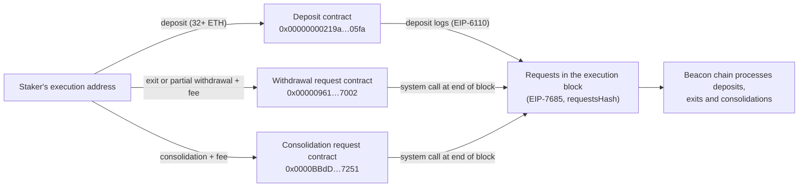

Pectra is the Ethereum network upgrade activated on mainnet on 2025-05-07. Its name joins the two layers it changes: *Prague* on the execution layer, which runs transactions and the EVM, and *Electra* on the consensus layer, which runs proof of stake. It followed Dencun (March 2024) and was followed by Fusaka (December 2025).

Pectra contains ten core EIPs, listed in the meta EIP [EIP-7600](https://eips.ethereum.org/EIPS/eip-7600). They fall into three groups: externally owned accounts that can run code (EIP-7702), a reworked validator lifecycle (larger validators, deposits and exits triggered from the execution layer), and capacity changes (more blobs, more expensive calldata for data-heavy transactions). This article describes each EIP with the constants of the specifications, then the impact for smart contract developers, stakers and node operators.

> This article has been made with the help of [Claude Code](https://claude.com/product/claude-code) and several custom skills

[TOC]

## What you need to know first

The article relies on the following mechanisms without developing them:

- **Execution layer and consensus layer.** Since the Merge, an Ethereum node runs two clients: an execution client (Geth, Nethermind, Reth…) for transactions and state, and a consensus client (Prysm, Lighthouse, Teku…) for validators, attestations and finality. A network upgrade changes both, under two names.
- **Externally owned account (EOA).** An account controlled by a private key, with no code, as opposed to a contract account. Before Pectra, an EOA could only sign transactions; it could not batch calls or define its own validation rules.
- **Validator and withdrawal credentials.** A validator is a 32 ETH stake with a BLS signing key. Its withdrawal credentials say where its funds go: `0x01` credentials point to an execution-layer address. Before Pectra, only the BLS signing key could start an exit.
- **Blobs.** Data attachments of 128 KiB introduced by Dencun ([EIP-4844](https://eips.ethereum.org/EIPS/eip-4844)) for rollups, priced in a separate *blob gas* market with its own target and maximum per block.
- **System contract.** A contract at a fixed address that the protocol itself calls at the start or end of each block, with no user transaction. Dencun introduced the first one (the beacon block roots of [EIP-4788](https://eips.ethereum.org/EIPS/eip-4788)); Pectra adds three.
- **Calldata token.** The unit in which calldata is priced: one token per zero byte, four per non-zero byte.

## Pectra at a glance

| EIP | Title | Layer | In one sentence |
|---|---|---|---|
| [EIP-2537](https://eips.ethereum.org/EIPS/eip-2537) | Precompile for BLS12-381 curve operations | Execution | Seven precompiles for the curve used by Ethereum's validator signatures. |
| [EIP-2935](https://eips.ethereum.org/EIPS/eip-2935) | Save historical block hashes in state | Execution | The last 8,191 block hashes kept in a system contract. |
| [EIP-6110](https://eips.ethereum.org/EIPS/eip-6110) | Supply validator deposits on chain | Both | Deposits read from execution blocks instead of voted by validators. |
| [EIP-7002](https://eips.ethereum.org/EIPS/eip-7002) | Execution layer triggerable exits | Both | Exits and partial withdrawals requested from the withdrawal address. |
| [EIP-7251](https://eips.ethereum.org/EIPS/eip-7251) | Increase the MAX_EFFECTIVE_BALANCE | Both | Validators of up to 2,048 ETH, with consolidation. |
| [EIP-7549](https://eips.ethereum.org/EIPS/eip-7549) | Move committee index outside Attestation | Consensus | Identical votes from different committees can be aggregated. |
| [EIP-7623](https://eips.ethereum.org/EIPS/eip-7623) | Increase calldata cost | Execution | A floor price for data-heavy transactions. |
| [EIP-7685](https://eips.ethereum.org/EIPS/eip-7685) | General purpose execution layer requests | Both | A generic channel from execution to consensus. |
| [EIP-7691](https://eips.ethereum.org/EIPS/eip-7691) | Blob throughput increase | Both | Blob target and maximum from 3 and 6 to 6 and 9. |
| [EIP-7702](https://eips.ethereum.org/EIPS/eip-7702) | Set EOA account code | Execution | An EOA can delegate to contract code. |

The meta EIP also lists two non-core EIPs: [EIP-7840](https://eips.ethereum.org/EIPS/eip-7840) (Informational), which adds the blob schedule to execution client configuration files, and [EIP-7642](https://eips.ethereum.org/EIPS/eip-7642) (eth/69, Networking), which clients could support at Pectra and had to support by the next upgrade.

### Activation

The activation times below come from EIP-7600 and the upgrade schedule of `forks/prague/__init__.py` in the execution specification:

| Network | Date and time (UTC) | Epoch |
|---|---|---|
| Holešky | 2025-02-24 21:55:12 | 115,968 |
| Sepolia | 2025-03-05 07:29:36 | 222,464 |
| Hoodi | 2025-03-26 14:37:12 | 2,048 |
| Mainnet | 2025-05-07 10:05:11 | 364,032 |

The first Prague block on mainnet is 22,431,084. Its header already contains the new `requestsHash` field of EIP-7685, and it carried 9 blobs, the new maximum, against 5 in the block before it.

## Accounts: EIP-7702

EIP-7702 adds a transaction type (`0x04`, *set code*) that lets an EOA point to the code of a contract. The transaction carries a list of *authorizations*, each a tuple `[chain_id, address, nonce, y_parity, r, s]` signed by the EOA's key. For each valid authorization, the protocol writes a *delegation indicator* into the EOA's code: the 23 bytes `0xef0100 || address`. From then on, any call to the EOA runs the code at `address`, in the EOA's own storage and balance context. The EOA keeps its private key, which can still sign transactions and replace or clear the delegation.

The cost per authorization is 25,000 gas (`PER_EMPTY_ACCOUNT_COST`), of which 12,500 is refunded when the authorizing account already exists (`forks/prague/vm/gas.py`). An authorization with `chain_id` 0 is valid on every chain.

What this enables, from the EIP's motivation:

- **Batching**: approve and swap in one transaction, from an EOA.
- **Sponsorship**: a third party submits the transaction and pays the gas, since the authorization is signed separately.
- **Privilege de-escalation**: sub-keys with limited rights, enforced by the delegated code.

EIP-7702 also changes assumptions that contracts relied on. `tx.origin == msg.sender` no longer proves that the caller has no code, since an EOA can run code during the transaction, and an EOA that receives ETH can now execute a fallback function. [EIP-7702: Set Code for EOAs - Overview]({{site.url_complet}}/2025/05/09/eip-7702-overview/) and [EIP-7702 Smart Wallet Security: Threat Model and Attack Surface Analysis]({{site.url_complet}}/2026/02/17/eip-7702-security-threat-model/) cover the mechanism and its risks in detail.

## Staking: the validator lifecycle

Four EIPs change how a validator enters, grows and leaves. They share one mechanism, EIP-7685: a block can carry typed *requests* from the execution layer to the consensus layer, committed in the header as `requestsHash`. Pectra defines three request types: deposits (`0x00`), withdrawals (`0x01`) and consolidations (`0x02`).

### EIP-6110: deposits on chain

Before Pectra, the consensus layer learned about deposits by voting on a view of the execution chain (`eth1data`), with a long follow distance. EIP-6110 has the execution client parse the deposit contract's logs in each block and pass them as deposit requests. The EIP gives the effect on latency: about 13 minutes from deposit transaction to processing, against about 12 hours before. The deposit contract itself (`0x00000000219ab540356cBB839Cbe05303d7705Fa`) did not change.

### EIP-7002: exits from the execution layer

Before Pectra, only the validator's BLS signing key could start an exit, so a staker who had delegated that key to an operator depended on the operator to leave. EIP-7002 lets the address in the `0x01` (or `0x02`) withdrawal credentials request a full exit or a partial withdrawal by calling a system contract at `0x00000961Ef480Eb55e80D19ad83579A64c007002`. The contract charges a fee that rises with the queue, like a base fee: the target is 2 requests per block, at most 16 are passed to the consensus layer per block, and the minimum fee is 1 wei.

### EIP-7251: validators of up to 2,048 ETH

Before Pectra, every validator's effective balance was capped at 32 ETH, so a large staker ran thousands of validators, and rewards above 32 ETH did not compound. EIP-7251 raises the maximum effective balance to 2,048 ETH (64 times 32 ETH) for validators with the new `0x02` *compounding* withdrawal credentials, keeps 32 ETH as the minimum, and adds *consolidation*: merging an existing validator into another, requested through a second system contract at `0x0000BBdDc7CE488642fb579F8B00f3a590007251` (target 1 request per block, maximum 2).

The intent stated by the EIP is to reduce the number of validators, and with it the number of signatures and messages the network handles, while letting solo stakers compound rewards in increments smaller than 32 ETH.

### EIP-7549: attestations aggregated across committees

EIP-7549 moves the committee index out of the signed part of an attestation, into a `committee_bits` field of the outer container. Validators of different committees who vote for the same thing now sign the same message, so their signatures can be aggregated, which reduces the number of pairings a client must verify. The EIP notes that zero-knowledge circuits proving the consensus rules benefit most.

## Capacity: blobs and calldata

### EIP-7691: more blobs

EIP-7691 raises the blob target from 3 to 6 per block and the maximum from 6 to 9. In blob gas, the maximum is 1,179,648 per block (9 × 131,072). The blob base fee update fraction, which sets how fast the blob base fee moves away from the target, becomes 5,007,716 (`forks/prague/vm/gas.py`). The EIP justifies the increase with network monitoring after Dencun, which showed stable propagation and a falling re-org rate. EIP-7840 records these values in a `blobSchedule` object of the execution client configuration, so each fork's blob parameters are configuration rather than code.

### EIP-7623: a floor for calldata

Calldata cost 4 gas per zero byte and 16 per non-zero byte. A block filled with zero bytes could therefore reach 7.15 MB of execution payload, against an average of about 100 KB.

EIP-7623 adds a floor: a transaction pays at least 21,000 + 10 gas per calldata token, that is 10 gas per zero byte and 40 per non-zero byte, when that is more than what it would pay otherwise. The EIP estimates that the maximum payload falls to about 0.72 MB (30M / 40). Transactions that spend most of their gas on execution, the usual case for contract calls, are not affected; transactions that mainly post data are, which pushes data to blobs.

## EVM: BLS12-381 and block hash history

### EIP-2537: BLS12-381 precompiles

EIP-2537 adds seven precompiles at addresses `0x0b` to `0x11` for the curve BLS12-381, the one Ethereum validators sign with:

| Address | Operation | Gas |
|---|---|---|
| `0x0b` | G1 addition | 375 |
| `0x0c` | G1 multi-scalar multiplication | 12,000 per point, with a discount for larger batches |
| `0x0d` | G2 addition | 600 |
| `0x0e` | G2 multi-scalar multiplication | 22,500 per point, with a discount |
| `0x0f` | Pairing check | 32,600 × pairs + 37,700 |
| `0x10` | Map field element to G1 | 5,500 |
| `0x11` | Map field element to G2 | 23,800 |

Before Pectra, verifying a BLS signature in a contract required implementing the curve in Solidity. With the precompiles, contracts can verify validator signatures, BLS multisignatures and proofs built on this curve at a cost comparable to the existing alt_bn128 precompiles.

### EIP-2935: block hashes in a system contract

The `BLOCKHASH` opcode returns only the last 256 block hashes. EIP-2935 stores the last 8,191 hashes (about 27 hours of blocks at 12 seconds) in a ring buffer in a system contract at `0x0000F90827F1C53a10cb7A02335B175320002935`, written by the protocol at the start of each block. `BLOCKHASH` itself is unchanged. The EIP gives two uses: rollups and other contracts can query a longer history, and stateless clients can prove a block hash with a storage proof instead of carrying the block headers.

## Impact

### For smart contract developers

- **Account assumptions changed.** An EOA may now have code (EIP-7702). Checks such as `tx.origin == msg.sender` or `extcodesize(addr) == 0` no longer identify an account without code, and an EOA that receives ETH may run a fallback function. The latter interacts with the 2,300 gas stipend of `transfer` and `send`, measured in [The 2,300 Gas Stipend in Ethereum - Origin, Breakages and Alternatives]({{site.url_complet}}/2026/10/23/ethereum-2300-gas-stipend/).
- **Calldata-heavy transactions cost more.** A transaction that posts data and executes little pays 10 or 40 gas per byte instead of 4 or 16 (EIP-7623); gas estimates for such transactions made before Pectra are too low.
- **New precompiles and a system contract.** BLS12-381 verification (EIP-2537) and block hashes up to 8,191 blocks back (EIP-2935) are available on chain.
- **Staking contracts can control exits.** A contract that holds withdrawal credentials (a liquid staking protocol, a staking vault) can now request exits, partial withdrawals and consolidations itself, by paying the request fee (EIP-7002, EIP-7251).

### For stakers and node operators

- A staker with withdrawal credentials can exit without the operator's cooperation (EIP-7002).
- Converting to `0x02` credentials allows compounding up to 2,048 ETH and consolidating several validators into one (EIP-7251).
- Deposits are processed in about 13 minutes instead of about 12 hours (EIP-6110).
- Clients must handle up to 9 blobs per block, and the execution client configuration carries a blob schedule (EIP-7691, EIP-7840).

## Conclusion

Pectra, activated on mainnet on 2025-05-07, changed three things:

- **Accounts.** EIP-7702 lets an EOA delegate to contract code through a signed authorization, at 25,000 gas per authorization, which brings batching and sponsored transactions to existing addresses and ends the assumption that an EOA has no code.
- **Validators.** EIP-7251 raises the maximum effective balance to 2,048 ETH with consolidation; EIP-7002 lets the withdrawal address trigger exits; EIP-6110 brings deposits on chain; all three use the EIP-7685 request channel. EIP-7549 makes attestations aggregate across committees.
- **Capacity.** EIP-7691 raises blobs to a target of 6 and a maximum of 9, while EIP-7623 makes data-heavy calldata pay at least 10 or 40 gas per byte, which lowers the maximum execution payload from about 7.15 MB to about 0.72 MB.

EIP-2537 and EIP-2935 add BLS12-381 precompiles and an 8,191-block hash history to the EVM. The next upgrade, [Ethereum Upgrade Fusaka - Overview]({{site.url_complet}}/2026/10/23/ethereum-fusaka-upgrade-overview/), continued the capacity work with PeerDAS and a per-transaction gas cap.

## Annex

### Key Terms

| Term | Definition |
|------|------------|
| **Prague / Electra** | The execution-layer and consensus-layer names of the Pectra upgrade. |
| **Meta EIP** | An EIP that lists the EIPs included in a network upgrade, here EIP-7600. |
| **Externally owned account (EOA)** | An account controlled by a private key; since Pectra it can delegate to contract code. |
| **Authorization** | A tuple signed by an EOA's key in a set code transaction, naming the code the EOA delegates to. |
| **Delegation indicator** | The 23 bytes `0xef0100 || address` written in an EOA's code by EIP-7702. |
| **Set code transaction** | The transaction type `0x04` introduced by EIP-7702 to carry authorizations. |
| **Execution layer request** | A typed message from the execution layer to the consensus layer, committed in the block header (EIP-7685). |
| **System contract** | A contract at a fixed address called by the protocol itself in each block, such as the EIP-2935 history contract. |
| **Withdrawal credentials** | The field of a validator that says where its funds are withdrawn; `0x01` and, since Pectra, `0x02` point to an execution address. |
| **Effective balance** | The balance used to compute a validator's rewards and duties; capped at 32 ETH before Pectra and at 2,048 ETH for compounding validators since. |
| **Consolidation** | Merging one validator's balance into another, requested through the EIP-7251 system contract. |
| **Attestation** | A validator's vote on the head of the chain and on finality, aggregated with others' votes by BLS signature. |
| **Blob target / maximum** | The number of blobs per block around which the blob base fee is stable, and the hard limit; 6 and 9 since Pectra. |
| **Calldata floor** | The minimum gas per calldata token a transaction pays since EIP-7623, 10 per token. |
| **BLS12-381** | The pairing-friendly elliptic curve used for Ethereum validator signatures, available to contracts since EIP-2537. |
| **Ring buffer** | A fixed-size storage area where each new entry overwrites the oldest, used by EIP-2935 for block hashes. |

## Frequently Asked Questions

**Q: What does EIP-7702 change for an existing EOA, and what does it not change?**

The EOA can sign an authorization that writes a delegation indicator in its code, after which calls to the EOA run the delegated contract's code with the EOA's storage and balance. Its address and its private key do not change, and the key can still sign transactions and replace or remove the delegation at any time.

**Q: Why do three staking EIPs depend on EIP-7685?**

Deposits, exits and consolidations all start on the execution layer and must be processed by the consensus layer. EIP-7685 defines one generic channel for that: typed requests collected in each execution block and committed in the header through `requestsHash`. Deposits (type `0x00`), withdrawals (`0x01`) and consolidations (`0x02`) are three request types on that channel, so a future request type does not need a new header field.

**Q: How does a staker exit without the operator's signing key after Pectra?**

The address in the validator's withdrawal credentials calls the EIP-7002 system contract with the validator's public key and pays the current request fee. At the end of the block the protocol reads the request queue, passes up to 16 requests to the consensus layer, and the validator enters the exit queue. The fee rises when more than 2 requests per block are waiting, which limits spam.

**Q: Does EIP-7623 make ordinary transactions more expensive?**

Not for transactions that spend most of their gas on execution. The floor only applies when 21,000 + 10 gas per calldata token exceeds the gas the transaction would pay otherwise, which happens for transactions that post a lot of data and execute little. For those, data now costs 10 gas per zero byte and 40 per non-zero byte.

**Q: Why were blobs increased and calldata made more expensive in the same upgrade?**

Both changes concern how much data a block can carry. More blobs give rollups more room in the market designed for their data. A calldata floor lowers the worst-case size of the execution payload, from about 7.15 MB to about 0.72 MB according to EIP-7623, which compensates for the larger blob capacity in the bandwidth a node must handle and moves data-heavy use from calldata to blobs.

**Q: What is the difference between `BLOCKHASH` and the EIP-2935 history contract?**

`BLOCKHASH` is an opcode that returns one of the last 256 block hashes and was not changed. The EIP-2935 contract stores the last 8,191 hashes in its storage, so a contract can read older hashes by calling it, and a stateless client can prove a hash with a storage proof.

**Q: What does a validator gain by consolidating under EIP-7251?**

Rewards on a balance above 32 ETH count towards the effective balance up to 2,048 ETH, so they compound instead of being withdrawn. An operator running many 32 ETH validators can merge them into fewer, which reduces the number of keys to manage and the number of attestations the network processes.

## Gaps

The following points were not settled by the sources used for this article:

| Gap | Why it matters | What to read or verify |
|---|---|---|
| The 13-minute and 12-hour deposit latencies are the EIP-6110 author's estimates, not measurements. | Actual processing time also depends on the pending deposit queue added by EIP-7251. | Beacon chain explorers for deposit-to-activation times after 2025-05-07. |
| The MSM discount tables of EIP-2537 are summarised as "with a discount". | Exact costs for large batches depend on the table in the EIP. | The `Discounts` section of EIP-2537 and `forks/prague/vm/precompiled_contracts/bls12_381/`. |
| The changes of EIP-7251 to churn limits, slashing penalties and the pending deposit queue are not described. | They affect how fast large validators enter and exit and what they lose when slashed. | `specs/electra/beacon-chain.md` in consensus-specs. |
| The fee formula of the EIP-7002 and EIP-7251 request contracts is described only qualitatively. | Integrators of staking contracts need the exact fee to send. | The `fake_exponential` fee computation in EIP-7002 and the sys-asm contract sources. |
| How many EOAs adopted EIP-7702 delegation after activation is not covered. | The practical impact of the account changes depends on adoption. | On-chain data on set code transactions since 2025-05-07. |
| Client support of EIP-7642 (eth/69) at Pectra activation is not documented here. | It was optional at Pectra and mandatory at the next upgrade. | Client release notes for Pectra and Fusaka. |

## References

### Specifications

- [EIP-7600: Hardfork Meta — Pectra](https://eips.ethereum.org/EIPS/eip-7600)
- [EIP-2537: Precompile for BLS12-381 curve operations](https://eips.ethereum.org/EIPS/eip-2537)
- [EIP-2935: Save historical block hashes in state](https://eips.ethereum.org/EIPS/eip-2935)
- [EIP-4788: Beacon block root in the EVM](https://eips.ethereum.org/EIPS/eip-4788)
- [EIP-4844: Shard Blob Transactions](https://eips.ethereum.org/EIPS/eip-4844)
- [EIP-6110: Supply validator deposits on chain](https://eips.ethereum.org/EIPS/eip-6110)
- [EIP-7002: Execution layer triggerable exits](https://eips.ethereum.org/EIPS/eip-7002)
- [EIP-7251: Increase the MAX_EFFECTIVE_BALANCE](https://eips.ethereum.org/EIPS/eip-7251)
- [EIP-7549: Move committee index outside Attestation](https://eips.ethereum.org/EIPS/eip-7549)
- [EIP-7623: Increase calldata cost](https://eips.ethereum.org/EIPS/eip-7623)
- [EIP-7642: eth/69 - Drop pre-merge fields](https://eips.ethereum.org/EIPS/eip-7642)
- [EIP-7685: General purpose execution layer requests](https://eips.ethereum.org/EIPS/eip-7685)
- [EIP-7691: Blob throughput increase](https://eips.ethereum.org/EIPS/eip-7691)
- [EIP-7702: Set Code for EOAs](https://eips.ethereum.org/EIPS/eip-7702)
- [EIP-7840: Add blob schedule to EL config files](https://eips.ethereum.org/EIPS/eip-7840)

### Analyzed source and data

- [ethereum/execution-specs](https://github.com/ethereum/execution-specs) — analyzed at commit [`aaae5abd382b6c0612add96bd8400d6fa4eb0617`](https://github.com/ethereum/execution-specs/tree/aaae5abd382b6c0612add96bd8400d6fa4eb0617), 2026-10-23 (`forks/prague/`)
- Mainnet blocks 22,431,083 and 22,431,084 read with `eth_getBlockByNumber` on `ethereum-rpc.publicnode.com`, 2026-10-23
- [Coinbase - The Ultimate Guide to Ethereum's Pectra Upgrade](https://www.coinbase.com/blog/the-ultimate-guide-to-ethereums-pectra-upgrade)

### Related articles

- [EIP-7702: Set Code for EOAs - Overview]({{site.url_complet}}/2025/05/09/eip-7702-overview/)
- [EIP-7702 Smart Wallet Security: Threat Model and Attack Surface Analysis]({{site.url_complet}}/2026/02/17/eip-7702-security-threat-model/)
- [Ethereum Staking - How It Works]({{site.url_complet}}/2024/03/28/ethereum-staking/)
- [Ethereum: A Gas Story]({{site.url_complet}}/2026/10/23/ethereum-a-gas-story/)
- [Ethereum Gas — How Transaction Cost and the Per-Transaction Limit Are Computed (Fusaka and Glamsterdam)]({{site.url_complet}}/2026/10/23/ethereum-gas-cost-transaction-limit-fusaka-glamsterdam/)
