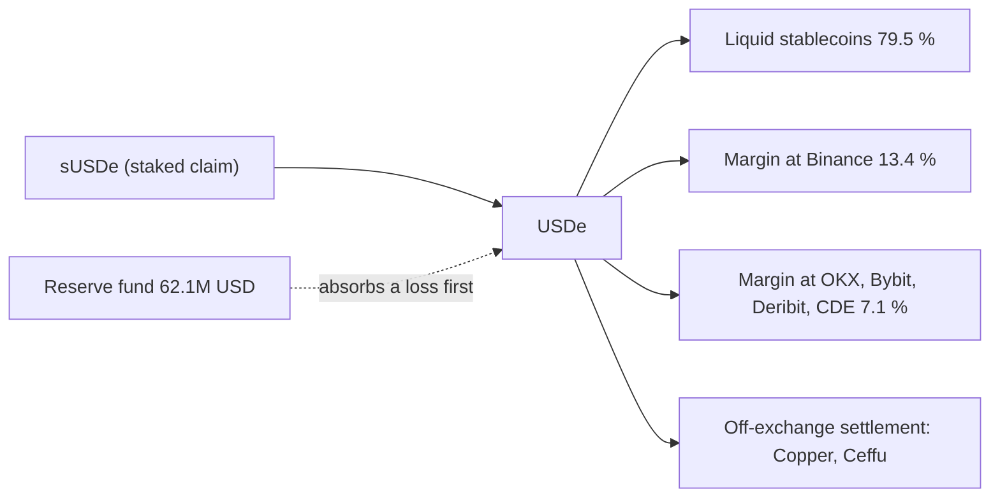
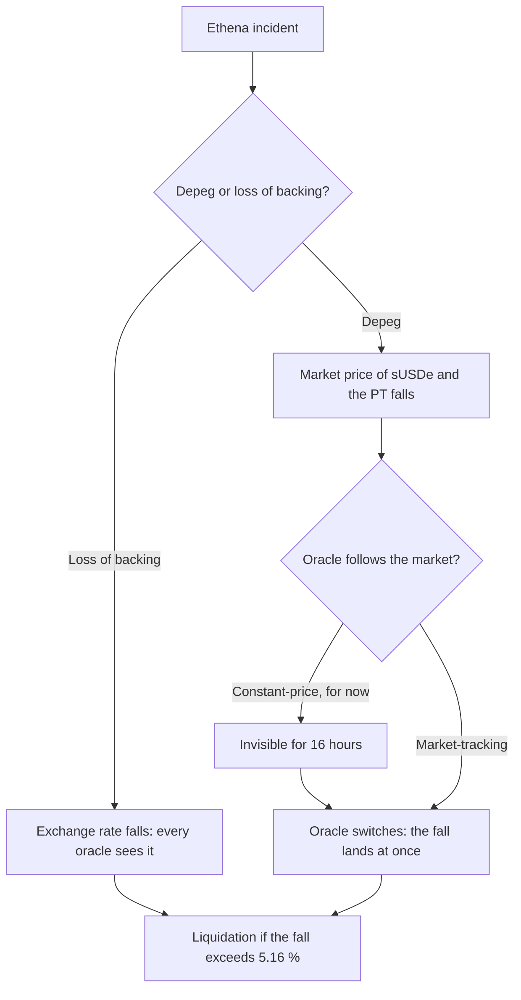

[Ethena](https://ethena.fi/) issues USDe, a synthetic dollar that is not backed by bank deposits but by a hedged crypto position. Its backing assets (BTC, ETH, SOL, liquid stablecoins) are held by off-exchange settlement providers and delegated to exchanges as margin for short perpetual futures, so that a fall in the assets is offset by a gain on the shorts. sUSDe is the staked form of USDe: it earns the funding paid to those shorts and the staking yield of the assets.

That design moves the risk away from a single issuer's balance sheet and onto exchanges, custodians and the funding rate of perpetual futures. This article shows how to turn those dependencies into numbers: where the backing sits, how likely a loss is, how a loss gets to a leveraged position built on sUSDe, and what an exchange failure or a long period of negative funding would cost. The figures come from Ethena's public transparency data as of 10 October 2026 and from a real leveraged position on Morpho.

> This article has been made with the help of [Claude Code](https://claude.com/product/claude-code) and several custom skills

[TOC]

## How USDe is backed

A short perpetual future pays or receives funding every few hours. When the market is long, as it usually is, longs pay shorts: a delta-neutral holder of the asset and a short perpetual earns that funding while its dollar value stays flat. [Traditional Futures vs. Perpetual Futures: A Technical Comparison]({{site.url_complet}}/2025/12/29/traditional-vs-perpetual-futures/) covers the funding mechanism itself.

Ethena runs that trade at scale:

- **The backing assets** sit with off-exchange settlement providers such as Copper and Ceffu. They are delegated to exchanges as margin, and the profit and loss is settled between the custodian and the exchange on a daily cycle.
- **The hedges** are short perpetuals on Binance, OKX, Bybit, Deribit and other venues.
- **Liquid stablecoins** make up the part of the backing that is not delegated to any exchange.
- **The reserve fund** absorbs losses before USDe holders, including negative funding.
- **Minting and redemption** go through a whitelisted desk, and unstaking sUSDe has a cooldown that Ethena can configure up to 90 days.

Ethena publishes the split of its backing on a transparency dashboard, with a keyless API. On 10 October 2026, at 22:58 UTC, it read:

| Venue | Share of the backing |
|---|---|
| Not on an exchange (liquid stablecoins) | 79.5 % |
| Binance | 13.4 % |
| OKX | 4.2 % |
| Bybit | 2.3 % |
| Deribit | 0.4 % |
| CDE | 0.2 % |

The total backing was 4,769M USD, of which 3,889M USD in liquid cash, 466M USD in BTC and 338M USD in ETH. The reserve fund held 62.1M USD, 1.30 % of the backing. The 30-day average yields were 4.96 % for the protocol and 4.83 % for sUSDe.



The dashboard splits the backing by exchange, not by custodian. How much each custodian holds is not public in this form.

## The position used as an example

USDe and sUSDe rarely sit alone in a portfolio. A common use is a leveraged loop: buy a Pendle principal token on sUSDe, PT-sUSDE, which redeems at par at maturity and so earns a fixed yield; post it as collateral on [Morpho Blue]({{site.url_complet}}/2026/10/10/morpho-blue-lending-markets/), borrow USDC against it, and buy more PT.

The example is such a loop on mainnet:

| Quantity | Value |
|---|---|
| Collateral | 3,961,491 PT-sUSDE (maturity 26 November 2026) |
| Debt | 3,414,343 USDC |
| Equity | about 520,000 USD |
| Oracle fall that liquidates it | 5.16 % |
| Cost of leaving now | 78,946 USD (1.99 % price impact on the Pendle pool, plus fees) |

The position is thin: a 5 % fall in what the oracle reports is enough to liquidate it. What follows asks how likely such a fall is when it comes from Ethena, and what it costs.

## How likely is a loss

Two kinds of Ethena event can hurt the position, and they need different probabilities.

**A depeg** is a fall in sUSDe's market price while the backing is intact: a liquidation cascade on one exchange, a run on redemptions, a funding shock. There is history to go on. USDe printed about 0.65 on one exchange's order book during the 10 October 2025 cascade while on-chain pools stayed near peg, and it dipped about 0.3 % in April 2024 during a period of negative funding. A reasonable prior is a 12 % chance a year of a depeg, with a severity drawn from a Beta(1.6, 18) distribution (mean 8.2 %), and 75 % of it recovered within a month.

**An exploit or a loss of backing** is permanent: a custodian failure, a key compromise in the minting path, a smart-contract bug. There is no Ethena incident of that kind to count, so the prior comes from a base rate. Over five years, protocols holding more than 100M USD were hacked at 34 hacks for 256 protocols, 2.66 % a year. Basis-trading protocols were hacked at half the average rate of all categories (1 hack for 29 protocols), and Ethena has been listed long enough for no age penalty. That gives 2.66 % × 0.50 = 1.33 % a year, with a severity drawn from Beta(1.2, 3.0) (mean 28.6 %).

Over a 30-day horizon, a yearly probability p becomes 1 − (1 − p)^(30/365):

| Event | Per year | Over 30 days | Expected loss on the position |
|---|---|---|---|
| sUSDe depeg | 12 % | 1.05 % | 3,760 USD (359,761 USD if it happens; it liquidates the position 76 % of the time) |
| Exploit or loss of backing | 1.33 % | 0.11 % | 511 USD |

The depeg is the position's largest single risk, ahead of an exploit of Morpho itself (1,066 USD).

A Monte Carlo simulation covers six risk layers of the position: the chain, an Ethena depeg, an Ethena exploit, Pendle, Morpho and the oracle. It gives an expected loss of 6,265 USD over 30 days, against 5,697 USD of carry earned by staying. The two are too close to call, so the sensible move is to reduce the leverage rather than to stay as is or to leave. [Monte Carlo Simulation for DeFi Risk Analysis - From Random Sampling to a Stay-or-Exit Decision]({{site.url_complet}}/2026/10/10/monte-carlo-defi-risk-analysis/) explains the simulation.

## The path from an Ethena loss to the position

The two events take different paths to the collateral's value:

- **A depeg** moves the market price of sUSDe, and so of the PT. Whether the position is liquidated depends on whether the oracle follows that market price.
- **A loss of backing** lowers what sUSDe is worth at redemption. The PT's underlying exchange rate falls, and every oracle sees it.

The example's oracle is a meta-oracle. It reads a constant-price primary source, and switches to a market-tracking source only after the two have diverged by more than 0.75 % for 16 hours. A depeg is therefore invisible to it for 16 hours, then lands at once. [Pricing a Lending Position During an Incident - What the Oracle Reads, When, and Who Bears the Gap]({{site.url_complet}}/2026/10/11/oracle-kinds-pricing-lending-position-incident/) goes through these oracle kinds in detail.



## An exchange failure

Ethena's own documentation is precise about what an exchange failure costs. The backing is never deposited at an exchange. It stays with the off-exchange settlement provider, so the exposure to one exchange is the profit and loss not yet settled, at most one daily settlement cycle. After a failure, Ethena would delegate the backing to another exchange and reopen the hedge there.

That is the expected case. A stress test should also cover the case where the arrangement does not hold: the settlement provider cannot recover the margin delegated to the failed venue, or part of it is frozen in the estate. The margin delegated to each exchange, the figure the dashboard publishes, bounds what such a failure could take.

The computation is short:

```text
lost      = backing delegated to the venue × share lost
absorbed  = min(lost, reserve fund)
markdown  = (lost − absorbed) ÷ total backing
```

The markdown applies to USDe and, by the same fraction, to sUSDe, which is a claim on USDe. Nothing of it is recovered, unlike a market depeg: a loss of backing is permanent. The hedges held at the failed venue are lost as well, leaving that collateral unhedged until they are reopened elsewhere.

For half of Binance's delegated margin:

| Step | Value |
|---|---|
| Backing delegated to Binance | 638M USD (13.4 %) |
| Lost (50 %) | 319.0M USD |
| Absorbed by the reserve fund | 62.1M USD |
| Markdown of USDe and sUSDe | 256.9M ÷ 4,769M = 5.39 % |

A 5.39 % markdown is just above the 5.16 % that liquidates the example position, and the oracle decides when it lands:

- **Before the oracle switches**, the position is not liquidated, but it has lost 211,960 USD (40.7 % of its equity) in value.
- **After the switch, 16 hours later**, it is liquidated, and the loss is 403,965 USD (77.7 % of its equity).

Leaving costs 78,946 USD and staying loses 403,965 USD, so given the incident the answer is to leave, and there are 16 hours to do it.

The same stress applied to a book of ten 1M USD pockets, one of them this loop and none of the others holding USDe or sUSDe, costs 407,431 USD, 4.07 % of the book, all in the one pocket. If leaving that pocket costs 11 % of it (110,000 USD), leaving pays when the incident's probability over 30 days exceeds 110,000 ÷ 407,431 = 27.0 %.

## Negative funding

The yield of USDe comes from funding. When funding turns negative, the shorts pay instead of receiving, and the reserve fund pays for it. A useful stress is a sustained funding rate of −10 % a year on the hedged notional, taken as the margin on exchanges:

```text
hedged notional  = 975M USD (every venue except the liquid stablecoins)
daily cost       = 975M × 10 % ÷ 365 = 267k USD
reserve fund     = 62.1M USD → 232 days
```

The reserve fund would cover about 232 days of such funding. After that, USDe holders bear the cost. This is a scenario rather than a forecast: funding was negative for weeks in 2022 and again in parts of 2025, but not at that level for months. It is also slower than the other risks. It erodes the reserve fund over months, while a depeg or a venue failure lands in a day.

## Contagion

An Ethena incident does not stay inside one position.

- **Markets lending against the same collateral.** Three other Morpho markets take sUSDe or read the same price. At a 10 % fall, 96,963,152 PYUSD of debt becomes liquidatable on sUSDe/PYUSD, 964,053 DAI on sUSDe/DAI and 911,976 USDtb on sUSDe/USDtb. Their liquidations sell sUSDe into the same market and can deepen the fall.
- **Both tokens at once.** A loss of backing marks down USDe and sUSDe together, so every market whose collateral is either of them, or a PT on sUSDe, is hit by the same incident.
- **Concentration.** 9.4 % of sUSDe's supply is posted as collateral in those Morpho markets. The example's market holds 8.2 times the PT available in its Pendle pool, and the pool accepts at most 2.7M more PT. A forced sale is thin.
- **Category weight.** By DefiLlama's count, Ethena is 0.81 % of DeFi's total value locked, but 61.1 % of its category, basis trading. An incident there is the category's incident.

## What can be watched

Most of what matters about Ethena is off-chain, so it cannot be followed block by block like a smart contract. Two kinds of monitoring remain:

- **The transparency dashboard.** The backing by venue, the reserve fund and the yields can be read regularly. A rise in one venue's share or a fall in the reserve fund changes the venue stress and the funding runway above.
- **The markets that hold sUSDe.** An oracle move in a market taking sUSDe or a PT on it, a falling health factor, or bad debt are the on-chain signs of an Ethena incident. With a meta-oracle like the example's, those signs appear only once the oracle switches.

## What remains uncertain

Several parts of the picture cannot be measured from public data:

- **The split by custodian.** A custodian's failure cannot be stressed on its own.
- **The cost of lost hedges.** After a venue failure, the collateral is unhedged until the hedge is reopened, and its price risk in that window is not priced.
- **The probability of negative funding.** It is a scenario, not an event with a measured frequency.
- **Redemption delays.** The minting desk and the unstaking cooldown slow an exit through Ethena itself; a holder in a hurry sells on the market instead.
- **An outside price for the risk.** No cover market prices an Ethena loss directly, so the priors above have no market check.

## Conclusion

USDe is backed by a hedged position spread across custodians and exchanges, and its risk follows that structure:

- **The backing is public by venue.** 79.5 % sits in liquid stablecoins, 13.4 % is delegated to Binance, the rest to four other exchanges, with a reserve fund of 1.30 % in front of holders.
- **A depeg is the most likely Ethena event.** At 12 % a year, it is the largest driver of a leveraged PT-sUSDe position's expected loss, ahead of an exploit (1.33 % a year).
- **The oracle decides when a loss lands.** A meta-oracle hides a depeg for 16 hours, then passes it on at once.
- **An exchange failure costs unsettled profit and loss by design.** A stress of half of Binance's delegated margin still marks USDe down 5.39 %, enough to liquidate a position that a 5.16 % fall liquidates.
- **Negative funding is slow.** At −10 % a year, the reserve fund lasts about 232 days.
- **Contagion runs through every market on sUSDe.** Sibling markets, thin Pendle liquidity and a 61 % share of its category spread an Ethena incident well beyond one position.


## Annex

### Key Terms

| Term | Definition |
|------|------------|
| **USDe** | Ethena's synthetic dollar, backed by crypto assets hedged with short perpetual futures and by liquid stablecoins. |
| **sUSDe** | The staked form of USDe, which earns the funding and staking yield; its value is a claim on USDe. |
| **Delta-neutral** | A position whose value does not move with the price of the underlying asset, here a long asset and an equal short perpetual. |
| **Perpetual future** | A futures contract with no expiry, kept close to the spot price by periodic funding payments between longs and shorts. |
| **Funding rate** | The periodic payment between longs and shorts of a perpetual; when it is negative, shorts pay. |
| **Off-exchange settlement** | A custody arrangement where assets stay with a custodian and are delegated to an exchange as margin, with profit and loss settled on a cycle. |
| **Reserve fund** | Ethena's buffer that absorbs losses, including negative funding, before USDe holders. |
| **Depeg** | A fall in a stable asset's market price below its target while its backing may be intact. |
| **Pendle PT** | A principal token that redeems one unit of the underlying at maturity, bought at a discount, so it earns a fixed yield. |
| **Leveraged loop** | Repeatedly posting collateral, borrowing against it and buying more collateral, to multiply the yield and the risk. |
| **Health factor** | The ratio of a borrower's collateral value, times the liquidation threshold, to the debt; below 1 the position can be liquidated. |
| **Meta-oracle** | An oracle that reads one source and switches to another after a sustained divergence between them. |
| **Beta distribution** | A distribution on [0, 1] used here for the severity of an event, set by two shape parameters. |
| **Sibling market** | A lending market that takes the same collateral or reads the same price as the position's market. |

### Integration Notes

| Behaviour | What an analyst should do |
|---|---|
| The dashboard reports backing by exchange, but the backing stays with custodians | Treat a venue's share as an upper bound on an exchange failure's loss, not as the expected loss |
| sUSDe is a claim on USDe | Apply any USDe markdown to sUSDe by the same fraction |
| A loss of backing is permanent, a market depeg partly recovers | Use no recovery for a venue loss, and a recovery for a depeg |
| The reserve fund absorbs losses first | Subtract it before marking USDe down, and report "no markdown" for a loss below it |
| A meta-oracle delays a depeg | Price the position both before and after the oracle switch |
| Unstaking sUSDe has a cooldown | Count an exit through Ethena as slow; a fast exit is a market sale at the depeg price |

## Frequently Asked Questions

**Q: Why is a depeg modelled separately from a loss of backing?**

They differ in what falls and whether it comes back. A depeg is a fall in the market price while the backing is intact, and most of it recovers within weeks. A loss of backing lowers what sUSDe is worth at redemption and does not recover. They also hit a position by different paths: a depeg needs an oracle that follows the market, while a loss of backing changes the exchange rate that every oracle reads.

**Q: Does a Binance failure cost USDe 13.4 % of its backing?**

No, not by Ethena's design. The backing stays with off-exchange settlement providers, so an exchange failure costs the profit and loss not yet settled, at most one daily cycle. The 13.4 % is the margin delegated to Binance, which bounds what a failure could take if the settlement arrangement did not hold. The 50 % stress in the article is such a case, not the expected one.

**Q: How is the 5.39 % markdown in the venue stress computed?**

In three steps:

- Half of the 638M USD delegated to Binance is lost: 319.0M USD.
- The reserve fund absorbs 62.1M USD of it.
- The remaining 256.9M USD is divided by the 4,769M USD of total backing.

The result is 5.39 %, applied to both USDe and sUSDe.

**Q: Why is the example position not liquidated as soon as the venue loss happens?**

Because its oracle is a meta-oracle reading a constant-price source first. It switches to a market-tracking source only after a divergence above 0.75 % has lasted 16 hours. Until then, the position has lost 211,960 USD of value without being liquidated. After the switch, the 5.39 % markdown exceeds the 5.16 % that liquidates it, and the loss rises to 403,965 USD.

**Q: Where does the 1.33 % yearly probability of an exploit come from?**

From a base rate, since Ethena has no exploit to count. Protocols holding more than 100M USD were hacked at 2.66 % a year over five years. Basis-trading protocols were hacked at half the average rate, so the rate is halved, and there is no penalty for age.

**Q: Why is negative funding treated as a slow risk?**

Because it drains the reserve fund over time rather than in one event. At −10 % a year on 975M USD of hedged notional, it costs about 267,000 USD a day, and the 62.1M USD reserve fund covers about 232 days before holders bear any of it. A depeg or a venue failure, by contrast, hits a leveraged position within a day.

**Q: When does leaving a pocket of a book pay, in the venue stress?**

When the incident is likely enough that the loss it saves outweighs the cost of leaving. Leaving the PT-sUSDe pocket costs 110,000 USD for sure and saves 407,431 USD if the incident happens. So it pays if the incident's probability over 30 days is above 110,000 ÷ 407,431 = 27.0 %.

## References

### Ethena documentation

- [Ethena — Protocol overview](https://docs.ethena.fi/protocol-overview)
- [Ethena — Exchange failure risk](https://docs.ethena.fi/protocol-overview/risks/exchange-failure-risk)
- [Ethena — Funding risk](https://docs.ethena.fi/protocol-overview/risks/funding-risk)
- [Ethena — Custodial risk](https://docs.ethena.fi/protocol-overview/risks/custodial-risk)
- [Ethena — Backing asset custody](https://docs.ethena.fi/backing-custody-and-security/backing-asset-custody)
- [Ethena — Staking USDe](https://docs.ethena.fi/technical-design/staking-usde)
- [Ethena — Transparency dashboard](https://app.ethena.fi/dashboards/transparency)

### Data sources

- [DefiLlama — Hacks database](https://defillama.com/hacks)
- [DefiLlama — Ethena USDe](https://defillama.com/protocol/ethena-usde)
- [Morpho documentation](https://docs.morpho.org/)
- [Pendle documentation](https://docs.pendle.finance/)

### Related articles

- [Traditional Futures vs. Perpetual Futures: A Technical Comparison]({{site.url_complet}}/2025/12/29/traditional-vs-perpetual-futures/)
- [How Morpho Blue Works - Isolated Lending Markets, Shares, Liquidations and Bad Debt]({{site.url_complet}}/2026/10/10/morpho-blue-lending-markets/)
- [Pricing a Lending Position During an Incident - What the Oracle Reads, When, and Who Bears the Gap]({{site.url_complet}}/2026/10/11/oracle-kinds-pricing-lending-position-incident/)
- [Monte Carlo Simulation for DeFi Risk Analysis - From Random Sampling to a Stay-or-Exit Decision]({{site.url_complet}}/2026/10/10/monte-carlo-defi-risk-analysis/)
- [Risk of a Zama Confidential Morpho Vault - Losses, Exits, Contagion and What Can Be Watched]({{site.url_complet}}/2026/10/11/zama-confidential-morpho-vault-risk/)
- [Stablecoins Under MiCA — Asset-Referenced Tokens and E-Money Tokens (Titles III and IV)]({{site.url_complet}}/2026/09/17/mica-stablecoins-asset-referenced-tokens-e-money-tokens/)
