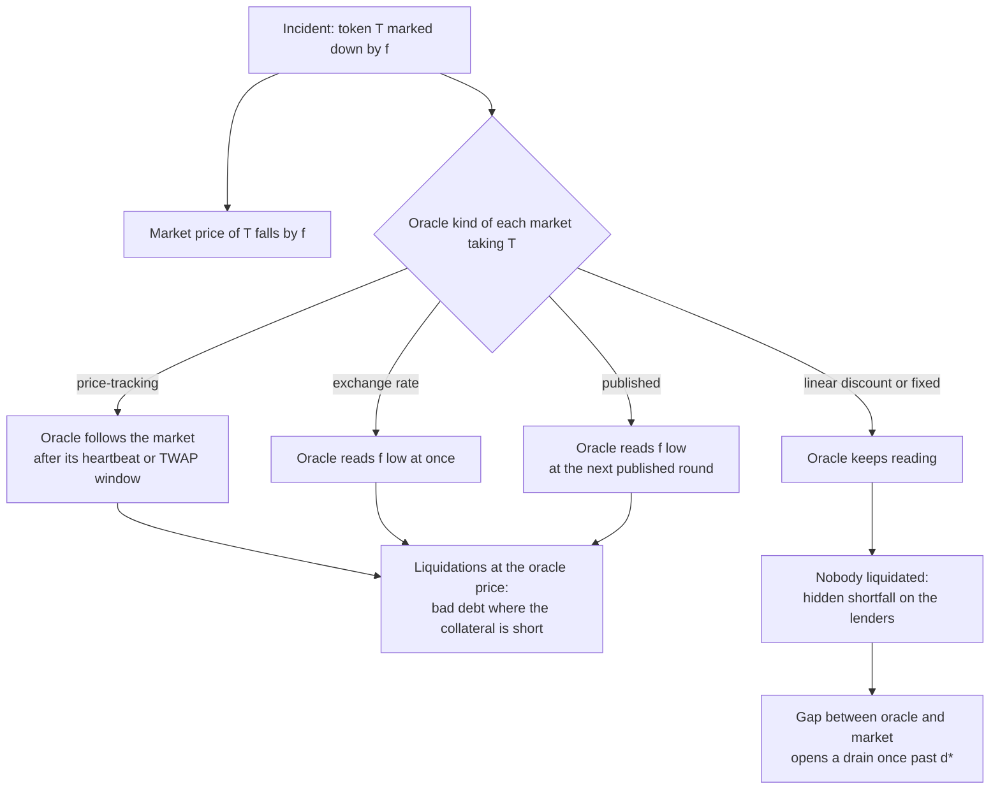

An on-chain lending market never sees the value of its collateral. It sees one number, the price its oracle returns, and every rule of the market is evaluated against that number: who can borrow, who is liquidated, when a debt is written off. In normal times the oracle price and the price at which the collateral can be sold are close enough that the distinction does not matter.

During an incident they separate. A stablecoin depegs, an issuer writes down the net asset value of a tokenised fund, a thin pool is pushed by a large sale: the question a lender or a borrower then has to answer is not "what is the collateral worth" but "what will the oracle read, how soon, and who is left holding the difference". This article classifies oracles by the shocks they pass on, and turns that classification into a method for pricing a position once the incident is known.

> This article has been made with the help of [Claude Code](https://claude.com/product/claude-code) and several custom skills

[TOC]

## Two prices, one rule

A collateralised loan involves two prices for the same asset:

- the **oracle price** $$P_o$$, the only one the contract reads;
- the **market price** $$P_m$$, the price at which a liquidator or the borrower can sell the collateral.

The market's rules use the first. On [Morpho Blue]({{site.url_complet}}/2026/10/10/morpho-blue-lending-markets/), whose formulas this article uses as the reference, a position with collateral quantity $$q$$ and debt $$D$$ is liquidatable when

$$
\begin{aligned}
q \, P_o \cdot \text{LLTV} \lt D
\end{aligned}
$$

where LLTV is the market's liquidation loan-to-value. The liquidator repays debt and seizes collateral worth the repaid amount times the liquidation incentive factor (LIF), valued at the oracle price. Morpho Blue derives the factor from the LLTV, with $$\beta = 0.3$$ and a cap $$M = 1.15$$:

$$
\begin{aligned}
\text{LIF} = \min\left(M, \frac{1}{\beta \cdot \text{LLTV} + (1 - \beta)}\right)
\end{aligned}
$$

The fall of the oracle price that makes a position liquidatable follows directly:

$$
\begin{aligned}
f_{\text{liq}} = 1 - \frac{D}{q \, P_o \cdot \text{LLTV}}
\end{aligned}
$$

Everything else in this article is a consequence of one observation: the formulas above react to $$P_o$$ only. A fall of $$P_m$$ that the oracle does not pass on changes nothing in the contract, and the loss it represents lands on whoever holds the claim when the collateral is finally sold.

## Which shocks an oracle passes on

Oracles differ in what they measure, and therefore in which shocks they transmit. Two broad classes cover most of what lending markets use, and the second splits into four kinds that behave very differently in an incident.

### Price-tracking oracles

A price-tracking oracle follows a market. A [Chainlink data feed](https://docs.chain.link/data-feeds) aggregates exchange prices and publishes a new round when the price moves past a deviation threshold or when a heartbeat elapses; a Pendle PT oracle reads a time-weighted average (TWAP) of the AMM's own implied rate over a window of a few minutes. Such an oracle passes a depeg, a crash or a large sale on with a delay bounded by its update rule, and liquidations follow.

A price-tracking oracle protects lenders by liquidating borrowers early, and exposes borrowers to transient moves. The second property is the one that matters on a thin market: a single sale into a shallow pool, held for the length of a TWAP window, is enough to liquidate positions whose collateral is worth what it was before.

### Constant-price oracles, in four kinds

A constant-price oracle does not follow a market. A depeg of the collateral on exchanges does not move it at all, so nobody is liquidated. What distinguishes the four kinds is how they react when the issuer itself loses value:

| Kind | Typical source | A market depeg | A loss recorded by the issuer |
|---|---|---|---|
| **Exchange rate** | an [ERC-4626](https://eips.ethereum.org/EIPS/eip-4626) share's `convertToAssets`, a staking token's rate, a rate computed on-chain | not seen | seen at once, when the issuer's accounting records it |
| **Published** | a net asset value or a "fundamental" value pushed in rounds by a transaction | not seen | seen at the next published round |
| **Linear discount** | a PT valued on a deterministic path to par at maturity | not seen | never seen |
| **Fixed** | a hardcoded value, often exactly 1.0 | not seen | never seen |

The table explains why "the oracle does not follow the market" is not one statement. On an exchange-rate oracle, a loss of backing can trigger liquidations in the same block as the accounting update. On a published feed it triggers them at the next round, whose timing is the issuer's choice; a write-down of a tokenised fund typically lands as one step, with no market move before it to warn anyone. On a linear-discount or fixed oracle it triggers none: the market keeps lending against a price that is no longer true.

### Composite oracles

Real deployments combine inputs, and the combination decides the class:

- **A product of feeds**, such as a base feed times a conversion rate divided by a quote feed, moves when any of its base-side inputs moves. It is price-tracking if one input is.
- **A minimum** of a market price and a schedule, for instance $$\min(\text{TWAP}, \text{linear discount})$$ for a PT, reads the lower of the two. It caps the price at the schedule and still passes every market fall on: it is price-tracking for falls.
- **A meta-oracle** reads a primary source and switches to a backup when the two diverge by more than a threshold and a challenge survives a timelock. Its behaviour in an incident is the primary's until the timelock expires, then the backup's. A constant-price primary with a price-tracking backup is constant-price for the first hours of a depeg and price-tracking after.

### Reading the class from the chain

The class can be established from on-chain reads alone, without trusting a name:

- **Structural getters** settle many cases. A non-zero `twapDuration()` identifies a Pendle TWAP input; a `baseDiscountPerYear()` that answers identifies a linear discount; a `BASE_VAULT` set on a Morpho `ChainlinkOracleV2` is an ERC-4626 exchange rate.
- **The round history** of a feed with rounds separates the rest. A market price falls about as often as it rises; an accrual rate almost never falls. A share of falls among the changes of the last rounds (one in five is a workable boundary) separates the two.
- **An answer of exactly 1.0** with no round history is a fixed value.
- **A pushed round history** whose value has not changed yet is still a published feed, not a fixed one: the next round can carry a loss.
- **The verified contract name** is the last resort, when nothing structural decides.

## Pricing a position given the incident

Once the incident is known, no probability is needed to price it. The method has three steps: translate the incident into what each oracle reads, apply the market's rules at that price, and compare the result with the cost of leaving.

### Step 1: what the oracle reads

A markdown of token $$T$$ by a fraction $$f$$ has two components. The market price of $$T$$ falls by $$f$$. Every exchange-rate or published input that prices $$T$$ reads $$f$$ low, at the time its kind allows. A linear-discount or fixed input reads what it read before. A price-tracking input follows the market price through its own update rule.

Treating every non-market oracle as if it read the markdown is a common simplification, and it is wrong in both directions: it invents liquidations on markets priced by a schedule, and it hides the shortfall those markets actually carry.

### Step 2a: an oracle that moves

When the oracle falls by $$f$$, a position's collateral is valued at $$V_o = q \, P_o (1 - f)$$. If it is liquidatable, the liquidator repays at most what the seized collateral covers:

$$
\begin{aligned}
\text{repaid} &= \min\left(D, \frac{V_o}{\text{LIF}}\right) \\
\text{bad debt} &= \max\left(0, D - \frac{V_o}{\text{LIF}}\right)
\end{aligned}
$$

Take a position with collateral worth 1,000,000 at the oracle, a debt of 800,000 and an LLTV of 86 %. Its health factor is 1.075, its liquidation fall $$f_{\text{liq}} = 6.98\ \%$$, and its LIF $$1/(0.3 \times 0.86 + 0.7) = 1.0438$$.

| Markdown $$f$$ | Oracle value | Repaid by the liquidator | Bad debt to the lenders |
|---|---|---|---|
| 20 % | 800,000 | 766,400 | 33,600 |
| 30 % | 700,000 | 670,600 | 129,400 |

The bad debt is larger than the collateral shortfall ($$D - V_o$$, zero at 20 % and 100,000 at 30 %) because the liquidator is paid its incentive out of the collateral. When liquidators are absent, because the collateral cannot be sold or the incentive does not cover the slippage, the position stays open and the loss is the shortfall instead, with the market's liquidity locked behind it.

### Step 2b: an oracle that keeps reading

On a linear-discount or fixed oracle the same markdown liquidates nobody. The lenders' loss is the shortfall measured at the market price, position by position:

$$
\begin{aligned}
S = \sum_{i} \max\left(0, D_i - q_i \, P_m (1 - f)\right)
\end{aligned}
$$

It is hidden: no event records it, the market's accounting still shows full collateralisation, and a vault holding the market keeps its share price at par. Whoever withdraws first leaves at par, and the loss concentrates on those who stay.

The gap also opens a second loss. When the collateral trades at a discount $$\delta$$ below a non-moving oracle, anyone can buy it, post it and borrow LLTV times its oracle value. With $$c$$ the cost of buying at size, the trade pays as soon as

$$
\begin{aligned}
\delta \gt d^\star = 1 - \frac{\text{LLTV}}{1 + c}
\end{aligned}
$$

and it then borrows every unit the market can lend. Each drained unit is bad debt in the proportion $$\max(0, 1 - (1 - \delta)/\text{LLTV})$$. At an LLTV of 86 % and a buying cost of 1 %, $$d^\star = 14.85\ \%$$; a 30 % markdown is past it, and 18.6 % of every drained unit is lost. The drain is a property of the oracle kind: an oracle that reads the markdown closes the gap and leaves nothing to drain, an oracle that keeps reading leaves it open.

### Step 3: how fast it lands

The time to impact depends only on the oracle, and it decides whether leaving is still possible:

| Oracle | Time before the market reacts to the incident |
|---|---|
| Price-tracking feed | the feed's next round: its deviation threshold at once, or its heartbeat |
| Pendle TWAP | the TWAP window, provided the move holds that long |
| Exchange rate | the block in which the issuer's accounting records the loss |
| Published | the next published round, at the publisher's discretion |
| Linear discount, fixed | never: the loss surfaces only when the collateral is sold |
| Meta-oracle | its live source's timing, and its backup's after the challenge timelock |

An immediate impact means leaving helps only if it is done before the update. A published markdown arrives as one transaction; a depositor who has not left before it has no time to leave after it.

## The PT case: yield, price and the pool

A Pendle principal token (PT) redeems one unit of its underlying at maturity and trades at a discount before it. With $$y$$ the implied yield and $$T$$ the time to maturity in years, its price in the underlying is

$$
\begin{aligned}
P = (1 + y)^{-T}
\end{aligned}
$$

A rise of the implied yield by $$s$$ moves the price by

$$
\begin{aligned}
f = 1 - \left(\frac{1 + y}{1 + y + s}\right)^{T}
\end{aligned}
$$

and the rise needed for a given fall is the inverse:

$$
\begin{aligned}
s = (1 + y)\left((1 - f)^{-1/T} - 1\right)
\end{aligned}
$$

The exponent $$T$$ is what makes the PT case specific. At $$y = 5\ \%$$:

| Time to maturity | Price fall for +0.5 point | Price fall for +2 points | Rise needed for a 6.98 % fall |
|---|---|---|---|
| 47 days | 0.06 % | 0.24 % | +79 points |
| 1 year | 0.47 % | 1.87 % | +7.9 points |

A PT close to maturity is nearly immune to yield moves: liquidating the example position above through its pool would require the implied yield to rise by 79 points. The same position on a one-year PT is liquidated by a rise of 7.9 points, which a thin pool can produce with one sale.

### A sale into the pool

Under a price-tracking PT oracle, the relevant shock is not a yield assumption but a sale. A large holder unwinding, a looped borrower deleveraging or a deliberate manipulation sells PT into the AMM, and the TWAP reads the pool's marginal price after the sale. That price can be measured rather than modelled:

1. Quote sales of increasing size against the pool alone, without an aggregator, since the oracle reads only the pool.
2. From consecutive quotes, compute the marginal price of each step relative to the first: the pool's price after a sale of each size.
3. Interpolate the size whose marginal price is $$1 - f_{\text{liq}}$$ of the spot. That is the sale that liquidates the position, and its own slippage is what it costs the seller.
4. If the quotes stop routing before that size, no single sale through the pool moves the price to the liquidation level, and the report should say so with the largest routed size and its price.

Two qualifications belong next to the number. The move must hold through the TWAP window, and arbitrage can reverse it first. And a linear-discount PT oracle sees none of this: the same sale that liquidates a TWAP-priced market leaves a linear-discount market untouched, with its hidden shortfall instead. The [comparison of a PT TWAP feed with an issuer exchange rate]({{site.url_complet}}/2026/10/11/huma-pst-ojo-pt-oracle-morpho-collateral-pricing/) follows one such episode in detail.

## From the impact to a decision

With the incident given, the decision is a comparison of two amounts:

- **Staying** loses $$L$$, the loss computed above for the position, or the depositor's share of a vault's bad debt.
- **Leaving now** costs $$C$$ for certain: the exit quote's slippage and fees, or the yield given up over the horizon.

Leaving is worth it when $$L \gt C$$. When the incident is not certain, the same two numbers give the breakeven probability, the chance of the incident above which leaving pays:

$$
\begin{aligned}
p^\star = \frac{C}{L}
\end{aligned}
$$

A $$p^\star$$ of 3 % says that leaving pays if the incident has more than a 3 % chance over the horizon. It replaces a probability that nobody can defend with a threshold that can be compared against an outside view, for instance the price of cover on the protocol.

The given incident also has an uncertain size. Drawing it around the observed value (partly reversed in some paths, deepened in others) and drawing whether liquidators act at all gives a distribution of $$L$$ rather than one number. Its tail is often what decides: a position whose expected loss is below the cost of leaving can still lose several times that cost in the worst few percent of paths.

## Conclusion

A lending market's exposure to an incident is decided by its oracle, not by the collateral's value, and the oracle's kind decides how.

- **Price-tracking oracles** pass market moves on after their update rule; they liquidate early and expose borrowers to transient moves, including a single sale into a thin pool held for a TWAP window.
- **Exchange-rate oracles** pass an issuer's loss on at once, and **published feeds** at their next round, as one step with no market warning.
- **Linear-discount and fixed oracles** never pass it on. Nobody is liquidated, the lenders hold a hidden shortfall, and the gap between oracle and market opens a drain once it exceeds $$d^\star = 1 - \text{LLTV}/(1 + c)$$.
- **Composite oracles** take their class from their inputs: a product or a minimum follows any price-tracking input, a meta-oracle follows its live source until a challenge switches it.
- **A PT's sensitivity** to its yield scales with its time to maturity; close to maturity, no realistic sale through the pool moves it far enough to liquidate, while a year out, one sale can.
- **The decision** compares the loss of staying with the certain cost of leaving, and the ratio of the two is the breakeven probability.

Pricing an incident therefore starts with one question per market: which kind of oracle prices this collateral, and which of its inputs will read the incident.

## Annex

### Key Terms

| Term | Definition |
|------|------------|
| **Oracle price** | The price a lending contract reads for the collateral, and the only one its liquidation rule uses. |
| **Market price** | The price at which the collateral can be sold, which may differ from the oracle price during an incident. |
| **LLTV** | Liquidation loan-to-value: the share of the collateral's oracle value a position may borrow before it becomes liquidatable. |
| **LIF** | Liquidation incentive factor: the multiple of the repaid debt a liquidator seizes in collateral, valued at the oracle price. |
| **Health factor** | Collateral oracle value times LLTV, divided by the debt; below 1 the position is liquidatable. |
| **Bad debt** | Debt left unrepaid once a position's collateral is exhausted, written off against the lenders. |
| **Price-tracking oracle** | An oracle that follows a market price, through a feed's rounds or a pool's TWAP. |
| **Constant-price oracle** | An oracle that does not follow a market: an exchange rate, a published value, a linear discount or a fixed value. |
| **Exchange-rate oracle** | A constant-price oracle computed from the issuer's on-chain accounting; it reflects a recorded loss at once. |
| **Published feed** | A constant-price oracle whose value is pushed in rounds by a transaction, such as a fund's net asset value. |
| **Linear discount** | A deterministic valuation of a PT on a path to par at maturity, which no market or issuer event moves. |
| **Meta-oracle** | An oracle that reads a primary source and switches to a backup after a divergence challenge survives a timelock. |
| **TWAP** | Time-weighted average price: an average of a pool's price over a window, which a move must hold to pass on fully. |
| **Heartbeat and deviation threshold** | The two triggers of a push feed's new round: the maximum time between rounds and the price move that forces one. |
| **Hidden shortfall** | The amount by which debt exceeds collateral at the market price on a market whose oracle has not moved; unrecorded until the collateral is sold. |
| **Drain** | Buying collateral below a non-moving oracle price, posting it and borrowing against it, profitable past the threshold $$d^\star$$. |
| **PT (principal token)** | A Pendle token redeeming one unit of its underlying at maturity, trading at a discount set by its implied yield. |
| **Implied yield** | The annual rate at which a PT's discount accretes to par; its moves set the PT's price before maturity. |
| **Breakeven probability** | The cost of leaving divided by the loss of staying: the incident probability above which leaving pays. |

### Security Implementation Checklist

The rows below apply to any lending market, vault curator or risk process that accepts collateral priced by an oracle.

#### Oracle classification

| Check | Security requirement | Failure mode if violated |
|:---:|------------|------------|
| ☐ | Each market's oracle is classified from its structure (getters, round history), not from its name or documentation alone. | A feed described as a market price turns out to be a published value, and an incident is priced with the wrong timing. |
| ☐ | Constant-price oracles are split by kind: exchange rate, published, linear discount, fixed. | A markdown is modelled as liquidating a market whose oracle never moves, and its hidden shortfall is missed. |
| ☐ | Each input of a composite oracle is classified, and the composite's class is derived from them (product, minimum, meta-oracle). | A minimum with a TWAP input is treated as a schedule, and a pool sale's liquidations are not anticipated. |
| ☐ | A meta-oracle's live source, backup, divergence threshold and challenge timelock are read and monitored. | The switch to a price-tracking backup lands liquidations hours after the incident, when no one expected them. |

#### Feed quality and timing

| Check | Security requirement | Failure mode if violated |
|:---:|------------|------------|
| ☐ | Each feed's freshness is measured against its own update rhythm, and a stale feed is flagged. | A frozen feed keeps a market lending against a price that stopped updating. |
| ☐ | A TWAP window is compared with the depth of the pool it averages. | A short window on a shallow pool lets one sale liquidate positions whose collateral did not lose value. |
| ☐ | The time to impact of each oracle kind is part of the incident analysis. | A published markdown lands in one transaction, and the decision to leave comes after the loss. |

#### Administration

| Check | Security requirement | Failure mode if violated |
|:---:|------------|------------|
| ☐ | Whoever can change an oracle, a feed or the collateral token is identified, with the timelock above them. | An upgrade or a feed swap changes the price with no delay to react. |
| ☐ | A published feed's publisher and its update policy are known. | A write-down arrives at the publisher's discretion with no prior signal. |

#### Loss accounting

| Check | Security requirement | Failure mode if violated |
|:---:|------------|------------|
| ☐ | Markets priced by a non-moving oracle carry an estimate of their shortfall at the market price. | A vault's share price stays at par over an insolvent market, and the first depositors out leave the loss to the rest. |
| ☐ | The drain threshold $$d^\star$$ and the drainable liquidity are computed for each such market. | Arbitrage borrows the market's free liquidity in one block once the discount passes the threshold. |
| ☐ | The no-liquidator case is priced alongside the liquidated one. | Collateral that cannot be sold leaves positions open, and the loss and the locked liquidity are both understated. |

## Frequently Asked Questions

**Q: Why does a lending market ignore the market price of its collateral?**

Its contract has no access to one. The liquidation rule compares the debt with the collateral valued at the oracle price, so only that price can trigger a liquidation. The market price matters only when collateral is sold, by a liquidator or by the market's lenders after a default.

**Q: What separates the four kinds of constant-price oracle in an incident?**

None of them follows a market depeg. They differ on a loss recorded by the issuer:

- An **exchange rate** reflects it at once, in the block where the accounting records it.
- A **published** feed reflects it at its next round, pushed by a transaction at the publisher's discretion.
- A **linear discount** and a **fixed** value never reflect it.

**Q: A 30 % markdown hits a market with an LLTV of 86 %. Why is the lenders' loss different on a price-tracking oracle and on a linear-discount one?**

On a price-tracking oracle the oracle reads the markdown, positions are liquidated, and the liquidator's incentive comes out of the collateral: the example position leaves 129,400 of bad debt. On a linear-discount oracle nobody is liquidated, and the lenders hold the shortfall at the market price, 100,000 for the same position, unrecorded until the collateral is sold.

The second market also carries a drain risk. A 30 % discount is past $$d^\star = 14.85\ \%$$, so anyone can buy the collateral, post it and borrow the market's free liquidity, losing 18.6 % of each drained unit for the lenders.

**Q: Why can one sale into a pool liquidate a one-year PT but not a 47-day PT?**

The PT's price depends on its implied yield raised to the power of its time to maturity. At 47 days the exponent is small, so a liquidation fall of 6.98 % requires the implied yield to rise by 79 points, which no sale a pool can route will produce. At one year the same fall needs a rise of 7.9 points, which a sale into a shallow pool can produce. Under a TWAP oracle, that sale only has to hold for the length of the window.

**Q: How does the breakeven probability help when the incident is not certain?**

It turns the decision into a threshold. With $$L$$ the loss of staying if the incident happens and $$C$$ the certain cost of leaving, leaving pays when the incident's probability exceeds $$p^\star = C/L$$. The threshold can then be compared with an outside estimate, such as the price of cover, instead of resting on a probability no model can defend.

**Q: A vault lends to a market priced by a published NAV feed. The issuer announces a write-down for tomorrow. What should a depositor expect?**

The write-down will arrive in the market in one round. Two things follow:

- The liquidations it causes land in the same block as the new round, so a depositor who wants to avoid them has to withdraw before it.
- Until then the vault's share price stays at par, so those who withdraw first leave at par and the loss falls on those who stay.

If the vault's liquidity is mostly in that market, the queue to withdraw matters as much as the size of the write-down.

## References

### Protocols and oracles

- [Morpho Blue documentation](https://docs.morpho.org/)
- [Morpho Blue oracles repository (ChainlinkOracleV2)](https://github.com/morpho-org/morpho-blue-oracles)
- [Chainlink Data Feeds documentation](https://docs.chain.link/data-feeds)
- [Pendle documentation: PT pricing and oracles](https://docs.pendle.finance/)
- [ERC-4626 Tokenized Vault Standard](https://eips.ethereum.org/EIPS/eip-4626)

### Related articles

- [How Morpho Blue Works - Isolated Lending Markets, Shares, Liquidations and Bad Debt]({{site.url_complet}}/2026/10/10/morpho-blue-lending-markets/)
- [Pricing Yield Collateral on Morpho - Huma's PST Exchange Rate and Ojo's Pendle PT Feed]({{site.url_complet}}/2026/10/11/huma-pst-ojo-pt-oracle-morpho-collateral-pricing/)
- [Monitoring a Morpho Vault V2 - What a Depositor Needs to Watch]({{site.url_complet}}/2026/10/10/morpho-vault-v2-risk-monitoring/)
- [The Hyperliquid Oracle - How Validator Medians Become Mark Price, Funding and Liquidation]({{site.url_complet}}/2026/09/02/hyperliquid-oracle-mark-price/)
- [Integrating Pyth Network Price Feeds — A Security-Focused Guide]({{site.url_complet}}/2026/03/13/pyth-integration-security/)
- [The Unified Risk Layer for DeFi - From Price Oracles to Protocol-Owned Risk Oracles]({{site.url_complet}}/2026/07/02/defi-unified-risk-layer-llama-guard/)
- [Risk of Ethena's USDe and sUSDe - Backing Venues, Depeg Priors and a Leveraged PT Position]({{site.url_complet}}/2026/10/11/ethena-usde-risk-backing-venues-leveraged-positions/)
- [The PT-reUSD Liquidations on Morpho - How a 320,000 SY Trade Liquidated 36M, Replayed from On-Chain State]({{site.url_complet}}/2026/10/11/pt-reusd-morpho-liquidations-pendle-twap-replay/)

### Tooling

- [Claude Code](https://claude.com/product/claude-code)
