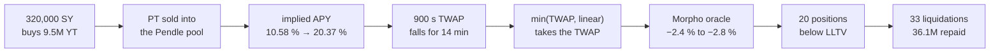
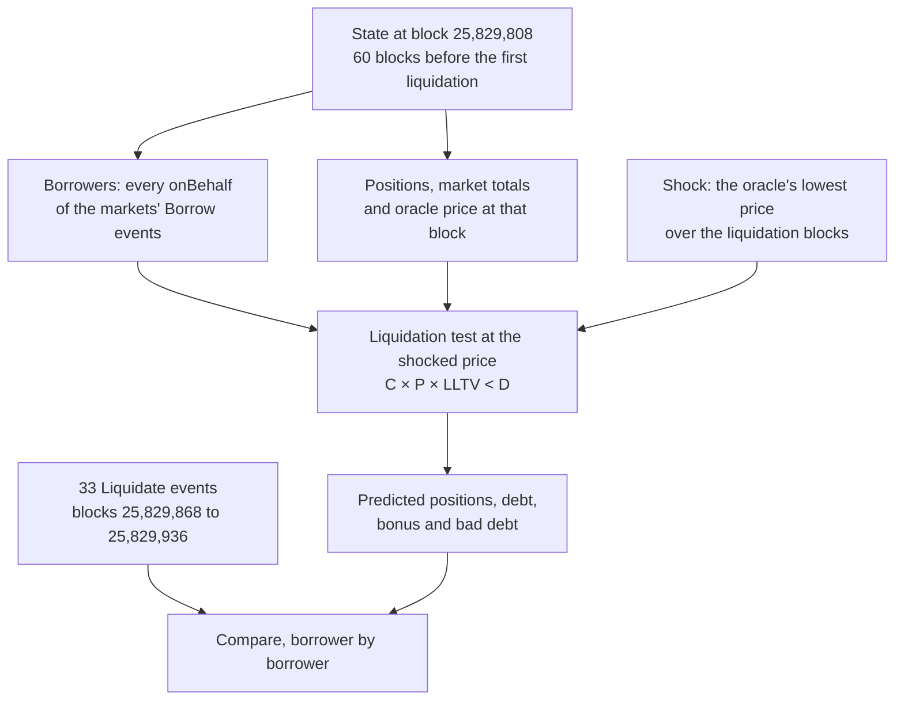

[Pendle](https://www.pendle.finance/) splits a yield-bearing token into a Principal Token (PT), which redeems for one unit of the underlying at maturity, and a Yield Token (YT), which collects the yield until then. PTs are popular collateral on [Morpho Blue]({{site.url_complet}}/2026/10/10/morpho-blue-lending-markets/), where borrowers loop them at a high loan-to-value ratio to earn the PT's fixed yield on borrowed stablecoins.

On 25 August 2026, between 04:28 and 04:51 UTC, one wallet spent 320,000 SY-reUSD buying YT on Pendle. The purchase pushed down the price that the oracle of two Morpho markets read for PT-reUSD-10DEC2026, and 33 liquidations followed: 20 positions, about 36.1M of USDC and USDT debt repaid, 0.95M of liquidation bonus paid by the borrowers, no bad debt. Nothing was hacked, and reUSD itself did not move.

This article explains the incident from the contracts involved: why buying YT sells PT, why the oracle kept falling after the trades stopped, and why the borrowers paid while the lenders lost nothing. It then replays the incident from the chain's state twelve minutes before the first liquidation, and checks the replay against the 33 `Liquidate` events.

> This article has been made with the help of [Claude Code](https://claude.com/product/claude-code) and several custom skills

[TOC]

## The setting: two markets on one PT

Two Morpho Blue markets lent against the same collateral, PT-reUSD-10DEC2026, a PT on reUSD, the dollar token of the reinsurance protocol Re. Both had a liquidation loan-to-value (LLTV) of 91.5 %.

| Market | Loan token | Borrowers before the incident | LLTV |
|---|---|---|---|
| PT-reUSD-10DEC2026/USDC | USDC | 148 | 91.5 % |
| PT-reUSD-10DEC2026/USDT | USDT | 45 | 91.5 % |

**The oracle.** Both markets priced the PT through an Ojo PT feed that returns the lower of two values:

$$
\begin{aligned}
P_{\text{oracle}} = \min\left(P_{\text{TWAP}},\ P_{\text{lin}}\right)
\end{aligned}
$$

- $$P_{\text{TWAP}}$$ is the Pendle pool's PT price averaged over a 900-second window.
- $$P_{\text{lin}}$$ is a linear discount to maturity, about 0.9824 that day.

The design caps the price from above, so nobody can inflate the collateral by buying PT. Nothing bounds it from below. The previous article in this series, [Pricing Yield Collateral on Morpho - Huma's PST Exchange Rate and Ojo's Pendle PT Feed]({{site.url_complet}}/2026/10/11/huma-pst-ojo-pt-oracle-morpho-collateral-pricing/), covers the feed's construction; this one follows what happened when the lower branch was pushed down.

**The liquidation rule.** A Morpho position is healthy while

$$
\begin{aligned}
C \cdot P_{\text{oracle}} \cdot \text{LLTV} \geq D
\end{aligned}
$$

where $$C$$ is the collateral in PT and $$D$$ the debt. A liquidator repays debt and seizes collateral worth the repaid amount times the liquidation incentive factor (LIF), which Morpho Blue derives from the LLTV with a cursor of 0.3:

$$
\begin{aligned}
\text{LIF} = \min\left(1.15,\ \frac{1}{1 - 0.3\,(1 - \text{LLTV})}\right) = \frac{1}{1 - 0.3 \times 0.085} \approx 1.02617
\end{aligned}
$$

At 91.5 %, the borrower pays a 2.62 % bonus on every unit of debt repaid. A looped position close to that LLTV has a buffer of a few percent at most, which is the number this incident tested.

## The trigger: buying YT sells PT into the pool

A Pendle pool holds PT and SY, the standardised wrapper of the underlying. It holds no YT. A YT purchase is therefore a flash swap, and it is visible in Pendle's router (`ActionCallbackV3.sol`):

```solidity
function _callbackSwapExactSyForYt(int256 ptToAccount, int256, bytes calldata data) internal {
    (address receiver, IPYieldToken YT) = _decodeSwapExactSyForYt(data);

    uint256 ptOwed = ptToAccount.abs();
    uint256 netPyOut = YT.mintPY(msg.sender, receiver);

    if (netPyOut < ptOwed) revert("Slippage: INSUFFICIENT_PT_REPAY");
}
```

The steps of one `swapExactSyForYt` call:

1. The pool sends SY to the router first; it is a flash swap, so payment is checked at the end.
2. The router adds the buyer's SY and mints PT and YT from the total (`mintPY`).
3. The YT goes to the buyer, and the PT goes back to the pool as payment (`ptOwed`).

The net effect on the pool is a **sale of PT for SY**. The pool holds more PT, its implied yield rises and the PT's price falls. A YT buyer moves the PT price exactly as a PT seller would.

**Why a small amount moves a large one.** A YT is worth roughly the yield left to maturity, a few cents per unit for a PT trading near 0.97. The wallet's 320,000 SY bought 9,501,135 YT, about 0.034 SY each, and every YT minted put one PT on the market. Rebuilding the pool from its on-chain state shows the result between the block before the trades and the first liquidation:

| Pool figure | Value |
|---|---|
| Implied APY before | 10.58 % |
| Implied APY at the first liquidation | 20.37 % |
| PT sold into the pool | 5,428,403 |
| Underlying paid out | 5,208,303 |

The pool took fewer PT than the 9.5M minted. Pendle's router fills limit orders before the pool, and those fills take part of a trade without moving the pool's implied rate.

## From the pool to the oracle: the TWAP lag

A time-weighted average does not jump with the pool. It moves as new observations replace old ones, so the oracle kept falling for fourteen minutes after the last purchase. The timeline, from the [third-party incident analysis](https://hackmd.io/@kanveuler/BJe_n1ivGe):

| Time (UTC) | Block | Event | Oracle price | Change |
|---|---|---|---|---|
| 04:28:35 | 25,829,822 | reference, before the trades | 0.970991 | |
| 04:28:47 to 04:37:35 | | 11 `swapExactSyForYt` calls | | |
| 04:37:35 | 25,829,867 | last YT purchase | 0.966044 | −0.51 % |
| 04:37:47 | 25,829,868 | first liquidation | | |
| 04:51:23 | 25,829,936 | last liquidation | 0.944188 | −2.76 % |
| 04:51 to 05:39 | | the wallet sells its YT back | | |
| 09:11:59 | 25,831,234 | end of the analysis | 0.967610 | −0.35 % |



Two properties of the feed let the move through:

- **The linear branch never bound.** It sat at about 0.9824 the whole time, above the TWAP, so the minimum always returned the TWAP.
- **The staleness check saw nothing.** Both branches report the current block time as their update time, so a consumer's 24-hour staleness limit cannot reject the value.

The oracle was back at 0.9680 by 05:17, under half an hour after the last liquidation. The liquidations were permanent.

## The liquidations

Liquidators started twelve seconds after the last purchase and finished fourteen minutes later.

| | PT-reUSD/USDC | PT-reUSD/USDT | Total |
|---|---|---|---|
| Positions liquidated | 13 | 7 | 20 (19 borrowers) |
| `Liquidate` events | 16 | 17 | 33 |
| Debt repaid | 35,188,280 USDC | 955,966 USDT | 36.14M |
| PT seized | 37,604,334 | 1,034,264 | 38,638,598 |
| Liquidation bonus | 920,781 USDC | 25,015 USDT | 945,796 |
| Bad debt | 0 | 0 | 0 |

**Who paid.** The bonus is the borrowers' loss: 2.62 % of the debt repaid, transferred to the liquidators, on top of the position itself being closed at the bottom of the move. One liquidator handled 13 events and 96 % of the repaid debt. It flash-borrowed the stablecoins, liquidated, posted the seized PT as collateral for another wallet and borrowed against it. The incident analysis rates common control of that wallet and the YT buyer as plausible, not proven.

**Why the lenders lost nothing.** A liquidation leaves bad debt only when the collateral no longer covers the debt plus the bonus. With $$L$$ the position's loan-to-value at the oracle price, the seized collateral covers the repaid debt as long as

$$
\begin{aligned}
L \cdot \text{LIF} \leq 1 \iff L \leq \frac{1}{1.02617} \approx 97.4\,\%
\end{aligned}
$$

A fall of under 3 % takes a position from 91.5 % to about 94 %, well inside that bound. The incident moved money from borrowers to liquidators, and the lenders were repaid in full.

**What it left behind.** The 36.1M repaid went back to the two markets as free liquidity, so their utilisation fell at once. The 38.6M PT seized went to the liquidators, and the pool could not absorb it: at the first liquidation it accepted only 309,320 more PT before hitting its 96 % proportion cap. The liquidators kept the rest or found other buyers.

## Replaying the incident from on-chain state

The incident is a good test of a liquidation model, because the outcome is on-chain down to the borrower. The open-source [riskdep](https://github.com/rya-sge/defi-monitoring) tool replays it with `riskdep backtest`.



The state is read through an archive RPC at block 25,829,808, twelve minutes before the first liquidation. The shock is the lowest price each market's oracle reported during its liquidations: −2.45 % for the USDC market and −2.76 % for the USDT market. Each position then goes through the liquidation test above.

### Given the oracle's fall

| Market | Positions (predicted / real) | Debt liquidatable / repaid | Bonus (predicted / real) | Bad debt |
|---|---|---|---|---|
| PT-reUSD/USDC | 13 / 13, the same borrowers | 35,463,198 / 35,188,280 | 927,975 / 920,781 | 0 / 0 |
| PT-reUSD/USDT | 7 / 7, the same borrowers | 1,887,001 / 955,966 | 49,378 / 25,015 | 0 / 0 |

No borrower is missed and none is flagged wrongly. In the USDC market the debt and the bonus are within 0.8 %.

The USDT gap is not a model error. The model counts all the debt that becomes liquidatable, while Morpho lets a liquidator repay part of a position. In that market the liquidators repaid about half, in 17 smaller events.

### From the trade alone

A replay that applies the observed price only answers "given the price move, who is liquidated". The harder question is whether the price move itself could have been computed from the trade.

Pendle's pool math (`MarketMathCore.sol`) is public, and the pool's state is on-chain at every block, so the pool can be rebuilt as it stood before the trades:

- **The sale needed.** To lift the implied APY from 10.58 % to 20.37 %, the rebuilt pool needs a sale of 5,518,201 PT. The chain shows 5,428,403, a difference of 1.7 %.
- **The price fall.** Selling the observed 5,428,403 PT into the pool as it stood before moves the PT's price by 2.36 %, against 2.45 % and 2.76 % observed.
- **The cascade.** If the liquidators sell the PT they seize back into the pool, the price falls further. The pool's 96 % proportion cap stops it after 98,024 PT, at −2.46 %.

At −2.36 % and at −2.46 %, the model predicts the same 13 and 7 positions: none missed, none extra. The trade alone was enough to know who would be liquidated, before the TWAP had finished moving.

## What the incident shows

The incident was a transfer, not a loss to the system, and each party saw it differently.

- **Borrowers.** A looped PT position at 91.5 % LLTV can be liquidated by a pool trade costing under 1 % of the debt it liquidates (320,000 SY against 36.1M). Borrowing at the LLTV leaves no room for a move the TWAP will deliver anyway; the incident analysis suggests a borrow limit about three points below it.
- **Lenders and curators.** No bad debt, but two signals worth watching: the PT supply posted as collateral was many times what the pool could absorb (38.6M seized against 309,320 accepted), and 36.1M of liquidity returned to the markets at once, changing their rates.
- **Oracle design.** A minimum caps manipulation from one side only. A floor, a longer window, or a check on the gap between the TWAP and the linear branch would each have stopped or slowed this move.
- **Monitoring.** Three signals moved before the first liquidation: the pool's implied APY, the gap between the two branches of the feed, and the number of positions within a few percent of the LLTV. The trades began nine minutes before the first liquidation, and the TWAP kept moving for fourteen minutes after the last one.

## Conclusion

On 25 August 2026 a Pendle YT purchase sold PT into a thin pool, the TWAP side of an Ojo min(TWAP, linear) feed carried the fall to two Morpho markets, and 20 positions were liquidated.

- **The mechanism is in the router.** Buying YT mints PT and YT and returns the PT to the pool, so it sells PT exactly as a PT sale would.
- **The leverage is in the YT.** At about 0.034 SY per YT, 320,000 SY put 5.43M PT into the pool and lifted its implied APY from 10.58 % to 20.37 %.
- **The oracle had no floor.** The linear branch only caps the price, so the depressed TWAP was the answer, and the staleness check could not object.
- **Borrowers paid, lenders did not.** 945,796 of bonus moved from borrowers to liquidators; at a 91.5 % LLTV, a liquidation leaves bad debt only above about 97.4 % loan-to-value.
- **The outcome was predictable from the state before.** A replay from block 25,829,808 finds the same 20 positions. Pendle's pool math reproduces the sale behind the move within 1.7 %, and the fall it gives from the trade alone (2.36 %) finds the same positions.


## Annex

### Key Terms

| Term | Definition |
|------|------------|
| **Principal Token (PT)** | The Pendle token that redeems for one unit of the underlying at maturity and trades at a discount before it. |
| **Yield Token (YT)** | The Pendle token that collects the underlying's yield until maturity; its price is roughly the yield left, a few cents per unit here. |
| **SY** | Pendle's standardised wrapper of a yield-bearing token; a Pendle pool trades PT against SY. |
| **Implied APY** | The fixed yield a PT's price implies to maturity; a higher implied APY means a lower PT price. |
| **Flash swap** | A swap where the pool sends its output first and checks payment at the end of the call; Pendle uses it to trade YT. |
| **TWAP** | A time-weighted average price; here the PT price averaged over 900 seconds, which lags the pool. |
| **Linear discount oracle** | A PT price computed from time to maturity and a fixed discount rate, with no market input. |
| **Ojo PT feed** | The feed both markets used: the minimum of the Pendle TWAP and the linear discount price. |
| **LLTV** | Liquidation loan-to-value: the debt-to-collateral ratio at which a Morpho Blue position becomes liquidatable, 91.5 % here. |
| **Liquidation incentive factor (LIF)** | The multiple of repaid debt a liquidator seizes in collateral; 1.02617 at a 91.5 % LLTV. |
| **Bad debt** | Debt left unpaid after a position's collateral is exhausted, which Morpho Blue charges to the market's lenders. |
| **Looping** | Borrowing against a PT to buy more of it, repeatedly, to multiply its fixed yield; it keeps the position close to the LLTV. |
| **Partial liquidation** | A liquidation that repays only part of a position's debt; Morpho Blue allows it. |
| **Backtest** | A replay of a past incident from the state before it, with the prediction compared to what happened. |
| **Archive RPC** | An Ethereum node that serves state at any past block, needed to read positions before the incident. |
| **Cascade** | Further price falls caused by liquidators selling seized collateral into the same pool. |

## Frequently Asked Questions

**Q: Was the PT-reUSD incident a hack?**

No. No contract was exploited and reUSD did not lose value. A wallet traded on Pendle through public functions, the oracle reported the price its design computes, and Morpho liquidated positions that its rule declared unhealthy. The incident analysis treats a link between the trader and the main liquidator as plausible but not proven.

**Q: Why does buying YT lower the price of PT?**

A Pendle pool holds PT and SY, not YT, so the router makes a flash swap:

- the pool sends SY to the router;
- the router mints PT and YT from that SY plus the buyer's;
- it gives the YT to the buyer and returns the PT to the pool.

The pool ends with more PT and less SY, which is a PT sale. Its implied APY rises and the PT price falls.

**Q: Why did the oracle keep falling after the last trade?**

The feed reads a 900-second TWAP. When the trades stopped, the window still held observations from before them. As those rolled out over the next fourteen minutes, the average converged to the new, lower pool price. The oracle moved 0.51 % by the last purchase and 2.76 % by the last liquidation.

**Q: The borrowers lost money. Why did the lenders lose nothing?**

A Morpho liquidation seizes collateral worth the repaid debt times the LIF. Lenders lose only when the collateral cannot cover that, which at a LIF of 1.02617 means a loan-to-value above about 97.4 %. A fall under 3 % took positions from 91.5 % to about 94 %. The borrowers paid the 2.62 % bonus and lost their positions; the lenders were repaid in full.

**Q: How was the replay checked, and what does the USDT gap mean?**

The replay read every borrower at block 25,829,808, applied each market's lowest oracle price during the liquidations, and compared the predicted liquidatable positions with the `Liquidate` events. Both markets match borrower by borrower, 13 and 7. In the USDT market the model's liquidatable debt is about twice the repaid debt because liquidators repaid only part of the positions, which Morpho allows.

**Q: Could the liquidations have been predicted without knowing the oracle's fall?**

Yes, from the trade. Rebuilding the Pendle pool from its state before the trades and selling the observed 5.43M PT into it gives a 2.36 % fall. At that fall, and at the 2.46 % that a cascade of resold collateral adds, the model predicts the same 20 positions. A monitor that saw the pool's implied APY jump could have computed this while the TWAP was still moving.

**Q: Which oracle changes would have stopped this move?**

Any of these would have:

- a floor under the TWAP branch, such as the linear price minus a tolerance, so a short push cannot set the price;
- a longer TWAP window, so the same trade moves the average less and costs more to sustain;
- a deviation check between the two branches that freezes or flags the price when they diverge.

Each trades protection against manipulation for slower reaction to a genuine loss of value.

## References

### Analyzed source

- [rya-sge/defi-monitoring](https://github.com/rya-sge/defi-monitoring) (riskdep, `backtest.py`, `pendle_amm.py`), analyzed at commit [`a07f0905b67244624de85ae123a18427827864af`](https://github.com/rya-sge/defi-monitoring/tree/a07f0905b67244624de85ae123a18427827864af), 2026-10-11
- [pendle-finance/pendle-core-v2-public](https://github.com/pendle-finance/pendle-core-v2-public) (`ActionCallbackV3.sol`, `ActionSwapYTV3.sol`, `MarketMathCore.sol`), analyzed at commit [`87685c89d05087535e9b9647eeda0e3d297d1f06`](https://github.com/pendle-finance/pendle-core-v2-public/tree/87685c89d05087535e9b9647eeda0e3d297d1f06), 2026-10-11
- [morpho-org/morpho-blue](https://github.com/morpho-org/morpho-blue) (`Morpho.sol`, `ConstantsLib.sol`: the liquidation rule and the LIF), analyzed at commit [`8e26ca6a8dbc5089edcd67fb576248810fd2870a`](https://github.com/morpho-org/morpho-blue/tree/8e26ca6a8dbc5089edcd67fb576248810fd2870a), 2026-10-11

### Incident reports

- [PT-reUSD Morpho liquidation event, incident analysis (HackMD)](https://hackmd.io/@kanveuler/BJe_n1ivGe): timeline, oracle prices, liquidators and the trader's wallet
- [Morpho liquidations triggered as Pendle routes 320K SY-reUSD into 36.4M cascade (Crypto Briefing, 25 August 2026)](https://cryptobriefing.com/morpho-liquidations-pendle-reusd-cascade/)

### Documentation

- [Pendle V2 developer documentation](https://docs.pendle.finance/pendle-v2-dev/): flash swaps, YT trading through the router, PT oracles
- [Morpho developer documentation](https://docs.morpho.org/): Morpho Blue liquidations and the liquidation incentive factor

### Related articles

- [Pricing a Lending Position During an Incident - What the Oracle Reads, When, and Who Bears the Gap]({{site.url_complet}}/2026/10/11/oracle-kinds-pricing-lending-position-incident/)
- [Risk of Ethena's USDe and sUSDe - Backing Venues, Depeg Priors and a Leveraged PT Position]({{site.url_complet}}/2026/10/11/ethena-usde-risk-backing-venues-leveraged-positions/)
- [Monte Carlo Simulation for DeFi Risk Analysis - From Random Sampling to a Stay-or-Exit Decision]({{site.url_complet}}/2026/10/10/monte-carlo-defi-risk-analysis/)
- [The Unified Risk Layer for DeFi - From Price Oracles to Protocol-Owned Risk Oracles]({{site.url_complet}}/2026/07/02/defi-unified-risk-layer-llama-guard/)
