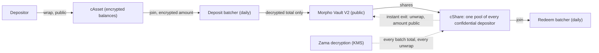
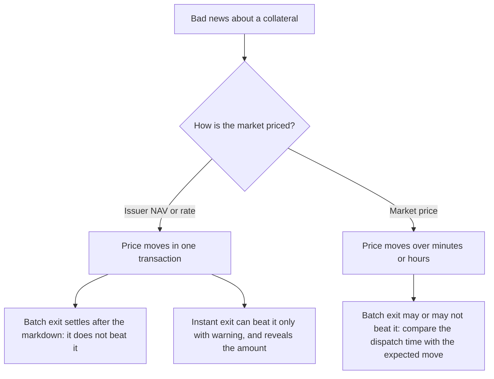
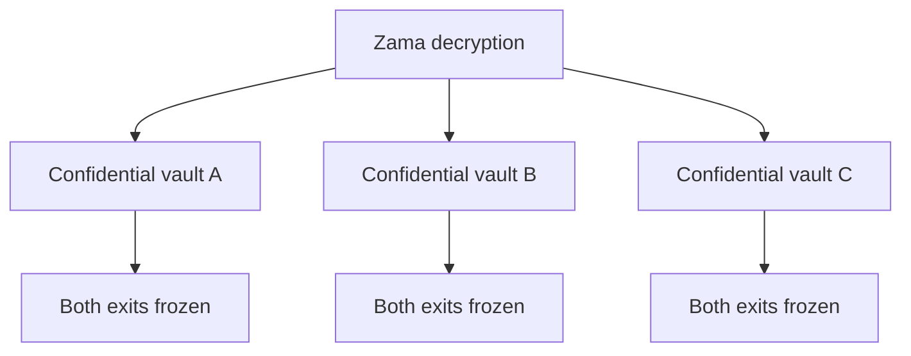

[Zama](https://www.zama.org/) runs a protocol that lets Ethereum contracts compute on encrypted values with fully homomorphic encryption (FHE). Its decryption is done by a threshold key-management service rather than by any single party, as covered in [Inside the Zama KMS — Threshold Key Management for FHE, From MPC Protocol to Enclave Deployment]({{site.url_complet}}/2026/09/18/zama-kms-threshold-key-management-architecture-and-operation/). Zama's Confidential Vault protocol uses it to let depositors enter an ordinary [Morpho Vault V2]({{site.url_complet}}/2026/10/10/morpho-vault-v2-architecture/) without revealing how much each of them holds.

The vault does not change: its markets, collateral, oracles and borrowers stay public. What changes is who holds its shares and how those holders get out. This article looks at what that means for a risk analysis of the vault: who bears a loss, how fast a confidential depositor can leave, how a failure spreads, and what can still be monitored. The figures come from a 30 % markdown of one collateral, applied to the state of a mainnet vault at block 26,165,059.

> This article has been made with the help of [Claude Code](https://claude.com/product/claude-code) and several custom skills

[TOC]

## How a confidential vault is built

A confidential vault puts three contracts between the depositor and the Morpho vault:

- **A confidential asset (cAsset)**, for example cUSDC: an [ERC-7984](https://eips.ethereum.org/EIPS/eip-7984) wrapper of the vault's underlying token, whose balances are encrypted.
- **Two batchers**, one for deposits and one for redemptions. Users join the open batch with an encrypted amount. Once a day the batch is dispatched, and only its total is decrypted and settled against the vault.
- **A confidential share (cShare)**: an ERC-7984 wrapper of the vault's own shares. It holds the vault shares of every confidential depositor, and each depositor's slice inside it is encrypted.

On mainnet, every batcher has a minimum batch age of 23 hours 58 minutes and a callback deadline of 12 hours. Redemptions are dispatched at about 11:00 UTC and deposits at about 15:00 UTC. A batch that does not settle before its deadline is canceled, and its participants take back their exact input.

The protocol hides the split, not the totals. Who joined each batch, each batch's decrypted total, its exchange rate and every wrap and unwrap amount are public. A depositor alone in a batch is therefore fully revealed. What no observer can do is attribute part of a total to one participant.

On the vault used for the figures below, a confidential RWA vault lending USDC, the cShare holds 99.1 % of the shares. It is the vault's largest holder by far, and it is not one person.

## What stays the same: the loss through the markets

A Morpho vault loses money when a market it supplies takes bad debt: a borrower's collateral falls below the debt, and liquidations do not cover the difference. That loss lowers the share price, and every share bears it pro rata. The cShare's shares are no exception. The loss computation for a confidential vault is therefore the one for any vault: read the vault's allocation, every borrower of its markets, their collateral and the oracle prices, apply the shock, and add up what each market's lenders lose.

For the vault above, a 30 % markdown of its main collateral, an issuer-priced token, gives:

| Quantity | Value |
|---|---|
| Debt that becomes liquidatable in the hit market | 28,094,727 of 34,392,087 USDC, 12 borrowers |
| Bad debt in that market | 5,685,620 USDC |
| Vault's share of the market's supply | 58 % |
| Vault loss | 3,273,881 USDC, 12.38 % of 26,446,445 |

Confidentiality changes none of these numbers. A confidential depositor loses 12.38 % of what they hold, exactly like a public one.

## Who holds the vault: a pool, not a holder

Two steps of a vault analysis look at individual holders, and a cShare breaks both if it is read as one holder.

**Choosing whose position to weigh.** An analysis that has no depositor to start from usually takes the largest one. Here that would be the cShare, whose "position" is the sum of many people's. The meaningful default is the largest holder that is *not* a cShare. On the example vault it holds 0.89 % of the shares, 235,890 USDC.

**Modelling a run.** A common way to measure exit risk is to ask what a depositor recovers if every *contract* holder (other vaults, funds, multisigs) withdraws first, since contracts can react in the same block as the news. The cShare is a contract. Counted as a fast holder, it would put 99.1 % of the vault ahead of everyone, and every depositor would look stuck. That is wrong in practice: the cShare cannot withdraw on its own. Its depositors leave through a daily batch or one by one through unwraps. It has to be modelled as a pool of depositors who are, if anything, slower than the public ones.

A confidential depositor's own loss cannot be computed from the chain at all. Their amount is encrypted, and only they can decrypt it. A tool can apply the vault's loss rate to an amount the depositor supplies. It cannot find the position by itself.

## Exits and the race against the incident

A depositor who wants to leave before a loss is written off is racing the incident. A confidential depositor has two ways out, and both need a Zama decryption:

| Exit | How | Time | Cost |
|---|---|---|---|
| Batch | Join the redeem batcher; the batch is dispatched once it is old enough, its total is decrypted, and it settles at the vault's share price of that moment | Up to about 24 hours, plus the decryption | No slippage bound: the price is whatever it is at settlement |
| Instant | Unwrap the cShare to public vault shares, then redeem them like any public holder | Minutes (one decryption) | The amount becomes public |

The key comparison is time to impact against time to exit. When the hit market is priced by an issuer's NAV or exchange rate, the markdown lands in a single transaction, and liquidations can start in the same block. A daily batch cannot beat that. In the example, the redeem batch open at the time of the reading could be dispatched in 12.4 hours at the earliest, so a confidential depositor who joined it would settle after the loss is written off.

The instant exit can beat the incident, but only with warning, and at the price of confidentiality. It also draws on the same pool as everyone else: once unwrapped, the shares are redeemed like any public shares, and only the vault's free liquidity can pay them.

The stay-or-exit decision is computed the same way for a confidential holder. In the example, staying loses 29,201 USDC on the 235,890 position, and leaving first loses nothing, so the verdict given the incident is EXIT.

When the incident is not certain, the decision becomes a breakeven probability. Leaving forgoes 1,939 USDC of yield over 30 days (the vault pays about 10 % a year), so it pays if the incident's probability over 30 days is above 1,939 ÷ 29,201 = 6.64 %. The confidential holder faces the same arithmetic. The difference is which exit actually achieves "leaving first", and what it reveals.

## Contagion

Contagion has two channels here, and only one of them carries a loss.

### Through the markets

A shock on one collateral hits every market that prices it, through the same feed or the same oracle. In the example, the same 30 % markdown costs the lenders of two sibling markets (markets the vault does not supply, lending against the same token) 4,455,716 PYUSD and 632,835 AUSD. This channel is computed the same way for a confidential vault: a dependency graph of markets, oracles and feeds, and a propagation of the price change through it.

### Through Zama

The Zama layer adds dependencies that the vault page does not show:

| Layer | What can fail | Effect on a confidential depositor |
|---|---|---|
| Zama decryption (KMS, coprocessors) | Halts or is delayed | No batch settles and no unwrap completes: neither exit works until it resumes; a dispatched batch cancels after 12 hours |
| cAsset and cShare wrappers | Paused through the wrapper registry's governance; a wrapper bug | Position frozen, or lost if the wrapper's backing is wrong |
| Batchers | The owner pauses joins and dispatch | Exits delayed; quit and claim stay available |
| Operator that dispatches | Stops | Anyone can dispatch: a delay, not a loss |

Two properties set this channel apart from the markets:

- **It is common-mode.** Every confidential vault depends on the same decryption service. A dependency graph that draws one Zama node for all of them makes this visible: sixteen vaults on mainnet, one point of failure for their confidential exits.
- **It freezes rather than destroys.** A decryption halt costs no money directly. It costs time, and that time matters only if an incident in the markets lands while the exits are frozen. A propagation model built on losses through markets has nothing to propagate here. The honest output is a statement ("if decryption halts, neither exit works until it resumes"), not a number.

The trust model limits the damage of the owner-controlled parts. A batcher's owner can pause joins and dispatch, but cannot move funds or force an outcome: quit returns the exact deposit before dispatch or after a cancellation, and claims on a settled batch never expire.

## Probabilities

A risk model needs a probability for each layer it includes. For lending markets there is history: hacks, depegs, oracle failures and liquidation cascades give base rates. The Zama layer has none yet. It is a young protocol, with no recorded incident to count. Any probability for a decryption halt or a wrapper bug is therefore a stated assumption, and should be labelled as one rather than borrowed from an unrelated base rate.

The breakeven framing above sidesteps part of the problem. It does not ask for the probability of the Zama layer failing. It asks how likely the market incident must be for leaving to pay. The Zama layer then enters as a qualifier on the exit: whether the exit chosen can be completed in time.

## What can still be watched

Confidentiality hides individual amounts, but batch-level activity is public, and some of it is more informative than what a public vault offers. The redeem batch's total, decrypted each day, is a single public number for the confidential depositors' outflow.

| Signal | Source | Suggested level |
|---|---|---|
| A redeem batch's total as a share of the vault | The cShare unwrap to the redeem batcher | Info; warn from 2 %; critical from 10 % (a confidential run forming) |
| An instant exit | A cShare unwrap to anyone but the batcher | Info; warn from 1 % (an informed holder leaving fast) |
| A batch canceled with money in it | `BatchCanceled` | Warn |
| A batch canceled after a zero total | `BatchCanceled` after an empty decryption | Silent: an empty day is routine |
| A batcher or wrapper paused or upgraded | `Paused`, `Upgraded` | Critical |
| An owner change | `OwnershipTransferred` | Warn |

The share of the vault is computed from the cleartext unwrap amount and the cShare's conversion rate to vault shares. When that rate cannot be read, it is safer to report nothing than to guess.

## What is not covered

A complete analysis of a confidential vault still has gaps:

- **The individual position.** It needs the depositor's cooperation: they decrypt their balance and supply it.
- **A probability for the Zama layer.** There is no incident history to base it on.
- **The cost of a freeze.** It depends on what happens in the markets during the outage, which a loss-propagation model does not cover.
- **Measured decryption delays.** The batch time is known; the decryption time under load is not yet measured.

## Conclusion

A Zama confidential vault is a public Morpho vault with a confidential layer in front of it. Most of a risk analysis carries over unchanged. Three parts do not:

- **Losses are unchanged.** Bad debt in a market lowers the share price, and confidential shares lose pro rata like any others.
- **The holder structure changes.** The cShare is a pool of depositors, not one holder: it must be skipped when picking a representative depositor, and it must not be counted as a fast holder in a run.
- **The exits change.** A confidential depositor leaves through a daily batch, which cannot beat a markdown that lands at once, or through an instant unwrap that reveals the amount. Both need Zama's decryption.
- **Contagion has a second channel.** Losses still spread through markets that share a collateral or a feed. Zama decryption is a common dependency of every confidential vault, but its failure freezes exits rather than destroying value.
- **Monitoring improves in one respect.** The daily redeem total is a public measure of confidential outflows, and pauses, upgrades and canceled batches are visible events.

## Annex

### Key Terms

| Term | Definition |
|------|------------|
| **Morpho Vault V2** | An ERC-4626 vault that allocates deposits across Morpho lending markets through adapters; its losses come from bad debt in those markets. |
| **Bad debt** | The part of a loan that a liquidation cannot recover because the collateral is worth less than the debt; the market's lenders bear it. |
| **FHE** | Fully homomorphic encryption: computation on encrypted values whose result can only be read after decryption. |
| **KMS** | Zama's threshold key-management service, which decrypts only what the protocol marks decryptable and proves each decryption on-chain. |
| **ERC-7984** | A token standard for confidential fungible tokens whose balances and transfer amounts are encrypted. |
| **cAsset** | The confidential wrapper of the vault's underlying token, for example cUSDC. |
| **cShare** | The confidential wrapper of the vault's shares; it holds the vault shares of every confidential depositor as one pool. |
| **Batcher** | A contract that collects encrypted joins and, once a day, settles their decrypted total against the vault; one for deposits, one for redemptions. |
| **Instant exit** | Unwrapping cShare to public vault shares and redeeming them directly; fast, but the amount becomes public. |
| **Callback deadline** | The 12 hours a dispatched batch has to settle; past it, the batch cancels and participants take back their input. |
| **NAV oracle** | A price feed that publishes an issuer's net asset value or exchange rate, so a markdown lands in one transaction. |
| **Sibling market** | A lending market the vault does not supply but which shares a collateral, an underlying or a price feed with one it does. |
| **Common-mode dependency** | A component several positions depend on at once, so its failure hits all of them together. |
| **Breakeven probability** | The probability of an incident above which leaving now costs less than staying: the cost of leaving divided by the loss it saves. |

### Integration Notes

| Behaviour | What an analyst should do |
|---|---|
| The largest holder of a confidential vault is the cShare | Exclude it when choosing a representative depositor |
| The cShare is a contract | Do not count it among the fast holders that exit first in a run |
| A confidential position is invisible on-chain | Ask the depositor for the amount; never infer it from batch participation, which can include encrypted-zero decoys |
| The redeem batch settles at the share price at settlement | Treat it as unable to beat an incident priced by a NAV oracle |
| An empty batch cancels every day it has no redemption | Alert only on a cancellation with money in it |
| Decryption failure causes delay, not loss | State it next to the exit options rather than adding it to the expected loss |

## Frequently Asked Questions

**Q: Does a confidential depositor lose more or less than a public one in the same incident?**

The same proportion. Bad debt lowers the vault's share price, and the cShare's vault shares lose like every other share. What differs is the ability to leave before the loss is written off, not the size of the loss for someone who stays.

**Q: Why should the cShare not be treated as the vault's largest depositor?**

Because it is many depositors. Weighing its "position" describes nobody's exposure. In a run model it would also appear as one fast contract holder ahead of everyone, when its depositors can only leave through a daily batch or one by one through unwraps.

**Q: Can the redeem batch beat a markdown published by the collateral's issuer?**

No. An issuer's NAV or exchange-rate oracle moves in one transaction, and liquidations can follow in the same block. The batch is dispatched at most once a day and settles at the share price of that moment, with no slippage bound, so it settles after the markdown. Only the instant exit can beat it, and only with warning.

**Q: What does a halt of Zama's decryption do to a confidential depositor, and why is it hard to put a number on?**

Both exits stop working:

- no batch total can be decrypted, so no batch settles, and a dispatched batch cancels after 12 hours;
- no unwrap can complete, so the instant exit is blocked as well.

No money is lost by the halt itself, so a model that propagates losses has nothing to propagate. The cost depends on whether a market incident lands while the exits are frozen, which is why it is stated as a condition on the exits rather than added to the expected loss.

**Q: Why is Zama decryption described as a common-mode dependency?**

Every confidential vault on the protocol uses the same decryption service. A failure there freezes the confidential exits of all of them at once. Drawing a single shared node for it in a dependency graph shows that link, which no single vault's page reveals.

**Q: Which public signal is most useful for monitoring a confidential vault, and how is it measured?**

The redeem batch's daily total. It becomes public when it is decrypted, as a cShare unwrap to the redeem batcher. Divided by the vault's total shares, after conversion with the cShare's rate, it gives the share of the vault leaving confidentially that day. Thresholds of 2 % for a warning and 10 % for a critical alert separate a routine day from a run forming.

**Q: How does the breakeven probability work in the example, and does confidentiality change it?**

Leaving forgoes 1,939 USDC of yield over 30 days and saves a loss of 29,201 USDC, so leaving pays if the incident's probability over 30 days exceeds 1,939 ÷ 29,201 = 6.64 %. Confidentiality does not change this arithmetic. It changes which exit can achieve "leaving first" in time, and whether using it reveals the amount.

## References

### Zama Confidential Vault documentation

- [Confidential Vault — Batch lifecycle](https://docs.zama.org/protocol/confidential-vault/concepts/batch-lifecycle)
- [Confidential Vault — Confidentiality](https://docs.zama.org/protocol/confidential-vault/concepts/confidentiality)
- [Confidential Vault — Trust model](https://docs.zama.org/protocol/confidential-vault/concepts/trust-model)
- [Confidential Vault — Mainnet addresses](https://docs.zama.org/protocol/confidential-vault/reference/addresses)

### Standards and protocols

- [ERC-7984 — Confidential Fungible Token](https://eips.ethereum.org/EIPS/eip-7984)
- [ERC-4626 — Tokenized Vaults](https://eips.ethereum.org/EIPS/eip-4626)
- [Morpho documentation](https://docs.morpho.org/)

### Related articles

- [Monte Carlo Simulation for DeFi Risk Analysis - From Random Sampling to a Stay-or-Exit Decision]({{site.url_complet}}/2026/10/10/monte-carlo-defi-risk-analysis/)
- [Zama FHEVM Architecture — Components, Data Flow and What Has to Be Trusted]({{site.url_complet}}/2026/09/18/zama-fhevm-architecture-components-trust-model/)
- [Inside the Zama KMS — Threshold Key Management for FHE, From MPC Protocol to Enclave Deployment]({{site.url_complet}}/2026/09/18/zama-kms-threshold-key-management-architecture-and-operation/)
- [Technical Analysis of the OpenZeppelin ERC-7984 Implementation]({{site.url_complet}}/2026/02/24/erc7984-openzeppelin-analysis/)
- [Risk of Ethena's USDe and sUSDe - Backing Venues, Depeg Priors and a Leveraged PT Position]({{site.url_complet}}/2026/10/11/ethena-usde-risk-backing-venues-leveraged-positions/)
