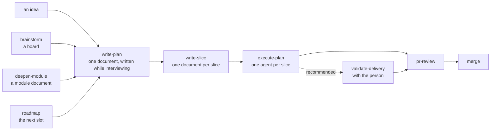
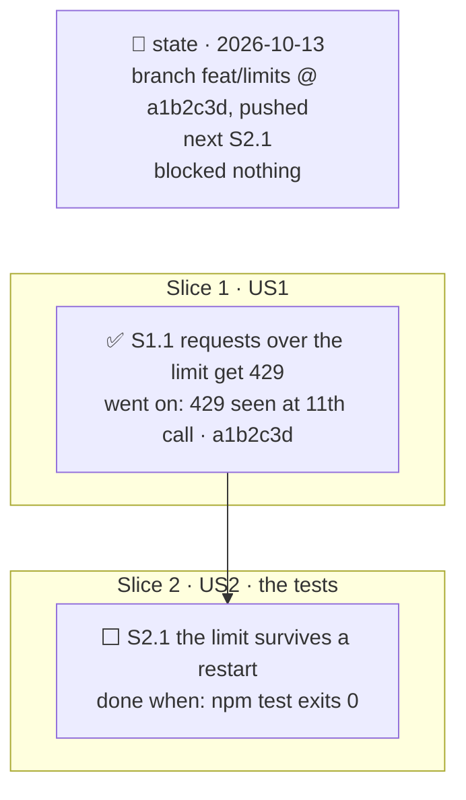
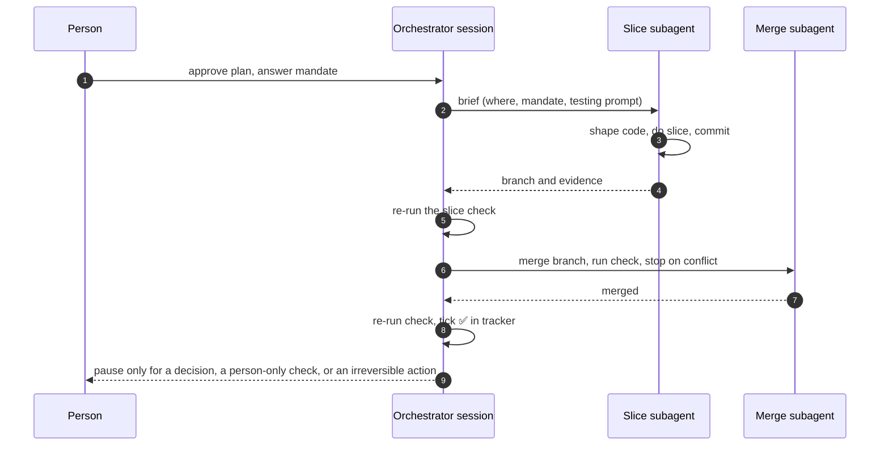
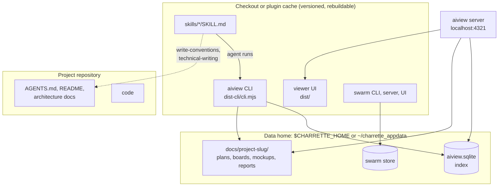

[Charrette](https://github.com/Ovich/charrette) is an open-source collection of agent skills for [Claude Code](https://claude.com/product/claude-code) and other coding agents. A *skill* is a folder of Markdown instructions that the agent loads when a request matches its description. Charrette uses about two dozen of them to make an agent design, plan and get approval for a change before it writes code. The name comes from architecture studios, where a *charrette* is the intense session in which a design is drawn, argued over and decided before anything expensive is built.

This article describes how the collection is built and how its parts interact. It covers the skills and their grouping, the loop a piece of work goes through, the plan document and its tracker, the orchestrator and its mandate, verification, and the two companion tools: `aiview`, which renders every document, and `swarm`, a coordination board for agents running in parallel. The last sections cover how a change reaches users and what a three-day, five-person use of the method showed about its limits.

> This article has been made with the help of [Claude Code](https://claude.com/product/claude-code) and several custom skills

[TOC]

## Design premises

Four premises explain most of Charrette's structure.

- **Settle before building.** No code is written for a planned change until a person has approved its plan. The agent proposes, the person decides, and each skill names the decisions that belong to the person.
- **Diagrams as shared context.** A diagram states a concept in a form that both a person and an agent read the same way. Charrette uses Mermaid diagrams as a main medium: the plan's progress, the module map, the flows and the roadmap are all diagrams, checked by a parser after every edit.
- **Documents outside the repository.** Boards, plans, mockups and review reports are working material that becomes obsolete when the change merges. Charrette stores them in a separate *data home* rather than the project repository, to avoid documentation rot: an outdated document in the tree misleads the next agent that reads it.
- **Iterate in small increments.** A plan covers one increment that works and can be verified, and stops where the next one would begin. The project's own README warns against "big design up front": an agent enjoys writing long plans, and a long plan tends to fall apart before its end.

## The skills and how they are organised

### One folder per skill, grouped by phase

Each skill is a folder under `skills/` that opens on a `SKILL.md` file. Supporting files sit beside it, and material needed only in one situation goes under `references/`. The groups follow the phases of the work:

| Group | Skills | Role |
|---|---|---|
| `project/` | `roadmap`, `write-conventions`, `technical-writing` | What a project has once and keeps |
| `architecture/` | `brainstorm`, `deepen-module`, `write-diagrams`, `dependency-graph`, `complexity-rework` | Thinking a design through |
| `ui/` | `design-prototype`, `point-at` | Working mockups and pointing at screens |
| `plan/` | `write-plan`, `write-slice` | The plan and its slices |
| `execute/` | `execute-plan`, `orchestrate-plan`, `execute-slice` | Running an approved plan |
| `verify/` | `verification-skill-create`, `validate-delivery` | Judging what was delivered |
| `workbench/` | `create-workbench` | Reusable development pages |
| `review/` | `pr-review`, `recurring-review-findings` | Pull request analysis |
| root | `interview`, `whiteboard-defense`, `aiview`, `swarm` | Shared services and the two tools |

The plugin manifest `.claude-plugin/plugin.json` lists the eight group folders explicitly. Claude Code's default scan reads one level under `skills/`, which finds the root skills; a group left off the manifest's list ships none of its skills, and `claude plugin validate` does not report the omission.

### Skills written for a router and a reader

A skill is read at two moments, and Charrette writes for both. The harness's router reads only the `description` field when deciding which skill to load, so the description states what triggers the skill, what it produces and what it excludes, and nothing else. The agent reads the body only after loading it, so the method lives there.

Several of the repository's own conventions (in its `AGENTS.md`) follow from the cost of loading:

- **Progressive disclosure.** `SKILL.md` keeps only what every use needs. A situation-specific procedure goes in `references/<topic>.md`, named in `SKILL.md` at the point where the situation arises, together with the condition for reading it.
- **One owner per protocol.** The tracker protocol belongs to `write-plan`, the interview to `interview`, diagram discipline to `write-diagrams`, the document index to `aiview` and the board protocol to `swarm`. Other skills point at the owner and never restate it, because two copies drift.
- **References by name.** A skill cites another as "the `interview` skill", never by path. The harness resolves names wherever a skill is installed; a path breaks when the layout changes.
- **No project-specific vocabulary.** A skill loads in every project, so its examples use only terms every project has. A foreign module name would read as a fact about the current codebase.

### The shared layer

Four components are used by almost every other skill:

- **`interview`** resolves a tree of decisions one question at a time, in dependency order. It reads the code, the history and the documents before asking, researches any claim about a tool from its primary source, and gives a recommended option first with the trade-off of each option.
- **`write-diagrams`** holds the diagram discipline.
- **The tracker protocol**, owned by `write-plan`, defines how a plan records its progress.
- **`aiview`** stores, indexes and renders every document.

## The loop

### Entry points and phases

A piece of work enters the loop from whatever already exists: an idea stated in chat, a `brainstorm` board, a module agreed through `deepen-module`, or the next slot of the roadmap. It then passes through planning, slicing, execution and review.

One pass through this loop is one iteration and delivers one increment. What the increment teaches feeds the next plan, which is written with that knowledge in hand.

### Above the loop: the roadmap

The `roadmap` skill keeps one document per project. It orders the iterations, and each iteration is made of *slots*: something a customer can use, or a system that can be deployed. A slot's state is never typed by hand. It is derived from the documents tagged with the slot's slug: no document means *empty*, a board or an unapproved plan means *in design*, an approved plan means *planned*, a tracker with a step in progress means *in progress*, and *landed* requires the person's evidence (a URL, a deployment, a customer). A separate *foundation* reference records technology decisions (stack, database, hosting), each closed no later than the first slot that needs it.

## The plan document

### One document for design and execution

`write-plan` produces a single Markdown file per increment, named `YYYY-MM-DD-<topic>.plan.md` and registered in aiview. It is written during the interview, section by section as decisions land. Its skeleton has two parts:

- **Design**: why and why not (goals, non-goals, user stories with observable acceptance), before and after (existing code cited as `file:line`), the module map, the flows, state and its writers, failure modes, experiments that ran, and the decisions table.
- **Execution**: the slices, the orchestrator's mandate, and an interview log that records every question with its options, its recommendation and the answer as given.

The header records the approval status in the approver's own words, the increment the plan delivers with its proof, any hard rule that must not change, and the branch and commit the plan was read against. A section that does not apply is left out, and the header says which.

### Decisions and deep modules

Every decision is a row in the decisions table, with an id (`D3`), a kind (purpose, module, architecture, contract or clarification), a status, a source and the slice that implements it. Open questions are rows too, with an owner.

Major areas are designed as *deep modules* through `deepen-module`: an interface that hides much behind little, shown as the code a caller writes, the entry signatures without bodies, what the module hides and what stays outside it.

### Slices

`write-slice` cuts the increment into *slices* and then writes one document per slice. That document contains the whole design a single agent needs: the decisions quoted, the modules involved, the cases to test and the environment facts the first command will hit. The mandate is not in it, because it reaches the agent separately, through the brief.

## The tracker protocol

### A diagram that records state

The *tracker* is the first thing in the plan: a Mermaid flowchart in which each slice is a subgraph (`SL<n>`) and each step a node (`S<n>.<step>`). A step's first line states an outcome an observer could check, and its second line says when it is done or what happened:

| Glyph | Meaning | Second line |
|---|---|---|
| ⬜ | not started | `done when: <command or observation>` |
| ▶ | in progress, one at a time per fork arm | `done when: …` |
| ✅ | done, re-run by this session | `went on: <observation> · <sha> · #<pr>` |
| ⏸ | blocked on someone | `paused: <on whom, for what, asked <date>>` |
| ✖ | dropped | `dropped: <what happened> · <decision id>` |

A minimal tracker looks like this:

### The state node and the mandate line

A *state node*, connected to nothing, holds the branch and commit, what is deployed, the next step, what is blocked and what was left aside. Its fields are overwritten, never appended. Under the diagram, one line states the mandate in force. A later session that has none of the conversation in context resumes from these two elements alone.

The protocol has explicit rules: insert a found step as `S2.3b` rather than renumbering, keep forks between slices and never inside one, draw a debt as a dotted edge to the step that pays it, and tick ✅ only after the current session has re-run the step's check itself, never on a subagent's word. `aiview mermaid-check` and `aiview tracker check` are run after every edit, and `aiview tracker sync` writes the colour classes from the glyphs.

## Execution: orchestrator, mandate and slices

### Three skills, three roles

Execution is split across three skills with disjoint responsibilities:

- **`execute-plan`** keeps the plan and its tracker true while the work happens. It refuses to start on a plan without a tracker or with a slice whose check is not a command, and it pauses for only three things: a decision that belongs to the person, a verification only a person can do, or an action that leaves the machine and cannot be cheaply undone.
- **`orchestrate-plan`** dispatches the work. The orchestrating session holds the plan, the tracker, the briefs and the decisions; subagents never edit the plan.
- **`execute-slice`** is what a subagent runs on one slice. It first reshapes the code around the slice without changing behaviour, in separate commits, using the `dependency-graph` script to see what depends on what. It then implements the acceptance criteria and nothing beyond them, and returns its branch and evidence.

### The mandate

Before the first dispatch, the orchestrator settles the *mandate*, a set of fields written into the plan and summarised in one line under the tracker:

| Field | Options (recommended first) |
|---|---|
| `mode` | classic (slices in sequence, forks in parallel) · swarm (all slices at once) |
| `pace` | run through · run through, the person merges · stop at each slice |
| `pull requests` | one for the plan · one per slice |
| `steps` | delegated (a subagent per slice) · inline (this session works) |
| `model`, `effort` | the subagent's model and reasoning effort |
| `tests` | at the plan end · at the slice end · none |
| `verify` | each slice · slot done · off |

While subagents work, the orchestrator runs a digest script (`watch-agents.mjs`) every few minutes. It prints one line per live subagent (call count, idle time, last tool, last words) and marks a command that crosses the brief's boundary; the orchestrator reports a stall or a breach and steers only a drift from the brief. The orchestrator never opens a full transcript, because that would exhaust its own context. Forks run in separate git worktrees, and merges are done by a dedicated subagent that stops on a conflict instead of resolving it.

### Swarm mode

In `mode: swarm`, every slice is dispatched at once, each runner in its own worktree. The runners coordinate on the board of the `swarm` skill, a separate CLI, server and UI whose store lives in the data home. A runner is identified as `<plan>/<slice>`, gets a generated name at join, and can mention others (`@orchestrator`, `@<slice>`). The board shows who holds which files and carries the runners' messages. A plan must be cut for swarm mode from the start, because the slice cut and the tracker differ.

## Verification

Charrette separates two kinds of checking:

- **Agent-side quality.** `verification-skill-create` generates a project-local `verify-<app>` skill. It opens on a role prompt written for the product (its quality owner, product owner, first-time user, sceptic), carries the tooling to reach and drive every part of the application, and comes with a navigation map drawn in aiview. The skill is proven by one complete quality pass. When the mandate's `verify` is on, a subagent runs it per slice or per slot.
- **Person-side validation.** `validate-delivery` walks the same verify process live with the person, who decides what to look at and whether it holds. The agent proposes what to check and makes requested changes on the spot.

`validate-delivery` refuses to start without a verify skill and proposes creating one first.

## The companion tools

### aiview: index and live viewer

`aiview` is a local application that indexes and renders every document the skills produce. It is one npm package with three parts sharing a core:

- a **CLI** (`aiview.mjs`), the agent's interface;
- a **plain Node server** with five API routes, static files and server-sent events for live reload, on `localhost:4321`;
- a **React and TypeScript UI** that renders Markdown with Mermaid, sandboxed HTML mockups and PDFs.

The shared core holds a typed SQLite index (through Node's built-in `node:sqlite`, hence the Node 22.5 minimum), the path rules and a file watcher.

Documents are filed one folder per project under `docs/<project>/`, and a project record lists the working directories it covers. That way, a session started in a repository resolves to its project by longest-prefix match. Each file follows the `YYYY-MM-DD-<topic>.<kind>.md` pattern. The kind is mandatory (`brainstorm`, `plan`, `slice`, `module`, `mockup`, `workbench`, `pr-analysis`, `report`, `roadmap` and a few others), and a plan gets its own group shared with its slice documents. Agents never build a path by hand: `aiview path <filename>` returns it for the current operating system, and `aiview open` registers the file, starts the server if needed and prints the URL to give the person.

Beyond rendering, aiview carries the checks the protocols depend on: `mermaid-check` parses every diagram in a document with the bundled Mermaid parser, `tracker check` judges a tracker against its own protocol, and `check` resolves the bindings between mockups (a screen binding components from a parts sheet).

### Mockups and workbenches

`design-prototype` produces self-contained HTML mockups that behave: a stepper counts, a form advances. A mockup declares its states (empty, error, promo applied) as variants that the viewer exposes in a toolbar. `point-at` lets an agent move the person's open viewer to a component and outline it before asking a question about it. `create-workbench` turns a recurring manual task, such as diffing API responses before and after a refactor, into an aiview page fed by the project's own data, plus a project-local `workbench-<bench>` skill that knows how to refresh it.

## Distribution and releases

Charrette reaches users as a Claude Code plugin, with the repository acting as its own marketplace. Two properties of that channel shape the release procedure, documented in `RELEASING.md`:

- **The version is the delivery.** Claude Code caches an installed plugin by version and skips an update when the declared version matches the installed one. The version is declared in both `plugin.json` and `marketplace.json`, and `plugin.json` takes precedence. A push without a version bump reaches no existing user, and nothing reports it.
- **Build output is committed.** An update installs into a new, empty cache directory, so anything not in git would have to be rebuilt by every user. The aiview UI (`dist/`) and the bundled CLI (`dist-cli/`, built by esbuild with dependencies such as `parse5` and `mermaid` inlined) are therefore versioned, and the only runtime requirement is Node.

A release runs the builds and tests, bumps both manifests to the same version and pushes; a GitHub workflow creates the `charrette--v<version>` tag. The repository's conventions also warn that the plugin cache is itself a clone with push rights. Work committed there is real and leaves the development checkout behind, which has happened once.

## What field use showed

A three-day hackathon by five developers, each working with agents, produced 52 plans and about 245 numbered decisions with this method. The resulting feedback shows where the design held and where it was bypassed:

- **What held.** Decision ids cited from code comments let a reader go from a line to its rationale. The tracker's state node let another developer resume work. Plans stayed small enough to approve in one reading.
- **What was skipped.** 45 plans recorded "the agent's defaults" instead of running the interview, 49 of 50 ran with `verify off`, and none used delegated steps. Several defaults later proved wrong, and a demo failed in front of the audience on problems a rehearsal checklist would have caught.
- **What collided.** Decision ids form one series per project, so two developers planning in parallel took the same numbers. The backlog spread over six ad-hoc documents instead of the roadmap.

The common cause is that under time pressure the cheapest path through a skill was to skip a step. The improvements under discussion therefore add light modes that leave a trace, such as listing the agent's default decisions at approval or a short three-question interview, rather than adding rules.

## Conclusion

Charrette is a set of Markdown skills and two Node tools that put a design and approval phase in front of an agent's coding work, and keep that phase's documents outside the repository.

- **Skills** are grouped by phase, describe only their trigger in the description, disclose situational material through `references/`, and delegate every shared protocol to a single owner.
- **The loop** goes from an idea, board, module or roadmap slot to one plan per increment, then slices, orchestrated execution, optional live validation, review and merge.
- **The plan** holds the design, the decisions table and the execution in one document. Its Mermaid tracker, with glyph-coded steps, a state node and a mandate line, is the record a later session resumes from.
- **Execution** separates keeping the plan (`execute-plan`), dispatching and checking subagents (`orchestrate-plan`) and doing one slice (`execute-slice`), under a mandate that fixes pace, pull requests, tests and verification.
- **aiview** indexes and renders every document from a data home and provides the parsers that enforce the protocols. **swarm** coordinates parallel slice runners.
- **Releases** depend on a version bump in both manifests and on committed build output.
- **Field use** confirmed the value of cited decisions and resumable trackers, and showed that skippable steps are skipped under time pressure.

## Annex

### Key Terms

| Term | Definition |
|------|------------|
| **Agent skill** | A folder of Markdown instructions, opening on `SKILL.md`, that a coding agent loads when a request matches its description. |
| **Description (router text)** | The frontmatter field the harness reads to decide whether to load a skill; in Charrette it states the trigger, the output and the exclusions only. |
| **Progressive disclosure** | Keeping in `SKILL.md` what every use needs and moving situational procedures to `references/`, read only when their stated condition arises. |
| **Data home** | The directory outside every repository (`$CHARRETTE_HOME` or `charrette_appdata`) that holds the document index and all documents, filed per project. |
| **Board** | A `brainstorm` document that keeps a design discussion: decisions, diagrams and what was investigated. |
| **Plan** | One document per increment holding its design, decisions table, slices, tracker, mandate and interview log. |
| **Increment** | The bounded change one iteration of the loop delivers, working and verifiable when the iteration ends. |
| **Slice** | A part of a plan's increment carried out by one agent from its own slice document. |
| **Tracker** | The Mermaid flowchart at the top of a plan whose nodes are steps with status glyphs; the single record of where the work stands. |
| **State node** | The tracker node, connected to nothing, holding branch, commit, deployment, next step, blockers and parked work. |
| **Mandate** | The orchestrator's operating terms: mode, pace, pull requests, steps, model, effort, tests and verify. |
| **Brief** | The only message sent to a slice subagent: where the work is, the mandate in force and the testing prompt. |
| **Deep module** | A module whose small interface hides a large implementation, designed through `deepen-module`. |
| **Slot** | A roadmap unit a customer can use or that can be deployed; its state is derived from the documents tagged with it. |
| **Swarm mode** | An execution mode in which all slices run at once, coordinated through the `swarm` board. |
| **Verify skill** | A project-local `verify-<app>` skill, generated by `verification-skill-create`, that judges the product quality of a delivery. |

### Invariants

| Invariant | Enforced by | Breaks if |
|-----------|-------------|-----------|
| No code is written for a planned change before the plan is approved. | `write-plan` (approval step) and `execute-plan` (refuses a plan without tracker or slice documents). | An agent runs an unapproved plan, or work starts outside the loop. |
| A ✅ in a tracker reflects a check re-run by the orchestrating session. | Tracker protocol rule on `went on`; `orchestrate-plan` re-runs each slice's check before ticking. | A subagent's claim is copied into the tracker. |
| Subagents never edit the plan or its tracker. | `orchestrate-plan` ("subagents do the work"); briefs exclude the plan. | A brief includes the plan or asks a subagent to update it. |
| Every working document lives in the data home, not in a project repository. | `aiview path` and the aiview contract; `AGENTS.md` rule 7 for the Charrette repository itself. | A project commits plans to its tree without that choice being recorded. |
| Every diagram in a document parses. | `aiview mermaid-check` after every edit. | Edits skip the check; Mermaid fails silently in the browser. |
| An existing user receives a release. | Version bumped to the same value in both manifests, build output committed (`RELEASING.md`). | A push without a bump, or a source change without a rebuild. |
| A shared protocol has exactly one written owner. | `AGENTS.md` rule 4 and review. | A skill restates the tracker or interview protocol instead of pointing at it. |

## Frequently Asked Questions

**Q: Where do Charrette's plans and boards live, and why not in the repository?**

They live in the data home, `$CHARRETTE_HOME` or `charrette_appdata` in the user's home directory, filed under `docs/<project>/` and indexed in `aiview.sqlite`. Charrette treats them as working material that becomes obsolete when the change merges. Kept in the repository, they would be reviewed, go stale and keep misleading the agents that read them. Documents meant to stay current, such as a README or an architecture document, still belong in the repository, written through `technical-writing`.

**Q: What does a later session need in order to resume a half-executed plan?**

Only the plan document. The tracker's glyphs show which steps are done, in progress, blocked or dropped. The state node gives the branch, commit, next step, blockers and parked work. The line under the diagram states the mandate in force. `execute-plan` reconciles the tracker against the repository before resuming and reports any difference it finds.

**Q: How do `execute-plan`, `orchestrate-plan` and `execute-slice` divide the work?**

The split is by role:

- `execute-plan` keeps the plan and tracker true and decides when to pause.
- `orchestrate-plan` settles the mandate, writes briefs, dispatches one subagent per slice, monitors them with a digest script, re-runs each slice's check and has merges done by a subagent.
- `execute-slice` is what the subagent runs: reshape the surrounding code, implement the acceptance criteria and return the branch with evidence.

**Q: Why does a release that changes only aiview's TypeScript source fail to reach users?**

Two mechanisms combine. Claude Code updates a plugin only when its declared version changes, so the version must be bumped in both manifests. Users also never build anything: an update installs into an empty cache directory and runs the committed `dist/` and `dist-cli/` output. A source change without a rebuild therefore ships the old viewer, even with a correct version bump.

**Q: A team of five plans in parallel with Charrette. Which parts of the design cause friction, and why?**

Two parts were designed for one person and their agents:

- **Decision ids.** They form one series per project, so two developers on separate branches take the same numbers and collide at merge.
- **Coordination.** The `swarm` board coordinates the slices of one plan, not several people working on several plans.

Combined with skippable steps (the interview, verification), this produced duplicated backlog documents and assumptions that were found late. Proposed fixes include ids namespaced by plan and a single backlog intake in the roadmap.

**Q: What is the difference between the `verify-<app>` skill and `validate-delivery`?**

The verify skill is the agent's own quality pass. A subagent runs it alone, per slice or per slot when the mandate's `verify` is on, and records a verdict in aiview. `validate-delivery` runs the same verify process with the person guiding it live, deciding what to inspect and whether it holds. The first catches defects before a person looks; the second is the person's acceptance.

## References

### Analyzed source

- [Ovich/charrette](https://github.com/Ovich/charrette), upstream project; analyzed through the fork [rya-sge/charrette](https://github.com/rya-sge/charrette) at commit [`38f4e1255678f190118ea8b816e6a9b52cdca5d7`](https://github.com/rya-sge/charrette/tree/38f4e1255678f190118ea8b816e6a9b52cdca5d7) (commit message "release: v2.3.9", committed 2026-10-10), read on 2026-10-13

### Documentation and tools

- [Claude Code](https://claude.com/product/claude-code)
- [Claude Code documentation: plugins](https://code.claude.com/docs/en/plugins)
- [Mermaid](https://mermaid.js.org/), the diagram language used for trackers and design diagrams
- [Node.js `node:sqlite` module](https://nodejs.org/api/sqlite.html), used by aiview's index

### Related articles

- [Security in Claude Code: Architecture, Safeguards, and Best Practices]({{site.url_complet}}/2026/01/13/claude-code-security/)
- [Mermaid Diagrams on GitHub Pages — A Rendering Test]({{site.url_complet}}/2026/09/29/mermaid-on-github-pages-test/)
