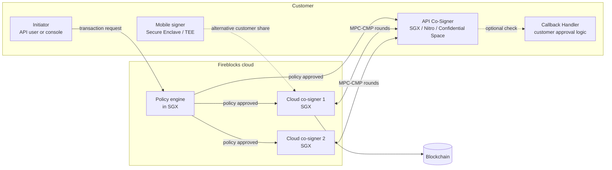
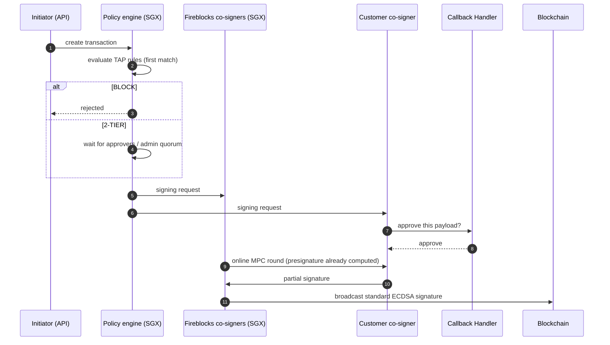
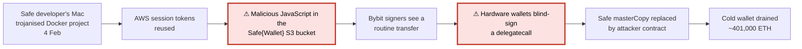
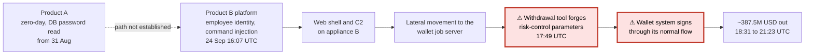

[Fireblocks](https://www.fireblocks.com/) is a custody and wallet infrastructure company used by exchanges, banks, payment companies and funds to hold and move digital assets. Its wallets have no single private key: the key exists only as shares spread across several machines, which sign together through a multi-party computation (MPC) protocol, and each share sits inside a hardware-isolated environment such as Intel SGX or an AWS Nitro Enclave. A policy engine decides which transactions the shares are allowed to sign at all.

This article describes how those pieces fit together: the MPC-CMP and MPC-BAM protocols, the co-signer deployment options (SGX, AWS Nitro, Google Cloud Confidential Space), the Key Link integration with customer HSMs, and the backup and recovery path. It then reviews the incidents linked to Fireblocks and to MPC in general, and compares them with the attacks on Safe multisig wallets, the Bybit theft of February 2025 above all. The comparison leads to a less flattering conclusion than vendor marketing suggests: most large thefts since 2022 broke the operational layer around the key, not the key scheme itself.

> This article has been made with the help of [Claude Code](https://claude.com/product/claude-code) and several custom skills

[TOC]

## Company and product scope

Fireblocks was founded in 2018 by Michael Shaulov, Idan Ofrat and Pavel Berengoltz ([Calcalist](https://www.calcalistech.com/ctech/articles/0,7340,L-3928064,00.html)). It raised a 550 million USD Series E at an 8 billion USD valuation in January 2022 ([The Block](https://www.theblock.co/post/131952/fireblocks-raises-550-million-in-series-e-funding-now-valued-at-8-billion)). In January 2026 the company stated that more than 10 trillion USD in digital assets had been transferred through the platform, over 120 blockchains, and it listed BNY, Worldpay, Galaxy and Revolut among its clients ([PR Newswire](https://www.prnewswire.com/news-releases/fireblocks-acquires-tres-finance-to-deliver-the-first-unified-operating-system-for-digital-assets-302654983.html)). Its presentation at the NIST MPTS 2026 workshop cites more than 2,400 institutional customers.

The product line has grown beyond the MPC wallet:

- **MPC wallets and vaults**, the core custody product described in this article.
- **Fireblocks Network**, a directory of exchanges, liquidity providers and counterparties with automatically authenticated deposit addresses.
- **Off Exchange**, launched in November 2023 with Deribit, where trading collateral sits in an MPC wallet that neither the trader nor the exchange controls alone, and the exchange only mirrors the balance ([press release](https://fireblocks.com/press/fireblocks-launches-off-exchange-the-first-solution-to-truly-mitigate-exchange-counterparty-risk-with-deribit-as-first-live-exchange-integration/)).
- **Embedded Wallets** (formerly Non-Custodial Wallets, NCW), a 2-of-2 MPC wallet between the end user's device and Fireblocks, now extended by the acquisition of the wallet and authentication company Dynamic in October 2025 ([The Block](https://www.theblock.co/post/375939/fireblocks-crypto-authentication-dynamic-web3)).
- **Key Link**, which lets a customer keep signing keys in its own HSM or KMS while using the Fireblocks workflow.
- **Fireblocks Network for Payments**, a stablecoin payment network launched in September 2025.

## Architecture overview

A Fireblocks customer works inside a **workspace**. Assets are grouped into **vault accounts**, each holding one or more wallets (one address per blockchain), and vault accounts can be segregated per client or used as omnibus accounts ([developer documentation](https://developers.fireblocks.com/docs/what-is-fireblocks)).

Four mechanisms protect a workspace, and each addresses a different attacker:

| Layer | What it controls | Attacker it targets |
|-------|------------------|---------------------|
| MPC key shares | Who can produce a signature | Theft of a single server, device or database |
| Hardware isolation (SGX, Nitro, Secure Enclave) | Where shares and policy code run | A root-level attacker on the host, a cloud insider |
| Transaction Authorization Policy (TAP) | Which transactions may be signed | A compromised API key or user, a fat-finger error |
| Admin Quorum | Who may change users, policies and whitelists | A single compromised administrator |

The **Admin Quorum** is the minimum number of administrators required to approve workspace changes such as adding a user or a whitelisted address. The **Transaction Authorization Policy** is an ordered list of rules, evaluated first match wins, whose action is `ALLOW`, `BLOCK` or `2-TIER` (route to additional approvers). Rules filter on initiator, source, destination, asset and amount, with per-transaction or time-window limits ([TAP reference](https://developers.fireblocks.com/reference/configure-transaction-authorization-policy)). According to Fireblocks, the policy engine itself runs inside SGX enclaves and its check is distributed across several MPC servers, so that a compromised server cannot approve a transaction the policy forbids.

### Who holds the key shares

In the default configuration the signing key is split across three co-signers: two operated by Fireblocks in its cloud, and one held by the customer, either on an administrator's mobile device or in an **API Co-Signer** server. Fireblocks support documentation describes this as one third of the key material on the customer side and two thirds on the Fireblocks side, and the workspace backup procedure refers to "the two cloud key shares". The exact threshold is not published in the material reviewed here; what the documentation does state is that a signature requires participation from both sides, so neither Fireblocks nor the customer can sign alone.

A **Hosted MPC** variant moves all three shares to the customer: a primary co-signer (mobile or API co-signer) plus customer-run SGX "guard" co-signers.

The customer cannot split its own share into a k-of-n among its staff. The customer side can hold several shares, but they sit side by side and are not combined: according to the [Fireblocks mobile app documentation](https://support.fireblocks.io/hc/en-us/articles/8744575638044-About-the-Fireblocks-mobile-app), every user with the Owner, Admin or Signer role generates a key share of their own in the [secure enclave or TEE of their phone](https://support.fireblocks.io/hc/en-us/articles/9205187986844-Security-aspects-Signing-with-the-Fireblocks-mobile-app), and the Owner approves each new share. Approvers, Editors and Viewers hold no share. Requiring several people on the customer side is a policy setting, not a cryptographic one: a TAP rule names the approvers and their number, and the policy engine releases the request to the co-signers only once they have approved. Hosted MPC is the only option where the customer holds every share needed to sign, and it gets there by replacing Fireblocks' two shares, not by splitting the customer's.

The API Co-Signer holds the MPC key share for API users and the configuration keys used to approve workspace changes. It can call a **Callback Handler**, an HTTPS endpoint the customer writes, which approves or rejects each signing request; if the handler does not answer within 30 seconds the request fails ([co-signer architecture](https://developers.fireblocks.com/docs/cosigner-architecture-overview)). This hook is the place where a customer can add its own independent verification of a transaction before its share takes part in a signature.

## The MPC protocols

Fireblocks does not reconstruct the private key to sign. Each party runs a threshold signature protocol (TSS) on its share and the parties jointly output a standard ECDSA or EdDSA signature, which the blockchain cannot distinguish from a single-key signature. The general theory is covered in [an earlier article on MPC]({{site.url_complet}}/2024/10/21/mpc-protocol-overview/); this section looks at the protocols Fireblocks ships.

### MPC-CMP

**MPC-CMP** is the threshold ECDSA protocol of Canetti, Makriyannis and Peled ([ePrint 2020/492](https://eprint.iacr.org/2020/492)), later merged with the work of Gennaro and Goldfeder into **CGGMP** ([ePrint 2021/060](https://eprint.iacr.org/2021/060), "UC Non-Interactive, Proactive, Threshold ECDSA with Identifiable Aborts"). Its properties, as stated in the paper:

- **Presigning.** Most of the signing work does not depend on the message and can be precomputed. Only the final round needs the message, which is why Fireblocks markets it as "1 signing round" versus 9 for GG18; the figure describes the online phase.
- **Proactive security.** Shares can be refreshed periodically without changing the public key or the blockchain address, so an attacker must compromise enough parties within the same refresh period.
- **Identifiable aborts.** When a signing fails, the honest parties can identify which party misbehaved instead of retrying blindly.
- **Universal composability (UC)** security against adaptive corruption, under Strong RSA, DDH and Paillier assumptions in the random oracle model.

Fireblocks released MPC-CMP in May 2020 as free to use, and published its C++ implementation as [fireblocks/mpc-lib](https://github.com/fireblocks/mpc-lib) under the GPL-3.0 licence in 2023. According to the repository's `SECURITY.md`, the code was audited by NCC Group. Besides ECDSA MPC-CMP, the library contains EdDSA (including an asymmetric, offline variant for cold workspaces), MPC-BAM since August 2025, and since July 2026 FROST Schnorr signing and a `SECURITY-MODEL.md`. That security model assumes malicious adversaries with at least one honest party, and leaves storage, transport authentication and policy enforcement to the integrator.

### MPC-BAM

**MPC-BAM**, announced in December 2024, is a two-party ECDSA protocol described in ["Two-Round 2PC ECDSA at the Cost of 1 OLE"](https://eprint.iacr.org/2024/1950) (Adjedj, Blokh, Couteau, Galansky, Joux, Makriyannis). Fireblocks reports a signature in about 50 ms with about 2 KB of bandwidth, and its support documentation states the protocol was audited by Trail of Bits. It is opt-in per API user and requires a recent co-signer version on SGX, Nitro or GCP. Fireblocks and 3MI Labs presented both CGGMP21 and BAM to NIST's threshold cryptography call in January 2026.

### Signing flow

## Hardware isolation: SGX, AWS Nitro and Confidential Space

MPC removes the single key, but each share is still a secret on a computer. Fireblocks stores its cloud shares inside **Intel SGX** enclaves and states that they "cannot be extracted" from there. The customer side can choose among three enclave technologies for its API Co-Signer ([co-signer architecture](https://developers.fireblocks.com/docs/cosigner-architecture-overview)):

| Option | Hosting | Parties trusted | Note from Fireblocks docs |
|--------|---------|-----------------|---------------------------|
| Intel SGX | On-premises, Azure, IBM Cloud, Alibaba Cloud | Intel and Fireblocks | Smallest trust base, slowest option |
| AWS Nitro Enclaves | AWS EC2 | AWS, Fireblocks | Recommended migration path for older KMS-based AWS co-signers |
| Google Cloud Confidential Space | GCP | Google, Fireblocks | Same trade-off as Nitro |

### The Nitro co-signer in detail

[AWS Nitro Enclaves]({{site.url_complet}}/2025/07/17/aws-nitro-enclaves-overview/) are isolated virtual machines carved out of an EC2 instance, with no network, no persistent storage and no interactive access; the only channel is a vsock to the parent instance. The [Fireblocks Nitro co-signer](https://developers.fireblocks.com/docs/aws-nitro-api-co-signer) uses that isolation together with AWS KMS attestation:

1. Fireblocks ships the co-signer as a signed enclave image file (EIF).
2. On first start, the enclave asks AWS KMS for a 128-bit AES data key (`FBKS-DB-Key`) that encrypts the co-signer's database, which holds the key share.
3. The data key is stored in S3, encrypted under a customer-managed KMS key (CMK).
4. The CMK's key policy only releases the key to an enclave whose attestation document shows the expected measurements; **PCR8** binds it to an image signed by Fireblocks.

The parent EC2 instance therefore only ever sees ciphertext. An attacker with root on the instance, or an AWS operator without the ability to forge an attestation, cannot read the share. The trust base still includes AWS (the Nitro hypervisor and the KMS attestation check) and Fireblocks (whoever signs the image). The [AWS re:Invent session summarised here]({{site.url_complet}}/2025/07/29/aws-blockchain-wallets/) shows the same design from the AWS side.

### Mobile signers

When the customer share lives on a phone, it is generated inside the iOS Secure Enclave or the Android TEE and is never exported in plaintext. Each use requires a six-digit PIN plus a biometric or a YubiKey, and the backup of the share is encrypted with the user's passphrase before being sent to Fireblocks.

## HSMs and other providers: Key Link

Banks and custodians often already operate certified HSMs and are required by their regulator or auditor to keep keys there. [Key Link](https://fireblocks.com/blog/introducing-fireblocks-key-link-a-seamless-integration-for-existing-key-management-solutions/), announced in December 2024, lets them keep the private key in their own HSM or KMS while using Fireblocks for policies, workflow and connectivity. In that mode Fireblocks does **not** use MPC for the key: it only receives public keys, whose ownership is proven, and forwards signing requests.

The flow is:

- The open-source **Keylink Agent**, deployed at the customer, polls Fireblocks for signing requests.
- The agent forwards each request to a **Customer Server** that the customer builds, which calls the HSM or KMS (on-premises or cloud, hot or cold).
- Two key types exist: **validation keys**, approved once by the Admin Quorum, and **signing keys**, which must carry a certificate from a validation key plus a proof of ownership.

Two HSM vendors publish Key Link integration guides: [Thales Luna](https://thalesdocs.com/gphsm/integrations/guides/fireblocks/index.html) (secp256k1 ECDSA on Luna 7.x firmware, Ed25519 from firmware 7.8.9, RSA-2048 validation keys) and [Securosys Primus](https://docs.securosys.com/fireblocks/overview). The design is vendor-agnostic, so any HSM or KMS that supports the curve can sit behind the Customer Server, but those are the only documented integrations found for this article.

The security model changes accordingly. With Key Link, the key is a single key protected by the HSM's tamper resistance and access control (see the [PCI PTS HSM article]({{site.url_complet}}/2026/07/20/pci-pts-hsm-security-requirements-v4/) for what an HSM certification checks), and the customer's Customer Server becomes the component that decides what the HSM signs. The protection against a forged request is the customer's own code, not the MPC quorum.

## Backup and disaster recovery

Custody that cannot be recovered when the vendor disappears is a counterparty risk. Fireblocks addresses it with an offline recovery kit:

1. The workspace owner generates an RSA key pair with the offline Recovery Utility, on an air-gapped machine, and uploads only the public key.
2. Fireblocks encrypts the cloud key shares into a recovery kit under that RSA public key.
3. Recovery of the full private key needs three items: the kit, the RSA private key, and the owner's mobile recovery passphrase.

For Embedded Wallets, the disaster-recovery kit is encrypted to a customer RSA-4096 key, and the full key is only assembled during an end-user "full key takeover". The recovery path is, by design, the one place where the complete key can exist, so the RSA private key and the passphrase deserve the same protection as a cold wallet seed; a natural place for that RSA key is an offline HSM, though Fireblocks documentation does not require one.

## Previous accidents and vulnerabilities

### Vulnerabilities in Fireblocks' own MPC

The one public vulnerability affecting Fireblocks' product concerned its **legacy GG18-based** MPC, not MPC-CMP. In December 2021 Fireblocks [disclosed](https://www.fireblocks.com/blog/vulnerabilities-discovered-and-patched-in-legacy-mpc-algorithm-fireblocks-urges-move-to-mpc-cmp) a key-extraction attack caused by a missing range proof in GG18/GG20, found by its own researchers and demonstrated together with Omer Shlomovits' team. Fireblocks patched its legacy wallets within 96 hours and reported no evidence of exploitation. No CVE or GitHub advisory against `mpc-lib` was found for the period since then, which does not exclude privately handled bug-bounty reports.

### MPC vulnerabilities found by Fireblocks in other wallets

Fireblocks' research team has been one of the main sources of public attacks on threshold ECDSA implementations:

- **BitForge** (August 2023, [ePrint 2023/1234](https://eprint.iacr.org/2023/1234), Black Hat USA "Small Leaks, Billions of Dollars"). Two bug classes affected more than 15 providers. In GG18/GG20, a missing zero-knowledge proof that the Paillier modulus is well-formed (CVE-2023-33241) let one malicious party extract the key in as few as 16 signatures. In Lindell17 two-party ECDSA, mishandled aborts leaked about one key bit per failed signature (CVE-2023-33242), roughly 200 to 256 attempts in total; ZenGo and Coinbase WaaS were affected and fixed it ([Fireblocks](https://fireblocks.com/blog/bitforge-fireblocks-researchers-uncover-vulnerabilities-in-over-15-major-wallet-providers/)).
- **CGGMP21 Rust library** (2025). Fireblocks researcher Arik Galansky reported two issues to Dfns: a missing check in the Paillier-Blum modulus proof, inherited from the 2021 paper itself, and a forgery combining presignatures with raw-hash signing ([Dfns write-up](https://dfns.co/article/cggmp21-vulnerabilities-patched-and-explained.md)). The first one is a reminder that the paper behind MPC-CMP also had to be corrected; whether `mpc-lib` was exposed is not stated in any public source found.

Other teams found comparable bugs: **Alpha-Rays** ([ePrint 2021/1621](https://eprint.iacr.org/2021/1621), ZenGo) on GG18/GG20, **TSSHOCK** ([Verichains](http://verichains.io/tsshock/), 2023) on GG18/GG20/CGGMP21 implementations including tss-lib and THORChain, the tss-lib CVEs disclosed by io.finnet and Kudelski in 2023, and a Multichain fastMPC bug where the Ntilde proof iterations had been cut from 128 to 1. **No confirmed theft caused by an MPC protocol bug** was found in any of these cases. They were all disclosures with proofs of concept.

### Incidents involving Fireblocks customers

| Incident | Loss | Role of Fireblocks | Root cause |
|----------|------|--------------------|------------|
| StakeHound, Jun 2021 | 38,178 ETH (about 75M USD), lost, not stolen | Fireblocks' research team generated BLS key shares for StakeHound's ETH 2.0 validators, managed outside the Fireblocks platform; StakeHound sued Fireblocks in Tel Aviv, and Fireblocks says it was never in charge of the keys ([The Block](https://www.theblock.co/post/109277/staking-company-serves-fireblocks-with-a-lawsuit-over-private-keys-to-over-75-million-in-eth), [Calcalist](https://calcalistech.com/ctech/articles/0,7340,L-3910814,00.html)) | Key backup unusable: according to StakeHound, the backup lacked the keys needed to decrypt two key shares, and both were lost |
| Deribit, Nov 2022 | 28M USD | Remediation: Deribit moved its whole hot wallet to Fireblocks after the theft ([report](https://insights.deribit.com/exchange-updates/1-november-incident-report-and-next-steps/)) | Legacy, non-Fireblocks hot wallet; cause undisclosed |
| Fortress Trust, Sep 2023 | 12 to 15M USD | Customer; Fireblocks says the breach was outside its platform and its policy engine stopped transfers once the configured limit was hit ([Fireblocks](https://www.fireblocks.com/blog/in-response-to-the-fortress-trust-hack-dated-september-12-2023)) | Third-party portal vendor compromised by phishing |
| Bybit, Feb 2025 | 1.46B USD | Bybit used Off Exchange; Fireblocks states those funds were unaffected | Safe multisig cold wallet (see below) |
| Phemex, Jan 2025 | 70 to 85M USD | Remediation: custody rebuilt on Fireblocks MPC and AWS Nitro afterwards | Hot wallet key or access compromise |
| WazirX, Jul 2024 | 235M USD | Remediation: Fireblocks integrated in January 2026 | Safe multisig with Liminal (see below) |
| Bitget, Sep 2026 | 351.6 to 387.5M USD | Bitget had announced a Fireblocks Off Exchange integration for institutional clients in June 2026 ([TechFlow](https://www.techflowpost.com/en-US/newsletter/125690)); neither [Mandiant's status report](https://img.bgstatic.com/multiLang/events/MFR26-1029_Status_Update_Bitget_0930.pdf) nor [SlowMist's progress report](https://github.com/slowmist/Knowledge-Base/blob/master/open-report-V2/incident-response/SlowMist%20Investigation%20Progress%20Report%20-%20Bitget_en-us.pdf) mentions Fireblocks, and the stolen hot-wallet funds were signed by Bitget's own wallet system | Third-party security appliances compromised (zero-day on one product from 31 August, an employee identity on the other, per SlowMist), wallet job server taken over, custom tool forging risk-control parameters (see below) |

Fortress Trust is the most instructive case. The attacker never touched a key share; they obtained legitimate access through a vendor and issued transactions the workspace accepted. MPC did nothing against that, and the TAP amount limit is what capped the loss. No public incident was found in which a Fireblocks key share, enclave or cloud co-signer was compromised. StakeHound is the closest case, and it is a loss of availability, not a theft: validator key shares generated by Fireblocks outside its platform could no longer be decrypted, and responsibility is disputed in court. Bitget is listed for its operational lessons; the public reports tie the theft to its own wallet back end, not to its Fireblocks integration. Operationally, third-party trackers report short service disruptions (for example delayed finalisation for about two hours in February 2026), not breaches.

## Comparison with Safe multisig hacks

[Safe](https://safe.global/) (formerly Gnosis Safe, see [the earlier tutorial]({{site.url_complet}}/2022/08/12/multisig-wallet-gnosis/)) is a smart-contract multisig: each signer holds an ordinary key, often on a hardware wallet, and the contract executes a transaction once m of n signatures are collected. The threshold is on-chain and auditable; with MPC it is inside the protocol and invisible on-chain.

### Bybit, February 2025

The largest crypto theft on record, about 401,000 ETH (1.46 billion USD), was attributed by the FBI to the North Korean group TraderTraitor ([IC3 PSA](https://www.ic3.gov/PSA/2025/PSA250226)). The chain of events, from Safe's statement and the interim forensics of Sygnia and Verichains ([The Block](https://www.theblock.co/post/343530)):

1. A Safe{Wallet} developer's macOS machine was compromised on 4 February through a trojanised Docker project delivered by social engineering. The attackers then used live AWS session tokens.
2. Malicious JavaScript was placed in the Safe{Wallet} front-end bucket on AWS S3 about two days before the attack. It activated only for Bybit's Safe and one other address.
3. Bybit's signers, on hardware wallets, saw a routine transfer in the interface and blind-signed a payload that was in fact a `delegatecall` replacing the Safe's `masterCopy` with an attacker contract.
4. The attacker drained the cold wallet. The malicious files were replaced with clean ones about two minutes later.

No Safe contract bug and no key extraction were involved. The signers' keys were used as intended, on a transaction they could not read.

### WazirX and Radiant Capital, 2024

- **WazirX** (July 2024, 235M USD) used a Safe multisig with five WazirX signers and one Liminal signer. The signers approved an upgrade to a malicious implementation while the interface showed something else. WazirX and Liminal still blame each other's environment ([Wikipedia summary](https://en.wikipedia.org/wiki/2024_WazirX_hack)).
- **Radiant Capital** (October 2024, about 50M USD): malware on at least three developers' machines displayed legitimate transactions in the Safe interface while malicious ones were sent to the hardware wallets. Simulation in Tenderly showed nothing wrong. Mandiant attributed it to DPRK ([crypto.news](https://crypto.news/post-mortem-reveals-stealthy-malware-injection-led-to-50m-radiant-capital-exploit/)).

### Bitget, September 2026

Bitget is not a Safe case, but it is the largest theft since Bybit and it failed on the same point: the signer trusted what it was told to sign. About 351.6 to 387.5 million USD left its hot and warm wallets on 24 September (UTC), in XRP, ETH, USDT, USDC, BNB, AVAX, TRX, ZEC and Tether Gold. The chain of events below combines [Mandiant's status report](https://img.bgstatic.com/multiLang/events/MFR26-1029_Status_Update_Bitget_0930.pdf) of 28 September and [SlowMist's investigation progress report](https://github.com/slowmist/Knowledge-Base/blob/master/open-report-V2/incident-response/SlowMist%20Investigation%20Progress%20Report%20-%20Bitget_en-us.pdf) of 29 September; both reports give times in UTC+8, converted to UTC here.

1. From 31 August, according to SlowMist, a zero-day in a service on one node of a third-party security product (Product A) let the attacker run a hidden script that read the database password from an environment variable and connect to the database. The same activity reappeared on two other nodes on 23 and 25 September (UTC+8, no time given).
2. On 24 September at 16:07, the attacker logged into the management platform of the second product (Product B) with an internal employee's identity, tried three command injections in task parameters, then used the platform's web execution endpoint to change the server configuration, write a relay file and upload malicious programs. Mandiant describes the same stage as privileged access to appliances A and B, a web shell on appliance B and a command-and-control connection.
3. From appliance B, the attacker moved laterally to Bitget's production **wallet job server** and deployed malicious packages there (Mandiant).
4. At 17:49, a withdrawal tool written for Bitget's wallet system started running. SlowMist recovered it from files the attacker had deleted: it forged the risk-control parameters, built withdrawal requests and called the normal withdrawal process.
5. From 18:31:00 to 21:23:11, the wallet system signed and broadcast the transfers across several chains, alongside legitimate internal operations. Monitoring raised the alert at 18:31, at the first transfer, but the outflow lasted almost three more hours.
6. After about 21:22, the attacker edited withdrawal records directly in the wallet database and launched withdrawal tasks on the host; two fabricated BTC withdrawal orders entered processing and returned errors.

No private key was extracted and the cold wallets were untouched. As at Bybit, the keys were used as intended; the difference is that neither report mentions any human approval in the withdrawal path. The risk-control check sat upstream of the signer, in the same back end the attacker controlled, so forging its output was enough. Neither report says how the attacker got from Product A to Product B, and both investigations were still open when they were published.

Mapped onto the controls described above, the attack did not need to break any key protection. What could have limited it is a check the attacker could not reach: a policy engine or Callback Handler outside the compromised network, a destination whitelist that only an admin quorum can change, and per-vault limits low enough that three hours of outflow from a hot wallet cannot reach hundreds of millions. Each of these depends on how strictly it is configured, as Fortress Trust showed.

### Robustness compared

The table below compares the schemes on the failure modes that actually caused losses. It is a qualitative reading of the documented designs and incidents, not a benchmark.

| Failure mode | Safe multisig (default use) | Fireblocks MPC | HSM-only custody (incl. Key Link) | In-house signing service |
|--------------|-----------------------------|----------------|-----------------------------------|--------------------------|
| Theft of one key or device | Resisted if below threshold | Resisted, share alone is useless and sits in an enclave | Resisted by tamper-resistant hardware | Depends on design |
| Compromised front end / UI shows a fake transaction | **Failed** (Bybit, WazirX, Radiant) | Mitigated by server-side policy and transaction decoding, if rules are strict | Not addressed by the HSM itself | Depends on design |
| Compromised backend issuing forged requests | Each signer must still sign manually | Mitigated by TAP rules, Callback Handler and admin quorum; limits cap the loss | Customer Server is the single check | **Failed** (Bitget 2026, BigONE 2025) when the signer trusts the backend |
| Compromised vendor or third-party tool | Safe{Wallet} front end was the vector | Fortress Trust: loss capped by policy, not prevented | Vendor risk moves to the HSM supplier | Bitget: compromised security appliances |
| Insider or key concentration | Visible on-chain (signer set) | Hidden; relies on vendor and enclave integrity | Relies on HSM access controls | Multichain: MPC nodes on the CEO's account |
| Protocol / cryptographic bug | Smart-contract risk, well audited | Several TSS bugs found industry-wide, none exploited in the wild | Mature, certified primitives | Depends |
| Transparency and auditability | Full, on-chain | Low, closed platform plus an open library | Certification reports | Low |

Three observations follow from the incidents.

- **The signature scheme was rarely the weak point.** Bybit, WazirX and Radiant all used a sound multisig with hardware wallets, and the keys were never extracted. The attack replaced *what* was signed. MPC removes the key-theft class but does not solve this one by itself.
- **The decisive control is independent verification at the signer.** Fireblocks' answer is that the policy engine, running in enclaves on Fireblocks' side, checks destination and amount against rules that an attacker on the customer's front end cannot change without the admin quorum. That defence holds only as long as the rules are restrictive (whitelisted destinations, low limits on hot vaults). A workspace with a permissive `ALLOW` rule is close to a blind signer.
- **The same failure hits non-multisig systems.** Bitget lost up to 387.5 million USD in September 2026 when attackers, entering through two compromised third-party security appliances (one through a zero-day, the other with an employee's identity), took over the wallet job server and forged the risk-control parameters; Bitget's own wallet system then signed the transfers (see [Bitget, September 2026](#bitget-september-2026), based on the Mandiant and SlowMist reports). BigONE (July 2025) failed the same way. The problem is a signer that trusts the host telling it what to sign, whatever the key scheme.

There is also a cost on the Fireblocks side of the ledger. A Safe's signer set and threshold can be read by anyone on-chain; a Fireblocks wallet is an ordinary address, and the customer must trust Fireblocks' SGX deployment, its image signing and its policy engine. The Bybit theft itself started with the compromise of a wallet vendor's developer, and Fireblocks is a wallet vendor whose cloud co-signers take part in every signature. Taylor Monahan's remark after Bybit, that adding security products can make "your attack surface LARGER" ([Blockworks](https://www.blockworks.com/news/security-firms-react-to-bybit-hack)), applies to any vendor in the signing path, Fireblocks included. Its [own post on Bybit](https://www.fireblocks.com/blog/bybit-attack-security-flaws-fireblocks-nation-state-resilient-solutions) argues that its design would have prevented the attack, but that claim has not been independently tested.

## Conclusion

Fireblocks combines threshold signatures, hardware isolation and a server-side policy engine, so that no single machine, employee or administrator can move funds on its own.

- **MPC-CMP** (CGGMP) gives one-round online ECDSA signing, proactive share refresh and identifiable aborts; **MPC-BAM** adds a faster two-party variant. Both are published, and the implementation is open source and audited.
- **Key shares** are split between Fireblocks' SGX cloud co-signers and a customer co-signer, which can run on SGX, **AWS Nitro Enclaves** (KMS keys released only to an attested, Fireblocks-signed image) or Google Cloud Confidential Space, or on a phone's secure element.
- **Key Link** connects customer HSMs such as Thales Luna and Securosys Primus; in that mode the protection is the HSM and the customer's own approval server, not MPC.
- **No theft through a broken Fireblocks key share or MPC protocol is publicly known.** The one product vulnerability (legacy GG18, 2021) was patched without known exploitation, and Fireblocks' research disclosed several key-extraction bugs in other vendors' MPC.
- **The large losses of 2024 to 2026 were operational.** Safe users lost funds to falsified interfaces and blind signing, and non-multisig systems (Bitget, BigONE) lost funds to backends trusted by their signer. Fortress Trust shows that a Fireblocks customer can also be drained through legitimate access, with policy limits reducing the loss.

The practical comparison is therefore less "MPC versus multisig" than "is there a check, outside the attacker's reach, of what is being signed". Fireblocks provides one through its policy engine, at the price of trusting a closed vendor; a Safe can provide one through independent transaction decoding and hardware wallets that display the real payload.

## Annex

### Key Terms

| Term | Definition |
|------|------------|
| **Custody** | Holding the means to move digital assets on behalf of oneself or a client, in practice controlling the private keys. |
| **Multisig** | A smart-contract wallet such as Safe that executes a transaction only after m of n independent signatures are collected on-chain. |
| **Multi-party computation (MPC)** | Cryptographic techniques that let several parties compute a function over their secret inputs without revealing them to each other. |
| **Threshold signature scheme (TSS)** | An MPC protocol in which shares of one private key jointly produce a standard signature without the key ever being reassembled. |
| **Key share** | One party's secret piece of a threshold key; alone it reveals nothing about the key and cannot sign. |
| **MPC-CMP / CGGMP** | The threshold ECDSA protocol of Canetti, Gennaro, Goldfeder, Makriyannis and Peled, with presigning, proactive refresh and identifiable aborts, used by Fireblocks. |
| **MPC-BAM** | Fireblocks' two-party, two-round ECDSA protocol based on oblivious linear evaluation, faster than MPC-CMP. |
| **Presignature** | The message-independent part of a threshold signature, computed in advance so that only one online round is needed. |
| **Proactive refresh** | Periodic re-randomisation of key shares that keeps the same public key, invalidating shares stolen in earlier periods. |
| **Paillier encryption** | An additively homomorphic encryption scheme used inside threshold ECDSA; malformed Paillier keys were the root of BitForge and related attacks. |
| **Intel SGX** | A CPU feature creating enclaves whose memory is encrypted and isolated from the operating system and hypervisor. |
| **AWS Nitro Enclave** | An isolated VM carved from an EC2 instance, without network or storage, able to prove its code identity to AWS KMS through attestation. |
| **Attestation / PCR** | A signed statement of an enclave's measured code; Platform Configuration Registers such as PCR8 bind a KMS key to a specific signed image. |
| **API Co-Signer** | The customer-run server that holds the customer's key share for automated (API) signing and can call a Callback Handler. |
| **Transaction Authorization Policy (TAP)** | Fireblocks' ordered rule set that allows, blocks or escalates each transaction by initiator, source, destination, asset and amount. |
| **Admin Quorum** | The number of administrators required to approve workspace changes such as new users, whitelisted addresses or policies. |
| **HSM** | A certified tamper-resistant device that generates and uses keys without exposing them. |
| **Key Link** | The Fireblocks integration that keeps signing keys in a customer HSM or KMS, reached through an open-source agent and a customer server. |
| **Blind signing** | Approving a transaction on a device that cannot show its real content, the mechanism exploited in the Bybit, WazirX and Radiant thefts. |
| **Off Exchange** | A Fireblocks service where exchange collateral stays in an MPC wallet shared by trader and exchange instead of the exchange's custody. |

### Security Implementation Checklist

These checks apply to any institutional custody deployment, MPC-based or multisig, and are derived from the incidents above.

#### Keys and shares

| Check | Security requirement | Failure mode if violated |
|:---:|------------|------------|
| ☐ | Every key share or signer key lives in a hardware-isolated environment (enclave, secure element, HSM). | A single compromised host leaks key material. |
| ☐ | No party, including the vendor or a founder, controls enough shares or signers to move funds alone. | Insider theft or loss of access, as with Multichain. |
| ☐ | Threshold ECDSA implementations validate Paillier moduli and range proofs, and handle aborts without leaking. | Key extraction through BitForge, TSSHOCK or Alpha-Rays class bugs. |
| ☐ | Enclave key release is bound to attestation of a specific signed image. | A modified co-signer image could read the share. |
| ☐ | Recovery material (RSA backup key, passphrase) is stored offline and split across custodians. | The recovery path reconstructs the full key for whoever holds it. |

#### Transaction verification

| Check | Security requirement | Failure mode if violated |
|:---:|------------|------------|
| ☐ | Outgoing destinations are restricted to a whitelist changed only by an admin quorum. | A forged request sends funds to an attacker address. |
| ☐ | Hot and warm vaults carry per-transaction and per-period amount limits. | A single compromise drains the whole balance instead of a capped amount. |
| ☐ | Contract calls such as upgrades, `delegatecall` or approvals are decoded and verified on a device independent of the initiating machine. | Blind signing of a malicious upgrade, as with Bybit and WazirX. |
| ☐ | The signer runs its own check (policy engine, Callback Handler) rather than trusting fields set by the wallet backend. | A compromised job server forges risk-control fields, as with Bitget. |
| ☐ | Third-party tools with access to the custody API are inventoried and hold least-privilege credentials. | Vendor compromise yields legitimate transaction rights, as with Fortress Trust. |

## Frequently Asked Questions

**Q: Does Fireblocks ever reconstruct the private key?**

Not during normal signing. The key shares run the MPC-CMP or MPC-BAM protocol and output a standard signature without the key being assembled. The full key can be reconstructed only through the disaster-recovery path, which requires the encrypted recovery kit, the customer's offline RSA private key and the owner's recovery passphrase. With Key Link, there is no MPC at all: the full key exists inside the customer's HSM.

**Q: What does the "one round" in MPC-CMP refer to?**

It refers to the online phase. Most of the signing computation is independent of the message and is done in advance as a presignature. When a transaction arrives, the parties need only one more round of communication to produce the signature. The total protocol has several rounds, but they are run before the message is known.

**Q: How does an AWS Nitro Enclave protect the customer's key share?**

The co-signer database holding the share is encrypted with a data key from AWS KMS. That data key is itself encrypted under a customer-managed KMS key whose policy only releases it to an enclave presenting a valid attestation, with PCR8 matching an image signed by Fireblocks. The parent EC2 instance has no access to enclave memory, so root on the instance is not enough to read the share. AWS and Fireblocks remain in the trust base.

**Q: Would Fireblocks have prevented the Bybit theft?**

Not by MPC alone. The Bybit attackers did not steal keys; they made the legitimate signers approve a malicious upgrade through a falsified interface. What could have stopped it in a Fireblocks setup is the policy layer:

- a whitelist that does not include the attacker's contract;
- an amount limit on the vault;
- a rule requiring additional approvers for contract calls;
- a Callback Handler that independently decodes the payload.

These controls exist but are configured by the customer, and Fireblocks' claim that its design would have prevented the attack has not been independently demonstrated.

**Q: Would Fireblocks have prevented the Bitget theft?**

Probably not prevented, but it could have capped it. Bitget's hot wallets were run by its own wallet system, not by Fireblocks (its Fireblocks integration covers Off Exchange for institutional clients), so this is a counterfactual. The attacker controlled the back end that creates withdrawals. In a Fireblocks setup, that back end is the API initiator, and the API Co-Signer runs in the customer's own infrastructure, so an attacker in that infrastructure could have submitted requests that Fireblocks would see as coming from a legitimate API user. The enclave would keep the key share out of reach, but the attacker did not need it at Bitget either.

What changes is where the last check runs:

- the Transaction Authorization Policy is evaluated in Fireblocks' cloud and can only be changed with the admin quorum, so the attacker cannot forge its result the way the risk-control parameters were forged at Bitget;
- amount and velocity limits on the hot vaults would have stopped the outflow long before it reached hundreds of millions of USD;
- a destination whitelist would block unknown addresses, but an exchange must pay arbitrary customer addresses, so it fits treasury transfers better than customer withdrawals;
- a Callback Handler helps only if it runs outside the compromised network; at Bitget the attacker moved from security appliances to the wallet server, so a handler on the same network could have been reached too.

The outcome would therefore depend on the rules: a hot vault with a permissive `ALLOW` rule and high limits would have signed the forged withdrawals as Bitget's own system did, while tight limits would have reduced the loss to the limit, as at Fortress Trust.

**Q: Why did none of the published MPC vulnerabilities lead to known thefts, while multisig wallets lost billions?**

The MPC bugs (BitForge, TSSHOCK, Alpha-Rays) required a malicious party inside the signing protocol or many signing requests, and they were disclosed and patched before any known exploitation. The multisig losses came from a much easier path: compromise a developer or a front end and let legitimate signers approve a malicious transaction. Attackers go for the cheapest step, and that step is usually the human and software layer around the signature, which affects MPC systems as well (Fortress Trust, Bitget).

**Q: What is the main trade-off between Safe multisig and Fireblocks MPC?**

A Safe exposes its signer set and threshold on-chain, so anyone can audit who controls the funds, and it depends on no single vendor for signing. Fireblocks hides the threshold inside the protocol and adds enclave isolation, proactive refresh and a server-side policy engine, but the customer must trust Fireblocks' infrastructure, which takes part in every signature. The first favours transparency and independence, the second favours centralised policy control and operational convenience.

## References

### Fireblocks documentation and announcements

- [Fireblocks - What is Fireblocks (developer docs)](https://developers.fireblocks.com/docs/what-is-fireblocks)
- [Fireblocks - API Co-Signer architecture overview](https://developers.fireblocks.com/docs/cosigner-architecture-overview)
- [Fireblocks - AWS Nitro API Co-Signer](https://developers.fireblocks.com/docs/aws-nitro-api-co-signer)
- [Fireblocks - Configure the Transaction Authorization Policy](https://developers.fireblocks.com/reference/configure-transaction-authorization-policy)
- [Fireblocks - Embedded Wallet high-level architecture](https://developers.fireblocks.com/docs/embedded-wallet-high-level-architecture)
- [Fireblocks - Introducing Key Link](https://fireblocks.com/blog/introducing-fireblocks-key-link-a-seamless-integration-for-existing-key-management-solutions/)
- [Fireblocks - Announcing the MPC-BAM protocol](https://www.fireblocks.com/blog/announcing-the-fireblocks-mpc-bam-protocol)
- [Fireblocks - MPC-CMP code is open source](https://www.fireblocks.com/blog/fireblocks-mpc-cmp-code-is-open-source)
- [Fireblocks - Off Exchange launch with Deribit](https://fireblocks.com/press/fireblocks-launches-off-exchange-the-first-solution-to-truly-mitigate-exchange-counterparty-risk-with-deribit-as-first-live-exchange-integration/)
- [Fireblocks - Support for AWS Nitro Enclaves](https://www.fireblocks.com/blog/support-for-aws-nitro-enclaves-on-fireblocks/)
- [PR Newswire - Fireblocks acquires TRES Finance (January 2026)](https://www.prnewswire.com/news-releases/fireblocks-acquires-tres-finance-to-deliver-the-first-unified-operating-system-for-digital-assets-302654983.html)
- [Fireblocks - About the Fireblocks mobile app](https://support.fireblocks.io/hc/en-us/articles/8744575638044-About-the-Fireblocks-mobile-app)
- [Fireblocks - Security aspects of signing with the Fireblocks mobile app](https://support.fireblocks.io/hc/en-us/articles/9205187986844-Security-aspects-Signing-with-the-Fireblocks-mobile-app)

### Cryptography papers

- [Canetti, Makriyannis, Peled - UC Non-Interactive, Proactive, Threshold ECDSA (ePrint 2020/492)](https://eprint.iacr.org/2020/492)
- [Canetti, Gennaro, Goldfeder, Makriyannis, Peled - UC Non-Interactive, Proactive, Threshold ECDSA with Identifiable Aborts (ePrint 2021/060)](https://eprint.iacr.org/2021/060)
- [Adjedj et al. - Two-Round 2PC ECDSA at the Cost of 1 OLE (ePrint 2024/1950)](https://eprint.iacr.org/2024/1950)
- [Makriyannis, Yomtov, Galansky - Practical Key-Extraction Attacks in Leading MPC Wallets (ePrint 2023/1234)](https://eprint.iacr.org/2023/1234)
- [Tymokhanov, Shlomovits - Alpha-Rays: Key Extraction Attacks on Threshold ECDSA Implementations (ePrint 2021/1621)](https://eprint.iacr.org/2021/1621)

### HSM integrations

- [Thales - Fireblocks Key Link integration guide for Luna HSM](https://thalesdocs.com/gphsm/integrations/guides/fireblocks/index.html)
- [Securosys - Fireblocks Key Link with Primus HSM](https://docs.securosys.com/fireblocks/overview)

### Vulnerability disclosures

- [Fireblocks - Vulnerabilities discovered and patched in legacy MPC algorithm (2021)](https://www.fireblocks.com/blog/vulnerabilities-discovered-and-patched-in-legacy-mpc-algorithm-fireblocks-urges-move-to-mpc-cmp)
- [Fireblocks - BitForge, vulnerabilities in over 15 wallet providers](https://fireblocks.com/blog/bitforge-fireblocks-researchers-uncover-vulnerabilities-in-over-15-major-wallet-providers/)
- [NVD - CVE-2023-33242 (Lindell17 abort)](https://nvd.nist.gov/vuln/detail/CVE-2023-33242)
- [Verichains - TSSHOCK](http://verichains.io/tsshock/)
- [Verichains - Multichain fastMPC key extraction (VSA-2022-120)](https://blog.verichains.io/p/vsa-2022-120-multichain-key-extraction)
- [io.finnet - Security disclosure for ECDSA and EdDSA threshold signature schemes](https://www.iofinnet.com/post/security-disclosure-for-ecdsa-and-eddsa-threshold-signature-schemes)
- [Dfns - CGGMP21 vulnerabilities patched and explained](https://dfns.co/article/cggmp21-vulnerabilities-patched-and-explained.md)

### Incidents

- [FBI IC3 - North Korea responsible for 1.5 billion USD Bybit hack](https://www.ic3.gov/PSA/2025/PSA250226)
- [The Block - Sygnia and Verichains findings on Bybit](https://www.theblock.co/post/343530)
- [Fireblocks - In response to the Fortress Trust hack](https://www.fireblocks.com/blog/in-response-to-the-fortress-trust-hack-dated-september-12-2023)
- [Deribit - 1 November incident report and next steps](https://insights.deribit.com/exchange-updates/1-november-incident-report-and-next-steps/)
- [Wikipedia - 2024 WazirX hack](https://en.wikipedia.org/wiki/2024_WazirX_hack)
- [crypto.news - Radiant Capital post-mortem](https://crypto.news/post-mortem-reveals-stealthy-malware-injection-led-to-50m-radiant-capital-exploit/)
- [Mandiant - Bitget incident response status report, 28 September 2026 (PDF)](https://img.bgstatic.com/multiLang/events/MFR26-1029_Status_Update_Bitget_0930.pdf)
- [SlowMist - Investigation Progress Report - Bitget, as of 29 September 2026 (PDF)](https://github.com/slowmist/Knowledge-Base/blob/master/open-report-V2/incident-response/SlowMist%20Investigation%20Progress%20Report%20-%20Bitget_en-us.pdf)
- [TechFlow - Bitget integrates Fireblocks Off Exchange (17 June 2026)](https://www.techflowpost.com/en-US/newsletter/125690)
- [The Block - StakeHound serves Fireblocks with a lawsuit over 75M USD in ETH](https://www.theblock.co/post/109277/staking-company-serves-fireblocks-with-a-lawsuit-over-private-keys-to-over-75-million-in-eth)
- [Calcalist - Loss of 75 million USD in Ether highlights infancy of crypto infrastructure](https://calcalistech.com/ctech/articles/0,7340,L-3910814,00.html)
- [Halborn - Bitget hack technical analysis (September 2026)](https://www.halborn.com/blog/post/bitget-hack-technical-analysis-september-2026)
- [Blockworks - Multichain exploit was an inside job](https://blockworks.co/news/multichains-exploit-inside-job)

### Going further

- [fireblocks/mpc-lib on GitHub](https://github.com/fireblocks/mpc-lib), including `SECURITY-MODEL.md`
- [Fireblocks - Bybit attack, security flaws and nation-state resilient solutions](https://www.fireblocks.com/blog/bybit-attack-security-flaws-fireblocks-nation-state-resilient-solutions)
- [Blockworks - Security firms react to the Bybit hack](https://www.blockworks.com/news/security-firms-react-to-bybit-hack)
- [a16z crypto - Lessons from the Bybit hack](https://a16zcrypto.com/posts/article/bybit-hack-lessons)
- [Black Hat USA 2023 - Small Leaks, Billions of Dollars (BitForge slides)](https://i.blackhat.com/BH-US-23/Presentations/US-23-Makriyannis-Small-Leaks-Billions-Of-Dollars.pdf)
- [Black Hat USA 2023 - TSSHOCK white paper](https://i.blackhat.com/BH-US-23/Presentations/US-23-Nguyen-TSSHOCK-Breaking-MPC-Wallets-wp.pdf)
- [NIST - Fireblocks and 3MI Labs threshold ECDSA presentation, MPTS 2026](https://csrc.nist.gov/csrc/media/presentations/2026/mpts2026-2a2/images-media/mpts2026-2a2-slides-fireblocks-3mi-ecdsa-nikos.pdf)
- [AWS - Nitro Enclaves cryptographic attestation](https://docs.aws.amazon.com/enclaves/latest/user/set-up-attestation.html)

### Related articles

- [Overview, security and applications of Multi-Party Computation (MPC)]({{site.url_complet}}/2024/10/21/mpc-protocol-overview/)
- [AWS Nitro Enclaves: Secure and Isolated Compute for Sensitive Data]({{site.url_complet}}/2025/07/17/aws-nitro-enclaves-overview/)
- [Blockchain wallets on AWS with Fireblocks and Circle]({{site.url_complet}}/2025/07/29/aws-blockchain-wallets/)
- [How to create a multisig wallet with Gnosis Safe]({{site.url_complet}}/2022/08/12/multisig-wallet-gnosis/)
- [PCI PTS HSM v4.0 — How Payment Hardware Security Modules Are Evaluated]({{site.url_complet}}/2026/07/20/pci-pts-hsm-security-requirements-v4/)
- [Crypto Hacks of 2024 - DMM Bitcoin, WazirX and a Year of Exchange Breaches]({{site.url_complet}}/2026/10/07/crypto-hacks-2024/)
