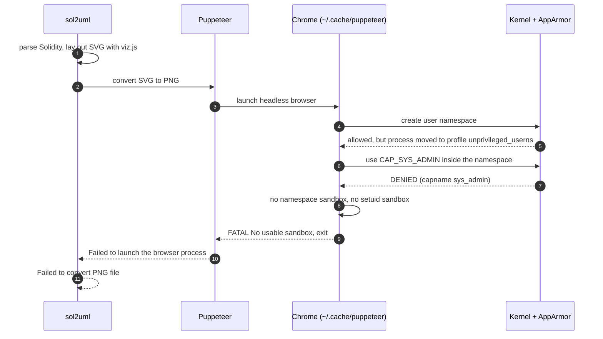

[sol2uml](https://github.com/naddison36/sol2uml) is a command-line tool that draws UML class diagrams from Solidity smart contracts. It parses the contracts, lays the classes out with Graphviz, and can write the result as SVG or PNG. On a recent Ubuntu release the PNG export fails before any image is written, with a Chrome error that ends in `No usable sandbox!`.

The cause is not sol2uml. Ubuntu uses [AppArmor](https://apparmor.net/), the Linux Security Module it enables by default, to decide which programs may create *unprivileged user namespaces*, and the browser sol2uml launches to rasterise its SVG is not one of them. This article explains what AppArmor is, how Ubuntu applies it to user namespaces and why, how that restriction stops sol2uml, and the remediations available, from the ones that keep the protection intact to the one that removes it.

The failure and every remediation marked as tested below were reproduced on a current Ubuntu LTS release with AppArmor 5 and sol2uml 2.5.26, while regenerating the class diagrams of a Solidity project.

> This article has been made with the help of [Claude Code](https://claude.com/product/claude-code) and several custom skills

[TOC]

## What sol2uml does, and where a browser comes in

sol2uml reads Solidity source files (or verified contracts fetched from a block explorer), builds a model of the contracts, interfaces, libraries and their relations, and renders it as a class diagram. A typical call draws one contract:

```bash
npx sol2uml class src/modules/VersionModule.sol -b VersionModule -d 0 -f png -o VersionModuleUML.png
```

The output format decides how many steps run:

- **`-f dot`** writes the Graphviz description of the diagram and stops.
- **`-f svg`** additionally lays it out with `@aduh95/viz.js`, a WebAssembly build of Graphviz bundled with sol2uml, and writes an SVG.
- **`-f png`** additionally converts that SVG to a PNG with the `convert-svg-to-png` package, which opens the SVG in a headless Chrome driven by [Puppeteer](https://pptr.dev/) and takes a screenshot of it.

Only the PNG path needs a browser. In sol2uml 2.5.26 the conversion is a single call in `lib/writerFiles.js`:

```javascript
const png = await convert(svg, {
    launch: { executablePath: puppeteer.executablePath() },
});
```

`puppeteer.executablePath()` returns the Chrome build that Puppeteer downloaded into the user's cache at install time, of the form `~/.cache/puppeteer/chrome/linux-<version>/chrome-linux64/chrome`. sol2uml passes no other launch option, which matters later: there is no flag to change how that browser starts.

## AppArmor in brief

AppArmor is a Linux Security Module (LSM). An earlier article, [Advanced GNU/Linux Security - SECCOMP and Linux Security Modules (LSM)]({{site.url_complet}}/2026/06/29/linux-advanced-security-seccomp-lsm/), places it among the other modules; the points needed here are short.

- **Mandatory access control.** The usual Unix checks are discretionary: the owner of a file decides who may use it. An LSM adds a second check that the administrator defines and that a process cannot lift for itself. The kernel calls the LSM hooks only after the discretionary check has passed, so access requires both.
- **Path-based profiles.** AppArmor attaches a *profile* to a program identified by the path of its executable, unlike SELinux, which labels files. A profile lists what the confined program may do: file paths and the access mode for each, capabilities, network families, signals, and, since AppArmor 4, the creation of user namespaces.
- **Modes.** A profile in *enforce* mode blocks and logs what it does not allow; in *complain* mode it only logs. A program with no profile runs *unconfined*.
- **Files and tools.** Profiles live in `/etc/apparmor.d/`, with local additions in `/etc/apparmor.d/local/`. `apparmor_parser` compiles and loads them into the kernel, `aa-status` lists what is loaded, and denials are written to the kernel audit log as lines tagged `apparmor="DENIED"`.

Ubuntu has shipped AppArmor enabled by default since release 7.10 (2007). Most of its profiles confine network daemons and a few desktop applications; the rest of the system runs unconfined. Until 2023, running unconfined only meant that AppArmor added no restriction; the user namespace rules below made it a condition that does restrict something.

## Unprivileged user namespaces, and why Ubuntu restricts them

A user namespace gives a process its own mapping of user and group identifiers. Inside it, a process can be root (UID 0) and hold a full set of capabilities, while remaining an ordinary user on the host. Since Linux 3.8, an unprivileged process can create one. This is what rootless containers, Flatpak's `bubblewrap` and browser sandboxes are built on; the isolation side is covered in [Linux Isolation Primitives - Defense in Depth Beyond the Castle Model]({{site.url_complet}}/2026/06/29/linux-isolation-primitives-defense-in-depth/).

The same property is an attack surface. Capabilities held inside a user namespace are only valid for resources that namespace owns, but they still unlock kernel code paths that check for a capability such as `CAP_SYS_ADMIN` or `CAP_NET_ADMIN`: creating network namespaces, configuring netfilter tables, mounting some filesystems. Code that was written for privileged callers becomes callable by any local user, and a bug in it becomes a local privilege escalation. Several published Linux kernel exploits depend on this first step.

Ubuntu's answer was to keep user namespaces available, but only to programs AppArmor names. [Canonical announced it](https://canonical.com/blog/ubuntu-23-10-restricted-unprivileged-user-namespaces) as an opt-in in Ubuntu 23.10, and Ubuntu 24.04 LTS enabled it by default. Two sysctls control it, both set to `1` on the test machine:

```text
kernel.apparmor_restrict_unprivileged_userns = 1
kernel.apparmor_restrict_unprivileged_unconfined = 1
```

The first enables the mechanism, which works as follows:

- **A program with an AppArmor profile containing a `userns,` rule** creates user namespaces normally.
- **A program with `CAP_SYS_ADMIN`** in the initial namespace, effectively root, is not affected.
- **An unconfined program without that capability** can still create the namespace, but the kernel moves it into a special profile, `unprivileged_userns`. That profile denies every capability. The process gets a namespace in which being "root" grants nothing, which defeats the purpose of creating it.

The profile Ubuntu ships, from `/etc/apparmor.d/unprivileged_userns`:

```text
profile unprivileged_userns {
     audit deny capability,
     audit deny change_profile,
     allow network,
     allow file rwlkm /{,**},
     allow userns,
     # stack children to strip capabilities
     allow pix /** -> &unprivileged_userns ,
     ...
}
```

The second sysctl closes an escape route: it stops an unconfined process from switching into a more permissive profile with `aa-exec` or `change_profile`. Enabling it was part of the mitigation advice after [Qualys reported three bypasses](https://www.qualys.com/2025/three-bypasses-of-Ubuntu-unprivileged-user-namespace-restrictions.txt) in 2025. Each one obtained a full-capability namespace by running code under a profile that allows one:

- **`aa-exec`** switched an unconfined process into such a profile.
- **The `busybox` shell**, installed by default, had such a profile, and `unshare` run from it created the namespace.
- **`LD_PRELOAD`** injected a library into a program with such a profile, Nautilus in the advisory.

Canonical treats the restriction as defence in depth: the bypasses gave no privilege on their own, but they removed the obstacle in front of a kernel exploit.

Applications that need namespaces get an explicit profile. On the test machine, about a hundred files in `/etc/apparmor.d/` mention `userns`, among them Google Chrome's profile:

```text
profile chrome /opt/google/chrome/chrome flags=(unconfined) {
  userns,
  @{exec_path} mr,
  include if exists <local/chrome>
}
```

`flags=(unconfined)` means the profile restricts nothing else: it exists only to give the program a name and the `userns` permission. The profile is tied to the path `/opt/google/chrome/chrome`. A Chrome binary anywhere else gets nothing from it.

## Why the restriction breaks sol2uml

Chrome isolates its renderer processes in a sandbox. On Linux, its preferred sandbox creates a user namespace and needs `CAP_SYS_ADMIN` inside it, to set up the new mount, network and PID namespaces and `chroot` the renderer. When that is not available it falls back to a setuid helper, `chrome-sandbox`; when neither works, it refuses to start.

The Chrome that Puppeteer downloads lives in the user's home directory, matches no profile, and so runs unconfined. When sol2uml asks for a PNG, the following happens:



The kernel audit log records both steps. The two lines below are from the failing run, with the timestamp, host name, process IDs, user name and Chrome version removed:

```text
apparmor="AUDIT" operation="userns_create" class="namespace"
  info="Userns create - transitioning profile" profile="unconfined" comm="chrome"
  requested="userns_create" target="unprivileged_userns"
  execpath="/home/<user>/.cache/puppeteer/chrome/linux-<version>/chrome-linux64/chrome"
apparmor="DENIED" operation="capable" class="cap" profile="unprivileged_userns"
  comm="chrome" capability=21 capname="sys_admin"
```

Chrome then aborts, and sol2uml surfaces the error from the conversion package:

```text
Error: Failed to convert PNG file .../RuleEngineUML.png
  [cause]: Error: Failed to launch the browser process:  Code: null
  stderr:
  [...:FATAL:content/browser/zygote_host/zygote_host_impl_linux.cc:128] No usable sandbox!
  If you are running on Ubuntu 23.10+ or another Linux distro that has disabled
  unprivileged user namespaces with AppArmor, see
  https://chromium.googlesource.com/chromium/src/+/main/docs/security/apparmor-userns-restrictions.md
```

Nothing in this chain is a bug. sol2uml asks for a browser, Puppeteer provides one, Chrome requires a sandbox, and Ubuntu declines to give an unknown binary the capability that sandbox needs. Any tool that rasterises through a Puppeteer-managed Chrome hits the same wall, including Mermaid's command-line renderer and HTML-to-PDF converters.

## Remediations

Five options, ordered from the least to the most intrusive. The first three keep Ubuntu's protection fully in place.

| # | Remediation | Needs root | Keeps the restriction | Tested here |
|:---:|---|:---:|:---:|:---:|
| 1 | Point Puppeteer at a browser that has a profile | No | Yes | Yes |
| 2 | Skip the browser: render the DOT output with Graphviz | No | Yes | Yes |
| 3 | Skip the browser: use SVG instead of PNG | No | Yes | Yes |
| 4 | Add an AppArmor profile for Puppeteer's Chrome | Yes | Weakened for one path | No |
| 5 | Turn the restriction off system-wide | Yes | No | No |

### 1. Use the system Chrome

`puppeteer.executablePath()` honours the `PUPPETEER_EXECUTABLE_PATH` environment variable. Pointing it at the Google Chrome package, which Ubuntu's `chrome` profile covers, is enough:

```bash
PUPPETEER_EXECUTABLE_PATH=/opt/google/chrome/chrome \
  npx sol2uml class src/modules/VersionModule.sol -b VersionModule -d 0 -f png -o VersionModuleUML.png
```

On the test machine the same command that failed with the downloaded Chrome wrote the PNG. It requires Google Chrome installed from its `.deb` package at its standard path; other browsers work only if a profile with a `userns` rule covers their exact path. The output may differ slightly from one Chrome version to another, which matters if the images are committed and compared.

### 2. Render the DOT output with Graphviz

The browser is only needed to rasterise an SVG. Graphviz's own `dot` program can draw the PNG directly from the diagram description, with the same layout engine sol2uml uses:

```bash
npx sol2uml class src/modules/VersionModule.sol -b VersionModule -d 0 -f dot -o VersionModuleUML.dot
dot -Tpng -Gdpi=96 VersionModuleUML.dot -o VersionModuleUML.png
```

`-Gdpi=96` matters: Graphviz renders at 72 dpi by default, which gives smaller images than the Chrome screenshots, and 96 dpi matched the existing ones. This is the remediation the project's diagram script now uses. It removes the browser from the toolchain entirely, at the cost of requiring Graphviz (`apt install graphviz`), which projects generating Surya call graphs usually have already.

### 3. Use SVG

`-f svg` stops after the WebAssembly Graphviz step and never starts a browser. SVG scales without loss and renders on GitHub and in most static sites. The cost is that every link to a `.png` in the documentation has to change, and some renderers (PDF exporters, some wikis) handle SVG less well.

### 4. Give Puppeteer's Chrome its own profile

This is the approach Chromium's documentation describes for developer builds: a profile, modelled on Ubuntu's `chrome` one, that grants `userns` to the downloaded binary only.

```bash
sudo tee /etc/apparmor.d/puppeteer-chrome > /dev/null <<'EOF'
abi <abi/5.0>,
include <tunables/global>

profile puppeteer-chrome /home/*/.cache/puppeteer/chrome/*/chrome-linux64/chrome flags=(unconfined) {
  userns,
  include if exists <local/puppeteer-chrome>
}
EOF
sudo apparmor_parser -r /etc/apparmor.d/puppeteer-chrome
```

`abi <abi/5.0>` matches AppArmor 5; on an AppArmor 4 system such as Ubuntu 24.04, use `abi <abi/4.0>`. The globs keep the profile valid when Puppeteer downloads a new Chrome version. To remove it: `sudo apparmor_parser -R /etc/apparmor.d/puppeteer-chrome`, then delete the file.

The weakness is the path. AppArmor identifies the program by where it is, and this path sits in a directory the user owns. Any process running as that user, including malicious code in an npm dependency, can place its own binary at that path and inherit the `userns` permission, which is exactly the capability the restriction exists to withhold. Chromium's documentation gives the same warning for profiles that cover a build directory. This profile was not loaded on the test machine.

### 5. Turn the restriction off

```bash
sudo sysctl -w kernel.apparmor_restrict_unprivileged_userns=0
```

The setting lasts until reboot; a file in `/etc/sysctl.d/` makes it permanent. Every unconfined program regains full-capability user namespaces, and with them the kernel attack surface described above. It is the right tool for a short diagnosis ("is AppArmor the cause?"), not for a workstation that stays in that state.

### What does not work

- **Chrome's `--no-sandbox` flag.** It would avoid the error, but sol2uml passes only `executablePath` to the conversion package, so there is no way to add the flag without patching sol2uml. It would also run the renderer with no isolation at all.
- **Running sol2uml as root.** It works, because the restriction does not apply to a process holding `CAP_SYS_ADMIN`, and it is the worst option: it runs a Node.js dependency tree and a browser as root.

## Conclusion

The failure sits at the meeting point of three reasonable designs: a documentation tool that rasterises through a browser, a browser that refuses to run without a sandbox, and a distribution that refuses user namespaces to programs it cannot identify.

- **AppArmor** is the Linux Security Module Ubuntu enables by default. It confines programs identified by their executable path, through profiles in `/etc/apparmor.d/`.
- **Since Ubuntu 23.10, and by default since 24.04**, an unconfined program that creates a user namespace is moved into the `unprivileged_userns` profile and loses every capability inside it. Only programs whose profile carries a `userns` rule keep them.
- **sol2uml's PNG export** goes through a Puppeteer-downloaded Chrome in the user's cache. That binary matches no profile, Chrome's namespace sandbox is denied `CAP_SYS_ADMIN`, and Chrome exits with `No usable sandbox!`. The audit log shows both the profile transition and the denial.
- **Three remediations keep the protection**: point `PUPPETEER_EXECUTABLE_PATH` at a profiled browser, render sol2uml's DOT output with Graphviz `dot`, or export SVG. Each was tested.
- **Two weaken it**: a profile for the downloaded Chrome, whose user-writable path lets any process of that user claim the permission, and the global sysctl, which removes the restriction for every program.


## Annex

### Key Terms

| Term | Definition |
|------|------------|
| **Linux Security Module (LSM)** | A kernel framework that lets security modules add access checks at hooks inside the kernel, after the standard Unix permission checks. |
| **Mandatory access control (MAC)** | Access rules defined by the administrator that a process cannot change or lift, as opposed to discretionary rules set by a file's owner. |
| **AppArmor** | The LSM that Ubuntu enables by default; it confines programs identified by their executable path, using text profiles. |
| **Profile** | An AppArmor policy attached to an executable path, listing the files, capabilities, network access and namespace operations the program may use. |
| **Enforce / complain mode** | Enforce mode blocks and logs what a profile does not allow; complain mode only logs. |
| **Unconfined** | The state of a program with no AppArmor profile, restricted only by the standard Unix permissions. |
| **Capability** | One of the privileges into which Linux splits root's power, such as `CAP_SYS_ADMIN` or `CAP_NET_ADMIN`, each checked separately by the kernel. |
| **User namespace** | A kernel feature that gives a process its own user and group ID mapping, so it can be root with full capabilities inside the namespace while remaining unprivileged on the host. |
| **Unprivileged user namespace** | A user namespace created by a process without `CAP_SYS_ADMIN` on the host, the case Ubuntu restricts. |
| **`userns` rule** | The AppArmor 4 and later profile rule that allows a confined program to create user namespaces with capabilities. |
| **`unprivileged_userns` profile** | The profile Ubuntu moves an unconfined program into when it creates a user namespace; it denies every capability. |
| **`flags=(unconfined)`** | A profile flag that leaves a program unrestricted while still naming it, used to grant `userns` without confining anything else. |
| **Chrome sandbox** | Chrome's isolation of its renderer processes; on Linux it uses namespaces, or a setuid helper as a fallback, and Chrome refuses to start without either. |
| **Puppeteer** | A Node.js library that downloads and drives a headless Chrome, used by sol2uml's PNG conversion. |
| **DOT** | The text language Graphviz uses to describe graphs; sol2uml can stop at this stage with `-f dot`. |

## Frequently Asked Questions

**Q: Why does sol2uml need a browser at all?**

Only for PNG output. sol2uml lays out the diagram as SVG with a WebAssembly build of Graphviz, then converts the SVG to PNG by opening it in a headless Chrome through Puppeteer and capturing the result. The `-f dot` and `-f svg` outputs never start a browser.

**Q: AppArmor confines programs that have a profile. Why does it affect a program that has none?**

Since Ubuntu 23.10, the restriction applies precisely to programs without a profile. An unconfined process that creates a user namespace is moved by the kernel into the `unprivileged_userns` profile, which denies every capability. Having no profile is what triggers the restriction, and having a profile with a `userns` rule is what lifts it.

**Q: The namespace is created successfully. Why does Chrome still fail?**

Because the namespace is useless to it. Chrome's sandbox needs `CAP_SYS_ADMIN` inside the new namespace to create further namespaces and change the renderer's root. Inside `unprivileged_userns` that capability is denied, which is the `DENIED ... capname="sys_admin"` line in the audit log. With the setuid helper also unavailable, Chrome has no sandbox and exits.

**Q: Why does `PUPPETEER_EXECUTABLE_PATH=/opt/google/chrome/chrome` fix it without changing any setting?**

Ubuntu ships a profile named `chrome` attached to exactly that path, with a `userns` rule. The installed Google Chrome is therefore allowed full-capability user namespaces, and its sandbox starts. The binary Puppeteer downloads sits in the user's cache, a path no profile covers, so it is not.

**Q: Why is a profile for Puppeteer's Chrome weaker than using the system Chrome, when both grant the same `userns` permission?**

Because AppArmor identifies programs by path, and the two paths have different owners:

- `/opt/google/chrome/chrome` is owned by root. Only an administrator can replace the binary that receives the permission.
- `~/.cache/puppeteer/chrome/.../chrome` is in the user's home directory. Any process running as that user can write its own binary there and receive the permission.

The second case hands the capability the restriction protects to whatever code runs as the user, including a compromised npm dependency.

**Q: Which remediation should a project use in its documentation scripts?**

Rendering the DOT output with Graphviz `dot` is the most portable: it removes the browser from the toolchain, needs no root and no Chrome, and behaves the same on a workstation and in CI. Setting `PUPPETEER_EXECUTABLE_PATH` is quicker on a single machine with Google Chrome installed. Disabling the sysctl is only appropriate as a temporary diagnostic.

## References

### Ubuntu and AppArmor

- [AppArmor project](https://apparmor.net/)
- [Ubuntu 23.10: restricted unprivileged user namespaces](https://canonical.com/blog/ubuntu-23-10-restricted-unprivileged-user-namespaces), Canonical, 9 October 2023
- [Understanding AppArmor User Namespace Restriction](https://discourse.ubuntu.com/t/understanding-apparmor-user-namespace-restriction/58007), Ubuntu Discourse
- [Three bypasses of Ubuntu's unprivileged user namespace restrictions](https://www.qualys.com/2025/three-bypasses-of-Ubuntu-unprivileged-user-namespace-restrictions.txt), Qualys, 2025

### Chrome and Puppeteer

- [AppArmor User Namespace Restrictions vs. Chromium Developer Builds](https://chromium.googlesource.com/chromium/src/+/main/docs/security/apparmor-userns-restrictions.md), Chromium documentation
- [Puppeteer](https://pptr.dev/)

### Tools

- [sol2uml](https://github.com/naddison36/sol2uml), version 2.5.26 used here
- [Graphviz](https://graphviz.org/)

### Related articles

- [Advanced GNU/Linux Security - SECCOMP and Linux Security Modules (LSM)]({{site.url_complet}}/2026/06/29/linux-advanced-security-seccomp-lsm/)
- [Linux Isolation Primitives - Defense in Depth Beyond the Castle Model]({{site.url_complet}}/2026/06/29/linux-isolation-primitives-defense-in-depth/)
- [GNU/Linux Base Security Primitives - Authentication, Permissions, ACLs, Attributes, Capabilities]({{site.url_complet}}/2026/06/29/linux-base-security-primitives/)
- [Tools to create documentation for Solidity Smart Contracts]({{site.url_complet}}/2023/06/03/solidity-smart-contracts-doc/)
