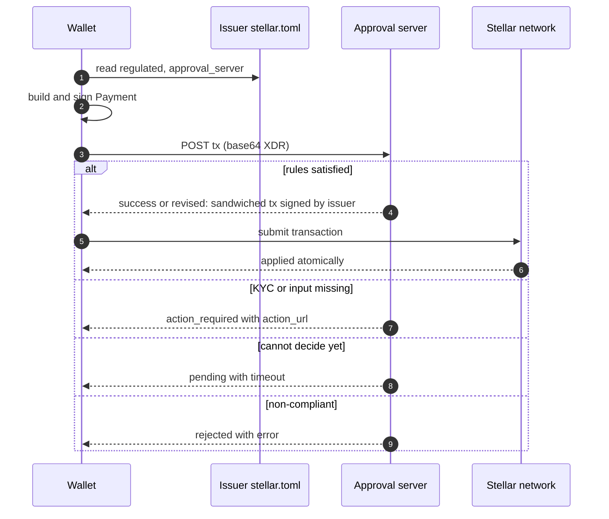
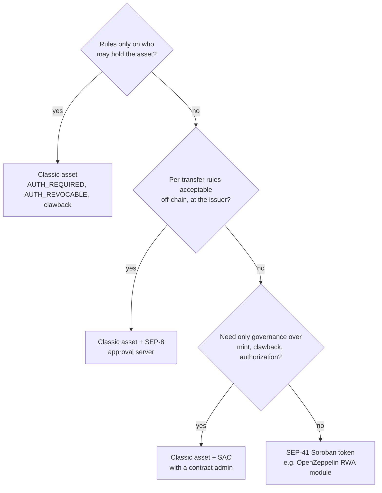

[Stellar](https://stellar.org/) is a layer 1 blockchain built for payments and asset issuance. A token there does not need a smart contract: the protocol itself knows what an asset is, who issued it and who may hold it. Since February 2024 the same network also runs [Soroban](https://developers.stellar.org/docs/build/smart-contracts/overview), a smart-contract platform executed by the same validators on the same ledger, and an earlier article, [Deploying a SEP-41 Fungible Token on Stellar with OpenZeppelin]({{site.url_complet}}/2026/07/09/stellar-fungible-token-openzeppelin-sep41/), covers the contract side.

This article covers the other side: the **Stellar Classic asset**, the protocol-native token. It explains how a Classic asset is identified, held, issued and controlled, which features come with it for free, and where its fixed feature set stops. It then maps a Classic asset onto the two Ethereum interfaces a reader is most likely to compare it with: [ERC-20](https://eips.ethereum.org/EIPS/eip-20), the fungible-token baseline, and [ERC-7943](https://eips.ethereum.org/EIPS/eip-7943) (uRWA), the minimal interface for permissioned real-world-asset tokens.

The last part covers what to do when the built-in features are not enough: an off-chain approval server under [SEP-8](https://github.com/stellar/stellar-protocol/blob/master/ecosystem/sep-0008.md), the Stellar Asset Contract with a contract as admin, or a custom Soroban token under [SEP-41](https://github.com/stellar/stellar-protocol/blob/master/ecosystem/sep-0041.md).

> This article has been made with the help of [Claude Code](https://claude.com/product/claude-code) and several custom skills

[TOC]

## Classic and Soroban: one network, two token models

A frequent description of Stellar is "Classic is the native layer, Soroban the smart-contract layer on top of it". The first half is accurate and the second half is misleading. Soroban is not a layer 2 or a sidechain: Soroban transactions and Classic operations are validated by the same nodes under the same consensus protocol (SCP), and they are recorded in the same ledger.

The two models differ in where token logic lives:

- **Classic asset.** The logic is the protocol. Every Classic asset behaves the same way and offers the same configurable controls, and no code can be attached to it.
- **Soroban token.** The logic is a contract implementing the SEP-41 interface, so it can do anything the contract author writes.

A bridge connects them. Every Classic asset can have one **Stellar Asset Contract (SAC)**, a built-in contract instance at a deterministic address that exposes the asset to Soroban through the SEP-41 interface. The SAC does not create a second balance: for a Stellar account it reads and writes the same trustline that Classic operations use.

## How a Classic asset works

### Identity: code and issuer

A Classic asset is identified by the pair `CODE:ISSUER`:

- **Code.** Up to 12 alphanumeric characters, encoded either as `credit_alphanum4` (1 to 4 characters) or `credit_alphanum12` (5 to 12 characters). For a currency the convention is the ISO 4217 code, and for a security the ISIN.
- **Issuer.** The public key (`G...`) of the account that created the asset.

Two assets with the same code but different issuers are unrelated. `USDC:GA5Z...` issued by Circle and `USDC:GXYZ...` issued by anyone else are distinct assets, and wallets rely on the issuer key, not on the code, to tell them apart. The native asset, XLM, is the only asset with no issuer.

Descriptive metadata (full name, description, logo, redemption terms, regulatory status) is not stored on the ledger. The issuer sets a `home_domain` on its account, and the domain serves a `stellar.toml` file under [SEP-1](https://github.com/stellar/stellar-protocol/blob/master/ecosystem/sep-0001.md) with a `[[CURRENCIES]]` entry for the asset.

### Amounts

Every amount is a signed 64-bit integer with a fixed scale of 7 decimal places. The smallest unit, a *stroop*, is 0.0000001, and the largest representable balance is (2^63 − 1) / 10^7, about 922 billion units. The issuer cannot choose another number of decimals.

### Trustlines: holding is opt-in

An account cannot receive an asset it has not explicitly accepted. To hold `CODE:ISSUER`, an account first submits a `ChangeTrust` operation, which creates a **trustline** ledger entry on that account. The trustline stores:

- the balance;
- a limit, the maximum balance the holder agrees to hold;
- authorization flags set by the issuer (see below);
- liabilities, the amounts locked in open DEX offers.

Each trustline is a subentry of the account and raises its minimum XLM balance by one base reserve (0.5 XLM at the time of writing). The reserve can be paid by another account through **sponsored reserves**, which is how issuers and wallets onboard users who hold no XLM.

The opt-in has a practical consequence for anyone coming from Ethereum: a payment to an address that has no trustline fails (`PAYMENT_NO_TRUST`). Nobody can receive an asset they did not accept, which removes unsolicited airdrops, but it also means that "send to any address" is not a property of a Classic asset.

### Issuance, burn and supply

The issuing account has no balance of its own asset. Instead:

- a **payment from the issuer** creates new units (a mint);
- a **payment to the issuer** destroys them (a burn).

The recommended layout uses two accounts: a cold *issuing account* that mints, and a hot *distribution account* that receives the initial supply and serves users. If the hot account is compromised, the attacker can drain its inventory but cannot mint.

The ledger keeps no total-supply counter. Indexers such as Horizon compute the circulating amount by summing trustline balances, claimable balances, liquidity-pool reserves and SAC contract balances. A fixed supply is obtained by **locking the issuer**: once the initial supply is minted, the issuer sets its master key weight to zero and removes every other signer, after which no transaction can ever be signed for that account. The lock is irreversible and also disables every issuer control described below, so a regulated asset cannot use it.

### Issuer controls: account flags and trustline flags

Access control on a Classic asset is configured with four flags on the issuing account (set with `SetOptions`) and enforced through flags on each holder's trustline (set with `SetTrustLineFlags`).

| Issuer flag | Bit | Effect |
|---|:---:|---|
| `AUTH_REQUIRED_FLAG` | 0x1 | A new trustline starts unauthorized; the issuer must authorize it before the holder can receive or send the asset. |
| `AUTH_REVOCABLE_FLAG` | 0x2 | The issuer can remove or downgrade a trustline's authorization, which freezes the holder's balance. |
| `AUTH_IMMUTABLE_FLAG` | 0x4 | The issuer flags can no longer be changed and the issuing account cannot be merged. |
| `AUTH_CLAWBACK_ENABLED_FLAG` | 0x8 | Trustlines created from now on carry `TRUSTLINE_CLAWBACK_ENABLED_FLAG`. Requires `AUTH_REVOCABLE_FLAG`. |

On a trustline, authorization has three levels:

- **`AUTHORIZED_FLAG`.** Full authorization: the holder can send, receive, trade and deposit into liquidity pools.
- **`AUTHORIZED_TO_MAINTAIN_LIABILITIES_FLAG`.** Limited authorization: the holder's existing DEX offers stay open, but the holder can neither send nor receive the asset.
- **Neither flag.** Unauthorized: the balance is frozen, and removing authorization also pulls the account's open offers and redeems its liquidity-pool shares involving the asset.

Clawback is the last control. If a trustline carries `TRUSTLINE_CLAWBACK_ENABLED_FLAG`, the issuer can submit a `Clawback` operation that removes any amount, up to the full balance, from that trustline and burns it. `ClawbackClaimableBalance` does the same for an unclaimed claimable balance. The flag is fixed when the trustline is created, so enabling clawback on the issuer after the fact does not affect existing holders; the issuer can clear the flag on a trustline but cannot set it back.

### What comes with every Classic asset

Because the asset is a protocol object, every protocol feature applies to it without any code:

- **SDEX.** A native order book (`ManageSellOffer`, `ManageBuyOffer`) for any pair of assets.
- **Liquidity pools.** Constant-product AMM pools, added by [CAP-38](https://github.com/stellar/stellar-protocol/blob/master/core/cap-0038.md).
- **Path payments.** A payment that converts through up to five intermediate assets in one operation, with a guaranteed minimum received or maximum sent.
- **Claimable balances.** A payment held on the ledger until a listed claimant claims it, optionally under time predicates, which also solves "pay someone who has no trustline yet".
- **Multisig.** Weighted signers and thresholds on the issuing account, which is how an issuer splits minting and freezing between several keys.
- **Events.** Since Protocol 23 ([CAP-67](https://github.com/stellar/stellar-protocol/blob/master/core/cap-0067.md)), Classic operations emit the same events as SEP-41 contracts: `transfer`, `mint`, `burn`, `clawback` and `set_authorized`. Before Protocol 23, indexers had to reconstruct these from transaction metadata.

### What a Classic asset cannot do

The fixed feature set is also the limit. A Classic asset has **no hook**: there is no point at which issuer code runs during a transfer. The protocol alone therefore cannot express:

- rules that depend on the transfer itself, such as an amount limit, a holding period, a maximum number of holders, or a jurisdiction pair;
- separate rights to send and to receive (one authorization flag governs both);
- freezing part of a balance;
- transfer fees, rebasing, or any other balance arithmetic;
- delegated spending (`approve` / `transferFrom`) on the Classic side.

The next two sections show where these gaps fall in terms an Ethereum developer already uses.

## Mapping a Classic asset to ERC-20

ERC-20 and a Classic asset cover the same ground, holding and moving a fungible balance, but they differ in two structural ways: a Classic asset requires opt-in through a trustline, and it has no allowance mechanism unless it is accessed through its SAC.

| ERC-20 | Stellar Classic asset | Through the SAC (Soroban) |
|---|---|---|
| `name()` | No ledger field; `name` in the issuer's `stellar.toml` | `name()` returns `CODE:ISSUER` |
| `symbol()` | The asset code | `symbol()` returns the code |
| `decimals()` | Fixed at 7 | `decimals()` returns 7 |
| `totalSupply()` | No ledger value; computed by indexers | Not part of SEP-41 |
| `balanceOf(account)` | Trustline balance (account balance for XLM) | `balance(id)` |
| `transfer(to, amount)` | `Payment` (or `PathPaymentStrictSend` / `StrictReceive`); `to` must have an authorized trustline | `transfer(from, to, amount)` with `from.require_auth()` |
| `approve(spender, amount)` | No equivalent | `approve(from, spender, amount, live_until_ledger)`; the allowance expires at a ledger |
| `allowance(owner, spender)` | No equivalent | `allowance(from, spender)` |
| `transferFrom(from, to, amount)` | No equivalent; the closest substitutes are a co-signer on the holder account or a claimable balance | `transfer_from(spender, from, to, amount)` |
| `Transfer` event | `transfer`, or `mint` / `burn` when the issuer is a party (CAP-67) | Same events |
| `Approval` event | None | `approve` event |
| Mint / burn (common extension) | Payment from / to the issuer | `mint` (admin only) / `burn`, `burn_from` |
| Receiving without consent | Impossible: a trustline is required | Contract addresses need no trustline; Stellar accounts still do |

Two remarks complete the table. First, the SAC is not a wrapper token: there is one balance, and the SAC is only a second entry point to it. Second, the Classic side has features ERC-20 does not have at all: the order book, path payments, claimable balances and a per-holder limit.

## Mapping a Classic asset to ERC-7943 (uRWA)

[ERC-7943](https://eips.ethereum.org/EIPS/eip-7943), *uRWA – Universal Real World Asset Interface*, is a Final ERC that defines the minimum surface a permissioned token needs, without imposing an identity system the way [ERC-3643](https://eips.ethereum.org/EIPS/eip-3643) does. Its fungible variant is `IERC7943Fungible` (ERC-165 id `0x3edbb4c4`):

```solidity
interface IERC7943Fungible is IERC165 {
    event ForcedTransfer(address indexed from, address indexed to, uint256 amount);
    event Frozen(address indexed account, uint256 amount);

    error ERC7943CannotSend(address account);
    error ERC7943CannotReceive(address account);
    error ERC7943CannotTransfer(address from, address to, uint256 amount);
    error ERC7943InsufficientUnfrozenBalance(address account, uint256 amount, uint256 unfrozen);

    function forcedTransfer(address from, address to, uint256 amount) external returns (bool result);
    function setFrozenTokens(address account, uint256 amount) external returns (bool result);
    function canSend(address account) external view returns (bool allowed);
    function canReceive(address account) external view returns (bool allowed);
    function getFrozenTokens(address account) external view returns (uint256 amount);
    function canTransfer(address from, address to, uint256 amount) external view returns (bool allowed);
}
```

ERC-7943 is close to what a Classic asset with `AUTH_REQUIRED`, `AUTH_REVOCABLE` and clawback already provides, which makes the gaps easy to locate.

| ERC-7943 | Stellar Classic equivalent | Coverage |
|---|---|---|
| `canSend(account)` | Sender's trustline has `AUTHORIZED_FLAG` | Partial: the same flag also governs receiving |
| `canReceive(account)` | Recipient has a trustline with `AUTHORIZED_FLAG` and enough room under its limit | Partial: cannot differ from `canSend` |
| `canTransfer(from, to, amount)` | No ledger view; the protocol only checks both trustlines' authorization. Per-transfer rules require SEP-8 | Not covered on-ledger |
| `getFrozenTokens(account)` | None. Freezing is per trustline: the whole balance or nothing | Not covered |
| `setFrozenTokens(account, amount)` | Only a full freeze, by removing `AUTHORIZED_FLAG`. A partial freeze can be approximated by clawing back the amount and holding it at the issuer, but the units then leave the holder's balance | Not covered |
| `forcedTransfer(from, to, amount)` | `Clawback` from `from` plus a `Payment` from the issuer to `to`, in one atomic transaction; requires clawback enabled on `from`'s trustline and an authorized trustline for `to` | Covered, with a different event pair |
| `ForcedTransfer` event | `clawback` then `mint` events (CAP-67) | Different shape |
| `Frozen` event | `set_authorized` event with a boolean, not an amount | Partial |
| Errors `ERC7943Cannot*` | Operation result codes such as `PAYMENT_SRC_NOT_AUTHORIZED`, `PAYMENT_NOT_AUTHORIZED`, `PAYMENT_NO_TRUST` | Different mechanism |
| ERC-165 discovery | Issuer flags readable from the account; `regulated = true` in `stellar.toml` under SEP-8 | Off-ledger metadata |

ERC-7943's rules for mint and burn also have a Classic counterpart. A mint to a recipient for which `canReceive` is false must fail: on Stellar a payment from the issuer to an unauthorized trustline fails in the same way. A burn in a permissioned context may bypass the freeze: on Stellar, clawback works on a frozen trustline, while a voluntary burn (a payment to the issuer) requires the holder to be authorized.

In short, a Classic asset implements the account-level half of ERC-7943 and the forced transfer, but neither the amount-level freeze nor any per-transfer rule. Those are exactly the parts that need code, and Classic has nowhere to put code.

## Next steps when the built-in features are not enough

Three options exist, in increasing order of control and of departure from the Classic model.

### SEP-8: per-transaction approval by the issuer

[SEP-8](https://github.com/stellar/stellar-protocol/blob/master/ecosystem/sep-0008.md) (*Regulated Assets*, v1.7.4, Active) keeps the Classic asset unchanged and moves the transfer rules to an off-chain **approval server** run by the issuer. It relies on two Classic primitives: `AUTH_REQUIRED` plus `AUTH_REVOCABLE` on the issuer, and the fact that all operations in a transaction are applied atomically.

Holders are normally left unauthorized, or in `AUTHORIZED_TO_MAINTAIN_LIABILITIES` if they may keep DEX offers. A wallet that wants to move the asset builds the payment, signs it, and posts it to the `approval_server` URL announced in `stellar.toml` (`regulated = true`, `approval_server`, `approval_criteria`). The server evaluates its rules and, when it approves, wraps the payment in an **authorization sandwich** and co-signs it:

1. `SetTrustLineFlags`: fully authorize the sender;
2. `SetTrustLineFlags`: fully authorize the recipient;
3. the user's `Payment`;
4. `SetTrustLineFlags`: downgrade the recipient back;
5. `SetTrustLineFlags`: downgrade the sender back.

Since the five operations are atomic, both accounts are authorized for that payment and nothing else.



The response statuses are `success` (signed as is), `revised` (operations added; the user must review and re-sign), `pending`, `action_required` and `rejected`.

SEP-8 gives a Classic asset an equivalent of ERC-7943's `canTransfer` and, more generally, of an ERC-3643 compliance check. Its costs follow from the design:

- **Off-chain rules.** The rules are not on the ledger and cannot be audited from it; holders trust the issuer's server.
- **Availability.** If the approval server is down, the asset cannot move.
- **Wallet support.** The wallet must implement the SEP-8 flow; a plain Stellar wallet cannot transfer the asset.
- **Composability.** A Soroban contract that calls the SAC cannot consult an approval server in the middle of its execution, so a SEP-8 asset is in practice unusable in contract-based DeFi unless the issuer authorizes the contract's balance permanently.

### The SAC with a contract as admin

The Stellar Asset Contract has an admin, by default the issuer, that can call `mint`, `clawback`, `set_authorized` and `set_admin`. The admin can be set to a Soroban contract, which then wraps those privileged functions with its own logic: role-based access control, multisig, rate limits on minting, or a timelock on clawback. The OpenZeppelin Stellar library provides a `SACAdminWrapper` for this pattern.

This option changes **who may exercise the issuer controls and under which conditions**. It does not change what a transfer between two holders checks: those still follow the Classic trustline rules. It is the right step when the requirement is governance over minting and enforcement, not new transfer rules.

Changing the SAC admin does not change the issuer, and it does not take the issuer's Classic powers away. The issuer is part of the asset's identity (`CODE:ISSUER`), and the issuing account can still mint with a `Payment`, change trustline flags with `SetTrustLineFlags` and claw back with the `Clawback` operation, none of which goes through the SAC. A Soroban contract also cannot be a signer of a Classic account, whose signers can only be ed25519 keys, pre-authorized transaction hashes, hash-x preimages and signed payloads. To put the asset fully under the admin contract, the issuer first calls `set_admin` to hand the SAC to the contract, then locks the issuing account (master key weight zero, no other signers). From then on, `mint`, `clawback` and `set_authorized` are only reachable through the contract. The cost is the issuer actions the SAC does not expose. Deauthorizing a trustline through the SAC always downgrades it to `AUTHORIZED_TO_MAINTAIN_LIABILITIES`, so a full deauthorization that cancels offers is no longer possible; the issuer flags and the `home_domain` can no longer be changed; and SEP-8 is ruled out, since its authorization sandwich needs the issuer's signature. Without the lock, the issuer key and the admin contract both hold minting and enforcement power.

### SEP-41: a custom Soroban token

When the requirement is per-transfer logic on-chain (partial freeze, transfer rules, identity checks, compliance modules), the asset has to be a contract. [SEP-41](https://github.com/stellar/stellar-protocol/blob/master/ecosystem/sep-0041.md) defines the token interface such a contract exposes, so that wallets and other contracts can use it like any SAC:

```rust
fn allowance(env: Env, from: Address, spender: Address) -> i128;
fn approve(env: Env, from: Address, spender: Address, amount: i128, live_until_ledger: u32);
fn balance(env: Env, id: Address) -> i128;
fn transfer(env: Env, from: Address, to: MuxedAddress, amount: i128);
fn transfer_from(env: Env, spender: Address, from: Address, to: Address, amount: i128);
fn burn(env: Env, from: Address, amount: i128);
fn burn_from(env: Env, spender: Address, from: Address, amount: i128);
fn decimals(env: Env) -> u32;
fn name(env: Env) -> String;
fn symbol(env: Env) -> String;
```

The interface matches the SAC's common subset, without `mint`, `clawback` or any admin function; each token adds those itself. For permissioned assets, the [OpenZeppelin Stellar Contracts](https://docs.openzeppelin.com/stellar-contracts) library ships an RWA module based on T-REX / ERC-3643, with an identity registry, hook-based compliance modules, address-level and amount-level freezing, forced transfer, recovery and pause. That provides the behaviour behind every row of the ERC-7943 table above, including the two that Classic cannot express, although the module does not expose the ERC-7943 function names as such.

The trade-off is the loss of everything the protocol provided:

- **No SDEX, no path payments.** A pure Soroban token is not a Classic asset, so it cannot be traded on the native order book or used in path payments; trading goes through Soroban AMMs.
- **Wallet support.** A wallet has to support the specific contract rather than a generic trustline.
- **Code risk.** The token is now software to audit and, if upgradeable, to govern.
- **State archival.** Balances live in contract storage with a time to live, as described in [Soroban State Archival — Storage Semantics and Security Implications]({{site.url_complet}}/2026/04/15/soroban-state-archival/).

SEP-41 itself is still a Draft (v0.5.2 at the time of writing), although the SAC and most Soroban tooling already implement it.

### Choosing between them



| Requirement | Classic | Classic + SEP-8 | SAC with contract admin | SEP-41 token |
|---|:---:|:---:|:---:|:---:|
| Allowlist of holders, full freeze, clawback | Yes | Yes | Yes | Yes |
| Per-transfer rules | No | Yes, off-chain | No | Yes, on-chain |
| Partial (amount) freeze | No | No | No | Yes |
| Programmable governance of issuer powers | Multisig only | Multisig only | Yes | Yes |
| SDEX and path payments | Yes | Yes, through the server | Yes | No |
| Usable by Soroban contracts | Through the SAC | Only if the contract stays authorized | Through the SAC | Yes |

## Conclusion

A Stellar Classic asset is a protocol object, not a contract: it is identified by `CODE:ISSUER`, held through opt-in trustlines, and controlled through a fixed set of issuer and trustline flags.

- **Built-in controls** cover the account-level needs of a regulated asset: authorization before holding, full freeze, partial or total clawback, and a supply lock for unregulated assets.
- **Built-in features** come with no code: the order book, AMM pools, path payments, claimable balances, sponsored reserves, and since Protocol 23 SEP-41-style events.
- **Against ERC-20**, the main differences are the trustline opt-in, the fixed 7 decimals, the absence of an on-ledger supply counter, and the absence of allowances outside the SAC.
- **Against ERC-7943**, Classic covers `canSend` / `canReceive` (as one flag) and `forcedTransfer` (as clawback plus issuer payment), but not `canTransfer` and not the amount-level freeze.
- **Beyond Classic**, SEP-8 adds per-transfer rules off-chain while keeping the native features, a contract admin on the SAC adds governance over issuer powers, and a SEP-41 token adds any on-chain logic at the cost of the native DEX and of a contract to audit.


## Annex

### Key Terms

| Term | Definition |
|------|------------|
| **Stellar Classic** | The set of operations and ledger entries native to the Stellar protocol (accounts, trustlines, offers, payments), as opposed to Soroban contracts. |
| **Soroban** | Stellar's smart-contract platform, executed by the same validators on the same ledger as Classic operations. |
| **Classic asset** | A token defined by the protocol and identified by an asset code and an issuer account, with no contract code. |
| **Issuing account** | The account whose public key identifies the asset; a payment from it mints and a payment to it burns. |
| **Distribution account** | A separate account that receives the initial supply and serves users, so that the issuing key can stay offline. |
| **Trustline** | A ledger entry on a holder's account that records its balance, limit, liabilities and authorization flags for one asset; required to hold that asset. |
| **Stroop** | The smallest amount unit, 0.0000001; every amount is a 64-bit integer count of stroops. |
| **Base reserve** | The minimum XLM an account must keep per ledger entry it owns, including each trustline. |
| **Sponsored reserves** | A mechanism by which one account pays the reserve of another account's ledger entries. |
| **AUTH_REQUIRED_FLAG** | Issuer flag under which new trustlines start unauthorized and must be approved before use. |
| **AUTH_REVOCABLE_FLAG** | Issuer flag that allows removing or downgrading a trustline's authorization, which freezes the balance. |
| **AUTHORIZED_TO_MAINTAIN_LIABILITIES_FLAG** | Limited trustline authorization that keeps existing offers but blocks sending and receiving. |
| **Clawback** | An issuer operation that removes and burns an amount from a trustline or claimable balance where clawback is enabled. |
| **SDEX** | Stellar's native decentralized exchange: an order book and constant-product liquidity pools available to every asset. |
| **Path payment** | A payment that converts the sent asset into the received asset through the SDEX in one atomic operation. |
| **Claimable balance** | An amount held on the ledger until a designated claimant claims it, optionally subject to time conditions. |
| **SAC** | Stellar Asset Contract: the built-in Soroban contract that exposes a Classic asset through the SEP-41 interface plus admin functions. |
| **SEP-8** | Stellar Ecosystem Proposal for regulated assets, in which an issuer's approval server co-signs every transaction. |
| **SEP-41** | The Soroban token interface, the Stellar counterpart of ERC-20. |
| **ERC-7943 (uRWA)** | A minimal Ethereum interface for permissioned real-world-asset tokens: send/receive checks, amount freezing and forced transfer. |

### Integration Notes

| Behaviour | What an integrator should do |
|-----------|------------------------------|
| A payment to an address with no trustline fails with `PAYMENT_NO_TRUST`. | Check for the trustline before paying, or use a claimable balance to pay an account that has not opted in yet. |
| An authorized trustline can still reject a payment that would exceed its limit (`PAYMENT_LINE_FULL`). | Read the trustline limit as well as the authorization flag. |
| Decimals are fixed at 7 and balances are 64-bit. | Convert from 18-decimal amounts explicitly; the SAC accepts `i128` but fails above the 64-bit range for trustline balances. |
| Total supply is not stored on the ledger. | Use an indexer's asset statistics, which include claimable balances, pool reserves and contract balances. |
| Enabling `AUTH_CLAWBACK_ENABLED_FLAG` only affects trustlines created afterwards. | Set the flag before the first holder opens a trustline. |
| Removing `AUTHORIZED_FLAG` cancels offers and redeems pool shares; downgrading to `AUTHORIZED_TO_MAINTAIN_LIABILITIES_FLAG` does not. | Choose the downgrade when only payments must be blocked. |
| Locking the issuer is irreversible and removes freeze, clawback and authorization. | Never lock the issuer of a regulated asset. |
| A SEP-8 asset cannot be moved by a plain wallet or by a Soroban contract call. | Integrate the approval-server flow in the wallet, and expect limited DeFi composability. |

## Frequently Asked Questions

**Q: Is Soroban a layer 2 on top of Stellar Classic?**

No. Soroban contracts and Classic operations are validated by the same nodes, under the same consensus protocol, and recorded in the same ledger. The difference is where token logic lives: in the protocol for a Classic asset, in contract code for a Soroban token. The Stellar Asset Contract lets Soroban use a Classic asset directly, against the same trustline balance.

**Q: Why can an Ethereum-style "send to any address" fail for a Classic asset?**

Holding a Classic asset is opt-in. The recipient must first create a trustline with `ChangeTrust`, and if the issuer has `AUTH_REQUIRED_FLAG` set, the issuer must also authorize that trustline. A payment to an account without a trustline fails with `PAYMENT_NO_TRUST`, and one to an unauthorized trustline fails with `PAYMENT_NOT_AUTHORIZED`. A claimable balance is the usual way to pay an account that has not opted in yet.

**Q: How does an issuer fix the supply of a Classic asset, and what does it lose?**

It mints the full supply to a distribution account, then sets the issuing account's master key weight to zero and removes all other signers. After that, no transaction can be signed for the issuer, so nothing more can be minted. The same lock also removes every issuer control: no authorization changes, no freeze and no clawback. A regulated asset therefore cannot use it.

The lock fixes the supply only while the issuer is still the SAC admin. If the SAC admin was moved to another account or contract before the lock, that admin can still call `mint`, `clawback` and `set_authorized` through the SAC.

**Q: Which ERC-7943 functions can a Classic asset reproduce, and which can it not?**

It can reproduce:

- `canSend` and `canReceive`, through the trustline's `AUTHORIZED_FLAG`, although one flag governs both directions;
- `forcedTransfer`, as a `Clawback` from the source followed by a payment from the issuer to the destination, in one atomic transaction.

It cannot reproduce `getFrozenTokens` / `setFrozenTokens`, because Classic freezes a whole trustline, not an amount, and it has no on-ledger `canTransfer`, because the protocol checks only authorization, never the transfer itself.

**Q: An issuer needs a maximum holding per investor and a lock-up period, but wants the asset to stay tradable on the SDEX. Which option fits?**

A Classic asset with SEP-8. Both rules depend on the transfer (the amount, the date, the recipient's resulting balance), so the protocol alone cannot express them. A SEP-41 token could, but it would leave the SDEX and path payments behind. SEP-8 keeps the asset Classic: holders stay unauthorized between transactions, and the approval server applies the holding limit and the lock-up before it adds the authorization sandwich and co-signs. The cost is an off-chain rule engine that must stay available, and wallets that implement the SEP-8 flow.

**Q: What is the difference between setting a contract as SAC admin and writing a SEP-41 token?**

A contract admin on the SAC controls the privileged functions only: `mint`, `clawback`, `set_authorized` and `set_admin`. It can add roles, limits or delays to those actions, but a transfer between two holders still follows the Classic trustline rules.

A SEP-41 token is a separate contract with its own balances. Its `transfer` can run any logic, which is what partial freezes and compliance modules require. In exchange, it is no longer a Classic asset, so it loses the native DEX and path payments.

**Q: Is it possible to wrap a Stellar Classic token into a Soroban smart contract?**

Yes, and in most cases no wrapper is needed. Every Classic asset can be exposed to Soroban through its Stellar Asset Contract, which anyone can deploy at a deterministic address (for example with `stellar contract asset deploy --asset CODE:ISSUER`). The SAC is not a wrapper: it reads and writes the same trustline balance, so the asset stays on the SDEX and in path payments while contracts use it through the SEP-41 interface.

A true wrapper is still possible when the token needs logic the SAC does not have. It is a SEP-41 contract that takes deposits of the Classic asset through the SAC and mints its own token 1:1, then burns that token and returns the underlying on withdrawal. The contract address holds the underlying in a contract balance, so it needs no trustline. Two points remain:

- **Issuer controls still apply to the underlying.** If the issuer has `AUTH_REQUIRED_FLAG` set, it must authorize the wrapper's balance with `set_authorized`, and with clawback enabled it can claw back from the wrapper contract or deauthorize it, which would freeze every wrapped holder at once.
- **The wrapped token is a Soroban token.** It has the SEP-41 trade-offs listed above: no SDEX or path payments, contract-specific wallet support, code to audit and storage subject to state archival.

**Q: Can the issuer of a Classic asset be changed?**

No. The issuer is part of the asset's identity (`CODE:ISSUER`), and the SAC address is derived from it, so another issuer means another asset, with new trustlines and another SAC. Moving to a new issuer requires issuing a new asset and migrating holders, for example through a swap or a clawback followed by a reissue.

What can change is who controls the issuing account. With `SetOptions`, the issuer can add signers and thresholds (a Classic multisig), rotate keys by adding a new signer and setting the old master key weight to zero, or lock the account entirely. A Soroban contract cannot be one of those signers. Setting a contract as SAC admin and then locking the issuer is the way to place every privileged action (`mint`, `clawback`, `set_authorized`) under contract control.

**Q: Where does the ERC-20 allowance model exist on Stellar?**

Only on the Soroban side. The SAC and any SEP-41 token expose `approve`, `allowance` and `transfer_from`, with an allowance that expires at a given ledger (`live_until_ledger`). Classic operations have no allowance; the nearest substitutes are adding a co-signer to the holder's account or locking funds in a claimable balance.

## References

### Stellar specifications

- [SEP-0001: Stellar Info File (stellar.toml)](https://github.com/stellar/stellar-protocol/blob/master/ecosystem/sep-0001.md)
- [SEP-0008: Regulated Assets](https://github.com/stellar/stellar-protocol/blob/master/ecosystem/sep-0008.md)
- [SEP-0041: Token Interface](https://github.com/stellar/stellar-protocol/blob/master/ecosystem/sep-0041.md)
- [CAP-0038: Automated Market Makers](https://github.com/stellar/stellar-protocol/blob/master/core/cap-0038.md)
- [CAP-0067: Unified Asset Events](https://github.com/stellar/stellar-protocol/blob/master/core/cap-0067.md)

### Stellar documentation

- [Assets (Stellar data structures)](https://developers.stellar.org/docs/learn/fundamentals/stellar-data-structures/assets)
- [Asset Design Considerations](https://developers.stellar.org/docs/tokens/control-asset-access)
- [Stellar Asset Contract](https://developers.stellar.org/docs/tokens/stellar-asset-contract)
- [Clawbacks](https://developers.stellar.org/docs/build/guides/transactions/clawbacks)
- [Soroban smart contracts overview](https://developers.stellar.org/docs/build/smart-contracts/overview)

### Ethereum standards

- [ERC-20: Token Standard](https://eips.ethereum.org/EIPS/eip-20)
- [ERC-7943: uRWA – Universal Real World Asset Interface](https://eips.ethereum.org/EIPS/eip-7943)
- [ERC-3643: T-REX – Token for Regulated EXchanges](https://eips.ethereum.org/EIPS/eip-3643)

### Libraries

- [OpenZeppelin Stellar Contracts (documentation)](https://docs.openzeppelin.com/stellar-contracts)
- [OpenZeppelin Stellar Contracts – Real World Assets](https://docs.openzeppelin.com/stellar-contracts/tokens/rwa/rwa)

### Related articles

- [Deploying a SEP-41 Fungible Token on Stellar with OpenZeppelin]({{site.url_complet}}/2026/07/09/stellar-fungible-token-openzeppelin-sep41/)
- [Soroban State Archival — Storage Semantics and Security Implications]({{site.url_complet}}/2026/04/15/soroban-state-archival/)
- [Three Vulnerabilities from the OpenZeppelin Stellar Contracts Audits]({{site.url_complet}}/2026/07/10/stellar-soroban-vulnerabilities-audit/)
- [Two Ways to Build a Permissioned Token — Centrifuge's Transfer Hook Against ERC-3643]({{site.url_complet}}/2026/08/18/centrifuge-hook-vs-erc3643/)
- [CIP-113 Programmable Tokens on Cardano]({{site.url_complet}}/2026/08/26/cip-113-programmable-tokens-cardano/)
- [AIP-20, the Aztec Token Standard, Compared with ERC-20 and ERC-7984]({{site.url_complet}}/2026/09/11/aip-20-aztec-token-standard-vs-erc-20-erc-7984/)

### Tooling

- [Claude Code](https://claude.com/product/claude-code)
