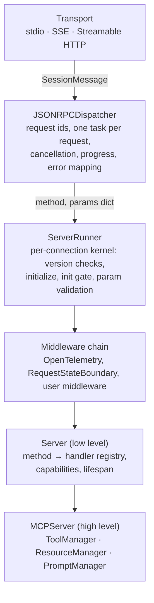
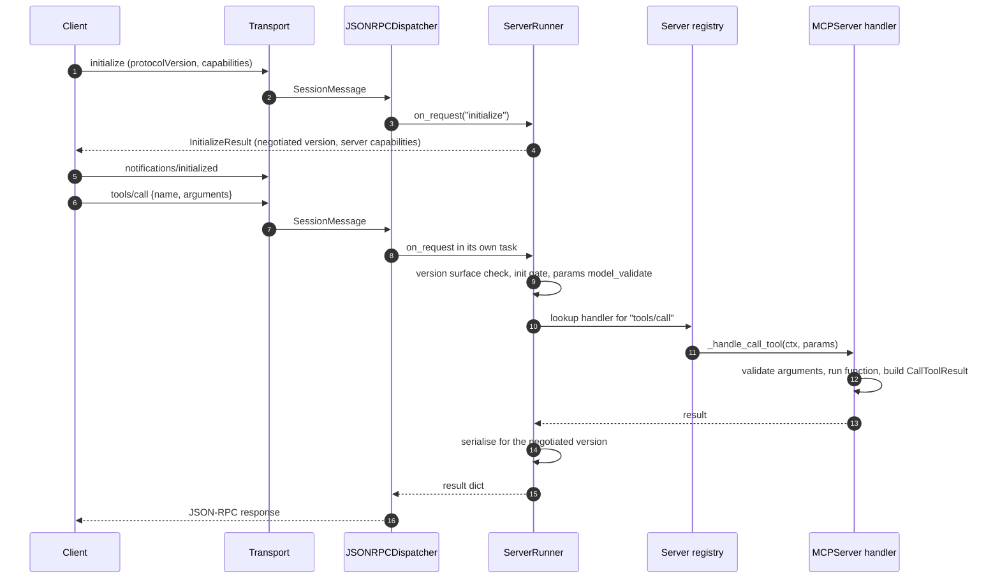
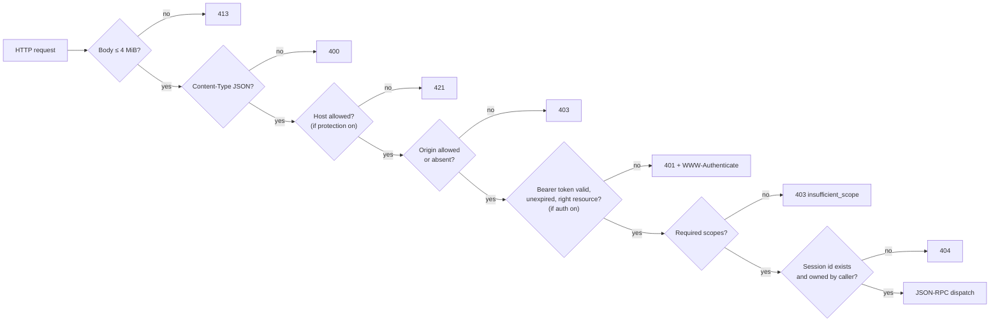

The [Model Context Protocol](https://modelcontextprotocol.io/) (MCP) is an open protocol that lets an AI application connect to external programs, called servers, which expose tools the model can call, resources it can read and prompts the user can pick. Messages are [JSON-RPC 2.0](https://www.jsonrpc.org/specification), carried over standard input/output for a local process or over HTTP for a remote one. The [official Python SDK](https://github.com/modelcontextprotocol/python-sdk) is one of the reference implementations, and its server half is what turns a decorated Python function into something a model can invoke.

This article reads the server side of the SDK at version 2 (the `main` branch, a few commits after release 2.3.0). It follows a request from the transport to the handler and back, describes the layers in between, and then looks at the security controls the SDK applies by default, the ones the developer has to switch on, and the problems it leaves to the application.

> This article has been made with the help of [Claude Code](https://claude.com/product/claude-code) and several custom skills

[TOC]

## MCP in brief

MCP separates three parties:

- the **host** is the application the user interacts with (a chat client, an IDE, an agent runtime);
- the **client** is the component inside the host that holds one connection to one server;
- the **server** exposes capabilities to that client.

A server offers three primitives. **Tools** are functions the model decides to call, with a JSON Schema for their arguments. **Resources** are data addressed by URI that the application reads, either fixed (`config://app`) or parameterised by an [RFC 6570](https://datatracker.ietf.org/doc/html/rfc6570) URI template (`greeting://{name}`). **Prompts** are reusable message templates the user selects. Around these sit utilities: progress notifications, cancellation, completions for arguments, change notifications, and elicitation (the server asking the user for input).

The SDK at the analyzed commit supports two generations of the protocol, and the difference shapes the whole server:

| Era | Protocol versions | Connection model |
|---|---|---|
| Handshake | 2024-11-05, 2025-03-26, 2025-06-18, 2025-11-25 | `initialize` request, then `notifications/initialized`; capabilities negotiated once per connection; the server may send requests to the client (sampling, elicitation, roots) |
| Modern | 2026-07-28 | no handshake; each request carries its protocol version, client info and capabilities in a `_meta` envelope; `server/discover` replaces `initialize`; the server cannot initiate requests |

The versions are declared in `src/mcp-types/mcp_types/version.py` as `HANDSHAKE_PROTOCOL_VERSIONS` and `MODERN_PROTOCOL_VERSIONS`. One server instance answers both eras, deciding per connection.

## A minimal server

The README's first example is the shortest complete server:

```python
from mcp.server import MCPServer

mcp = MCPServer("Demo")


@mcp.tool()
def add(a: int, b: int) -> int:
    """Add two numbers."""
    return a + b


@mcp.resource("greeting://{name}")
def greeting(name: str) -> str:
    """Greet someone by name."""
    return f"Hello, {name}!"
```

Calling `mcp.run()` serves it over stdio, and `mcp.run(transport="streamable-http")` serves it over HTTP on `127.0.0.1:8000` at the path `/mcp`. Nothing in the file mentions JSON-RPC, schemas or sessions. The rest of this article is about the code that fills that gap.

Readers coming from version 1 will know the class as `FastMCP`. It was renamed `MCPServer` in version 2, and `mcp.server.fastmcp` is now a module that raises an `ImportError` pointing to the migration guide.

## Architecture overview

Version 2 is not version 1 with new names. The long-lived `ServerSession` receive loop of version 1 is gone, and its responsibilities are split across a stack of layers, each with one job:



| Layer | Location | Knows about MCP? |
|---|---|---|
| Transport | `src/mcp/server/stdio.py`, `sse.py`, `streamable_http.py`, `streamable_http_manager.py`, `_streamable_http_modern.py` | No: moves `SessionMessage` objects over a pair of streams |
| Dispatcher | `src/mcp/shared/jsonrpc_dispatcher.py` | No: methods are strings, params are dicts |
| Runner | `src/mcp/server/runner.py` (`ServerRunner`) | Yes: protocol versions, `initialize`, the init gate |
| Low-level server | `src/mcp/server/lowlevel/server.py` (`Server`) | Yes: maps each method name to a handler |
| High-level server | `src/mcp/server/mcpserver/server.py` (`MCPServer`) | Yes: builds the handlers from decorated Python functions |

The protocol types live in a separate package, `mcp-types` (`src/mcp-types/mcp_types/`), which the `mcp` wheel pins to the exact same version. `mcp.types` re-exports it, so `import mcp.types as types` keeps working. The package holds the Pydantic models, the JSON-RPC envelopes and error codes, and per-version validators that decide which methods and fields exist in which protocol revision.

### MCPServer, the high-level API

`MCPServer` does not subclass `Server`; it composes one. Its constructor builds a low-level `Server` and passes its own bound methods as handlers:

```python
self._lowlevel_server = Server(
    name=name or "mcp-server",
    ...
    on_list_tools=self._handle_list_tools,
    on_call_tool=self._handle_call_tool,
    ...
)
```

Each primitive has a manager: `ToolManager` (`mcpserver/tools/tool_manager.py`), `ResourceManager` (`mcpserver/resources/resource_manager.py`) and `PromptManager` (`mcpserver/prompts/manager.py`). The decorators `@mcp.tool()`, `@mcp.resource(uri)`, `@mcp.prompt()` and `@mcp.completion()` register into them. `@mcp.custom_route(path, methods)` adds a plain Starlette route next to the MCP endpoint, outside any authentication.

### The low-level Server

`Server` is the registry the runner dispatches into. Handlers are passed to the constructor as `on_*` keyword arguments (`on_list_tools`, `on_call_tool`, `on_read_resource`, `on_get_prompt`, `on_completion`, and so on) and stored in a dictionary keyed by method name, each entry paired with the Pydantic type of its parameters. Every handler has the same shape: it receives a `ServerRequestContext` and the typed parameters, and returns a result model.

```python
async def list_tools(ctx: ServerRequestContext, params: PaginatedRequestParams | None) -> ListToolsResult:
    return ListToolsResult(tools=[SEARCH_BOOKS])


async def call_tool(ctx: ServerRequestContext, params: CallToolRequestParams) -> CallToolResult:
    args = params.arguments or {}
    text = f"Found 3 books matching {args['query']!r} (showing up to {args['limit']})."
    return CallToolResult(content=[TextContent(type="text", text=text)])


server = Server("Bookshop", on_list_tools=list_tools, on_call_tool=call_tool)
app = server.streamable_http_app()
```

The low-level API is the escape hatch for what `MCPServer` does not do: pagination (`MCPServer` returns every item in a single page), hand-written schemas, custom methods through `add_request_handler`. The documentation states the trade-off plainly: at this level "nothing is derived, wrapped, or validated for you", which matters for the security section below.

`Server.get_capabilities()` derives the advertised capabilities from which handlers are registered. A server with no `on_list_prompts` does not claim the `prompts` capability.

## From a Python function to a tool

Registering a tool is mostly schema generation. `Tool.from_function` (`mcpserver/tools/base.py`) does four things:

1. It finds the parameter annotated as `Context`, whatever its name, and the parameters marked `Annotated[T, Resolve(fn)]`, and removes them from the public signature.
2. `func_metadata` (`mcpserver/utilities/func_metadata.py`) builds a dynamic Pydantic model from the remaining parameters, named `<function>Arguments`. A parameter without annotation becomes a string, and a name starting with `_` is refused.
3. The input schema advertised in `tools/list` is that model's `model_json_schema()`.
4. If the function has a return annotation, an output model is built for **structured output**.

The structured-output rules follow the return type. A Pydantic model, a `TypedDict` or a `dict[str, T]` is used directly as the output schema. Primitives, lists and unions are wrapped in an object with a single `result` field, which is why the README's client prints `{'result': 3}` for the `add` tool. Images, audio and raw content blocks stay unstructured. The schema is generated in a strict mode, so a return type that cannot be serialised fails when the tool is registered rather than at the first call.

At call time, `Tool.run` validates the arguments against the generated model, runs the function (a synchronous function runs in a worker thread through `anyio.to_thread.run_sync`), converts the return value into a `CallToolResult` carrying both text content and `structured_content`, and validates the structured part against the output model.

Errors are split into two channels, and the split is a protocol rule rather than a style choice:

- a **tool execution error** (bad arguments, a `ToolError` raised by the tool, an unexpected exception) becomes a normal result with `is_error=True`, which the model reads and can react to;
- a **protocol error** (an `MCPError` raised anywhere) becomes a JSON-RPC error response.

### Resources and URI templates

`@mcp.resource(uri)` parses the URI as an RFC 6570 template. Without variables, the function becomes a static `FunctionResource`. With variables, it becomes a template, and the decorator checks that the template variables match the function parameters exactly. On `resources/read`, `ResourceManager.get_resource` tries concrete resources first, then each template in turn, and raises `ResourceNotFoundError` (a `-32602` protocol error) when nothing matches. The template matcher is a linear scan with length caps (8,192 characters per template, 256 variables, 65,536 characters per URI), not a regular expression.

### Prompts and completions

`Prompt.from_function` derives the prompt's arguments from the same `func_metadata` model and wraps the function in Pydantic's `validate_call`. A missing required argument or an unknown prompt name is an invalid-params protocol error. `@mcp.completion()` registers a single `completion/complete` handler that receives the reference (a prompt or a resource template), the argument being completed and its partial value.

## Request lifecycle

The sequence below follows a `tools/call` over a handshake-era connection.



### The dispatcher

`JSONRPCDispatcher` is deliberately unaware of MCP. It reads `SessionMessage` objects from the transport, correlates responses with request ids, starts one task per incoming request, and turns exceptions into JSON-RPC error objects. It also handles two cross-cutting notifications itself: `notifications/cancelled` cancels the task of the matching in-flight request (which then receives no response), and progress notifications are routed against the caller's progress token. The per-request back-channel is a `DispatchContext`, which carries the request id, the cancellation flag, a `progress()` method and whether the server is allowed to send requests back.

### The runner and its middleware

`ServerRunner` is described in its docstring as "the per-connection handler kernel". For each request it builds a `ServerRequestContext` (including a fresh `ServerSession`, which in version 2 is a small per-request proxy for sending notifications and requests back to the client), wraps the call in the middleware chain, and then runs a fixed sequence:

```python
entry = self.server.get_request_handler(method)
if entry is None:
    raise MCPError(code=METHOD_NOT_FOUND, message="Method not found", data=method)
if not self.connection.initialize_accepted and method not in _INIT_EXEMPT:
    raise MCPError(code=INVALID_PARAMS, message="Invalid request parameters", data="")
typed_params = entry.params_type.model_validate({} if params is None else params, by_name=False)
result = await entry.handler(ctx, typed_params)
```

Before this, it checks that the method exists in the negotiated protocol version. After it, the result is filtered to the fields that version knows about. `_INIT_EXEMPT` contains only `ping`, so on a handshake connection nothing else runs before `initialize` has been accepted.

`initialize` itself is not a registered handler. The runner handles it inline, negotiates the version (the client's version if supported, otherwise the latest handshake version), and commits the connection state only after the middleware chain has succeeded. Because the dispatcher pauses its read loop during `initialize`, a middleware that awaited a request to the client at that point would deadlock, a constraint the `ServerMiddleware` docstring spells out.

Middleware has the signature `(ctx, call_next) -> result`. The default chain contains an OpenTelemetry middleware; `MCPServer` adds a `RequestStateBoundary` (covered in the security section) and any middleware the developer passes. The code marks this API as provisional.

### Two eras on one server

`Server.run()` enters the lifespan and calls `serve_dual_era_loop`, which looks at the first request on the connection. If it carries the `io.modelcontextprotocol/protocolVersion` key in `_meta`, the connection is modern; otherwise it is a handshake connection. Mixing afterwards is refused: `initialize` on a modern connection gets `UNSUPPORTED_PROTOCOL_VERSION`, and an enveloped request on a handshake connection gets `INVALID_REQUEST`.

On a modern connection each request is self-contained: the runner builds a `Connection` from the envelope and serves that one request. The dispatch context refuses outbound requests, so any attempt to call the client raises `NoBackChannelError`. Interactions that needed a server-to-client request in the handshake era (asking the user a question, requesting a model completion) become **multi-round-trip requests**: the tool returns an `InputRequiredResult` listing what it needs, the client answers in a follow-up call, and the server resumes. The high-level API hides this behind resolver markers such as `Elicit[T]` and `Sample`, which are batched into an `InputRequiredResult` on 2026-07-28 and sent as live requests on older versions.

## Context, lifespan and dependencies

A tool, resource or prompt function that declares a parameter annotated `Context` receives a `mcp.server.mcpserver.Context`. It is the handler's view of the request:

- `report_progress(progress, total, message)` emits a progress notification if the caller sent a progress token, and does nothing otherwise;
- `elicit(message, schema)` asks the user for structured input and validates the answer against a Pydantic model; `elicit_url(...)` sends the user to a URL instead;
- `read_resource(uri)` reads another resource of the same server;
- `notify_tools_changed()` and its siblings publish change notifications;
- `request_id`, `protocol_version`, `headers` and `client_capabilities` describe the caller;
- the logging methods (`info`, `warning`, ...) still exist but are deprecated, as the logging capability is deprecated in the 2026-07-28 revision.

Long-lived resources such as a database pool belong to the **lifespan**, an async context manager entered once:

```python
@asynccontextmanager
async def app_lifespan(server: MCPServer) -> AsyncIterator[AppContext]:
    db = await Database.connect()
    try:
        yield AppContext(db=db)
    finally:
        await db.disconnect()

mcp = MCPServer("Bookshop", lifespan=app_lifespan)

@mcp.tool()
def count_books(genre: str, ctx: Context[AppContext]) -> str:
    db = ctx.request_context.lifespan_context.db
```

Over Streamable HTTP, version 2 enters the lifespan once when the session manager starts, not once per session or per request as version 1 did.

## Transports

`MCPServer.run(transport=...)` selects one of three transports.

**stdio.** `stdio_server()` (`src/mcp/server/stdio.py`) reads newline-delimited JSON-RPC from standard input and writes to standard output. While it serves, it points file descriptor 0 at the null device and file descriptor 1 at standard error, so a stray `print()` in a handler or a child process cannot write into the protocol stream. Logging goes to standard error.

**SSE.** The older HTTP transport, with a long-lived Server-Sent Events stream for server messages and a separate POST endpoint for client messages. The SDK keeps it for legacy clients; the protocol replaced it with Streamable HTTP in the 2025-03-26 revision.

**Streamable HTTP.** A single endpoint (`/mcp`) that accepts POST requests and answers either with a JSON body or with an SSE stream. `StreamableHTTPSessionManager` routes each request on the `MCP-Protocol-Version` header into one of three paths:

- **modern** (2026-07-28): one POST, one response, no session id; any worker can serve any request;
- **stateless handshake** (`stateless_http=True`): a fresh transport per request, no session id, no server-to-client requests;
- **stateful handshake** (the default for older clients): the server issues an `Mcp-Session-Id`, keeps per-session state, and can resume an SSE stream from `Last-Event-ID` if the developer supplies an `EventStore` implementation (the SDK ships only the abstract class).

`streamable_http_app()` returns a Starlette application, so the server can be mounted inside an existing ASGI application:

```python
@asynccontextmanager
async def lifespan(app: Starlette) -> AsyncIterator[None]:
    async with mcp.session_manager.run():
        yield

app = Starlette(
    routes=[Mount("/", app=mcp.streamable_http_app())],
    lifespan=lifespan,
)
```

The explicit lifespan is required because Starlette never runs the lifespan of a mounted sub-application; without it, the first request fails with `Task group is not initialized`.

## Security

The security of an MCP server is shared between three places: the transport (who can reach the server and with which session), the authorization layer (whether a caller holds a valid token for this server), and the handlers (what the server does with arguments it receives and data it returns). The SDK covers a large part of the first two, applies validation to the third when the high-level API is used, and leaves the model-facing risks to the application.



The order shown is the logical sequence of checks rather than the exact nesting of middlewares, which differs slightly between the session manager and the modern-era handler.

### stdio: the process is the boundary

A stdio server has no network surface and no authentication. The authorization guide is explicit that neither the bearer middleware nor the token verifier applies to stdio: the security boundary is the process that launched the server, and `get_access_token()` always returns `None` there. A stdio server runs with the privileges of the user who started the host, so a tool that reads files reads them as that user. Two further points apply. First, the stdio reader validates each line as JSON-RPC but enforces no size limit on it. Second, the descriptor redirection protects the protocol stream from accidental output, but an unflushed write at import time can still corrupt it.

### HTTP hardening: DNS rebinding, body size, content type

A server listening on `127.0.0.1` looks unreachable from the internet, but a web page in the user's browser can rebind its own domain to `127.0.0.1` and send requests to it. The defence is to check the `Host` and `Origin` headers, which `TransportSecurityMiddleware` (`src/mcp/server/transport_security.py`) does. Its default depends on how the server is built:

```python
# Auto-enable DNS rebinding protection for localhost (IPv4 and IPv6)
if transport_security is None and host in ("127.0.0.1", "localhost", "::1"):
    transport_security = TransportSecuritySettings(
        enable_dns_rebinding_protection=True,
        allowed_hosts=["127.0.0.1:*", "localhost:*", "[::1]:*"],
        allowed_origins=["http://127.0.0.1:*", "http://localhost:*", "http://[::1]:*"],
    )
```

Since `host` defaults to `127.0.0.1`, a server started with defaults is protected. Two configurations are not:

- passing any other `host` (`0.0.0.0`, a public name) without `transport_security=` leaves the check off, and the deployment guide warns that this "leaves every Host and Origin accepted";
- building a `StreamableHTTPSessionManager` or `SseServerTransport` directly without settings falls back to `TransportSecuritySettings(enable_dns_rebinding_protection=False)`, a default kept for backwards compatibility.

When the check is on, a disallowed `Host` gets `421` and a disallowed `Origin` gets `403`. A missing `Origin` is accepted, since only browsers send it. Allowlist entries are exact strings, with a `:*` suffix meaning any port. Independently of that setting, a POST whose `Content-Type` is not JSON is rejected with `400`, and every HTTP entry point (Streamable HTTP, the SSE POST endpoint and the OAuth endpoints) caps the request body at 4 MiB through `RequestBodyLimitMiddleware`, which counts streamed chunks as well as the declared `Content-Length`.

### Sessions

Stateful Streamable HTTP sessions have three protections, all added during 2026:

- the session id is `uuid4().hex`, 122 random bits from the operating system's generator;
- the session manager caps open sessions at 10,000 (`DEFAULT_MAX_SESSIONS`; further attempts get `503`) and expires a session after 30 minutes without HTTP activity (`DEFAULT_SESSION_IDLE_TIMEOUT`);
- each session is bound to the authenticated principal that created it, the triple of client id, issuer and subject. A request carrying a valid session id but a different principal gets `404 Session not found`, the same answer as an unknown id, so the response does not confirm that the session exists.

The binding has one limit: on a server without authentication, every caller is the same anonymous principal, and knowing the session id is enough to use the session. Stateless mode and the 2026-07-28 protocol have no server-side session to hijack.

### Authorization: an OAuth 2.1 resource server

The SDK implements the MCP authorization model, in which the MCP server is an OAuth 2.1 **resource server**: it validates access tokens issued by a separate authorization server and never signs anyone in. The configuration is an `AuthSettings` object plus a `TokenVerifier`, a protocol with a single method:

```python
class TokenVerifier(Protocol):
    async def verify_token(self, token: str) -> AccessToken | None: ...
```

The verifier is where the cryptography happens: checking a JWT signature, or calling the authorization server's introspection endpoint as in the `IntrospectionTokenVerifier` example built on [RFC 7662](https://datatracker.ietf.org/doc/html/rfc7662). The SDK adds the checks around it:

- `BearerAuthBackend` extracts the bearer token, calls the verifier, and treats the request as unauthenticated if the verifier returns `None` or if `expires_at` is in the past;
- `RequireAuthMiddleware` answers `401 invalid_token` for an unauthenticated request and `403 insufficient_scope` when any of `required_scopes` is missing (all of them are required), with a `WWW-Authenticate` header pointing to the metadata document;
- when `resource_server_url` is set, the server publishes **Protected Resource Metadata** ([RFC 9728](https://datatracker.ietf.org/doc/html/rfc9728)) at `/.well-known/oauth-protected-resource`, which tells the client which authorization server to use.

The audience check deserves attention. A token issued for another service should not be accepted by this one, which is what the `resource` indicator of [RFC 8707](https://datatracker.ietf.org/doc/html/rfc8707) is for. The SDK can compare the token's `resource` with `resource_server_url` itself, but only if `AuthSettings.validate_token_resource=True`. Left unset, it behaves as `False` and emits a deprecation warning saying it will default to `True` in version 3. Until then, either the setting is turned on or the `TokenVerifier` must check the audience itself.

The SDK also contains an **embedded authorization server** (`auth_server_provider=`), with `/authorize`, `/token`, optional `/register` ([RFC 7591](https://datatracker.ietf.org/doc/html/rfc7591) dynamic client registration) and optional `/revoke` ([RFC 7009](https://datatracker.ietf.org/doc/html/rfc7009)). The documentation describes it as predating the separation of roles and recommends against it for new servers. Its handlers enforce [PKCE](https://datatracker.ietf.org/doc/html/rfc7636) with `S256` only, exact redirect URI matching, client secrets compared with `hmac.compare_digest`, codes bound to their client and expiry, and refresh-token scopes restricted to a subset of the original grant. Generating codes and tokens, and their entropy, is the provider's job.

### Input validation and error disclosure

With `MCPServer`, tool arguments are validated by the Pydantic model generated from the function signature before the function runs. Two behaviours are worth knowing. A string argument for a non-string field is first parsed as JSON (a workaround for clients that send `"5"` for `5`). Unknown arguments are dropped silently, since the generated model uses Pydantic's default handling of extra fields.

The error path is designed not to leak server internals to the model:

```python
except Exception as exc:
    # A crash: the exception's own text stays on the server.
    raise UnexpectedToolError(f"Error executing tool {self.name}") from exc
```

A validation failure or a deliberate `ToolError` returns its message to the model, because the model needs it to correct the call. Any other exception returns only `Error executing tool <name>`, and the traceback is logged on the server. When a validation fails, the server logs the field names but not the rejected values, which are the caller's data.

The low-level `Server` does none of this. A tool registered there receives the raw `arguments` dictionary, and the developer is responsible for validating it against the schema they wrote.

### Resource templates and path traversal

Resource templates are a classic traversal surface: `file://{path}` with `path` set to `../../etc/passwd`. Every template parameter goes through `ResourceSecurity` (`mcpserver/resources/templates.py`), whose defaults reject path traversal segments, absolute paths (including Windows drive forms) and null bytes. The checks run on the percent-decoded value, so `..%2F` and `%2E%2E` are caught. A rejection stops the search through templates instead of falling through to a later, more permissive one, and the client receives `Unknown resource`.

The documentation calls these checks a "heuristic pre-filter". For filesystem access the containment boundary is `safe_join(base, *parts)` in `src/mcp/shared/path_security.py`, which resolves the final path and requires it to remain under `base`. Its docstring notes that the symlink check is point-in-time, so a symlink swapped between the check and the open is not covered.

### Sealed request state

In a multi-round-trip request, the server hands the client an opaque `requestState` and the client echoes it in the next call. The specification requires the server to treat that echoed value as attacker-controlled. `RequestStateBoundary` (`src/mcp/server/request_state.py`) seals it with AES-256-GCM under an HKDF-derived key, binds it to the authenticated principal and to the server's name as audience, and expires it after 600 seconds. Every verification failure produces the same `Invalid or expired requestState` error, so a failure does not reveal which check rejected it.

The default key is `os.urandom(32)` generated at start-up. That is safe, but it means state sealed by one worker cannot be opened by another, or by the same worker after a restart. A deployment with several instances must pass a shared key ring.

### What the SDK does not protect against

Several MCP risks sit above the transport and are not something a server library can close:

- **Prompt injection through tool output.** Whatever a tool returns enters the model's context. If a tool fetches a web page or an e-mail, instructions hidden in it reach the model. The SDK's documentation treats server-provided text, including skill content, as untrusted model input, but filtering it is the host's job, and a server author should keep tool output factual and bounded.
- **Tool poisoning.** Tool names and descriptions are also read by the model. A malicious or compromised server can put instructions in a description. This is a risk for the host that connects to the server, not one the server SDK can mitigate.
- **Token passthrough and confused deputy.** A server that calls another API on the user's behalf must obtain its own token for that API, not forward the token it received. The SDK provides no helper for this and its documentation does not discuss it; the [MCP security best practices](https://modelcontextprotocol.io/specification/draft/basic/security_best_practices) cover both patterns.
- **Excessive capability.** A tool that runs shell commands or writes files gives the model that power. The SDK cannot restrict what a handler does; least privilege for the server process, and a confirmation step for destructive tools, are design decisions.
- **Secrets in results.** The low-level guide warns: "Never put a secret in any part of a tool result." Structured content, text content and metadata all reach the client.

A few smaller points surfaced while reading the code at the analyzed commit, none of which is exploitable on its own:

- the PKCE verifier hash is compared with `!=` rather than in constant time; the value compared is derived from a one-time code and is hashed first, so this is a hygiene point rather than a practical leak;
- the embedded authorization server's `/token` handler parses the `resource` parameter but leaves the comparison with the authorization code's `resource` to the provider;
- dynamic client registration, when enabled, is unauthenticated and has no rate limiting in the SDK.

## Conclusion

The server half of the MCP Python SDK v2 is a stack of narrow layers: a transport that moves messages, a dispatcher that knows JSON-RPC but not MCP, a runner that enforces the protocol, a registry of handlers, and the `MCPServer` facade that generates those handlers from decorated functions.

- **Schemas come from type hints.** `func_metadata` turns a function signature into a Pydantic model, which provides both the advertised input schema and the runtime validation; return annotations produce the output schema.
- **Errors take two routes.** Tool failures become `is_error` results the model can read, protocol failures become JSON-RPC errors, and unexpected exceptions return a generic message only.
- **Two protocol eras share one server.** Handshake connections negotiate once and allow server-to-client requests; 2026-07-28 connections are stateless per request and replace server-initiated requests with multi-round-trip results.
- **Transport defaults are protective on localhost.** DNS rebinding protection, a 4 MiB body cap, bounded and expiring sessions bound to their principal are on without configuration, but the rebinding check turns off as soon as the server binds to another host without explicit settings.
- **Authorization is a resource-server role.** The SDK handles bearer extraction, expiry, scopes and RFC 9728 metadata; token verification and, unless `validate_token_resource` is enabled, the audience check are the developer's code.
- **Model-facing risks remain with the application.** Prompt injection, tool poisoning, token passthrough and the privileges of the tools themselves are outside what a server library enforces.


## Annex

### Key Terms

| Term | Definition |
|------|------------|
| **JSON-RPC 2.0** | The message format MCP uses: requests with an id, a method and params, responses with a result or an error, and notifications without an id. |
| **Host** | The application the user interacts with, which contains one MCP client per connected server. |
| **MCP server** | A program that exposes tools, resources and prompts to a client over MCP. |
| **Tool** | A function the model may call, described by a name, a description and a JSON Schema for its arguments. |
| **Resource** | Data identified by a URI that the application can read, either fixed or produced from a URI template. |
| **Prompt** | A reusable message template with arguments, selected by the user rather than the model. |
| **URI template (RFC 6570)** | A URI with variables in braces, such as `greeting://{name}`, used to define a family of resources. |
| **Capability** | A feature a client or server declares support for, such as `tools` or `prompts`, which governs which methods may be used. |
| **Structured output** | A tool result carried as JSON matching a declared output schema, alongside the text content. |
| **MCPServer** | The SDK's high-level server class, formerly `FastMCP`, which builds handlers from decorated Python functions. |
| **Low-level Server** | The SDK class that maps method names to handler functions without generating or validating schemas. |
| **JSONRPCDispatcher** | The SDK component that correlates JSON-RPC ids, runs each request in its own task and handles cancellation and progress. |
| **ServerRunner** | The per-connection kernel that checks protocol versions, handles `initialize`, validates parameters and calls handlers. |
| **Lifespan** | An async context manager entered when the server starts, used to create and release shared resources. |
| **Streamable HTTP** | The MCP HTTP transport: one endpoint receiving POST requests and answering with JSON or an SSE stream. |
| **Mcp-Session-Id** | The HTTP header carrying the session id of a stateful handshake-era Streamable HTTP connection. |
| **DNS rebinding** | An attack in which a web page makes the browser send requests to a local service by pointing its own domain at a local address. |
| **Resource server** | In OAuth, the service that accepts and validates access tokens; the role the MCP server plays. |
| **Protected Resource Metadata (RFC 9728)** | A JSON document at a well-known URL telling clients which authorization server issues tokens for a resource. |
| **Resource indicator (RFC 8707)** | A parameter naming the service a token is intended for, used to reject tokens issued for another service. |
| **Multi-round-trip request** | In the 2026-07-28 protocol, a call that returns an `InputRequiredResult` and is completed by a follow-up call carrying the answers. |

### Invariants

| Invariant | Enforced by | Breaks if |
|-----------|-------------|-----------|
| On a handshake connection, only `ping` runs before `initialize` is accepted. | `_INIT_EXEMPT` check in `ServerRunner._on_request`. | A custom method is added to the exempt set. |
| A method is only served if it exists in the negotiated protocol version. | Per-version surface validation in the runner. | The version is negotiated incorrectly or the check is bypassed by a custom dispatcher. |
| An unexpected exception in a tool never sends its text to the client. | `Tool.run` wraps it in `UnexpectedToolError("Error executing tool <name>")`. | A tool catches and re-raises the exception as `ToolError` with its message. |
| `MCPServer` tool arguments match the generated model before the function runs. | `FuncMetadata.validate_arguments`. | The tool is registered on the low-level `Server` instead. |
| A session can only be used by the principal that created it. | Owner check in `StreamableHTTPSessionManager` and `SseServerTransport`. | The server runs without authentication, so all callers share one anonymous principal. |
| No HTTP request body above 4 MiB reaches a handler. | `RequestBodyLimitMiddleware` on Streamable HTTP, SSE POST and OAuth endpoints. | `max_request_body_size` is raised, or the transport is stdio (no cap). |
| Resource template parameters do not contain traversal segments, absolute paths or null bytes. | `ResourceSecurity` defaults on percent-decoded values. | A parameter is listed in `exempt_params` or a custom policy disables a check. |
| An echoed `requestState` is authentic, unexpired and issued to the same principal. | `RequestStateBoundary` with AES-256-GCM sealing. | Instances use different keys (state fails to open) or the boundary is removed from the middleware. |

### Integration Notes

| Behaviour | What an integrator should do |
|-----------|------------------------------|
| DNS rebinding protection is on only when the host is a loopback address and no settings are passed. | For any other host, pass `transport_security=TransportSecuritySettings(...)` listing the real `Host` values, or turn it off explicitly behind a proxy that controls `Host`. |
| `validate_token_resource` defaults to behaving as `False` and only warns. | Set it to `True` with `resource_server_url`, or check the token audience in the `TokenVerifier`. |
| Unknown tool arguments are dropped silently. | Do not rely on an error to detect client typos; validate in the tool if a strict contract is needed. |
| The `requestState` key is random per process by default. | Pass a shared key ring when running several instances or when state must survive a restart. |
| A mounted Streamable HTTP sub-application's lifespan is not run by Starlette. | Enter `mcp.session_manager.run()` in the parent application's lifespan. |
| `MCPServer` list methods return everything in one page. | Use a low-level `on_list_*` handler that reads `params.cursor` for large catalogues. |
| stdio has no message size limit and no authentication. | Treat the launching process as the trust boundary and run the server with the least privileges its tools need. |
| `@mcp.custom_route` endpoints are not covered by the bearer middleware. | Add authentication to custom routes separately if they expose anything sensitive. |

## Frequently Asked Questions

**Q: What is the difference between `MCPServer` and the low-level `Server`?**

`MCPServer` is the high-level API: it reads decorated Python functions, generates their JSON Schemas from type hints, validates arguments and converts return values. It builds a low-level `Server` internally and registers its own handlers on it. The low-level `Server` is a registry that maps method names such as `tools/call` to handler functions; it advertises and validates nothing beyond the JSON-RPC parameter types, so the developer writes schemas and checks arguments by hand.

**Q: How does the SDK produce the input schema of a tool?**

`func_metadata` builds a Pydantic model from the function's parameters, after removing the `Context` parameter and any `Resolve(...)` dependencies. The model's `model_json_schema()` becomes the `inputSchema` advertised in `tools/list`, and the same model validates incoming arguments at call time, so the advertised schema and the runtime check cannot drift apart.

**Q: A tool raises `KeyError` on a bad input. What does the client see, and what does the server log?**

The client receives a normal `CallToolResult` with `is_error=True` and the text `Error executing tool <name>`, without the `KeyError` message. The server logs the full traceback at error level. Had the tool raised `ToolError("...")` instead, its message would have been returned to the model, which is the intended way to report an anticipated failure the model can correct.

**Q: Why does a server started with `mcp.run(transport="streamable-http", host="0.0.0.0")` accept requests with any `Host` header?**

DNS rebinding protection is armed automatically only when no `transport_security` is passed and the host is `127.0.0.1`, `localhost` or `::1`. Any other host skips that default, and the middleware then falls back to settings with protection disabled. Passing a non-local host does not add it to an allowlist. The fix is to pass `TransportSecuritySettings` with the expected `Host` and `Origin` values.

**Q: How do the two protocol eras differ for a tool that needs to ask the user a question?**

On a handshake-era connection the server sends an elicitation request to the client during the tool call and waits for the answer on the same connection.

On a 2026-07-28 connection the server cannot send requests. The tool instead returns an `InputRequiredResult` describing the questions, together with a sealed `requestState`; the client asks the user and calls again with the answers and the state.

With `MCPServer`, a parameter annotated with the `Elicit[T]` marker hides the difference: the SDK chooses the mechanism from the negotiated version.

**Q: Which combination of settings gives a remote Streamable HTTP server token-based access control with audience checking and session binding?**

At minimum:

- `auth=AuthSettings(issuer_url=..., resource_server_url=..., required_scopes=[...], validate_token_resource=True)`;
- a `token_verifier` that verifies the token's signature or introspects it with the authorization server;
- `transport_security=TransportSecuritySettings(...)` listing the public host names, since the localhost default does not apply.

With authentication on, sessions are automatically bound to the client id, issuer and subject of the token that created them.

**Q: Does the SDK protect a server against prompt injection?**

No. Prompt injection happens in the model, which runs in the host. The server SDK can validate inputs and avoid leaking errors, but it cannot decide whether text returned by a tool contains instructions. A server author can limit the exposure by returning bounded, structured data, by not relaying untrusted content verbatim when it is not needed, and by keeping the tools' privileges minimal.

## References

### Analyzed source

- [modelcontextprotocol/python-sdk](https://github.com/modelcontextprotocol/python-sdk) — analyzed at commit [`2af9e3089ac66b35c1550c500aae86a82efb1e17`](https://github.com/modelcontextprotocol/python-sdk/tree/2af9e3089ac66b35c1550c500aae86a82efb1e17) (11 commits after release v2.3.0), 2026-10-19

### Model Context Protocol

- [Model Context Protocol](https://modelcontextprotocol.io/)
- [MCP Specification](https://modelcontextprotocol.io/specification)
- [MCP Security Best Practices](https://modelcontextprotocol.io/specification/draft/basic/security_best_practices)
- [MCP Python SDK documentation](https://py.sdk.modelcontextprotocol.io/)
- [JSON-RPC 2.0 Specification](https://www.jsonrpc.org/specification)

### OAuth and URI standards

- [RFC 6570 — URI Template](https://datatracker.ietf.org/doc/html/rfc6570)
- [RFC 7009 — OAuth 2.0 Token Revocation](https://datatracker.ietf.org/doc/html/rfc7009)
- [RFC 7591 — OAuth 2.0 Dynamic Client Registration Protocol](https://datatracker.ietf.org/doc/html/rfc7591)
- [RFC 7636 — Proof Key for Code Exchange by OAuth Public Clients](https://datatracker.ietf.org/doc/html/rfc7636)
- [RFC 7662 — OAuth 2.0 Token Introspection](https://datatracker.ietf.org/doc/html/rfc7662)
- [RFC 8707 — Resource Indicators for OAuth 2.0](https://datatracker.ietf.org/doc/html/rfc8707)
- [RFC 9728 — OAuth 2.0 Protected Resource Metadata](https://datatracker.ietf.org/doc/html/rfc9728)

### Related articles

- [Security in Claude Code: Architecture, Safeguards, and Best Practices]({{site.url_complet}}/2026/01/13/claude-code-security/)
- [How Charrette Works: Architecture of an Agent Skill Collection That Plans Before It Codes]({{site.url_complet}}/2026/10/13/charrette-agent-skills-architecture/)

### Tooling

- [Claude Code](https://claude.com/product/claude-code)
