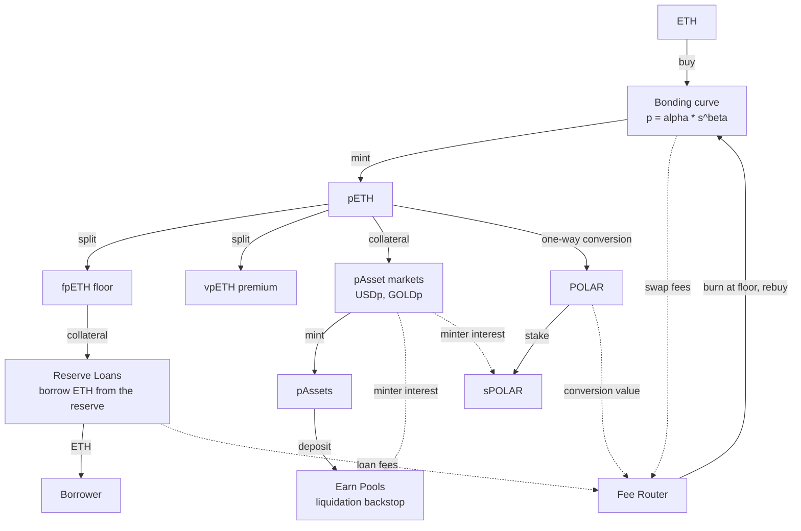
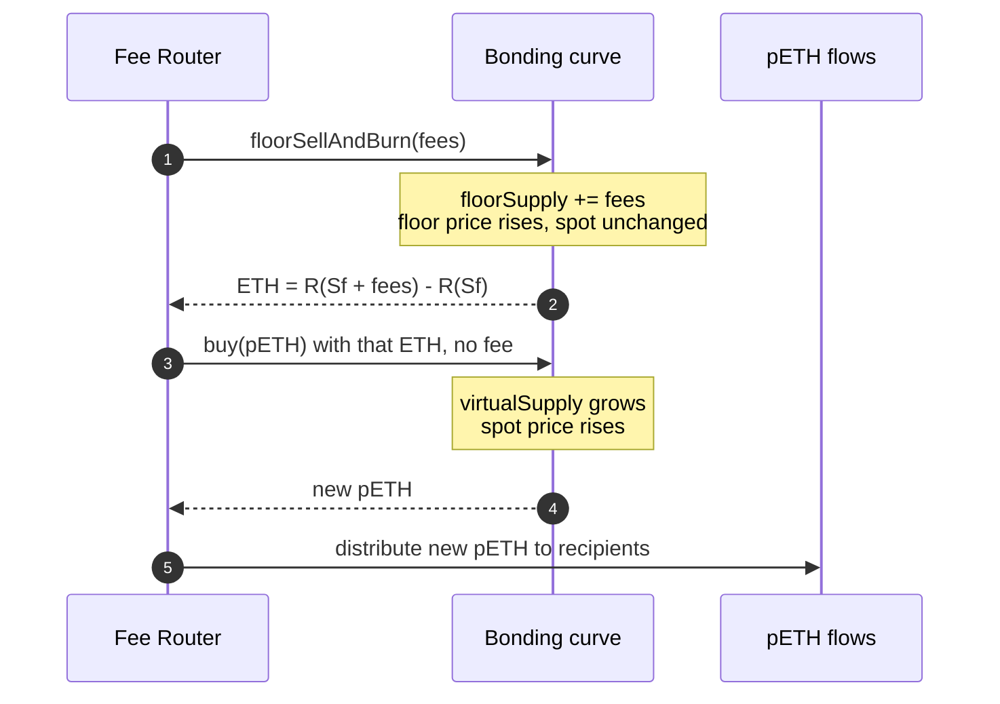

[Polaris](https://polaris.finance/) is a pre-mainnet DeFi protocol on Ethereum that issues stablecoins and synthetic assets against a single collateral, pETH. pETH is not wrapped ETH. Its price comes from a bonding curve that holds ETH, and the curve gives it a floor price, measured in ETH, that protocol rules only allow to rise. Every other component of Polaris is built on that floor: the dollar USDp, the gold token GOLDp, a loan that cannot be liquidated, and a token split that separates the floor from the premium above it.

This article explains the system from two sources. The first is the public documentation repository, read at a commit of October 2026. The second is the `bonding-curve` repository, a Foundry project that implements the power-law curve and compares two fixed-point math libraries. The second source is a prototype rather than the deployed protocol, so the article gives the curve's mathematics from the code and the rest of the architecture from the documentation, and it says which source each claim comes from.

> This article has been made with the help of [Claude Code](https://claude.com/product/claude-code) and several custom skills

[TOC]

## The architecture at a glance

Polaris has three layers, all of them denominated in or backed by pETH.

- **The bonding curve** turns ETH into pETH and pETH back into ETH. It sets both the market (spot) price and the floor price of pETH, without any external oracle.
- **pAsset markets** let users mint USDp, GOLDp and future synthetic assets against pETH in overcollateralized positions. Each market has its own oracle configuration, its own Earn Pool and its own risk state.
- **POLAR and sPOLAR** are the utility token and its time-locked staked form. sPOLAR holders receive part of the minters' interest and steer a bounded set of parameters.

pETH can also be split into fpETH (the floor) and vpETH (the premium). fpETH is the collateral of Reserve Loans, which lend ETH directly from the curve's reserve.

The documentation describes the core contracts as immutable, with no admin role that can move user funds, no freeze or blacklist function on pETH or any pAsset, and no upgrade path. What remains adjustable is a short list of parameters under *bounded stewardship*, covered in the last section.

## The bonding curve

### A power-law price

The prototype contract `BaseBondingCurve.sol` defines the curve in a single comment: `p = A * s^B`. Writing $$\alpha$$ for `A` and $$\beta$$ for `B`, the marginal price of pETH at supply $$s$$ and the ETH reserve needed to reach that supply are:

$$
\begin{aligned}
p(s) &= \alpha \, s^{\beta}, \qquad 0 \lt \beta \lt 1 \\
R(s) &= \int_0^{s} \alpha \, x^{\beta} \, dx = \frac{\alpha \, s^{\beta + 1}}{\beta + 1}
\end{aligned}
$$

The constructor enforces `params.beta > 0` and `params.beta < DECIMAL_PRECISION`, so $$\beta$$ is strictly between 0 and 1 in 18-decimal fixed point. The curve is therefore concave: price rises with supply, but more slowly as supply grows. $$\alpha$$ is stored in a mutable slot because `init()` can set it once. $$\beta$$ is `immutable`.

The contract never evaluates the integral. It keeps the reserve on the curve through a "reserve ratio" identity, implemented in `_getReserveRatioLeftFormula` and `_getBalanceFromReserveRatio`:

$$
\begin{aligned}
(\beta + 1) \cdot R = \alpha \, s^{\beta + 1} = s \cdot p(s)
\end{aligned}
$$

A buy of $$\Delta$$ pETH computes the new reserve from the new supply and charges the difference. A sell does the reverse. The invariant test `invariant_ReserveRatio` asserts that `reserveRatioDeviation()` is exactly zero after every handler call.

### Why the curve is called scale-free

The identity above says the reserve is always the fraction $$\frac{1}{1+\beta}$$ of the curve's market capitalisation $$s \cdot p(s)$$, whatever the size of the system. Solving for $$s$$ and substituting gives price as a function of reserve, from which the elasticity follows:

$$
\begin{aligned}
p \propto R^{\frac{\beta}{\beta + 1}} \quad \Longrightarrow \quad \frac{dp}{p} = \frac{\beta}{\beta + 1} \cdot \frac{dR}{R}
\end{aligned}
$$

A deposit that grows the reserve by 1% moves the price by the same percentage at 1,000 ETH of reserve as at 1,000,000 ETH. That is the property the documentation calls a *scale-free design*: the price response of pETH depends on relative flows, not on absolute size. With $$\beta = 0.5$$, the value used in the repository's tests, a 1% increase in reserve raises the price by about 0.33%. The production value of $$\beta$$ is not given in either source.

### The floor, from the code

The prototype tracks four numbers. Their names are the ones in the contract:

| Variable | Meaning |
|---|---|
| `virtualSupply()` | $$S_v$$, the x-coordinate of the current point on the curve: real supply plus `floorSupply` |
| `virtualBalance` | $$R(S_v)$$, the reserve that corresponds to that point |
| `floorSupply` | $$S_f$$, the supply that has been burnt "at the floor" by the Fee Router |
| `floorBalance` | $$R(S_f)$$, the reserve that corresponds to the floor point |

The pETH held by users is $$S_v - S_f$$, and the ETH held by the curve contract is $$R(S_v) - R(S_f)$$. If every holder sold, the state would move down the curve from $$S_v$$ to $$S_f$$, and the curve would pay out exactly what it holds. The last unit sold would receive $$p(S_f)$$, which is the floor price returned by `floorPrice()`:

$$
\begin{aligned}
p_{\text{floor}} = \alpha \, S_f^{\beta}, \qquad \frac{p_{\text{floor}}}{p_{\text{spot}}} = \left(\frac{S_f}{S_v}\right)^{\beta}
\end{aligned}
$$

Because $$p$$ is increasing, the average ETH paid per pETH in a full exit, $$\frac{R(S_v) - R(S_f)}{S_v - S_f}$$, is never below $$p(S_f)$$. The reserve below the floor point, $$R(S_f)$$, is not needed to honour any sale and is not held by the curve: the invariant `invariant_TokenBalances` checks that the curve's reserve-token balance equals `virtualBalance - floorBalance`, and, in the test setup where the Fee Router is a plain address that spends nothing, that the router holds `floorBalance`.

The second ratio explains the documentation's table on $$\beta$$. For a given position of the floor relative to the spot point, a smaller $$\beta$$ gives a floor closer to the spot price and a flatter curve. With $$\beta = 0.5$$ and a floor supply equal to half the virtual supply, the floor would be about 71% of the spot price.

### Only one function moves the floor

`buy()` and `sell()` change `virtualBalance` and the real supply, but neither touches `floorSupply`. The floor moves only through `floorSellAndBurn()`, which is restricted to the Fee Router by `_requireOnlyFeeRouter()`. It burns $$\Delta$$ pETH, adds $$\Delta$$ to `floorSupply`, and sends the Fee Router the reserve between the old and the new floor points, $$R(S_f + \Delta) - R(S_f)$$. There is no function that decreases `floorSupply`, and since $$\beta \gt 0$$ the floor price can only increase. This is the code-level basis for the documentation's statement that "the pETH floor can only rise; it cannot fall".

The burn leaves $$S_v$$ unchanged, so it raises the floor without changing the spot price. Two `require` statements bound it: the new floor supply cannot exceed the virtual supply, and `init()` requires a non-zero floor from the start so that `pow` is never evaluated at zero.

### Swap fees and the math libraries

In the prototype, a swap fee is a fixed `FEE_PERCENTAGE` taken in pETH, set to 0.05% in the tests. On a buy, the fee tokens are minted to the Fee Router on top of the buyer's amount and paid for by the buyer. On a sell, they are transferred from the seller to the Fee Router. A buy made by the Fee Router itself pays no fee. The documentation describes the production swap fee differently, as a *spike-and-decay* fee that rises with demand and decays with inactivity, so the flat fee should be read as a simplification of the prototype.

The repository's stated purpose is to compare two implementations of `pow` for non-integer exponents, both computed as $$2^{e \cdot \log_2 b}$$: `PRBBondingCurve` with PRBMath's `SD59x18` type, and `ABDKBondingCurve` with ABDK's 64.64 fixed-point library. The gas report in its README shows the two within about 1.2% of each other (average `buy`: 87,475 gas for PRB, 88,515 for ABDK). The fuzz tests in `PowMathLibsComparison.t.sol` also record the input ranges beyond which each library reverts.

## How protocol revenue strengthens the floor

The Fee Router is the contract that turns pETH-denominated revenue into a higher floor before passing it on. It receives swap fees, Reserve Loan fees and the value of pETH-to-POLAR conversions. The documentation describes three steps:

1. The pETH collected as fees is burnt at the floor, which raises the floor price and releases ETH from the reserve.
2. That ETH immediately buys newly minted pETH, which raises the spot price.
3. The new pETH is distributed through *pETH flows* to pAsset markets and whitelisted recipients.

The prototype makes one consequence of this sequence visible. The ETH released in step 1 is priced near the floor, while the pETH bought in step 2 is priced near the spot. When pETH trades above its floor, the router therefore buys back fewer pETH than it burnt. Circulating supply falls, and the difference stays with every holder as a higher floor. Recipients receive the revenue only after it has been applied to the floor and the spot price.

pAsset interest follows a separate path. Interest paid by USDp or GOLDp minters is denominated in the pAsset, does not pass through the Fee Router, and is split by each market's own flow logic between its Earn Pool, sPOLAR and approved recipients.

## Splitting pETH into fpETH and vpETH

A pETH has two components with different risks. The floor rises over time and cannot fall in ETH terms. The premium above it moves with demand for pETH and can expand or shrink. Polaris lets a holder separate them:

$$
\begin{aligned}
1 \; \text{pETH} \;\longleftrightarrow\; 1 \; \text{fpETH} + 1 \; \text{vpETH}
\end{aligned}
$$

The split is reversible at any time, so one fpETH plus one vpETH should trade close to one pETH, and arbitrage between split and merge keeps them there. The documentation's example starts from a pETH worth 1 ETH with a floor of 0.75 ETH:

| Scenario | fpETH (floor) | vpETH (premium) | pETH |
|---|---|---|---|
| At the split | 0.75 ETH | 0.25 ETH | 1.00 ETH |
| Floor up, premium down | 0.82 ETH | 0.23 ETH | 1.05 ETH |
| Floor up, premium up | 0.85 ETH | 0.40 ETH | 1.25 ETH |

fpETH is the low-volatility side: an ETH-denominated asset whose yield is the growth of the floor, not validator rewards or borrower interest. vpETH carries the premium, and the documentation suggests it can be used to hedge. A minter who shorts vpETH keeps the pETH collateral and the floor growth while removing exposure to the premium, leaving only the ETH/USD exposure, which can be hedged elsewhere. The comparison the documentation draws is with [Pendle](https://www.pendle.finance/). Pendle splits a yield-bearing asset into fixed and variable yield, whereas Polaris splits its asset into floor and premium.

Secondary-market prices of the two halves need not equal the curve's current floor and premium. fpETH may trade above the floor if buyers pay in advance for future floor growth, and below it only to the extent that the Reserve Loan route described next does not arbitrage the discount away.

## Reserve Loans

A Reserve Loan lends ETH from the bonding curve's reserve against fpETH. The collateral is the floor component, valued in ETH, and the floor cannot fall in ETH. A drop in the ETH price therefore cannot make the loan undercollateralized. The protocol has no liquidation path for these loans, and a borrower can draw up to 100% of the floor value of the deposited fpETH.

There is no interest rate. The cost has two parts:

- **An opening fee of 0.05%** of the ETH borrowed, deducted from the amount received, on every borrow including top-ups.
- **A time-weighted, utilization-based share of the floor growth** produced while the loan is open. The more of the reserve is lent out, the larger the share. Because it is taken from growth, it never reduces the principal value of the position.

The documentation's example: 1 fpETH with a floor of 1 ETH, 1 ETH borrowed, 0.9995 ETH received. When the floor reaches 1.2 ETH and the utilization-based share is 1%, the borrower can access 0.198 ETH of the 0.2 ETH gain and 0.002 ETH goes to the protocol.

Fees are collected from *every* open loan whenever *any* loan is opened, increased, repaid or closed, and they are sent to the Fee Router. A borrower therefore pays accrued fees without touching their own position, and revenue depends on loan activity continuing. Reserve Loans also put a bound on fpETH's market price, since fpETH bought below the floor can be deposited and borrowed against at the full floor value.

## pAsset markets

### Minting and collateral-only positions

A pAsset market is a collateralized-debt system in which positions deposit pETH and mint a synthetic asset. USDp tracks the dollar and GOLDp tracks gold. Both use a Minimum Collateral Ratio of 115%: a position needs at least 1.15 dollars of pETH for each dollar of debt, and becomes liquidatable below that. The documentation states that launching a new market is permissionless and that "any asset with an oracle can become a pAsset". Every market must route a minimum share of its interest to its own Earn Pool, and the rest of its revenue model is up to its builder.

A market also accepts **collateral-only positions**, which deposit pETH without minting. They hold no debt at first, but they take part in the market's peg operations and earn their fees, and they receive the Protocol Safety Rate described below.

### Adaptive Peg Defense

Both sides of the peg are defended by arbitrage at the target price:

| Market price | Arbitrage | Supply | Effect on existing positions |
|---|---|---|---|
| Above target | Buy newly minted pAsset at peg with pETH, sell on the market | Expands | Upsized: added debt, collateral and fees spread across positions |
| Below target | Buy on the market, redeem at peg for pETH | Contracts | Downsized: debt and collateral removed, fees spread across positions |

Where Polaris differs from most collateralized-debt systems is in who carries the new debt. A peg buyer does not open a position. The minted supply, the pETH paid for it and the peg-arbitrage fee are distributed across the market's existing positions, both minting and collateral-only, according to the protocol's accounting. Redemptions apply the same distribution in reverse. A minter's debt and collateral can therefore change without any action on their part, and the fee they receive is the compensation for it.

### Two interest rates

| | Peg Stability Rate | Protocol Safety Rate |
|---|---|---|
| Role | Main minting cost | Defends aggregate collateral health |
| Driven by | Net minting versus redemption activity | Position leverage and market health |
| Paid by | All minters, in the pAsset | Higher-leverage positions |
| Paid to | Earn Pool and sPOLAR (protocol revenue) | Lower-leverage and collateral-only positions (not revenue) |

The Peg Stability Rate is not set by governance. Net minting, which signals that the asset trades above peg, pushes it down towards a 0.05% floor. Net redemptions push it up. Accrued interest is periodically minted as new pAssets and distributed. The Protocol Safety Rate is a transfer inside a market, small in normal conditions and larger when collateral health weakens.

Because interest is paid in the pAsset while minters also receive pETH-denominated flows and peg fees, the documentation stresses that the headline rate is not the effective cost. A position can have a low or even negative net rate, and that net rate moves with the ETH price.

### Liquidations, Earn Pools and redistribution

Liquidations stay inside the protocol, with no external auction. Readers who know [Liquity](https://www.liquity.org/) will recognise the two-stage structure of its Stability Pool and redistribution:

1. **Earn Pool first.** Depositors of the pAsset supply the funds that cancel a liquidated position's debt, and the pool receives the position's pETH collateral. Since liquidation happens above 100% collateralization, the pETH received normally exceeds the pAssets burnt. Depositors earn a protocol-defined minimum share of minter interest plus these liquidation gains. Each deposit is a transferable NFT, and auto-compounding [ERC-4626](https://eips.ethereum.org/EIPS/eip-4626) wrappers are left to third parties.
2. **Redistribution second.** If the pool cannot absorb the whole position, the remaining debt and collateral are spread proportionally across the other open positions in that market.

### Defensive Mode and Recovery Mode

Each market has two stress states, triggered by its own reserve-to-debt ratio and independent of the other markets and of the bonding curve.

```mermaid
stateDiagram-v2
    direction LR
    Normal --> Defensive: market ratio below 110%
    Defensive --> Normal: ratio back above 110%
    Defensive --> Recovery: market ratio below 100%
    Recovery --> Defensive: ratio back above 100%
    note right of Defensive
      risk-increasing actions only if the position
      stays at 150% or more and its ratio does not fall,
      closing and buying at peg blocked
    end note
    note right of Recovery
      redemptions paid pro rata to backing,
      no redistribution, liquidations must
      not lower the market ratio
    end note
```

In **Defensive Mode** (below 110%), adding collateral and repaying debt stay open. Withdrawing collateral or increasing debt is allowed only if the position ends at 150% or more and its own ratio does not fall. Closing a position and buying at peg are restricted, because both would lower the market's backing.

**Recovery Mode** (below 100%) keeps those restrictions and adds two rules. Redemptions pay out in proportion to the remaining backing, so at 80% backing every redeemer receives 80% of face value, which removes any advantage in exiting first. Redistribution is disabled, and a liquidation is executed only if it holds or improves the market's ratio.

### Oracles and the Medianizer

The pETH price comes from the curve, so external prices are needed only for the pAsset's reference value: ETH/USD for USDp, plus XAU/USD for GOLDp. Every external price goes through a **Medianizer**, one per price, with up to three feeds:

- three valid feeds: the median;
- one or two valid feeds: the first valid feed in the configured order;
- no valid feed: the last valid price.

A feed is valid if the call succeeds, the value is positive and the price is not stale. Stewards can replace a failed feed immediately, but replacing a live feed or filling an empty slot goes through a timelock. The feeds used at launch had not been fixed at the documentation commit read.

## POLAR, sPOLAR and bounded stewardship

POLAR launches with 100 million tokens, and allocation and vesting were still to be published at the time of reading. Beyond that supply, new POLAR is created only by **conversion**: a user burns pETH and receives newly minted POLAR, priced by a Dutch auction whose price spikes after each conversion in proportion to the fraction of supply minted and then decays. Conversion is one-way. The burnt pETH releases ETH from the reserve, part of which may be rebated to the converter, and the rest goes through the Fee Router into the pETH floor. Since POLAR can never be converted back, no reserve has to be kept for it.

sPOLAR is POLAR staked for between 2 weeks and 4 years. It receives a share of USDp and GOLDp minter interest, paid in those assets, and it carries stewardship rights. Each sPOLAR position is an NFT that can be sold before its term ends. The protocol treasury has no privileged fee stream. To earn protocol revenue it has to stake as sPOLAR like any other holder.

Stewardship is limited to a fixed list of parameters:

| Stewardship can | Stewardship cannot |
|---|---|
| Set interest-rate splits | Modify the bonding curve |
| Tune POLAR conversion parameters within immutable bounds | Introduce new collateral for pAssets |
| Replace oracle feeds (failed: immediately; live: timelocked) | Change liquidation mechanics |
| Whitelist or remove flow recipients and set their weights | Upgrade the core contracts |
| Grant temporary minimum flow allocations | Move user funds |

This limit does not remove governance risk, and the documentation's risk page says so: the choice of flow recipients, rate splits and oracle feeds still shapes yields and liquidity across the system.

## Conclusion

Polaris builds a stablecoin and synthetic-asset system on one collateral, pETH, whose price and floor come from a power-law bonding curve rather than from an oracle.

- **The curve** holds a reserve equal to $$\frac{1}{1+\beta}$$ of its market capitalisation at every size, so its price response depends only on relative flows. The prototype's `floorSupply` can only grow, through the Fee Router's burns, which is why the floor price can only rise.
- **Revenue** from swaps, Reserve Loans and conversions is burnt at the floor and re-bought at the spot price before being distributed, so it raises both prices first.
- **The floor** supports two primitives that a conventional collateral cannot: fpETH, an ETH-denominated asset whose yield is floor growth, and Reserve Loans, which lend up to 100% of that floor with no liquidation.
- **pAsset markets** follow a Liquity-like design (Earn Pool, then redistribution) and add two-sided peg arbitrage whose debt is spread over existing positions, a self-adjusting Peg Stability Rate, a leverage-based Protocol Safety Rate, and per-market Defensive and Recovery modes.
- **Governance** is limited to flows, splits, conversion parameters and oracle feeds. External prices enter only through a three-feed Medianizer.

The protocol was in public testnet on Sepolia when the documentation was read, and several production parameters, including $$\beta$$, the swap-fee schedule and the launch oracles, were not published in either source.

## Annex

### Key Terms

| Term | Definition |
|------|------------|
| **Bonding curve** | A contract that mints and burns a token against a reserve asset at a price fixed by a formula of the token's supply, so it acts as its own market maker. |
| **Collateralized debt position** | A position that locks collateral and mints a debt asset against it, and can be liquidated if the collateral value falls too far relative to the debt. |
| **Collateral ratio** | Value of a position's collateral divided by its debt; Polaris uses 115% as the minimum for USDp and GOLDp. |
| **Peg** | The target price a synthetic asset is meant to trade at, such as one dollar for USDp. |
| **Oracle** | A source of off-chain prices for contracts; Polaris needs one only for pAsset reference prices, never for pETH. |
| **pETH** | The ETH-backed reserve asset minted and burnt by the Polaris bonding curve, used as the single collateral of every pAsset. |
| **Spot price** | The marginal price of pETH at the curve's current virtual supply, $$p(S_v)$$. |
| **Floor price** | The marginal price at the floor supply, $$p(S_f)$$; the least ETH per pETH the reserve can pay, and a value that only rises. |
| **β (beta)** | The exponent of the power-law curve, strictly between 0 and 1; a smaller β gives a flatter curve and a floor closer to the spot price. |
| **Scale-free** | The property that the reserve stays a fixed fraction $$\frac{1}{1+\beta}$$ of market capitalisation, so price responds to relative rather than absolute flows. |
| **Fee Router** | The contract that burns pETH revenue at the floor, re-buys pETH at the spot price with the released ETH, and distributes it through pETH flows. |
| **fpETH / vpETH** | The two halves of a split pETH: the floor component and the market premium above it; one of each merges back into one pETH. |
| **Reserve Loan** | A non-liquidatable loan of ETH from the curve's reserve against fpETH, up to 100% of the floor value, paid for by a share of floor growth. |
| **pAsset** | A synthetic asset minted against pETH in a Polaris market, such as USDp or GOLDp. |
| **Collateral-only position** | A pAsset-market position with pETH and no initial debt, which takes part in peg operations and receives the Protocol Safety Rate. |
| **Adaptive Peg Defense** | Buying and redeeming at peg, with the resulting debt, collateral and fees spread across all positions of the market. |
| **Earn Pool** | A per-market pool of pAsset deposits that absorbs liquidations first, in exchange for interest and pETH liquidation gains. |
| **Redistribution** | The fallback liquidation path that spreads leftover debt and collateral over the market's other positions; disabled in Recovery Mode. |
| **Medianizer** | The per-price oracle aggregator with up to three feeds, taking the median of three or falling back to the first valid feed or the last valid price. |
| **sPOLAR** | POLAR staked for 2 weeks to 4 years as a transferable NFT, earning a share of minter interest and stewardship rights. |

### Invariants

The first four are taken from the prototype's invariant tests, the others from the documentation.

| Invariant | Enforced by | Breaks if |
|-----------|-------------|-----------|
| $$(\beta + 1) \cdot R = \alpha \, s^{\beta+1}$$ at the current point and at the floor point. | `_getBalanceFromReserveRatio` on every buy, sell and floor burn; `invariant_ReserveRatio` and `invariant_FloorReserveRatio`. | `pow` rounding drifts between the library used for buys and the one used for sells, or a path updates supply without recomputing the balance. |
| Real supply equals `virtualSupply - floorSupply`, and the curve's reserve balance equals `virtualBalance - floorBalance`. | State updates in `buy`, `sell`, `floorSellAndBurn`; `invariant_TokenBalances`. | A function moves reserve tokens without updating `virtualBalance` or `floorBalance`. |
| The floor price never decreases. | Only `floorSellAndBurn` changes `floorSupply`, only upward, and only the Fee Router can call it. | A new function lowers `floorSupply`, or the caller restriction is removed. |
| Floor supply is non-zero and never above virtual supply. | `require` checks in `init` and `floorSellAndBurn`; `invariant_NonZeroBalances`. | Initialisation with a zero floor makes `pow(0, ·)` revert. |
| A Reserve Loan cannot become undercollateralized from ETH price moves. | Collateral (fpETH floor) and debt are both in ETH, and the floor cannot fall. | The loan were allowed to exceed the floor value, or the floor could decrease. |
| A pAsset market in Recovery Mode cannot see its backing ratio fall through a liquidation. | Liquidations that lower the ratio are not executed; redistribution is disabled. | Redistribution is re-enabled below 100% backing. |

### Integration Notes

| Behaviour | What an integrator should do |
|-----------|------------------------------|
| pETH is not a 1:1 wrapper of ETH; it has a spot price and a lower floor price, both from the curve. | Value pETH at the spot price for trading and at `floorPrice()` for worst-case collateral, and never assume 1 pETH = 1 ETH. |
| A minter's debt and collateral change when others buy or redeem at peg, through Adaptive Peg Defense. | Read position state from the contracts before acting, rather than caching the values from the position's last transaction. |
| Reserve Loan fees are charged to every borrower when any loan is touched. | Expect a borrower's accessible floor gain to fall between their own interactions. |
| In Defensive Mode, closing a position and buying at peg are restricted, and risk-increasing changes need a 150% result. | Handle these reverts in a frontend or vault, especially in automated deleveraging or exit flows. |
| Recovery Mode redemptions pay pro rata to backing, not face value. | Do not price a redemption at 1:1 when the market's reserve-to-debt ratio is below 100%. |
| Earn Pool positions are NFTs whose rewards must be claimed and are not compounded. | Use a third-party ERC-4626 wrapper for a fungible share, and account for its additional contract risk. |
| Oracle failure falls back to the last valid price. | Monitor feed staleness yourself, since a stale price can persist through the fallback. |

## Frequently Asked Questions

**Q: What is the difference between the spot price and the floor price of pETH?**

The spot price is the marginal price of pETH at the curve's current virtual supply $$S_v$$: it is what the next buyer pays and it rises or falls with buys and sells. The floor price is the marginal price at the floor supply $$S_f$$, which is what the last pETH would receive if every holder sold. Buys and sells change only $$S_v$$, so they move the spot price. Only the Fee Router's burns move $$S_f$$, and only upward, so the floor never falls.

**Q: Why does the documentation call the bonding curve scale-free?**

On a power-law curve the reserve is always $$\frac{1}{1+\beta}$$ of the market capitalisation $$s \cdot p(s)$$. As a result, the relative price change is a fixed multiple of the relative reserve change, $$\frac{dp}{p} = \frac{\beta}{\beta+1} \cdot \frac{dR}{R}$$. A 1% inflow has the same price effect at any size of the system, so the protocol's behaviour does not change as it grows.

**Q: How does the Fee Router make protocol revenue raise both the floor and the spot price?**

It processes collected pETH in three steps:

- It burns the pETH at the floor through `floorSellAndBurn`. Floor supply grows, so the floor price rises, while the spot price is unchanged.
- It uses the ETH released to buy new pETH from the curve, which raises the spot price.
- It distributes the new pETH through pETH flows.

Because the ETH was released near the floor price and spent near the spot price, the router buys back fewer pETH than it burnt whenever pETH trades above its floor. Circulating supply shrinks, and the difference stays with all holders.

**Q: Why can a Reserve Loan lend 100% of the collateral value without liquidations, when Aave or Morpho cannot?**

In a conventional loan the collateral and debt are in different assets, so a price move can push the debt above the collateral value, and the lender needs a buffer and a liquidation mechanism. A Reserve Loan uses fpETH, whose value is the pETH floor in ETH, and lends ETH from the same reserve that backs that floor. Collateral and debt are in the same unit, and the floor cannot fall, so no price move can make the position undercollateralized. The borrower pays with a utilization-based share of future floor growth instead of interest.

**Q: A USDp minter has done nothing for a week, yet their debt has increased. What happened?**

The most likely cause is Adaptive Peg Defense. If USDp traded above one dollar, arbitrageurs bought newly minted USDp at peg with pETH. That new debt, the pETH paid and the peg fee were spread across all existing positions, so each position's debt and collateral grew together and its fee balance increased. Accrued Peg Stability Rate interest also adds to debt over time. A redistribution after a liquidation the Earn Pool could not fully absorb would have the same visible effect.

**Q: What changes for a USDp holder who wants to redeem when the market's reserve-to-debt ratio is 90%?**

The market is in Recovery Mode, so the redemption pays 90% of face value in pETH, and every redeemer takes the same cut, so there is no gain in redeeming first. Redistribution of liquidations is also disabled, and a liquidation only proceeds if it keeps or raises the 90% ratio. The bonding curve is unaffected, and the market returns towards normal as the ETH price recovers, minters add collateral or repay, and liquidations and the Protocol Safety Rate improve the ratio.

**Q: Why is POLAR conversion one-way, and what does it do to pETH?**

If POLAR could be converted back into pETH, part of the value of each conversion would have to be held in reserve to honour that exit. With a one-way conversion, the burnt pETH releases ETH from the curve, part of it may be rebated to the converter, and the rest is routed through the Fee Router into the floor. Each conversion therefore reduces pETH supply, raises the floor for remaining holders and increases POLAR supply, without a perpetual emission schedule.

## References

### Analyzed source

- [Polaris-Finance/polaris-docs](https://github.com/Polaris-Finance/polaris-docs) — analyzed at commit [`651688826fc9c58f39191fd4f1c0f50b4e6f126a`](https://github.com/Polaris-Finance/polaris-docs/tree/651688826fc9c58f39191fd4f1c0f50b4e6f126a), 2026-10-21
- [Polaris-Finance/bonding-curve](https://github.com/Polaris-Finance/bonding-curve) — analyzed at commit [`2312169a0882071a41822440fa99493ba379218d`](https://github.com/Polaris-Finance/bonding-curve/tree/2312169a0882071a41822440fa99493ba379218d), 2026-10-21

### Polaris documentation

- [Polaris](https://polaris.finance/)
- [Polaris Documentation](https://docs.polaris.finance/)
- [Bonding Curve](https://docs.polaris.finance/architecture/bonding-curve)
- [Reserve Loans](https://docs.polaris.finance/architecture/reserve-loans)
- [Fee Router](https://docs.polaris.finance/design/fee-router)
- [Recovery Mode](https://docs.polaris.finance/design/recovery-mode)
- [Risks](https://docs.polaris.finance/risks)

### Libraries and related protocols

- [PRBMath](https://github.com/PaulRBerg/prb-math)
- [ABDK Libraries for Solidity](https://github.com/abdk-consulting/abdk-libraries-solidity)
- [Liquity](https://www.liquity.org/)
- [Pendle](https://www.pendle.finance/)
- [ERC-4626: Tokenized Vaults](https://eips.ethereum.org/EIPS/eip-4626)

### Related articles

- [10 Key Differences Between MakerDAO and Liquity]({{site.url_complet}}/2024/12/16/10-Key-Differences-Between-MakerDAO-and-Liquity/)
- [Introduction to MakerDAO]({{site.url_complet}}/2023/11/20/makerdao/)
- [Automated Market Makers (AMMs) - Overview]({{site.url_complet}}/2025/07/29/automated-market-makers-amm/)
- [How Morpho Blue Works - Isolated Lending Markets, Shares, Liquidations and Bad Debt]({{site.url_complet}}/2026/10/10/morpho-blue-lending-markets/)
- [Pricing a Lending Position During an Incident - What the Oracle Reads, When, and Who Bears the Gap]({{site.url_complet}}/2026/10/11/oracle-kinds-pricing-lending-position-incident/)

### Tooling

- [Claude Code](https://claude.com/product/claude-code)
