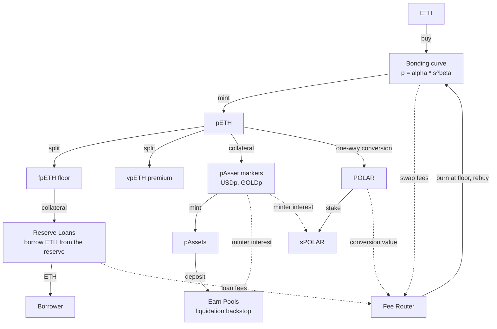
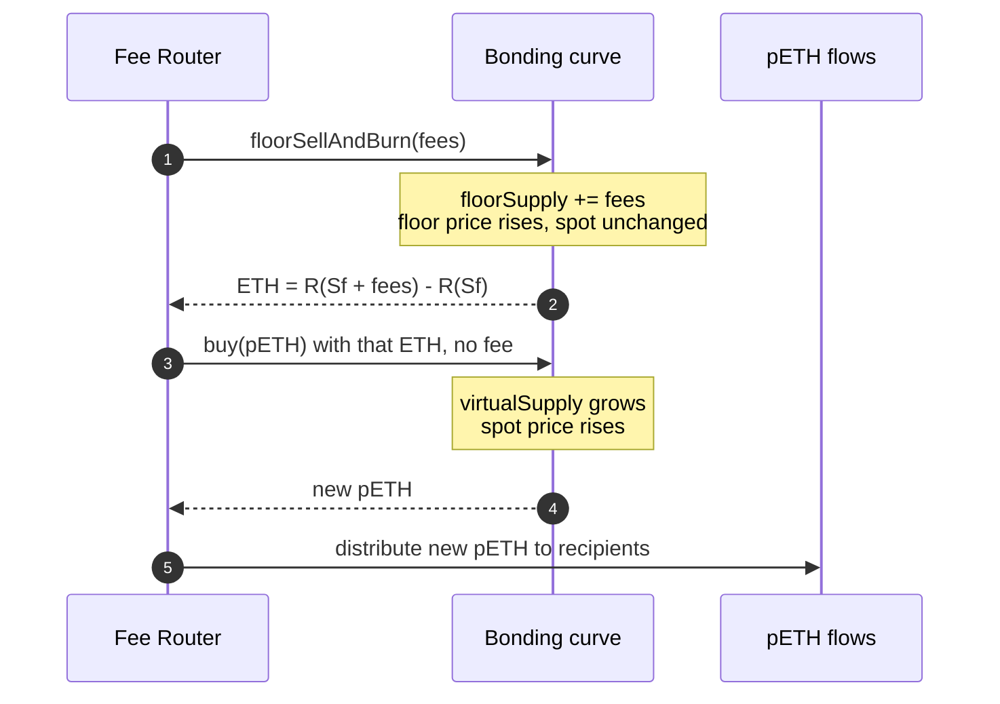
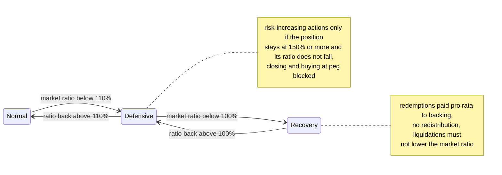
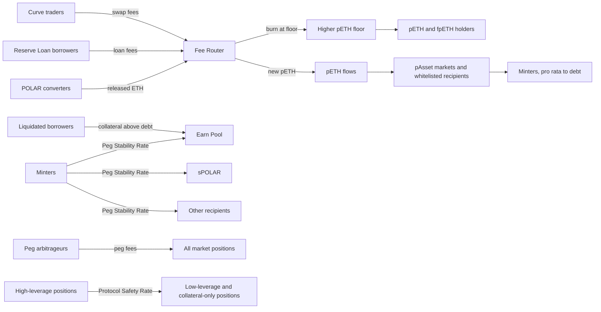

[Polaris](https://polaris.finance/) is a pre-mainnet DeFi protocol on Ethereum that issues stablecoins and synthetic assets against a single collateral, pETH. pETH is not wrapped ETH. Its price comes from a bonding curve that holds ETH, and the curve gives it a floor price, measured in ETH, that protocol rules only allow to rise. Every other component of Polaris is built on that floor: the dollar USDp, the gold token GOLDp, a loan that cannot be liquidated, and a token split that separates the floor from the premium above it.

This article explains the system from three sources. The first is the public documentation repository, read at a commit of October 2026. The second is the `bonding-curve` repository, a Foundry project that implements the power-law curve and compares two fixed-point math libraries; it is a prototype rather than the deployed protocol. The third is the Polaris public testnet on Sepolia, whose contracts are deployed but not source-verified, and whose parameters were read on-chain on 22 October 2026. The article gives the curve's mathematics from the code, the rest of the architecture from the documentation, and testnet values where the contracts expose them, and it says which source each claim comes from.

> This article has been made with the help of [Claude Code](https://claude.com/product/claude-code) and several custom skills

[TOC]

## What you need to know first

The article assumes familiarity with DeFi and Ethereum, and uses the following more specific mechanisms without re-deriving them.

- **Collateralized debt position (CDP).** A user locks collateral and mints a debt token against it, as in [MakerDAO]({{site.url_complet}}/2023/11/20/makerdao/) vaults. Below a minimum collateral ratio the position can be liquidated, and a system can also track the ratio of all collateral to all debt to restrict operations under stress, which is what Polaris's Defensive and Recovery modes do.
- **Peg arbitrage, stability pool and redistribution.** [Liquity](https://www.liquity.org/) keeps its stablecoin near one dollar by letting anyone redeem it for collateral at face value, and liquidates without auctions: a pool of stablecoin depositors absorbs bad debt first, and leftover debt is shared among all other positions. Polaris keeps both liquidation stages and applies peg arbitrage on both sides of the peg.
- **Power law.** A function of the form $$y = a \cdot x^{k}$$, where the variable is raised to a fixed exponent. Multiplying $$x$$ by any factor $$c$$ multiplies $$y$$ by $$c^{k}$$ wherever the curve starts, so a power law has no preferred scale. The pETH price is a power law of the supply with exponent $$\beta$$; [a separate article]({{site.url_complet}}/2026/10/22/power-law-curves/) covers power-law curves in detail.
- **Marginal price and price impact.** When price depends on the quantity traded, as in an [automated market maker]({{site.url_complet}}/2025/07/29/automated-market-makers-amm/), the quoted price applies only to an infinitesimal trade, and a real trade pays the average over the range it moves through. On a bonding curve that cost is the area under the price curve, which is why integrals appear below.
- **Splitting a token into components.** [Pendle](https://www.pendle.finance/) splits a yield-bearing token into principal and yield parts that trade separately and recombine into the original. Polaris splits pETH into floor and premium and relies on the same split-and-merge arbitrage.
- **Vote-escrowed staking.** A holder locks tokens for a chosen period, often up to four years, in exchange for voting power and revenue that depend on the lock length, a model popularised by Curve's veCRV. sPOLAR follows it, with each position held as a transferable NFT.
- **Fixed-point arithmetic and fractional powers.** Solidity has no floating point, so fractions are integers scaled by $$10^{18}$$ and every rounding decides whether the user or the protocol keeps the dust. A power such as $$s^{\beta}$$ with fractional $$\beta$$ is computed as $$2^{\beta \cdot \log_2 s}$$ by libraries such as [PRBMath](https://github.com/PaulRBerg/prb-math) and [ABDK](https://github.com/abdk-consulting/abdk-libraries-solidity), which the Polaris prototype compares.
- **Invariant testing.** In Foundry, the fuzzer calls a handler contract in random sequences and checks after every call that the `invariant_*` functions still hold. The prototype uses it to show that the curve's reserve accounting never drifts.

## The architecture at a glance

Polaris has three layers, all of them denominated in or backed by pETH.

- **The bonding curve** turns ETH into pETH and pETH back into ETH. It sets both the market (spot) price and the floor price of pETH, without any external oracle.
- **pAsset markets** let users mint USDp, GOLDp and future synthetic assets against pETH in overcollateralized positions. Each market has its own oracle configuration, its own Earn Pool and its own risk state.
- **POLAR and sPOLAR** are the utility token and its time-locked staked form. sPOLAR holders receive part of the minters' interest and steer a bounded set of parameters.

pETH can also be split into fpETH (the floor) and vpETH (the premium). fpETH is the collateral of Reserve Loans, which lend ETH directly from the curve's reserve.

The documentation describes the core contracts as immutable, with no admin role that can move user funds, no freeze or blacklist function on pETH or any pAsset, and no upgrade path. What remains adjustable is a short list of parameters under *bounded stewardship*, covered in the last section.

## The bonding curve

### A power-law price

A bonding curve is a contract that is the market for its own token. There is no order book and no liquidity provider: the contract mints a token when someone pays the reserve asset in, burns it when someone hands it back, and quotes a price that depends only on how many tokens exist. For Polaris the token is pETH and the reserve asset is ETH.

The price is a power law of the supply, a family of curves with a property this section relies on: multiplying the supply by any factor always multiplies the price by the same amount. Rather than re-deriving that here, a companion article, [Power-Law Curves - Scale Invariance, Log-Log Lines, Bonding Curves and Heavy Tails]({{site.url_complet}}/2026/10/22/power-law-curves/), covers the definition, log-log plots, integrals and other DeFi uses such as constant-product pools.

The prototype contract `BaseBondingCurve.sol` gives the price rule in a single comment: `p = A * s^B`. Writing $$\alpha$$ for `A` and $$\beta$$ for `B`, the curve is defined by two functions of the supply $$s$$:

$$
\begin{aligned}
p(s) &= \alpha \, s^{\beta}, \qquad 0 \lt \beta \lt 1 \\
R(s) &= \int_0^{s} \alpha \, x^{\beta} \, dx = \frac{\alpha \, s^{\beta + 1}}{\beta + 1}
\end{aligned}
$$

The symbols mean the following:

- **$$s$$** is the supply coordinate on the curve. In the code it is `virtualSupply()`, which, as the floor section below explains, is the circulating pETH plus the pETH already burnt at the floor.
- **$$p(s)$$** is the *marginal* price: the ETH cost of one more infinitesimally small unit of pETH at supply $$s$$. It is the spot price returned by `currentPrice()`.
- **$$\alpha$$** is a scale factor. Doubling it doubles every price and every reserve amount without changing the shape of the curve. The constructor caps it (`MAX_ALPHA`), and `init()` can set it once if it was not set at deployment.
- **$$\beta$$** is the exponent and sets how fast the price grows with supply. It is `immutable`, and the constructor enforces `params.beta > 0` and `params.beta < DECIMAL_PRECISION`, so in 18-decimal fixed point $$\beta$$ is strictly between 0 and 1.
- **$$R(s)$$** is the ETH the curve must hold when the supply is $$s$$, which is the variable `virtualBalance`.

The reserve is an integral because each unit of pETH was bought at the marginal price in force when it was minted. Adding up the price of every unit from 0 to $$s$$ is the area under the price curve, and for a power function that area has the closed form above. That is the practical reason for choosing a power law: integrating $$x^{\beta}$$ gives another power, $$\frac{x^{\beta + 1}}{\beta + 1}$$, so the reserve is a single formula the contract can evaluate without summing anything. The same reasoning prices any trade: moving from supply $$s_1$$ to $$s_2$$ costs (or, for a sale, pays) the area between the two points, $$R(s_2) - R(s_1)$$.

The bound on $$\beta$$ decides how the price grows. With $$\beta = 0$$ the price would be the constant $$\alpha$$ and the curve would be a fixed-rate wrapper of ETH. With $$\beta = 1$$ it would be a straight line, the price rising by the same amount for every unit minted. With $$\beta$$ between the two, the curve is concave: price rises with supply, but each additional unit raises it by less than the previous one, so large supplies see a smaller price impact per pETH. Holding the reserve at a constant share of the token's market value, as shown below, makes this the same family of curves as Bancor's constant-reserve-ratio design.

A worked example with the parameters of the repository's tests, $$\alpha = 2$$ and $$\beta = 0.5$$ (so $$p(s) = 2\sqrt{s}$$ and $$R(s) = \frac{4}{3} s^{1.5}$$), fees ignored:

| Supply $$s$$ | Spot price $$p(s)$$ | Reserve $$R(s)$$ |
|---|---|---|
| 100 | 20 | 1,333.33 |
| 121 | 22 | 1,774.67 |
| 144 | 24 | 2,304.00 |

A buyer who takes the supply from 100 to 121 receives 21 pETH and pays $$R(121) - R(100) = 441.33$$ ETH. The price is not fixed during the trade: the first unit is minted at about 20 ETH and the last at about 22 ETH, so the buyer pays an average of about 21.02 ETH per pETH. The gap between the spot price quoted before the trade (20) and this average is the price impact; a larger trade moves further along the curve and pays a higher average.

A seller who returns the same 21 pETH moves the supply back from 121 to 100 and receives the same 441.33 ETH, because the price depends only on supply and the sale covers the same stretch of curve. Without fees, a round trip therefore costs nothing.

Raising the price from 22 to 24 then takes 23 pETH, two more than the 21 that raised it from 20 to 22. Each further increase of the price needs a larger amount of pETH, which is what makes the curve concave:

| Supply $$s$$ | $$\sqrt{s}$$ | Price $$2\sqrt{s}$$ | pETH added | Cost in ETH | Price gain |
|---|---|---|---|---|---|
| 100 | 10 | 20 | | | |
| 121 | 11 | 22 | 21 | 441.33 | +2 |
| 144 | 12 | 24 | 23 | 529.33 | +2 |
| 169 | 13 | 26 | 25 | 625.33 | +2 |

The left panel shows the worked example: the shaded area up to $$s = 100$$ is the reserve, and the band between 100 and 121 is what the buyer pays. The right panel shows why $$\beta$$ matters: the closer it is to 0, the flatter the curve, and the testnet value of 0.15 (read on 22 October 2026) gives a much flatter curve than the prototype's 0.5.

The contract never evaluates the integral. It keeps the reserve on the curve through a "reserve ratio" identity, obtained by multiplying the expression for $$R$$ by $$\beta + 1$$, and implemented in `_getReserveRatioLeftFormula` and `_getBalanceFromReserveRatio`:

$$
\begin{aligned}
(\beta + 1) \cdot R = \alpha \, s^{\beta + 1} = s \cdot p(s)
\end{aligned}
$$

Each trading function uses this identity in one direction or the other:

- **Buy a given amount of pETH** (`getBuyAmount`): compute the new supply $$s + \Delta$$, derive the reserve it requires, and charge the difference with the current `virtualBalance`. The division by $$\beta + 1$$ is rounded up, so rounding favours the curve.
- **Sell a given amount of pETH** (`getSellAmount`): compute the reserve at $$s - \Delta$$ and pay out the difference.
- **Spend a given amount of ETH** (`getBuyBcTokenAmountFromReserve`): invert the identity to find the supply that a reserve $$R$$ supports, $$s = \left(\frac{(\beta + 1) R}{\alpha}\right)^{\frac{1}{\beta + 1}}$$, then recompute the reserve from that supply and return any rounding leftover.

The invariant test `invariant_ReserveRatio` asserts that `reserveRatioDeviation()`, the difference between the two sides of the identity, is exactly zero after every handler call.

#### The power-law price in short

- **The curve is the market.** pETH is minted when ETH comes in and burnt when it goes out, with no order book and no liquidity provider.
- **The price depends only on the supply**, through $$p(s) = \alpha \, s^{\beta}$$. $$\alpha$$ scales every price, $$\beta$$ sets how fast the price rises.
- **$$\beta$$ is between 0 and 1**, so the price rises with supply but each extra pETH raises it less than the previous one.
- **The reserve is the area under the price curve.** It is the sum of what every pETH in existence was paid, $$R(s)$$.
- **A trade pays the area between its start and end supply.** Its average price lies between the spot price before and after the trade; the difference is the price impact.
- **Buying and then selling the same amount returns the same ETH**, fees aside, because both cover the same stretch of curve.
- **The contract never integrates.** It enforces $$(\beta + 1) \cdot R = s \cdot p(s)$$ after every trade, and its tests require that identity to hold exactly.
- **The testnet curve is flatter than the prototype's**: $$\beta = 0.15$$ on Sepolia (read on 22 October 2026) against 0.5 in the tests.

### Why the curve is called scale-free

The identity above says the reserve is always the fraction $$\frac{1}{1+\beta}$$ of the curve's market capitalisation $$s \cdot p(s)$$, whatever the size of the system. Solving for $$s$$ and substituting gives price as a function of reserve, from which the elasticity follows:

$$
\begin{aligned}
p \propto R^{\frac{\beta}{\beta + 1}} \quad \Longrightarrow \quad \frac{dp}{p} = \frac{\beta}{\beta + 1} \cdot \frac{dR}{R}
\end{aligned}
$$

This is the power-law property seen from the reserve side. On the price side, doubling the supply always multiplies the price by $$2^{\beta}$$: about 1.41 (+41%) with $$\beta = 0.5$$, and about 1.11 (+11%) with the testnet's $$\beta = 0.15$$, whether the supply goes from 10 to 20 or from one million to two million.

A deposit that grows the reserve by 1% moves the price by the same percentage at 1,000 ETH of reserve as at 1,000,000 ETH. That is the property the documentation calls a *scale-free design*: the price response of pETH depends on relative flows, not on absolute size. With $$\beta = 0.5$$, the value used in the repository's tests, a 1% increase in reserve raises the price by about 0.33%. The curve deployed on the Polaris testnet uses a much flatter $$\beta = 0.15$$ (read on 22 October 2026, see below), for which the same 1% increase raises the price by about 0.13%. The mainnet value is not published.

### The floor, from the code

The prototype tracks four numbers. Their names are the ones in the contract:

| Variable | Meaning |
|---|---|
| `virtualSupply()` | $$S_v$$, the x-coordinate of the current point on the curve: real supply plus `floorSupply` |
| `virtualBalance` | $$R(S_v)$$, the reserve that corresponds to that point |
| `floorSupply` | $$S_f$$, the supply that has been burnt "at the floor" by the Fee Router |
| `floorBalance` | $$R(S_f)$$, the reserve that corresponds to the floor point |

The pETH held by users is $$S_v - S_f$$, and the ETH held by the curve contract is $$R(S_v) - R(S_f)$$. If every holder sold, the state would move down the curve from $$S_v$$ to $$S_f$$, and the curve would pay out exactly what it holds. The last unit sold would receive $$p(S_f)$$, which is the floor price returned by `floorPrice()`:

$$
\begin{aligned}
p_{\text{floor}} = \alpha \, S_f^{\beta}, \qquad \frac{p_{\text{floor}}}{p_{\text{spot}}} = \left(\frac{S_f}{S_v}\right)^{\beta}
\end{aligned}
$$

Because $$p$$ is increasing, the average ETH paid per pETH in a full exit, $$\frac{R(S_v) - R(S_f)}{S_v - S_f}$$, is never below $$p(S_f)$$. The reserve below the floor point, $$R(S_f)$$, is not needed to honour any sale and is not held by the curve: the invariant `invariant_TokenBalances` checks that the curve's reserve-token balance equals `virtualBalance - floorBalance`, and, in the test setup where the Fee Router is a plain address that spends nothing, that the router holds `floorBalance`.

The second ratio explains the documentation's table on $$\beta$$. For a given position of the floor relative to the spot point, a smaller $$\beta$$ gives a floor closer to the spot price and a flatter curve. With $$\beta = 0.5$$ and a floor supply equal to half the virtual supply, the floor would be about 71% of the spot price.

### Only one function moves the floor

`buy()` and `sell()` change `virtualBalance` and the real supply, but neither touches `floorSupply`. The floor moves only through `floorSellAndBurn()`, which is restricted to the Fee Router by `_requireOnlyFeeRouter()`. It burns $$\Delta$$ pETH, adds $$\Delta$$ to `floorSupply`, and sends the Fee Router the reserve between the old and the new floor points, $$R(S_f + \Delta) - R(S_f)$$. There is no function that decreases `floorSupply`, and since $$\beta \gt 0$$ the floor price can only increase. This is the code-level basis for the documentation's statement that "the pETH floor can only rise; it cannot fall".

The burn leaves $$S_v$$ unchanged, so it raises the floor without changing the spot price. Two `require` statements bound it: the new floor supply cannot exceed the virtual supply, and `init()` requires a non-zero floor from the start so that `pow` is never evaluated at zero.

### The curve deployed on the testnet

The Polaris public testnet runs on Sepolia. Its web application (`testnet.polaris.finance`) lists the deployed contract addresses, and the pETH curve is at [`0x07ea…705e`](https://sepolia.etherscan.io/address/0x07ea2ff889e6228cded329a09f66e370f12c705e). Its source is not verified on Etherscan or Sourcify, but it still answers the prototype's public getters, so its state can be read directly. The values below were read on **22 October 2026**, at Sepolia block 11,969,272. They are **testnet values**, which can change at any time and need not match the mainnet deployment.

| Getter | Testnet value (22 October 2026) |
|---|---|
| `B()`, the exponent $$\beta$$ | 0.15 |
| `A()`, the scale $$\alpha$$ | ≈ 0.4513 |
| `currentPrice()`, spot price | ≈ 3.0495 WETH per pETH |
| `floorPrice()`, floor price | ≈ 1.8479 WETH per pETH |
| `virtualSupply()` / `floorSupply()` | ≈ 340,386 / ≈ 12,068 pETH |
| `virtualBalance()` / `floorBalance()` | ≈ 902,630 / ≈ 19,392 WETH |
| `reserveToken()` | Sepolia WETH |

These numbers are consistent with the formulas of the previous subsections. The floor-to-spot ratio predicted by $$\left(\frac{S_f}{S_v}\right)^{\beta}$$ is $$\left(\frac{12{,}068}{340{,}386}\right)^{0.15} \approx 0.606$$, and the ratio of the two prices returned by the contract is $$\frac{1.8479}{3.0495} \approx 0.606$$. The reserve-ratio identity also holds: the contract's own `reserveRatioDeviation()` returned 0 at that block. Recomputing both sides with exact arithmetic gives $$(\beta + 1) \cdot R(S_v) \approx 1{,}038{,}024.43$$ and $$\alpha \, S_v^{\beta + 1} \approx 1{,}038{,}023.57$$, a gap of about 0.86 WETH, or 0.00008%. That gap is the approximation error of the contract's fixed-point `pow`. The contract's own check reports zero because `virtualBalance` is itself computed with that same `pow`. With $$\beta = 0.15$$, the curve holds $$\frac{1}{1.15} \approx 87\%$$ of pETH's market value in reserve, against 67% for the $$\beta = 0.5$$ of the tests.

The deployed curve differs from the prototype in at least one respect: `FEE_PERCENTAGE()` reverts, and the application's interface instead calls functions named `buyFee`, `buyFeeParams` and `buyFeeState`. That is consistent with the documentation's dynamic, spike-and-decay swap fee.

### Swap fees and the math libraries

In the prototype, a swap fee is a fixed `FEE_PERCENTAGE` taken in pETH, set to 0.05% in the tests. On a buy, the fee tokens are minted to the Fee Router on top of the buyer's amount and paid for by the buyer. On a sell, they are transferred from the seller to the Fee Router. A buy made by the Fee Router itself pays no fee. The documentation describes the production swap fee differently, as a *spike-and-decay* fee that rises with demand and decays with inactivity, so the flat fee should be read as a simplification of the prototype.

The repository's stated purpose is to compare two implementations of `pow` for non-integer exponents, both computed as $$2^{e \cdot \log_2 b}$$: `PRBBondingCurve` with PRBMath's `SD59x18` type, and `ABDKBondingCurve` with ABDK's 64.64 fixed-point library. The gas report in its README shows the two within about 1.2% of each other (average `buy`: 87,475 gas for PRB, 88,515 for ABDK). The fuzz tests in `PowMathLibsComparison.t.sol` also record the input ranges beyond which each library reverts.

## How protocol revenue strengthens the floor

The Fee Router is the contract that turns pETH-denominated revenue into a higher floor before passing it on. It receives swap fees, Reserve Loan fees and the value of pETH-to-POLAR conversions. The documentation describes three steps:

1. The pETH collected as fees is burnt at the floor, which raises the floor price and releases ETH from the reserve.
2. That ETH immediately buys newly minted pETH, which raises the spot price.
3. The new pETH is distributed through *pETH flows* to pAsset markets and whitelisted recipients.

The prototype makes one consequence of this sequence visible. The ETH released in step 1 is priced near the floor, while the pETH bought in step 2 is priced near the spot. When pETH trades above its floor, the router therefore buys back fewer pETH than it burnt. Circulating supply falls, and the difference stays with every holder as a higher floor. Recipients receive the revenue only after it has been applied to the floor and the spot price.

pAsset interest follows a separate path. Interest paid by USDp or GOLDp minters is denominated in the pAsset, does not pass through the Fee Router, and is split by each market's own flow logic between its Earn Pool, sPOLAR and approved recipients.

## Splitting pETH into fpETH and vpETH

A pETH has two components with different risks. The floor rises over time and cannot fall in ETH terms. The premium above it moves with demand for pETH and can expand or shrink. Polaris lets a holder separate them:

$$
\begin{aligned}
1 \; \text{pETH} \;\longleftrightarrow\; 1 \; \text{fpETH} + 1 \; \text{vpETH}
\end{aligned}
$$

The split is reversible at any time, so one fpETH plus one vpETH should trade close to one pETH, and arbitrage between split and merge keeps them there. The documentation's example starts from a pETH worth 1 ETH with a floor of 0.75 ETH:

| Scenario | fpETH (floor) | vpETH (premium) | pETH |
|---|---|---|---|
| At the split | 0.75 ETH | 0.25 ETH | 1.00 ETH |
| Floor up, premium down | 0.82 ETH | 0.23 ETH | 1.05 ETH |
| Floor up, premium up | 0.85 ETH | 0.40 ETH | 1.25 ETH |

fpETH is the low-volatility side: an ETH-denominated asset whose yield is the growth of the floor, not validator rewards or borrower interest. vpETH carries the premium, and the documentation suggests it can be used to hedge. A minter who shorts vpETH keeps the pETH collateral and the floor growth while removing exposure to the premium, leaving only the ETH/USD exposure, which can be hedged elsewhere. The comparison the documentation draws is with Pendle. Pendle splits a yield-bearing asset into fixed and variable yield, whereas Polaris splits its asset into floor and premium.

Secondary-market prices of the two halves need not equal the curve's current floor and premium. fpETH may trade above the floor if buyers pay in advance for future floor growth, and below it only to the extent that the Reserve Loan route described next does not arbitrage the discount away.

## Reserve Loans

A Reserve Loan lends ETH from the bonding curve's reserve against fpETH. The collateral is the floor component, valued in ETH, and the floor cannot fall in ETH. A drop in the ETH price therefore cannot make the loan undercollateralized. The protocol has no liquidation path for these loans, and a borrower can draw up to 100% of the floor value of the deposited fpETH.

There is no interest rate. The cost has two parts:

- **An opening fee of 0.05%** of the ETH borrowed, deducted from the amount received, on every borrow including top-ups.
- **A time-weighted, utilization-based share of the floor growth** produced while the loan is open. The more of the reserve is lent out, the larger the share. Because it is taken from growth, it never reduces the principal value of the position.

The documentation's example: 1 fpETH with a floor of 1 ETH, 1 ETH borrowed, 0.9995 ETH received. When the floor reaches 1.2 ETH and the utilization-based share is 1%, the borrower can access 0.198 ETH of the 0.2 ETH gain and 0.002 ETH goes to the protocol.

The left panel shows why there is no liquidation: the collateral's floor value and the debt are both in ETH, the first can only rise and the second is fixed, so the ETH/USD price never enters the comparison. The right panel shows where the documentation's example ends up: the debt is still covered by the original floor value, and the growth above it is split between the borrower and the fee.

Fees are collected from *every* open loan whenever *any* loan is opened, increased, repaid or closed, and they are sent to the Fee Router. A borrower therefore pays accrued fees without touching their own position, and revenue depends on loan activity continuing. Reserve Loans also put a bound on fpETH's market price, since fpETH bought below the floor can be deposited and borrowed against at the full floor value.

## pAsset markets

### Minting and collateral-only positions

A pAsset market is a collateralized-debt system in which positions deposit pETH and mint a synthetic asset. USDp tracks the dollar and GOLDp tracks gold. Both use a Minimum Collateral Ratio of 115%: a position needs at least 1.15 dollars of pETH for each dollar of debt, and becomes liquidatable below that. The documentation states that launching a new market is permissionless and that "any asset with an oracle can become a pAsset". Every market must route a minimum share of its interest to its own Earn Pool, and the rest of its revenue model is up to its builder.

A market also accepts **collateral-only positions**, which deposit pETH without minting. They hold no debt at first, but they take part in the market's peg operations and earn their fees, and they receive the Protocol Safety Rate described below.

### Adaptive Peg Defense

Both sides of the peg are defended by arbitrage at the target price:

| Market price | Arbitrage | Supply | Effect on existing positions |
|---|---|---|---|
| Above target | Buy newly minted pAsset at peg with pETH, sell on the market | Expands | Upsized: added debt, collateral and fees spread across positions |
| Below target | Buy on the market, redeem at peg for pETH | Contracts | Downsized: debt and collateral removed, fees spread across positions |

Where Polaris differs from most collateralized-debt systems is in who carries the new debt. A peg buyer does not open a position. The minted supply, the pETH paid for it and the peg-arbitrage fee are distributed across the market's existing positions, both minting and collateral-only, according to the protocol's accounting. Redemptions apply the same distribution in reverse. A minter's debt and collateral can therefore change without any action on their part, and the fee they receive is the compensation for it.

The right panel draws a consequence of the mechanism with illustrative numbers. Take a market with 1.7 million of collateral and 1 million of debt, a 170% ratio. A peg buy adds debt and collateral of equal value (fees aside), so 50,000 of it brings the market to 1.75 million against 1.05 million, about 166.7%. A redemption of 50,000 removes equal value from both and lifts the ratio to about 173.7%. Peg buys therefore move a market towards 100% backing and redemptions away from it, which is consistent with Defensive Mode restricting peg buys, as described below. The documentation does not say how that change is split between individual positions, so the figure shows market totals only.

### Two interest rates

| | Peg Stability Rate | Protocol Safety Rate |
|---|---|---|
| Role | Main minting cost | Defends aggregate collateral health |
| Driven by | Net minting versus redemption activity | Position leverage and market health |
| Paid by | All minters, in the pAsset | Higher-leverage positions |
| Paid to | Earn Pool and sPOLAR (protocol revenue) | Lower-leverage and collateral-only positions (not revenue) |

The Peg Stability Rate is not set by governance. Net minting, which signals that the asset trades above peg, pushes it down towards a 0.05% floor. Net redemptions push it up. Accrued interest is periodically minted as new pAssets and distributed. The Protocol Safety Rate is a transfer inside a market, small in normal conditions and larger when collateral health weakens.

Because interest is paid in the pAsset while minters also receive pETH-denominated flows and peg fees, the documentation stresses that the headline rate is not the effective cost. A position can have a low or even negative net rate, and that net rate moves with the ETH price.

### Liquidations, Earn Pools and redistribution

Liquidations stay inside the protocol, with no external auction. Readers who know Liquity will recognise the two-stage structure of its Stability Pool and redistribution:

1. **Earn Pool first.** Depositors of the pAsset supply the funds that cancel a liquidated position's debt, and the pool receives the position's pETH collateral. Since liquidation happens above 100% collateralization, the pETH received normally exceeds the pAssets burnt. Depositors earn a protocol-defined minimum share of minter interest plus these liquidation gains. Each deposit is a transferable NFT, and auto-compounding [ERC-4626](https://eips.ethereum.org/EIPS/eip-4626) wrappers are left to third parties.
2. **Redistribution second.** If the pool cannot absorb the whole position, the remaining debt and collateral are spread proportionally across the other open positions in that market.

The documentation gives no liquidation penalty, but the testnet market contracts expose them. On 22 October 2026 both testnet markets (the dollar market at [`0xbdc1…6aa1`](https://sepolia.etherscan.io/address/0xbdc1fe97e787ae7f653ffbccd74ec49814fe6aa1) and the gold market at [`0x18f6…fe41`](https://sepolia.etherscan.io/address/0x18f652c41a5d30b4b49a9962800b34a6f1abfe41)) returned `LIQUIDATION_PENALTY_SP() = 5%`, `LIQUIDATION_PENALTY_REDISTRIBUTION() = 15%` and `fixedGasComp() = 0.0375` (18-decimal units, denomination not determined). They also returned `MCR() = 115%`, `DEFENSIVE_MODE_RATIO() = 110%` and `DEFENSIVE_MODE_MCR() = 150%`, which match the documentation. On the testnet the two pAssets are named pUSD and pGOLD rather than USDp and GOLDp.

### Defensive Mode and Recovery Mode

Each market has two stress states, triggered by its own reserve-to-debt ratio and independent of the other markets and of the bonding curve.

In **Defensive Mode** (below 110%), adding collateral and repaying debt stay open. Withdrawing collateral or increasing debt is allowed only if the position ends at 150% or more and its own ratio does not fall. Closing a position and buying at peg are restricted, because both would lower the market's backing.

**Recovery Mode** (below 100%) keeps those restrictions and adds two rules. Redemptions pay out in proportion to the remaining backing, so at 80% backing every redeemer receives 80% of face value, which removes any advantage in exiting first. Redistribution is disabled, and a liquidation is executed only if it holds or improves the market's ratio.

### Oracles and the Medianizer

The pETH price comes from the curve, so external prices are needed only for the pAsset's reference value: ETH/USD for USDp, plus XAU/USD for GOLDp. Every external price goes through a **Medianizer**, one per price, with up to three feeds:

- three valid feeds: the median;
- one or two valid feeds: the first valid feed in the configured order;
- no valid feed: the last valid price.

A feed is valid if the call succeeds, the value is positive and the price is not stale. Stewards can replace a failed feed immediately, but replacing a live feed or filling an empty slot goes through a timelock. The feeds used at launch had not been fixed at the documentation commit read.

## POLAR, sPOLAR and bounded stewardship

POLAR launches with 100 million tokens, and allocation and vesting were still to be published at the time of reading. Beyond that supply, new POLAR is created only by **conversion**: a user burns pETH and receives newly minted POLAR, priced by a Dutch auction whose price spikes after each conversion in proportion to the fraction of supply minted and then decays. Conversion is one-way. The burnt pETH releases ETH from the reserve, part of which may be rebated to the converter, and the rest goes through the Fee Router into the pETH floor. Since POLAR can never be converted back, no reserve has to be kept for it.

sPOLAR is POLAR staked for between 2 weeks and 4 years. It receives a share of USDp and GOLDp minter interest, paid in those assets, and it carries stewardship rights. Each sPOLAR position is an NFT that can be sold before its term ends. The protocol treasury has no privileged fee stream. To earn protocol revenue it has to stake as sPOLAR like any other holder.

Stewardship is limited to a fixed list of parameters:

| Stewardship can | Stewardship cannot |
|---|---|
| Set interest-rate splits | Modify the bonding curve |
| Tune POLAR conversion parameters within immutable bounds | Introduce new collateral for pAssets |
| Replace oracle feeds (failed: immediately; live: timelocked) | Change liquidation mechanics |
| Whitelist or remove flow recipients and set their weights | Upgrade the core contracts |
| Grant temporary minimum flow allocations | Move user funds |

This limit does not remove governance risk, and the documentation's risk page says so: the choice of flow recipients, rate splits and oracle feeds still shapes yields and liquidity across the system.

## Where the yield comes from

Polaris describes its yield as *protocol-native*: it does not come from validator rewards, lending to an external market or off-chain assets such as Treasury bills. Every return in the system is paid by another participant for something they do inside the protocol. The yield is spread over the earlier sections; this one gathers who pays, who receives, and in which asset.

### Who pays

- **Traders on the curve** pay swap fees in pETH on every buy and sell. The documentation describes them as spike-and-decay fees that rise with demand.
- **Reserve Loan borrowers** pay the 0.05% opening fee and a utilization-based share of their collateral's floor growth.
- **POLAR converters** burn pETH to mint POLAR; the ETH released goes to the Fee Router, minus any rebate.
- **pAsset minters** pay the Peg Stability Rate, in the pAsset they minted.
- **Peg arbitrageurs** pay a fee on every buy or redemption at peg.
- **Liquidated borrowers** lose collateral worth more than the debt that is cancelled.
- **Highly leveraged positions** pay the Protocol Safety Rate.

### Who receives, and in what

| Position | Yield | Paid in | Comes from |
|---|---|---|---|
| pETH holder | Rising floor, plus upward pressure on the spot price from the Fee Router's rebuys | pETH value (in ETH) | Swap fees, Reserve Loan fees, conversions, all routed through the Fee Router |
| fpETH holder | Floor growth only, without the premium's volatility | ETH value of the floor | The same flows as the floor |
| vpETH holder | No yield; exposure to the premium, and possibly lending fees from short sellers | Price change | Demand for pETH |
| Reserve Loan borrower | Keeps the floor growth of the deposited fpETH, minus the utilization-based share | fpETH floor value | The floor growth itself |
| pAsset minter | pETH flows in proportion to debt, peg fees, and the Protocol Safety Rate when lightly leveraged | pETH and the pAsset | Fee Router output, peg arbitrage, leveraged positions |
| Collateral-only position | Peg fees and the Protocol Safety Rate | pETH and the pAsset | Peg arbitrage, leveraged positions |
| Earn Pool depositor | A minimum share of minter interest, plus liquidation gains | The pAsset, and pETH | Minters, liquidated borrowers |
| sPOLAR holder | A share of USDp and GOLDp minter interest | USDp, GOLDp | Minters |
| Flow recipient (pools, vaults, integrations) | pETH flows and pAsset flows, weighted by holdings and stewardship | pETH, pAssets | Fee Router output, minter interest |

### What the yield depends on

- **Activity, not time.** Every source above is a fee on a transaction or interest on a loan. If trading, borrowing and minting stop, the floor stops rising and fpETH earns nothing. There is no emission schedule to fill the gap, by design.
- **Two denominations.** Floor growth and pETH flows are in ETH terms, while minter interest and Earn Pool yield are in the pAsset. A minter's net rate therefore moves with ETH/USD, which is why the documentation says it can be low or even negative.
- **Some yield is a transfer, not revenue.** The Protocol Safety Rate and peg fees move value between positions of the same market; they do not add value to the system as a whole. Only fees paid in from outside a market (swap fees, loan fees, conversions, minter interest) grow the total.
- **The reserve itself earns nothing.** The curve holds WETH, not a staking token, so the reserve gives up the staking yield an LST would earn. pETH yield has to exceed that opportunity cost to be worth holding instead of staked ETH (*derived*; the testnet reserve token is WETH).

## Comparison with Liquity V2 (BOLD)

The pAsset markets borrow the most from Liquity, and the closest current design is [Liquity V2]({{site.url_complet}}/2026/10/22/liquity-v2-bold-user-set-interest-rates/), whose stablecoin is BOLD. Both have an immutable core, mint a dollar against ETH-based collateral, and liquidate through a stability pool before redistributing leftover debt to the other positions. The Liquity V2 values below come from `contracts/src/Dependencies/Constants.sol` of its repository. Where the two differ is in what backs the debt, how the interest rate is set, who is redeemed against, and what happens under stress.

| | Liquity V2 (BOLD) | Polaris (USDp, GOLDp) |
|---|---|---|
| Collateral | WETH, wstETH and rETH, one branch of contracts per collateral, all minting the same BOLD | One collateral, pETH, priced by the bonding curve; one market per pAsset |
| Debt assets | BOLD only | USDp, GOLDp and any pAsset with an oracle; new markets are permissionless |
| Minimum collateral ratio | 110% (WETH), 120% (wstETH, rETH) | 115% for USDp and GOLDp |
| Minimum position | 2,000 BOLD of debt | None stated; collateral-only positions with no debt are allowed |
| Interest rate | Chosen by each borrower, 0.5% to 250% a year; a 7-day upfront fee on opening, borrowing more, and on rate changes within 7 days | Peg Stability Rate set by net minting and redemption activity, minimum 0.05%, plus the Protocol Safety Rate transferring from high to low leverage |
| Where interest goes | 75% to the branch's Stability Pool, 25% to LQTY-governed initiatives | A protocol-defined minimum to the Earn Pool, a share to sPOLAR, the rest to approved recipients |
| Below the peg | Redemption at face value minus a fee of 0.5% plus a decaying base rate, against troves with the **lowest interest rate** first | Redemption at peg for pETH, spread across **all** positions of the market by Adaptive Peg Defense |
| Above the peg | No minting at peg; a soft ceiling, as borrowers lower their rates when BOLD trades high | Anyone can buy newly minted pAssets at peg, the debt being spread across existing positions |
| Liquidation | Stability Pool then redistribution; penalties of 5% (pool) and 10% or 20% (redistribution), plus gas compensation | Earn Pool then redistribution; on the testnet (22 October 2026), penalties of 5% (pool) and 15% (redistribution) and a fixed gas compensation of 0.0375, the same figure as Liquity V2's 0.0375 WETH |
| Market-wide stress | Below the critical ratio (150% or 160%), operations must raise the branch's total ratio; below the shutdown ratio (110% or 120%) or on oracle failure, the branch shuts down permanently and urgent redemptions pay a 2% bonus | Defensive Mode below 110%, Recovery Mode below 100% with pro-rata redemptions; the market keeps running and can return to normal |
| Oracle failure | Branch shutdown, using the last good price | Medianizer falls back to the last valid price; stewards replace the failed feed |
| Yield on the collateral itself | Staking yield of wstETH or rETH accrues to the borrower | pETH floor growth and pETH flows accrue to holders and minters |
| Positions | Troves are NFTs; delegation of rate setting and batch managers | Not described as NFTs; Earn Pool deposits and sPOLAR are NFTs |
| Governance | LQTY staked with voting power growing with time, directing the 25% of interest | sPOLAR locked 2 weeks to 4 years, steering flows and a bounded parameter list |

Three differences matter most for a user:

- **Who carries a redemption.** In Liquity V2 the borrower chooses an interest rate knowing that the lowest rates are redeemed first, so the rate is also a price for redemption risk. In Polaris every position takes a pro-rata share of each redemption and of each peg buy, so no position is singled out, but no position can avoid them either.
- **How the rate is set.** Liquity V2 leaves the rate to a market of individual borrowers. Polaris sets one rate per market from aggregate minting and redemption flows, and adds a separate transfer from leveraged to conservative positions.
- **What happens below full backing.** Liquity V2 ends a failing branch with an irreversible shutdown. Polaris keeps the market open in Recovery Mode, pays redemptions in proportion to the remaining backing, and lets the ratio recover.

## Conclusion

Polaris builds a stablecoin and synthetic-asset system on one collateral, pETH, whose price and floor come from a power-law bonding curve rather than from an oracle.

- **The curve** holds a reserve equal to $$\frac{1}{1+\beta}$$ of its market capitalisation at every size, so its price response depends only on relative flows. The prototype's `floorSupply` can only grow, through the Fee Router's burns, which is why the floor price can only rise.
- **Revenue** from swaps, Reserve Loans and conversions is burnt at the floor and re-bought at the spot price before being distributed, so it raises both prices first.
- **The floor** supports two primitives that a conventional collateral cannot: fpETH, an ETH-denominated asset whose yield is floor growth, and Reserve Loans, which lend up to 100% of that floor with no liquidation.
- **pAsset markets** follow a Liquity-like design (Earn Pool, then redistribution) and add two-sided peg arbitrage whose debt is spread over existing positions, a self-adjusting Peg Stability Rate, a leverage-based Protocol Safety Rate, and per-market Defensive and Recovery modes.
- **Governance** is limited to flows, splits, conversion parameters and oracle feeds. External prices enter only through a three-feed Medianizer.
- **All yield is paid by other participants**: curve traders, Reserve Loan borrowers, POLAR converters, minters, peg arbitrageurs and liquidated borrowers. It stops when activity stops, part of it only moves value between positions, and the WETH reserve itself earns nothing.
- **The main risks** are unverified and unaudited immutable code, oracle feeds for the pAssets, a peg defence that weakens under stress, a pETH premium that can fall to the floor, an undocumented collateral valuation basis that decides whether liquidations can feed on themselves, and stewardship powers whose holders are not yet known.
- **Compared with Liquity V2**, Polaris has one collateral and several debt assets, a protocol-set rather than borrower-set interest rate, redemptions spread over all positions rather than the lowest-rate ones, and a Recovery Mode instead of a permanent branch shutdown.

The protocol was in public testnet on Sepolia when the documentation was read, and several production parameters, including the swap-fee schedule and the launch oracles, were not published. The testnet contracts, read on 22 October 2026, give $$\beta = 0.15$$ and liquidation penalties of 5% and 15%, but their source is not verified and mainnet values may differ.

## Annex

### Key Terms

| Term | Definition |
|------|------------|
| **Bonding curve** | A contract that mints and burns a token against a reserve asset at a price fixed by a formula of the token's supply, so it acts as its own market maker. |
| **Collateralized debt position** | A position that locks collateral and mints a debt asset against it, and can be liquidated if the collateral value falls too far relative to the debt. |
| **Collateral ratio** | Value of a position's collateral divided by its debt; Polaris uses 115% as the minimum for USDp and GOLDp. |
| **Peg** | The target price a synthetic asset is meant to trade at, such as one dollar for USDp. |
| **Oracle** | A source of off-chain prices for contracts; Polaris needs one only for pAsset reference prices, never for pETH. |
| **pETH** | The ETH-backed reserve asset minted and burnt by the Polaris bonding curve, used as the single collateral of every pAsset. |
| **Spot price** | The marginal price of pETH at the curve's current virtual supply, $$p(S_v)$$. |
| **Floor price** | The marginal price at the floor supply, $$p(S_f)$$; the least ETH per pETH the reserve can pay, and a value that only rises. |
| **β (beta)** | The exponent of the power-law curve, strictly between 0 and 1; a smaller β gives a flatter curve and a floor closer to the spot price. |
| **Scale-free** | The property that the reserve stays a fixed fraction $$\frac{1}{1+\beta}$$ of market capitalisation, so price responds to relative rather than absolute flows. |
| **Fee Router** | The contract that burns pETH revenue at the floor, re-buys pETH at the spot price with the released ETH, and distributes it through pETH flows. |
| **fpETH / vpETH** | The two halves of a split pETH: the floor component and the market premium above it; one of each merges back into one pETH. |
| **Reserve Loan** | A non-liquidatable loan of ETH from the curve's reserve against fpETH, up to 100% of the floor value, paid for by a share of floor growth. |
| **pAsset** | A synthetic asset minted against pETH in a Polaris market, such as USDp or GOLDp. |
| **Collateral-only position** | A pAsset-market position with pETH and no initial debt, which takes part in peg operations and receives the Protocol Safety Rate. |
| **Adaptive Peg Defense** | Buying and redeeming at peg, with the resulting debt, collateral and fees spread across all positions of the market. |
| **Earn Pool** | A per-market pool of pAsset deposits that absorbs liquidations first, in exchange for interest and pETH liquidation gains. |
| **Redistribution** | The fallback liquidation path that spreads leftover debt and collateral over the market's other positions; disabled in Recovery Mode. |
| **Medianizer** | The per-price oracle aggregator with up to three feeds, taking the median of three or falling back to the first valid feed or the last valid price. |
| **sPOLAR** | POLAR staked for 2 weeks to 4 years as a transferable NFT, earning a share of minter interest and stewardship rights. |

### Invariants

The first four are taken from the prototype's invariant tests, the others from the documentation.

| Invariant | Enforced by | Breaks if |
|-----------|-------------|-----------|
| $$(\beta + 1) \cdot R = \alpha \, s^{\beta+1}$$ at the current point and at the floor point. | `_getBalanceFromReserveRatio` on every buy, sell and floor burn; `invariant_ReserveRatio` and `invariant_FloorReserveRatio`. | `pow` rounding drifts between the library used for buys and the one used for sells, or a path updates supply without recomputing the balance. |
| Real supply equals `virtualSupply - floorSupply`, and the curve's reserve balance equals `virtualBalance - floorBalance`. | State updates in `buy`, `sell`, `floorSellAndBurn`; `invariant_TokenBalances`. | A function moves reserve tokens without updating `virtualBalance` or `floorBalance`. |
| The floor price never decreases. | Only `floorSellAndBurn` changes `floorSupply`, only upward, and only the Fee Router can call it. | A new function lowers `floorSupply`, or the caller restriction is removed. |
| Floor supply is non-zero and never above virtual supply. | `require` checks in `init` and `floorSellAndBurn`; `invariant_NonZeroBalances`. | Initialisation with a zero floor makes `pow(0, ·)` revert. |
| A Reserve Loan cannot become undercollateralized from ETH price moves. | Collateral (fpETH floor) and debt are both in ETH, and the floor cannot fall. | The loan were allowed to exceed the floor value, or the floor could decrease. |
| A pAsset market in Recovery Mode cannot see its backing ratio fall through a liquidation. | Liquidations that lower the ratio are not executed; redistribution is disabled. | Redistribution is re-enabled below 100% backing. |

### Integration Notes

| Behaviour | What an integrator should do |
|-----------|------------------------------|
| pETH is not a 1:1 wrapper of ETH; it has a spot price and a lower floor price, both from the curve. | Value pETH at the spot price for trading and at `floorPrice()` for worst-case collateral, and never assume 1 pETH = 1 ETH. |
| A minter's debt and collateral change when others buy or redeem at peg, through Adaptive Peg Defense. | Read position state from the contracts before acting, rather than caching the values from the position's last transaction. |
| Reserve Loan fees are charged to every borrower when any loan is touched. | Expect a borrower's accessible floor gain to fall between their own interactions. |
| In Defensive Mode, closing a position and buying at peg are restricted, and risk-increasing changes need a 150% result. | Handle these reverts in a frontend or vault, especially in automated deleveraging or exit flows. |
| Recovery Mode redemptions pay pro rata to backing, not face value. | Do not price a redemption at 1:1 when the market's reserve-to-debt ratio is below 100%. |
| Earn Pool positions are NFTs whose rewards must be claimed and are not compounded. | Use a third-party ERC-4626 wrapper for a fungible share, and account for its additional contract risk. |
| Oracle failure falls back to the last valid price. | Monitor feed staleness yourself, since a stale price can persist through the fallback. |

### Risks

The documentation has a [risk page](https://docs.polaris.finance/risks) that lists smart-contract, market, peg, oracle, Earn Pool, stewardship and execution risks. This section covers the same ground with the details from the code and the testnet, and adds the risks that follow from the design itself. Points marked *derived* are this article's analysis rather than statements from the sources; on-chain observations are from the Sepolia testnet on 22 October 2026.

#### Smart contracts and transparency

- **No published source for the deployed contracts.** As of 22 October 2026 the testnet contracts are not verified on Etherscan or Sourcify, the core repositories are not public, and neither source contains an audit report. A user cannot yet check that the deployed code matches the documentation.
- **Immutability cuts both ways.** The documentation states that the core contracts cannot be upgraded or paused. On the protective side, nobody can upgrade them to a malicious or buggy new version, swap the logic behind users' positions, or change the rules after a user has deposited, which removes the upgrade and admin-key risk that many DeFi protocols carry. On the other side, a bug in the curve, the market accounting or the Reserve Loans contract could not be fixed in place: the fix would be a new deployment and a migration.
- **Unusual accounting.** Adaptive Peg Defense and redistribution change every position's debt and collateral through shared accumulators, the Fee Router burns and rebuys on the same curve, and Reserve Loans charge every borrower on each interaction. Shared-accumulator code of this kind is where rounding and ordering bugs have appeared in comparable CDP systems (*derived*).

#### External dependencies and oracles

- **Oracles for the pAssets.** pETH has no oracle, but every pAsset market needs at least ETH/USD, and GOLDp needs XAU/USD as well. A wrong, stale or manipulated feed misprices collateral, which triggers or blocks liquidations and redemptions.
- **Fallback to the last valid price.** When no feed is valid, the Medianizer keeps returning the last valid price. That keeps the market running, but during a fast move the price used can be stale for as long as the feeds are down. The testnet XAU/USD Medianizer exposes a `MAX_STALENESS_THRESHOLD()` of 7 days, an upper bound on the configurable staleness rather than the setting itself, which was not read.
- **Which feeds are used is not yet known.** The launch feeds were still to be announced, so the oracle risk cannot be assessed provider by provider.
- **Ethereum and WETH.** The reserve is wrapped ETH (WETH on the testnet), and the protocol inherits Ethereum's risks: congestion that delays liquidations and arbitrage, MEV around peg operations and Fee Router rebuys, and censorship by some block builders.

#### Depeg

- **USDp and GOLDp depend on arbitrage.** The peg holds only while arbitrageurs find it profitable to buy at peg above the target and redeem at peg below it. Gas costs, peg fees, thin secondary liquidity or slow oracles widen the band in which the price can drift.
- **The above-peg defence is switched off under stress.** In Defensive Mode, buying at peg is restricted, so a pAsset trading above its target in a stressed market loses its main supply-side correction (*derived* from the Defensive Mode rules).
- **The below-peg defence weakens in Recovery Mode.** Below 100% backing, redemptions pay in proportion to the backing, so a market backed at 90% redeems at 90% of face value. A pAsset in that state can trade below its peg with no arbitrage pulling it back to 1.
- **pETH is not pegged to ETH.** pETH trades at its spot price, above a floor. If demand for pETH falls, the spot price can fall as far as the floor, which on the testnet was 39.4% below the spot price. A holder who bought at the spot price carries that premium risk in ETH terms, before any ETH/USD move.

#### Collateral quality and reflexivity

- **Two layers of volatility.** A USDp position's collateral is worth (pETH price in ETH) × (ETH price in USD). A fall in ETH and a fall in the pETH premium compound, so the 115% minimum ratio covers a combined move, not an ETH move alone (*derived*).
- **Possible feedback loop.** Liquidations hand pETH to Earn Pool depositors, who may sell it on the curve. Selling lowers the spot price, which lowers the collateral value of the remaining positions and can trigger more liquidations. Whether this loop exists depends on whether markets value pETH at its spot price or at its floor, which neither source states (*derived*; listed under Gaps).
- **Manipulating the spot price is expensive at the testnet's β.** With $$\beta = 0.15$$, raising the spot price by 10% requires the curve's reserve to grow by a factor of $$1.1^{1.15 / 0.15} \approx 2.08$$, that is more than doubling it. On the testnet that would mean adding about 971,700 WETH to a reserve of about 902,600. A flatter curve makes short-lived price manipulation through the curve costly (*derived*).
- **Yield depends on activity.** The floor grows only when fees, Reserve Loan charges and conversions feed the Fee Router. If activity stops, the floor stops rising, fpETH's yield goes to zero, and the premium that vpETH holders own depends only on expectations.

#### Reserve liquidity

- **Lent ETH is not available to sellers.** Reserve Loans lend ETH out of the same reserve that pays pETH sellers. Neither source says what happens if many holders sell while a large share of the reserve is lent out, for example whether sales are limited until loans are repaid (*derived*; listed under Gaps).
- **Leverage built on the floor.** Borrowing 100% of the floor value and buying more pETH or fpETH with it (looping) multiplies exposure to the premium and to the floor-growth rate. The loan itself cannot be liquidated, but the position built with the borrowed ETH can lose value.

#### Centralisation and governance

- **Bounded, not absent.** Stewardship cannot change the curve, the collateral or the liquidation logic, but it does choose oracle feeds, flow recipients and their weights, interest-rate splits and conversion parameters. Those choices decide where the protocol's revenue goes and which prices the markets trust.
- **Who holds stewardship power.** sPOLAR voting power follows staked POLAR, and the allocation of the initial 100 million POLAR between treasury, community, team and investors was not yet published. A concentrated allocation would concentrate stewardship.
- **Owners on the testnet.** On 22 October 2026 the testnet's bonding curve, markets and Fee Router answered none of the usual owner, pause or admin getters. Several peripheral contracts did: the Earn Pool contracts (`stabilityPool`), the position and Reserve Loan NFTs, and the vote-escrow contracts return an `owner()` or `dao()` equal to [`0x11df…79D4`](https://sepolia.etherscan.io/address/0x11dfDAcb5A362e5C6fF35fA1538ed87b66c179D4), an upgradeable proxy that answers like an Aragon OSx DAO (`protocolVersion()` 1.4.0). The vote-escrow contract also defines `PAUSER_ROLE` and `SWEEPER_ROLE`. What these owners can do, and who controls the DAO, could not be determined without the source.
- **Off-chain components.** The documentation, the testnet application and the list of contract addresses are served by the team. Users who rely on them for addresses or transaction data depend on those front ends being correct.

#### Liquidations and loss sharing

- **Earn Pool depositors take the first loss.** If collateral falls fast or liquidations are late, the pETH received can be worth less than the pAssets burnt.
- **Every position can absorb bad debt.** When the Earn Pool cannot cover a liquidation, the remainder is redistributed to all positions, including collateral-only positions that never borrowed. Their reward for supporting the market (peg fees, Protocol Safety Rate) comes with this exposure.
- **Peg operations change positions without consent.** Adaptive Peg Defense resizes every position on each peg buy or redemption, so a minter's ratio and exposure change between their own transactions.

#### Regulatory

- **A stablecoin with no issuer.** USDp is minted by immutable contracts with no company behind the issuance. How regulations such as MiCA, covered in [Stablecoins Under MiCA]({{site.url_complet}}/2026/09/17/mica-stablecoins-asset-referenced-tokens-e-money-tokens/), apply to a fully decentralised issuer, and to the front ends and integrators that distribute it, is not settled and may restrict access in some jurisdictions.

#### Summary

| Risk | Where it comes from | What the design does about it | What remains |
|---|---|---|---|
| Code | Unverified, unaudited (in the sources), immutable contracts | No admin key on the core: the logic cannot be upgraded to a malicious or buggy version | Bugs cannot be patched; code cannot yet be reviewed |
| Oracle | ETH/USD and XAU/USD for pAssets | Medianizer with up to three feeds, timelocked replacement | Stale last-valid price; launch feeds unknown |
| pAsset depeg | Arbitrage on both sides of the peg | Peg buys, redemptions, Peg Stability Rate | Peg buys restricted under stress; pro-rata redemptions below 100% |
| pETH premium | Demand for pETH above its floor | Floor that only rises | Spot can fall to the floor (39.4% below spot on the testnet) |
| Reflexive liquidations | pETH both collateral and liquidation proceeds | Low β makes the spot price hard to move | Valuation basis of pETH collateral not documented |
| Reserve liquidity | Reserve Loans lend the reserve | Utilization-based fee | Behaviour of sells at high utilization not documented |
| Governance | Stewardship of feeds, flows, splits | Hard limits on what stewards can change | Token allocation unknown; testnet periphery owned by a DAO proxy |
| Loss sharing | Earn Pool, redistribution, Adaptive Peg Defense | Liquidation gains and fees compensate | Collateral-only positions can receive bad debt |

## Frequently Asked Questions

**Q: What is the difference between the spot price and the floor price of pETH?**

The spot price is the marginal price of pETH at the curve's current virtual supply $$S_v$$: it is what the next buyer pays and it rises or falls with buys and sells. The floor price is the marginal price at the floor supply $$S_f$$, which is what the last pETH would receive if every holder sold. Buys and sells change only $$S_v$$, so they move the spot price. Only the Fee Router's burns move $$S_f$$, and only upward, so the floor never falls.

**Q: Why does the documentation call the bonding curve scale-free?**

On a power-law curve the reserve is always $$\frac{1}{1+\beta}$$ of the market capitalisation $$s \cdot p(s)$$. As a result, the relative price change is a fixed multiple of the relative reserve change, $$\frac{dp}{p} = \frac{\beta}{\beta+1} \cdot \frac{dR}{R}$$. A 1% inflow has the same price effect at any size of the system, so the protocol's behaviour does not change as it grows.

**Q: How does the Fee Router make protocol revenue raise both the floor and the spot price?**

It processes collected pETH in three steps:

- It burns the pETH at the floor through `floorSellAndBurn`. Floor supply grows, so the floor price rises, while the spot price is unchanged.
- It uses the ETH released to buy new pETH from the curve, which raises the spot price.
- It distributes the new pETH through pETH flows.

Because the ETH was released near the floor price and spent near the spot price, the router buys back fewer pETH than it burnt whenever pETH trades above its floor. Circulating supply shrinks, and the difference stays with all holders.

**Q: Why can a Reserve Loan lend 100% of the collateral value without liquidations, when Aave or Morpho cannot?**

In a conventional loan the collateral and debt are in different assets, so a price move can push the debt above the collateral value, and the lender needs a buffer and a liquidation mechanism. A Reserve Loan uses fpETH, whose value is the pETH floor in ETH, and lends ETH from the same reserve that backs that floor. Collateral and debt are in the same unit, and the floor cannot fall, so no price move can make the position undercollateralized. The borrower pays with a utilization-based share of future floor growth instead of interest.

**Q: A USDp minter has done nothing for a week, yet their debt has increased. What happened?**

The most likely cause is Adaptive Peg Defense. If USDp traded above one dollar, arbitrageurs bought newly minted USDp at peg with pETH. That new debt, the pETH paid and the peg fee were spread across all existing positions, so each position's debt and collateral grew together and its fee balance increased. Accrued Peg Stability Rate interest also adds to debt over time. A redistribution after a liquidation the Earn Pool could not fully absorb would have the same visible effect.

**Q: What changes for a USDp holder who wants to redeem when the market's reserve-to-debt ratio is 90%?**

The market is in Recovery Mode, so the redemption pays 90% of face value in pETH, and every redeemer takes the same cut, so there is no gain in redeeming first. Redistribution of liquidations is also disabled, and a liquidation only proceeds if it keeps or raises the 90% ratio. The bonding curve is unaffected, and the market returns towards normal as the ETH price recovers, minters add collateral or repay, and liquidations and the Protocol Safety Rate improve the ratio.

**Q: A borrower wants to avoid being redeemed against. How does that differ between Liquity V2 and Polaris?**

In Liquity V2, redemptions hit troves in order of interest rate, lowest first, so a borrower lowers their redemption risk by paying a higher rate than other borrowers. The 7-day upfront fee on rate changes stops them from raising the rate only when a redemption is about to happen. In Polaris, Adaptive Peg Defense spreads every redemption across all positions of the market, so a minter cannot avoid it by any choice of rate or collateral ratio. In return, the minter receives a share of the redemption fees.

**Q: Why is POLAR conversion one-way, and what does it do to pETH?**

If POLAR could be converted back into pETH, part of the value of each conversion would have to be held in reserve to honour that exit. With a one-way conversion, the burnt pETH releases ETH from the curve, part of it may be rebated to the converter, and the rest is routed through the Fee Router into the floor. Each conversion therefore reduces pETH supply, raises the floor for remaining holders and increases POLAR supply, without a perpetual emission schedule.

## Gaps

The sources leave the following points open. They should be checked, or the article updated, once the production contracts and parameters are published.

| Gap | Why it matters | What to read or verify |
|-----|----------------|------------------------|
| The `bonding-curve` repository is a math-library prototype, and the testnet contracts on Sepolia are deployed but not source-verified on Etherscan or Sourcify (checked 22 October 2026). | Code-level statements (state variables, `floorSellAndBurn`) are confirmed only through the getters the testnet curve still answers; the rest may differ in production. | Verified or published source of the testnet and mainnet contracts. |
| Only testnet values of $$\alpha$$ and $$\beta$$ are known ($$\beta = 0.15$$, $$\alpha \approx 0.4513$$, read 22 October 2026). | The floor-to-spot ratio and the price elasticity depend on them, and $$\beta$$ is `immutable`, so the mainnet value is fixed at deployment. | The mainnet curve's `A()` and `B()` once deployed. |
| The spike-and-decay swap-fee and peg-fee formulas are only described in prose. | The cost of a trade and the size of revenue routed to the floor depend on them. | The fee contract source or a formal specification. |
| The Reserve Loan fee curve (share of floor growth as a function of utilization) is not specified. | Borrowers cannot compute their cost, and the docs example assumes 1%. | The Reserve Loans manager contract. |
| How Adaptive Peg Defense splits debt, collateral and fees across positions is not specified. | It determines how a minter's position changes without their action. | The pAsset market accounting code. |
| The Peg Stability Rate and Protocol Safety Rate update functions are not specified. | Effective minting cost and market behaviour under stress depend on them. | The interest-rate contracts. |
| The prototype's `redeemFpToken` transfers reserve without updating `virtualBalance` or `floorBalance`, and no test exercises it. | It would break the reserve-balance invariant if used as written. | The production splitter and its interaction with the curve. |
| Oracle feeds, staleness thresholds, POLAR allocation, Earn Pool minimum share and sPOLAR revenue split are announced for later. | Oracle risk, token supply and yield distribution cannot be assessed without them. | Polaris announcements and the docs at mainnet launch. |
| Whether pAsset markets value pETH collateral at the spot or the floor price, and what happens to pETH sales when much of the reserve is lent through Reserve Loans, are not documented. | Both decide whether the liquidation feedback loop and the reserve-liquidity risk described under Risks exist. | The market `priceFeed` contracts and the Reserve Loans manager. |
| Testnet peripheral contracts (Earn Pools, position and loan NFTs, vote escrow) have an owner or `dao` that answers like an Aragon OSx DAO proxy at `0x11df…79D4`; its powers and controllers were not determined. | It bears on the centralisation risk and on the claim that no administrator can move user funds. | The DAO's plugins and permissions, and the source of the owned contracts. |
| No audit report appeared in either source. | Security claims rely on the docs alone. | Polaris audit reports, if published. |
| Liquidation penalties and gas compensation are known only from the testnet (5%, 15%, 0.0375 on 22 October 2026), the denomination of the gas compensation is not determined, and whether pETH collateral is valued at the spot or the floor price is not given. | Both are needed to compare liquidation incentives and collateral ratios with Liquity V2. | The market contracts' `priceFeed` logic and the mainnet values. |
| The testnet `RECOVERY_MODE_RATIO()` getter reverts on the market contracts, and the Medianizer's actual staleness threshold was not read (only its maximum, `MAX_STALENESS_THRESHOLD() = 7 days`, and a `TIMELOCK_DURATION()` of 1 hour on the gold oracle). | The Recovery Mode trigger and oracle fallback timing are taken from the documentation only. | The contract holding the Recovery Mode ratio and the Medianizer's per-feed configuration. |
| Several statements come from general knowledge or inference rather than the sources: the Bancor comparison, the description of veCRV, and the Fee Router's net supply reduction. The Liquity V2 column was checked against `liquity/bold`; the Liquity V1 background in the prerequisites was not. | They are stated in the article as background or derivation. | Bancor's whitepaper, Curve's documentation, the Fee Router code, and the site's Liquity V1 article for the V1 mechanisms. |

## References

### Analyzed source

- [Polaris-Finance/polaris-docs](https://github.com/Polaris-Finance/polaris-docs) — analyzed at commit [`651688826fc9c58f39191fd4f1c0f50b4e6f126a`](https://github.com/Polaris-Finance/polaris-docs/tree/651688826fc9c58f39191fd4f1c0f50b4e6f126a), 2026-10-21
- [Polaris-Finance/bonding-curve](https://github.com/Polaris-Finance/bonding-curve) — analyzed at commit [`2312169a0882071a41822440fa99493ba379218d`](https://github.com/Polaris-Finance/bonding-curve/tree/2312169a0882071a41822440fa99493ba379218d), 2026-10-21
- Polaris public testnet contracts on Sepolia, addresses taken from the `testnet.polaris.finance` application bundle, source not verified; state read with `eth_call` on 2026-10-22 at block 11,969,272: bonding curve [`0x07ea2ff889e6228cded329a09f66e370f12c705e`](https://sepolia.etherscan.io/address/0x07ea2ff889e6228cded329a09f66e370f12c705e), Fee Router [`0x133e695512bf7b11ad5f7c2739971e99ea5b0965`](https://sepolia.etherscan.io/address/0x133e695512bf7b11ad5f7c2739971e99ea5b0965), dollar market [`0xbdc1fe97e787ae7f653ffbccd74ec49814fe6aa1`](https://sepolia.etherscan.io/address/0xbdc1fe97e787ae7f653ffbccd74ec49814fe6aa1), gold market [`0x18f652c41a5d30b4b49a9962800b34a6f1abfe41`](https://sepolia.etherscan.io/address/0x18f652c41a5d30b4b49a9962800b34a6f1abfe41), Reserve Loans manager [`0xcaa0757808a96f9f4ee76c04256536d6c17e6e27`](https://sepolia.etherscan.io/address/0xcaa0757808a96f9f4ee76c04256536d6c17e6e27), XAU/USD Medianizer [`0x331ed8031be714d2b43df97f31542d89dc5df50e`](https://sepolia.etherscan.io/address/0x331ed8031be714d2b43df97f31542d89dc5df50e)
- [liquity/bold](https://github.com/liquity/bold) (Liquity V2), used for the comparison, at commit [`d262669ef3c4d37bf0544df3bb2624c07b8a5ee0`](https://github.com/liquity/bold/tree/d262669ef3c4d37bf0544df3bb2624c07b8a5ee0), 2026-10-22

### Polaris documentation

- [Polaris](https://polaris.finance/)
- [Polaris Documentation](https://docs.polaris.finance/)
- [Bonding Curve](https://docs.polaris.finance/architecture/bonding-curve)
- [Reserve Loans](https://docs.polaris.finance/architecture/reserve-loans)
- [Fee Router](https://docs.polaris.finance/design/fee-router)
- [Recovery Mode](https://docs.polaris.finance/design/recovery-mode)
- [Risks](https://docs.polaris.finance/risks)

### Libraries and related protocols

- [PRBMath](https://github.com/PaulRBerg/prb-math)
- [ABDK Libraries for Solidity](https://github.com/abdk-consulting/abdk-libraries-solidity)
- [Liquity](https://www.liquity.org/)
- [Pendle](https://www.pendle.finance/)
- [ERC-4626: Tokenized Vaults](https://eips.ethereum.org/EIPS/eip-4626)

### Related articles

- [Power-Law Curves - Scale Invariance, Log-Log Lines, Bonding Curves and Heavy Tails]({{site.url_complet}}/2026/10/22/power-law-curves/)
- [How Liquity V2 Works - BOLD, User-Set Interest Rates, Redemption Routing and Branch Shutdown]({{site.url_complet}}/2026/10/22/liquity-v2-bold-user-set-interest-rates/)
- [How Liquity V1 Works - LUSD, Troves, the Stability Pool, Redemptions and Recovery Mode]({{site.url_complet}}/2026/10/22/liquity-v1-lusd-troves-stability-pool/)
- [10 Key Differences Between MakerDAO and Liquity]({{site.url_complet}}/2024/12/16/10-Key-Differences-Between-MakerDAO-and-Liquity/)
- [Introduction to MakerDAO]({{site.url_complet}}/2023/11/20/makerdao/)
- [Automated Market Makers (AMMs) - Overview]({{site.url_complet}}/2025/07/29/automated-market-makers-amm/)
- [How Morpho Blue Works - Isolated Lending Markets, Shares, Liquidations and Bad Debt]({{site.url_complet}}/2026/10/10/morpho-blue-lending-markets/)
- [Pricing a Lending Position During an Incident - What the Oracle Reads, When, and Who Bears the Gap]({{site.url_complet}}/2026/10/11/oracle-kinds-pricing-lending-position-incident/)

### Tooling

- [Claude Code](https://claude.com/product/claude-code)
