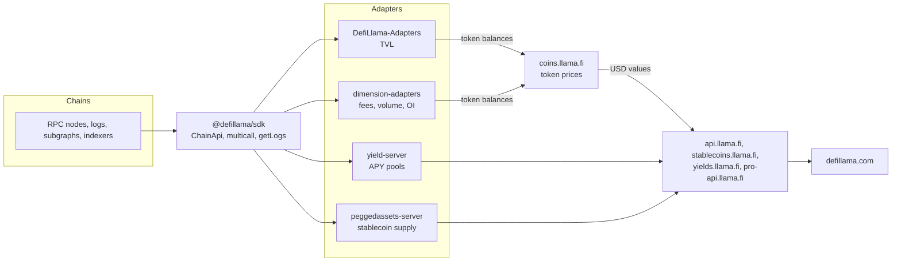
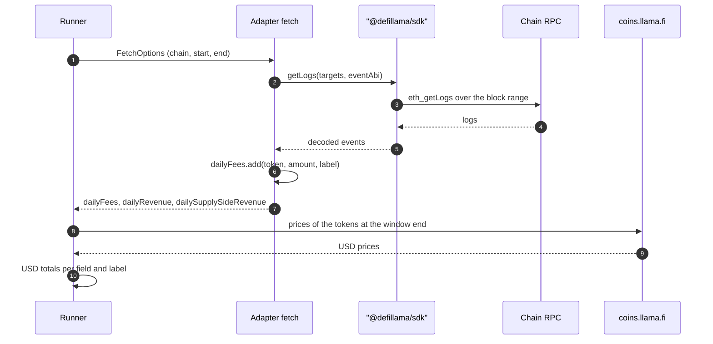

[DefiLlama](https://defillama.com/) is an open-source analytics site for decentralised finance. It publishes the total value locked (TVL) of several thousand protocols, along with token prices, stablecoin supply, yield pools, trading volumes, fees and revenue, and a database of exploits. Research reports, risk dashboards and protocol pitch decks quote its numbers, usually without describing how they were produced.

Those numbers do not come from a central database fed by the protocols themselves. Each protocol is described by a small script, an *adapter*, kept in a public GitHub repository and reviewed by pull request. DefiLlama's servers run the adapters on a schedule, price the token balances they return and serve the result through a public API, with a free tier and a paid Pro tier.

This article reads the code of the main DefiLlama repositories to explain how the figures are computed, which data the platform exposes, how the API is organised and where its free and paid parts separate, and how an adapter is written.

> This article has been made with the help of [Claude Code](https://claude.com/product/claude-code) and several custom skills

[TOC]

## What you need to know first

The article relies on a few DeFi accounting and on-chain data concepts:

- **Total value locked (TVL).** The USD value of the assets held by a protocol's contracts at a given time. It is a balance-sheet measure (what is deposited), not a flow measure (what is traded or earned).
- **Double counting.** When protocol B deposits its users' assets into protocol A, the same tokens appear in both protocols' balances. Summing TVL across protocols then counts them twice, so aggregators flag such protocols and exclude them from totals.
- **Event logs.** EVM contracts emit indexed events (`Swap`, `Transfer`, `Deposit`) stored in transaction receipts. Reading the logs over a time window is the usual way to measure a flow, such as volume or fees, without running an indexer.
- **Multicall.** A helper contract that bundles many read-only calls into one RPC request. Adapters that read balances of hundreds of contracts depend on it to stay within RPC rate limits.
- **LP token and pool2.** A liquidity-provider token represents a share of an AMM pool. When the pool pairs a protocol's own token with another asset, DeFi analytics call it *pool2* liquidity and usually keep it out of the headline TVL, because its value is partly self-referential.
- **ERC-4626 vault.** A tokenised-vault standard, [ERC-4626](https://eips.ethereum.org/EIPS/eip-4626), where `totalAssets()` returns the underlying amount held. Many yield products expose it, which lets one generic adapter value them.
- **Protocol income statement.** Fees paid by users split into the part passed to liquidity providers or lenders (the supply side) and the part the protocol keeps (revenue), which may in turn go to a treasury or to token holders.

## How DefiLlama works

### Three separated concerns

DefiLlama separates three things: **collecting** a metric, **pricing** it, and **serving** it.

- **Collecting** is done by adapters. An adapter answers one narrow question for one protocol, such as "which tokens, in which amounts, do this protocol's contracts hold on Arbitrum at block N?" or "which fees did this protocol collect between two timestamps?". It returns raw token balances keyed by token address, not USD values.
- **Pricing** is done by the coins service (`coins.llama.fi`), which maps a token identifier and a timestamp to a USD price. The local TVL test runner (`DefiLlama-Adapters/test.js`) sends the balances an adapter returns to that service to convert them to USD, and the chain library `@defillama/sdk` queries the same host.
- **Serving** is done by the public API hosts and the website, which read the stored, priced results.

This separation explains a property of every DefiLlama figure: two protocols holding the same token are valued with the same price at the same time, because neither adapter computes a price. It also explains a common failure: a token the coins service does not know is reported by the test runner as *unknown* and contributes nothing to TVL.

### The repositories

The public code is split by metric. The nine repositories read for this article are:

| Repository | What it holds | Size at the analysed commit |
|---|---|---|
| `DefiLlama-Adapters` | TVL adapters, one folder or file per protocol, plus shared helpers and registries | about 3,660 entries in `projects/` |
| `dimension-adapters` | Adapters for every flow metric: fees, revenue, DEX volume, derivatives, options, aggregators, open interest, liquidations, active users | 1,495 files in `fees/`, 927 in `dexs/` |
| `yield-server` | Yield adaptors returning APY pools, and the serverless backend of `yields.llama.fi` | about 1,050 adaptors |
| `peggedassets-server` | Stablecoin supply adapters and the backend of `stablecoins.llama.fi` | 93 entries in `src/adapters/peggedAssets/` |
| `nft-server` | NFT marketplace trade indexer | n/a |
| `defillama-sdk` | `@defillama/sdk`, the chain-access library every adapter uses | n/a |
| `api-sdk` | `@defillama/api`, the TypeScript client of the public API | n/a |
| `api-docs` | The API reference site, the OpenAPI specifications and the `llms*.txt` summaries | n/a |
| `chainlist` | The chainlist.org site, source of the default RPC list | n/a |

The code that schedules adapters, stores results and serves `api.llama.fi` (the `defillama-server` repository) was not part of the analysed set; the description of the pipeline below stops where the read code stops.

### The pipeline

The diagram shows how a figure travels from the chain to an API answer.



Three rules hold across the adapter repositories:

- **On-chain first.** The TVL repository refuses adapters whose TVL comes from a protocol's own API: an API may list pools or vaults, but the amounts must come from balances, calls or logs. The dimension and yield repositories prefer logs and contract calls and accept an off-chain source only when nothing else exists.
- **No new dependencies.** Adapters may not add npm packages. Everything goes through the SDK and the shared helpers, which keeps several thousand scripts maintainable.
- **Review by pull request.** Listing a protocol means opening a PR with the adapter and answering a template (website, chains, methodology). Metadata such as logos and categories is handled separately, by e-mail.

## What information DefiLlama provides

The data falls into a dozen families. The table states, for each one, where it is produced and whether the free API serves it.

| Family | Content | Produced by | Free API |
|---|---|---|---|
| TVL | Current and historical TVL per protocol, chain and token | `DefiLlama-Adapters` | Yes |
| Prices | Current and historical token prices, price charts, first price, block at a timestamp | coins service | Yes |
| Stablecoins | Circulating supply per stablecoin and chain, peg prices | `peggedassets-server` | Yes; per-chain dominance is Pro |
| Yields | About 15,500 pools with TVL, base APY, reward APY and predictions | `yield-server` | Yes; borrow rates, perps funding and LSD rates are Pro |
| DEX and options volume | Daily volume per protocol and chain | `dimension-adapters` | Yes |
| Fees and revenue | Daily fees, revenue and holder revenue per protocol | `dimension-adapters` | Yes; the label breakdown and financial statements are Pro |
| Open interest | Open interest of perpetual venues | `dimension-adapters` | Yes |
| Derivatives volume | Perpetual DEX volume | `dimension-adapters` | Pro |
| Token unlocks | Emission schedules, circulating supply, next unlock | emissions data | Pro |
| Protocol analytics | Categories, forks, oracles, treasuries, entities, raises | aggregated listings | Pro |
| Hacks | Date, technique, classification, amount, chain and returned funds of each exploit | curated database | Pro in the docs; answered without a key on 2026-10-22 |
| Bridges | Bridge volume per chain, daily stats, transactions | bridge adapters | Pro |
| Other | ETF flows, digital-asset treasuries, real-world assets, equities, pre-IPO valuations | external data | Pro |

### TVL is several numbers, not one

A TVL adapter does not return one total. It returns one function per chain and per *bucket*, and the buckets are reported separately:

- **`tvl`**: the assets the protocol holds for its users. This is the headline figure.
- **`staking`**: the protocol's own token staked in its contracts.
- **`pool2`**: liquidity of pools that pair the protocol's token.
- **`borrowed`**: outstanding loans of a lending market, reported apart from deposits so that a loan is not counted as locked value.
- **`ownTokens`** and **`vesting`**: tokens the protocol holds of itself, and tokens locked in vesting contracts.

On top of the buckets, flags qualify the figure: `doublecounted: true` marks a protocol whose deposits are already counted elsewhere (a yield aggregator depositing into a lending market), and `misrepresentedTokens: true` marks an adapter that reports a value through a substitute token rather than the actual one. The aggregate endpoint `/v2/historicalChainTvl` is documented as excluding liquid staking and double-counted TVL, so a chain's total is lower than the sum of its protocols.

### Fees follow an income statement

The dimension repository defines fees as an income statement, and its `AGENTS.md` maps each field to an accounting line:

| Field | Accounting line | Meaning |
|---|---|---|
| `dailyFees` | Gross protocol revenue | Everything users paid, all sources included |
| `dailySupplySideRevenue` | Cost of revenue | Part passed to LPs, lenders, stakers, integrators |
| `dailyRevenue` | Gross profit | Part kept by the protocol, equal to fees minus supply-side revenue |
| `dailyProtocolRevenue` | Treasury share | Part of revenue allocated to the treasury |
| `dailyHoldersRevenue` | Token-holder income | Buybacks, burns and distributions to token holders |

Two identities hold by construction: revenue equals fees minus supply-side revenue, and revenue equals holder revenue plus protocol revenue. The attribution depends on the protocol type. For a lending market, fees are borrow interest and the supply side is the interest paid to lenders; for a chain, fees are only the transaction fees users pay, and block rewards are counted as incentives rather than fees.

## The API

### Two tiers, kept apart

DefiLlama exposes two APIs that should not be mixed:

| | Free API | Pro API |
|---|---|---|
| Authentication | None | API key, placed in the URL path |
| Base URLs | `api.llama.fi`, `coins.llama.fi`, `stablecoins.llama.fi`, `yields.llama.fi` | `https://pro-api.llama.fi/{API_KEY}` |
| Price | Free | The "API plan", listed at 300 USD per month in the documentation |
| Endpoints | 31 documented | The same 31 under a prefix, plus 38 exclusive ones and several beta groups |
| Quota | Not documented | Monthly credits, reset on the first of each month |

There are only these two tiers. One Pro key unlocks every paid endpoint, and there are no add-ons per data family.

### Hosts of the free API

The free endpoints live on four hosts, by data family:

| Family | Host | Example |
|---|---|---|
| TVL, volumes, open interest, fees | `https://api.llama.fi` | `/protocols`, `/tvl/aave`, `/summary/fees/aave` |
| Prices and blocks | `https://coins.llama.fi` | `/prices/current/coingecko:ethereum` |
| Stablecoins | `https://stablecoins.llama.fi` | `/stablecoins`, `/stablecoin/1` |
| Yields | `https://yields.llama.fi` | `/pools`, `/chart/{pool}` |

The file `llms-free.txt` in the `api-docs` repository, written for language-model agents, states that every free endpoint uses `api.llama.fi`. That is wrong for prices, stablecoins and yields: `https://api.llama.fi/prices/current/coingecko:ethereum` returned HTTP 404 on 2026-10-22, while the same path on `coins.llama.fi` answered. The OpenAPI file `defillama-openapi-free.json` and the `BASE_URLS` constant of the official client both carry the correct host per path.

### Main free endpoints

The endpoints group as follows:

- **TVL.** `/protocols` lists every protocol with its `slug`, category, chains and current TVL; `/protocol/{slug}` returns the history broken down by chain and token; `/tvl/{slug}` returns a bare number; `/v2/chains` and `/v2/historicalChainTvl[/{chain}]` give chain totals.
- **Prices.** `/prices/current/{coins}`, `/prices/historical/{timestamp}/{coins}`, `/batchHistorical`, `/chart/{coins}` (with `start`, `end`, `span`, `period`), `/percentage/{coins}`, `/prices/first/{coins}`, and `/block/{chain}/{timestamp}`, which returns the closest block height to a timestamp.
- **Stablecoins.** `/stablecoins`, `/stablecoincharts/all`, `/stablecoincharts/{chain}`, `/stablecoin/{id}`, `/stablecoinchains`, `/stablecoinprices`.
- **Yields.** `/pools` and `/chart/{pool}`, where the pool identifier is a UUID taken from `/pools`.
- **Volumes and fees.** `/overview/{dexs|options|fees}[/{chain}]`, `/summary/{dexs|options|fees}/{slug}` and `/overview/open-interest`, with a `dataType` parameter (`dailyFees`, `dailyRevenue`, `dailyHoldersRevenue` for fees; `dailyNotionalVolume`, `dailyPremiumVolume` for options).

A token is identified as `{chain}:{address}` or `coingecko:{id}`, and several identifiers are separated by commas:

```bash
curl -s "https://coins.llama.fi/prices/current/coingecko:ethereum,ethereum:0xdac17f958d2ee523a2206206994597c13d831ec7"
# {"coins":{"ethereum:0xdac1…1ec7":{"decimals":6,"symbol":"USDT","price":0.9992…,"timestamp":…,"confidence":0.99},
#           "coingecko:ethereum":{"symbol":"ETH","price":…,"timestamp":…,"confidence":0.99}}}

curl -s "https://coins.llama.fi/block/ethereum/1700000000"
# {"height":18573051,"timestamp":1700000003}

curl -s "https://api.llama.fi/summary/fees/aave?dataType=dailyRevenue" | jq '{name, total24h, total30d}'
```

The block endpoint is useful beyond DefiLlama: any script that needs "the Ethereum block at midnight UTC on a given day" can call it rather than bisecting block timestamps over RPC.

### The Pro API

A Pro key is a path segment, inserted between the host and the endpoint. It is not a query parameter or a header:

```
wrong   https://pro-api.llama.fi/api/overview/derivatives?apikey=KEY
right   https://pro-api.llama.fi/KEY/api/overview/derivatives
```

The free endpoints are also served through the Pro host, with a prefix that depends on the free host: `/api/…` for `api.llama.fi` paths, `/coins/…`, `/stablecoins/…` and `/yields/…` for the others. A Pro user calls them there for the higher rate limit.

The Pro-only endpoints cover token holdings across protocols (`/api/tokenProtocols/{symbol}`), inflows and outflows (`/api/inflows/{protocol}/{timestamp}`), token unlocks (`/api/emissions`), categories, forks, oracles, hacks, raises and treasuries, borrow rates (`/yields/poolsBorrow`), perpetual funding rates (`/yields/perps`), derivatives volume, bridges, ETFs, digital-asset treasuries, real-world assets, and a beta "dimensions" API (`/api/v2/metrics/{metric}` and `/api/v2/chart/{metric}/…`) that breaks any flow metric down by chain, protocol, version or fee label. A beta financial-statement endpoint returns a protocol's income statement by year, quarter and month.

`https://pro-api.llama.fi/usage/{KEY}` returns the remaining credits. It is the one endpoint where the key comes last.

### Reading the status codes

The status codes carry more information than usual:

- **402** with the body `Upgrade to the paid API plan at https://defillama.com/subscription` means the endpoint is Pro-only. It does not mean a subscription expired. On 2026-10-22 it was returned without a key by `/emissions`, `/oracles`, `/categories`, `/raises`, `/treasuries`, `/overview/derivatives`, `yields.llama.fi/poolsBorrow` and `bridges.llama.fi/bridges`.
- **404** usually means the wrong host (a price path on `api.llama.fi`) or an unknown slug.
- **200 from a free endpoint** proves nothing about a key, since the free endpoint needs none.

The boundary is not exactly the documented one. `https://api.llama.fi/hacks` and `https://api.llama.fi/v2/metrics/fees` answered without a key on 2026-10-22, although the documentation lists both as Pro. A script that depends on them should expect them to move behind the paywall.

### Clients

The official TypeScript client, `@defillama/api` (repository `api-sdk`), wraps both tiers. Its README marks Pro methods with a lock, and calling one without a key raises `ApiKeyRequiredError` before any request is sent:

```typescript
import { DefiLlama } from "@defillama/api";

const client = new DefiLlama();                       // free tier
const aave = await client.tvl.getProtocol("aave");
const prices = await client.prices.getCurrentPrices(["coingecko:bitcoin"]);

const pro = new DefiLlama({ apiKey: process.env.DEFILLAMA_API_KEY });
const unlocks = await pro.emissions.getEmissions();   // Pro only
```

A Python client is published as `defillama-sdk` on PyPI (repository `DefiLlama/python-sdk`).

### Practical constraints

Several free responses are large: `/protocols`, `/pools` (about 15,500 pools on 2026-10-22) and the `overview` endpoints weigh several megabytes. The `overview` endpoints take `excludeTotalDataChart=true&excludeTotalDataChartBreakdown=true` to drop the chart arrays. Chain names follow two conventions: TVL and stablecoin paths use display names (`Ethereum`, `Arbitrum`), while price and block paths use lowercase identifiers (`ethereum`, `bsc`, `avax`). The free tier's rate limit is not documented, so batch scripts should call sequentially, cache large answers and back off on HTTP 429.

## Adapters

### TVL adapters

A TVL adapter is a CommonJS module in `DefiLlama-Adapters/projects/<slug>/`. The folder name is the protocol slug used by the API. The module exports one object per chain, each with one async function per bucket. The function receives a `ChainApi` object (`api`) bound to the chain, block and timestamp being computed, and either returns balances or adds them to `api`.

The adapter of the Lighter order book on Arbitrum shows the whole pattern in fifteen lines:

```javascript
const { sumTokens2 } = require('../helper/unwrapLPs')
const { getLogs } = require('../helper/cache/getLogs')

async function tvl(api) {
  const logs = await getLogs({
    api,
    target: '0x35642792abc96fa1e9ffe5f2f62a539bb80a8af4',
    topic: 'OrderBookCreated(uint8,address,address,address,uint8,uint8)',
    fromBlock: 65833710,
    eventAbi: 'event OrderBookCreated (uint8 orderBookId, address orderBookAddress, address token0, address token1, uint8 logSizeTick, uint8 logPriceTick)',
    onlyArgs: true,
  })

  return sumTokens2({ api, ownerTokens: logs.map(i => [[i.token0, i.token1], i.orderBookAddress]) })
}

module.exports = {
  arbitrum: { tvl, }
}
```

The adapter discovers every order book from the factory's `OrderBookCreated` events, then asks `sumTokens2` for the balance of each book's two tokens. `sumTokens2`, in `projects/helper/unwrapLPs.js`, is the generic balance reader of the repository: given owners and tokens, it reads the balances by multicall and, on request, unwraps LP tokens, Uniswap V3 positions (`resolveUniV3`) and other wrappers into their underlying assets. The adapter never touches a price.

Most protocols are forks or instances of a known design, and the repository has two levels of reuse for them:

- **Helpers** in `projects/helper/`: `aave.js`, `compound.js`, `compoundV3.js`, `masterchef.js`, `erc4626.js`, `staking.js`, `pool2.js`, `unknownTokens.js`, `cex.js` (exchange wallet lists), and `coreAssets.json`, the canonical token addresses per chain.
- **Registries** in `registries/`: data-only listings for patterns such as `uniswapV2.js`, `uniswapV3.js`, `compound.js`, `aaveV3.js`, `erc4626.js`, `liquity.js` and `stakingOnly.js`. A plain ERC-4626 vault, for instance, is listed by adding its address to `registries/erc4626.js`, with no adapter file at all.

The allowed export keys are fixed in `projects/helper/whitelistedExportKeys.json`: `tvl`, `staking`, `pool2`, `borrowed`, `ownTokens`, `vesting`, `methodology`, `doublecounted`, `misrepresentedTokens`, `timetravel`, `start`, `hallmarks`, `deadFrom`, `isHeavyProtocol`, `meta` and `moduleFilePath`. The test runner rejects anything else and rejects a bucket exported at the root of the module instead of under a chain.

An adapter is tested locally, optionally at a past date:

```bash
node test.js projects/lighter/index.js
node test.js projects/aave/v3.js 2024-10-16
```

The runner computes each bucket, prices the balances through the coins service, prints the TVL per chain and per token, and lists the tokens it could not price. RPC endpoints are overridden with `{CHAIN}_RPC` variables in a `.env` file, the variable names following the chain keys of `@defillama/sdk`.

### Dimension adapters

Dimension adapters measure flows over a time window, in TypeScript, in `dimension-adapters/<metric>/`, with one folder per metric: `fees`, `dexs`, `aggregators`, `derivatives`, `aggregator-derivatives`, `options`, `bridge-aggregators`, `open-interest`, `liquidations`, `active-users`, `new-users`, `normalized-volume` and `incentives`.

The adapter of sDAI on Gnosis Chain counts the interest the bridge receives from the Maker DSR:

```typescript
import { FetchOptions, SimpleAdapter } from "../adapters/types";
import { CHAIN } from "../helpers/chains";

const ClaimedEvent = "event Claimed(uint256 indexed amount)";
// BridgeInterestReceiver Contract
const contract = "0x670daeaf0f1a5e336090504c68179670b5059088";

const fetch = async (options: FetchOptions) => {
  const dailyFees = options.createBalances();

  const data: any[] = await options.getLogs({
    target: contract,
    eventAbi: ClaimedEvent,
  });
  data.forEach((log: any) => {
    dailyFees.addGasToken(log.amount);
  });

  return {
    dailyFees: dailyFees,
    dailyRevenue: 0,
    dailySupplySideRevenue: dailyFees,

  };
};

const adapter: SimpleAdapter = {
  version: 2,
  pullHourly: true,
  methodology: {
    Fees: 'Yield generated from MakerDAO DSR on bridged assets',
    Revenue: 'No revenue',
    SupplySideRevenue: 'Total yield is distributed to sDAI holders',
  },
  fetch,
  adapter: {
    [CHAIN.XDAI]: {
      start: "2023-09-28",
    },
  },
};

export default adapter;
```

The `fetch` function receives a `FetchOptions` object that carries the chain, the window (`startTimestamp`, `endTimestamp`, `getFromBlock()`, `getToBlock()`), a `getLogs` bound to that window, and `createBalances()`. It returns balances per income-statement field, here all fees attributed to the supply side and no revenue, and `methodology` explains each field in prose.

The repository's `AGENTS.md` sets the rules a reviewer applies:

- **Version 2 by default.** A `version: 2` adapter accepts an arbitrary window and runs hourly; it must set `pullHourly` explicitly. `version: 1` is reserved for sources that only give daily aggregates, and is mandatory for Dune queries, which would otherwise be re-run every hour.
- **One signature.** `fetch(options)` only; the former three-argument signature no longer exists.
- **Targeted logs.** `getLogs` takes the list of contracts; scanning every log of a chain with `noTarget` is refused as too heavy.
- **Labels everywhere.** Every amount is added under a label (`'Swap Fees'`, `'Borrow Interest To Treasury'`), and each label must be described in `breakdownMethodology`. The labels feed the Pro label-breakdown and financial-statement endpoints.
- **Errors surface.** A recoverable per-chain failure returns zero and logs; anything else is thrown. Swallowing errors with an empty `try/catch` is rejected.

An adapter is tested with `pnpm test <metric> <adapter> [YYYY-MM-DD] [chains]`, for example `pnpm test fees bitcoin 2025-10-10`.

The sequence below shows one run of a dimension adapter, as the test command performs it.



### Yield and stablecoin adapters

The two remaining families are simpler:

- **Yield adaptors** (`yield-server/src/adaptors/<slug>/index.js`) return an array of pools, each with a unique `pool` identifier (`${address}-${chain}` in lowercase), `chain`, `project` (the TVL slug), `symbol`, `tvlUsd`, `apyBase`, `apyReward`, `rewardTokens` and `underlyingTokens`. The methodology asks for the minimum attainable yield: unboosted rates, no pre-mined, locked or non-tradable rewards, and fee APY over 24 hours. Pools under 10,000 USD of TVL are not displayed.
- **Stablecoin adapters** (`peggedassets-server/src/adapters/peggedAssets/<coingecko-id>/index.ts`) export, per chain, `minted` (issued natively there), `unreleased` (held in reserve and never circulated) and optional `bridgedFrom<Chain>` functions, each returning an amount keyed by peg type (`peggedUSD`, `peggedEUR`, `peggedVAR`). Circulating supply on a chain is derived from these three quantities: minted, less unreleased, plus what was bridged in. A helper, `addChainExports`, builds the adapter from a list of issuer and reserve addresses.

## Conclusion

DefiLlama's figures are the output of several thousand small, public scripts rather than of a single database, and the code shows the conventions behind each number:

- **Adapters return token balances, not USD.** A shared price service converts them, so every protocol is valued with the same prices, and an unknown token is worth zero.
- **TVL is a set of buckets.** `tvl`, `staking`, `pool2`, `borrowed` and the `doublecounted` flag are kept apart, and chain totals exclude double counting.
- **Fees follow an income statement.** Fees, supply-side revenue, revenue and holder revenue are separate fields linked by two identities, and every amount carries a label.
- **The free API covers the core data.** TVL, prices, blocks, stablecoins, yield pools, volumes and fees are free, but on four different hosts, and one official summary file gives the wrong host for three of them.
- **The Pro API adds analytics.** Unlocks, raises, bridges, borrow rates, derivatives, label breakdowns and statements need a key placed in the URL path, and a 402 answer marks a paid endpoint.
- **Adapters favour on-chain data.** TVL must come from balances, calls or logs; flow adapters use targeted logs, run hourly and are reviewed against written rules.


## Annex

### Key Terms

| Term | Definition |
|------|------------|
| **TVL** | USD value of the assets held by a protocol's contracts at a given time, reported per chain and per bucket. |
| **Adapter** | Public script that measures one metric for one protocol and returns token balances, reviewed by pull request. |
| **Bucket** | One of the TVL categories an adapter exports per chain: `tvl`, `staking`, `pool2`, `borrowed`, `ownTokens` or `vesting`. |
| **Double counting** | Assets that appear in two protocols because one deposits into the other, flagged with `doublecounted` and excluded from totals. |
| **Pool2** | Liquidity of pools pairing the protocol's own token, reported apart from the headline TVL. |
| **Dimension** | Any flow metric measured over a window (fees, volume, open interest, liquidations), produced by `dimension-adapters`. |
| **dailyFees** | Everything users paid to a protocol over the window, the gross revenue line of the income statement. |
| **dailyRevenue** | Part of the fees kept by the protocol, equal to fees minus supply-side revenue. |
| **dailySupplySideRevenue** | Part of the fees passed to liquidity providers, lenders, stakers or integrators. |
| **dailyHoldersRevenue** | Value passed to token holders through buybacks, burns or distributions. |
| **Breakdown label** | Name attached to each amount an adapter adds, such as `Borrow Interest`, described in `breakdownMethodology`. |
| **Slug** | Lowercase protocol identifier, shared by the API, the TVL adapter folder and the yield adaptor folder. |
| **Coin identifier** | Token key of the price service, `{chain}:{address}` or `coingecko:{id}`. |
| **ChainApi** | Object from `@defillama/sdk` bound to a chain and block, through which adapters call contracts and accumulate balances. |
| **sumTokens2** | Helper that reads token balances of a list of owners by multicall and can unwrap LP and Uniswap V3 positions. |
| **Registry** | Data-only listing in `DefiLlama-Adapters/registries/` that adds a protocol of a known pattern without an adapter file. |
| **pullHourly** | Flag of a version 2 dimension adapter stating that its data can be fetched hour by hour. |
| **Pro API key** | Key of the paid API plan, inserted as a path segment after `https://pro-api.llama.fi/`. |

### Integration Notes

| Behaviour | What an integrator should do |
|-----------|------------------------------|
| Prices, stablecoins and yields are not served on `api.llama.fi`, although `llms-free.txt` says so. | Use `coins.llama.fi`, `stablecoins.llama.fi` and `yields.llama.fi`, as the OpenAPI file does. |
| A Pro-only endpoint answers 402 on the free hosts. | Treat 402 as "paid endpoint", not as an expired subscription or a transient error. |
| The Pro key goes in the path; the documentation rules out a query parameter or a header. | Build `https://pro-api.llama.fi/{KEY}/<prefix>/<path>` and keep the key out of logs, since it is part of every URL. |
| `/hacks` and `/v2/metrics/fees` answer without a key although documented as Pro. | Do not build a free-tier dependency on them without a fallback. |
| `/tvl/{slug}` returns a bare number, not JSON. | Parse it as a number rather than an object. |
| Chain names are display names for TVL and stablecoins and lowercase ids for prices and blocks. | Map names explicitly; take valid values from `allChains` or `/v2/chains`. |
| Parent protocols aggregate their versions (`aave` contains `aave-v2`, `aave-v3`). | Query the version slug when one deployment is meant; the parent answers with an `id` such as `parent#aave`. |
| Several free responses weigh several megabytes. | Pass the `exclude…` flags on `overview` endpoints and cache `/protocols` and `/pools`. |
| A token unknown to the price service contributes zero. | When a protocol's TVL looks low, check its tokens with `/prices/current/{coins}` before suspecting the adapter. |

## Frequently Asked Questions

**Q: Why does a TVL adapter return token balances rather than a USD amount?**

Pricing is a separate service. The adapter only states which tokens the protocol holds and in which amounts; the coins service converts them with one price per token and timestamp. All protocols are therefore valued consistently, adapters stay small, and a price source can be fixed once for every protocol that holds the token.

**Q: Which free host serves the historical price of a token, and how is the token written?**

`https://coins.llama.fi/prices/historical/{timestamp}/{coins}`, with the token written as `{chain}:{address}` (for example `ethereum:0xa0b86991c6218b36c1d19d4a2e9eb0ce3606eb48`) or `coingecko:{id}`. Several tokens are separated by commas. The same path on `api.llama.fi` returns 404.

**Q: A script calls `https://api.llama.fi/emissions` and gets HTTP 402. What does it mean, and what would the paid call look like?**

402 means the endpoint belongs to the Pro API; it is not an authentication failure of an existing subscription. With a key, the call is `https://pro-api.llama.fi/{KEY}/api/emissions`: the key is a path segment after the host, and the endpoint takes the `/api` prefix. Remaining credits can be checked with `https://pro-api.llama.fi/usage/{KEY}`.

**Q: How do `dailyFees`, `dailySupplySideRevenue` and `dailyRevenue` relate for a lending market?**

For a lending market:

- `dailyFees` is the borrow interest paid by borrowers.
- `dailySupplySideRevenue` is the share of that interest paid to lenders.
- `dailyRevenue` is what the protocol keeps, the reserve factor in Aave terms, and equals fees minus supply-side revenue.

If part of the revenue then buys back and distributes the governance token, that part is also reported as `dailyHoldersRevenue`.

**Q: A yield aggregator deposits its users' USDC into Aave. How should its TVL adapter report it, and how does this affect chain totals?**

The aggregator reports the deposited USDC in its `tvl` bucket, so that its own page shows the assets it manages, and sets `doublecounted: true`. Aave already counts the same USDC in its own TVL. The flag lets DefiLlama exclude the aggregator from aggregates such as `/v2/historicalChainTvl`, which is documented as excluding double-counted TVL, so the chain total counts the USDC once.

**Q: Why must a version 2 dimension adapter set `pullHourly`, and why are Dune-based adapters version 1?**

A version 2 adapter accepts an arbitrary window and is run hourly, so each run should fetch only the new hour; `pullHourly: true` declares that the data source supports it, and `false` must be justified in a comment. A Dune query is expensive and returns daily data; run hourly, it would recompute the same day 24 times, so Dune adapters are version 1 and run once per day.

**Q: How would an analyst get, for free, the Ethereum block at a date and the USD value of a protocol's TVL at that date?**

Two free calls are enough:

- `https://coins.llama.fi/block/ethereum/{timestamp}` returns the closest block height.
- `https://api.llama.fi/protocol/{slug}` returns the protocol's TVL history per chain, from which the point at or before that timestamp is read.

For the token detail, the same response holds the per-token breakdown, and `coins.llama.fi/prices/historical/{timestamp}/{coins}` prices any token at that time.

## Gaps

The analysed repositories leave several points open:

| Gap | Why it matters | What to read or verify |
|-----|----------------|------------------------|
| The scheduler, storage and API server code (`defillama-server`) was not read. | The pipeline description stops at the adapters and the test runner; refresh intervals and retries in production are not stated. | The `DefiLlama/defillama-server` repository. |
| The production pricing path is inferred from `test.js` and `@defillama/sdk`, which call `coins.llama.fi`. | Production may use internal endpoints or additional price sources. | The coins service code in `defillama-server`. |
| The free tier's rate limit is not documented. | Batch scripts may hit HTTP 429 without knowing the budget. | The DefiLlama docs at `docs.llama.fi`, or a controlled test. |
| `/hacks` and `/v2/metrics/fees` answered without a key on 2026-10-22, against the documentation. | An integration built on them may break when the boundary is enforced. | Re-test the endpoints before relying on them. |
| The website's default handling of `staking`, `pool2`, `borrowed` and `doublecounted` in displayed totals is not taken from the analysed code. | The article only states what the API documentation says about aggregates. | The `defillama-app` front-end repository and its TVL settings. |
| The Pro price (300 USD per month) and the credit volume come from `llms.txt`. | Pricing pages change more often than API docs. | <https://defillama.com/subscription>. |
| The hacks, raises and unlocks databases are curated, and their sourcing process is not described in the repositories. | Their completeness and classification rules are unknown. | DefiLlama's methodology pages for each dashboard. |
| The `nft-server` and `chainlist` repositories were only surveyed. | Their role is summarised, not analysed. | Their source code, if NFT or RPC data is needed. |

## References

### Analyzed source

- [DefiLlama/DefiLlama-Adapters](https://github.com/DefiLlama/DefiLlama-Adapters) — analyzed at commit [`12ff22ad30ad76f44c3653d5110e4e51dcdac63b`](https://github.com/DefiLlama/DefiLlama-Adapters/tree/12ff22ad30ad76f44c3653d5110e4e51dcdac63b), 2026-10-22
- [DefiLlama/dimension-adapters](https://github.com/DefiLlama/dimension-adapters) — analyzed at commit [`4f6d084716fefe10f12db5af8e79bf0185ddb7f7`](https://github.com/DefiLlama/dimension-adapters/tree/4f6d084716fefe10f12db5af8e79bf0185ddb7f7), 2026-10-22
- [DefiLlama/yield-server](https://github.com/DefiLlama/yield-server) — analyzed at commit [`40307814aebd5f567963a57698e9fbf777389219`](https://github.com/DefiLlama/yield-server/tree/40307814aebd5f567963a57698e9fbf777389219), 2026-10-22
- [DefiLlama/peggedassets-server](https://github.com/DefiLlama/peggedassets-server) — analyzed at commit [`f42cee5325c5fd82c8726f5d40d6f69d5578e3c9`](https://github.com/DefiLlama/peggedassets-server/tree/f42cee5325c5fd82c8726f5d40d6f69d5578e3c9), 2026-10-22
- [DefiLlama/defillama-sdk](https://github.com/DefiLlama/defillama-sdk) — analyzed at commit [`e9435a0796147030dafa5b5a150d999e9bcf0a47`](https://github.com/DefiLlama/defillama-sdk/tree/e9435a0796147030dafa5b5a150d999e9bcf0a47), 2026-10-22
- [DefiLlama/api-docs](https://github.com/DefiLlama/api-docs) — analyzed at commit [`53e1b0e0e3e20dc8928c14fc5d196feb4677b222`](https://github.com/DefiLlama/api-docs/tree/53e1b0e0e3e20dc8928c14fc5d196feb4677b222), 2026-10-22
- [DefiLlama/api-sdk](https://github.com/DefiLlama/api-sdk) — analyzed at commit [`f0d43119c746dda0c1ad8460c37ac9e00e8e5161`](https://github.com/DefiLlama/api-sdk/tree/f0d43119c746dda0c1ad8460c37ac9e00e8e5161), 2026-10-22

### Documentation

- [DefiLlama API reference](https://api-docs.defillama.com/)
- [DefiLlama API summary for agents (llms.txt)](https://api-docs.defillama.com/llms.txt)
- [DefiLlama documentation, listing a project](https://docs.llama.fi/submit-a-project)
- [DefiLlama API plan](https://defillama.com/subscription)
- [ERC-4626: Tokenized Vaults](https://eips.ethereum.org/EIPS/eip-4626)
- [Claude Code](https://claude.com/product/claude-code)

### Related articles

- [Risk of Ethena's USDe and sUSDe - Backing Venues, Depeg Priors and a Leveraged PT Position]({{site.url_complet}}/2026/10/11/ethena-usde-risk-backing-venues-leveraged-positions/)
- [BIO Tokenomics - Supply, Unlocks, Demand and Value Capture of Bio Protocol's Token]({{site.url_complet}}/2026/09/18/bio-protocol-tokenomics-analysis/)
- [Crypto Hacks of 2021 - Poly Network, BitMart, Cream and the DeFi Boom]({{site.url_complet}}/2026/10/07/crypto-hacks-2021/)
- [Tether USDT smart contract - Overview]({{site.url_complet}}/2025/07/06/tether-stablecoin-overview/)
