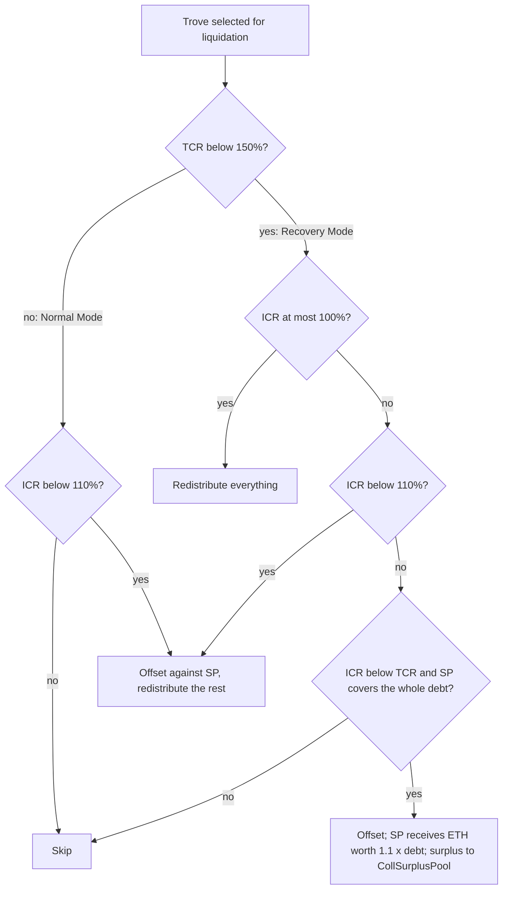

[Liquity](https://www.liquity.org/) is a borrowing protocol on Ethereum. Its first version, launched in April 2021, lets a user lock ETH and mint LUSD, a stablecoin pegged to the US dollar, with no interest and a minimum collateral ratio of 110%. The contracts are immutable and have no admin keys or governance. Every parameter that elsewhere would be voted on is either a constant or adjusted by a formula.

Two mechanisms make the low ratio possible. Liquidations need no auction: a pool of LUSD depositors absorbs the debt at once, and when that pool is empty, the debt and collateral are spread over every other borrower. Redemptions let anyone exchange LUSD for ETH at face value, which holds the price of LUSD close to one dollar from below. This article walks through the system from the `liquity/dev` repository, the source of truth for the deployed contracts, and ends with what V1 left to its successor, [Liquity V2]({{site.url_complet}}/2026/10/22/liquity-v2-bold-user-set-interest-rates/).

> This article has been made with the help of [Claude Code](https://claude.com/product/claude-code) and several custom skills

[TOC]

## What you need to know first

The article assumes familiarity with DeFi and stablecoins, and uses the following more specific mechanisms without re-deriving them.

- **Collateralized debt position (CDP).** A user locks collateral and mints a debt token against it, as in [MakerDAO]({{site.url_complet}}/2023/11/20/makerdao/) vaults. Below a minimum collateral ratio the position is liquidated. Liquity calls such a position a *trove*.
- **Peg arbitrage.** If a token can always be exchanged for 1 USD of some asset, buying it below 1 USD and exchanging it is a profit, and that buying pushes the price back up. Liquity's redemptions are such an exchange.
- **Push oracle.** A [Chainlink](https://chain.link/) price feed writes a new price on-chain when the price moves past a deviation threshold or a heartbeat expires. Between updates the contract reads a stale price, which matters for liquidations and redemptions.
- **Accumulator-based reward accounting.** Instead of updating every depositor on each event, a contract keeps a running sum per unit of stake and stores a snapshot of it with each deposit. A depositor's reward is the difference between the current sum and the snapshot. The Stability Pool and the redistribution mechanism both use this pattern.
- **Sorted linked list with hints.** Keeping positions in order on-chain costs gas proportional to how far the contract searches for the insertion point. Callers therefore pass hints, nearby list entries computed off-chain, so the search starts close to the right position.

## The system at a glance

A borrower interacts with four kinds of contracts. The table names the core ones from `packages/contracts/contracts/`.

| Contract | Role |
|---|---|
| `BorrowerOperations` | Open, adjust and close troves; enforces the 110% minimum and the Recovery Mode rules |
| `TroveManager` | Liquidations, redemptions, redistribution, fee state (`baseRate`) |
| `StabilityPool` | LUSD deposits that absorb liquidated debt; ETH and LQTY gains; front-end registration |
| `SortedTroves` | Doubly linked list of troves ordered by nominal collateral ratio |
| `ActivePool`, `DefaultPool` | ETH and debt of active troves; ETH and debt redistributed but not yet claimed by troves |
| `CollSurplusPool`, `GasPool` | Collateral owed to liquidated or redeemed borrowers; the LUSD liquidation reserve |
| `PriceFeed` | ETH/USD price from Chainlink, with Tellor as fallback |
| `LUSDToken`, `LQTYToken`, `LQTYStaking`, `CommunityIssuance` | The stablecoin, the secondary token, its fee-sharing staking, and the LQTY reward schedule |

Only the protocol contracts can mint or burn LUSD. There is no owner after deployment: the deployer renounces ownership once the contract addresses are wired together.

The two ratios that recur everywhere are the individual collateral ratio of a trove and the total collateral ratio of the system:

$$
\begin{aligned}
ICR &= \frac{\text{coll} \cdot P}{\text{debt}} \\
TCR &= \frac{\sum \text{coll} \cdot P}{\sum \text{debt}}
\end{aligned}
$$

where $$P$$ is the ETH/USD price. The minimum collateral ratio (MCR) is 110% and the critical collateral ratio (CCR) is 150%. Below the CCR, the system enters Recovery Mode.

## Troves and fees

### Opening a trove

`openTrove` takes ETH and mints the requested LUSD. Three amounts are added to the debt:

- **The requested LUSD**, sent to the borrower. The net debt must be at least `MIN_NET_DEBT` = 1,800 LUSD.
- **A borrowing fee**, one-off, computed from `baseRate` (see below) and added to the debt.
- **A liquidation reserve** of 200 LUSD (`LUSD_GAS_COMPENSATION`), minted to the `GasPool`. It is paid to whoever liquidates the trove, and burned when the borrower closes the trove normally.

A trove therefore carries at least 2,000 LUSD of debt. The borrower pays no interest, ever: a trove opened in 2021 owes the same debt today unless it was adjusted, redeemed or hit by a redistribution.

### The borrowing fee and `baseRate`

The borrowing and redemption fees share one state variable, `baseRate`. It rises with redemptions and decays over time:

$$
\begin{aligned}
b(t) &= b(t_0) \cdot \delta^{m}, \qquad \delta = 0.999037758833783, \quad m = \text{minutes since } t_0 \\
f_{\text{borrow}} &= \min\left(0.5\% + b(t),\; 5\%\right)
\end{aligned}
$$

The decay factor $$\delta$$ gives a half-life of 12 hours ($$\delta^{720} = 0.5$$). The borrowing fee lies between a 0.5% floor and a 5% cap, and is zero in Recovery Mode, because new borrowing at a high collateral ratio is what the system wants then.

The fee couples borrowing to redemptions. After a wave of redemptions, `baseRate` is high, so new LUSD is expensive to mint while the system is redeeming LUSD that trades below peg.

## The Stability Pool and liquidations

### Liquidation through the Stability Pool

When a trove's ICR falls below 110%, anyone can call `liquidate` (one trove), `liquidateTroves(n)` (the n riskiest) or `batchLiquidateTroves` (a list). The trove's debt is cancelled against the LUSD in the Stability Pool, and its ETH is sent to the pool's depositors. A depositor loses LUSD and gains ETH worth about 110% of it, which is the incentive to deposit.

The pool cannot track each deposit individually at every liquidation, so it uses a product-sum scheme described in the paper [*Scalable Reward Distribution with Compounding Stakes*](https://github.com/liquity/dev/blob/main/papers/Scalable_Reward_Distribution_with_Compounding_Stakes.pdf). A running product $$P$$ records how much of each unit deposited is left after each liquidation, and a running sum $$S$$ records how much ETH each unit has earned:

$$
\begin{aligned}
d(t) &= d_0 \cdot \frac{P(t)}{P_0} \\
\text{ETH gain}(t) &= d_0 \cdot \frac{S(t) - S_0}{P_0}
\end{aligned}
$$

where $$d_0$$, $$P_0$$ and $$S_0$$ are stored when the deposit is made. Since $$P$$ only shrinks, the contract multiplies it by $$10^9$$ (`SCALE_FACTOR`) and increments a scale counter when it gets too small. A liquidation that empties the pool completely starts a new epoch, in which earlier deposits are worth zero. The pool keeps at least 1 LUSD (`MIN_LUSD_IN_SP`) after an offset, so a single liquidation cannot reduce $$P$$ to zero.

Each deposit is also tagged with a front end, which matters for LQTY rewards (see below). To prevent depositors from escaping a loss they can see coming, `withdrawFromSP` reverts while any trove has an ICR below 110%.

### Redistribution

If the Stability Pool holds less LUSD than the debt being liquidated, the remainder is redistributed: the uncovered debt and the matching ETH (minus the gas compensation) are shared among all active troves in proportion to their collateral. No transfer happens at that moment. `TroveManager` raises two accumulators, `L_ETH` and `L_LUSDDebt`, and moves the ETH and debt to the `DefaultPool`. A trove's share is applied the next time it is touched:

$$
\begin{aligned}
\Delta \text{coll} &= \text{stake} \cdot (L_{ETH} - L_{ETH}^{\text{snap}}) \\
\Delta \text{debt} &= \text{stake} \cdot (L_{LUSD} - L_{LUSD}^{\text{snap}})
\end{aligned}
$$

Because redistributed ETH is not part of any trove's recorded collateral until applied, a trove that joins later would otherwise receive an unfair share. The stake therefore uses a "corrected stake" computed from snapshots of the total stakes and total collateral, as derived in the paper [*Efficient Order-Preserving Redistribution of Troves*](https://github.com/liquity/dev/blob/main/papers/Efficient_Order-Preserving_Redistribution_of_Troves.pdf). The same paper proves that redistribution never changes the order of troves by collateral ratio, which is what lets `SortedTroves` stay valid without re-sorting.

Borrowers are therefore the guarantors of last resort. A redistribution lowers every other trove's ICR, and in a crash it can push some of them below 110%, which is why a large Stability Pool matters.

### The liquidation decision

The behaviour depends on the mode. The flow below follows `TroveManager._liquidateNormalMode` and `_liquidateRecoveryMode`.



The liquidator receives the 200 LUSD reserve plus 0.5% of the trove's ETH (`PERCENT_DIVISOR` = 200), whichever path is taken.

## Redemptions

### Swapping LUSD for ETH at face value

`redeemCollateral` burns LUSD and pays out ETH at the oracle price, starting with the trove that has the **lowest** collateral ratio above 110% and moving up the list. Each redeemed trove loses debt and the matching ETH. If its net debt reaches zero, the trove is closed and its leftover ETH goes to the `CollSurplusPool`. A partial redemption that would leave a trove below the minimum debt is cancelled for that trove instead.

```mermaid
sequenceDiagram
    autonumber
    participant R as Redeemer
    participant TM as TroveManager
    participant ST as SortedTroves
    participant AP as ActivePool
    R->>TM: redeemCollateral(amount, hints, maxFee)
    TM->>TM: decay baseRate, then add amount / (2 * supply)
    TM->>ST: walk from the lowest ICR at or above 110%
    loop each trove until the amount is used
        TM->>TM: reduce debt and coll at price P
    end
    TM->>AP: send ETH minus redemption fee
    TM->>R: ETH; LUSD burned
```

The redemption fee is paid in ETH and goes to LQTY stakers:

$$
\begin{aligned}
b &\leftarrow b(t) + \frac{m}{2 \, N} \\
f_{\text{redeem}} &= \min\left(0.5\% + b,\; 100\%\right)
\end{aligned}
$$

where $$m$$ is the LUSD redeemed and $$N$$ the LUSD supply. Large redemptions raise the fee for the next redeemer, and the fee cools down with the same 12-hour half-life. For the first 14 days after deployment (`BOOTSTRAP_PERIOD`), redemptions were disabled.

### What redemptions do to the peg

When LUSD trades below `1 USD − fee`, buying it and redeeming is profitable, so the price has a hard floor near 1 USD. When it trades above 1.10 USD, opening a trove at 110% and selling the LUSD is profitable, which gives a soft ceiling. Between those bounds the price is set by the market.

A redeemed borrower loses no value, because they keep ETH worth their collateral minus the debt removed. They do lose exposure to ETH, and redemptions hit the riskiest troves first. That is why many V1 borrowers held ratios well above the minimum. It is also the behaviour V2 changed, by ordering redemptions by interest rate instead.

## Recovery Mode

When the TCR falls below 150%, the system enters Recovery Mode until it recovers. Two things change:

- **Liquidation conditions are relaxed.** A trove with an ICR between 110% and the current TCR can be liquidated if the Stability Pool can absorb its whole debt. The pool receives collateral worth 1.1 times the debt, and the borrower can claim the rest from the `CollSurplusPool`. Only the excess above the 110% level is taken, not the whole collateral.
- **Borrowing is restricted.** New troves need an ICR of at least 150%, adjustments may not lower the TCR, and the borrowing fee is zero. The incentive is to add collateral, repay debt or deposit into the Stability Pool.

Recovery Mode is meant to act as a deterrent: the threat of liquidation at a ratio above 110% makes borrowers keep their ratios higher than they otherwise would. V2 removed it, because it can liquidate borrowers whose own trove is healthy.

## The price feed

`PriceFeed` reads the Chainlink ETH/USD aggregator and falls back to Tellor. It is a small state machine with five states, and moves between them according to which oracle is working:

- **Chainlink is treated as broken** if the call reverts, returns zero or a timestamp in the future, or if the price moved more than 50% since the previous round (`MAX_PRICE_DEVIATION_FROM_PREVIOUS_ROUND`).
- **Chainlink is treated as frozen** if it has not updated for 4 hours (`TIMEOUT`).
- **The two oracles must agree within 5%** (`MAX_PRICE_DIFFERENCE_BETWEEN_ORACLES`) for the system to return to Chainlink after a fallback.
- **When both fail**, the feed keeps returning `lastGoodPrice`.

There is no shutdown: V1 keeps running on the last good price. That choice reappears in V2, but there an oracle failure shuts the collateral branch down for good.

## LQTY, front ends and staking

LQTY is not a governance token, since there is nothing to govern. It has two uses:

- **Fee sharing.** Staking LQTY in `LQTYStaking` earns the ETH paid as redemption fees and the LUSD paid as borrowing fees.
- **Stability Pool rewards.** `CommunityIssuance` releases 32 million LQTY to Stability Pool depositors over time, following a halving schedule $$32\,\text{M} \cdot (1 - 0.5^{t})$$ with $$t$$ in years. Half of it was issued in the first year.

Liquity AG did not run a front end. Anyone can call `registerFrontEnd(kickbackRate)` on the Stability Pool. Deposits tagged with that front end share their LQTY rewards: the depositor gets the kickback rate and the front end keeps the rest. The [Liquity frontend registry](https://github.com/liquity/frontend-registry) lists the independent operators. This is the "decentralized front ends" point that the earlier [MakerDAO comparison]({{site.url_complet}}/2024/12/16/10-Key-Differences-Between-MakerDAO-and-Liquity/) discussed.

V1 staking is still live. Liquity V2's governance deposits each voter's LQTY into `LQTYStaking` through a per-user proxy, so V2 voters keep earning V1 fees.

## Known issues, audits and forks

The repository README lists the issues the team considered and accepted:

- **Inaccurate TCR in Recovery Mode batches.** Inside a `batchLiquidateTroves` sequence, the TCR used at each step does not exclude collateral surpluses already set aside, a distortion that can in theory turn a gain for depositors into a small loss.
- **Hints at the ends of the sorted list** can make `adjustTrove` run out of gas.
- **Front-running.** Depositors can withdraw from the Stability Pool ahead of a price drop, or deposit just before a profitable liquidation. Attackers can front-run redemptions and inserts with new troves to raise the gas they cost.

Before launch, Trail of Bits audited the core contracts, the LQTY lockups, the LP staking contract and the proxy contracts, and Coinspect audited the system as well. The reports are linked from the [V1 documentation](https://docs.liquity.org/). An audit-time finding reproduced in public collections shows a trove updated to a zero ICR being removed from `SortedTroves` while `TroveManager` still records it.

Because the code is open and the design proven, V1 has been forked many times, often for other collateral types. The most expensive fork incident is [Prisma Finance](https://hackmd.io/@PrismaRisk/PostMortem0328) in March 2024: a migration helper that users had approved as a delegate accepted a flash-loan callback from anyone, and read the victim's account from the attacker's data. The [technical concepts behind the 2024 hacks]({{site.url_complet}}/2026/10/07/crypto-hacks-2024-technical-concepts/) covers that callback bug in detail. The flaw was in the periphery, not in the V1 core, but it shows where forks add risk: new collateral types, new zap contracts, and new oracle wiring.

## From V1 to V2

V1 works, but its design has two costs that V2 addresses:

- **No interest means no yield.** The Stability Pool earns only liquidation gains and LQTY, so when market rates rose there was little reason to hold LUSD, and redemptions surged.
- **Redemptions by collateral ratio.** Borrowers protect themselves by over-collateralizing, which wastes capital and makes the 110% minimum mostly theoretical.

Liquity V2 replaces the one-off fee with an interest rate each borrower chooses, orders redemptions by that rate, accepts liquid staking tokens next to ETH, and replaces Recovery Mode with a per-branch shutdown. The [Liquity V2 article]({{site.url_complet}}/2026/10/22/liquity-v2-bold-user-set-interest-rates/) describes it.

## Conclusion

Liquity V1 issues LUSD against ETH at a 110% minimum ratio, with no interest and no governance. The rest of the design follows from those three choices.

- **Liquidations need no auction.** The Stability Pool absorbs debt immediately, and redistribution makes all borrowers the backstop when the pool is empty.
- **Redemptions bound the price from below.** LUSD can always be swapped for 1 USD of ETH minus a fee that rises with redemption volume and decays with a 12-hour half-life.
- **Accumulators keep the cost constant.** The Stability Pool (product-sum with scales and epochs) and redistribution (corrected stakes) update every participant in O(1) gas.
- **Recovery Mode guards the system ratio.** Below a 150% TCR it relaxes liquidations and restricts borrowing, so the threat of liquidation above 110% keeps borrowers' ratios up.
- **The oracle degrades without stopping.** Chainlink is primary, Tellor is the fallback, and the last good price is used when both fail; the system never shuts down.
- **LQTY shares fees and rewards depositors.** It earns borrowing and redemption fees, and its issuance is split with independent front ends through kickback rates.


## Annex

### Key Terms

| Term | Definition |
|------|------------|
| **Trove** | A Liquity collateralized debt position: ETH locked against LUSD debt, owned by one address. |
| **LUSD** | The USD-pegged stablecoin minted by troves and burned on repayment or redemption. |
| **LQTY** | The secondary token, which earns protocol fees when staked and is issued to Stability Pool depositors. |
| **ICR / TCR** | The individual collateral ratio of one trove and the total collateral ratio of the system, both at the oracle price. |
| **MCR / CCR** | The 110% minimum ratio below which a trove is liquidated, and the 150% system ratio below which Recovery Mode applies. |
| **Net debt** | The debt of a trove excluding the 200 LUSD liquidation reserve; it must be at least 1,800 LUSD. |
| **Liquidation reserve** | The 200 LUSD minted to the GasPool at opening, paid to the liquidator or burned on a normal close. |
| **Stability Pool** | A pool of LUSD deposits that absorbs liquidated debt in exchange for the liquidated ETH. |
| **Product-sum scheme** | The accounting of the Stability Pool, where a running product tracks deposit depletion and a running sum tracks gains. |
| **Scale / epoch** | A scale is incremented when the product is multiplied by 1e9 to keep precision; an epoch starts when the pool is emptied. |
| **Redistribution** | Sharing uncovered liquidated debt and collateral among all active troves in proportion to their stake. |
| **Corrected stake** | A trove's stake adjusted by system snapshots so that redistributions remain fair to troves opened later. |
| **Redemption** | Burning LUSD in exchange for ETH at face value, taken from the troves with the lowest collateral ratio. |
| **`baseRate`** | The shared fee state that rises with redemption volume and decays with a 12-hour half-life. |
| **Recovery Mode** | The state entered when TCR is below 150%, with relaxed liquidation and restricted borrowing. |
| **CollSurplusPool** | The contract holding collateral owed to a borrower after a capped liquidation or a closing redemption. |
| **Hint** | An off-chain-computed position in the sorted list that limits the gas spent finding where a trove belongs. |
| **Kickback rate** | The share of LQTY rewards a front end passes on to the depositors who used it. |

### Invariants

| Invariant | Enforced by | Breaks if |
|-----------|-------------|-----------|
| Every active trove has ICR ≥ 110% after any borrower operation in Normal Mode. | `BorrowerOperations._requireICRisAboveMCR` | A fork lowers the check or uses a stale or manipulable price. |
| The TCR does not decrease through a borrower operation in Recovery Mode. | `_requireValidAdjustmentInCurrentMode` | An adjustment path skips the mode check. |
| Troves in `SortedTroves` stay ordered by nominal ICR, including after redistributions. | Order-preserving redistribution and re-insertion on every change | A path changes a trove's ratio without re-inserting it, or a zero-ICR update removes it from the list. |
| The Stability Pool is never emptied by an offset. | `MIN_LUSD_IN_SP` | The product P reaches zero and every deposit is lost to rounding. |
| Pending redistribution rewards are applied before a trove is read or changed. | `_applyPendingRewards` at the start of each operation | An entry point reads stale debt or collateral. |
| Total LUSD supply equals total system debt. | Mint and burn only by protocol contracts | A fork adds a mint path not matched by debt. |

## Frequently Asked Questions

**Q: Why can Liquity V1 offer a 110% minimum collateral ratio when many CDP systems require 150% or more?**

Because liquidation does not depend on an auction finding buyers in time. The Stability Pool already holds the LUSD needed to cancel the debt, so a trove is closed in the same transaction that detects it, at a ratio close to 110%. When the pool is insufficient, redistribution spreads the remaining debt over other troves, so there is always a counterparty.

**Q: What does a Stability Pool depositor gain and risk?**

The depositor gains:

- the ETH of liquidated troves, worth up to about 110% of the LUSD lost;
- LQTY from community issuance, shared with the front end they used.

The risk is a liquidation below 100% ICR, after a flash crash or an oracle failure, where the ETH received is worth less than the LUSD burned. Withdrawals are blocked while any trove is below 110%, so the loss cannot be dodged by watching the mempool for liquidations.

**Q: How does the redemption fee respond to a large redemption, and why?**

`baseRate` first decays according to the minutes since the last fee event, then increases by half the fraction of supply redeemed. The fee is `0.5% + baseRate`, capped at 100%. A large redemption therefore raises the fee for itself and for the next redemptions, which throttles bursts, and the 12-hour half-life brings it back down when redemptions stop. The same `baseRate` raises the borrowing fee, so minting new LUSD is expensive while LUSD is being redeemed.

**Q: In Recovery Mode, a trove with a 130% ICR is liquidated while the TCR is 140%. What do the depositors and the borrower receive?**

The trove's ICR is between 110% and the TCR, so it can be liquidated if the Stability Pool covers its whole debt. The pool cancels the debt and receives ETH worth 1.1 times that debt, minus the gas compensation. The borrower keeps the ETH worth the remaining 20% of the debt, claimable from the `CollSurplusPool`. Nothing is redistributed.

**Q: Why does redistribution not require re-sorting the trove list?**

Redistributed debt and collateral are allocated in proportion to each trove's collateral stake. The paper on order-preserving redistribution shows that this keeps the order of troves by nominal collateral ratio unchanged. The list therefore stays valid without touching any node, and each trove picks up its share lazily the next time it is used.

**Q: What made Prisma Finance exploitable, and does V1 itself share the flaw?**

Prisma was a V1 fork for liquid staking tokens. Its `MigrateTroveZap` accepted an ERC-3156 flash-loan callback while checking only that the lender called it, then read the account to migrate from the callback data. Users had made the zap a delegate in `BorrowerOperations`, so an attacker could close and reopen their troves with less collateral.

V1 has no delegate system and no zap with that callback, so the core does not share the flaw. Forks that add periphery contracts must check both the loan initiator and the account.

## Gaps

The sources leave a few points open, listed here for verification before relying on them.

| Gap | Why it matters | What to read or verify |
|-----|----------------|------------------------|
| The article reads `liquity/dev` at a 2025 commit, not the exact deployed bytecode. | Comments and tests changed after launch; constants such as `MIN_NET_DEBT` should be checked on-chain. | Etherscan verified source of `TroveManager` and `BorrowerOperations` at the deployed addresses. |
| `MIN_LUSD_IN_SP` is present in the analysed code but its introduction date is not given. | Earlier deployments or forks may lack the guard against emptying the pool. | `git log -S MIN_LUSD_IN_SP` in `liquity/dev`. |
| The April 2021 launch date comes from general knowledge, not from the analysed repositories. | It anchors the 14-day bootstrap period and the issuance schedule. | Liquity's launch announcement and the deployment block of `CommunityIssuance`. |
| The Trail of Bits and Coinspect reports were not read for this article. | They may contain findings that refine the known-issues section. | The audit links in the V1 documentation. |
| The Tellor fallback's current state on mainnet is not checked. | If the Tellor query has stopped updating, the fallback no longer provides protection. | `PriceFeed.status()` on mainnet and the Tellor ETH/USD query. |
| The claim that V1 borrowers over-collateralized because of redemptions comes from the V2 whitepaper's narrative. | It motivates the V2 design described at the end. | On-chain distribution of trove ICRs over 2022–2024 (e.g. Dune dashboards). |

## References

### Analyzed source

- [liquity/dev](https://github.com/liquity/dev) — analyzed at commit [`3e64ee1b52c50d51587c64c1cf75e0ba82934979`](https://github.com/liquity/dev/tree/3e64ee1b52c50d51587c64c1cf75e0ba82934979), 2026-10-22
- [liquity/frontend-registry](https://github.com/liquity/frontend-registry) — list of V1 front-end operators

### Liquity documentation and papers

- [Liquity documentation (V1)](https://docs.liquity.org/)
- [Scalable Reward Distribution with Compounding Stakes](https://github.com/liquity/dev/blob/main/papers/Scalable_Reward_Distribution_with_Compounding_Stakes.pdf)
- [Efficient Order-Preserving Redistribution of Troves](https://github.com/liquity/dev/blob/main/papers/Efficient_Order-Preserving_Redistribution_of_Troves.pdf)
- [Liquity](https://www.liquity.org/)

### Incidents

- [Prisma Finance: post-mortem, 28 March 2024](https://hackmd.io/@PrismaRisk/PostMortem0328)

### Related articles

- [10 Key Differences Between MakerDAO and Liquity]({{site.url_complet}}/2024/12/16/10-Key-Differences-Between-MakerDAO-and-Liquity/)
- [Introduction to MakerDAO]({{site.url_complet}}/2023/11/20/makerdao/)
- [How Liquity V2 Works - BOLD, User-Set Interest Rates, Redemption Routing and Branch Shutdown]({{site.url_complet}}/2026/10/22/liquity-v2-bold-user-set-interest-rates/)
- [How Polaris Works - pETH, the Power-Law Bonding Curve, Reserve Loans and pAsset Markets]({{site.url_complet}}/2026/10/21/polaris-peth-bonding-curve-passets/)
- [The Technical Concepts Behind the 2024 Crypto Hacks]({{site.url_complet}}/2026/10/07/crypto-hacks-2024-technical-concepts/)
- [Pricing a Lending Position During an Incident - What the Oracle Reads, When, and Who Bears the Gap]({{site.url_complet}}/2026/10/11/oracle-kinds-pricing-lending-position-incident/)
