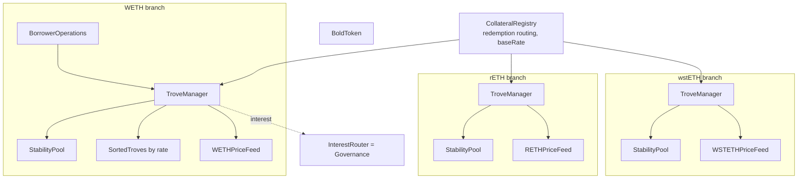
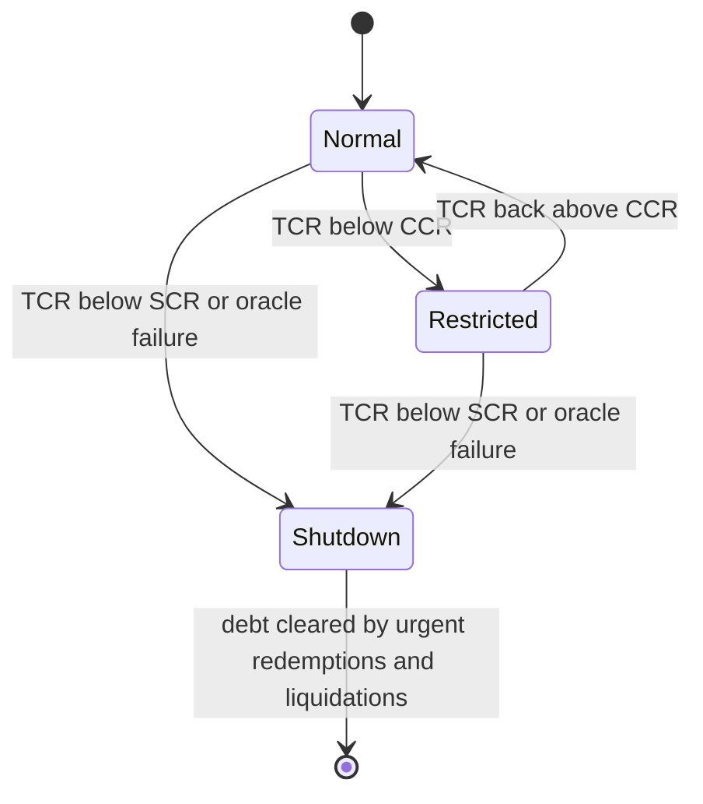

[Liquity V2](https://www.liquity.org/) is the second version of the Liquity borrowing protocol on Ethereum. Users lock ETH, wstETH or rETH and mint BOLD, a dollar stablecoin, and each borrower chooses the annual interest rate they pay. Redemptions take collateral from the troves with the lowest rates first, so the rate a borrower picks is also how much redemption risk they accept.

V2 keeps the core of [Liquity V1]({{site.url_complet}}/2026/10/22/liquity-v1-lusd-troves-stability-pool/): immutable contracts, a Stability Pool that absorbs liquidations, redistribution as a backstop, and redemptions at face value. Around that core it adds interest, several collateral branches, NFT troves, delegation to rate managers, and a permanent shutdown for a branch whose collateral or oracle fails. This article describes the system from the `liquity/bold` and `liquity/V2-gov` repositories, the public audit reports, and the whitepaper rev. 0.3 of November 2024. It ends with the points where the deployed code differs from that whitepaper.

> This article has been made with the help of [Claude Code](https://claude.com/product/claude-code) and several custom skills

[TOC]

## What you need to know first

The article assumes familiarity with DeFi and stablecoins, and with the V1 design described in the [Liquity V1 article]({{site.url_complet}}/2026/10/22/liquity-v1-lusd-troves-stability-pool/). It uses these more specific mechanisms without re-deriving them.

- **Stability Pool and redistribution.** A pool of stablecoin deposits cancels a liquidated position's debt in exchange for its collateral. What the pool cannot cover is shared among the remaining positions. V2 keeps both stages, per collateral branch.
- **Redemption.** Anyone can burn the stablecoin for 1 USD of collateral minus a fee, taken from specific positions. This sets a price floor near 1 USD.
- **Liquid staking token (LST).** A token such as Lido's wstETH or Rocket Pool's rETH represents staked ETH and accrues staking rewards. Its value is the ETH it redeems for at the issuer's exchange rate, the *canonical rate*, which can differ from its market price.
- **Push oracle with a deviation threshold.** A Chainlink feed updates on-chain only when the price moves by more than a threshold (for example 2% for RETH/ETH) or a heartbeat expires, so the on-chain price lags the market by up to that threshold.
- **Debt shares.** When several positions share one debt balance, each holds shares and its debt is `shares × total debt / total shares`. Rounding in this conversion is a classic source of exploits, and V2 uses it for batches.
- **Flash-loan callback.** A contract borrows tokens, receives them in a callback, and must repay in the same transaction. The callback must check who started the loan, not only who sent it.
- **Gauge voting.** Token holders vote each epoch on how a stream of rewards is split between recipients, a model popularised by Curve. V2 governance uses it for the share of interest that does not go to the Stability Pools.

## What changed from V1

| Feature | Liquity V1 | Liquity V2 |
|---|---|---|
| Stablecoin | LUSD | BOLD |
| Collateral | ETH only | WETH, wstETH, rETH, one branch each |
| Borrowing cost | One-off fee, no interest | Annual rate chosen by the borrower, plus a 7-day upfront fee |
| Redemption order | Lowest collateral ratio first | Lowest interest rate first, per branch |
| Minimum ratio | 110% | 110% (WETH), 120% (LSTs) |
| System stress | Recovery Mode below 150% TCR | Borrowing limits below CCR; permanent branch shutdown below SCR or on oracle failure |
| Position | One per address | ERC-721 trove NFT, many per address |
| Delegation | None | Add and remove managers, interest delegates, batch managers |
| Stability Pool yield | Liquidation gains and LQTY | Liquidation gains and 75% of interest |
| Governance | None | LQTY votes on where the remaining 25% of interest goes |

## Architecture: one registry, several branches

A single `CollateralRegistry` and a single `BoldToken` sit above one *branch* per collateral. Each branch is a full V1-like system with its own troves, Stability Pool and price feed, wired together by an `AddressesRegistry`. Collateral never mixes across branches: a liquidation on the rETH branch is paid in rETH to the rETH Stability Pool and redistributed only to rETH troves.

Inside a branch, the contracts keep V1's names and roles, with three additions:

- **`TroveNFT`** makes each trove an ERC-721 token. The trove ID is the hash of the caller, the owner and an owner index.
- **`ActivePool`** tracks the branch's aggregate debt and mints the interest it accrues.
- **Periphery.** `HintHelpers`, `MultiTroveGetter`, `RedemptionHelper` and `DebtInFrontHelper` are read helpers. The zappers open and adjust troves from raw ETH and build leveraged positions with flash loans.

The branch parameters are constants in `Dependencies/Constants.sol`:

| Parameter | WETH branch | wstETH and rETH branches |
|---|---|---|
| MCR (liquidation threshold) | 110% | 120% |
| CCR (borrowing restrictions) | 150% | 160% |
| SCR (shutdown threshold) | 110% | 120% |
| BCR (extra ratio for troves in a batch) | 10% | 10% |
| Liquidation penalty, Stability Pool | 5% | 5% |
| Liquidation penalty, redistribution | 10% | 20% |

The other global constants are a minimum debt of 2,000 BOLD, rates between 0.5% and 250%, a liquidation reserve of 0.0375 WETH per trove, and a 75% share of interest for the Stability Pools (`SP_YIELD_SPLIT`).

## Interest rates and upfront fees

### Accrual and minting

Each trove records its debt, its annual rate $$r$$ and the time of its last update. Interest accrues as simple interest and is compounded each time the trove is touched:

$$
\begin{aligned}
\text{debt}(t) = \text{debt}(t_0) \cdot \left(1 + r \cdot \frac{t - t_0}{\text{1 year}}\right)
\end{aligned}
$$

Updating every trove at every operation would be too expensive, so `ActivePool` keeps the branch total as `aggRecordedDebt` and the weighted sum $$\sum_i d_i r_i$$ as `aggWeightedDebtSum`, where $$d_i$$ and $$r_i$$ are the debt and rate of trove $$i$$. Every operation that changes debt first mints the interest pending since the last mint as new BOLD. 75% of it goes to the branch's Stability Pool and 25% to the `InterestRouter`, which on mainnet is the governance contract.

The core invariant, corrected during the ChainSecurity audit, is that the individual debts add up to the aggregate plus pending interest plus the redistributed debt not yet applied:

$$
\begin{aligned}
\sum_i d_i = \text{aggRecordedDebt} + \text{pendingAggInterest} + \text{DefaultPool debt}
\end{aligned}
$$

### Fees that stop borrowers dodging redemptions

Since redemptions follow the rate order, a borrower could watch for an incoming redemption, raise their rate just before it, and lower it afterwards. They could also close and reopen their trove. Two fees make this costly. Both equal **7 days of the branch's average interest** on the trove's debt:

$$
\begin{aligned}
\bar r &= \frac{\sum_i d_i r_i}{\sum_i d_i} \\
\text{upfront fee} &= \text{debt} \cdot \bar r \cdot \frac{7 \text{ days}}{\text{1 year}}
\end{aligned}
$$

- **The upfront borrowing fee** is charged when a trove is opened or its debt increased, and added to its debt.
- **The premature adjustment fee** is charged when a trove changes its rate less than 7 days (`INTEREST_RATE_ADJ_COOLDOWN`) after its previous change. Joining a batch always pays it.

At an average rate of 5%, the fee is about 0.096% of the debt. The borrower passes a maximum fee, so a transaction does not execute at a fee the borrower did not expect.

## Redemptions

### Routing across branches

`CollateralRegistry.redeemCollateral` first splits the BOLD amount $$M$$ between branches, in proportion to each branch's *unbacked* debt, the part of its debt not covered by its Stability Pool:

$$
\begin{aligned}
U_b &= \max\left(0,\; D_b - SP_b\right) \\
M_b &= M \cdot \frac{U_b}{\sum_k U_k}
\end{aligned}
$$

A branch whose Stability Pool is small relative to its debt is treated as less trusted by the market, and is redeemed more. Branches that are shut down, or whose TCR is below the SCR, are excluded. If every eligible branch is fully backed, the split falls back to total debt.

### Order within a branch and "debt in front"

Within a branch, redemptions start with the trove that pays the lowest rate. The troves' collateral ratios play no part in the order. A borrower's risk is therefore measured by the *debt in front* of them: the total debt of troves with a lower rate, which a redemption must use up before reaching them. `DebtInFrontHelper` computes it, and the `bold-ir-management` rate manager targets a percentage of debt in front for the troves it manages.

The redeemer receives collateral worth the BOLD redeemed minus the fee, at the oracle price $$p_c$$:

$$
\begin{aligned}
c = m \cdot \frac{1 - f}{p_c}
\end{aligned}
$$

The fee portion stays in the redeemed trove as collateral, unlike in V1 where it went to LQTY stakers. A redeemed borrower therefore keeps a small premium.

### The redemption fee

The fee uses the V1 formula with different parameters, and is computed once in the registry for all branches:

$$
\begin{aligned}
b &\leftarrow b \cdot \delta^{m} + \alpha \cdot \frac{M}{N} \\
f &= \min\left(0.5\% + b,\; 100\%\right)
\end{aligned}
$$

where $$\delta$$ gives a half-life of 6 hours, $$m$$ is the minutes since the last fee event, $$\alpha = 1$$, and $$N$$ is the BOLD supply. At deployment, `baseRate` started at 100% (`INITIAL_BASE_RATE`), which blocked redemptions until BOLD fell below about 0.95 USD or the rate had decayed.

### Zombie troves

In V2, a redemption never closes a trove. A trove whose debt falls below 2,000 BOLD is flagged **zombie** and removed from the sorted list, so that many dust troves cannot clog redemptions. A zombie can only be adjusted back above the minimum debt or closed. Since a trove with little debt left has no reason to pay a high rate, the protocol keeps a pointer `lastZombieTroveId` to the last partially redeemed zombie, and the next redemption on the branch takes it first.

The zombie state has more transitions than any other part of the system: redemption, redistribution, `applyPendingDebt`, `adjustZombieTrove`, batch rate changes and liquidation all move a trove in or out of it. The audits found most of their redemption bugs there (see below).

## Liquidations and the Stability Pool

### Penalties and compensation

A trove is liquidated when its ICR falls below the branch's MCR. There is no Recovery Mode, so a trove above the MCR is never liquidated. The two V1 stages remain, with explicit penalties:

- **Stability Pool offset.** The pool burns BOLD equal to the debt and receives collateral worth the debt plus 5%. Any collateral above that goes to the `CollSurplusPool` for the borrower.
- **Redistribution.** The uncovered debt and collateral worth the debt plus 10% (WETH) or 20% (LSTs) are spread over the other active troves of the branch. The borrower can again claim any surplus.

The liquidator receives the 0.0375 WETH reserve plus 0.5% of the collateral offset by the Stability Pool, capped at 2 units of collateral. Since May 2025, a fully redistributed trove pays only the WETH reserve. A V1-style "just in time" liquidation is possible: deposit BOLD into the pool and liquidate in the same transaction.

### Restrictions below the CCR

When a branch's TCR falls below its CCR (150% or 160%), operations that would lower the TCR are refused. Debt increases and collateral withdrawals must leave the TCR higher than before, and a new trove can be opened only if the resulting TCR is at least the CCR. Liquidations still use the MCR. This replaces Recovery Mode without liquidating troves that are healthy on their own.

### The Stability Pool after the 2025 rework

The pool uses V1's product-sum accounting, extended with a third accumulator for BOLD yield. In March 2025, after a potential attack on the pool was found, the accounting was reworked:

- At least 1 BOLD (`MIN_BOLD_IN_SP`) always stays in the pool and cannot offset debt, so the pool can never be emptied.
- Since the pool cannot be emptied, epochs were removed. `P` now has 36 decimals (`P_PRECISION = 1e36`) and is rescaled by $$10^9$$ when it gets small.
- The error-correction terms of V1 were removed.

Depositors can claim their collateral and yield, or stash the collateral and compound the yield into their deposit. Unlike V1, withdrawals are not blocked while undercollateralized troves exist (see the whitepaper section).

## Delegation and batches

### Managers and delegates

A trove owner can grant three kinds of rights:

- **An add manager** may add collateral and repay debt. By default anyone can.
- **A remove manager** may withdraw collateral and borrow, with the funds sent to a chosen receiver. It also has add-manager rights.
- **An individual interest delegate** may change the rate within a range the owner sets, at most once per minimum period the owner chooses.

These rights stay attached to the NFT when it is transferred, so a buyer of a trove should check that no manager is set.

### Batch managers and debt shares

A batch manager registers a rate range, an annual management fee (up to 10%) and a minimum period between rate changes (at least 1 hour). Troves that join the batch share one debt balance: each holds shares, and a single rate change updates every member at once. Batch troves must keep an ICR of at least MCR + BCR (120% or 130%). The [`bold-ir-management`](https://github.com/liquity/bold-ir-management) canister on the Internet Computer is such a manager: it adjusts rates automatically to keep a target share of debt in front of its troves.

Share accounting is where the most serious bug of the audits was found. Converting debt to shares rounds down, so donating 1 wei of debt to a batch, combined with dust troves, raised the debt per share until a minimum-debt trove minted zero shares. The attacker could then push its debt onto the other members and mint unbacked BOLD (ChainSecurity CS-BOLD-001, Recon H-01). The fix caps the debt-to-shares ratio at $$10^9$$ (`MAX_BATCH_SHARES_RATIO`), burns all shares when a trove's debt is fully repaid, and lets anyone remove a trove from a batch above the cap with `kickFromBatch`. The kicked trove keeps the batch's rate and pays no fee.

## Price feeds and the redemption price

Each branch has a Chainlink-based feed, and the two LST feeds also read the issuer's canonical rate:

| Branch | Price for borrowing and liquidation | Price for redemptions |
|---|---|---|
| WETH | ETH/USD | ETH/USD |
| wstETH | STETH/USD × wstETH-stETH rate | max(STETH/USD, ETH/USD) × rate, if the two are within 1% |
| rETH | min(RETH/ETH market, canonical rate) × ETH/USD | max of the two, if within 2%, otherwise the min |

The redemption price gives the redeemer the *worse* of two prices whenever they are within the feed's deviation threshold. Without it, a redeemer could watch for a pending oracle update that raises the price, redeem at the stale lower price, and sell the extra collateral. The borrowing price takes the minimum of market and canonical prices, so a manipulated high price cannot mint excess BOLD.

If a Chainlink call reverts, returns 0 or is stale, or if the canonical-rate call fails, the feed falls back to `lastGoodPrice` (or a composite of the remaining sources) and **shuts the branch down**. Two audit findings shaped this path. A canonical-rate call without `try/catch` would have reverted every redemption, since redemptions loop over all branches (Coinspect BOLD-05). And a caller could give a `try` block just enough gas to fail while the remaining 1/64 still ran the shutdown (ChainSecurity CS-BOLD-030); the feed now compares `gasleft()` before and after the call.

## Branch shutdown and urgent redemptions

A branch shuts down when its TCR falls below its SCR (anyone can call `BorrowerOperations.shutdown`) or when its oracle fails. Shutdown is permanent:

- Pending interest and batch fees are minted, then interest stops accruing.
- Opening and adjusting troves, rate changes, batch operations and normal redemptions are disabled.
- Closing troves, liquidations, Stability Pool deposits and withdrawals remain possible, and the owner of the last trove can close it.
- `urgentRedemption` lets anyone redeem BOLD from that branch only, from any troves, with no fee and a 2% collateral bonus, so arbitrageurs clear its debt quickly.

If the branch's collateral is worth less than its debt, the shortfall is not socialized automatically. Part of the BOLD supply can end up unbacked, and the README suggests governance could redirect interest to burn BOLD until the hole is filled.

## Governance and protocol-incentivized liquidity

The 25% of interest that does not go to the Stability Pools funds liquidity for BOLD. LQTY holders decide each week how it is split, through the `Governance` contract of `liquity/V2-gov`. Governance has no other power: the core contracts are immutable.

- **Deposits.** LQTY deposited in governance is staked in V1's `LQTYStaking` through a per-user `UserProxy`, so the voter keeps earning V1 fees.
- **Voting power** grows linearly with time: for a user with deposits $$m_i$$ made at times $$t_i$$, $$V(t) = \sum_i m_i (t - t_i) = t \cdot M - S$$. The contract stores each line as an amount and an offset $$S$$.
- **Epochs** last 7 days. During the first 6, users can vote for and veto *initiatives*. On the last day, they can only lower votes or add vetoes, so a bad initiative cannot be pushed through at the last minute.
- **Initiatives** are registered by anyone for a 100 BOLD fee: DEX gauges, Merkl campaigns, Curve gauges, bribe contracts. An initiative whose votes exceed 2% of all votes and its vetoes can claim a share of the epoch's BOLD proportional to its votes. The share of initiatives that do not qualify rolls over to the next epoch.
- **Bribes.** `BribeInitiative` lets third parties pay voters of an initiative in BOLD and one other token, by their share of the epoch's votes.

Governance received six audits, which found two Criticals and fifteen Highs between them. Most came from the first representation of voting power as an *average stake timestamp*, whose rounding made allocate-then-deallocate a non-zero operation and let a flash-loan stake shift what a deallocation subtracted. The current code stores each allocation's exact amount and offset and resets all allocations before each new one. One finding was accepted rather than fixed: vetoes can still be removed after the voting cutoff, which works like a late vote (ChainSecurity CS-V2Gov-012).

## Deployment history and audits

V2 has been deployed twice:

| Version | Commit | Date | Note |
|---|---|---|---|
| V4 | `ce0128a` | 13 Jan 2025 | First launch, after three audit rounds; osETH and ETHx branches had been dropped |
| V5 | `f87639d` | 3 Mar 2025 | Fix for a potential Stability Pool attack and pool rework; LST branches moved to 120% / 160%; maximum rate raised to 250%; BCR added |
| V6 | `2e901c7` | 6 May 2025 | Cantina competition fixes: `kickFromBatch`, closing the last trove after shutdown, liquidator compensation from the offset part only |
| V7 | `abe7cbf` | 14 May 2025 | Price feeds without owner; redeployment |

The public reports are listed in the documentation: two core audits and a review of the Cantina fixes by Dedaub, Recon, Chaos Labs (mechanism design), Certora (formal verification of batch equivalence), Coinspect (core, governance, redemption helper), ChainSecurity (core and governance), and a Cantina competition with 65 findings. Read together, they keep returning to the same few areas:

- **Batch accounting.** Share rounding, and the weighted debt and weighted fee accumulators that every batch path must update together (Dedaub found fourteen Mediums there in its first audit).
- **Zombie troves.** Lost pointers, zombies lifted above the minimum debt without becoming active again, and zombies whose batch could still change their rate.
- **Redemption inputs.** The redemption price leaking into other checks, and unbacked debt that includes debt redemptions cannot reach.
- **Shutdown as a terminal state.** The last trove could not be closed, a division by `totalStakes` could reach zero, and guards were missing on sibling entry points.
- **Zappers.** Flash-loan callbacks that checked only the lender (the class of bug behind the Prisma exploit on a V1 fork), and leftovers stuck when the core repaid less than requested.

## Risks

Liquity publishes its own risk disclosure: the [known issues and mitigations](https://github.com/liquity/bold?tab=readme-ov-file#known-issues-and-mitigations) section of the `bold` README describes 26 issues, from oracle front-running to bad debt after a shutdown, and says for each one whether a fix was made. Its guidance for forks adds the two assumptions the whole design rests on: "economically and technically sound collateral" and "robust price oracles". This section starts from that list and adds what the deployed contracts and their state show. On-chain values were read on 22 October 2026 at Ethereum block 26,248,463 (13:30 UTC), from the addresses in `api.liquity.org/addresses/relaunch.json`. Points marked *derived* are this article's analysis rather than statements from the sources.

The state of the three branches at that block:

| Branch | Collateral | Price (USD) | Debt (BOLD) | Stability Pool (BOLD) | TCR | Pool / debt |
|---|---|---|---|---|---|---|
| WETH | 10,583.5 WETH | 2,397.90 | 12,955,850 | 8,164,064 | 195.9% | 63.0% |
| wstETH | 17,857.7 wstETH | 2,991.05 | 21,457,943 | 9,593,885 | 248.9% | 44.7% |
| rETH | 5,652.4 rETH | 2,815.75 | 4,101,110 | 4,723,335 | 388.1% | 115.2% |

Collateral and debt come from `getEntireBranchColl()` and `getEntireBranchDebt()` on each `TroveManager`, deposits from `getTotalBoldDeposits()` on each `StabilityPool`, and the price from a simulated call (`eth_call`) to each feed's `fetchPrice()`, which reported no oracle failure on any branch. The TCR is collateral times price divided by debt. The branches carry 38.51 million BOLD of debt in total, against a `totalSupply()` of 38,514,160 BOLD, and the three pools hold 58.4% of that supply. No branch was shut down: `shutdownTime()` returned 0 on every `TroveManager` and `hasBeenShutDown()` returned false on every `BorrowerOperations`.

### Smart contracts and transparency

- **Verified, immutable, without owners.** The `BoldToken`, the `CollateralRegistry`, the `Governance` contract, the three `TroveManager`s, the three price feeds and the WETH `StabilityPool` are verified on Etherscan (Solidity 0.8.24) and none is a proxy. `owner()` returns the zero address on the `BoldToken`, the three `AddressesRegistry` contracts and `Governance`, which each give up ownership once their wiring call has run (`setCollateralRegistry`, `setAddresses`, `registerInitialInitiatives`). The `CollateralRegistry` and the three price feeds have no `owner()` function at all; the feeds lost theirs in V7.
- **Immutability cuts both ways.** No one holds an admin key, so no one can upgrade the logic to a malicious or buggy version, change a parameter or freeze funds, which removes the upgrade and admin-key risk that many DeFi protocols carry. The rules a borrower accepted when opening a trove are the rules that apply for the life of the deployment (*derived* from the owner reads above). The counterpart is that a bug can only be fixed by deploying a new system, as the next point shows.
- **A fix means a new system.** A bug cannot be patched in place. The Stability Pool fix of March 2025 therefore shipped as a new deployment, and V7 was deployed again in May (see [Deployment history and audits](#deployment-history-and-audits)). Each deployment has its own troves and its own BOLD token, so moving to it is up to each user. The V4 contracts are still on-chain: at the read block none of their branches was shut down, and their BOLD token (`0xb01d…ab98`) had a supply of 201,388, almost all of it (199,751 BOLD) debt on the old wstETH branch. The sources do not say how holders of the first deployment were migrated (listed under Gaps).
- **Accounting that is easy to get wrong.** Batch shares, the zombie state and the Stability Pool's product-sum are where the audits found their serious bugs (see [Deployment history and audits](#deployment-history-and-audits)). Several limits are accepted rather than fixed: aggregate debt that differs slightly from the sum of trove debts (Known Issue 6), pool rounding (7), an overflow bound near 1e23 BOLD in the pool (15), and stakes that could round to zero after about a thousand redistributions of 10% of a branch's debt (22).
- **Zappers act on users' troves.** The zappers set themselves as add manager, remove manager and receiver on the troves they open, so a bug in a zapper can move collateral or debt of every trove opened through it. The flash-loan callback bug of this kind found before launch (CS-BOLD-002) is the class of bug behind the Prisma exploit (about $11$M, March 2024) on a V1 fork. The same applies to friendly forks that reuse the code: a fork built on V4 or earlier lacks the V5 to V7 fixes (*derived*).

### External dependencies

- **Three Chainlink feeds and two issuer rates.** The branches depend on Chainlink ETH/USD, STETH/USD and RETH/ETH, and on the canonical rates returned by `stEthPerToken()` on wstETH and `getExchangeRate()` on rETH. The deployed staleness thresholds, read from `ethUsdOracle()`, `stEthUsdOracle()` and `rEthEthOracle()`, are 24 hours for ETH/USD and STETH/USD and 48 hours for RETH/ETH, as in the README. Until a feed passes that threshold, the system keeps using its last answer, which can allow redemptions at a wrong price, borrowing with too little collateral, or liquidation of healthy troves (Known Issue 5).
- **An oracle failure is terminal.** Any failure shuts the branch down for good, and with no owner on the feeds nobody can point the branch at a replacement. The README considers a feed that Chainlink stops maintaining the most likely cause. The shut-down branch is then priced at a frozen `lastGoodPrice`, which can make urgent redemptions unprofitable and leave debt in place if the market price is lower (Known Issue 4; see [Branch shutdown and urgent redemptions](#branch-shutdown-and-urgent-redemptions)).
- **LST contracts outside Liquity's control.** The canonical rates are set by the Lido and Rocket Pool systems. The README notes that most LST exchange rates are "controlled by an oracle-like scheme", so a wrong or manipulated rate on either side would flow straight into the branch's price. How those rates are governed is not covered by the sources (listed under Gaps).
- **Ethereum and MEV.** Liquidations, redemptions and Stability Pool deposits compete in the mempool, and the README expects many liquidations to go through private order flow. Several known issues depend on mempool visibility: oracle front-running (1), just-in-time pool deposits (16), and depositors or borrowers stepping out ahead of a loss-making liquidation (24, 25). Congestion that delays liquidations leaves more debt for the pools to absorb at a lower price (*derived*).

### Depeg

- **BOLD has a hard floor and a soft ceiling.** Below 1 USD, a redeemer receives 1 USD of collateral per BOLD minus the fee. At the read block `baseRate()` on the `CollateralRegistry` was 0.291%, so the fee was 0.791% and the floor about 0.992 USD before gas (*derived*). Above 1 USD there is no mint-at-par arbitrage: the whitepaper relies on borrowers lowering their rates, which makes borrowing cheaper, so BOLD can trade above its peg for as long as rates take to adjust.
- **The floor weakens when redemptions stop.** Branches below their SCR and shut-down branches are excluded from routing. After a shutdown that leaves bad debt, part of the BOLD supply can never be redeemed, and the README warns this could cause a bank run and "break the BOLD peg" (Known Issue 9).
- **The LST branches carry an LST depeg.** The wstETH borrowing price is STETH/USD times the canonical rate, so a stETH discount on the market lowers it directly. The rETH price takes the lower of the market and canonical prices, so either a market discount or a cut in the canonical rate (a slashing loss, for example) lowers it. The README states that downward manipulation is not protected against and that its impact should stay within the branch: liquidations and, at worst, shutdown (Known Issue 8).
- **WETH has no peg of its own.** WETH is a fixed 1:1 wrapper of ETH, so the WETH branch has no depeg risk beyond the ETH price itself.

### Collateral and market risk

Treating each branch as a whole and leaving liquidations aside, the price fall that takes a branch from its TCR down to a threshold is:

$$
\begin{aligned}
\text{fall to threshold} = 1 - \frac{\text{threshold}}{\text{TCR}}
\end{aligned}
$$

- **Buffers at the read block.** The formula gives 23.4% (WETH), 35.7% (wstETH) and 58.8% (rETH) to the CCR, and 43.8%, 51.8% and 69.1% to the SCR (*derived*). Individual troves near the MCR are liquidated long before that, and the WETH and wstETH branches would hold less collateral than debt after falls of 48.9% and 59.8%.
- **One market under three branches.** All three collaterals are priced in ETH, so a fall in ETH hits every branch at once. Branches isolate a failure of one LST, not the ETH price (*derived*). The wstETH branch carries 55.7% of all debt and has the lowest pool coverage, 44.7%.
- **Reflexive selling.** Pool depositors receive the liquidated collateral and may sell it. For an LST that trades in a few DEX pools, those sales lower the market price the feed reads, which can trigger the next round of liquidations (*derived*). When pools are empty, redistribution can drag healthy troves below the MCR in a cascade (Known Issue 23), although V2 no longer pays collateral compensation on redistributed troves, which makes such cascades less profitable to trigger.
- **Redemption risk for low-rate borrowers.** A borrower with little debt in front loses collateral to redemptions at the oracle price; the fee stays in the trove, but the README notes that a redemption can still cause a short-term loss. Debt in front can change at any moment because others adjust their debt and rates, and troves at the same rate are redeemed last-in, first-out, so a batch manager can re-insert its batch for free just before a redemption (Known Issue 26). The 7-day fees make dodging a redemption costly but do not remove the risk.
- **Manipulation of the prices the protocol computes.** The protocol computes no market price itself, only the redemption fee and the routing split. Routing can be steered with flash-loaned pool deposits on the branches a redeemer wants to avoid, which extracts no value from the system (Known Issue 2). At the read block the rETH pool held more BOLD than the branch's debt, so rETH had no unbacked debt and every redemption went 28.8% to WETH and 71.2% to wstETH (*derived* from the routing formula).

### Liquidity

- **Borrowers need BOLD to leave.** Closing a trove requires repaying its full debt in BOLD, bought on the market if needed. The last trove of a branch cannot be closed unless the branch is shut down.
- **Stability Pool deposits can always be withdrawn.** The code has no V1-style check that blocks withdrawals while undercollateralized troves exist (see [Whitepaper versus implementation](#whitepaper-versus-implementation)). Depositors can always get out, but those who stay take a larger share of a loss-making liquidation (Known Issue 24).
- **Holders exit by selling or redeeming.** Redemption is open to anyone, but the README calls it complex and MEV-competitive and advises leaving it to bots, warning that manual redemptions can lose funds. A holder who is not a bot relies on DEX liquidity, which the 25% interest share is meant to fund; its depth was not measured here (listed under Gaps).

### Centralisation and governance

- **No admin power over the core.** The owner reads above show no key that can change the core contracts. `Governance` has no owner either, and its only power is the split of the 25% interest share between initiatives. The mainnet contract returns `REGISTRATION_FEE()` = 100 BOLD and `VOTING_THRESHOLD_FACTOR()` = 2%, and its other immutables (0.01% registration threshold, unregistration after 4 epochs, `MIN_CLAIM` and `MIN_ACCRUAL` of 0, 7-day epochs with a 6-day voting cutoff, first epoch on 8 May 2025) also match the deploy script.
- **Voting power follows LQTY and bribes.** Anyone can register an initiative for 100 BOLD, and `BribeInitiative` lets third parties pay voters, so the incentive budget goes where LQTY holders and bribers send it. Vetoes can still be removed after the voting cutoff (CS-V2Gov-012, accepted). How LQTY voting power is distributed was not read (listed under Gaps).
- **The bad-debt remedy depends on governance.** The only way the README offers to fill a hole left by a shutdown is for LQTY voters to direct interest to a BOLD burn (Known Issue 9). Nothing in the contracts forces that vote.
- **Delegates are trusted by the borrowers who choose them.** A remove manager can withdraw collateral and borrow, sending the funds to its receiver. A batch manager can charge premature-adjustment fees that push a trove below the MCR after a price fall, and the README says batch managers "should be considered trusted actors" (Known Issue 11). Managers stay attached to the trove NFT on transfer (see [Delegation and batches](#delegation-and-batches)).
- **Off-chain parts.** Users access the protocol through front ends that third parties host, and an automated rate manager such as `bold-ir-management` runs on the Internet Computer. Redemptions and liquidations depend on bots. None of these can change the contracts, but a user who signs what a front end prepares depends on it (*derived*).

### Loss sharing

- **The Stability Pool takes the first loss, per branch.** Depositors burn BOLD and receive collateral worth up to the debt plus 5%, which is a loss only when the trove's collateral is worth less than its debt. Just-in-time deposits can take most of a profitable liquidation from long-term depositors (Known Issue 16), and withdrawals ahead of a loss leave it to those who stay (24). At least 1 BOLD (`MIN_BOLD_IN_SP`) always stays in each pool.
- **Borrowers of the same branch take the second loss.** What the pool cannot cover is redistributed to the active troves of the branch, borrowers who did not choose to absorb liquidations. The 10% or 20% penalty makes this a gain while the liquidated trove is above 100%, but it lowers every recipient's ratio, and a borrower can close ahead of a loss-making redistribution and leave it to the others (Known Issue 25).
- **Bad debt after a shutdown is nobody's in particular.** No mechanism socializes it automatically. It stays as BOLD that no collateral backs, so every BOLD holder carries it until governance burns enough interest (Known Issue 9). Below 102% ICR, the 2% urgent-redemption bonus makes a trove worse (Known Issue 14).

### Regulatory

- **A stablecoin with no issuer.** BOLD is minted by immutable contracts, and no company issues it. MiCA classifies a token by what it purports to do, so a token that references the US dollar falls under the e-money token rules, which reserve the offer to the public and admission to trading to the issuer or persons it authorises (see [MiCA Explained]({{site.url_complet}}/2026/09/17/mica-explained-scope-token-categories-timeline/) and [Stablecoins Under MiCA]({{site.url_complet}}/2026/09/17/mica-stablecoins-asset-referenced-tokens-e-money-tokens/)). How that applies to BOLD, and to the front ends and exchanges that make it available in the EU, is not settled in the sources, and it could restrict access in some jurisdictions (listed under Gaps).

### Summary

| Risk | Where it comes from | What the design does about it | What remains |
|---|---|---|---|
| Code | Immutable contracts with complex batch, zombie and pool accounting | Audits by ChainSecurity, Dedaub, Coinspect and Recon, a Cantina competition, Certora verification; verified source; no admin key, which removes upgrade and admin-key risk: the logic cannot be swapped for a malicious or buggy version, parameters cannot change and funds cannot be frozen | Bugs cannot be patched in place; a fix needs a redeployment and user migration |
| Oracle | Chainlink ETH/USD, STETH/USD, RETH/ETH and two canonical rates | Staleness thresholds (24 h, 48 h), worst-price rule for redemptions, minimum of market and canonical for rETH | Any failure shuts the branch for good at a frozen price; stale prices are used until the threshold |
| BOLD depeg | Redemption arbitrage below 1 USD, rate changes above | Redemptions at face value minus a 0.5% floor fee, routing to the least covered branches | Soft ceiling; unredeemable BOLD after a shutdown with bad debt |
| LST depeg | wstETH and rETH market discounts, slashing, canonical-rate errors | Separate branches with 120% MCR and 20% redistribution penalty | Downward manipulation not protected; 55.7% of debt sits on the wstETH branch |
| ETH market | All collateral priced in ETH | TCR buffers of 23.4% to 58.8% before the CCR at the read block | A large ETH fall hits all branches at once; reflexive selling of LST collateral |
| Redemption | Rate order within each branch | Upfront and premature-adjustment fees, debt-in-front tools | Low-rate borrowers lose collateral; debt in front can change before a redemption |
| Liquidity | Repayment in BOLD, MEV-competitive redemptions | No lock on pool withdrawals; 25% of interest for DEX liquidity | Non-bot holders depend on DEX depth; pool stayers carry loss-evading exits |
| Governance and delegation | LQTY votes and bribes, managers chosen by borrowers | Governance limited to the 25% interest split; delegation is opt-in | Bad-debt repair needs a vote; batch and remove managers are trusted |
| Loss sharing | Pool first, then redistribution, then BOLD holders | 5% and 10% or 20% penalties, `MIN_BOLD_IN_SP` | Bad debt after shutdown is not socialized by any mechanism |
| Regulatory | Dollar stablecoin without an issuer | None in the design | Treatment under MiCA of offering and listing BOLD is open |

## Whitepaper versus implementation

The whitepaper rev. 0.3 (November 2024) was written before the January 2025 launch. The redeployed code of May 2025 matches it on most parameters:

- the MCR, CCR and SCR of each branch;
- the 5% Stability Pool penalty and the 2% urgent-redemption bonus;
- the 0.5% to 250% rate range and the 7-day upfront and adjustment fees;
- the 75% yield split;
- the 0.5% redemption fee floor with a 6-hour half-life.

It differs on the points below.

### Behaviour that differs

| Topic | Whitepaper rev. 0.3 | Current code | Consequence |
|---|---|---|---|
| Stability Pool withdrawals | "Deposits can always be withdrawn unless there is undercollateralized debt in the respective borrow market" (as in V1) | `withdrawFromSP` has no such check | Depositors can exit ahead of a loss-making liquidation; the Cantina report lists this (3.2.3). |
| Borrowing below the critical threshold | "Creation of new debt in the affected market is prohibited" when TCR is below CT | A new trove may be opened if the resulting TCR is at least CCR | Borrowing with a high ratio helps the branch and is allowed; the Cantina report notes the README mismatch (3.2.6). |
| Redistribution penalty | The redistributed trove gives up its "remaining collateral" | Capped at 10% (WETH) or 20% (LSTs) above the debt; the rest is claimable by the borrower | Borrowers keep a surplus even when the pool is empty. |
| Liquidator compensation | "Effective gas costs plus a margin" | 0.0375 WETH reserve plus 0.5% of the collateral offset by the pool, capped at 2 units | A fixed formula; a fully redistributed trove pays only the reserve. |
| Voting power | "LQTY staked × (average) staking age" | Stored as an amount and an offset per allocation; a full reset before each allocation | Same quantity, but the representation changed after audits found rounding bugs in the average form. |

### Mechanisms the whitepaper does not mention

- **Zombie troves** and `lastZombieTroveId`. The whitepaper describes redemptions down the rate order, but not what happens to a trove left below the minimum debt.
- **The batch collateral buffer** (BCR, 10% above the MCR) and the 1-hour minimum period between batch rate changes. The whitepaper only says the delegate presets a waiting time.
- **The 10% cap on batch management fees.** The whitepaper gives "e.g. 0.05%" as an example.
- **`MAX_BATCH_SHARES_RATIO` and `kickFromBatch`**, both added to fix the share-inflation finding.
- **`INITIAL_BASE_RATE` of 100%**, which blocked redemptions at launch.
- **`MIN_BOLD_IN_SP`**, the 1 BOLD that always stays in each Stability Pool since the 2025 rework.
- **The separate redemption price** of the LST feeds, which takes the higher of the market and canonical prices when they are within the deviation threshold.

### Differences in wording only

- **Names.** The whitepaper calls the thresholds CT and ST; the code calls them CCR and SCR.
- **The symbol β.** In the whitepaper β is the decay factor and α = 1 is the spike parameter. In the code, `REDEMPTION_BETA` = 1 is described as 1/α, and the decay is `REDEMPTION_MINUTE_DECAY_FACTOR`, applied per minute.
- **ETH versus WETH.** The whitepaper speaks of ETH collateral and says it is wrapped "seamlessly" into WETH. The branch token is WETH, and the zappers wrap and unwrap at the edges.

The repository README itself is also behind the code in places. It gives a 72% yield split and a 1% urgent bonus, while `Constants.sol` has 75% and 2%. When the documents disagree, the constants file is the reference.

## Conclusion

Liquity V2 keeps V1's immutable, auction-free design and adds a market for interest rates. The way risk is shared follows from that addition.

- **Borrowers price their own redemption risk.** Redemptions follow the rate order, so a borrower chooses a rate relative to the debt in front of them, and the upfront and premature-adjustment fees (7 days of average interest) stop them from dodging a redemption at the last moment.
- **Interest funds the peg.** 75% goes to each branch's Stability Pool and 25% to liquidity incentives allocated by LQTY votes, so holding BOLD earns yield.
- **Branches isolate collateral.** Each collateral has its own troves, pool, feed and thresholds, and redemptions are routed toward branches whose debt is least covered by their pool.
- **Stress is handled per branch.** Below the CCR, borrowing that lowers the TCR is refused. Below the SCR or on oracle failure, the branch shuts down for good, and urgent redemptions with a 2% bonus clear its debt.
- **Most of the complexity is in batches and zombies.** The audits found their most serious bugs in debt-share rounding and in the below-minimum-debt state, and the fixes (the share-ratio cap, `kickFromBatch`, the zombie pointer) are not in the whitepaper.
- **The whitepaper is a design document, not a specification.** Stability Pool withdrawals, borrowing below the CCR, redistribution penalties and liquidator compensation all work differently in the deployed code.
- **The main risks sit around the immutable core.** An oracle or LST failure shuts a branch down for good at a frozen price, bad debt left by a shutdown is cleared by no mechanism, only by a governance vote to burn interest, and low-rate borrowers are redeemed first. On 22 October 2026 all three branches were far above their SCR, and the wstETH branch held 55.7% of the debt with the lowest Stability Pool coverage, 44.7%.

## Annex

### Key Terms

| Term | Definition |
|------|------------|
| **BOLD** | The dollar stablecoin of Liquity V2, minted by troves on every branch and redeemable for collateral. |
| **Branch** | The set of contracts for one collateral type, with its own troves, Stability Pool, price feed and thresholds. |
| **CollateralRegistry** | The contract that lists the branches, routes redemptions between them and holds the redemption `baseRate`. |
| **Trove NFT** | The ERC-721 token that represents ownership of a trove; one address can hold many. |
| **MCR / CCR / SCR** | The liquidation threshold of a trove, the system ratio below which borrowing is restricted, and the system ratio below which the branch shuts down. |
| **BCR** | The extra 10% collateral ratio, on top of the MCR, that troves in a batch must keep. |
| **User-set interest rate** | The annual rate between 0.5% and 250% that each borrower chooses and that orders redemptions. |
| **Debt in front** | The total debt of troves with a lower rate on the same branch, which a redemption reaches first. |
| **Upfront fee** | A fee of 7 days of the branch's average interest, charged on opening, on debt increases and on early rate changes. |
| **Unbacked debt** | A branch's debt minus the BOLD in its Stability Pool, used to split redemptions between branches. |
| **Zombie trove** | A trove whose debt fell below the 2,000 BOLD minimum after a redemption; it leaves the sorted list. |
| **Batch manager** | A delegate that sets one rate for every trove in its batch, within a registered range, for a management fee. |
| **Debt shares** | The units in which a batch's members hold its common debt. |
| **`MAX_BATCH_SHARES_RATIO`** | The cap of 1e9 on a batch's debt per share, introduced to prevent share-inflation attacks. |
| **Canonical rate** | The LST issuer's own exchange rate between the token and ETH, read alongside the market price. |
| **Redemption price** | The LST price used for redemptions, the worse of market and canonical prices for the redeemer. |
| **Shutdown** | The permanent state of a branch after TCR falls below the SCR or its oracle fails. |
| **Urgent redemption** | A fee-free redemption on a shut-down branch that pays a 2% collateral bonus. |
| **Initiative** | An address registered in governance that can receive a share of the 25% interest stream. |
| **Voting cutoff** | The last day of each 7-day epoch, when votes may only decrease and vetoes increase. |

### Invariants

| Invariant | Enforced by | Breaks if |
|-----------|-------------|-----------|
| The sum of trove debts equals aggregate recorded debt plus pending interest plus DefaultPool debt. | `ActivePool` aggregate updates on every operation | A batch path updates weighted debt and weighted fee differently, or omits redistribution gains. |
| A trove's share of batch debt is never minted at zero for non-zero debt. | `MAX_BATCH_SHARES_RATIO` check on share-increasing operations | The ratio cap is removed or skipped on a path other than redemption. |
| Every redemption fee and routing input counts only redeemable debt. | Exclusion of shut-down branches; `MIN_BOLD_IN_SP` | Zombie or sub-100% debt enters the unbacked portion. |
| A shut-down branch never resumes borrowing or interest accrual. | `shutdownTime` checks in BorrowerOperations and TroveManager | A sibling entry point lacks the shutdown guard. |
| Each Stability Pool keeps at least 1 BOLD. | `MIN_BOLD_IN_SP` in the offset and withdrawal paths | The pool is emptied and the product `P` collapses. |
| The rate changes that move a trove in the redemption order pay the premature-adjustment fee inside the cooldown. | Fee checks in rate change, batch join and batch rate change | A new path changes the rate without checking the trove's own timestamp. |

## Frequently Asked Questions

**Q: Why does V2 order redemptions by interest rate rather than by collateral ratio?**

In V1, borrowers could only protect themselves from redemptions by over-collateralizing, which wasted capital and made the 110% minimum mostly theoretical. Ordering by rate gives them a second dial: they pay more interest to have more debt in front of them, and that interest funds the Stability Pool yield that supports demand for BOLD. A trove's collateral ratio then only matters for liquidation.

**Q: A redeemer burns 1,000 BOLD while three branches have unbacked debt of 100, 50 and 100. What happens?**

The registry splits the amount in proportion to unbacked debt: 400 BOLD to the first branch, 200 to the second and 400 to the third. On each branch, the redemption starts with the zombie trove the pointer refers to, if any, then the trove with the lowest rate, and moves up. The redeemer receives collateral worth the BOLD minus the fee at each branch's redemption price, and the fee portion stays in the redeemed troves.

**Q: What do the upfront fee and the premature adjustment fee protect against?**

Two ways of dodging a redemption:

- Closing a trove before a redemption and reopening it afterwards. The upfront fee on opening makes this cost 7 days of average interest each time.
- Raising the rate just before a redemption and lowering it afterwards. A rate change within 7 days of the previous one pays the same fee, and joining a batch always pays it.

**Q: How could the batch share rounding bug mint unbacked BOLD, and how was it fixed?**

Shares are computed as `shares × debt increase / batch debt`, rounded down. By redeeming a trove down to one wei of debt and one share, then repeatedly donating one wei of debt and reopening troves, an attacker raised the debt per share until a 2,000 BOLD trove received zero shares. That trove's debt then belonged to the other members, and the attacker kept the BOLD.

The fix caps the debt-to-shares ratio at 1e9, burns all shares when a trove's debt is fully repaid, and lets anyone kick a trove out of a batch above the cap.

**Q: What happens to an rETH branch if the Rocket Pool exchange-rate call starts reverting?**

The price feed catches the failure, falls back to the last good price, and shuts the branch down permanently. Interest stops, normal redemptions and borrowing stop, and urgent redemptions open with a 2% bonus so the branch's debt is cleared. The other branches keep working, because the shutdown flag removes the branch from redemption routing. Before an audit fix, the canonical-rate call had no `try/catch`, and a revert would have blocked redemptions on every branch.

**Q: Name two places where the whitepaper and the deployed code differ in behaviour, and why it matters to a user.**

Two examples:

- **Stability Pool withdrawals.** The whitepaper says deposits cannot be withdrawn while undercollateralized debt exists, as in V1; the code has no such check. A depositor can therefore leave before a loss-making liquidation, and those who stay bear more of the loss.
- **Redistribution.** The whitepaper says a redistributed trove loses its remaining collateral; the code caps the penalty at 10% or 20% above the debt. The liquidated borrower keeps the surplus.

## Gaps

The following points are not settled by the sources used here.

| Gap | Why it matters | What to read or verify |
|-----|----------------|------------------------|
| The "potential attack to the protocol's Stability Pool" that led to the March 2025 rework is named but not described in the reports read. | It explains why epochs were removed and why the system was redeployed. | Liquity's announcement of the V2 relaunch and the PRs merged into V5 of `liquity/bold`. |
| The Cantina report gives no fix status for its 65 findings, and Dedaub's fix review does not map PRs to finding IDs. | The article states some issues as fixed from the code, not from the reports. | Compare each Cantina finding with commit `abe7cbf` of `liquity/bold`. |
| The analysed `bold` commit (September 2026) is later than the V7 redeployment commit. | Later commits may change frontend or periphery code compared with what is deployed. | `git diff abe7cbf d262669 -- contracts/src` and the verified source of the deployed contracts listed in `api.liquity.org/addresses/relaunch.json`. |
| Market and on-chain figures (rate distribution, Stability Pool sizes, BOLD supply) are not covered. | Debt in front and the yield split only mean something against real numbers. | Liquity's dashboards and Dune queries referenced in `api.liquity.org`. |
| A third Dedaub governance audit report contains a fix-PR reference to an "H3" that does not exist in that report. | One governance fix may be mislabelled. | V2-gov PR #120 and the Dedaub report of 22 December 2024. |
| The first deployment (V4) is still on-chain, not shut down, with 201,388 of its own BOLD outstanding on 22 October 2026, and the sources do not say how its users were moved to the relaunch. | Holders of the old token or troves depend on a system that no longer matches the documentation. | Liquity's relaunch announcement and `api.liquity.org/addresses/legacy.json`. |
| How LQTY voting power is distributed among holders was not read. | Concentrated voting power decides where incentives go and whether interest is ever redirected to burn bad debt. | LQTY balances in `Governance` user proxies and per-epoch vote totals on mainnet. |
| Who controls the wstETH and rETH canonical rates, and how they can change. | A wrong or manipulated rate lowers or raises the price of a whole branch. | Lido and Rocket Pool documentation on their oracle and upgrade governance. |
| DEX liquidity for BOLD, wstETH and rETH was not measured. | It sets the cost of manipulating an LST market price, the size of the reflexive selling loop, and how holders exit without redeeming. | Curve and Uniswap pool depths at a given block. |
| How MiCA applies to a dollar stablecoin with no issuer, and to EU platforms that offer or list it. | It decides whether BOLD can be offered or traded through regulated EU intermediaries. | MiCA Articles 48 and 142 and any ESMA or EBA guidance on decentralised issuance. |

## References

### Analyzed source

- [liquity/bold](https://github.com/liquity/bold) — analyzed at commit [`d262669ef3c4d37bf0544df3bb2624c07b8a5ee0`](https://github.com/liquity/bold/tree/d262669ef3c4d37bf0544df3bb2624c07b8a5ee0), 2026-10-22 (V7 redeployment commit: `abe7cbfbd465fba3812282c51773455766a70e96`)
- [liquity/V2-gov](https://github.com/liquity/V2-gov) — analyzed at commit [`8f4bff395ed4ef2023e98df12c078b65af94bb73`](https://github.com/liquity/V2-gov/tree/8f4bff395ed4ef2023e98df12c078b65af94bb73), 2026-10-22
- [liquity/bold-ir-management](https://github.com/liquity/bold-ir-management) — automated batch manager

### Liquity documentation

- [Liquity V2 whitepaper](https://liquity.gitbook.io/v2-whitepaper) (rev. 0.3, November 2024)
- [Liquity V2 documentation](https://docs.liquity.org/)
- *Technical Docs & Audits*, page of the Liquity V2 documentation that lists the reports below

### Audit reports

- [ChainSecurity, Liquity Bold smart contracts](https://www.chainsecurity.com/security-audit/liquity-bold-smart-contracts) (January and May 2025)
- [ChainSecurity, Liquity V2 Governance](https://www.chainsecurity.com/security-audit/liquity-v2-governance) (January 2025)
- [Dedaub, Liquity V2 first audit](https://dedaub.com/audits/liquity/liquity-v2-aug-28-2024/) (August 2024) and [second audit](https://dedaub.com/audits/liquity/liquity-v2-second-audit-nov-11-2024/) (November 2024)
- [Dedaub, Liquity V2 Cantina fixes review](https://dedaub.com/audits/liquity/liquity-v2-cantina-fixes-review-may-13-2025/) (May 2025)
- [Dedaub, Liquity V2 governance audits](https://dedaub.com/audits/liquity/liquity-v2-governance-1st-audit-aug-12-2024/) (August, November and December 2024)
- [Coinspect, Liquity Bold](https://www.coinspect.com/doc/Coinspect%20-%20Smart%20Contract%20Audit%20-%20Liquity%20-%20Bold%20-%20v241231.pdf) (December 2024) and [Bold Governance](https://www.coinspect.com/doc/Coinspect%20-%20Smart%20Contract%20Audit%20-%20Liquity%20-%20Bold%20Governance%20-%20v250120.pdf) (January 2025)
- [Certora, Liquity verification report](https://certora.cdn.prismic.io/certora/Z1tLJJbqstJ98b8J_LiquityVerificationReport.pdf) (December 2024)
- [Recon, Bold review](https://github.com/GalloDaSballo/bold-review) (2024)
- [Cantina, Liquity competition](https://cantina.xyz/portfolio/fca4f98a-7d24-49f1-9a3b-80e5e65b2b30) (March–April 2025)
- Chaos Labs, *Liquity V2 Mechanism Design Review*, September 2024 (linked from the Liquity technical docs)
- Coinspect, *Redemption Helper Smart Contract Audit*, October 2025

### Related articles

- [How Liquity V1 Works - LUSD, Troves, the Stability Pool, Redemptions and Recovery Mode]({{site.url_complet}}/2026/10/22/liquity-v1-lusd-troves-stability-pool/)
- [10 Key Differences Between MakerDAO and Liquity]({{site.url_complet}}/2024/12/16/10-Key-Differences-Between-MakerDAO-and-Liquity/)
- [How Polaris Works - pETH, the Power-Law Bonding Curve, Reserve Loans and pAsset Markets]({{site.url_complet}}/2026/10/21/polaris-peth-bonding-curve-passets/)
- [How Morpho Blue Works - Isolated Lending Markets, Shares, Liquidations and Bad Debt]({{site.url_complet}}/2026/10/10/morpho-blue-lending-markets/)
- [The Technical Concepts Behind the 2024 Crypto Hacks]({{site.url_complet}}/2026/10/07/crypto-hacks-2024-technical-concepts/)
- [Pricing a Lending Position During an Incident - What the Oracle Reads, When, and Who Bears the Gap]({{site.url_complet}}/2026/10/11/oracle-kinds-pricing-lending-position-incident/)
