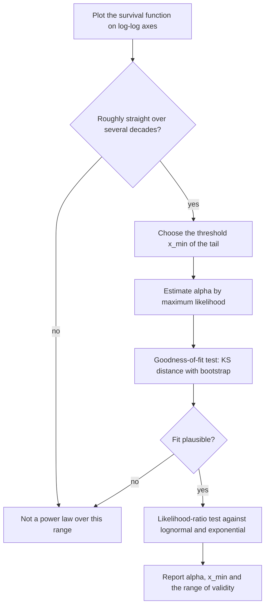

A power law is a relation in which one quantity varies as a fixed power of another, $$y = a \cdot x^{k}$$. It looks like a minor family of functions, but it is the only one that behaves identically at every scale: multiply the input by ten and the output is always multiplied by the same factor, whether the input was small or huge. That single property explains why power laws appear in the price curves of DeFi protocols, in the invariant of constant-product AMMs, in empirical market impact, and in the heavy tails of return distributions.

This article defines power-law curves, derives their scale invariance, shows how to recognise them on log-log axes and how they differ from linear and exponential growth, then covers the cases that matter in DeFi and finance. It was written as a companion to [How Polaris Works - pETH, the Power-Law Bonding Curve, Reserve Loans and pAsset Markets]({{site.url_complet}}/2026/10/21/polaris-peth-bonding-curve-passets/), whose pETH price is a power law of its supply.

> This article has been made with the help of [Claude Code](https://claude.com/product/claude-code) and several custom skills

[TOC]

## What you need to know first

The article assumes familiarity with functions, graphs and percentages, and uses the following without re-deriving them.

- **Logarithm rules.** $$\log(xy) = \log x + \log y$$ and $$\log(x^{k}) = k \log x$$, in any base. They turn products into sums and powers into multiplications, which is why logarithmic axes straighten power laws.
- **Logarithmic axis.** An axis on which equal distances represent equal *ratios* (1, 10, 100, 1,000) rather than equal differences. A log-log plot uses one on both axes.
- **Derivative as a rate of change.** $$\frac{dy}{dx}$$ is the change in $$y$$ per small change in $$x$$; for a power, $$\frac{d}{dx} x^{k} = k \, x^{k - 1}$$.
- **Elasticity.** The ratio of a relative change in $$y$$ to the relative change in $$x$$ that causes it, $$\frac{dy/y}{dx/x}$$. An elasticity of 0.5 means a 1% rise in $$x$$ gives roughly a 0.5% rise in $$y$$.
- **Integral as an area.** $$\int_a^b f(x)\,dx$$ is the area under $$f$$ between $$a$$ and $$b$$. In a bonding curve that area is the amount paid for a trade.
- **Survival function.** For a random variable $$X$$, the probability $$P(X \gt x)$$ that it exceeds a level $$x$$. The tail of a distribution is this function for large $$x$$.

## Definition

A power law, or power function, has the form

$$
\begin{aligned}
y = a \cdot x^{k}, \qquad x \gt 0
\end{aligned}
$$

- **$$k$$ is the exponent.** It is a fixed real number and decides whether the curve rises or falls, and how fast.
- **$$a$$ is the scale factor.** It stretches the curve vertically without changing its shape.

The sign and size of $$k$$ give four families:

| Exponent | Shape | Examples |
|---|---|---|
| $$k \lt 0$$ | decreasing, flattening towards 0 | gravitational force against distance ($$k = -2$$), a constant-product pool's reserves ($$k = -1$$) |
| $$0 \lt k \lt 1$$ | increasing, more and more slowly (concave) | $$\sqrt{x}$$ ($$k = 0.5$$), the pETH price on the Polaris testnet ($$k = 0.15$$) |
| $$k = 1$$ | straight line through the origin | a price proportional to quantity |
| $$k \gt 1$$ | increasing, faster and faster (convex) | area of a square against its side ($$k = 2$$), volume of a cube ($$k = 3$$) |

The case $$k = 0$$ is a constant, $$y = a$$. Every power curve with $$k \gt 0$$ passes through the origin, and every power curve with $$a = 1$$ passes through the point $$(1, 1)$$, which is where the curves of the figure below cross.

## Scale invariance

### The defining property

Multiply $$x$$ by any factor $$c \gt 0$$:

$$
\begin{aligned}
a \cdot (c \, x)^{k} = c^{k} \cdot a \, x^{k}
\end{aligned}
$$

The output is multiplied by $$c^{k}$$, and that factor does not depend on where $$x$$ was. Doubling the input always multiplies the output by $$2^{k}$$:

| Exponent $$k$$ | Doubling $$x$$ multiplies $$y$$ by | Multiplying $$x$$ by 10 multiplies $$y$$ by |
|---|---|---|
| 0.15 | $$2^{0.15} \approx 1.110$$ | $$10^{0.15} \approx 1.413$$ |
| 0.5 | $$2^{0.5} \approx 1.414$$ | $$10^{0.5} \approx 3.162$$ |
| 1 | 2 | 10 |
| 2 | 4 | 100 |
| $$-1$$ | 0.5 | 0.1 |

This holds whether $$x$$ goes from 1 to 2 or from one million to two million. The curve has no characteristic size: a zoomed-in piece looks like the whole curve after rescaling the axes. That is what *scale-free* or *scale-invariant* means.

The property also characterises power laws. If a continuous, positive function satisfies $$f(c\,x) = g(c) \, f(x)$$ for every $$c$$ and $$x$$, then it is a power law. Writing $$x = e^{u}$$ turns the condition into Cauchy's functional equation for $$\ln f$$, whose only continuous solutions are linear in $$u$$. No other smooth curve rescales uniformly.

### Constant elasticity

Taking the derivative gives the same result in relative terms:

$$
\begin{aligned}
\frac{dy}{dx} = a \, k \, x^{k - 1} = k \cdot \frac{y}{x} \quad \Longrightarrow \quad \frac{dy / y}{dx / x} = k
\end{aligned}
$$

The elasticity of a power law is the exponent itself, at every point. A 1% rise in $$x$$ gives approximately a $$k$$% change in $$y$$; exactly, it gives $$(1.01^{k} - 1)$$, for example 2.01% with $$k = 2$$ and 0.499% with $$k = 0.5$$. A linear function $$y = a + b\,x$$ with $$a \neq 0$$ does not have this property: its elasticity changes along the line.

## Reading a power law on log-log axes

Taking the logarithm of both sides turns the power law into a straight line:

$$
\begin{aligned}
\log y = \log a + k \cdot \log x
\end{aligned}
$$

On axes where both $$x$$ and $$y$$ are logarithmic, the curve is a line with slope $$k$$ and intercept $$\log a$$, which is what the right panel of the figure above shows. This gives a quick way to estimate the exponent from two points $$(x_1, y_1)$$ and $$(x_2, y_2)$$ known to lie on the curve:

$$
\begin{aligned}
k = \frac{\ln (y_2 / y_1)}{\ln (x_2 / x_1)}
\end{aligned}
$$

For the points $$(100, 20)$$ and $$(400, 40)$$: multiplying $$x$$ by 4 multiplies $$y$$ by 2, so $$k = \frac{\ln 2}{\ln 4} = 0.5$$. For $$(1, 3)$$ and $$(8, 12)$$: $$k = \frac{\ln 4}{\ln 8} = \frac{2}{3}$$.

Two cautions apply. A straight segment on a log-log plot is necessary, not sufficient: many curves look straight over a short range, and the test is only meaningful over several orders of magnitude. And the slope of a line fitted by least squares to noisy log-log data is a biased estimator, which matters for the distributions covered at the end of this article.

## Power laws against linear and exponential growth

Three families are easy to confuse because all three can increase:

| | Linear | Power law | Exponential |
|---|---|---|---|
| Formula | $$y = a + b\,x$$ | $$y = a\,x^{k}$$ | $$y = a\,e^{r x}$$ |
| Constant quantity | difference: adding 1 to $$x$$ adds $$b$$ | ratio for a ratio: multiplying $$x$$ by $$c$$ multiplies $$y$$ by $$c^{k}$$ | ratio for a difference: adding 1 to $$x$$ multiplies $$y$$ by $$e^{r}$$ |
| Straight on | linear axes | log-log axes | semi-log axes (log $$y$$ only) |
| Long-run growth | slowest | in between | fastest |

An exponential eventually exceeds any power law, however large its exponent. Comparing $$x^{10}$$ and $$2^{x}$$: the power is larger for every $$x$$ between about 1.08 and 58.8, and from 59 on the exponential is larger and the gap keeps widening ($$59^{10} \approx 5.11 \times 10^{17}$$ against $$2^{59} \approx 5.76 \times 10^{17}$$). In finance, compound interest is exponential in time; a bonding-curve price is a power law in supply. The two should not be mixed up when reading a chart.

## Integrals and sums

The integral of a power is another power, which is the property bonding curves rely on:

$$
\begin{aligned}
\int_0^{x} a \, t^{k} \, dt = \frac{a \, x^{k + 1}}{k + 1}, \qquad k \gt -1
\end{aligned}
$$

Over a finite interval the same formula applies with the two bounds, for any $$k \neq -1$$. For example $$\int_1^2 \sqrt{t}\,dt = \frac{2^{1.5} - 1}{1.5} \approx 1.219$$. The exception is $$k = -1$$, where the integral of $$\frac{1}{t}$$ is $$\ln t$$: the inverse law is the one power whose area is not a power.

Two consequences follow:

- **The area is proportional to the rectangle under the last point.** With $$k \gt -1$$, the area from 0 to $$x$$ equals $$\frac{1}{k + 1}$$ of $$x \cdot y(x)$$, at every $$x$$. A bonding curve whose price is a power of supply therefore holds a reserve that is always the same fraction of its market capitalisation.
- **The cost of moving between two points has a closed form.** No numerical integration is needed, which matters on a blockchain where every operation costs gas.

## Power laws in DeFi and finance

### Bonding curves

A bonding curve mints a token at a price that depends only on its supply. With a power-law price $$p(s) = \alpha \, s^{\beta}$$:

$$
\begin{aligned}
R(s) = \frac{\alpha \, s^{\beta + 1}}{\beta + 1}, \qquad \frac{R(s)}{s \cdot p(s)} = \frac{1}{\beta + 1}
\end{aligned}
$$

The reserve $$R$$ is a fixed fraction $$\frac{1}{1+\beta}$$ of the market capitalisation, the constant-reserve-ratio property associated with Bancor's design. The price elasticity with respect to the reserve is also constant, $$\frac{\beta}{\beta + 1}$$. Polaris's pETH uses this curve with $$0 \lt \beta \lt 1$$; on its Sepolia testnet $$\beta = 0.15$$, so doubling the supply raises the price by about 11%. The [Polaris article]({{site.url_complet}}/2026/10/21/polaris-peth-bonding-curve-passets/) covers the contract and the floor price built on top of the curve.

### Constant-product and weighted pools

A [constant-product AMM]({{site.url_complet}}/2025/07/29/automated-market-makers-amm/) such as Uniswap V2 keeps $$x \cdot y = K$$ between its two reserves. Solved for $$y$$, that is a power law with exponent $$-1$$, and the spot price of $$x$$ in units of $$y$$ is a power law with exponent $$-2$$:

$$
\begin{aligned}
y = K \, x^{-1}, \qquad p = \frac{y}{x} = K \, x^{-2}
\end{aligned}
$$

With 100 ETH and 300,000 USDC ($$K = 3 \times 10^{7}$$) the price is 3,000. If trades double the ETH reserve to 200, the USDC reserve falls to 150,000 and the price falls by the factor $$2^{-2}$$, to 750. Weighted pools in the style of Balancer generalise the invariant to $$x^{w_1} y^{w_2} = K$$, which gives $$y \propto x^{-w_1/w_2}$$; an 80/20 pool has exponent $$-4$$.

### Empirical laws in markets

Two empirical regularities are usually stated as power laws. They are approximations fitted to data, not exact laws, and their exponents vary between studies and markets.

- **Square-root price impact.** In equity and futures markets, the average price impact of a large order executed over time is commonly reported to grow roughly as the square root of the order's size relative to daily volume, an exponent near 0.5.
- **Heavy tails of returns.** The probability of a large price move falls off approximately as a power of its size, rather than as fast as a normal distribution predicts. Exponents near 3 are often quoted for stock returns. This is one of the reasons risk models based on normal or lognormal returns, such as the assumptions behind [the Black-Scholes model]({{site.url_complet}}/2026/07/18/black-scholes-option-pricing-model/), underestimate extreme moves.

## Power laws as distributions

A random variable follows a power-law or Pareto distribution above a threshold $$x_{\min}$$ when its survival function is a power:

$$
\begin{aligned}
P(X \gt x) = \left(\frac{x}{x_{\min}}\right)^{-\alpha}, \qquad x \ge x_{\min}
\end{aligned}
$$

The density then decays as $$x^{-(\alpha + 1)}$$. The smaller $$\alpha$$, the heavier the tail: the variance is infinite when $$\alpha \le 2$$ and the mean is infinite when $$\alpha \le 1$$. For $$\alpha \gt 1$$, the top fraction $$q$$ of the population holds the share $$q^{1 - 1/\alpha}$$ of the total. The "80/20 rule", in which the top 20% hold 80%, corresponds to $$\alpha = \log_4 5 \approx 1.161$$. Zipf's law for word frequencies and city sizes is the same distribution seen through ranks.

Fitting such a distribution is where log-log plots mislead most often. A straight line through a log-log histogram gives a biased exponent, and many distributions (lognormal, stretched exponential) look straight over two decades. The method set out by [Clauset, Shalizi and Newman (2009)](https://arxiv.org/abs/0706.1062) is the usual reference:

## Conclusion

A power law $$y = a\,x^{k}$$ is the only smooth curve that rescales uniformly: multiplying the input by $$c$$ always multiplies the output by $$c^{k}$$.

- **Scale invariance and constant elasticity** are the same fact. The elasticity of a power law is its exponent, everywhere on the curve.
- **On log-log axes** a power law is a straight line of slope $$k$$, and two points are enough to estimate $$k$$ when the law is known to hold.
- **Against other curves**, a power law grows faster than a line and slower than any exponential, which eventually overtakes it.
- **Its integral is another power** (except for $$k = -1$$), so the area under a power-law price, the reserve of a bonding curve, is a fixed fraction of the market capitalisation and has a closed form.
- **In DeFi**, bonding curves such as Polaris's use $$0 \lt k \lt 1$$, constant-product pools are power laws of exponent $$-1$$ for reserves and $$-2$$ for price, and weighted pools change the exponent through their weights.
- **As distributions**, power laws describe heavy tails, and their exponent should be estimated by maximum likelihood with goodness-of-fit and comparison tests, not by a line on a log-log plot.

## Annex

### Key Terms

| Term | Definition |
|------|------------|
| **Logarithmic axis** | An axis on which equal distances represent equal ratios, so that 1, 10, 100 are evenly spaced. |
| **Elasticity** | The ratio of a relative change in an output to the relative change in the input that causes it, $$\frac{dy/y}{dx/x}$$. |
| **Survival function** | The probability $$P(X \gt x)$$ that a random variable exceeds a level $$x$$; its behaviour for large $$x$$ is the tail. |
| **Power law** | A relation $$y = a \cdot x^{k}$$ in which the output varies as a fixed power of the input. |
| **Exponent** | The constant $$k$$ of a power law; it decides whether and how fast the curve rises, and equals its elasticity. |
| **Scale factor** | The constant $$a$$ of a power law; it stretches the curve vertically without changing its shape. |
| **Scale invariance** | The property that multiplying the input by $$c$$ multiplies the output by $$c^{k}$$ wherever the curve starts; unique to power laws among continuous positive functions. |
| **Concave / convex** | A curve that rises ever more slowly ($$0 \lt k \lt 1$$) or ever faster ($$k \gt 1$$). |
| **Log-log plot** | A chart with both axes logarithmic, on which a power law is a straight line of slope $$k$$. |
| **Bonding curve** | A contract that mints and burns a token at a price set by a formula of its supply; with a power-law price its reserve is a fixed share of its market capitalisation. |
| **Constant-product invariant** | The AMM rule $$x \cdot y = K$$, a power law of exponent $$-1$$ between the two reserves. |
| **Pareto distribution** | A distribution whose survival function above a threshold is a power law, $$P(X \gt x) \propto x^{-\alpha}$$. |
| **Tail exponent** | The $$\alpha$$ of a Pareto tail; the smaller it is, the heavier the tail and the more moments are infinite. |
| **Heavy (fat) tail** | A tail that decays as a power rather than exponentially, giving extreme values far more probability than a normal distribution does. |
| **Maximum-likelihood estimation** | Estimating a parameter as the value that makes the observed data most probable; the recommended way to fit a power-law tail. |

## Frequently Asked Questions

**Q: What makes $$y = 3x^{2}$$ a power law but $$y = 3 \cdot 2^{x}$$ not?**

In $$3x^{2}$$ the variable is the base and the exponent is fixed; in $$3 \cdot 2^{x}$$ the base is fixed and the variable is the exponent, which makes it an exponential. The practical difference: multiplying $$x$$ by 2 multiplies $$3x^{2}$$ by 4 wherever you start, while adding 1 to $$x$$ multiplies $$3 \cdot 2^{x}$$ by 2.

**Q: Doubling the input of a power law raises the output by 41%. What is the exponent, and what does a tenfold input do?**

$$2^{k} = 1.41$$ gives $$k = \log_2 1.41 \approx 0.5$$. A tenfold input then multiplies the output by $$10^{0.5} \approx 3.16$$. The answer does not depend on the starting point, which is the scale invariance of the curve.

**Q: Why is a power law a straight line on log-log axes, and what does the slope tell you?**

Taking logarithms of $$y = a\,x^{k}$$ gives $$\log y = \log a + k \log x$$, which is linear in $$\log x$$. The slope is the exponent $$k$$, which is also the elasticity: the percentage change in $$y$$ for a 1% change in $$x$$, approximately.

**Q: Why do bonding-curve designs favour a power-law price?**

Two reasons, both coming from the calculus of powers:

- The integral of $$\alpha s^{\beta}$$ is $$\frac{\alpha s^{\beta + 1}}{\beta + 1}$$, so the cost of any trade has a closed form and the contract never has to sum or integrate numerically.
- The reserve is always the fraction $$\frac{1}{\beta + 1}$$ of the market capitalisation, so the curve behaves the same way at every size.

**Q: A constant-product pool holds 100 ETH and 300,000 USDC. After trades the ETH side grows to 400. What is the new price?**

The price of ETH is $$K x^{-2}$$, a power law of exponent $$-2$$ in the ETH reserve. Multiplying the reserve by 4 multiplies the price by $$4^{-2} = \frac{1}{16}$$, so it falls from 3,000 to 187.5 USDC. Check: $$K = 3 \times 10^{7}$$, the USDC side becomes $$\frac{3 \times 10^{7}}{400} = 75{,}000$$, and $$\frac{75{,}000}{400} = 187.5$$.

**Q: A histogram of losses looks like a straight line on a log-log plot. Can you conclude it follows a power law and read the exponent off the slope?**

Not reliably. Several reasons:

- Other distributions, such as the lognormal, look straight over two decades.
- A least-squares fit to a log-log histogram gives a biased exponent.
- The range where the power law holds starts at an unknown threshold $$x_{\min}$$.

The standard approach estimates $$x_{\min}$$ and $$\alpha$$ by maximum likelihood, tests the goodness of fit, and compares the power law against alternatives with a likelihood-ratio test.

## Gaps

The following points were stated from general knowledge rather than from a source read for this article, and should be checked or sourced before relying on them.

| Gap | Why it matters | What to read or verify |
|-----|----------------|------------------------|
| The square-root price impact law and its exponent near 0.5 are stated without a cited study. | The section presents it as an empirical regularity with no reference. | Tóth et al., "Anomalous price impact and the critical nature of liquidity in financial markets" (Physical Review X, 2011), and Bouchaud, Bonart, Donier and Gould, *Trades, Quotes and Prices* (2018). |
| The tail exponent near 3 for stock returns is stated without a source. | It is quoted as a typical value. | Gabaix, "Power Laws in Economics and Finance" (Annual Review of Economics, 2009), and Cont, "Empirical properties of asset returns: stylized facts and statistical issues" (Quantitative Finance, 2001). |
| The constant-reserve-ratio property is attributed to Bancor's design without citing Bancor's paper. | The link between Bancor and power-law curves is given as background. | Bancor's protocol whitepaper and its formula for the connector weight. |
| The constant-product and weighted-pool formulas are taken from general knowledge of Uniswap V2 and Balancer. | The exponents $$-1$$, $$-2$$ and $$-w_1/w_2$$ are derived from those invariants. | The [Uniswap V2 whitepaper](https://uniswap.org/whitepaper.pdf) and the Balancer whitepaper. |
| The characterisation of power laws through Cauchy's functional equation is sketched, not proved. | The claim that power laws are the only continuous positive scale-invariant functions rests on it. | Any textbook treatment of Cauchy's functional equation under continuity. |

## References

### Papers and documents

- [Clauset, Shalizi and Newman, "Power-law distributions in empirical data", SIAM Review 51(4), 2009, arXiv:0706.1062](https://arxiv.org/abs/0706.1062)
- [Uniswap V2 Core whitepaper](https://uniswap.org/whitepaper.pdf)

### Verification

- Every numerical value in this article (doubling and tenfold factors, the two-point exponents, the $$x^{10}$$ and $$2^{x}$$ crossings, the integral, the AMM prices and the 80/20 exponent) was recomputed with qalc (Qalculate!) on 22 October 2026.

### Related articles

- [How Polaris Works - pETH, the Power-Law Bonding Curve, Reserve Loans and pAsset Markets]({{site.url_complet}}/2026/10/21/polaris-peth-bonding-curve-passets/)
- [Automated Market Makers (AMMs) - Overview]({{site.url_complet}}/2025/07/29/automated-market-makers-amm/)
- [The Black-Scholes Model - Pricing Options and Corporate Liabilities]({{site.url_complet}}/2026/07/18/black-scholes-option-pricing-model/)
- [Monte Carlo Simulation for DeFi Risk Analysis - From Random Sampling to a Stay-or-Exit Decision]({{site.url_complet}}/2026/10/10/monte-carlo-defi-risk-analysis/)
- [Confidence Intervals and the Central Limit Theorem - MIT 6.0002 Lecture 7 in Python]({{site.url_complet}}/2026/10/26/confidence-intervals-central-limit-theorem/)

### Tooling

- [Claude Code](https://claude.com/product/claude-code)
