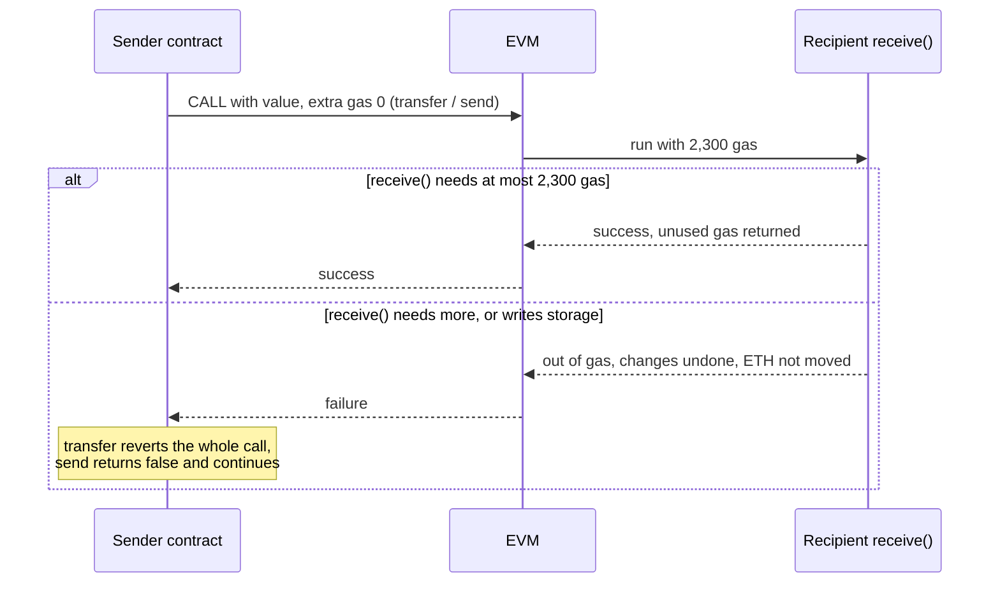

When a contract sends ether with a `CALL`, the EVM gives the receiving code 2,300 gas on top of whatever the caller forwards. Solidity's `transfer` and `send` forward nothing else, so a contract receiving ETH that way runs its `receive` or `fallback` function with exactly 2,300 gas. The amount has not changed since 2015, while the gas cost of what that code does has changed five times.

For years the stipend served two purposes at once: it let a recipient log the payment, and it was treated as a reentrancy guard, since 2,300 gas was not enough to write storage. This article explains where the stipend comes from in the protocol, how Constantinople, Istanbul, Berlin, EIP-7702 and Glamsterdam each changed what fits in it, and what replaces `transfer` and `send` now that Solidity has deprecated them. Each claim about behaviour is backed by measurements of small receiver contracts on five hard forks.

> This article has been made with the help of [Claude Code](https://claude.com/product/claude-code) and several custom skills

[TOC]

## What you need to know first

The article assumes familiarity with Solidity and relies on the following mechanisms:

- **`receive` and `fallback`.** The functions a contract runs when it receives ETH without calldata (`receive`) or with unknown calldata (`fallback`). A contract that has neither rejects plain ETH transfers.
- **Out of gas in a sub-call.** When the called code runs out of gas, its changes are undone and the call returns failure to the caller; the caller itself continues, unless it chooses to revert.
- **Cold and warm access.** Since Berlin, the first read of a storage slot in a transaction costs 2,100 gas (cold) and later reads 100 (warm).
- **Reentrancy.** A called contract calls back into its caller before the caller has finished updating its state, and observes or exploits the intermediate state.
- **Hard fork.** A protocol upgrade that can change the gas cost of opcodes; deployed contracts keep their code but run under the new costs.

## What the stipend is

In the Python executable specification of Ethereum ([execution-specs](https://github.com/ethereum/execution-specs)), the stipend is a constant defined since the first fork, `CALL_STIPEND = 2300` in `forks/frontier/vm/gas.py`. The function that computes how much gas a call gives to its callee adds it when value is sent; in `forks/osaka/vm/gas.py`:

```python
call_stipend = Uint(0) if value == 0 else call_stipend
...
gas = min(gas, max_message_call_gas(gas_left - memory_cost - extra_gas))
return MessageCallGas(gas + extra_gas, gas + call_stipend)
```

Three properties follow from these lines:

- **Only value-carrying calls get it.** A `CALL` with zero value adds nothing, and `STATICCALL` and `DELEGATECALL` cannot carry value.
- **It is added after the 63/64 rule.** Since [EIP-150](https://eips.ethereum.org/EIPS/eip-150), a caller can forward at most all but one 64th of its remaining gas; the stipend is added on top of that capped amount, so a callee always gets at least 2,300 gas when it receives ETH.
- **The caller pays for it.** A value-carrying call costs 9,000 gas (`CALL_VALUE`). [EIP-8038](https://eips.ethereum.org/EIPS/eip-8038) describes that 9,000 as 6,700 for writing the recipient's balance plus the 2,300 stipend. Gas the callee does not use, stipend included, returns to the caller.

go-ethereum defines the same constant as `CallStipend = 2300` in `params/protocol_params.go` and adds it in `core/vm/instructions.go` for `CALL` and `CALLCODE` with value.

Solidity builds two functions on the stipend. `payable(addr).transfer(amount)` performs a `CALL` with value and no extra gas, and reverts the caller if the call fails. `payable(addr).send(amount)` does the same but returns `false` instead of reverting. In both cases the recipient runs with exactly 2,300 gas, which the traces below confirm. `addr.call{value: amount}("")` forwards all available gas (within the 63/64 rule) and returns a success flag.



## Why 2,300

Under Frontier prices, 2,300 gas covered what a recipient was expected to do with a payment, logging it, and excluded writing storage:

| Operation (Frontier) | Gas | Fits in 2,300? |
|---|---|---|
| `LOG2` with 32 bytes of data (an event with one indexed parameter and one amount) | 375 + 2 × 375 + 8 × 32 = 1,381 | Yes |
| `SLOAD` | 50 | Yes |
| `SSTORE` updating a non-zero slot | 5,000 | No |
| `SSTORE` setting a zero slot | 20,000 | No |

Because no write fitted, developers came to treat a call made with the stipend as one that cannot change the recipient's state, and therefore cannot reenter usefully. That assumption was never part of any specification, and it is the one later forks kept running into.

## Measuring what fits

Six small receivers were compiled with solc 0.8.30 (optimizer, 200 runs) and called through `transfer`, `send` and `call{value: 1}` from a sender contract on local anvil nodes running the rules of each hard fork. The gas used by the receiver is read from a `callTracer` trace of each transaction. When the receiver did not fit in 2,300 gas, the "needed" value comes from the same receiver called through `call`, which forwards more gas.

| Receiver's `receive()` | Petersburg (2019) | Istanbul (2019) | Berlin, London, Osaka (2021–2025) | Glamsterdam rules (Sepolia, 2026) |
|---|---|---|---|---|
| Emits one event (`Received(address indexed, uint256)`) | 1,469 ✓ | 1,469 ✓ | 1,469 ✓ | ✓ |
| Reads one storage variable | 281 ✓ | 881 ✓ | 2,181 ✓ | ✓ |
| Reads two variables packed in one slot | 541 ✓ | 1,741 ✓ | needs 2,341 ✗ | ✗ |
| Reads one variable and emits the event | 1,717 ✓ | needs 2,317 ✗ | needs 3,617 ✗ | ✗ |
| Increments a counter in storage | ✗ (`SSTORE` costs more than 2,300) | ✗ (EIP-2200 rule) | ✗ (EIP-2200 rule) | ✗ |
| Writes transient storage (`TSTORE`) | — | — | Osaka: 138 ✓ | ✓ |

✓ the payment is accepted with the 2,300 gas stipend; ✗ it fails. Every receiver succeeded through `call` on every fork.

The Glamsterdam column was obtained with `eth_simulateV1` on Sepolia on 2026-10-23, with the receiver code placed by state override; the simulation returns the outcome but not the gas used inside the call. The differences between columns match the repricings exactly: a storage read went from 200 to 800 gas in Istanbul (881 − 281 = 600) and from 800 to 2,100 for a cold read in Berlin (2,181 − 881 = 1,300). The second read of the same slot became a warm read at 100 gas in Berlin, which is why two reads cost 2,341 rather than twice 2,181.

Two behaviours of the failing cases matter as much as the numbers:

- **`transfer` reverts the sender.** The whole transaction failed with status 0.
- **`send` reports failure and the transaction succeeds.** The transaction had status 1, `send` returned `false`, and the recipient's balance did not change. A sender that ignores the return value of `send` believes it has paid.

## The breakages, fork by fork

### Constantinople (2019): net gas metering and the reentrancy it would have enabled

[EIP-1283](https://eips.ethereum.org/EIPS/eip-1283) introduced net gas metering for `SSTORE`: a write to a slot already modified in the same transaction would cost 200 gas instead of 5,000. A recipient called with 2,300 gas could then have written storage, as long as the slot had been modified earlier in the transaction. The rationale of [EIP-2200](https://eips.ethereum.org/EIPS/eip-2200) describes the result: "a new kind of reentrancy attacks on existing contracts as Solidity by default grants a 'stipend' of 2300 gas to simple transfer calls". The issue was found before mainnet activation, and Petersburg ([EIP-1716](https://eips.ethereum.org/EIPS/eip-1716)) removed EIP-1283 at the same block as Constantinople (7,280,000, 2019-02-28).

The measurements above do not cover this case: EIP-1283 never activated on mainnet, and none of the node configurations used here enables it.

### Istanbul (2019): a rule that turns the assumption into protocol, and a repricing that breaks recipients

Istanbul brought net gas metering back as EIP-2200, with a guard that the specification still implements in `forks/istanbul/vm/instructions/storage.py`:

```python
if evm.gas_left <= GasCosts.CALL_STIPEND:
    raise OutOfGasError
```

An `SSTORE` executed with 2,300 gas or less fails, whatever it would cost. The informal assumption "a stipend call cannot write storage" became a protocol rule, which is why the counter receiver fails from Istanbul on with the message *not enough gas for reentrancy sentry*.

The same fork raised `SLOAD` from 200 to 800 gas ([EIP-1884](https://eips.ethereum.org/EIPS/eip-1884)), because a larger state had made reads slower. The EIP lists among its consequences "default-functions which access the storage and may in some cases require more than 2300 gas". The receiver that checks a storage flag and emits an event used 1,717 gas before Istanbul and needs 2,317 after it: 17 gas over the stipend, enough to stop every payment made to it through `transfer` or `send`.

### Berlin (2021): cold access

[EIP-2929](https://eips.ethereum.org/EIPS/eip-2929) made the first read of a slot cost 2,100 gas. One cold read still fits in the stipend (2,181 with the surrounding code); one read plus anything else of substance does not. A receiver that is itself a proxy is hit harder: forwarding the call to an implementation not yet accessed in the transaction needs a `DELEGATECALL` to a cold account (2,600 gas) and a read of the implementation address, more than the stipend on their own.

Berlin also introduced access lists ([EIP-2930](https://eips.ethereum.org/EIPS/eip-2930)). A transaction can declare in advance the accounts and slots it will touch and pay for them at the start, 2,400 per address and 1,900 per slot. Those items are then warm when the recipient reads them, at 100 gas. Access lists allowed affected senders to keep paying stipend-limited recipients without redeploying, at the cost of building the list off-chain for each transaction.

### Cancun (2024): a state change that fits

Transient storage ([EIP-1153](https://eips.ethereum.org/EIPS/eip-1153)) added `TSTORE` at 100 gas, and the EIP-2200 rule does not apply to it. The measured receiver writes transient storage with 138 gas. A recipient called through `transfer` can therefore change state that lives until the end of the transaction, which is enough to set a flag that another call in the same transaction reads. The assumption that a stipend call changes nothing was already false for events and balances; since Cancun it is false for state readable by contracts as well.

### Pectra (2025): accounts that look like EOAs run code

[EIP-7702](https://eips.ethereum.org/EIPS/eip-7702) lets an externally owned account delegate to contract code. A payment to such an account runs the delegated code's `receive` function with the stipend, like a payment to a contract. Measured on anvil with Osaka rules:

- An account delegated to the counter receiver rejected `transfer` (the sender reverted) and `send` (it returned `false`), and accepted `call`.
- An account delegated to the event-only receiver accepted all three.

Code that pays users with `transfer` on the grounds that users are EOAs fails for every user whose wallet delegates to code that does more than 2,300 gas of work on receipt.

### Glamsterdam (Sepolia, 2026): the stipend becomes explicit

Glamsterdam, active on Sepolia since 2026-10-06 and not scheduled for mainnet on 2026-10-23, keeps the stipend at 2,300 and changes three things around it:

- **The caller pays for it explicitly.** EIP-8038 redefines `CALL_VALUE` as `ACCOUNT_WRITE + CALL_STIPEND`, 9,000 + 2,300 = 11,300 gas, against 9,000 before (`CallValueTransferAmsterdam = 11300` in go-ethereum).
- **Cold account access rises** from 2,600 to 3,000 (EIP-8038). The recipient's own storage reads keep their cost, so the measured outcomes do not change.
- **The protocol logs the payment.** [EIP-7708](https://eips.ethereum.org/EIPS/eip-7708) makes every ETH transfer emit an ERC-20-style `Transfer` log from the address `0xff…fe`, at no gas cost to the callee. In the simulations, that log appears for every accepted payment, before the receiver's own event.

The specification keeps the `SSTORE` guard, now checked before the slot is read so that a failed write leaves no trace in the block access list: `check_gas(evm, max(gas_cost, CALL_STIPEND + 1))` in `forks/amsterdam/vm/instructions/storage.py`.

EIP-7708 removes the first reason the stipend was sized as it was. A recipient no longer needs to emit its own event to make an ETH payment visible to indexers.

## Deprecation in Solidity and what replaces it

The [Solidity 0.8.31 release announcement](https://www.soliditylang.org/blog/2025/12/03/solidity-0.8.31-release-announcement/) (2025-12-03) lists the removal of `<address>.send()` and `<address>.transfer()` among the deprecation warnings introduced in preparation for the 0.9.0 breaking release. It gives the reason in one sentence: their fixed stipend "came with an implicit assumption that opcode pricing will never change, which quickly turned out not to be the case."

The announcement names `<address>.call()` with an empty payload as the alternative and states that it "does not provide any reentrancy protection", since it forwards all gas by default. It points to a reentrancy guard in transient storage or to the checks-effects-interactions pattern for that protection, and mentions the `PAY` opcode of [EIP-5920](https://eips.ethereum.org/EIPS/eip-5920), which would send ETH without running any code of the recipient. EIP-5920 was in Draft status on 2026-10-23 and is not part of Glamsterdam.

The three ways of paying differ as follows:

| | `transfer` | `send` | `call{value: v}("")` |
|---|---|---|---|
| Gas given to the recipient | 2,300 | 2,300 | All but 1/64 of the remaining gas, plus 2,300 |
| On recipient failure | Reverts the sender | Returns `false` | Returns `false` |
| Recipient can write storage | No (since Istanbul) | No (since Istanbul) | Yes |
| Recipient can reenter | Only warm accounts, without persistent writes | Only warm accounts, without persistent writes | Yes |
| Status in Solidity | Deprecated in 0.8.31 | Deprecated in 0.8.31 | Recommended |

## Conclusion

The 2,300 gas stipend is a fixed amount of gas that the EVM adds to every value-carrying call, unchanged since Frontier. What fits in it has changed with every repricing:

- **Its original sizing** allowed a recipient to log a payment and excluded storage writes, which developers turned into an informal reentrancy guard.
- **Constantinople** would have broken that guard with cheap repeated writes; EIP-1283 was removed before activation, and Istanbul's EIP-2200 made "no `SSTORE` with 2,300 gas or less" a protocol rule.
- **Istanbul and Berlin repriced storage reads** (200 → 800 → 2,100 cold), and recipients that read storage and log a payment stopped fitting: one measured receiver needed 2,317 gas after Istanbul.
- **Cancun and Pectra widened what a stipend call can do**: transient storage writes fit in 138 gas, and EOAs delegated with EIP-7702 run contract code on receipt.
- **Glamsterdam** prices the stipend explicitly in `CALL_VALUE` (11,300) and makes the protocol log every ETH transfer.
- **Solidity 0.8.31 deprecated `transfer` and `send`**, naming `call` with an explicit reentrancy protection as the replacement.


## Annex

### Key Terms

| Term | Definition |
|------|------------|
| **Gas stipend** | The 2,300 gas the EVM adds to the gas of any `CALL` or `CALLCODE` that transfers value. |
| **`CALL_STIPEND`** | The constant holding the stipend in the execution specification and in go-ethereum (`CallStipend`). |
| **`CALL_VALUE`** | The extra cost of a value-carrying call: 9,000 gas until Osaka, 11,300 under Glamsterdam. |
| **`transfer`** | Solidity function that sends ETH with only the stipend and reverts if the recipient fails; deprecated in 0.8.31. |
| **`send`** | Solidity function that sends ETH with only the stipend and returns `false` if the recipient fails; deprecated in 0.8.31. |
| **Low-level `call`** | `addr.call{value: v}("")`, which forwards almost all remaining gas and returns a success flag. |
| **63/64 rule** | Since EIP-150, a call forwards at most all but one 64th of the caller's remaining gas; the stipend is added after this cap. |
| **Net gas metering** | Pricing several writes to one slot in a transaction by their net effect (EIP-1283, then EIP-2200). |
| **Reentrancy sentry** | The EIP-2200 rule that `SSTORE` fails when 2,300 gas or less remains. |
| **Cold / warm access** | Since Berlin, the first read of a slot in a transaction costs 2,100 gas, later reads 100. |
| **Access list** | Accounts and slots declared in a transaction and paid in advance, so that they are warm when accessed. |
| **Transient storage** | Storage cleared at the end of each transaction, written with `TSTORE` for 100 gas and not subject to the sentry. |
| **EIP-7702 delegation** | A pointer that makes an externally owned account run the code of a chosen contract. |
| **ETH transfer log** | Under Glamsterdam, the `Transfer` log emitted by the protocol for every ETH transfer (EIP-7708). |

### Security Implementation Checklist

The checklist applies to any contract that sends ETH to addresses it does not control.

#### Paying

| Check | Security requirement | Failure mode if violated |
|:---:|------------|------------|
| ☐ | ETH is sent with `call{value: v}("")`, not with `transfer` or `send`. | Payments to contracts, proxies and EIP-7702 accounts whose `receive` needs more than 2,300 gas fail; the gas a recipient needs can rise at any hard fork. |
| ☐ | The success flag of every `call` and `send` is checked. | A failed payment is recorded as made: the measured `send` returned `false` while the transaction succeeded. |
| ☐ | No gas amount is hard-coded in a call (`call{gas: 2300}`, `{gas: 5000}`). | A repricing turns a working amount into an out-of-gas failure, as EIP-1884 and EIP-2929 did. |
| ☐ | A failed payment to one recipient cannot block payments to others (pull payments or per-recipient accounting). | One recipient that reverts on receipt stops a loop that pays every recipient. |

#### Reentrancy

| Check | Security requirement | Failure mode if violated |
|:---:|------------|------------|
| ☐ | State is updated before the external call (checks-effects-interactions), or the function is protected by a reentrancy guard. | With `call`, the recipient has enough gas to call back into the function before its state is updated. |
| ☐ | No logic relies on the 2,300 gas stipend to prevent reentrancy or state changes. | Since Cancun, a stipend call can write transient storage; the guard holds only for persistent storage writes. |
| ☐ | Transient flags read after an external call are not trusted if the callee could have set them. | A recipient called with the stipend sets a transient flag (138 gas) that a later call in the same transaction reads. |

#### Receiving

| Check | Security requirement | Failure mode if violated |
|:---:|------------|------------|
| ☐ | A contract or delegated account that must accept ETH from senders still using `transfer` keeps `receive` within 2,300 gas on the fork it runs on, measured with cold storage reads. | Its payments fail; the measured receiver that reads one slot and emits an event needs 2,317 to 3,617 gas depending on the fork. |
| ☐ | `receive` does not write persistent storage when it must accept stipend payments. | The EIP-2200 sentry makes the write fail with 2,300 gas, so every such payment fails. |

## Frequently Asked Questions

**Q: Where does the 2,300 gas come from in a `transfer`?**

The EVM adds `CALL_STIPEND` (2,300) to the gas of every `CALL` that transfers value. Solidity's `transfer` and `send` forward zero gas of their own, so the recipient runs with exactly the stipend. The caller pays for it as part of the 9,000 gas `CALL_VALUE` cost, and unused gas returns to the caller.

**Q: Why did a receiver that worked in 2018 stop accepting `transfer` in December 2019?**

Istanbul raised `SLOAD` from 200 to 800 gas (EIP-1884). The measured receiver that reads one storage flag and emits an event used 1,717 gas under Petersburg rules and needs 2,317 under Istanbul rules, 17 more than the stipend. Every payment made to it with `transfer` reverts, and every payment made with `send` returns `false`.

**Q: What would EIP-1283 have broken, and how does EIP-2200 prevent it?**

EIP-1283 made a write to a slot already modified in the transaction cost 200 gas. A recipient called with 2,300 gas could then write storage and, through it, act on a caller that assumed stipend calls cannot change state. EIP-2200 keeps net metering but makes any `SSTORE` fail when 2,300 gas or less remains, so a stipend call can never write persistent storage, whatever the write costs.

**Q: Can a recipient called through `transfer` change any state at all?**

Yes, in three ways:

- it can emit events, which was the intended use;
- since Cancun, it can write transient storage, which costs 100 gas and is not covered by the EIP-2200 rule (138 gas in the measurement);
- it can call an account already accessed in the transaction, such as the sender itself, for 100 gas of access cost, and read its state (read-only reentrancy); a cold account costs 2,600 and does not fit since Berlin.

It cannot write persistent storage, and any ETH it forwards would need a second value-carrying call, which costs more than the stipend.

**Q: Why does EIP-7702 matter for contracts that pay users with `transfer`?**

A user account delegated with EIP-7702 runs its delegate's `receive` function when it receives ETH, with the 2,300 gas stipend. If that code needs more gas or writes storage, the payment fails: the measured account delegated to a counter receiver rejected `transfer` and `send` and accepted `call`. "Users are EOAs, so `transfer` is safe" no longer holds.

**Q: What changes for the stipend under Glamsterdam?**

The stipend stays at 2,300 and the measured outcomes do not change. The caller now pays `CALL_VALUE` = 11,300 gas, the 9,000 account write plus the 2,300 stipend, and every ETH transfer emits a `Transfer` log from the protocol (EIP-7708), so a recipient no longer needs its own event for the payment to be visible.

**Q: If `call` replaces `transfer`, what replaces the reentrancy protection the stipend was assumed to give?**

Nothing in the call itself: `call` forwards almost all gas. The Solidity announcement points to the checks-effects-interactions pattern, which updates state before paying, and to a reentrancy guard, which can use transient storage at 100 gas per write. A future `PAY` opcode (EIP-5920, a draft) would send ETH without running the recipient's code.

## Gaps

The following points were not settled by the sources used for this article:

| Gap | Why it matters | What to read or verify |
|---|---|---|
| The reasoning behind the value 2,300 is inferred from Frontier gas costs, not quoted from a design document. | The article presents "log, but no storage write" as the intent. | The Yellow Paper and early go-ethereum or Ethereum Foundation discussions of `G_callstipend`. |
| The Constantinople case was not measured: no local node used here runs EIP-1283. | The 200 gas write under a stipend is described from the EIP texts only. | A client or test fixture that implements Constantinople before Petersburg, such as the EIP-1283 tests in ethereum/tests. |
| The Solidity 0.9.0 release date and the exact form of the removal (error or warning) were not known on 2026-10-23. | Code compiled with 0.8.x keeps compiling with a warning until then. | The Solidity changelog and the 0.9.0 release announcement. |
| The Glamsterdam column comes from `eth_simulateV1`, which reports success or failure but not the gas used inside the call. | The gas figures under Glamsterdam are inferred to be unchanged because storage read costs are unchanged. | A trace of the same calls on a Sepolia node that supports `debug_traceCall` with Glamsterdam rules. |
| The Glamsterdam EIPs (EIP-8038, EIP-7708) were in Last Call on 2026-10-23. | `CALL_VALUE` = 11,300 and the transfer log may change before mainnet. | The EIP texts and `forks/amsterdam/` in execution-specs. |
| Behaviour on other EVM chains was not checked. | Chains that lag mainnet forks may still have pre-Istanbul or pre-Berlin costs, and some change the stipend. | The hard fork schedule and gas tables of each target chain. |

## References

### Specifications

- [EIP-150: Gas cost changes for IO-heavy operations](https://eips.ethereum.org/EIPS/eip-150)
- [EIP-1153: Transient storage opcodes](https://eips.ethereum.org/EIPS/eip-1153)
- [EIP-1283: Net gas metering for SSTORE without dirty maps](https://eips.ethereum.org/EIPS/eip-1283)
- [EIP-1716: Hardfork Meta — Petersburg](https://eips.ethereum.org/EIPS/eip-1716)
- [EIP-1884: Repricing for trie-size-dependent opcodes](https://eips.ethereum.org/EIPS/eip-1884)
- [EIP-2200: Structured Definitions for Net Gas Metering](https://eips.ethereum.org/EIPS/eip-2200)
- [EIP-2929: Gas cost increases for state access opcodes](https://eips.ethereum.org/EIPS/eip-2929)
- [EIP-2930: Optional access lists](https://eips.ethereum.org/EIPS/eip-2930)
- [EIP-5920: PAY opcode](https://eips.ethereum.org/EIPS/eip-5920)
- [EIP-7702: Set Code for EOAs](https://eips.ethereum.org/EIPS/eip-7702)
- [EIP-7708: ETH transfers emit a log](https://eips.ethereum.org/EIPS/eip-7708)
- [EIP-8038: State-access gas cost update](https://eips.ethereum.org/EIPS/eip-8038)

### Analyzed source

- [ethereum/execution-specs](https://github.com/ethereum/execution-specs) — analyzed at commit [`aaae5abd382b6c0612add96bd8400d6fa4eb0617`](https://github.com/ethereum/execution-specs/tree/aaae5abd382b6c0612add96bd8400d6fa4eb0617), 2026-10-23 (`forks/frontier/vm/gas.py`, `forks/osaka/vm/gas.py`, `forks/istanbul/vm/instructions/storage.py`, `forks/amsterdam/vm/`)
- [ethereum/go-ethereum](https://github.com/ethereum/go-ethereum) — analyzed at commit [`8b8bb43a732d5d3441c646e62352d25bdaccb30f`](https://github.com/ethereum/go-ethereum/tree/8b8bb43a732d5d3441c646e62352d25bdaccb30f) (after v1.17.9), 2026-10-23 (`params/protocol_params.go`, `core/vm/instructions.go`)

### Solidity

- [Solidity 0.8.31 Release Announcement](https://www.soliditylang.org/blog/2025/12/03/solidity-0.8.31-release-announcement/), Solidity Team, 2025-12-03

### Related articles

- [Ethereum: A Gas Story]({{site.url_complet}}/2026/10/23/ethereum-a-gas-story/)
- [Ethereum Gas — How Transaction Cost and the Per-Transaction Limit Are Computed (Fusaka and Glamsterdam)]({{site.url_complet}}/2026/10/23/ethereum-gas-cost-transaction-limit-fusaka-glamsterdam/)
- [EIP-7702: Set Code for EOAs - Overview]({{site.url_complet}}/2025/05/09/eip-7702-overview/)
- [EIP-7702 Smart Wallet Security: Threat Model and Attack Surface Analysis]({{site.url_complet}}/2026/02/17/eip-7702-security-threat-model/)
- [Solidity Modifier Patterns: Gas, Bytecode Size, and Security Trade-offs]({{site.url_complet}}/2026/02/18/solidity-modifier-patterns-gas-bytecode-security/)
- [EIP-6780, selfdestruct, we won't miss you]({{site.url_complet}}/2024/03/13/EIP-6780-selfdestruct/)

### Tooling

- [Foundry](https://getfoundry.sh/) 1.5.0 (forge, cast, anvil with `--hardfork petersburg`, `istanbul`, `berlin`, `london`, `osaka`)
- `eth_simulateV1` on `ethereum-sepolia-rpc.publicnode.com` (Glamsterdam rules), 2026-10-23
