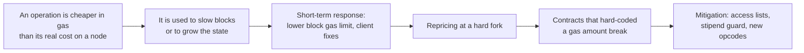

Ethereum charges every transaction in gas, a unit that stands for the work a node must do to process it. The price list of that work was written once, in 2015, as an estimate of how long each operation takes on a typical machine, and it has been rewritten at almost every network upgrade since. Each rewrite answered a concrete problem: an attack that made blocks slow to process, a refund that let users store gas and spend it later, a fee market that made prices unpredictable, data that rollups needed but the EVM never read.

This article follows that story from Frontier to Glamsterdam: the main changes to gas costs, fees and limits, why each was made, and what each one broke. The figures come from the Python executable specification of Ethereum ([execution-specs](https://github.com/ethereum/execution-specs)), from the EIP texts, and from mainnet block headers read for this article. A companion article, [Ethereum Gas — How Transaction Cost and the Per-Transaction Limit Are Computed (Fusaka and Glamsterdam)]({{site.url_complet}}/2026/10/23/ethereum-gas-cost-transaction-limit-fusaka-glamsterdam/), covers the current rules and how to measure gas in detail.

> This article has been made with the help of [Claude Code](https://claude.com/product/claude-code) and several custom skills

[TOC]

## What you need to know first

The story relies on a few mechanisms of the EVM that it uses without deriving them:

- **Opcode cost.** Every EVM instruction has a gas cost, fixed (`ADD` costs 3) or computed from its inputs (`EXP` depends on the size of the exponent). Repricing an opcode is a protocol change, made at a hard fork.
- **Storage slot.** A contract's persistent state is a map of 32-byte keys to 32-byte values, stored in a Merkle tree on the node's disk. Reading or writing it requires disk access, which is why storage operations are the most expensive ones.
- **Gas limit of a transaction and of a block.** The sender sets the maximum gas a transaction may use; the block producer sets the maximum gas a whole block may contain. A transaction that runs out of gas reverts, and the gas it consumed is still paid.
- **Refund.** Some operations, such as clearing a storage slot, give back part of their cost at the end of the transaction, to reward freeing state.
- **The 2,300 gas stipend.** A call that sends ETH gives the receiving contract 2,300 gas, whatever gas the caller has left. Solidity's `transfer` and `send` rely on it; a receiving contract whose fallback function needs more than 2,300 gas cannot receive ETH that way.
- **Rollup.** A layer-2 network that executes transactions off Ethereum and posts their data to Ethereum, so that anyone can reconstruct its state. The cost of posting that data has shaped several recent changes.

## Why gas exists

A smart contract can contain loops, and whether a program terminates cannot be decided in general. A network in which every node executes every transaction therefore needs another way to bound the work a transaction may cause. Ethereum's answer, defined in the Yellow Paper, is to charge each operation in gas and make the sender pay for the gas in ether. A transaction stops when its gas runs out, so its work is bounded by its gas limit, and an attacker who wants to slow the network has to pay for every operation.

Gas has two separate properties that the story keeps returning to:

- **The cost of an operation in gas** is set by the protocol, and is meant to reflect the time and resources a node needs to execute it. It changes only at hard forks.
- **The price of a unit of gas in ether** is set by the market: originally by an auction between users, since 2021 by a base fee computed by the protocol plus a tip.

The block gas limit ties the two together. If gas costs are accurate, the block gas limit bounds the time a node needs to process a block. When one operation is underpriced, a block full of it takes longer to process than the limit suggests, and the network slows down. Most of the repricings below correct such a mismatch.

## 2015: Frontier and the first price list

Frontier, launched on 2015-07-30, fixed the first price list. The values below are those of `forks/frontier/vm/gas.py`:

| Operation | Frontier cost |
|---|---|
| Transaction base cost | 21,000 |
| Calldata | 4 per zero byte, 68 per non-zero byte |
| `SLOAD` (read a storage slot) | 50 |
| `SSTORE` zero → non-zero | 20,000 |
| `SSTORE` other writes | 5,000 |
| Refund for clearing a slot | 15,000 |
| `BALANCE`, `EXTCODESIZE`, `EXTCODECOPY` | 20 |
| `CALL` | 40 (plus 9,000 when sending value) |
| `LOG` | 375 + 375 per topic + 8 per byte |

Two numbers of that table appear again and again later. Reading state was cheap (50 for a slot, 20 for an account), and storing a value in a new slot was expensive (20,000). The first turned out to be a mistake; the second held for ten years.

The fee was a first-price auction: each transaction carried a `gasPrice`, miners included the highest bids, and every included transaction paid its own bid. The block gas limit was voted by miners, each block allowed to move it by at most 1/1024 of the previous value. The genesis block had a gas limit of 5,000, too low for a single transaction (21,000 gas); miners raised it to 21,003 by block 46,147 on 2015-08-07, when the first transactions appeared, and to 3,141,592 within a week.

The figure plots the gas limit of mainnet blocks sampled for this article. Its two sharp movements are the October 2016 drop, when miners cut the limit to resist an attack, and the August 2021 doubling, when London introduced a gas target equal to half the limit.

## 2016: Homestead and the Shanghai attacks

**Homestead** (2016-03-14, block 1,150,000) made two changes that matter here. [EIP-2](https://eips.ethereum.org/EIPS/eip-2) charged contract creation by transaction 32,000 more (53,000 in total, like the `CREATE` opcode), and a creation that runs out of gas while depositing its code now fails instead of leaving an empty contract. [EIP-7](https://eips.ethereum.org/EIPS/eip-7) added `DELEGATECALL`, which later made proxy contracts possible.

In September and October 2016, during the Devcon 2 conference in Shanghai, an attacker exploited the cheap state reads. Transactions that called `EXTCODESIZE` and similar opcodes thousands of times forced nodes to look up accounts on disk for 20 gas each. A study of the period ([Perez and Livshits](https://arxiv.org/pdf/1909.07220.pdf)), quoted in EIP-2929, measured 20 to 80 seconds to execute such transactions, against a few milliseconds for an average one. Miners responded by lowering the block gas limit: the samples show 1,497,071 on 2016-10-11 and 500,000 on 2016-10-18, from about 4.7M a month earlier.

Two hard forks followed within five weeks:

- **Tangerine Whistle** (2016-10-18, block 2,463,000), with [EIP-150](https://eips.ethereum.org/EIPS/eip-150), repriced the IO-heavy opcodes: `EXTCODESIZE` and `EXTCODECOPY` from 20 to 700, `BALANCE` from 20 to 400, `SLOAD` from 50 to 200, `CALL` and its variants from 40 to 700, and `SELFDESTRUCT` from 0 to 5,000. The EIP derived the costs from a target of 8 MB of data read per block. It also introduced the **63/64 rule**: a call can forward at most all but one 64th of the remaining gas, which bounds the call depth an attacker can reach through gas alone.
- **Spurious Dragon** (2016-11-22, block 2,675,000) raised the cost of `EXP` from 10 to 50 per byte of exponent ([EIP-160](https://eips.ethereum.org/EIPS/eip-160)), made nodes delete any empty account a transaction touches ([EIP-161](https://eips.ethereum.org/EIPS/eip-161)), a way to clear the empty accounts left in the state, and limited contract code to 24,576 bytes ([EIP-170](https://eips.ethereum.org/EIPS/eip-170)).

This episode set the pattern for most later repricings: a class of operation is found to be underpriced compared with its real cost on a node, it is used to slow the network, and its gas cost is raised.

## 2017–2019: Byzantium, Constantinople and Istanbul

**Byzantium** (2017-10-16, block 4,370,000) added `REVERT` ([EIP-140](https://eips.ethereum.org/EIPS/eip-140)), which undoes a call's changes but, unlike a failed assertion at the time, returns the unused gas to the caller. It also added precompiled contracts for elliptic curve operations on alt_bn128 ([EIP-196](https://eips.ethereum.org/EIPS/eip-196), [EIP-197](https://eips.ethereum.org/EIPS/eip-197)) and big-number modular exponentiation ([EIP-198](https://eips.ethereum.org/EIPS/eip-198)), with gas prices of their own: a pairing check cost 100,000 + 80,000 per pair.

**Constantinople** was the first upgrade withdrawn because of a gas change. [EIP-1283](https://eips.ethereum.org/EIPS/eip-1283) introduced *net gas metering*: writing a slot several times in one transaction would cost much less than paying 5,000 for each write. Shortly before activation, the change was found to enable reentrancy on contracts that relied on the 2,300 gas stipend being too small to write storage. A second hard fork, **Petersburg** ([EIP-1716](https://eips.ethereum.org/EIPS/eip-1716)), removed EIP-1283 and activated at the same block as Constantinople (7,280,000, 2019-02-28). The upgrade kept `EXTCODEHASH` at 400 gas ([EIP-1052](https://eips.ethereum.org/EIPS/eip-1052)), `CREATE2` and the bit-shift opcodes.

**Istanbul** (2019-12-08, block 9,069,000) brought four gas changes:

- **[EIP-1884](https://eips.ethereum.org/EIPS/eip-1884)** raised `SLOAD` from 200 to 800, `BALANCE` from 400 to 700 and `EXTCODEHASH` from 400 to 700, because the state had grown and reading it had become slower. The EIP lists the breakage itself: fallback functions that read storage could now need more than the 2,300 gas stipend, so contracts that received ETH through `transfer` from other contracts could stop working.
- **[EIP-2028](https://eips.ethereum.org/EIPS/eip-2028)** cut the cost of a non-zero calldata byte from 68 to 16, to make data cheaper for the first rollups and other data-heavy uses.
- **[EIP-2200](https://eips.ethereum.org/EIPS/eip-2200)** brought back net gas metering with a guard: `SSTORE` fails if less than 2,300 gas remains, so a call limited to the stipend still cannot write storage.
- **[EIP-1108](https://eips.ethereum.org/EIPS/eip-1108)** cut the alt_bn128 precompiles, a pairing check falling to 45,000 + 34,000 per pair, which made zk-SNARK verification on-chain several times cheaper.

The Istanbul changes show the second pattern of the story: a repricing that is correct for the network can break deployed contracts that hard-coded a gas amount, and the 2,300 gas stipend is the amount most often hard-coded.

## 2021: Berlin and London

**Berlin** (2021-04-15, block 12,244,000) replaced fixed state-access costs with the cold and warm model of [EIP-2929](https://eips.ethereum.org/EIPS/eip-2929). The first access to an account in a transaction costs 2,600 and to a storage slot 2,100; later accesses to the same item cost 100. The goal was again the worst case: the EIP estimated that the slowest attack transactions of 2016, which took 20 to 80 seconds to execute, would take about 7 to 27 seconds with the new costs. Contracts that called another contract with a fixed amount of gas risked failing on the new cold-access cost, so Berlin also introduced access lists ([EIP-2930](https://eips.ethereum.org/EIPS/eip-2930)): a transaction can declare the accounts and slots it will touch and pay for them in advance (2,400 per address, 1,900 per slot), at a small discount. Access lists came with typed transactions ([EIP-2718](https://eips.ethereum.org/EIPS/eip-2718)), the envelope used by every new transaction type since.

**London** (2021-08-05, block 12,965,000) changed how gas is priced rather than what it costs. [EIP-1559](https://eips.ethereum.org/EIPS/eip-1559) replaced the auction with a protocol-set *base fee*:

- each block has a *target* of half its gas limit; the gas limit itself was doubled at the fork, from about 15M to 30M, so the target stayed at 15M;
- the base fee rises by up to 12.5 % after a block above the target and falls by up to 12.5 % after a block below it;
- the base fee is burned, and the block producer only receives the *priority fee* (tip) the sender adds;
- the sender sets `maxFeePerGas` and `maxPriorityFeePerGas`, and pays the base fee plus the tip, within that maximum.

The headers of the first London blocks show the mechanism at work. Block 12,965,000 had a base fee of 1 gwei and used 30,025,257 gas of its 30,029,122 limit, twice the target; two blocks later the base fee was 1.265 gwei, close to 1 × 1.125².

London also changed refunds. Since Frontier, clearing a slot refunded 15,000 gas, up to half of the gas used. Users had turned this into a gas battery: *GasToken* contracts filled storage when gas was cheap and cleared it when gas was expensive, collecting refunds that paid for other work.

[EIP-3529](https://eips.ethereum.org/EIPS/eip-3529) lowered the refund for clearing a slot to 4,800, capped the total refund at one fifth of the gas used, and removed the `SELFDESTRUCT` refund. Its rationale states that gas tokens would become valueless.

[EIP-3198](https://eips.ethereum.org/EIPS/eip-3198) added the `BASEFEE` opcode, and [EIP-3541](https://eips.ethereum.org/EIPS/eip-3541) reserved code starting with `0xEF` for future EVM versions.

## 2022–2024: the Merge, Shanghai and Dencun

**The Merge** (Paris, 2022-09-15, block 15,537,394) replaced mining with proof of stake and did not change any gas cost. It changed who receives the priority fee (the validator proposing the block) and who sets the block gas limit (block proposers, through the value their client is configured with, still within 1/1024 per block).

**Shanghai** (2023-04-12) added `PUSH0` at 2 gas ([EIP-3855](https://eips.ethereum.org/EIPS/eip-3855)), which saves gas in almost every compiled contract; limited init code to 49,152 bytes and charged it 2 gas per 32-byte word ([EIP-3860](https://eips.ethereum.org/EIPS/eip-3860)); and made the block producer's address warm from the start ([EIP-3651](https://eips.ethereum.org/EIPS/eip-3651)).

**Dencun** (Cancun on the execution layer, 2024-03-13) opened a second gas market. [EIP-4844](https://eips.ethereum.org/EIPS/eip-4844) introduced *blobs*: 128 KiB data attachments that the EVM cannot read, kept by nodes for about 18 days, priced in a separate *blob gas* with its own base fee and its own target (3 blobs per block, at most 6). Rollups moved their data from calldata to blobs, and the execution gas market and the data market have been priced separately since. The same upgrade added transient storage ([EIP-1153](https://eips.ethereum.org/EIPS/eip-1153)): `TSTORE` and `TLOAD`, 100 gas each, for values that only need to live during one transaction, such as reentrancy locks that previously cost a full storage write. It also added `MCOPY` ([EIP-5656](https://eips.ethereum.org/EIPS/eip-5656)), the `BLOBBASEFEE` opcode ([EIP-7516](https://eips.ethereum.org/EIPS/eip-7516)), and restricted `SELFDESTRUCT` to contracts created in the same transaction ([EIP-6780](https://eips.ethereum.org/EIPS/eip-6780)).

The block gas limit stayed at 30M from London to the end of 2024.

## 2025: Pectra, the gas limit increases and Fusaka

The block gas limit rose three times in 2025, as validators changed the value their clients were configured to target: 36M in February, 45M by September, about 60M by the end of November. The samples show 36,000,000 on 2025-02-08, 45,000,000 on 2025-09-05 and 59,940,950 on 2025-11-28.

**Pectra** (Prague on the execution layer, 2025-05-07) made calldata-heavy transactions pay a floor ([EIP-7623](https://eips.ethereum.org/EIPS/eip-7623)). A transaction now pays at least 21,000 + 10 gas per calldata token (one token per zero byte, four per non-zero byte), which makes data that the EVM does not use more expensive than in a blob and bounds the size of a block filled with calldata. Pectra also raised the blob target and maximum to 6 and 9 ([EIP-7691](https://eips.ethereum.org/EIPS/eip-7691)), priced the delegations of externally owned accounts ([EIP-7702](https://eips.ethereum.org/EIPS/eip-7702), 25,000 per authorization, 12,500 refunded when the account already exists) and added BLS12-381 precompiles ([EIP-2537](https://eips.ethereum.org/EIPS/eip-2537)).

**Fusaka** (Osaka on the execution layer, 2025-12-03) capped the gas of a single transaction at 2²⁴ = 16,777,216 ([EIP-7825](https://eips.ethereum.org/EIPS/eip-7825)). Until then, a transaction could use the whole block, so each increase of the block gas limit also raised the worst case of a single transaction. With the cap, the block limit can keep rising while the largest transaction stays bounded; on a 60M block, at least three maximum-size transactions fit. Fusaka also:

- set 60M as the default block gas limit in client configurations ([EIP-7935](https://eips.ethereum.org/EIPS/eip-7935));
- limited the RLP-encoded block to 10 MiB minus a 2 MiB margin ([EIP-7934](https://eips.ethereum.org/EIPS/eip-7934));
- tied the minimum blob base fee to the execution base fee ([EIP-7918](https://eips.ethereum.org/EIPS/eip-7918)), so blob prices cannot fall to almost zero while execution is expensive;
- repriced the `MODEXP` precompile upwards ([EIP-7883](https://eips.ethereum.org/EIPS/eip-7883)) and added a secp256r1 signature precompile at 6,900 gas ([EIP-7951](https://eips.ethereum.org/EIPS/eip-7951)).

Two *Blob Parameter Only* forks ([EIP-7892](https://eips.ethereum.org/EIPS/eip-7892)) followed in December 2025 and January 2026, raising the blob target and maximum to 10 and 15, then 14 and 21, without any other change.

For contract developers, the cap turned a soft limit into a hard one. A loop over user input, such as a batch transfer or a batch mint, now has a maximum size that no future block gas limit increase will raise. For a token batch mint measured for the companion article, that maximum is 565 new holders per transaction on mainnet.

## 2026: Glamsterdam and two dimensions of gas

Glamsterdam (Amsterdam on the execution layer, meta-EIP [EIP-7773](https://eips.ethereum.org/EIPS/eip-7773)) activated on Sepolia on 2026-10-06. On 2026-10-23 it had no mainnet date, and its gas EIPs were in Last Call status. It changes the unit of account itself: gas becomes two-dimensional.

- **State gas** ([EIP-8037](https://eips.ethereum.org/EIPS/eip-8037)) charges the creation of new state per byte, at 1,530 gas per byte: 97,920 for a new storage slot (64 bytes) and 183,600 for a new account (120 bytes). It is counted apart from the 16,777,216 cap, which now applies to execution gas only. The part of a transaction's gas limit above the cap becomes a reservoir from which state gas is paid.
- **State access** ([EIP-8038](https://eips.ethereum.org/EIPS/eip-8038)) separates accessing a slot from creating it: any first write to a slot costs 2,100 for the cold access plus 10,000, and a cold account access rises from 2,600 to 3,000.
- **Intrinsic cost** ([EIP-2780](https://eips.ethereum.org/EIPS/eip-2780)) breaks the 21,000 base cost into its parts: 12,000 for the transaction, 3,000 for the called account and 6,000 when ETH is sent. A plain ETH transfer still costs 21,000.
- **Data and access lists** become more expensive: the calldata floor rises from 10 to 16 gas per token ([EIP-7976](https://eips.ethereum.org/EIPS/eip-7976)), and access lists are charged for their data footprint as well, so that they cannot be used to bypass that floor ([EIP-7981](https://eips.ethereum.org/EIPS/eip-7981)).
- **Block accounting** counts gas before refunds ([EIP-7778](https://eips.ethereum.org/EIPS/eip-7778)), so a refund no longer frees room in the block, and counts execution gas and state gas separately, each against the block gas limit.

The 20,000 gas charged since Frontier for a new storage slot thus becomes 12,100 of execution gas and 97,920 of state gas. Creating state, which stays on every node forever, is now priced for the storage it occupies rather than for the time it takes. The companion article measures the effect on a batch mint on Sepolia: 117,597 gas per new holder instead of 29,593, and up to 849 new holders in one transaction instead of 565, because only the execution part counts against the cap.

## What the story shows

Read in order, the changes follow a small number of patterns:

- **State access was underpriced, and was repriced four times.** `SLOAD` went from 50 (Frontier) to 200 (2016), 800 (2019) and 2,100 cold (2021). Each step followed a measurement of how long state reads took as the state grew.
- **Refunds kept shrinking.** From 15,000 per cleared slot and half the transaction in Frontier, to 4,800 and one fifth in London, to no effect on block accounting under Glamsterdam. Every refund large enough to be stored was turned into a gas token.
- **Data and execution were separated.** Calldata became cheaper in 2019 for rollups, data moved to blobs with their own market in 2024, and calldata got a floor in 2025 so that it no longer competes with blobs.
- **Limits multiplied.** One block gas limit in 2015; in 2026, a block gas limit, a per-transaction cap, a blob limit, a block size limit and, on Glamsterdam networks, a separate state gas budget.
- **Hard-coded gas amounts were the recurring casualty.** The 2,300 stipend, fixed gas forwarded to a call, and gas estimates made under one fork and reused under the next all failed at some point. Gas costs are protocol parameters, and the protocol changes them.

The price of gas moved independently of all this. The base fee read from fork blocks gives an idea of the range: 1 gwei at London's first block (its initial value), 48.8 gwei at the Merge, 62.0 gwei at Cancun, 1.42 gwei at Prague and 0.031 gwei at Osaka. These are single blocks, not averages.

## Conclusion

Gas started in 2015 as one price list and one auction, and in 2026 it is a set of separately priced resources. The changes that shaped it:

- **2016, Tangerine Whistle and Spurious Dragon:** repricing of state reads after the Shanghai denial-of-service attacks, and the 63/64 rule for calls.
- **2019, Constantinople and Istanbul:** net gas metering withdrawn for a reentrancy risk, then reintroduced with a guard; state reads repriced again; calldata made four times cheaper.
- **2021, Berlin and London:** cold and warm access with access lists; the EIP-1559 base fee, burned, with a target of half the block; refunds cut to end gas tokens.
- **2024, Dencun:** blob gas, a second fee market for rollup data, and transient storage.
- **2025, Pectra and Fusaka:** a calldata floor, a block gas limit raised from 30M to 60M, and a cap of 16,777,216 gas per transaction.
- **2026, Glamsterdam (on Sepolia):** state gas priced per byte and counted apart from the per-transaction cap, storage access repriced, and the 21,000 base cost split into its parts.

## Annex

### Key Terms

| Term | Definition |
|------|------------|
| **Gas** | The unit in which Ethereum measures the work of a transaction; each EVM operation has a cost in gas. |
| **Gas price** | The amount of ether paid per unit of gas; set by an auction until London, then by the base fee plus a priority fee. |
| **Block gas limit** | The maximum total gas of the transactions in one block, adjusted by block producers by at most 1/1024 per block. |
| **Gas target** | Since London, half the block gas limit; the base fee rises when a block uses more and falls when it uses less. |
| **Base fee** | The protocol-set price per unit of gas introduced by EIP-1559, burned rather than paid to the block producer. |
| **Priority fee** | The tip per unit of gas a sender adds on top of the base fee, paid to the block producer. |
| **Repricing** | A change of the gas cost of an operation at a hard fork, usually to match its real cost on a node. |
| **63/64 rule** | Since EIP-150, a call can forward at most all but one 64th of the caller's remaining gas. |
| **2,300 gas stipend** | The gas given to a contract that receives ETH through a call with value; too little to write storage. |
| **Net gas metering** | Pricing several writes to the same slot in one transaction by their net effect, introduced by EIP-2200. |
| **Cold / warm access** | Since Berlin, the first access to an account or slot in a transaction (cold) costs more than later ones (warm). |
| **Access list** | A list of accounts and slots declared in a transaction and paid for in advance, introduced by EIP-2930. |
| **Refund** | Gas returned at the end of a transaction for clearing storage, capped at one fifth of the gas used since London. |
| **Gas token** | A contract that stored gas as filled storage slots and recovered it through refunds, made worthless by EIP-3529. |
| **Blob** | A 128 KiB data attachment introduced by EIP-4844, not readable by the EVM and priced in blob gas. |
| **Calldata floor** | Since EIP-7623, the minimum gas a transaction pays per calldata token. |
| **Per-transaction gas cap** | The limit of 16,777,216 gas on any transaction, introduced by EIP-7825 with Fusaka. |
| **State gas** | Under Glamsterdam, the gas charged per byte of new state, 1,530 per byte, counted apart from the per-transaction cap. |

## Frequently Asked Questions

**Q: Why did Ethereum need gas at all, rather than a fixed fee per transaction?**

A contract can loop, and a node cannot know in advance how long a transaction will run. Charging each operation in gas, up to a limit the sender sets, bounds the work of every transaction and makes an attacker pay for each operation. A fixed fee would let one transaction run as long as it wanted for the same price.

**Q: What happened in the Shanghai attacks of 2016, and how did the protocol respond?**

The attacker sent transactions that called opcodes such as `EXTCODESIZE` thousands of times. Each call cost 20 gas but forced a disk lookup, so blocks took far longer to process than their gas suggested. The response came in three steps:

- miners lowered the block gas limit, down to 500,000 on 2016-10-18;
- Tangerine Whistle (EIP-150) raised the cost of these opcodes to 400 or 700 and introduced the 63/64 rule;
- Spurious Dragon made nodes delete empty accounts touched by a transaction (EIP-161), which cleared empty accounts from the state.

**Q: Why was EIP-1283 removed from Constantinople, and how was it reintroduced?**

EIP-1283 made repeated writes to the same slot cheap. Contracts that relied on the 2,300 gas stipend to prevent a receiver from writing storage would then have been open to reentrancy, because some writes would have fitted in 2,300 gas. Petersburg removed it at the same block as Constantinople. Istanbul reintroduced net metering as EIP-2200, with a rule that `SSTORE` fails when 2,300 gas or less remains.

**Q: What did EIP-1559 change, and what did it not change?**

It changed how the price of gas is set: a base fee computed from how full the previous block was, burned, plus a tip for the block producer, instead of a first-price auction. It did not change the gas cost of any operation, and it did not lower fees by itself; it made the price more predictable from one block to the next, within a range of 12.5 % per block.

**Q: Why were refunds reduced so much in London?**

A refund large enough to be collected later can be used as a store of gas. GasToken contracts wrote storage when gas was cheap and cleared it when gas was expensive, using the 15,000 refund to pay for other work, which grew the state and let blocks execute more than their gas limit. EIP-3529 reduced the refund to 4,800, capped refunds at one fifth of the gas used and removed the `SELFDESTRUCT` refund.

**Q: Why did Fusaka cap the gas of a single transaction when it was also raising the block gas limit?**

Before the cap, the largest transaction was as large as the block, so raising the block gas limit also raised the worst case a node might face in a single transaction. The cap of 16,777,216 decouples the two: blocks can grow while each transaction stays bounded. The cost is borne by contracts that process large inputs in one transaction, which must now split them.

**Q: How does Glamsterdam's state gas connect to the earlier history of storage pricing?**

Since Frontier, a new storage slot cost 20,000 gas, a price for the time of the write, although the slot stays on every node forever. Glamsterdam keeps an execution cost of 12,100 and adds a charge of 97,920 for the 64 bytes of state created.

With refunds no longer affecting block accounting, it continues the line of EIP-3529: state is paid for by the bytes it occupies, not only by the work of writing it.

## Gaps

The following points were not settled by the sources used for this article:

| Gap | Why it matters | What to read or verify |
|---|---|---|
| The Glamsterdam gas EIPs were in Last Call status on 2026-10-23. | The constants of the Glamsterdam section (1,530 per byte, 12,000 base cost, 16 per token floor) may change before mainnet. | The EIP texts and `forks/amsterdam/` in execution-specs at the time of reading. |
| The account of the 2016 Shanghai attacks comes from the EIP-150 and EIP-2929 texts and the paper they cite, not from a post-mortem. | Details such as the exact attack transactions and dates are not given here. | Ethereum Foundation blog posts of September and October 2016 on the DoS attacks. |
| The discovery of the EIP-1283 reentrancy issue is described from the EIP-2200 rationale; who found it and when is general knowledge. | The article does not name the finder or the date the upgrade was postponed. | The ChainSecurity disclosure of January 2019 and the Ethereum Foundation postponement announcement. |
| The block gas limit curve is built from about 45 sampled blocks, not from every block. | Short-lived changes between two samples are not visible in the figure. | A full series of block headers, or Etherscan's gas limit chart. |
| The reasons given for the 2025 gas limit increases (validator configuration) are general knowledge. | The article does not cite the coordination process that led to 36M, 45M and 60M. | Client release notes and the Ethereum Foundation blog for 2025. |
| The base fee values are those of single fork blocks. | They do not represent the average fee around each upgrade. | Daily average base fee series, for example from Etherscan. |
| The link between EIP-161 and the empty accounts created during the 2016 attacks is general knowledge; EIP-161 itself does not mention the attack. | The article presents EIP-161 as a clean-up without citing a source that ties it to the attack. | The Spurious Dragon announcement on the Ethereum Foundation blog (November 2016). |
| The original draft placed EIP-150 in Byzantium and in Spurious Dragon. | The specification places it in Tangerine Whistle (block 2,463,000), which this article follows. | `forks/tangerine_whistle/__init__.py` in execution-specs. |

## References

### Specifications: early forks (2015–2019)

- [EIP-2: Homestead Hard-fork Changes](https://eips.ethereum.org/EIPS/eip-2)
- [EIP-7: DELEGATECALL](https://eips.ethereum.org/EIPS/eip-7)
- [EIP-140: REVERT instruction](https://eips.ethereum.org/EIPS/eip-140)
- [EIP-150: Gas cost changes for IO-heavy operations](https://eips.ethereum.org/EIPS/eip-150)
- [EIP-160: EXP cost increase](https://eips.ethereum.org/EIPS/eip-160)
- [EIP-161: State trie clearing](https://eips.ethereum.org/EIPS/eip-161)
- [EIP-170: Contract code size limit](https://eips.ethereum.org/EIPS/eip-170)
- [EIP-196: Precompiled contracts for addition and scalar multiplication on the elliptic curve alt_bn128](https://eips.ethereum.org/EIPS/eip-196)
- [EIP-197: Precompiled contracts for optimal ate pairing check on the elliptic curve alt_bn128](https://eips.ethereum.org/EIPS/eip-197)
- [EIP-198: Big integer modular exponentiation](https://eips.ethereum.org/EIPS/eip-198)
- [EIP-1052: EXTCODEHASH opcode](https://eips.ethereum.org/EIPS/eip-1052)
- [EIP-1108: Reduce alt_bn128 precompile gas costs](https://eips.ethereum.org/EIPS/eip-1108)
- [EIP-1283: Net gas metering for SSTORE without dirty maps](https://eips.ethereum.org/EIPS/eip-1283)
- [EIP-1716: Hardfork Meta — Petersburg](https://eips.ethereum.org/EIPS/eip-1716)
- [EIP-1884: Repricing for trie-size-dependent opcodes](https://eips.ethereum.org/EIPS/eip-1884)
- [EIP-2028: Transaction data gas cost reduction](https://eips.ethereum.org/EIPS/eip-2028)
- [EIP-2200: Structured Definitions for Net Gas Metering](https://eips.ethereum.org/EIPS/eip-2200)

### Specifications: Berlin to Dencun (2021–2024)

- [EIP-1153: Transient storage opcodes](https://eips.ethereum.org/EIPS/eip-1153)
- [EIP-1559: Fee market change for ETH 1.0 chain](https://eips.ethereum.org/EIPS/eip-1559)
- [EIP-2718: Typed Transaction Envelope](https://eips.ethereum.org/EIPS/eip-2718)
- [EIP-2929: Gas cost increases for state access opcodes](https://eips.ethereum.org/EIPS/eip-2929)
- [EIP-2930: Optional access lists](https://eips.ethereum.org/EIPS/eip-2930)
- [EIP-3198: BASEFEE opcode](https://eips.ethereum.org/EIPS/eip-3198)
- [EIP-3529: Reduction in refunds](https://eips.ethereum.org/EIPS/eip-3529)
- [EIP-3541: Reject new contract code starting with the 0xEF byte](https://eips.ethereum.org/EIPS/eip-3541)
- [EIP-3651: Warm COINBASE](https://eips.ethereum.org/EIPS/eip-3651)
- [EIP-3855: PUSH0 instruction](https://eips.ethereum.org/EIPS/eip-3855)
- [EIP-3860: Limit and meter initcode](https://eips.ethereum.org/EIPS/eip-3860)
- [EIP-4844: Shard Blob Transactions](https://eips.ethereum.org/EIPS/eip-4844)
- [EIP-5656: MCOPY - Memory copying instruction](https://eips.ethereum.org/EIPS/eip-5656)
- [EIP-6780: SELFDESTRUCT only in same transaction](https://eips.ethereum.org/EIPS/eip-6780)
- [EIP-7516: BLOBBASEFEE instruction](https://eips.ethereum.org/EIPS/eip-7516)

### Specifications: Pectra to Glamsterdam (2025–2026)

- [EIP-2537: Precompile for BLS12-381 curve operations](https://eips.ethereum.org/EIPS/eip-2537)
- [EIP-2780: Resource-based intrinsic transaction gas](https://eips.ethereum.org/EIPS/eip-2780)
- [EIP-7623: Increase calldata cost](https://eips.ethereum.org/EIPS/eip-7623)
- [EIP-7691: Blob throughput increase](https://eips.ethereum.org/EIPS/eip-7691)
- [EIP-7702: Set Code for EOAs](https://eips.ethereum.org/EIPS/eip-7702)
- [EIP-7773: Hardfork Meta — Glamsterdam](https://eips.ethereum.org/EIPS/eip-7773)
- [EIP-7778: Block Gas Accounting without Refunds](https://eips.ethereum.org/EIPS/eip-7778)
- [EIP-7825: Transaction Gas Limit Cap](https://eips.ethereum.org/EIPS/eip-7825)
- [EIP-7883: ModExp Gas Cost Increase](https://eips.ethereum.org/EIPS/eip-7883)
- [EIP-7892: Blob Parameter Only Hardforks](https://eips.ethereum.org/EIPS/eip-7892)
- [EIP-7918: Blob base fee bounded by execution cost](https://eips.ethereum.org/EIPS/eip-7918)
- [EIP-7934: RLP Execution Block Size Limit](https://eips.ethereum.org/EIPS/eip-7934)
- [EIP-7935: Set default gas limit to 60M](https://eips.ethereum.org/EIPS/eip-7935)
- [EIP-7951: Precompile for secp256r1 Curve Support](https://eips.ethereum.org/EIPS/eip-7951)
- [EIP-7976: Increase Calldata Floor Cost](https://eips.ethereum.org/EIPS/eip-7976)
- [EIP-7981: Increase Access List Cost](https://eips.ethereum.org/EIPS/eip-7981)
- [EIP-8037: State Creation Gas Cost Increase](https://eips.ethereum.org/EIPS/eip-8037)
- [EIP-8038: State-access gas cost update](https://eips.ethereum.org/EIPS/eip-8038)

### Analyzed source and data

- [ethereum/execution-specs](https://github.com/ethereum/execution-specs) — analyzed at commit [`aaae5abd382b6c0612add96bd8400d6fa4eb0617`](https://github.com/ethereum/execution-specs/tree/aaae5abd382b6c0612add96bd8400d6fa4eb0617), 2026-10-23 (`forks/<fork>/vm/gas.py` and `forks/<fork>/__init__.py` for every fork from Frontier to Amsterdam)
- Mainnet block headers (`gasLimit`, `gasUsed`, `baseFeePerGas`, `timestamp`) read with `eth_getBlockByNumber` on `ethereum-rpc.publicnode.com`, 2026-10-23
- [Ethereum Yellow Paper](https://ethereum.github.io/yellowpaper/paper.pdf)
- Daniel Perez and Benjamin Livshits, [Broken Metre: Attacking Resource Metering in EVM](https://arxiv.org/pdf/1909.07220.pdf), 2019 (cited by EIP-2929)
- [Glamsterdam Testnet Announcement](https://blog.ethereum.org/2026/09/17/glamsterdam-testnet-announcement), Ethereum Foundation, 2026-09-17

### Related articles

- [Ethereum Gas — How Transaction Cost and the Per-Transaction Limit Are Computed (Fusaka and Glamsterdam)]({{site.url_complet}}/2026/10/23/ethereum-gas-cost-transaction-limit-fusaka-glamsterdam/)
- [Ethereum Upgrade Pectra - Overview]({{site.url_complet}}/2025/05/02/ethereum-pectra-upgrade/)
- [Summary of EIP-4844 Proto-Danksharding]({{site.url_complet}}/2023/09/26/EIP-4844-Proto-Danksharding/)
- [EIP-6780, selfdestruct, we won't miss you]({{site.url_complet}}/2024/03/13/EIP-6780-selfdestruct/)
- [Solidity Gas Optimization Cheatsheet]({{site.url_complet}}/2023/09/27/gas-optimization/)
