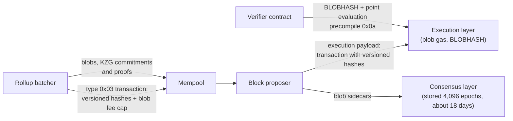

Dencun is the Ethereum network upgrade activated on mainnet on 2024-03-13. Its name joins *Cancun*, the execution-layer part, and *Deneb*, the consensus-layer part. It followed [Shapella]({{site.url_complet}}/2026/10/23/ethereum-shapella-upgrade-overview/) (April 2023) and was followed by [Pectra]({{site.url_complet}}/2025/05/02/ethereum-pectra-upgrade/) (May 2025).

Dencun contains nine EIPs, listed in the meta EIP [EIP-7569](https://eips.ethereum.org/EIPS/eip-7569). The best known is EIP-4844, which added *blobs*: large data attachments for rollups, priced in a fee market of their own and deleted by nodes after about 18 days. The other eight change the EVM (transient storage, a memory copy opcode, a restricted `SELFDESTRUCT`, two new opcodes and a system contract exposing beacon chain roots) and three consensus rules on exits, attestations and validator activation. This article describes each EIP with the constants of the specifications, then the impact for contract developers, rollups, stakers and node operators.

> This article has been made with the help of [Claude Code](https://claude.com/product/claude-code) and several custom skills

[TOC]

## What you need to know first

The article relies on the following mechanisms without developing them:

- **Execution layer and consensus layer.** An Ethereum node runs an execution client (transactions, EVM, state) and a consensus client (validators, attestations, finality). An upgrade changes both, under two names.
- **Rollup.** A layer-2 network that executes transactions off Ethereum and posts their data to Ethereum so that anyone can reconstruct its state. Before Dencun, that data was posted as calldata and paid at calldata prices.
- **Base fee.** The protocol-set price per unit of gas introduced by [EIP-1559](https://eips.ethereum.org/EIPS/eip-1559). It rises when blocks are above a target and falls when they are below it, and it is burned.
- **Polynomial commitment (KZG).** A short value, 48 bytes here, that commits to a polynomial and lets anyone verify the value of the polynomial at a point with a short proof. EIP-4844 commits to each blob this way.
- **System contract.** A contract at a fixed address that the protocol itself calls in each block, with no user transaction. EIP-4788 introduced the first one.
- **Reentrancy lock.** A storage flag that a contract sets at the start of a function and clears at the end, so that a nested call cannot re-enter the function. It was the most common case of storage written and cleared within one transaction.

## Dencun at a glance

| EIP | Title | Layer | In one sentence |
|---|---|---|---|
| [EIP-4844](https://eips.ethereum.org/EIPS/eip-4844) | Shard Blob Transactions | Both | A transaction type carrying blobs of 128 KiB, priced in blob gas. |
| [EIP-1153](https://eips.ethereum.org/EIPS/eip-1153) | Transient storage opcodes | Execution | `TSTORE` and `TLOAD`: storage cleared at the end of the transaction, 100 gas each. |
| [EIP-5656](https://eips.ethereum.org/EIPS/eip-5656) | MCOPY - Memory copying instruction | Execution | One opcode to copy a memory range. |
| [EIP-6780](https://eips.ethereum.org/EIPS/eip-6780) | SELFDESTRUCT only in same transaction | Execution | `SELFDESTRUCT` deletes a contract only in its creation transaction. |
| [EIP-7516](https://eips.ethereum.org/EIPS/eip-7516) | BLOBBASEFEE opcode | Execution | Returns the current blob base fee. |
| [EIP-4788](https://eips.ethereum.org/EIPS/eip-4788) | Beacon block root in the EVM | Both | The parent beacon block root stored in a system contract. |
| [EIP-7044](https://eips.ethereum.org/EIPS/eip-7044) | Perpetually Valid Signed Voluntary Exits | Consensus | A signed exit message no longer expires after two upgrades. |
| [EIP-7045](https://eips.ethereum.org/EIPS/eip-7045) | Increase Max Attestation Inclusion Slot | Consensus | Attestations can be included until the end of the next epoch. |
| [EIP-7514](https://eips.ethereum.org/EIPS/eip-7514) | Add Max Epoch Churn Limit | Consensus | At most 8 validators activated per epoch. |

### Activation

The activation times below come from EIP-7569 and the upgrade schedule of `forks/cancun/__init__.py` in the execution specification:

| Network | Date and time (UTC) | Epoch |
|---|---|---|
| Goerli | 2024-01-17 06:32:00 | 231,680 |
| Sepolia | 2024-01-30 22:51:12 | 132,608 |
| Holešky | 2024-02-07 11:34:24 | 29,696 |
| Mainnet | 2024-03-13 13:55:35 | 269,568 |

The first Cancun block on mainnet is 19,426,587. Its header carries the three fields Dencun added: `blobGasUsed` and `excessBlobGas`, both zero, and `parentBeaconBlockRoot`. The block before it has none of them. The first block with a blob is 19,426,589, 24 seconds later, with one blob.

## Blobs: EIP-4844

EIP-4844, also called *proto-danksharding*, adds a transaction type (`0x03`) that carries *blobs* next to the transaction. A blob is 4,096 field elements of 32 bytes, 131,072 bytes (128 KiB). The EVM cannot read a blob's content. The transaction only contains, for each blob, a *versioned hash*: the byte `0x01` followed by the last 31 bytes of the SHA-256 of the blob's KZG commitment. The blobs themselves travel next to the block on the consensus layer, as *sidecars*.

### The blob gas market

Blobs are priced in *blob gas*, separate from ordinary gas, with its own base fee. The constants of `forks/cancun/vm/gas.py` and `fork.py`:

| Parameter | Value |
|---|---|
| Blob gas per blob | 131,072 (2¹⁷) |
| Target per block | 393,216 blob gas (3 blobs) |
| Maximum per block | 786,432 blob gas (6 blobs) |
| Minimum blob base fee | 1 wei |
| Update fraction | 3,338,477 |

The blob base fee follows the excess of blob gas over the target, accumulated block after block, through an exponential function. With the update fraction above, a block with the maximum of 6 blobs raises the blob base fee by a factor of e^(393,216 / 3,338,477) ≈ 1.125, the same 12.5 % step as the EIP-1559 base fee. A blob transaction sets a `max_fee_per_blob_gas` and pays the blob base fee times its blob gas, on top of its ordinary gas, and that blob fee is burned. A blob transaction cannot create a contract.

### Verifying blob data in a contract

The EVM gets two tools to work with blobs it cannot read. The `BLOBHASH` opcode (`0x49`, 3 gas) returns the versioned hash of the n-th blob of the current transaction. The *point evaluation precompile* at address `0x0a`, priced at 50,000 gas, takes a versioned hash, a point, a claimed value, the KZG commitment and a proof, and verifies that the blob's polynomial takes that value at that point. A rollup's contract can therefore prove a statement about a blob's content without the content being in the EVM, which is what optimistic rollup fraud proofs and zero-knowledge rollup verifiers need.

### Retention

The consensus specification (`configs/mainnet.yaml` in consensus-specs) sets `MIN_EPOCHS_FOR_BLOB_SIDECARS_REQUESTS` to 4,096: nodes must keep and serve blobs for 4,096 epochs, about 18.2 days (4,096 × 32 slots × 12 seconds), and may delete them afterwards. Only the commitments stay in the chain. Rollups that need the data longer, to let users reconstruct state, must store it elsewhere. The EIP-4844 summary article on this site, [Summary of EIP-4844 Proto-Danksharding]({{site.url_complet}}/2023/09/26/EIP-4844-Proto-Danksharding/), covers the design background.

## EVM changes

### EIP-1153: transient storage

EIP-1153 adds a second storage area per contract, written with `TSTORE` (`0x5d`) and read with `TLOAD` (`0x5c`), at 100 gas each, the cost of a warm storage access. It behaves like storage within a transaction and is cleared when the transaction ends. A write is undone if the call frame that made it reverts, and `TSTORE` is not allowed in a static call.

The EIP lists six use cases, all values that only need to live for one transaction:

- reentrancy locks;
- constructor arguments read from a factory, so that `CREATE2` addresses can be computed on chain;
- ERC-20 approvals valid for a single transaction;
- fee-on-transfer tokens unlocked for the duration of a transaction;
- the *till* pattern, where a user acts inside a callback and the balance is checked at the end;
- metadata passed from a proxy to its implementation without calldata.

A reentrancy lock written to storage costs a full write and a refund under the London rules; in transient storage it costs a few hundred gas. Solidity exposes it through the `transient` keyword and OpenZeppelin through `ReentrancyGuardTransient`, discussed in [Solidity Modifier Patterns: Gas, Bytecode Size, and Security Trade-offs]({{site.url_complet}}/2026/02/18/solidity-modifier-patterns-gas-bytecode-security/).

Two properties catch developers. Transient storage is not cleared between calls within the same transaction, so a contract called twice in one transaction, through a multicall or a batch, sees what the first call left unless it clears the value itself; the EIP's security considerations warn against leaving slots set to save gas. And `TSTORE` costs 100 gas, little enough to run inside the 2,300 gas stipend of `transfer`, so a receiver limited to the stipend can now change state that persists for the rest of the transaction, measured in [The 2,300 Gas Stipend in Ethereum - Origin, Breakages and Alternatives]({{site.url_complet}}/2026/10/23/ethereum-2300-gas-stipend/).

### EIP-5656: MCOPY

EIP-5656 adds `MCOPY` (`0x5e`), which copies a range of memory to another position, overlapping ranges included. It costs 3 gas, 3 more per 32-byte word copied, and the cost of any memory expansion. Before it, compilers copied memory word by word with `MLOAD` and `MSTORE`, or through the identity precompile; the EIP's motivation is the cost of those copies when building and moving large data structures.

### EIP-6780: SELFDESTRUCT only in the creation transaction

EIP-6780 changes `SELFDESTRUCT`. It still sends the contract's entire balance to the target, but it deletes the contract's code and storage only when it runs in the same transaction that created the contract. In every other case the contract stays, with its code and storage.

The change prepares state structures in which deleting an account's whole storage is no longer practical (Verkle trees in the EIP's rationale). Its main casualty is the *metamorphic contract* pattern: deploy with `CREATE2`, self-destruct, and redeploy different code at the same address. Since Dencun, a contract created in an earlier transaction can no longer be removed, so its address cannot be reused. The site's article [EIP-6780, selfdestruct, we won't miss you]({{site.url_complet}}/2024/03/13/EIP-6780-selfdestruct/) covers the history of the opcode and the vulnerabilities around it.

### EIP-7516: BLOBBASEFEE

EIP-7516 adds `BLOBBASEFEE` (`0x4a`, 2 gas), which returns the current block's blob base fee, the blob counterpart of the `BASEFEE` opcode. A rollup contract can use it to charge users for data costs, or to price blob space in contracts that trade it.

### EIP-4788: beacon block root in the EVM

EIP-4788 gives the EVM access to the consensus layer. At the start of each block, the protocol calls a system contract at `0x000F3df6D732807Ef1319fB7B8bB8522d0Beac02` with the root of the parent beacon block, which the execution block now carries in its header. The contract keeps the roots in a ring buffer of 8,191 entries indexed by timestamp, about 27 hours of blocks at 12 seconds. Any contract can query the root for a given timestamp.

A beacon block root commits to the whole beacon state: validators, balances, withdrawal credentials. With it, a contract can verify a Merkle proof of a fact about a validator without trusting an oracle, which staking pools, restaking protocols and bridges use. The same system contract pattern was reused by Pectra for block hashes, withdrawals and consolidations.

## Consensus changes (Deneb)

Three EIPs change only the consensus layer:

- **EIP-7044** fixes the signing domain of voluntary exits to the Capella fork version. Before, a signed exit message was valid for two upgrades only. A staker who gave a pre-signed exit to a third party, for example a staking service, no longer has to sign it again at every upgrade.
- **EIP-7045** extends the window in which an attestation can be included in a block, from 32 slots after its slot to the end of the epoch after the attestation's epoch. Attestations created at the end of an epoch get more inclusion slots, which helps when blocks are missed.
- **EIP-7514** caps validator activations at 8 per epoch (`MAX_PER_EPOCH_ACTIVATION_CHURN_LIMIT`). The activation churn previously grew with the number of validators. The EIP states its aim as slowing the growth of the staked supply until a longer-term solution is designed; exits are not capped by it.

## Impact

### For smart contract developers

- **Transient storage** replaces storage for values that live for one transaction, at 100 gas per access, with the two caveats above: no clearing between calls within a transaction, and state changes possible within the 2,300 gas stipend.
- **`SELFDESTRUCT` no longer removes contracts** created in earlier transactions. Upgrade or emergency patterns that relied on self-destruction and redeployment at the same address stopped working.
- **`MCOPY`** lowers the cost of memory copies in compiled code; Solidity uses it when compiling for the Cancun EVM version.
- **Beacon roots** (EIP-4788) make trust-minimised proofs about validators possible on chain.

### For rollups

Rollups moved their data from calldata to blobs. Calldata cost 16 gas per non-zero byte in the ordinary gas market; blob data is priced in a separate market whose price starts at 1 wei per blob gas and only rises when blocks exceed 3 blobs. Rollups that verify data on chain use `BLOBHASH` and the point evaluation precompile. They must also keep their own copy of the data, since nodes delete blobs after about 18 days.

### For stakers and node operators

- Consensus clients store and serve blob sidecars for 4,096 epochs, which adds storage and bandwidth: up to 6 × 128 KiB = 768 KiB of blob data per block.
- Pre-signed voluntary exits stay valid across upgrades (EIP-7044).
- New validators enter at no more than 8 per epoch (EIP-7514).

## Conclusion

Dencun, activated on mainnet on 2024-03-13, made three kinds of change:

- **Data.** EIP-4844 added blobs of 128 KiB, kept by nodes for about 18 days and priced in a separate blob gas market with a target of 3 and a maximum of 6 blobs per block, a 1 wei floor, and steps of about 12.5 % per block. `BLOBHASH`, `BLOBBASEFEE` and the point evaluation precompile let contracts work with blobs they cannot read.
- **EVM.** Transient storage (EIP-1153) costs 100 gas per access and is cleared at the end of the transaction. `MCOPY` (EIP-5656) copies memory. `SELFDESTRUCT` (EIP-6780) only deletes contracts in their creation transaction. The parent beacon block root is stored in a system contract (EIP-4788).
- **Consensus.** Voluntary exits stay valid across upgrades (EIP-7044), attestations have a longer inclusion window (EIP-7045), and activations are capped at 8 per epoch (EIP-7514).

The next upgrades raised the blob target to 6 with Pectra, then to 14 with the blob-parameter forks after [Ethereum Upgrade Fusaka - Overview]({{site.url_complet}}/2026/10/23/ethereum-fusaka-upgrade-overview/).

## Annex

### Key Terms

| Term | Definition |
|------|------------|
| **Cancun / Deneb** | The execution-layer and consensus-layer names of the Dencun upgrade. |
| **Blob** | A data attachment of 4,096 field elements of 32 bytes (128 KiB), carried next to a block and not readable by the EVM. |
| **Blob sidecar** | The structure in which the consensus layer transmits a blob with its commitment and proof. |
| **Blob gas** | The unit in which blob space is priced, 131,072 per blob, with its own base fee. |
| **Blob base fee** | The price per unit of blob gas, at least 1 wei, computed from the excess of blob gas over the target. |
| **Excess blob gas** | The running total of blob gas used above the target, stored in each block header, from which the blob base fee is computed. |
| **KZG commitment** | A 48-byte commitment to the polynomial formed by a blob's field elements, used to verify its content at a point. |
| **Versioned hash** | The byte `0x01` followed by 31 bytes of the SHA-256 of a KZG commitment, as carried in a blob transaction. |
| **Point evaluation precompile** | The precompile at `0x0a` that verifies, for 50,000 gas, that a blob's polynomial takes a given value at a given point. |
| **Transient storage** | Per-contract storage written with `TSTORE` and read with `TLOAD`, cleared at the end of each transaction. |
| **Metamorphic contract** | A contract redeployed with different code at the same `CREATE2` address after self-destructing, impossible since EIP-6780. |
| **Beacon block root** | The hash committing to a beacon block and its state, stored in the EIP-4788 system contract for each block. |
| **Ring buffer** | A fixed-size storage area where each new entry overwrites the oldest, used by EIP-4788 with 8,191 entries. |
| **Voluntary exit** | A message signed by a validator's key to leave the active set. |
| **Churn limit** | The number of validators allowed to enter or leave the active set per epoch. |

## Frequently Asked Questions

**Q: Why can a contract not read the content of a blob?**

Blobs are carried on the consensus layer next to the block, not in the execution payload, and nodes delete them after about 18 days. The EVM only sees each blob's versioned hash, through `BLOBHASH`. A contract that needs to check the content uses the point evaluation precompile, which verifies a claimed value of the blob's polynomial at a point against its KZG commitment.

**Q: How is the blob base fee computed, and how fast does it move?**

Each header stores the excess of blob gas over the target (393,216, three blobs), accumulated over blocks. The blob base fee is an exponential function of that excess with an update fraction of 3,338,477 and a minimum of 1 wei. A block with the maximum of six blobs adds 393,216 to the excess, which multiplies the fee by about 1.125; a block with no blob lowers the excess by the same amount.

**Q: What is the difference between storage, transient storage and memory?**

Storage persists between transactions and costs at least 2,100 gas for a first read. Memory lives only during one call frame and is not shared between calls. Transient storage sits between the two: it costs 100 gas, is shared by all calls to the same contract within a transaction, and is cleared when the transaction ends.

**Q: Why did EIP-6780 break metamorphic contracts?**

A metamorphic contract relied on `SELFDESTRUCT` deleting the code at its address, so that `CREATE2` could deploy different code at the same address later. Since Dencun, `SELFDESTRUCT` only deletes a contract created in the same transaction. A contract deployed earlier keeps its code and storage, so its address can never be reused.

**Q: What can a contract do with the beacon block root of EIP-4788?**

The root commits to the beacon state, which includes every validator's balance, status and withdrawal credentials. A contract that receives a Merkle proof against a root read from the EIP-4788 system contract can verify a fact about a validator, for example its balance, without an oracle. Staking pools, restaking protocols and bridges use this.

**Q: Why does a blob transaction cost less than the same data in calldata?**

The two are priced in different markets. Calldata pays ordinary gas at the execution base fee, 16 gas per non-zero byte. Blobs pay blob gas, whose base fee starts at 1 wei and only rises when blocks hold more than three blobs on average. Blobs are also deleted after about 18 days, while calldata stays in the chain history.

**Q: What did the three Deneb consensus EIPs change for stakers?**

EIP-7044 made signed voluntary exits valid across upgrades, so a pre-signed exit given to a third party does not expire. EIP-7045 gave attestations a longer inclusion window, until the end of the next epoch. EIP-7514 capped activations at 8 validators per epoch, which lengthened the entry queue when demand was high.

## Gaps

The following points were not settled by the sources used for this article:

| Gap | Why it matters | What to read or verify |
|---|---|---|
| Blob usage and the blob base fee after activation are not measured here. | The claim that rollups moved to blobs is stated from the EIP's purpose, not from data. | Block headers (`blobGasUsed`, `excessBlobGas`) sampled since 2024-03-13, or a blob explorer. |
| The KZG trusted setup ceremony that produced the parameters of EIP-4844 is not described. | The security of the commitments depends on it. | The KZG ceremony documentation linked from EIP-4844. |
| Solidity's support of `transient` and of `MCOPY` is described without version numbers. | Developers need the compiler version that emits these opcodes. | Solidity release notes for 0.8.24 and later. |
| The effect of EIP-7514 on the activation queue length after Dencun is not quantified. | The cap of 8 per epoch matters most when many validators wait to enter. | Beacon chain queue data for 2024. |
| The rationale of EIP-6780 is summarised as preparation for state structures such as Verkle trees. | Later roadmap changes may have replaced Verkle trees with other designs. | The EIP-6780 rationale and current statelessness proposals. |

## References

### Specifications

- [EIP-7569: Hardfork Meta — Dencun](https://eips.ethereum.org/EIPS/eip-7569)
- [EIP-1153: Transient storage opcodes](https://eips.ethereum.org/EIPS/eip-1153)
- [EIP-1559: Fee market change for ETH 1.0 chain](https://eips.ethereum.org/EIPS/eip-1559)
- [EIP-4788: Beacon block root in the EVM](https://eips.ethereum.org/EIPS/eip-4788)
- [EIP-4844: Shard Blob Transactions](https://eips.ethereum.org/EIPS/eip-4844)
- [EIP-5656: MCOPY - Memory copying instruction](https://eips.ethereum.org/EIPS/eip-5656)
- [EIP-6780: SELFDESTRUCT only in same transaction](https://eips.ethereum.org/EIPS/eip-6780)
- [EIP-7044: Perpetually Valid Signed Voluntary Exits](https://eips.ethereum.org/EIPS/eip-7044)
- [EIP-7045: Increase Max Attestation Inclusion Slot](https://eips.ethereum.org/EIPS/eip-7045)
- [EIP-7514: Add Max Epoch Churn Limit](https://eips.ethereum.org/EIPS/eip-7514)
- [EIP-7516: BLOBBASEFEE opcode](https://eips.ethereum.org/EIPS/eip-7516)

### Analyzed source and data

- [ethereum/execution-specs](https://github.com/ethereum/execution-specs) — analyzed at commit [`aaae5abd382b6c0612add96bd8400d6fa4eb0617`](https://github.com/ethereum/execution-specs/tree/aaae5abd382b6c0612add96bd8400d6fa4eb0617), 2026-10-23 (`forks/cancun/`)
- [ethereum/consensus-specs](https://github.com/ethereum/consensus-specs) — analyzed at commit [`065bcd5c6ad96186cd2c0ac1c435f620a0b25373`](https://github.com/ethereum/consensus-specs/tree/065bcd5c6ad96186cd2c0ac1c435f620a0b25373), 2026-10-23 (`specs/deneb/`, `configs/mainnet.yaml`)
- Mainnet blocks 19,426,586 to 19,426,589 read with `eth_getBlockByNumber` on `ethereum-rpc.publicnode.com`, 2026-10-23

### Related articles

- [Summary of EIP-4844 Proto-Danksharding]({{site.url_complet}}/2023/09/26/EIP-4844-Proto-Danksharding/)
- [EIP-6780, selfdestruct, we won't miss you]({{site.url_complet}}/2024/03/13/EIP-6780-selfdestruct/)
- [Solidity Modifier Patterns: Gas, Bytecode Size, and Security Trade-offs]({{site.url_complet}}/2026/02/18/solidity-modifier-patterns-gas-bytecode-security/)
- [The 2,300 Gas Stipend in Ethereum - Origin, Breakages and Alternatives]({{site.url_complet}}/2026/10/23/ethereum-2300-gas-stipend/)
- [Ethereum: A Gas Story]({{site.url_complet}}/2026/10/23/ethereum-a-gas-story/)
- [Ethereum Staking - How It Works]({{site.url_complet}}/2024/03/28/ethereum-staking/)
