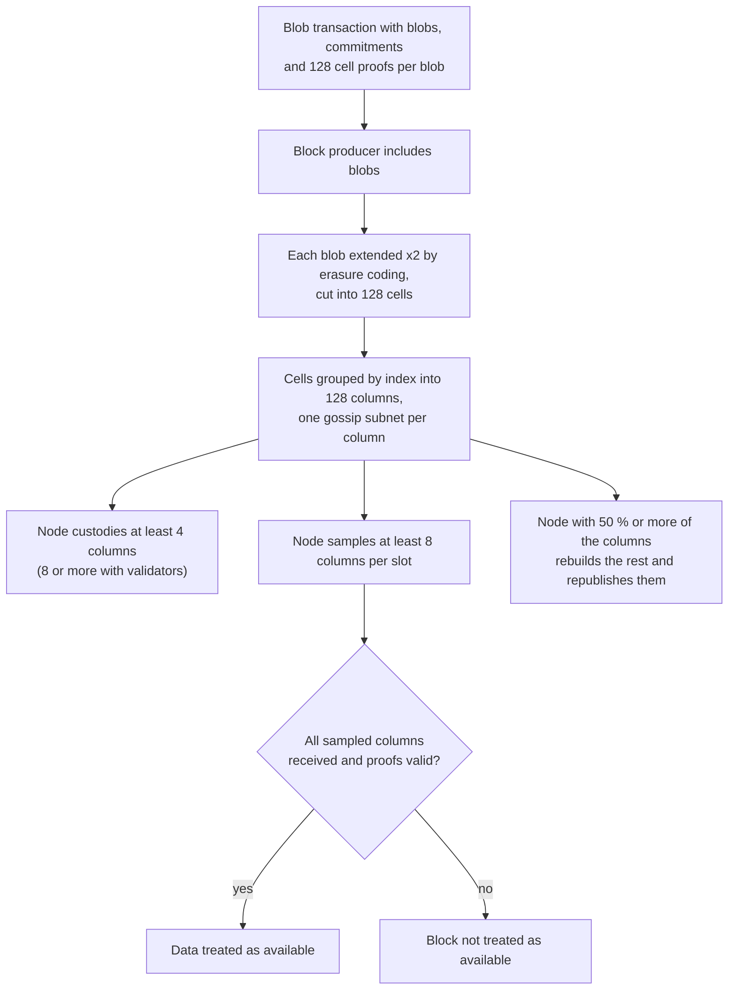

Fusaka is the Ethereum network upgrade that followed Pectra. It activated on mainnet on 2025-12-03 at 21:49:11 UTC and combines two forks: *Fulu* on the consensus layer and *Osaka* on the execution layer. Its main change is PeerDAS, which lets nodes check that blob data is available by downloading only part of it, so that the number of blobs per block can grow. The same upgrade also caps the gas of a single transaction, adds a reserve price to blobs, introduces a way to raise blob capacity without a full hard fork, and changes the EVM in three places.

This article goes through the thirteen EIPs listed in the Fusaka meta EIP, [EIP-7607](https://eips.ethereum.org/EIPS/eip-7607), grouped by topic: what each changes, why, and who it affects. The values come from the EIP texts and from the executable specifications of both layers. It follows the earlier [Pectra overview]({{site.url_complet}}/2025/05/02/ethereum-pectra-upgrade/).

> This article has been made with the help of [Claude Code](https://claude.com/product/claude-code) and several custom skills

[TOC]

## What you need to know first

The article relies on the following mechanisms, introduced before Fusaka:

- **Execution layer and consensus layer.** An Ethereum node runs two clients: the execution client runs the EVM and holds the state, and the consensus client runs proof of stake and the beacon chain. Each upgrade has one name per layer; Fusaka is the combination of Fulu (consensus) and Osaka (execution).
- **Blob.** Since Dencun ([EIP-4844](https://eips.ethereum.org/EIPS/eip-4844)), a transaction can carry blobs: 128 KiB data attachments that the EVM cannot read, kept by consensus nodes for about 18 days. Rollups post their data in blobs. Blobs are priced in *blob gas*, with their own base fee and a target and maximum number per block.
- **KZG commitment.** Each blob comes with a short cryptographic commitment. A proof can show that a piece of the blob matches the commitment without revealing the rest of the blob.
- **Data availability.** A node must be sure the data of a block was published, otherwise no one could rebuild a rollup's state. Before Fusaka, every consensus node downloaded every blob to be sure.
- **Erasure coding.** Data is extended with redundant parts so that the whole can be rebuilt from any half of the extended data. Erasure coding is what makes sampling meaningful: if half of the extended data is available, all of it is.
- **Precompile.** A contract at a fixed address whose logic is built into the client rather than written in EVM code, used for cryptographic operations. It has its own gas formula.

## Fusaka at a glance

The meta EIP lists nine core EIPs, which change the protocol rules, and four others, which concern networking, client configuration and JSON-RPC:

| EIP | Layer | Topic | Change |
|---|---|---|---|
| [EIP-7594](https://eips.ethereum.org/EIPS/eip-7594) | Consensus, networking | Data availability | PeerDAS: nodes sample blob data by columns instead of downloading every blob |
| [EIP-7892](https://eips.ethereum.org/EIPS/eip-7892) | Both | Blobs | *Blob Parameter Only* forks that change only the blob target, maximum and fee update fraction |
| [EIP-7918](https://eips.ethereum.org/EIPS/eip-7918) | Execution | Blobs | Reserve price for blob gas, tied to the execution base fee |
| [EIP-7825](https://eips.ethereum.org/EIPS/eip-7825) | Execution | Limits | Maximum gas per transaction: 2²⁴ = 16,777,216 |
| [EIP-7934](https://eips.ethereum.org/EIPS/eip-7934) | Execution | Limits | Maximum RLP-encoded block size: 10 MiB minus a 2 MiB margin |
| [EIP-7935](https://eips.ethereum.org/EIPS/eip-7935) | Execution (client defaults) | Limits | Default block gas limit of clients set to 60M |
| [EIP-7939](https://eips.ethereum.org/EIPS/eip-7939) | Execution | EVM | `CLZ` opcode: count leading zero bits |
| [EIP-7823](https://eips.ethereum.org/EIPS/eip-7823) | Execution | Precompiles | Upper bound of 1,024 bytes on each `MODEXP` input |
| [EIP-7883](https://eips.ethereum.org/EIPS/eip-7883) | Execution | Precompiles | `MODEXP` gas cost increase |
| [EIP-7951](https://eips.ethereum.org/EIPS/eip-7951) | Execution | Precompiles | `P256VERIFY` precompile for secp256r1 signatures |
| [EIP-7917](https://eips.ethereum.org/EIPS/eip-7917) | Consensus | Proposers | Deterministic proposer lookahead stored in the beacon state |
| [EIP-7642](https://eips.ethereum.org/EIPS/eip-7642) | Networking | History | `eth/69`: announce served block range, drop pre-merge fields and receipt blooms |
| [EIP-7910](https://eips.ethereum.org/EIPS/eip-7910) | JSON-RPC | Operations | `eth_config` method reporting a node's fork configuration |

### Activation

Fusaka and its two Blob Parameter Only forks activated on the following dates (UTC), as given in EIP-7607 and in the execution specification's upgrade schedule:

| Network | Fusaka | BPO1 | BPO2 |
|---|---|---|---|
| Holešky | 2025-10-01 08:48:00 | 2025-10-07 01:20:00 | 2025-10-13 21:10:24 |
| Sepolia | 2025-10-14 07:36:00 | 2025-10-21 03:26:24 | 2025-10-27 23:16:48 |
| Hoodi | 2025-10-28 18:53:12 | 2025-11-05 18:02:00 | 2025-11-12 13:52:24 |
| Mainnet | 2025-12-03 21:49:11 (epoch 411,392) | 2025-12-09 14:21:11 (epoch 412,672) | 2026-01-07 01:01:11 (epoch 419,072) |

The first mainnet block under Osaka rules is block 23,935,694 (timestamp 1,764,798,563). It used 33,435,936 gas of a 59,941,294 limit and carried 9 blobs, the Osaka maximum.

## Data availability: PeerDAS (EIP-7594)

Before Fusaka, every consensus node downloaded every blob of every block. The blob count per block was therefore bounded by the bandwidth of the smallest nodes the network wanted to keep. EIP-7594, *Peer Data Availability Sampling*, replaces full download with sampling. Its stated motivation is to scale data availability beyond EIP-4844 for rollups, "whose dominant bottleneck is layer 1 data availability".

The mechanism, with the mainnet values of the Fulu configuration in `consensus-specs`:

- **Extension.** Each blob is extended with an erasure code to twice its size, then cut into 128 *cells* of 64 field elements. Any half of the cells is enough to rebuild the blob.
- **Columns.** The cells at the same index across all blobs of a block form a *column*. There are 128 columns, each with its own gossip subnet.
- **Custody.** Each node keeps a deterministic set of columns derived from its node ID: at least 4 custody groups for any node. A node with validators keeps at least 8, plus one per 32 ETH of attached effective balance, up to all 128.
- **Sampling.** Each slot, a node checks at least 8 columns (`SAMPLES_PER_SLOT`), or its custody count if higher. If they are all available, it treats the block's data as available.
- **Reconstruction.** A node that obtains at least half of the columns rebuilds the full data and republishes the columns it was missing.

With 4 custody groups out of 128, a node without validators stores 1/32 of the extended data, which is 1/16 of the original blob data since the extension doubles it.

Two changes affect users directly:

- **Blob transaction senders compute the cell proofs.** Computing proofs for every cell is expensive, so the EIP moves the work to the sender. The network wrapper of a blob transaction gains a `wrapper_version` byte (set to 1) and carries `cell_proofs`, 128 per blob, instead of one proof per blob. Rollup software and blob-submitting libraries had to change their transaction format.
- **At most 6 blobs per transaction.** The EIP introduces a per-transaction limit of 6 blobs, enforced at submission, in the transaction pool and in block validation (`BLOB_COUNT_LIMIT = 6` in `forks/osaka/fork.py`). A block can hold more blobs than that, but only from several transactions.

## Blob capacity and fees

### Blob Parameter Only forks (EIP-7892)

PeerDAS lowers the cost of each blob for nodes, but how many blobs mainnet could carry safely was to be found by observation. EIP-7892 defines a lighter kind of hard fork that changes only three blob parameters: the target, the maximum and the base fee update fraction. Its motivation is to raise capacity in smaller steps, "in response to real-world demand and network conditions", without the coordination of a full upgrade.

Two BPO forks were scheduled with Fusaka, and the execution specification gives their parameters (`forks/<fork>/vm/gas.py`):

| Fork | Mainnet activation | Blob target | Blob maximum | Base fee update fraction |
|---|---|---|---|---|
| Osaka | 2025-12-03 | 6 | 9 | 5,007,716 |
| BPO1 | 2025-12-09 | 10 | 15 | 8,346,193 |
| BPO2 | 2026-01-07 | 14 | 21 | 11,684,671 |

At 128 KiB per blob, the BPO2 maximum of 21 blobs is 2.625 MiB of blob data per block. The consensus configuration records only the maximum per epoch (`BLOB_SCHEDULE`); the target and the fee parameters live on the execution layer. The specification also contains BPO3 to BPO5, unscheduled and with the BPO2 values at the commit read.

### Blob reserve price (EIP-7918)

Under EIP-4844, the blob base fee falls whenever blocks use less than the blob target, and it can fall to 1 wei. EIP-7918 gives two reasons to bound it:

- When the execution cost of a rollup's transaction is much larger than its blob cost, the blob base fee no longer influences demand. The EIP notes that a 10 % change of the blob base fee could then move the total cost by 0.0000001 %, and that over an hour of near-full blocks was needed to restore a market price when demand returned.
- Nodes must verify the KZG proofs of every blob, which costs computation. The EIP wants blob users to pay at least a fraction of the market rate for that computation.

The rule adds a reserve price of `BLOB_BASE_COST × base_fee_per_gas`, with `BLOB_BASE_COST = 2¹³ = 8,192`. When this reserve is above the blob cost at the current blob base fee, the excess blob gas is not reduced by the target, so the blob base fee stops falling and rises with use. The blob price therefore follows the execution base fee from below.

## Execution limits

### Transaction gas cap (EIP-7825)

EIP-7825 caps the gas limit of any transaction at 2²⁴ = 16,777,216 (`TX_MAX_GAS_LIMIT` in `forks/osaka/vm/gas.py`). A transaction declaring more is invalid, not reverted. The EIP's motivation lists three risks of transactions that can consume a whole block: denial of service, larger state changes, and longer block validation. Before the cap, the largest possible transaction grew with the block gas limit; with it, the block gas limit can rise while the worst single transaction stays the same. The [companion article on gas cost and the per-transaction limit]({{site.url_complet}}/2026/10/23/ethereum-gas-cost-transaction-limit-fusaka-glamsterdam/) measures what it means for a batch function.

### Block size limit (EIP-7934)

EIP-7934 limits the RLP-encoded execution block to `MAX_BLOCK_SIZE − SAFETY_MARGIN` = 10,485,760 − 2,097,152 = 8,388,608 bytes. The EIP notes that the consensus layer's gossip does not propagate blocks above 10 MiB, so an execution block larger than that could split the network; the 2 MiB margin leaves room for the rest of the beacon block. Without the limit, a block filled with cheap calldata could be valid and still fail to propagate.

### Default gas limit of 60M (EIP-7935)

EIP-7935 does not change a protocol rule. It commits execution client teams to ship 60M as the default block gas limit, and to test their clients at that level before Fusaka. The mainnet gas limit, 36M when the EIP was written, reached 45M by September 2025 and about 60M by late November 2025, before Fusaka activated; the history is told in [Ethereum: A Gas Story]({{site.url_complet}}/2026/10/23/ethereum-a-gas-story/).

## EVM and precompile changes

### CLZ opcode (EIP-7939)

EIP-7939 adds `CLZ` (opcode `0x1E`, 5 gas), which pops a 256-bit word and pushes the number of leading zero bits, or 256 if the word is zero. The EIP lists its uses: fixed-point logarithms and exponentials, square and cube roots, bitmaps (finding the next set bit), byte string comparison, calldata compression and post-quantum signature schemes. The fastest Solidity implementation before `CLZ` used several shifts and large constants, so the opcode reduces gas, bytecode size and, according to the EIP, the cost of proving the execution in zero-knowledge virtual machines.

### MODEXP bounds and repricing (EIP-7823, EIP-7883)

The `MODEXP` precompile at address `0x05` computes `base^exponent mod modulus` on arbitrary-size integers. Two EIPs change it:

- **EIP-7823** limits each of the three lengths to 1,024 bytes (8,192 bits). A call with a longer input fails and consumes all its gas. The EIP's motivation is that `MODEXP` "has been a source of numerous consensus bugs", many triggered by impractical input lengths, and that a bounded precompile could later be replaced by EVM code.
- **EIP-7883** raises the price, stating that the precompile was underpriced in some cases and that this stood in the way of higher block gas limits. The minimum cost rises from 200 to 500 gas, the general cost triples (the division by 3 of [EIP-2565](https://eips.ethereum.org/EIPS/eip-2565) is removed), the cost of exponents longer than 32 bytes doubles, and inputs shorter than 32 bytes are priced as if they were 32 bytes long.

Contracts that verify RSA signatures or run other big-integer arithmetic through `MODEXP` pay more after Fusaka, and inputs above 1,024 bytes (RSA keys above 8,192 bits) are no longer accepted.

### P256VERIFY precompile (EIP-7951)

EIP-7951 adds `P256VERIFY` at address `0x100`: ECDSA verification over secp256r1 (also called P-256), for 6,900 gas. Secp256r1 is the curve of the secure hardware in phones and computers (Apple Secure Enclave, Android Keystore) and of passkeys (FIDO2, WebAuthn), so a smart account can verify a signature made by such a device directly.

The EIP reuses the interface of RIP-7212, already deployed on several layer-2 networks at the same address, and fixes two flaws of that specification: a missing check that the recovered point is not the point at infinity, and a comparison of `r` that was not done modulo the curve order. The gas price differs: 6,900 on mainnet against 3,450 in RIP-7212, because benchmarks found secp256r1 verification much slower than `ECRECOVER` (3,000 gas). The precompile never reverts: an invalid input or signature returns empty output and consumes the full 6,900 gas.

## Consensus: deterministic proposer lookahead (EIP-7917)

Before Fusaka, the proposers of epoch N + 1 were not fully known during epoch N, because a change of effective balance within epoch N could change the result of the proposer election. Slashings and penalties could cause such changes, and since Pectra so can deposits and consolidations, with effective balances up to 2,048 ETH. EIP-7917 computes the proposer schedule in advance and stores it in the beacon state: a `proposer_lookahead` list of `(MIN_SEED_LOOKAHEAD + 1) × SLOTS_PER_EPOCH` = 2 × 32 = 64 slots, shifted by one epoch at each epoch transition (`process_proposer_lookahead` in `specs/fulu/beacon-chain.md`).

The EIP gives three effects. Preconfirmation protocols, in which a known future proposer commits in advance to include a transaction, get a schedule that cannot change. The schedule becomes provable to contracts through the beacon block root and a Merkle proof. And validators can no longer adjust effective balances to influence who proposes in the next epoch.

## Networking and node operations

### eth/69 (EIP-7642)

EIP-7642 defines version 69 of the `eth` peer-to-peer protocol, which client teams had to support by Fusaka:

- **Served block range.** The handshake announces the range of blocks a node can serve, and a new message updates it. Since 2025-05-01, clients may drop pre-merge history, so a syncing node needs to know which peers still serve it.
- **No total difficulty.** The handshake drops the total difficulty field, unused since the Merge.
- **No bloom filter in receipts.** Receipts are sent without their 256-byte bloom filter, which receivers recompute. The EIP estimates the saving at about 530 GB of transfer per full sync (2.3 billion transactions × 256 bytes).

### eth_config (EIP-7910)

EIP-7910 adds the `eth_config` JSON-RPC method, which reports a node's configuration for the current, next and last known forks: activation time, chain ID, fork ID, blob schedule, precompile addresses and system contract addresses. The motivation cites the Pectra activation on Holešky, where four of six clients had a wrong deposit contract configuration and the incorrect chain was justified. Operators can compare `eth_config` across nodes before a fork to catch such errors.

## Impact for smart contract developers

Most of Fusaka is invisible to contracts, but four changes are not:

- **Batch functions have a hard maximum.** A transaction cannot use more than 16,777,216 gas, whatever the block gas limit. A function that loops over user input (batch transfer, batch mint, airdrop, mass liquidation) has a maximum input size that no future block gas limit increase will raise. Measured on a token batch mint, that maximum is 565 new holders per transaction. Deployment and migration scripts that relied on very large transactions must split them.
- **`MODEXP` is more expensive and bounded.** On-chain RSA verification and other big-integer arithmetic cost about three times more, with a minimum of 500 gas per call, and inputs above 1,024 bytes fail. Gas estimates made before Fusaka for such calls are too low.
- **`CLZ` is available.** Math libraries (logarithms, square roots, bit scanning) can replace their shift-based implementations with a single 5-gas opcode, when compiled for the Osaka EVM version and deployed on a chain that supports it.
- **Passkey and secure-hardware signatures can be verified natively.** `P256VERIFY` at `0x100` costs 6,900 gas instead of the hundreds of thousands a Solidity implementation of secp256r1 verification needs. Contracts written for RIP-7212 on layer 2 keep the same interface on mainnet but must budget for the higher gas price.

Rollup and blob-submitting software must compute cell proofs and use the new transaction wrapper, and must respect the limit of 6 blobs per transaction.

## Impact for node operators and stakers

- **Bandwidth and storage of blob data fall per node**, since a node without validators keeps 4 of 128 columns. Nodes with validators keep more: 8 groups at minimum, and one more per 32 ETH of attached effective balance, so a node running 4,096 ETH of validators or more keeps all 128 columns and behaves as a *supernode*.
- **Blob capacity rises through BPO forks**, from a maximum of 9 to 21 per block between December 2025 and January 2026, with no client feature change but with new client releases carrying the schedule.
- **Clients must speak `eth/69`** and, if they want to serve history, announce the range they serve.
- **`eth_config`** gives a way to check, before each fork, that every node of an operator has the same configuration.

## Conclusion

Fusaka's thirteen EIPs serve three aims: more data for rollups, safer limits for a growing block gas limit, and a few targeted EVM changes.

- **Data:** PeerDAS (EIP-7594) replaces full blob download by column sampling, the BPO mechanism (EIP-7892) raised the blob maximum from 9 to 15 and then 21 within five weeks, and the reserve price (EIP-7918) keeps the blob fee from falling to 1 wei while execution is expensive.
- **Limits:** a transaction cannot exceed 16,777,216 gas (EIP-7825), a block cannot exceed 8,388,608 bytes of RLP (EIP-7934), and clients ship a 60M default gas limit (EIP-7935).
- **EVM:** `CLZ` (EIP-7939) and `P256VERIFY` (EIP-7951) add capabilities; `MODEXP` becomes bounded and more expensive (EIP-7823, EIP-7883).
- **Consensus and operations:** the proposer schedule of the next epoch is fixed in the state (EIP-7917), and nodes gain `eth/69` (EIP-7642) and `eth_config` (EIP-7910).

## Annex

### Key Terms

| Term | Definition |
|------|------------|
| **Fusaka** | The Ethereum upgrade combining Fulu (consensus layer) and Osaka (execution layer), active on mainnet since 2025-12-03. |
| **Blob** | A 128 KiB data attachment of a transaction, not readable by the EVM and priced in blob gas. |
| **Blob gas** | The resource in which blobs are priced, with its own base fee, target and maximum per block. |
| **KZG commitment** | A short commitment to a blob; a KZG proof shows that a piece of data matches the commitment. |
| **Data availability sampling** | Checking that data was published by downloading random parts of its erasure-coded extension instead of the whole. |
| **PeerDAS** | The data availability sampling protocol of EIP-7594, based on gossip subnets and peer requests. |
| **Cell** | One of the 128 pieces of an extended blob that can be checked against the blob's commitment. |
| **Column** | The cells at one index across all the blobs of a block; each column has its own gossip subnet. |
| **Custody** | The set of columns a node stores and serves, derived from its node ID; at least 4 groups, more for nodes with validators. |
| **Supernode** | A node that custodies all 128 columns, as validators with 4,096 ETH or more of attached effective balance do. |
| **Blob Parameter Only fork** | A hard fork that changes only the blob target, maximum and base fee update fraction (EIP-7892). |
| **Reserve price (blobs)** | The lower bound on the blob base fee set by EIP-7918, equal to 8,192 times the execution base fee per blob. |
| **Transaction gas cap** | The maximum gas limit of a transaction, 16,777,216, introduced by EIP-7825. |
| **CLZ** | The opcode `0x1E` that returns the number of leading zero bits of a word, at 5 gas. |
| **MODEXP** | The precompile at `0x05` computing modular exponentiation on large integers. |
| **P256VERIFY** | The precompile at `0x100` verifying ECDSA signatures on the secp256r1 curve, at 6,900 gas. |
| **Proposer lookahead** | The list of the next 64 slot proposers stored in the beacon state by EIP-7917. |
| **eth/69** | The version of the `eth` peer-to-peer protocol defined by EIP-7642. |

## Frequently Asked Questions

**Q: What do the names Fusaka, Fulu and Osaka refer to?**

Fulu is the consensus-layer fork and Osaka the execution-layer fork; Fusaka is the name of the combined upgrade, as Pectra combined Prague and Electra. Both forks activated together, at epoch 411,392 on mainnet.

**Q: How can a node be sure blob data is available while downloading only part of it?**

Each blob is extended with an erasure code so that any half of the extended data is enough to rebuild it, then split into 128 columns. A node checks at least 8 columns per slot.

To make a block look available while hiding data, a producer would have to withhold more than half of the columns, and then a node sampling random columns is very likely to request one that is missing. Nodes that hold at least half of the columns rebuild and republish the rest.

**Q: Why do blob transaction senders now compute cell proofs?**

PeerDAS needs a proof for each of the 128 cells of every extended blob. Computing them is much more expensive than verifying them, and the block producer would otherwise have to compute them for every blob on the critical path of block production. The EIP moves the work to the sender, who includes 128 cell proofs per blob in the transaction's network wrapper.

**Q: What problem does the blob reserve price solve?**

When rollups pay much more for execution than for blobs, the blob base fee no longer affects their demand, and the EIP-4844 mechanism lowers it to 1 wei. When demand returns, the fee needs a long run of full blocks to recover. EIP-7918 bounds the blob base fee from below by a fraction of the execution base fee, so the blob market keeps a price signal and blob users pay something for the proof verification they impose on nodes.

**Q: A contract mints tokens to 1,000 new holders in one transaction on a test network. Will it work on mainnet after Fusaka?**

Not if the transaction needs more than 16,777,216 gas. A new token holder costs around 29,600 gas in the measured example, so 1,000 holders need about 30M gas, above the cap. A transaction declaring such a gas limit is rejected by nodes, so the batch has to be split, at about 565 holders per transaction in that example.

**Q: Why are Fusaka's MODEXP changes a concern for existing contracts?**

They change the cost and the accepted input of a precompile that deployed contracts already call. A contract that verifies RSA signatures pays about three times more per call, and one that passes inputs longer than 1,024 bytes now has its call fail with all its gas consumed. A contract that forwards a fixed amount of gas to `MODEXP` may run out of gas.

**Q: What does the deterministic proposer lookahead make possible?**

The proposers of the current and next epoch are fixed in the beacon state at the start of each epoch, and can be proved to a contract through the beacon block root. A preconfirmation protocol can then rely on knowing which validator will propose a given slot in the next epoch, which could change before Fusaka when effective balances changed during the current epoch.

## Gaps

The following points were not settled by the sources read for this article:

| Gap | Why it matters | What to read or verify |
|---|---|---|
| The probability that sampling 8 columns detects withheld data is not computed here. | It is the quantitative basis of PeerDAS's security. | The security analysis linked from EIP-7594 and the PeerDAS research posts on ethresear.ch. |
| The effect of PeerDAS on node bandwidth after BPO2 was not measured. | The custody fractions say how much data a node stores, not the bandwidth it uses with 21 blobs per block. | Client team and Ethereum Foundation reports after the BPO forks. |
| The blob target values of BPO1 and BPO2 come from the execution specification; the consensus configuration stores only the maximum. | A reader checking a consensus client configuration will not find the target there. | `forks/bpo1/vm/gas.py`, `forks/bpo2/vm/gas.py` and the BPO meta EIPs 8134 and 8135. |
| The claim that RIP-7212 is deployed at `0x100` on several layer-2 networks comes from EIP-7951, without a list. | A contract ported from a given layer 2 may use a different address or gas price. | The documentation of each target layer 2. |
| The cost of a Solidity secp256r1 verification ("hundreds of thousands" of gas) is general knowledge. | It is the comparison point for the benefit of `P256VERIFY`. | A gas measurement of a maintained Solidity P-256 library. |
| The 60M gas limit in late November 2025 was observed in block headers; the coordination behind it is not described here. | The article does not say which client releases or validator signals produced it. | Client release notes and Ethereum Foundation posts of November 2025. |

## References

### Specifications: core EIPs

- [EIP-7607: Hardfork Meta — Fusaka](https://eips.ethereum.org/EIPS/eip-7607)
- [EIP-7594: PeerDAS — Peer Data Availability Sampling](https://eips.ethereum.org/EIPS/eip-7594)
- [EIP-7823: Set upper bounds for MODEXP](https://eips.ethereum.org/EIPS/eip-7823)
- [EIP-7825: Transaction Gas Limit Cap](https://eips.ethereum.org/EIPS/eip-7825)
- [EIP-7883: ModExp Gas Cost Increase](https://eips.ethereum.org/EIPS/eip-7883)
- [EIP-7917: Deterministic proposer lookahead](https://eips.ethereum.org/EIPS/eip-7917)
- [EIP-7918: Blob base fee bounded by execution cost](https://eips.ethereum.org/EIPS/eip-7918)
- [EIP-7934: RLP Execution Block Size Limit](https://eips.ethereum.org/EIPS/eip-7934)
- [EIP-7939: Count leading zeros (CLZ) opcode](https://eips.ethereum.org/EIPS/eip-7939)
- [EIP-7951: Precompile for secp256r1 Curve Support](https://eips.ethereum.org/EIPS/eip-7951)

### Specifications: other EIPs

- [EIP-7642: eth/69 — history expiry and simpler receipts](https://eips.ethereum.org/EIPS/eip-7642)
- [EIP-7892: Blob Parameter Only Hardforks](https://eips.ethereum.org/EIPS/eip-7892)
- [EIP-7910: eth_config JSON-RPC Method](https://eips.ethereum.org/EIPS/eip-7910)
- [EIP-7935: Set default gas limit to 60M](https://eips.ethereum.org/EIPS/eip-7935)
- [EIP-4844: Shard Blob Transactions](https://eips.ethereum.org/EIPS/eip-4844)
- [EIP-2565: ModExp Gas Cost](https://eips.ethereum.org/EIPS/eip-2565)

### Analyzed source

- [ethereum/execution-specs](https://github.com/ethereum/execution-specs) — analyzed at commit [`aaae5abd382b6c0612add96bd8400d6fa4eb0617`](https://github.com/ethereum/execution-specs/tree/aaae5abd382b6c0612add96bd8400d6fa4eb0617), 2026-10-23 (`forks/osaka/`, `forks/bpo1/`, `forks/bpo2/`)
- [ethereum/consensus-specs](https://github.com/ethereum/consensus-specs) — analyzed at commit [`065bcd5c6ad96186cd2c0ac1c435f620a0b25373`](https://github.com/ethereum/consensus-specs/tree/065bcd5c6ad96186cd2c0ac1c435f620a0b25373), 2026-10-23 (`specs/fulu/`, `configs/mainnet.yaml`)
- Mainnet block headers 23,935,693 and 23,935,694 read with `eth_getBlockByNumber` on `ethereum-rpc.publicnode.com`, 2026-10-23

### Related articles

- [Summary of EIP-4844 Proto-Danksharding]({{site.url_complet}}/2023/09/26/EIP-4844-Proto-Danksharding/)
- [Ethereum Gas — How Transaction Cost and the Per-Transaction Limit Are Computed (Fusaka and Glamsterdam)]({{site.url_complet}}/2026/10/23/ethereum-gas-cost-transaction-limit-fusaka-glamsterdam/)
- [Ethereum: A Gas Story]({{site.url_complet}}/2026/10/23/ethereum-a-gas-story/)
