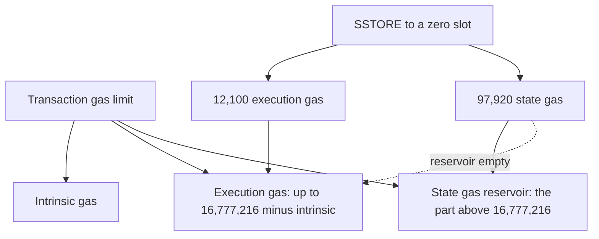
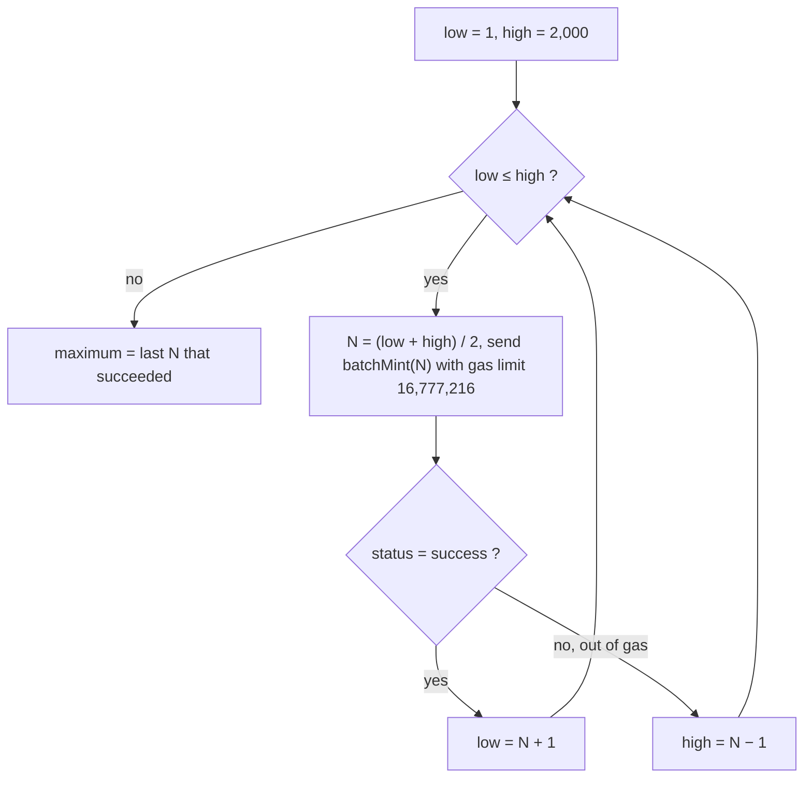

Every Ethereum transaction pays for the work it causes: a fixed entry cost, a cost per byte of input data, and a cost per EVM operation, with writes to storage by far the most expensive. Since the Fusaka upgrade of December 2025, a single transaction can also no longer use more than 2²⁴ = 16,777,216 gas, whatever the size of the block, which puts a hard ceiling on batch operations such as minting a token to hundreds of addresses at once.

The next upgrade, Glamsterdam, changes how that ceiling is counted. Creating new state (a new account or a new storage slot) is charged as a separate *state gas* that does not count against the 16,777,216 cap, while the rest of the work stays capped. The same batch can then hold more recipients and cost several times more gas. This article explains how gas is computed, which limits apply to a transaction, which EIPs set them, and how to measure all of it, using a token batch mint ([CMTAT](https://github.com/CMTA/CMTAT) 3.0 `batchMint`) as a running example.

> This article has been made with the help of [Claude Code](https://claude.com/product/claude-code) and several custom skills

[TOC]

## What you need to know first

The article assumes familiarity with Ethereum transactions and Solidity, and relies on the following mechanisms without deriving them:

- **Storage slot.** A contract's persistent state is a map of 32-byte keys to 32-byte values. A token balance is one slot, located at a key derived from the holder's address; a slot that has never been written reads as zero.
- **Cold and warm access.** Since Berlin, the first access to an account or a storage slot in a transaction is *cold* and costs more than later, *warm*, accesses to the same item ([EIP-2929](https://eips.ethereum.org/EIPS/eip-2929)). This is why the first write to a slot costs more than a second write in the same transaction.
- **Transaction receipt.** After a transaction is included, its receipt records `status` (success or revert) and `gasUsed`. All the gas figures in this article are read from receipts or from simulations that return the same value.
- **Hard fork and testnet.** Protocol rules change at named upgrades (Pectra, Fusaka, Glamsterdam). Each one activates on public testnets such as Sepolia before mainnet, so for a period the two networks run different gas rules.
- **JSON-RPC.** Nodes expose methods such as `eth_estimateGas` and `eth_simulateV1` that execute a transaction without broadcasting it. They are the main tools for measuring gas against a live network.

## How the gas of a transaction is computed

The gas a transaction uses is the sum of three parts, adjusted at the end by refunds and a floor:

$$
\begin{aligned}
\text{gasUsed} = \max\big(\text{intrinsic} + \text{execution} - \text{refund},\ \text{floor}\big)
\end{aligned}
$$

The figures below are those of the Osaka execution rules, the execution-layer part of Fusaka, as written in the Python executable specification ([execution-specs](https://github.com/ethereum/execution-specs)), `forks/osaka/vm/gas.py`.

### Intrinsic gas

The intrinsic gas is charged before any code runs:

- **21,000** base cost per transaction.
- **Calldata**: 4 gas per zero byte and 16 per non-zero byte ([EIP-2028](https://eips.ethereum.org/EIPS/eip-2028)). The specification expresses this as *tokens*: one token per zero byte, four per non-zero byte, 4 gas per token.
- **Contract creation**: 32,000 more, plus 2 gas per 32-byte word of init code.
- **Access list** ([EIP-2930](https://eips.ethereum.org/EIPS/eip-2930)): 2,400 per address and 1,900 per storage key declared in advance.

A transaction whose gas limit is below its intrinsic gas is invalid and never executes.

### Execution gas

Each EVM operation has a cost. Arithmetic and stack operations cost 2 to 10 gas, memory grows with a cost that becomes quadratic, and the operations that touch state dominate:

| Operation | Gas (Osaka) |
|---|---|
| Cold `SLOAD` (first read of a slot) | 2,100 |
| Warm `SLOAD` | 100 |
| `SSTORE` zero → non-zero, cold | 22,100 (20,000 + 2,100) |
| `SSTORE` non-zero → non-zero, cold | 5,000 (2,900 + 2,100) |
| Cold account access (`CALL`, `BALANCE`, `EXTCODESIZE`…) | 2,600 |
| `LOG` event | 375 + 375 per topic + 8 per byte of data |

The table shows the property that matters for batches. Writing a slot that was zero costs more than four times as much as updating a slot that already holds a value, so the cost of a batch depends on whether the recipients already exist.

### Refunds and the calldata floor

Clearing a storage slot (non-zero → zero) earns a refund of 4,800 gas, and since London the total refund is capped at one fifth of the gas used ([EIP-3529](https://eips.ethereum.org/EIPS/eip-3529)).

Since Pectra, a transaction also pays at least a *calldata floor* ([EIP-7623](https://eips.ethereum.org/EIPS/eip-7623)): 21,000 + 10 gas per calldata token. The floor only binds for transactions that carry a lot of data and execute little code. For a batch mint, each recipient adds 64 bytes of calldata (an address and an amount); with a typical address of 20 non-zero bytes and a small amount, that is 130 tokens, which is 520 gas at the standard rate and 1,300 at the floor rate, far below the ~30,000 gas the recipient costs in execution.

### What the sender pays

Since London ([EIP-1559](https://eips.ethereum.org/EIPS/eip-1559)), the price of a unit of gas has two parts: a *base fee* set by the protocol and burned, and a *priority fee* (tip) paid to the block producer. The fee of a transaction is:

$$
\begin{aligned}
\text{fee} = \text{gasUsed} \times \min(\text{maxFeePerGas},\ \text{baseFee} + \text{maxPriorityFeePerGas})
\end{aligned}
$$

The base fee moves by at most 1/8 (12.5 %) per block, up when the previous block used more than half of its gas limit (the *target*) and down when it used less. Gas used is therefore a property of the transaction and the state, while the price of gas is a property of the moment. Measuring the two separately is what makes a cost estimate reusable.

## The limits on one transaction

Four limits decide whether a large transaction can be included.

### The sender's gas limit

The sender sets a gas limit and pays at most `gasLimit × maxFeePerGas`. If execution needs more gas than the limit, the transaction reverts *out of gas*: every state change is undone, and the gas consumed so far is still paid. A batch is therefore never partly applied; all recipients are processed or none are.

### The per-transaction cap (EIP-7825)

[EIP-7825](https://eips.ethereum.org/EIPS/eip-7825), activated with Fusaka, caps the gas limit of every transaction at 2²⁴ = **16,777,216**. A transaction that declares a higher limit is rejected by the node before execution; it does not revert, it is simply invalid. Fusaka activated on Sepolia on 2025-10-14 and on mainnet on 2025-12-03 (21:49:11 UTC), according to the fork timestamps in the go-ethereum and execution-specs configurations.

The EIP gives three reasons: limiting the damage a single transaction can do to a block (denial of service), spreading gas more evenly across the transactions of a block, and bounding the time a node needs to validate a block. For contract developers it means that any loop over user-supplied input has a fixed upper bound that no longer grows with the block gas limit.

### The block gas limit

The block gas limit is chosen by block producers, who may move it by a small step per block. [EIP-7935](https://eips.ethereum.org/EIPS/eip-7935) raised the default configured in clients to 60M with Fusaka. With the cap in place, a 60M block can hold at least three maximum-size transactions, so on mainnet the block limit no longer binds a single transaction.

### Size limits

Two size limits apply as well, and neither binds a batch of a few thousand entries:

- **Block size** ([EIP-7934](https://eips.ethereum.org/EIPS/eip-7934)): the RLP-encoded execution block is limited to 10 MiB minus a 2 MiB margin, 8,388,608 bytes.
- **Mempool size**: go-ethereum refuses to relay a transaction above 128 KiB (`txMaxSize` in `core/txpool/legacypool/legacypool.go`), about 2,000 recipients at 64 bytes each.

## From Fusaka to Glamsterdam

Glamsterdam is the upgrade after Fusaka; its execution-layer part is named Amsterdam in the client code and specifications, and its EIP list is tracked in [EIP-7773](https://eips.ethereum.org/EIPS/eip-7773). It activated on Sepolia on 2026-10-06 (epoch 353,024); no mainnet date was set on 2026-10-23, and the gas EIPs below were still in Last Call status, so their constants may change before mainnet.

The gas changes that affect contract developers:

| Topic | Fusaka (mainnet) | Glamsterdam (Sepolia) | EIP |
|---|---|---|---|
| New storage slot | 20,000 execution gas | 97,920 state gas (64 bytes × 1,530) | [EIP-8037](https://eips.ethereum.org/EIPS/eip-8037) |
| New account | 25,000 execution gas | 183,600 state gas (120 bytes × 1,530) | EIP-8037 |
| First write to a slot | 22,100 (was zero) or 5,000 (was non-zero), cold | 12,100 execution gas in both cases (2,100 cold access + 10,000 write) | [EIP-8038](https://eips.ethereum.org/EIPS/eip-8038) |
| Cold account access | 2,600 | 3,000 | EIP-8038 |
| Transaction base cost | 21,000 | 12,000, plus 3,000 for the called account and 6,000 when value is sent | [EIP-2780](https://eips.ethereum.org/EIPS/eip-2780) |
| Calldata floor | 10 gas per token (40 per non-zero byte, 10 per zero byte) | 64 gas per byte, zero or not (every byte counts as 4 tokens, 16 gas per token) | [EIP-7976](https://eips.ethereum.org/EIPS/eip-7976) |
| What the 16,777,216 cap applies to | all gas | execution gas only | EIP-8037 |
| Block accounting | gas after refunds | execution and state gas counted separately, before refunds | [EIP-7778](https://eips.ethereum.org/EIPS/eip-7778) |

For a simple ETH transfer the new intrinsic costs add up to the familiar figure: 12,000 + 3,000 + 6,000 = 21,000.

### State gas and the reservoir

EIP-8037 splits gas into two dimensions. *Execution gas* pays for computation and access, and stays capped at 16,777,216 per transaction. *State gas* pays for the bytes a transaction adds to the state, at 1,530 gas per byte, and is not capped by EIP-7825.

Both are paid from the same gas limit. The specification (`forks/amsterdam/vm/gas.py`, `allocate_evm_gas`) splits the limit at the start of the transaction: up to 16,777,216 goes to execution gas, and whatever the sender declared above that forms a *state gas reservoir*. State gas is taken from the reservoir first and, once the reservoir is empty, from the execution gas.

Two consequences follow that have no equivalent under Fusaka:

- **A larger gas limit gives a larger batch.** Under Fusaka, a gas limit above what execution needs is just unused. Under Glamsterdam, the part above the cap is the only place state gas can come from without eating into the capped execution gas.
- **A gas limit of exactly 16,777,216 gives a smaller batch than before.** With no reservoir, every new slot takes 97,920 gas out of the capped execution budget, four to five times the 22,100 it cost under Fusaka.

The block applies the same split. In the specification's `check_block_gas_capacity`, a transaction is included only if its execution gas fits in the block's remaining execution budget and its whole gas limit fits in the block's remaining state budget, each budget being the block gas limit. A transaction with a 100M gas limit therefore needs a block gas limit of at least 100M.

### Storage repricing

EIP-8038 separates the cost of *accessing* a slot from the cost of *creating* it. The first write to a slot in a transaction costs 2,100 for the cold access and 10,000 for the write, whether the slot held zero or not; creating the slot is now the state gas of EIP-8037. Updating an existing balance thus costs 12,100 gas instead of 5,000. Creating a new one costs 110,020 in total, 12,100 of execution gas and 97,920 of state gas, against 22,100 under Fusaka.

## Measuring gas in practice

Gas figures quoted from memory or from a table of opcode costs are approximations. A measured `gasUsed` is exact for the code, compiler settings and state it was measured against.

### On a local node

A local node gives exact `gasUsed` values quickly. [anvil](https://getfoundry.sh/anvil/overview), the node of the Foundry toolkit, runs the rules of a chosen fork (`anvil --hardfork osaka`); the Hardhat network does the same inside a JavaScript test suite. The method is to deploy the contract, send the transaction with `cast send --gas-limit 16777216`, and read `gasUsed` and `status` from the receipt.

Two cautions apply. A local node may not enforce every rule: anvil 1.5.0 accepted a transaction with a gas limit of 16,777,217, so the cap must be applied by the person running the test, by never sending more than 16,777,216. And a local node only supports the forks its version knows; anvil 1.5.0 has no Glamsterdam mode.

### Against a live network: `eth_estimateGas` and `eth_simulateV1`

`eth_estimateGas` searches for the smallest gas limit with which a transaction succeeds. Its answer is an upper bound, not the exact `gasUsed`: clients stop the search within a tolerance (about 1.5 % in the reth node used for this article) and some add a margin.

`eth_simulateV1` executes one or more transactions against a chosen block and returns, for each, the exact `gasUsed`, the status and the logs. It accepts *state overrides*, which replace code, balances and storage slots for the simulation only. A contract that does not exist on the network can be measured by placing its compiled runtime code at an unused address and overriding the storage slots that hold its configuration, such as an admin role, a non-zero total supply or existing balances. Nothing is broadcast and no deployment is needed. Two settings matter:

- **`validation: true`** applies the transaction rules, including the per-transaction cap. With `validation: false`, the node used here accepted a batch needing about 50M execution gas, so a maximum found in that mode is not a real maximum.
- **The node's own simulation limit.** Public RPC endpoints cap the gas a simulation may use (50M on the endpoint used here), which can be lower than what a Glamsterdam transaction with a large reservoir needs.

A useful check before trusting a simulation is to reproduce a value measured locally under the same rules. The simulation on mainnet returned the same `gasUsed` as anvil for the same code and calldata, to the unit.

### Finding the largest batch: binary search

Gas grows steadily with the number of recipients N, so every batch up to some maximum fits under the cap and every larger one fails. A binary search finds that maximum in about log₂ of the search range: try the middle of the range with a gas limit of 16,777,216, keep the upper half on success and the lower half on failure, and stop when the range is empty.

Between 1 and 2,000, this takes eleven transactions instead of hundreds. Each attempt for new recipients must use fresh addresses, otherwise a successful attempt turns the next attempt's recipients into existing holders and changes the cost being measured.

### From gas to cost

Cost is the measured `gasUsed` multiplied by a gas price taken at a given moment. The Etherscan API V2 exposes a gas oracle (`gastracker gasoracle`) with three suggested prices (*Safe*, *Propose*, *Fast*) and the ETH price (`stats ethprice`). On 2026-10-22 the Propose price was 0.600 gwei, so a transaction of 16,760,071 gas cost about 0.010058 ETH. Testnet gas has no market value; on Sepolia the gas price was 51 wei on the same day, and only the limits matter there.

## Example: a token batch mint

CMTAT is a framework for tokenised securities on EVM chains. Its `batchMint(address[] accounts, uint256[] values)` mints to many holders in one transaction and checks only that the arrays are non-empty and of equal length, so the maximum batch size is set entirely by the network's gas rules. The figures below come from CMTAT v3.0.0 compiled with solc 0.8.30 (optimizer, 200 runs), measured on anvil (Fusaka rules) and with `eth_simulateV1` on Sepolia (Glamsterdam rules) on 2026-10-22 and 2026-10-23.

Per recipient, from the difference between batches of 100 and 200:

| Per recipient (standard deployment) | Mainnet, Fusaka | Sepolia, Glamsterdam |
|---|---|---|
| New holder, total gas | 29,593 | 117,597 (19,677 execution + 97,920 state) |
| New holder, gas counted against the cap | 29,593 | 19,677 |
| Existing holder | 12,499 | 19,677 |

Maximum recipients in one transaction, found by binary search:

| Case | Mainnet, Fusaka | Sepolia, Glamsterdam |
|---|---|---|
| Existing holders | 1,339 | 849 |
| New holders, gas limit 16,777,216 | 565 | 142 |
| New holders, gas limit large enough for the state gas | 565 (a higher limit is rejected) | 849, with a gas limit of about 99.9M |

The table follows directly from the rules above:

- **On mainnet**, every gas unit counts against the cap. About 42,000 gas of fixed cost per transaction and 29,593 per new holder give (16,777,216 − 42,000) / 29,593 ≈ 565.
- **On Sepolia with a large gas limit**, only the 19,677 execution gas per holder counts against the cap, which allows about 850 recipients whether they are new or not; 849 was measured. The 97,920 of state gas per new holder comes from the reservoir, so the 849 new holders need a gas limit of about 99.9M, which fits in Sepolia's block gas limit of 199.6M but would not fit in a 60M block, where the maximum is 509.
- **On Sepolia with a gas limit of 16,777,216**, the state gas has no reservoir and comes out of the capped execution gas: 117,597 per new holder allows 142.
- **Existing holders on Sepolia** fall from 1,339 to 849 because updating a slot now costs 12,100 instead of 5,000.

Two smaller effects show up in the measurements. The first mint of a token also takes the total supply from zero to non-zero, which costs one more new slot: 17,100 gas more on Fusaka and 97,920 more on Glamsterdam. And every recipient appears in events twice: in its own `Transfer` and `Mint` events, and in a final `BatchMint` event that logs both arrays in full, which together add about 4,200 gas per recipient on top of the storage writes.

## Conclusion

The gas of an Ethereum transaction is the sum of an intrinsic cost, the cost of each EVM operation and a refund adjustment, and storage writes dominate it. Since Fusaka, that sum is bounded per transaction.

- **The per-transaction cap** of 16,777,216 gas (EIP-7825) is the limit that binds a large batch on mainnet, not the block gas limit and not the transaction size.
- **Writing a slot that was zero** costs 22,100 gas under Fusaka against 5,000 for updating one, so a batch to new holders fits about half as many recipients as a batch to existing holders.
- **Glamsterdam splits gas** into capped execution gas and uncapped state gas. A new storage slot costs 97,920 state gas, taken from the part of the gas limit above the cap.
- **The maximum batch size under Glamsterdam depends on the gas limit the sender sets**: 849 new holders with a gas limit of about 99.9M, 142 with a gas limit of exactly 16,777,216, against 565 under Fusaka.
- **Measured values are exact; estimates are not.** `eth_simulateV1` with `validation: true` and state overrides gives the exact `gasUsed` against a live network; `eth_estimateGas` returns an upper bound, and a local node may not enforce every rule.

## Annex

### Key Terms

| Term | Definition |
|------|------------|
| **Gas** | The unit in which Ethereum measures the work of a transaction; every operation has a fixed or computed gas cost. |
| **Gas limit** | The maximum gas the sender allows a transaction to use; if execution needs more, the transaction reverts and the gas consumed is still paid. |
| **`gasUsed`** | The gas a transaction actually consumed, recorded in its receipt after refunds and the calldata floor. |
| **Intrinsic gas** | The gas charged before execution: a base cost, calldata, contract creation and access list entries. |
| **Calldata token** | The unit used to price calldata: one per zero byte, four per non-zero byte. |
| **Calldata floor** | The minimum gas a transaction pays per calldata token since EIP-7623, 10 per token under Fusaka; under Glamsterdam, 64 per byte, every byte counting as 4 tokens at 16 gas. |
| **Cold / warm access** | The first access to an account or slot in a transaction (cold) costs more than later accesses to the same item (warm). |
| **Refund** | Gas returned for clearing storage, capped at one fifth of the gas used since EIP-3529. |
| **Base fee** | The protocol-set price per gas unit, burned, which moves by at most 12.5 % per block toward a target of half the block gas limit. |
| **Priority fee** | The tip per gas unit paid to the block producer on top of the base fee. |
| **Per-transaction gas cap** | The 16,777,216 gas limit on any single transaction introduced by EIP-7825 with Fusaka. |
| **Block gas limit** | The total gas allowed in one block, set by block producers; the client default is 60M since Fusaka. |
| **Fusaka** | The Ethereum upgrade activated on mainnet on 2025-12-03; its execution-layer part is named Osaka. |
| **Glamsterdam** | The upgrade after Fusaka, active on Sepolia since 2026-10-06; its execution-layer part is named Amsterdam. |
| **Execution gas** | Under Glamsterdam, the gas for computation and access, still capped at 16,777,216 per transaction. |
| **State gas** | Under Glamsterdam, the gas for new state, 1,530 per byte, not counted against the per-transaction cap. |
| **State gas reservoir** | The part of a transaction's gas limit above 16,777,216, from which state gas is taken first. |
| **`eth_simulateV1`** | A JSON-RPC method that executes transactions against a block without broadcasting them and returns their exact `gasUsed`. |
| **State override** | A replacement of code, balance or storage applied for one simulation only. |

### Integration Notes

| Behaviour | What an integrator should do |
|---|---|
| A transaction with a gas limit above 16,777,216 is invalid on Fusaka networks, not reverted. | Clamp the gas limit to 16,777,216 when the estimate is higher, and split the batch instead. |
| Under Glamsterdam, a gas limit of exactly 16,777,216 leaves no state gas reservoir. | Set the gas limit to the expected total including state gas when the transaction creates storage, and check it fits in the block gas limit. |
| `eth_estimateGas` returns an upper bound within a tolerance, not the exact `gasUsed`. | Use `eth_simulateV1` or a receipt when an exact figure is needed, for example to find a maximum batch size. |
| `eth_simulateV1` with `validation: false` does not apply the per-transaction cap. | Run limit searches with `validation: true`. |
| anvil 1.5.0 does not enforce EIP-7825 and has no Glamsterdam mode. | Apply the cap yourself in local tests, and measure Glamsterdam figures against Sepolia. |
| Writing to a zero slot costs much more than updating a non-zero one, and the first mint of a token creates its total supply slot. | Measure batch limits for new holders and for the token's first mint separately from the existing-holder case. |

## Frequently Asked Questions

**Q: What is the difference between the gas limit and `gasUsed`?**

The gas limit is set by the sender before the transaction runs and is the most it may consume; it also bounds the fee the sender can be charged. `gasUsed` is what the transaction actually consumed, read from the receipt. A transaction that needs more than its gas limit reverts out of gas, and the sender still pays for the gas consumed.

**Q: Why is a batch to new holders smaller than a batch to existing holders under Fusaka?**

Each recipient's balance is a storage slot. Writing a slot that was zero costs 22,100 gas when cold, while updating a slot that already holds a value costs 5,000. In the CMTAT example, a new holder costs about 29,600 gas and an existing one about 12,500, so the 16,777,216 cap holds 565 of the first and 1,339 of the second.

**Q: If a sender sets a gas limit of 20,000,000 on mainnet today, what happens?**

The node rejects the transaction before execution because its gas limit exceeds the EIP-7825 cap. It is not included in a block and pays no fee. Under Glamsterdam the same transaction is valid: the 3,222,784 gas above the cap becomes a state gas reservoir.

**Q: Why does Glamsterdam allow more new holders per transaction while making each one more expensive?**

The cap applies to execution gas only. A new holder costs 19,677 execution gas and 97,920 state gas, so only 19,677 per holder counts against the 16,777,216 cap, against 29,593 under Fusaka, which allows 849 holders instead of 565. The total is 117,597 gas per holder, about four times the Fusaka figure, and the state gas has to be covered by a gas limit far above the cap (about 99.9M for 849 holders).

**Q: Why does a gas limit of exactly 16,777,216 fit only 142 new holders on Sepolia?**

With a gas limit equal to the cap there is no reservoir. Each new holder's 97,920 state gas is then taken from the execution gas, which is capped, so each holder consumes 117,597 of the 16,777,216 available. After about 42,000 gas of fixed cost, 142 holders fit.

**Q: Why use `eth_simulateV1` rather than `eth_estimateGas` to measure a maximum batch size?**

`eth_estimateGas` returns the result of a search that stops within a tolerance, so near the cap it can accept or reject a batch that the exact rule would treat differently. `eth_simulateV1` returns the exact `gasUsed` and status for a given gas limit, and with `validation: true` it applies the per-transaction cap. With state overrides it also measures a contract that is not deployed on the network.

**Q: Does the block gas limit ever bind a single transaction?**

On mainnet under Fusaka it does not: the block limit (60M) is above the per-transaction cap. Under Glamsterdam it can, because a transaction's whole gas limit, including the state gas reservoir, must fit in the block's state gas budget. A batch of 849 new holders needs about 99.9M and would not fit in a 60M block, where the maximum is 509.

## Gaps

The following points were not settled by the sources used for this article:

| Gap | Why it matters | What to read or verify |
|---|---|---|
| EIP-8037, EIP-8038, EIP-2780, EIP-7976 and EIP-7778 were in Last Call status on 2026-10-23. | Any constant in the Glamsterdam column (1,530 per byte, 10,000 per write, 12,000 base) may change before mainnet. | The EIP texts and `forks/amsterdam/vm/gas.py` in execution-specs at the time of reading. |
| The Glamsterdam mainnet date was not set. | Until it is, mainnet runs Fusaka rules and the two networks give different maximum batch sizes. | The EIP-7773 meta EIP and the Ethereum Foundation blog. |
| The 60M block gas limit in a Glamsterdam block is a client default, not a protocol constant. | The maximum batch under Glamsterdam depends on the block gas limit validators actually set. | Current block headers on the target network. |
| The ~1.5 % tolerance of `eth_estimateGas` was observed on one reth node. | Other clients use other search tolerances and margins. | The `eth_estimateGas` implementation of the client in use. |
| The Glamsterdam figures for 849 new holders were derived from measured per-recipient gas, not simulated in one call, because the RPC capped simulations at 50M gas. | A non-linear effect above 416 recipients (the largest batch simulated) would change the result slightly. | A simulation on a node without the 50M limit, or a transaction on Sepolia. |
| The Fusaka activation on Sepolia (2025-10-14) is taken from client configuration files. | The date places measurements made before it under different rules. | The Sepolia block at timestamp 1,760,427,360. |

## References

### Specifications

- [EIP-1559: Fee market change for ETH 1.0 chain](https://eips.ethereum.org/EIPS/eip-1559)
- [EIP-2028: Transaction data gas cost reduction](https://eips.ethereum.org/EIPS/eip-2028)
- [EIP-2780: Resource-based intrinsic transaction gas](https://eips.ethereum.org/EIPS/eip-2780)
- [EIP-2929: Gas cost increases for state access opcodes](https://eips.ethereum.org/EIPS/eip-2929)
- [EIP-2930: Optional access lists](https://eips.ethereum.org/EIPS/eip-2930)
- [EIP-3529: Reduction in refunds](https://eips.ethereum.org/EIPS/eip-3529)
- [EIP-7623: Increase calldata cost](https://eips.ethereum.org/EIPS/eip-7623)
- [EIP-7773: Hardfork Meta — Glamsterdam](https://eips.ethereum.org/EIPS/eip-7773)
- [EIP-7778: Block Gas Accounting without Refunds](https://eips.ethereum.org/EIPS/eip-7778)
- [EIP-7825: Transaction Gas Limit Cap](https://eips.ethereum.org/EIPS/eip-7825)
- [EIP-7934: RLP Execution Block Size Limit](https://eips.ethereum.org/EIPS/eip-7934)
- [EIP-7935: Set default gas limit to 60M](https://eips.ethereum.org/EIPS/eip-7935)
- [EIP-7976: Increase Calldata Floor Cost](https://eips.ethereum.org/EIPS/eip-7976)
- [EIP-8037: State Creation Gas Cost Increase](https://eips.ethereum.org/EIPS/eip-8037)
- [EIP-8038: State-access gas cost update](https://eips.ethereum.org/EIPS/eip-8038)
- [Execution APIs: `eth_simulateV1`](https://github.com/ethereum/execution-apis)

### Analyzed source

- [ethereum/execution-specs](https://github.com/ethereum/execution-specs) — analyzed at commit [`aaae5abd382b6c0612add96bd8400d6fa4eb0617`](https://github.com/ethereum/execution-specs/tree/aaae5abd382b6c0612add96bd8400d6fa4eb0617), 2026-10-23 (`forks/osaka/`, `forks/amsterdam/`)
- [ethereum/go-ethereum](https://github.com/ethereum/go-ethereum) — analyzed at commit [`8b8bb43a732d5d3441c646e62352d25bdaccb30f`](https://github.com/ethereum/go-ethereum/tree/8b8bb43a732d5d3441c646e62352d25bdaccb30f) (after v1.17.9), 2026-10-23 (`params/chainspecs/`, `core/txpool/legacypool/legacypool.go`)
- [CMTA/CMTAT](https://github.com/CMTA/CMTAT) — analyzed at commit [`69eecc9735ce8ada84fd35801888b05747658939`](https://github.com/CMTA/CMTAT/tree/69eecc9735ce8ada84fd35801888b05747658939) (release [v3.0.0](https://github.com/CMTA/CMTAT/releases/tag/v3.0.0)), 2026-10-23

### Announcements and data

- [Glamsterdam Testnet Announcement](https://blog.ethereum.org/2026/09/17/glamsterdam-testnet-announcement), Ethereum Foundation, 2026-09-17
- [Etherscan API V2](https://docs.etherscan.io/) — gas oracle and ETH price, 2026-10-22

### Related articles

- [Ethereum Upgrade Glamsterdam - Overview]({{site.url_complet}}/2026/10/23/ethereum-glamsterdam-upgrade-overview/)
- [Ethereum: A Gas Story]({{site.url_complet}}/2026/10/23/ethereum-a-gas-story/)
- [Ethereum Upgrade Pectra - Overview]({{site.url_complet}}/2025/05/02/ethereum-pectra-upgrade/)
- [Blockchain gas price]({{site.url_complet}}/2025/11/10/blockchain-gas-price/)
- [Solidity Gas Optimization Cheatsheet]({{site.url_complet}}/2023/09/27/gas-optimization/)
- [Flexible Access Control in smart contracts (CMTAT)]({{site.url_complet}}/2026/01/27/cmtat-access-control/)

### Tooling

- [Foundry](https://getfoundry.sh/) (forge, cast, anvil 1.5.0)
- [Hardhat](https://hardhat.org/)
- [Qalculate!](https://qalculate.github.io/), used to check every computed figure
