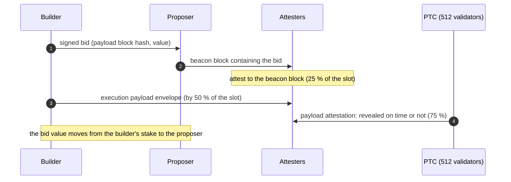

Glamsterdam is the Ethereum network upgrade that follows Fusaka. Its name joins the two layers it changes: *Gloas* on the consensus layer and *Amsterdam* on the execution layer. It activated on the Sepolia testnet on 2026-10-06 at 13:53:36 UTC (epoch 353,024); Hoodi and mainnet dates had not been set on 2026-10-23.

The upgrade schedules 18 EIPs. Two of them change how a block is produced and validated: enshrined proposer-builder separation moves block building into the protocol and gives validators more time to execute a payload, and block-level access lists record every account and slot a block touches so that clients can execute and verify it in parallel. Most of the others reprice gas, with one structural change among them: creating state is charged as a separate *state gas*, counted apart from the 16,777,216 per-transaction cap introduced by Fusaka. This article goes through every scheduled EIP, what it changes, why, and who it affects, with the figures taken from the EIP texts and the executable specifications.

> This article has been made with the help of [Claude Code](https://claude.com/product/claude-code) and several custom skills

[TOC]

## What you need to know first

The article assumes familiarity with Ethereum and Solidity, and uses the following mechanisms without deriving them:

- **Execution and consensus layers.** Since the Merge, an Ethereum node runs two clients: the execution client (Geth, Nethermind, Reth…) runs the EVM and holds the state; the consensus client (Prysm, Lighthouse, Teku…) runs proof of stake. Each upgrade has a name on each side, here Amsterdam and Gloas.
- **Slot and proposer.** Time is divided into 12-second slots; in each one, a validator chosen in advance proposes a block and a committee of validators attests to it.
- **Proposer-builder separation (PBS).** Most proposers do not build their blocks: through MEV-Boost, they sell the right to fill the block to specialised *builders*, with *relays* in the middle that both sides must trust.
- **Per-transaction gas cap.** Since Fusaka, no transaction may use more than 2²⁴ = 16,777,216 gas ([EIP-7825](https://eips.ethereum.org/EIPS/eip-7825)).
- **EIP status.** An EIP in *Last Call* is in its final review period before becoming *Final*; its content can still change until then.
- **Churn.** The amount of stake that may enter, leave or be consolidated in the validator set per epoch, limited so that the set changes slowly.

## Status and activation

The meta EIP [EIP-7773](https://eips.ethereum.org/EIPS/eip-7773), in *Review* status, lists the upgrade's content. On 2026-10-23, 17 of the 18 scheduled EIPs were in *Last Call*, with deadlines on 2026-11-01 (2026-11-04 for EIP-8246); [EIP-7688](https://eips.ethereum.org/EIPS/eip-7688) was in *Review*.

| Network | Activation | Source |
|---|---|---|
| Sepolia | epoch 353,024, slot 11,296,768, 2026-10-06 13:53:36 UTC (timestamp 1,791,294,816) | EIP-7773, go-ethereum `params/chainspecs/sepolia.json` |
| Hoodi | not set | EIP-7773 |
| Mainnet | not set | EIP-7773 |

The [Ethereum Foundation announcement](https://blog.ethereum.org/2026/09/17/glamsterdam-testnet-announcement) of 2026-09-17 lists the client releases that support the Sepolia activation: on the execution side Besu 26.9.0, Erigon 3.7.1, Ethrex 29.0.1, go-ethereum 1.17.7, Nethermind 2.1.0 and Reth 2.7.0; on the consensus side Grandine 3.0.0-rc.0, Lighthouse 8.3.0-rc.0, Lodestar 1.49.0, Nimbus 26.10.0, Prysm 7.2.1 and Teku 26.9.1.

In the executable specifications used for this article, the Amsterdam fork is `Unscheduled` in execution-specs (`forks/amsterdam/__init__.py`) and Gloas has no fork epoch in the consensus-specs mainnet configuration.

## The EIPs at a glance

| EIP | Title | Layer | Main audience |
|---|---|---|---|
| [EIP-7732](https://eips.ethereum.org/EIPS/eip-7732) | Enshrined Proposer-Builder Separation | consensus + execution | validators, builders |
| [EIP-8282](https://eips.ethereum.org/EIPS/eip-8282) | Builder Execution Requests | execution | builders |
| [EIP-7928](https://eips.ethereum.org/EIPS/eip-7928) | Block-Level Access Lists | execution | node operators |
| [EIP-8037](https://eips.ethereum.org/EIPS/eip-8037) | State Creation Gas Cost Increase | execution | developers, users |
| [EIP-8038](https://eips.ethereum.org/EIPS/eip-8038) | State-access gas cost update | execution | developers, users |
| [EIP-2780](https://eips.ethereum.org/EIPS/eip-2780) | Resource-based intrinsic transaction gas | execution | wallets, users |
| [EIP-7778](https://eips.ethereum.org/EIPS/eip-7778) | Block Gas Accounting without Refunds | execution | block builders |
| [EIP-7976](https://eips.ethereum.org/EIPS/eip-7976) | Increase Calldata Floor Cost | execution | data-heavy transactions |
| [EIP-7981](https://eips.ethereum.org/EIPS/eip-7981) | Increase Access List Cost | execution | transactions with access lists |
| [EIP-7954](https://eips.ethereum.org/EIPS/eip-7954) | Increase Maximum Contract Size | execution | developers |
| [EIP-8024](https://eips.ethereum.org/EIPS/eip-8024) | Backward compatible SWAPN, DUPN, EXCHANGE | execution | compilers |
| [EIP-7843](https://eips.ethereum.org/EIPS/eip-7843) | SLOTNUM opcode | execution + consensus | developers |
| [EIP-7708](https://eips.ethereum.org/EIPS/eip-7708) | ETH transfers emit a log | execution | indexers, exchanges, wallets |
| [EIP-8246](https://eips.ethereum.org/EIPS/eip-8246) | Remove SELFDESTRUCT Burn | execution | developers |
| [EIP-7997](https://eips.ethereum.org/EIPS/eip-7997) | Deterministic Factory Contract | execution | developers, other EVM chains |
| EIP-7688 | Forward compatible consensus data structures | consensus | light clients, provers |
| [EIP-8045](https://eips.ethereum.org/EIPS/eip-8045) | Exclude slashed validators from proposing | consensus | validators |
| [EIP-8061](https://eips.ethereum.org/EIPS/eip-8061) | Increase exit and consolidation churn | consensus | stakers |

## Block production: enshrined PBS

### EIP-7732: Enshrined Proposer-Builder Separation

**What changes.** The beacon block no longer contains the execution payload. It contains a *bid*: a builder's signed commitment to a payload, identified by its block hash, and to a value paid to the proposer. The builder reveals the payload later in the slot, in a separate *execution payload envelope*. A new committee of 512 validators, the *Payload Timeliness Committee* (PTC, `PTC_SIZE` in `specs/gloas/beacon-chain.md`), attests whether the payload was revealed on time. Builders become a protocol entity with their own stake on the beacon chain, and the bid value is deducted from that stake when the beacon block is processed.

The validator guide of Gloas (`specs/gloas/validator.md`) sets the deadlines inside a 12-second slot as fractions of the slot: attestations at 25 % (3 s), the payload at 50 % (6 s) and payload attestations at 75 % (9 s).

**Why.** The EIP gives two reasons. Proposers who outsource block building today must trust a relay to swap the promised payload in after they sign a blinded block; enshrined PBS makes the exchange trust-free, so an honest proposer is paid whatever the builder does, and an honest builder's payload becomes canonical whatever the proposer does. Second, validators today must run both the consensus and the execution state transition between receiving a block and the attestation deadline (4 seconds on mainnet, as the EIP states). Separating the two gives the execution payload most of the slot to propagate and be validated.

**Impact.**

- **Validators** gain a new duty, the payload timeliness attestation, and must update both beacon node and validator client.
- **Builders** register on the beacon chain with a stake and are paid by the protocol, not by relays.
- **Users and applications** see no change in the transaction format; the payload of a slot can now be missing while its beacon block is valid, in which case that slot has no transactions.

### EIP-8282: Builder Execution Requests

**What changes.** Builders register, top up and exit through two predeployed contracts on the execution layer instead of the validator deposit flow and the voluntary exit: a builder deposit contract at `0x0000bFF46984e3725691FA540a8C7589300D8282` and a builder exit contract at `0x000064D678505ad48F8cCb093BC65613800E8282`. Both follow the request pattern of [EIP-7002](https://eips.ethereum.org/EIPS/eip-7002) and [EIP-7251](https://eips.ethereum.org/EIPS/eip-7251) and are read by the protocol at the end of each block. They use the new request types `0x03` and `0x04` (`BUILDER_DEPOSIT_REQUEST_TYPE`, `BUILDER_EXIT_REQUEST_TYPE` in `specs/gloas/beacon-chain.md`).

**Why.** Under EIP-7732 alone, a builder can exit only with a signature from its BLS key, the same hot key that signs its bids. The exit contract lets the builder's execution address trigger the exit, as EIP-7002 does for validators.

**Impact.** Builders only. The EIP requires both contracts to be deployed (through the EIP-7997 factory) before the fork; without code at either address, every block after activation is invalid.

## Block validation: block-level access lists

### EIP-7928: Block-Level Access Lists

**What changes.** Every block carries a *block-level access list* (BAL): the accounts and storage slots touched during its execution, with their values after each transaction (balance, nonce, code and storage changes, and storage reads). The block header commits to it. The number of entries is bounded by the block gas limit: addresses plus unique storage keys may not exceed `block_gas_limit / 2,000` (`BLOCK_ACCESS_LIST_ITEM` in `forks/amsterdam/vm/gas.py`, checked in `block_access_lists.py`).

**Why.** A client cannot execute transactions in parallel without knowing which state they touch. Transaction access lists ([EIP-2930](https://eips.ethereum.org/EIPS/eip-2930)) are optional and not enforced. A BAL is enforced at block level, so a client can read all the needed state from disk in parallel, execute transactions in parallel, compute the state root in parallel, or apply the block's state changes without executing it at all.

**Impact.**

- **Node operators** get faster block validation and a new way to sync. Three networking EIPs build on BALs (see *Networking and informational EIPs*).
- **Builders** must produce the BAL with the block.
- **Developers and users** see no change in contract behaviour.

The informational [EIP-7904](https://eips.ethereum.org/EIPS/eip-7904) measured EVM compute operations on clients that include the BAL optimisations, against a target of 100 million gas per second, and found that no compute operation or precompile needs a gas increase.

## Gas: state, access, refunds and data

Seven EIPs change gas. The companion articles [Ethereum Gas — How Transaction Cost and the Per-Transaction Limit Are Computed (Fusaka and Glamsterdam)]({{site.url_complet}}/2026/10/23/ethereum-gas-cost-transaction-limit-fusaka-glamsterdam/) and [Ethereum: A Gas Story]({{site.url_complet}}/2026/10/23/ethereum-a-gas-story/) explain the mechanisms and their history; this section summarises each EIP. The constants are those of `forks/amsterdam/vm/gas.py` in execution-specs.

### EIP-8037: State Creation Gas Cost Increase

**What changes.** Creating state is charged per byte, at `COST_PER_STATE_BYTE` = 1,530 gas, as *state gas*:

| Operation | Before (Fusaka) | Glamsterdam state gas |
|---|---|---|
| New storage slot (64 bytes) | 20,000 | 97,920 |
| New account (120 bytes) | 25,000 | 183,600 |
| Code deposit, per byte | 200 | 1,530 (plus 6 per 32-byte word of execution gas for hashing) |
| [EIP-7702](https://eips.ethereum.org/EIPS/eip-7702) authorization base (23 bytes) | part of 25,000 | 35,190 |

State gas is metered apart from execution gas. The 16,777,216 cap of EIP-7825 now bounds execution gas only, and the part of a transaction's gas limit above the cap becomes a *reservoir* from which state gas is paid first. The total gas limit of a transaction is bounded by `TX_MAX_TOTAL_GAS_LIMIT` = 4,294,967,295. At block level, execution gas and state gas are counted separately, each against the block gas limit.

**Why.** The EIP sets the price per byte by targeting an average state growth of 120 GiB per year at a reference block gas limit of 150M. Without it, raising the block gas limit would raise state growth in proportion, and the state every node stores would grow faster. Metering state apart from execution also allows contract deployments larger than the per-transaction cap.

**Impact.** Every transaction that creates storage, accounts or contracts costs more gas in total. A transaction that creates a lot of state needs a gas limit above 16,777,216 to use the reservoir. See *Impact for smart contract developers*.

### EIP-8038: State-access gas cost update

**What changes.** The cost of touching state is split into *access*, *write* and *creation* (the last left to EIP-8037):

| Parameter | Fusaka | Glamsterdam |
|---|---|---|
| `COLD_ACCOUNT_ACCESS` | 2,600 | 3,000 |
| `COLD_STORAGE_ACCESS` | 2,100 | 2,100 |
| `STORAGE_WRITE` (first change of a slot in a transaction) | 2,800 (derived) | 10,000 |
| `ACCOUNT_WRITE` (nonce, balance or code hash) | 6,700 (derived) | 9,000 |
| Refund for clearing a slot | 4,800 | 11,616 |
| Access list, per address / per storage key | 2,400 / 1,900 | 2,900 / 2,000 |

`EXTCODESIZE` and `EXTCODECOPY` are also charged for a second database read. The first write to a slot thus costs 12,100 execution gas whether it held zero or not; a new slot adds the 97,920 of state gas.

**Why.** The state has grown, so reading and writing it is slower than when these costs were last set in Berlin (2021).

**Impact.** Updating storage is more expensive: a cold update of an existing slot goes from 5,000 to 12,100 gas. Contracts that forward a fixed amount of gas to another contract may run short.

### EIP-2780: Resource-based intrinsic transaction gas

**What changes.** The flat 21,000 base cost is split into parts: `TX_BASE` = 12,000, plus 3,000 for the cold access to the recipient, plus `TX_VALUE_COST` = 6,000 when the transaction sends ETH (`forks/amsterdam/transactions.py`, `calculate_intrinsic_cost`). A plain ETH transfer to an existing account still costs 21,000. Charges that depend on state, such as creating a new account or resolving an EIP-7702 delegation, are charged at run time rather than in the intrinsic cost.

**Why.** Each part of a transaction is priced for the resource it uses. A contract call without value no longer pays for a balance update it does not make.

**Impact.** A call to a contract without ETH costs 15,000 intrinsic gas instead of 21,000; a transfer that creates a new account pays the state gas of the new account.

### EIP-7778: Block Gas Accounting without Refunds

**What changes.** Refunds still lower what the sender pays, but no longer lower the gas counted against the block gas limit.

**Why.** The EIP cites block 20,878,522: 28.5M gas net, with 4.01M of refunds, so 32.51M gross for a 30M limit. Refunds let a block perform more work than its limit.

**Impact.** Block builders fit slightly fewer refund-heavy transactions per block; senders pay the same.

### EIP-7976 and EIP-7981: calldata floor and access list cost

**What changes.** EIP-7976 raises the calldata floor of [EIP-7623](https://eips.ethereum.org/EIPS/eip-7623) from 10 and 40 gas per zero and non-zero byte to 64 gas for every byte. In the specification, every calldata byte counts as four floor tokens at 16 gas each. EIP-7981 charges access lists for their data as well, so they cannot be used to bypass that floor.

**Why.** The EIPs reduce the worst-case block size, by about 37 % for the calldata floor and about 21 % for the access-list change. A block filled with cheap data is the largest block that can be produced, and its size matters for propagation, now that blobs carry rollup data.

**Impact.** Only transactions dominated by calldata pay more. A transaction that executes much more than it carries, which includes most contract calls, does not reach the floor.

## The EVM: new opcodes, larger contracts, logs

### EIP-7954: Increase Maximum Contract Size

**What changes.** The maximum contract code size rises from 24,576 bytes (24 KiB, set by [EIP-170](https://eips.ethereum.org/EIPS/eip-170) in 2016) to 65,536 bytes (64 KiB), and the init code limit from 49,152 to 131,072 bytes (`MAX_CODE_SIZE` and `MAX_INIT_CODE_SIZE` in `forks/amsterdam/vm/interpreter.py`).

**Why.** The 24 KiB limit forces large applications to split their logic across several contracts or proxies.

**Impact.** Developers can deploy larger contracts. The code deposit is now state gas at 1,530 per byte (EIP-8037), so a 64 KiB contract pays 100,270,080 gas of state gas for its code alone.

### EIP-8024: SWAPN, DUPN and EXCHANGE

**What changes.** Three opcodes give access deeper into the stack than `DUP1`–`DUP16` and `SWAP1`–`SWAP16`: `DUPN` (`0xe6`), `SWAPN` (`0xe7`) and `EXCHANGE` (`0xe8`), each with a one-byte immediate operand and a cost of 3 gas.

**Why.** Only the top 16 stack items are directly accessible, so compilers move extra local variables to memory, which makes code longer and more expensive. The operands are fixed immediates rather than stack values so that the stack stays statically analysable, and the encoding leaves `JUMPDEST` analysis of existing code unchanged.

**Impact.** Compilers can use them for code targeting Glamsterdam networks; existing contracts are unaffected.

### EIP-7843: SLOTNUM

**What changes.** A new opcode `SLOTNUM` (`0x4b`, 2 gas) returns the beacon chain slot number of the current block. The consensus layer passes it to the execution layer, and the execution block header gains a `slotNumber` field.

**Why.** Contracts that need the slot number either derive it from `block.timestamp` with a hard-coded slot duration, which breaks if the slot duration changes, or prove it against the beacon block root of [EIP-4788](https://eips.ethereum.org/EIPS/eip-4788), which costs gas.

**Impact.** A reliable time reference for contracts that work in slots, such as auctions or protocols tied to beacon chain events.

### EIP-7708: ETH transfers emit a log

**What changes.** Every non-zero ETH transfer emits a log identical to an ERC-20 `Transfer` event: emitted by the address `0xfffffffffffffffffffffffffffffffffffffffe`, with topic `keccak256("Transfer(address,address,uint256)")`, the sender and recipient as topics and the amount as data. This covers value-transferring transactions, `CALL`, `SELFDESTRUCT`, `CREATE` and `CREATE2` (`emit_transfer_log` in `forks/amsterdam/vm/__init__.py`).

**Why.** ETH sent by a smart contract wallet appears in no transaction list and no log, so services that track deposits had to trace every transaction. The EIP notes that early exchanges did not support deposits from contract wallets for this reason.

**Impact.** Indexers, exchanges and wallets can track ETH and ERC-20 tokens with the same mechanism. Code that counts the logs of a transaction will see more of them.

### EIP-8246: Remove SELFDESTRUCT Burn

**What changes.** A contract that self-destructs in the transaction that created it no longer burns any ETH left in it: code, storage and nonce are still cleared, but the balance is kept.

**Why.** After [EIP-6780](https://eips.ethereum.org/EIPS/eip-6780) (Cancun), ETH could still be burned only in this narrow case. The EIP's replay of mainnet up to about block 25M found 2 such burns after Cancun. Removing the case simplifies `SELFDESTRUCT` and, as the EIP states, removes the last EVM mechanism by which ETH leaves the total supply (the [EIP-1559](https://eips.ethereum.org/EIPS/eip-1559) base fee burn is outside the EVM).

**Impact.** Practically none for deployed contracts.

### EIP-7997: Deterministic Factory Contract

**What changes.** The `CREATE2` factory at `0x4e59b44847b379578588920cA78FbF26c0B4956C`, already deployed on Ethereum and many other chains, becomes a formal requirement of the protocol.

**Why.** Deploying a contract at the same address on every EVM chain requires the same factory at the same address on each. The EIP makes its presence a requirement rather than a convention, which helps multi-chain applications and account abstraction.

**Impact.** For Ethereum mainnet nothing changes in practice; the factory is also how the EIP-8282 builder contracts are deployed.

## Consensus: staking and data structures

### EIP-8061: Increase exit and consolidation churn

**What changes.** The churn limits introduced by EIP-7251 (Pectra) are split and raised. Exits use `CHURN_LIMIT_QUOTIENT_GLOAS` = 32,768 with no cap, consolidations get an independent limit with quotient 65,536, and activations keep their cap of 256 ETH per epoch.

**Why.** The EIP roughly doubles the consolidation churn and quadruples the exit churn, to speed up validator consolidation and relieve the exit queue, while keeping a weak subjectivity period of about 7 days (about half the previous one).

**Impact.** Stakers wait less to exit or consolidate; node operators who sync from a checkpoint need one that is at most about a week old.

### EIP-8045: Exclude slashed validators from proposing

**What changes.** Slashed validators are no longer selected as block proposers.

**Why.** A slashed validator's block is invalid, so each time one is selected, the slot is missed. After a mass slashing, this would degrade the chain for as long as the slashed validators take to exit.

**Impact.** Fewer missed slots in a crisis; no action for stakers.

### EIP-7688: Forward compatible consensus data structures

**What changes.** Consensus data structures adopt the progressive containers and lists of [EIP-7495](https://eips.ethereum.org/EIPS/eip-7495) and [EIP-7916](https://eips.ethereum.org/EIPS/eip-7916). Only their Merkle tree layout changes, not their serialisation.

**Why.** When a field is added to a container today, the indices used by Merkle proofs can change, which breaks light clients and smart contracts that verify beacon chain data. Progressive structures keep existing indices stable.

**Impact.** Light clients and on-chain verifiers of beacon state proofs, such as staking and restaking protocols that use the EIP-4788 beacon root, must update their proof paths once at Glamsterdam, and no longer at later forks.

## Networking and informational EIPs

Five networking EIPs change the peer-to-peer protocols without changing consensus rules:

- **[EIP-7975](https://eips.ethereum.org/EIPS/eip-7975)** (`eth/70`): peers can request part of a block's receipts.
- **[EIP-8159](https://eips.ethereum.org/EIPS/eip-8159)** (`eth/71`): messages to request and serve block-level access lists.
- **[EIP-8070](https://eips.ethereum.org/EIPS/eip-8070)** (`eth/72`): a *sparse blobpool*, in which an execution node downloads the full blobs of a transaction with probability 0.15 and otherwise only samples them, reducing average blob bandwidth to about a quarter.
- **[EIP-8136](https://eips.ethereum.org/EIPS/eip-8136)**: peers exchange only the cells of a PeerDAS data column they are missing.
- **[EIP-8189](https://eips.ethereum.org/EIPS/eip-8189)** (`snap/2`): snap sync heals state from block-level access lists instead of requesting trie nodes.

Two informational EIPs accompany the upgrade: EIP-7904, the compute gas analysis described above, and [EIP-8261](https://eips.ethereum.org/EIPS/eip-8261), which recommends that consensus clients take their gas limit default from a `GAS_LIMIT_SCHEDULE` in their configuration instead of a value fixed per release. According to the Foundation's announcement, Prysm and Teku default to a 60M gas limit after activation on Sepolia, where the block gas limit was 199,609,187 on 2026-10-23.

## Impact for smart contract developers

Most of the upgrade is invisible to a contract, but the gas changes alter limits that code and deployment scripts often assume. The figures below come from measurements of a token batch mint (CMTAT 3.0 `batchMint`) on Sepolia and mainnet, described in the gas articles.

- **Creating state is several times more expensive.** A new token holder cost 29,593 gas on mainnet (Fusaka) and 117,597 on Sepolia (Glamsterdam): 19,677 of execution gas and 97,920 of state gas.
- **The gas limit decides how much state a transaction can create.** State gas is taken from the part of the gas limit above 16,777,216. With a gas limit of about 99.9M, a batch mint fits 849 new holders, against 565 on mainnet under Fusaka. With a gas limit of exactly 16,777,216, it fits 142, because the state gas then comes out of the capped execution gas. Scripts and wallets that clamp the gas limit to the cap need revisiting.
- **The block gas limit bounds the largest state-creating transaction.** A transaction's whole gas limit must fit in the block's state gas budget, equal to the block gas limit. Deploying a full 64 KiB contract needs about 100.3M of state gas for its code alone; in a block with a 60M gas limit, the code deposit alone limits a contract to about 39,000 bytes (derived from 60,000,000 / 1,530, ignoring execution gas).
- **Storage updates cost more.** A first write to an existing slot costs 12,100 gas instead of 5,000, and a cold account access 3,000 instead of 2,600. Any hard-coded gas amount forwarded to another contract should be checked again.
- **Refunds are larger but no longer free block space.** Clearing a slot refunds 11,616 gas instead of 4,800; the refund is still capped at one fifth of the gas used.
- **New tools:** contracts up to 64 KiB, `SLOTNUM`, and deeper stack access for compilers through `DUPN`, `SWAPN` and `EXCHANGE`.
- **Logs:** every ETH transfer, including those between contracts, now appears as a `Transfer` log from `0xff…fe`.

## Conclusion

Glamsterdam pairs Gloas on the consensus layer with Amsterdam on the execution layer. It was active on Sepolia from 2026-10-06, with no mainnet date set and most of its EIPs in Last Call on 2026-10-23.

- **Block production** moves into the protocol: builders bid, stake and get paid on the beacon chain, and a 512-member committee attests that the payload was revealed (EIP-7732, EIP-8282).
- **Block validation** can run in parallel, because each block lists every account and slot it touches (EIP-7928).
- **Gas becomes two-dimensional**: creating state costs 1,530 gas per byte as state gas, outside the per-transaction cap, and state access, intrinsic costs, refunds and data are repriced (EIP-8037, EIP-8038, EIP-2780, EIP-7778, EIP-7976, EIP-7981).
- **The EVM gains** 64 KiB contracts, three stack opcodes, `SLOTNUM`, logs for every ETH transfer, and loses the last `SELFDESTRUCT` burn (EIP-7954, EIP-8024, EIP-7843, EIP-7708, EIP-8246).
- **Staking** exits and consolidations become faster, and slashed validators no longer propose (EIP-8061, EIP-8045).

## Annex

### Key Terms

| Term | Definition |
|------|------------|
| **Glamsterdam** | The Ethereum upgrade after Fusaka, combining Gloas (consensus layer) and Amsterdam (execution layer). |
| **Meta EIP** | An EIP that lists the content of a network upgrade; EIP-7773 for Glamsterdam. |
| **Last Call** | The final review status of an EIP before it becomes Final. |
| **Builder** | An entity that assembles the execution payload of a block; under EIP-7732 it stakes on the beacon chain and bids for the right to fill a block. |
| **Bid** | A builder's signed commitment to a payload, by block hash, and to a value paid to the proposer. |
| **Execution payload envelope** | The message in which the builder reveals the payload promised in its bid. |
| **Payload Timeliness Committee (PTC)** | A committee of 512 validators per slot that attests whether the payload was revealed on time. |
| **Relay** | The trusted intermediary between proposers and builders in MEV-Boost, made unnecessary by enshrined PBS. |
| **Block-level access list (BAL)** | The list of accounts and storage slots a block touches, with their values after each transaction, committed in the block header. |
| **State gas** | Gas charged per byte of new state, 1,530 per byte, counted apart from the per-transaction cap. |
| **Execution gas** | Gas for computation and state access, still capped at 16,777,216 per transaction. |
| **State gas reservoir** | The part of a transaction's gas limit above 16,777,216, from which state gas is paid first. |
| **Intrinsic gas** | The gas charged before execution; under EIP-2780, split into a base cost, a recipient access and a value cost. |
| **Calldata floor** | The minimum gas a transaction pays for its calldata, 64 gas per byte under EIP-7976. |
| **Churn limit** | The stake that may enter, exit or be consolidated per epoch. |
| **Weak subjectivity period** | The age beyond which a checkpoint used to sync a node can no longer be trusted. |
| **Progressive container** | An SSZ structure whose Merkle indices stay stable when fields are added (EIP-7495). |
| **Deterministic factory** | The `CREATE2` factory at a fixed address that lets a contract be deployed at the same address on every EVM chain. |

## Frequently Asked Questions

**Q: Is Glamsterdam live on mainnet?**

No. On 2026-10-23 it was active only on Sepolia, since 2026-10-06. The meta EIP and the Ethereum Foundation announcement leave the Hoodi and mainnet dates to be decided by client teams, and 17 of the 18 scheduled EIPs were still in Last Call.

**Q: What problem does enshrined PBS solve that MEV-Boost does not?**

With MEV-Boost, a proposer signs a block without seeing its payload and relies on a relay to insert the builder's payload and to ensure the builder pays. Under EIP-7732, the proposer includes the builder's bid in the beacon block, the protocol deducts the bid value from the builder's stake, and a committee attests whether the payload was revealed. Neither side has to trust a third party, and validators get more of the slot to validate the payload.

**Q: Why does a transaction that creates storage need a gas limit above 16,777,216 under Glamsterdam?**

The cap now applies to execution gas only. State gas is paid from the part of the gas limit above the cap; if the gas limit equals the cap, state gas is taken from the capped execution gas instead. In the batch mint measured on Sepolia, this is the difference between 849 new holders with a gas limit of about 99.9M and 142 with a gas limit of 16,777,216.

**Q: Which EIPs change what a deployed contract observes, and how?**

Four changes are visible from inside a contract:

- gas costs: storage writes, cold account access, refunds and state creation are repriced (EIP-8037, EIP-8038), which matters to code that forwards a fixed amount of gas;
- logs: every ETH transfer emits a `Transfer` log (EIP-7708);
- `SELFDESTRUCT` in the creating transaction keeps the balance instead of burning it (EIP-8246);
- three new opcodes and `SLOTNUM` become available, and the code size limit rises to 64 KiB (EIP-8024, EIP-7843, EIP-7954).

**Q: How do block-level access lists speed up a node?**

The list tells the client, before execution, every account and slot the block will touch, and the values they will have after each transaction. The client can fetch all of them from disk in parallel, execute independent transactions in parallel, and compute the state root in parallel. A syncing node can even apply the state changes without executing the transactions.

**Q: Why does Glamsterdam charge refunds outside the block gas limit while making the refund for clearing a slot larger?**

The two serve different purposes. EIP-7778 stops refunds from freeing room in the block, because they let a block do more work than its gas limit. EIP-8038 raises the refund to 11,616 so that it stays proportional to the higher cost of a storage write (10,000 + 2,100), which keeps the incentive to clear storage for the sender.

**Q: What should a staker do for Glamsterdam?**

On Sepolia, update both the beacon node and the validator client to a release that supports the activation and follow the client's instructions for the new payload timeliness duty. For Hoodi and mainnet, the announcement states that no action was required as of its publication. After the upgrade, exits and consolidations are processed faster (EIP-8061).

## Gaps

The following points were not settled by the sources used for this article:

| Gap | Why it matters | What to read or verify |
|---|---|---|
| The Hoodi and mainnet activation dates were not set on 2026-10-23. | Until then, mainnet runs Fusaka rules. | EIP-7773 and the Ethereum Foundation blog. |
| 17 EIPs were in Last Call (deadlines 2026-11-01 and 2026-11-04) and EIP-7688 in Review. | Any constant in this article (1,530 per state byte, 10,000 per storage write, 64 gas per calldata byte) may change before mainnet. | The EIP texts and `forks/amsterdam/` in execution-specs at the time of reading. |
| The execution-specs commit used marks Amsterdam as `Unscheduled`, and consensus-specs gives Gloas no mainnet epoch. | The specifications may lag behind the Sepolia deployment. | The client releases listed in the announcement. |
| The 39,000-byte bound on a contract deployed in a 60M block is derived, not measured. | It ignores execution gas and assumes the block's state gas budget equals its gas limit. | A deployment of a large contract on Sepolia with a reduced block gas limit, or the EIP-8037 test cases. |
| The batch mint figures come from simulations on Sepolia on 2026-10-23, and the 849 figure is derived from per-recipient gas. | They depend on the constants in force on Sepolia at that date. | The companion gas article, section on measurement. |
| The exit and consolidation churn values in ETH depend on total stake and are not computed here. | Stakers need the actual queue time, not the quotient. | `specs/gloas/beacon-chain.md` (`get_exit_churn_limit`, `get_consolidation_churn_limit`) and the current total stake. |
| The ePBS behaviour when a payload is not revealed (empty slot, builder payment rules) is summarised, not detailed. | Validators and builders need the exact payment and fork-choice rules. | `specs/gloas/beacon-chain.md` and `specs/gloas/fork-choice.md`. |

## References

### Meta EIP and announcement

- [EIP-7773: Hardfork Meta — Glamsterdam](https://eips.ethereum.org/EIPS/eip-7773)
- [Glamsterdam Testnet Announcement](https://blog.ethereum.org/2026/09/17/glamsterdam-testnet-announcement), Ethereum Foundation, 2026-09-17

### Scheduled EIPs

- [EIP-2780: Resource-based intrinsic transaction gas](https://eips.ethereum.org/EIPS/eip-2780)
- [EIP-7688: Forward compatible consensus data structures](https://eips.ethereum.org/EIPS/eip-7688)
- [EIP-7708: ETH transfers emit a log](https://eips.ethereum.org/EIPS/eip-7708)
- [EIP-7732: Enshrined Proposer-Builder Separation](https://eips.ethereum.org/EIPS/eip-7732)
- [EIP-7778: Block Gas Accounting without Refunds](https://eips.ethereum.org/EIPS/eip-7778)
- [EIP-7843: SLOTNUM opcode](https://eips.ethereum.org/EIPS/eip-7843)
- [EIP-7928: Block-Level Access Lists](https://eips.ethereum.org/EIPS/eip-7928)
- [EIP-7954: Increase Maximum Contract Size](https://eips.ethereum.org/EIPS/eip-7954)
- [EIP-7976: Increase Calldata Floor Cost](https://eips.ethereum.org/EIPS/eip-7976)
- [EIP-7981: Increase Access List Cost](https://eips.ethereum.org/EIPS/eip-7981)
- [EIP-7997: Deterministic Factory Contract](https://eips.ethereum.org/EIPS/eip-7997)
- [EIP-8024: Backward compatible SWAPN, DUPN, EXCHANGE](https://eips.ethereum.org/EIPS/eip-8024)
- [EIP-8037: State Creation Gas Cost Increase](https://eips.ethereum.org/EIPS/eip-8037)
- [EIP-8038: State-access gas cost update](https://eips.ethereum.org/EIPS/eip-8038)
- [EIP-8045: Exclude slashed validators from proposing](https://eips.ethereum.org/EIPS/eip-8045)
- [EIP-8061: Increase exit and consolidation churn](https://eips.ethereum.org/EIPS/eip-8061)
- [EIP-8246: Remove SELFDESTRUCT Burn](https://eips.ethereum.org/EIPS/eip-8246)
- [EIP-8282: Builder Execution Requests](https://eips.ethereum.org/EIPS/eip-8282)

### Networking, informational and earlier EIPs

- [EIP-7975: eth/70 - partial block receipt lists](https://eips.ethereum.org/EIPS/eip-7975)
- [EIP-8070: eth/72 - Sparse Blobpool](https://eips.ethereum.org/EIPS/eip-8070)
- [EIP-8136: Cell-Level Deltas for Data Column Broadcast](https://eips.ethereum.org/EIPS/eip-8136)
- [EIP-8159: eth/71 - Block Access List Exchange](https://eips.ethereum.org/EIPS/eip-8159)
- [EIP-8189: snap/2 - BAL-Based State Healing](https://eips.ethereum.org/EIPS/eip-8189)
- [EIP-7904: Compute Gas Cost Analysis](https://eips.ethereum.org/EIPS/eip-7904)
- [EIP-8261: Gas Limit Schedule](https://eips.ethereum.org/EIPS/eip-8261)
- [EIP-2930: Optional access lists](https://eips.ethereum.org/EIPS/eip-2930)
- [EIP-7623: Increase calldata cost](https://eips.ethereum.org/EIPS/eip-7623)
- [EIP-7825: Transaction Gas Limit Cap](https://eips.ethereum.org/EIPS/eip-7825)

### Analyzed source

- [ethereum/execution-specs](https://github.com/ethereum/execution-specs) — analyzed at commit [`aaae5abd382b6c0612add96bd8400d6fa4eb0617`](https://github.com/ethereum/execution-specs/tree/aaae5abd382b6c0612add96bd8400d6fa4eb0617), 2026-10-23 (`forks/amsterdam/`)
- [ethereum/consensus-specs](https://github.com/ethereum/consensus-specs) — analyzed at commit [`065bcd5c6ad96186cd2c0ac1c435f620a0b25373`](https://github.com/ethereum/consensus-specs/tree/065bcd5c6ad96186cd2c0ac1c435f620a0b25373), 2026-10-23 (`specs/gloas/`)
- [ethereum/go-ethereum](https://github.com/ethereum/go-ethereum) — analyzed at commit [`8b8bb43a732d5d3441c646e62352d25bdaccb30f`](https://github.com/ethereum/go-ethereum/tree/8b8bb43a732d5d3441c646e62352d25bdaccb30f) (after v1.17.9), 2026-10-23 (`params/chainspecs/sepolia.json`)

### Related articles

- [Ethereum Gas — How Transaction Cost and the Per-Transaction Limit Are Computed (Fusaka and Glamsterdam)]({{site.url_complet}}/2026/10/23/ethereum-gas-cost-transaction-limit-fusaka-glamsterdam/)
- [Ethereum: A Gas Story]({{site.url_complet}}/2026/10/23/ethereum-a-gas-story/)
