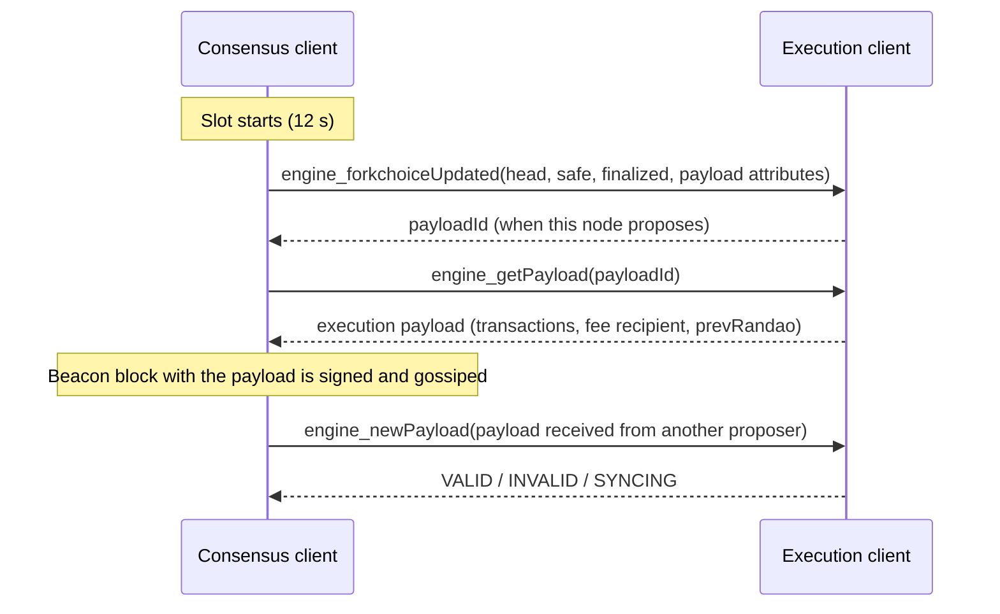

The Merge is the Ethereum upgrade that replaced proof-of-work mining with proof of stake, on 2022-09-15. It joined two chains that had run side by side since December 2020: the original Ethereum chain, which kept its state, transactions and EVM and became the *execution layer*, and the Beacon Chain, a proof-of-stake chain that from then on decided which execution blocks were canonical and became the *consensus layer*. The upgrade had one name on each side: *Paris* on the execution layer and *Bellatrix* on the consensus layer.

Unlike later upgrades, the Merge was not triggered at a block number or a time but when the accumulated proof-of-work difficulty passed a threshold, the *terminal total difficulty*. Its execution-layer changes were deliberately small: two EIPs, [EIP-3675](https://eips.ethereum.org/EIPS/eip-3675) and [EIP-4399](https://eips.ethereum.org/EIPS/eip-4399). This article describes them with the values of the specifications, the Bellatrix changes on the consensus side, the interface that connects the two clients, the two mainnet blocks on each side of the transition, and the impact for contract developers, node operators and stakers.

> This article has been made with the help of [Claude Code](https://claude.com/product/claude-code) and several custom skills

[TOC]

## What you need to know first

The article relies on the following mechanisms without developing them:

- **Proof of work and difficulty.** Before the Merge, a miner sealed a block by finding a `nonce` and `mixHash` that satisfied the Ethash function for the block's `difficulty`. The chain with the most accumulated difficulty, the *total difficulty*, was canonical.
- **Ommers (uncles).** Valid proof-of-work blocks that lost the race to a sibling could be included in a later block and earned a reduced reward; the header committed to them through `ommersHash`.
- **The Beacon Chain.** A proof-of-stake chain launched on 2020-12-01, in which validators who deposited 32 ETH propose and attest to blocks in 12-second slots, grouped in 32-slot epochs. Until the Merge it only agreed on itself and carried no user transactions.
- **RANDAO.** The Beacon Chain's source of randomness: each block proposer reveals a value derived from a signature, and the reveals are mixed into an accumulator, the *RANDAO mix*.
- **Finality.** In the Beacon Chain, a checkpoint becomes *finalized* when two thirds of the staked ETH attest to it in two consecutive epochs; reverting a finalized block requires at least one third of the stake to be slashed.
- **Fee recipient and priority fee.** Since London ([EIP-1559](https://eips.ethereum.org/EIPS/eip-1559)), each transaction pays a burned base fee plus a priority fee to the block's `beneficiary` (`coinbase`).

## Paris at a glance

There is no meta EIP written at the time for Paris. [EIP-7568](https://eips.ethereum.org/EIPS/eip-7568), a later "backfill" meta EIP, points to the execution specification for the list of Paris EIPs and to the `v1.2.0` release of the consensus specification for Bellatrix. The execution specification (`forks/paris/__init__.py`) lists two EIPs:

| EIP | Title | Layer | In one sentence |
|---|---|---|---|
| EIP-3675 | Upgrade consensus to Proof-of-Stake | Execution | Stops proof of work at the terminal block and lets the consensus layer choose the chain. |
| EIP-4399 | Supplant DIFFICULTY opcode with PREVRANDAO | Execution | The `DIFFICULTY` opcode returns the Beacon Chain's RANDAO mix. |

On the consensus side, Bellatrix added the execution payload to the beacon block, the transition rules and stricter penalty parameters; it has no EIP of its own.

### Activation

The Merge happened in two steps. Bellatrix activated first, at a fixed epoch, to prepare beacon blocks to carry execution payloads. Paris then activated when the proof-of-work chain reached the terminal total difficulty (TTD):

| Network | Terminal total difficulty | Expected date |
|---|---|---|
| Ropsten | 50,000,000,000,000,000 | June 8, 2022 |
| Sepolia | 17,000,000,000,000,000 | July 6, 2022 |
| Goerli | 10,790,000 | August 10, 2022 |
| Mainnet | 58,750,000,000,000,000,000,000 | September 15, 2022 |

The table is the upgrade schedule of `forks/paris/__init__.py`, which gives expected dates. On mainnet, Bellatrix activated at epoch 144,896 (2022-09-06 11:34:47 UTC, from the consensus specification's `configs/mainnet.yaml`). The specification records the result as a block number: the first proof-of-stake block is 15,537,394.

EIP-3675 explains why a TTD was used rather than a block number: an attacker with a minority of hash power could build a fork that reaches the block number, and a proof-of-stake block proposed on top of it would become the head, because the proof-of-stake fork choice takes priority during the transition. Total difficulty measures the work done on a chain, so a minority fork cannot reach it first.

## The transition on mainnet

The headers of the last proof-of-work block and the first proof-of-stake block, read from mainnet, show every header change of EIP-3675 at once:

| Field | Block 15,537,393 (terminal PoW) | Block 15,537,394 (first PoS) |
|---|---|---|
| Timestamp (UTC) | 2022-09-15 06:42:42 | 2022-09-15 06:42:59 |
| `difficulty` | 11,055,787,484,078,698 | 0 |
| `nonce` | `0x62a3ee77461d4fc9` | `0x0000000000000000` |
| `mixHash` / `prevRandao` | Ethash mix (`0x4cbec03d…`) | RANDAO mix (`0xa86c2e60…`) |
| `miner` / fee recipient | `0x829bd824…a830` | `0xeee27662…e4c8` |
| `extraData` | 18 bytes (a miner tag) | empty |
| Gas limit / gas used | 30,000,000 / 29,991,429 | 30,000,000 / 29,983,006 |
| Base fee | 43.39 gwei | 48.81 gwei |
| Transactions | 1 | 80 |

The terminal block is unusual: a single transaction used 99.97 % of its gas. Since the block was above the 15M target, the base fee of the first proof-of-stake block rose by close to the maximum 12.5 %, from 43.39 to 48.81 gwei, as under proof of work. The block producer changed from a mining pool to a validator's fee recipient, and the gas limit stayed at 30M.

## The execution layer: EIP-3675

EIP-3675 defines the transition and what the execution layer stops doing. Its stated goal is a minimal change set, so that most contracts and services keep working without intervention.

**Terminal block.** A proof-of-work block is terminal when its total difficulty is at least `TERMINAL_TOTAL_DIFFICULTY` and its parent's is below it. The first proof-of-stake block, the *transition block*, must be a child of a terminal block. Clients also carried a `TERMINAL_BLOCK_HASH` override, set to zero on mainnet (unused).

**Constant header fields.** From the transition block on, fields that proof of work used become constants:

| Field | Value after the Merge |
|---|---|
| `ommersHash` | `0x1dcc4de8…49347`, the hash of an empty list |
| `difficulty` | `0` |
| `nonce` | `0x0000000000000000` |
| `ommers` | `[]` |
| `mixHash` | zero in EIP-3675, then redefined as `prevRandao` by EIP-4399 |

`extraData` is limited to 32 bytes. The block format itself is unchanged, so tools that parse headers keep working.

**Validity and rewards.** The difficulty formula, the Ethash check and every ommer rule are removed. Block and ommer rewards are removed: the fee recipient no longer receives the 2 ETH of issuance per block (`BLOCK_REWARD` in `forks/gray_glacier/fork.py`, the last proof-of-work fork), while transaction fees (the priority fee) are still paid to it. Validator rewards are paid on the consensus layer instead.

**Fork choice and gossip.** The heaviest-chain rule is replaced by the consensus layer's fork choice, which the execution client follows. Block gossip on the execution layer's `eth` protocol is deprecated, since only the consensus layer has the information to validate a block; blocks propagate on the Beacon Chain's network.

## The EVM: EIP-4399 and PREVRANDAO

With `difficulty` fixed at 0, the `DIFFICULTY` opcode (`0x44`) would have returned 0 forever. EIP-4399 makes it return the `prevRandao` field of the header instead, which holds the Beacon Chain's RANDAO mix of the previous slot, and renames the opcode `PREVRANDAO`. The EIP gives the reason for reusing the opcode: many contracts mixed `block.difficulty` into their randomness, and they keep working.

The EIP also notes a side effect: a value above 2⁶⁴ shows that a transaction runs after the Merge, since proof-of-work difficulty was around 2⁵⁴.

The randomness is not unbiased. EIP-4399's security considerations state that:

- **Each proposer has one bit of influence per slot**: it can skip its block to keep the RANDAO mix from updating, at the cost of its rewards.
- **Colluding proposers of n consecutive slots get n bits**, and one honest proposal afterwards removes the bias.
- **A proposer can delay a transaction** to the next block, whose RANDAO value it knows in advance, at almost no cost.
- **Future values are predictable** to a limited extent, and past values completely.

Contracts that need unbiased randomness must therefore use another source, such as a commit-reveal scheme or a verifiable random function oracle.

## The consensus layer: Bellatrix

Bellatrix (`specs/bellatrix/` in the consensus specification) made the beacon block carry the execution block:

- **Execution payload.** The beacon block body gains an `ExecutionPayload`: `parent_hash`, `fee_recipient`, `state_root`, `receipts_root`, `logs_bloom`, `prev_randao`, `block_number`, `gas_limit`, `gas_used`, `timestamp`, `extra_data`, `base_fee_per_gas`, `block_hash` and the list of transactions. The beacon state keeps the header of the latest payload.
- **Transition rules.** The fork choice accepts the first payload only on top of a valid terminal proof-of-work block (`is_valid_terminal_pow_block`), and `is_merge_transition_complete` switches the chain to requiring a payload in every block.
- **Penalties.** Bellatrix applied the final values of three parameters that Altair had set lower during the Beacon Chain's early phase:

| Parameter | Altair | Bellatrix |
|---|---|---|
| `INACTIVITY_PENALTY_QUOTIENT` | 50,331,648 (3 × 2²⁴) | 16,777,216 (2²⁴) |
| `MIN_SLASHING_PENALTY_QUOTIENT` | 64 | 32 |
| `PROPORTIONAL_SLASHING_MULTIPLIER` | 2 | 3 |

A smaller quotient means a larger penalty: the inactivity leak becomes three times faster, the minimum slashing penalty goes from 1/64 to 1/32 of the effective balance, and the correlated slashing penalty is computed with three times the share of slashed stake instead of twice.

- **Optimistic sync.** A consensus client may import blocks whose payload its execution client has not yet validated, in particular while the execution client is still syncing; `specs/bellatrix/optimistic-sync.md` defines how such blocks are tracked and when a validator may build on them.

## Two clients and the Engine API

Since the Merge, a full node runs two programs: an execution client (Geth, Nethermind, Besu, Erigon…) and a consensus client (Prysm, Lighthouse, Teku, Nimbus, Lodestar…). They communicate through the *Engine API*, a JSON-RPC interface specified in the [ethereum/execution-apis](https://github.com/ethereum/execution-apis) repository and authenticated with a shared JWT secret. In each slot:

The consensus client tells the execution client which block is the head and which are safe and finalized; the execution client builds and validates payloads and keeps the state. The payload attributes passed by the consensus client include the timestamp, the RANDAO mix and the validator's fee recipient.

## Impact

### For smart contract developers

- **`block.difficulty` changed meaning.** It returns the RANDAO mix (`block.prevrandao` in Solidity 0.8.18 and later). Contracts that used it as a measure of mining difficulty receive a 256-bit random-looking value; contracts that used it for randomness receive a value that the proposer can bias by one bit per slot.
- **Block times became regular.** Blocks come in 12-second slots, and a slot can be empty when its proposer misses it, so the time between blocks is a multiple of 12 seconds rather than a random interval averaging about 13 seconds. Contracts that convert block numbers into time get a better approximation, but timestamps remain the reliable measure.
- **`block.coinbase` is a validator's fee recipient**, chosen by the validator, not a mining pool.
- **Finality exists.** Applications such as bridges and exchanges can wait for a finalized block, about two epochs (12.8 minutes) behind the head, instead of an arbitrary number of confirmations.
- **No other EVM change.** Gas costs, opcodes other than `0x44`, and transaction formats are the same as in London. The gas history around the Merge is in [Ethereum: A Gas Story]({{site.url_complet}}/2026/10/23/ethereum-a-gas-story/).

### For node operators

- A node needs both an execution client and a consensus client, connected through the Engine API with a JWT secret; an execution client alone can no longer follow the chain.
- The block gas limit is now chosen by block proposers through the value their execution client targets, still within 1/1024 of the parent per block.

### For stakers

- Validators receive the priority fees and any MEV payments of the blocks they propose, through their fee recipient address, in addition to consensus-layer rewards.
- Penalties for inactivity and slashing became stricter with Bellatrix.
- Withdrawals of staked ETH remained impossible. They were enabled by the next upgrade, [Shapella]({{site.url_complet}}/2026/10/23/ethereum-shapella-upgrade-overview/) (April 2023). The staking mechanism is described in [Ethereum Staking - How It Works]({{site.url_complet}}/2024/03/28/ethereum-staking/).

## Conclusion

Paris and Bellatrix, together called the Merge, replaced proof of work with proof of stake on 2022-09-15, at block 15,537,394:

- **The trigger was a total difficulty**, 58,750,000,000,000,000,000,000 on mainnet, so that the transition followed the chain with the most work; Bellatrix had activated beforehand, at epoch 144,896.
- **EIP-3675 turned proof-of-work fields into constants** (`difficulty` 0, `nonce` 0, no ommers), removed block rewards, and gave fork choice and block gossip to the consensus layer, while keeping the block format and the EVM unchanged.
- **EIP-4399 reused the `DIFFICULTY` opcode as `PREVRANDAO`**, returning the RANDAO mix, a value each proposer can bias by one bit per slot.
- **Bellatrix put the execution payload inside the beacon block** and applied final, stricter inactivity and slashing penalties.
- **Nodes became two programs** linked by the Engine API, and validators replaced miners as block producers and fee recipients; staked ETH could not yet be withdrawn.

## Annex

### Key Terms

| Term | Definition |
|------|------------|
| **The Merge** | The 2022 upgrade, Paris plus Bellatrix, that replaced proof of work with the Beacon Chain's proof of stake. |
| **Paris / Bellatrix** | The execution-layer and consensus-layer names of the Merge. |
| **Execution layer** | The part of Ethereum that holds the state and executes transactions in the EVM, run by an execution client. |
| **Consensus layer** | The proof-of-stake Beacon Chain that decides which execution blocks are canonical, run by a consensus client. |
| **Terminal total difficulty (TTD)** | The accumulated difficulty at which proof of work stopped; 58,750,000,000,000,000,000,000 on mainnet. |
| **Terminal block** | The last proof-of-work block: the first whose total difficulty reaches the TTD while its parent's is below it. |
| **Transition block** | The first proof-of-stake block, a child of the terminal block; block 15,537,394 on mainnet. |
| **Ommer** | A proof-of-work block included by reference in a later block; ommers are always empty after the Merge. |
| **RANDAO mix** | The Beacon Chain's accumulated randomness, updated with each proposer's reveal. |
| **PREVRANDAO** | The opcode `0x44`, formerly `DIFFICULTY`, which returns the RANDAO mix since EIP-4399. |
| **Execution payload** | The execution block carried inside a beacon block since Bellatrix. |
| **Engine API** | The authenticated JSON-RPC interface through which a consensus client drives an execution client. |
| **Fork choice** | The rule that selects the head of the chain; since the Merge, the consensus layer's rule replaces the heaviest proof-of-work chain. |
| **Finalized block** | A block that two thirds of the stake have justified in two consecutive epochs, which cannot be reverted without slashing. |
| **Fee recipient** | The address a validator designates to receive the priority fees of the blocks it proposes. |
| **Optimistic sync** | Importing beacon blocks whose execution payload has not yet been validated by the execution client. |
| **Inactivity leak** | The growing penalty applied to inactive validators when the chain cannot finalize. |

## Frequently Asked Questions

**Q: Why was the Merge triggered by total difficulty instead of a block number?**

EIP-3675 describes the attack a block number would allow: a minority of hash power builds a fork that reaches the block height, a proof-of-stake block is proposed on top of it, and since the proof-of-stake fork choice takes priority, that fork becomes the head. Total difficulty measures the work accumulated on a chain, so only the chain with the most work could trigger the transition.

**Q: Which header fields changed at the transition block, and what did they become?**

`difficulty` became 0, `nonce` became zero, `ommers` became an empty list and `ommersHash` the hash of an empty list. `mixHash` was kept as a field but now carries the RANDAO mix, under the name `prevRandao`. `extraData` was limited to 32 bytes. The other fields, including the gas limit and the base fee, kept their meaning, and the block format did not change.

**Q: Can a contract use `block.prevrandao` as a secure source of randomness?**

Not for anything valuable. EIP-4399 states that each proposer has one bit of influence per slot, by skipping its block, and that a proposer can also delay a transaction into the next block, whose RANDAO value it already knows. A lottery or game with a prize larger than a block's rewards gives proposers a reason to bias it. A commit-reveal scheme or a verifiable random function oracle avoids that.

**Q: What does a node operator run after the Merge that it did not run before?**

A consensus client, next to the execution client. The consensus client follows the Beacon Chain, decides the head and finality, and passes them to the execution client through the Engine API, authenticated with a shared JWT secret. The execution client keeps the state, executes transactions and builds or validates payloads.

**Q: What happened to block rewards and to transaction fees?**

The 2 ETH block reward and the ommer rewards of proof of work were removed by EIP-3675. Validators are rewarded on the consensus layer instead. Transaction fees were unchanged: the base fee is still burned, and the priority fee goes to the fee recipient, which is now an address chosen by the proposing validator rather than by a mining pool.

**Q: Could stakers withdraw their ETH after the Merge?**

No. The Merge moved block production to the Beacon Chain but did not add withdrawals. Staked ETH and rewards stayed locked until the Shapella upgrade of April 2023.

**Q: How did Bellatrix change penalties, and why does a smaller quotient mean a larger penalty?**

Penalties are computed by dividing a balance by a quotient. Bellatrix lowered the inactivity penalty quotient from 3 × 2²⁴ to 2²⁴ and the minimum slashing quotient from 64 to 32, and raised the proportional slashing multiplier from 2 to 3. Dividing by a smaller number gives a larger result, so the inactivity leak became three times faster and the minimum slashing penalty doubled.

## Gaps

The following points were not settled by the sources used for this article:

| Gap | Why it matters | What to read or verify |
|---|---|---|
| The total difficulty of the terminal block is not given: the RPC endpoints queried no longer return `totalDifficulty`. | It would show by how much the terminal block passed the TTD. | An archive node that keeps total difficulty, or an Etherscan block page for 15,537,393. |
| The testnet dates are the "expected dates" of the specification's table, not observed activation times. | Actual transition times on Ropsten, Sepolia and Goerli may differ slightly. | Block headers at the transition on each testnet. |
| The Engine API method names, the JWT authentication and the payload attributes are described from general knowledge; the execution-apis repository was not read for this article. | The exact method versions and fields are defined there, not in EIP-3675. | `src/engine/paris.md` and `src/engine/authentication.md` in ethereum/execution-apis. |
| The average proof-of-work block time of about 13 seconds is general knowledge. | It is used to contrast with the 12-second slots. | Block timestamps before block 15,537,394. |
| The Solidity version that introduced `block.prevrandao` (0.8.18) is general knowledge. | Contracts compiled with older versions only have `block.difficulty`. | The Solidity 0.8.18 release notes. |
| Why the terminal block contained a single transaction using almost all its gas is not explained. | It is visible in the data but its purpose is not documented here. | The transaction of block 15,537,393 on a block explorer. |
| The reduction in energy consumption, often cited for the Merge, is not covered. | No source for a figure was read for this article. | Studies published after September 2022 on Ethereum's energy use. |

## References

### Specifications

- [EIP-3675: Upgrade consensus to Proof-of-Stake](https://eips.ethereum.org/EIPS/eip-3675)
- [EIP-4399: Supplant DIFFICULTY opcode with PREVRANDAO](https://eips.ethereum.org/EIPS/eip-4399)
- [EIP-1559: Fee market change for ETH 1.0 chain](https://eips.ethereum.org/EIPS/eip-1559)
- [EIP-7568: Hardfork Meta Backfill - Berlin to Shapella](https://eips.ethereum.org/EIPS/eip-7568)
- [ethereum/execution-apis](https://github.com/ethereum/execution-apis) — Engine API specification

### Analyzed source and data

- [ethereum/execution-specs](https://github.com/ethereum/execution-specs) — analyzed at commit [`aaae5abd382b6c0612add96bd8400d6fa4eb0617`](https://github.com/ethereum/execution-specs/tree/aaae5abd382b6c0612add96bd8400d6fa4eb0617), 2026-10-23 (`forks/paris/`)
- [ethereum/consensus-specs](https://github.com/ethereum/consensus-specs) — analyzed at commit [`065bcd5c6ad96186cd2c0ac1c435f620a0b25373`](https://github.com/ethereum/consensus-specs/tree/065bcd5c6ad96186cd2c0ac1c435f620a0b25373), 2026-10-23 (`specs/bellatrix/`, `specs/altair/beacon-chain.md`, `configs/mainnet.yaml`)
- Mainnet blocks 15,537,393 to 15,537,395 read with `eth_getBlockByNumber` on `ethereum-rpc.publicnode.com`, 2026-10-23

### Related articles

- [Ethereum Staking - How It Works]({{site.url_complet}}/2024/03/28/ethereum-staking/)
- [Ethereum: A Gas Story]({{site.url_complet}}/2026/10/23/ethereum-a-gas-story/)
- [Ouroboros: How Cardano Reaches Consensus with Proof of Stake]({{site.url_complet}}/2026/07/16/ouroboros-proof-of-stake/)
