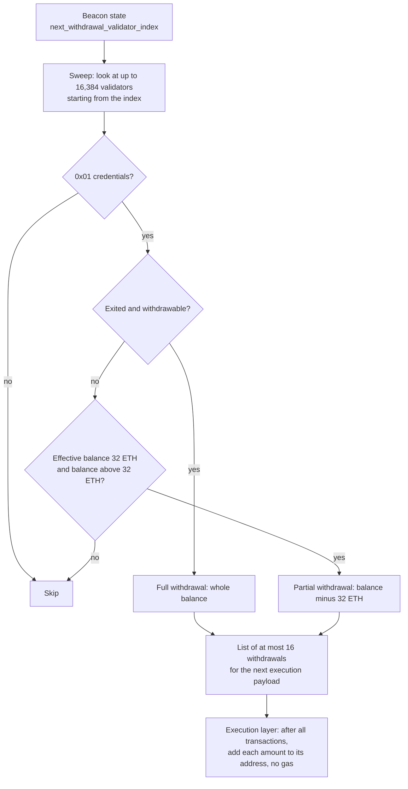

Shapella is the Ethereum network upgrade activated on mainnet on 2023-04-12, the first one after [the Merge]({{site.url_complet}}/2026/10/23/ethereum-paris-merge-upgrade-overview/). Its name joins *Shanghai*, the execution-layer upgrade, and *Capella*, the consensus-layer upgrade, and it was the first upgrade activated on both layers at the same moment, which required the execution layer to schedule forks by timestamp instead of block number.

Its main change was the one that the Merge had left out: validators could deposit ETH since December 2020 but could not withdraw it. Shapella added withdrawals, pushed by the beacon chain into the execution layer without gas, and a way for validators to set an execution address to receive them. On the execution side, it added the `PUSH0` instruction, limited and priced contract initcode, made the block producer's address cheaper to access, and announced that `SELFDESTRUCT` would change.

> This article has been made with the help of [Claude Code](https://claude.com/product/claude-code) and several custom skills

[TOC]

## What you need to know first

The article relies on the following mechanisms without developing them:

- **Execution layer and consensus layer.** Since the Merge, an Ethereum node runs an execution client (transactions, EVM, state) and a consensus client (validators, beacon chain). An upgrade has a name on each layer; Shapella is Shanghai plus Capella.
- **Validator and effective balance.** A validator is a stake of at least 32 ETH with a BLS key. Its *effective balance* used for rewards was capped at 32 ETH (`MAX_EFFECTIVE_BALANCE`) until Pectra, so rewards above 32 ETH accumulated without earning more.
- **Withdrawal credentials.** A 32-byte field set at deposit that says who controls the stake's withdrawal. The prefix `0x00` means a BLS public key hash; the prefix `0x01` means an execution-layer address in the last 20 bytes.
- **Initcode.** The code run once when a contract is created, which returns the code to deploy. It is sent as the data of a creation transaction or passed to `CREATE` / `CREATE2`.
- **Cold and warm access.** Since Berlin ([EIP-2929](https://eips.ethereum.org/EIPS/eip-2929)), the first access to an account in a transaction costs 2,600 gas (cold) and later ones 100 (warm).
- **Fork scheduling.** Upgrades on the execution layer were activated at a block number until the Merge. A post-Merge upgrade has to activate at the same moment as its consensus counterpart, which is defined by an epoch, so the execution layer moved to timestamps ([EIP-6953](https://eips.ethereum.org/EIPS/eip-6953), [EIP-6122](https://eips.ethereum.org/EIPS/eip-6122)).

## Shapella at a glance

Shapella had no meta EIP at the time. [EIP-7568](https://eips.ethereum.org/EIPS/eip-7568), written later to backfill the upgrades without one, points to the Shanghai list of the execution specification and to the `v1.3.0` release of the consensus specification for Capella. The Shanghai part, as listed in `forks/shanghai/__init__.py` of the execution specification:

| EIP | Title | Layer | In one sentence |
|---|---|---|---|
| [EIP-4895](https://eips.ethereum.org/EIPS/eip-4895) | Beacon chain push withdrawals as operations | Both | Withdrawals enter the execution layer as gas-free system operations. |
| [EIP-3651](https://eips.ethereum.org/EIPS/eip-3651) | Warm COINBASE | Execution | The block producer's address starts warm in every transaction. |
| [EIP-3855](https://eips.ethereum.org/EIPS/eip-3855) | PUSH0 instruction | Execution | A one-byte, 2-gas instruction that pushes zero. |
| [EIP-3860](https://eips.ethereum.org/EIPS/eip-3860) | Limit and meter initcode | Execution | Initcode limited to 49,152 bytes and charged 2 gas per 32-byte word. |
| [EIP-6049](https://eips.ethereum.org/EIPS/eip-6049) | Deprecate SELFDESTRUCT | Notice | No change in behaviour; a warning that `SELFDESTRUCT` would change. |

Capella, specified in `specs/capella/` of the consensus specification, adds the withdrawal sweep, the change of withdrawal credentials from `0x00` to `0x01`, and a new historical accumulator.

### Activation

From the upgrade schedule of `forks/shanghai/__init__.py` and `CAPELLA_FORK_EPOCH` of the consensus configuration:

| Network | Date and time (UTC) | Epoch |
|---|---|---|
| Sepolia | 2023-02-28 04:04:48 | 56,832 |
| Goerli | 2023-03-14 22:25:36 | 162,304 |
| Mainnet | 2023-04-12 22:27:35 | 194,048 |

Mainnet headers show the transition. Block 17,034,869 has no `withdrawalsRoot`; block 17,034,870, the first Shanghai block, has one but carries no withdrawal; it was produced 24 seconds after the fork time, two slots later. Block 17,034,871 carried the first three withdrawals, starting with withdrawal index 0 for validator 24,862 (4.4515 ETH). From then on, blocks carried up to 16 withdrawals each, the per-payload maximum.

## Staking withdrawals

Withdrawals take two steps. The consensus layer decides who is paid and how much; the execution layer credits the ETH.

### Capella: the withdrawal sweep

The consensus layer keeps a pointer, `next_withdrawal_validator_index`, and in each block examines validators from that index onwards (`get_validators_sweep_withdrawals` in `specs/capella/beacon-chain.md`). For each validator with `0x01` credentials:

- **Full withdrawal**: if the validator has exited and reached its withdrawable epoch, its whole balance is withdrawn.
- **Partial withdrawal**: if its effective balance is 32 ETH and its balance is higher, the excess above 32 ETH is withdrawn.

The sweep stops when it has collected `MAX_WITHDRAWALS_PER_PAYLOAD` = 16 withdrawals or examined `MAX_VALIDATORS_PER_WITHDRAWALS_SWEEP` = 16,384 validators. Withdrawals are therefore automatic: a validator does nothing to receive its rewards above 32 ETH, and the interval between two payments depends on the number of validators and on how many are eligible.

### Capella: changing the credentials

Validators created with `0x00` (BLS) credentials could not be withdrawn to, since they had no execution address. Capella adds a `BLSToExecutionChange` operation: signed with the withdrawal BLS key, it replaces `0x00` credentials once and for all with `0x01` credentials pointing to an execution address. A block can include up to `MAX_BLS_TO_EXECUTION_CHANGES` = 16 such operations.

### Shanghai: EIP-4895, withdrawals as operations

On the execution side, EIP-4895 adds a `withdrawals` list to the execution payload and a `withdrawalsRoot` to the header. Each withdrawal is `[index, validator_index, address, amount]`, with the amount in gwei. After all transactions of the block, the execution client adds each amount to its address.

The EIP's design choices explain how withdrawals behave for contracts:

- **No transaction and no gas.** A withdrawal is a *system-level operation*, not a transaction. The EIP justifies the absence of gas by the bound the consensus layer sets on the number of withdrawals per block.
- **No code execution.** The balance of the recipient increases without calling it, so a contract receiving withdrawals has no `receive` or fallback function run, and cannot refuse them. The EIP chose this so that a withdrawal can never fail.
- **Push, not pull.** Withdrawals are delivered when the consensus layer dequeues them; nobody has to claim them.

## EVM changes

### EIP-3855: PUSH0

Before Shanghai, pushing zero cost `PUSH1 0x00`: 3 gas and two bytes of code. Compilers often replaced it with cheaper one-byte opcodes whose value happens to be zero, such as `RETURNDATASIZE` or `CALLVALUE`. EIP-3855 adds `PUSH0` (opcode `0x5F`), which costs 2 gas and one byte. The EIP measured that about 11.5 % of executed `PUSH*` instructions pushed zero, and that 340,557,331 bytes of deployed code were `PUSH1 00`.

The change had a side effect outside mainnet. Solidity 0.8.20 made Shanghai its default EVM version, so its output contains `PUSH0`, and its [release announcement](https://www.soliditylang.org/blog/2023/05/10/solidity-0.8.20-release-announcement/) warns that on chains which do not yet support `PUSH0`, "such as L2 chains", deployment fails unless an older EVM version is selected.

### EIP-3860: limit and meter initcode

Before Shanghai, initcode had no size limit and, when passed to `CREATE` or `CREATE2`, no cost proportional to its size, although clients must analyse it for valid jump destinations before running it. EIP-3860 sets:

- a maximum initcode size of 49,152 bytes, twice the 24,576-byte code size limit (`MAX_INIT_CODE_SIZE = 2 * MAX_CODE_SIZE` in `forks/shanghai/vm/interpreter.py`);
- a cost of 2 gas per 32-byte word of initcode, for creation transactions and for `CREATE` / `CREATE2`; at the limit, 3,072 gas.

A creation transaction with larger initcode is invalid; a `CREATE` or `CREATE2` with larger initcode fails.

### EIP-3651: warm COINBASE

Searchers and builders often pay the block producer directly by sending ETH to `block.coinbase` from a contract, which makes the payment conditional on the transaction succeeding. Since Berlin, that first access to the coinbase address cost 2,600 gas. EIP-3651 adds the coinbase to the set of warm addresses at the start of each transaction, so the access costs 100. The EIP's motivation is that the price difference pushed payments towards tokens instead of ETH.

### EIP-6049: SELFDESTRUCT deprecated

EIP-6049 changes nothing in the protocol. It records that `SELFDESTRUCT` is deprecated and that its behaviour is expected to change. The change came one upgrade later with [EIP-6780](https://eips.ethereum.org/EIPS/eip-6780) in Dencun, which restricted `SELFDESTRUCT` to contracts created in the same transaction.

## Historical summaries

Capella replaces the beacon state's `historical_roots` accumulator with `historical_summaries`. Each `HistoricalSummary` keeps the block roots and state roots of a period separately, whereas the old accumulator mixed them. The specification states the purpose: with separate accumulators, the whole block history leading to a state can be verified from the state and the blocks alone.

## Impact

### For smart contract developers

- **Contracts can receive ETH without running code.** Since Shapella, a contract can be credited by a withdrawal without its `receive` function running, in addition to the older cases (block rewards before the Merge, `SELFDESTRUCT` to an address). Accounting that tracks ETH received only through `receive` can drift from `address(this).balance`.
- **Compiler target.** Bytecode compiled for Shanghai or later contains `PUSH0` and does not deploy on a chain that lacks it.
- **Factories.** Contracts that deploy large initcode through `CREATE` or `CREATE2` pay 2 gas per word and fail above 49,152 bytes.
- **Builder payments.** Paying `block.coinbase` from a contract costs 2,500 gas less.

### For stakers and node operators

- Staked ETH became withdrawable for the first time, both rewards above 32 ETH (automatically) and full balances after exit.
- Validators with `0x00` credentials needed a one-time signed change to `0x01` before receiving any withdrawal.
- Node operators had to upgrade both clients for the same timestamp and epoch; the execution clients released for Shanghai include Geth 1.11.5, Nethermind 1.17.3, Besu 23.1.2 and Erigon 2.41.0.

## Conclusion

Shapella, activated on 2023-04-12 at epoch 194,048, added the withdrawals that the move to proof of stake had left out:

- **Withdrawals**: Capella's sweep selects up to 16 withdrawals per block from up to 16,384 validators, full for exited validators and partial for balances above 32 ETH; EIP-4895 credits them on the execution layer after the transactions, with no gas and no code execution.
- **Credentials**: a one-time `BLSToExecutionChange` moves a validator from `0x00` to `0x01` credentials so that it can be paid.
- **EVM**: `PUSH0` at 2 gas, an initcode limit of 49,152 bytes with 2 gas per word, a warm coinbase, and a deprecation notice for `SELFDESTRUCT`.
- **Process**: the first upgrade activated on both layers at once, scheduled by timestamp on the execution layer.

The upgrades that followed are covered in the same series, among them [Ethereum Upgrade Pectra - Overview]({{site.url_complet}}/2025/05/02/ethereum-pectra-upgrade/), which reworked withdrawals again with exits triggered from the execution layer and validators of up to 2,048 ETH.

## Annex

### Key Terms

| Term | Definition |
|------|------------|
| **Shanghai / Capella** | The execution-layer and consensus-layer names of the Shapella upgrade. |
| **Withdrawal credentials** | The field of a validator that says who controls its withdrawals; `0x00` for a BLS key hash, `0x01` for an execution address. |
| **BLSToExecutionChange** | A Capella operation, signed with the withdrawal BLS key, that changes `0x00` credentials to `0x01` once. |
| **Effective balance** | The balance used for a validator's rewards and duties, capped at 32 ETH at the time of Shapella. |
| **Full withdrawal** | The payment of a validator's whole balance after it has exited and reached its withdrawable epoch. |
| **Partial withdrawal** | The automatic payment of a validator's balance above 32 ETH. |
| **Withdrawal sweep** | The consensus-layer loop that examines validators in order from a stored index and builds each block's withdrawals. |
| **System-level operation** | An action applied by the protocol rather than by a user transaction, such as a withdrawal under EIP-4895. |
| **withdrawalsRoot** | The header field added by Shanghai that commits to the block's list of withdrawals. |
| **PUSH0** | The opcode `0x5F`, added by EIP-3855, that pushes zero for 2 gas. |
| **Initcode** | The code run at contract creation to produce the deployed code, limited to 49,152 bytes since Shanghai. |
| **COINBASE** | The address of the block's fee recipient, warm from the start of every transaction since EIP-3651. |
| **Historical summaries** | The Capella accumulator of block roots and state roots that replaced `historical_roots`. |
| **Timestamp-based fork** | An upgrade activated at a block timestamp rather than a block number, used on the execution layer since Shanghai. |

## Frequently Asked Questions

**Q: Why could stakers not withdraw before Shapella?**

The beacon chain launched in December 2020 with deposits only, and the Merge in September 2022 joined it to the execution layer without adding withdrawals. Withdrawing needs both a consensus rule that decides who is paid and an execution mechanism that credits ETH; Capella provided the first and EIP-4895 the second.

**Q: What is the difference between a full and a partial withdrawal?**

A full withdrawal pays a validator's whole balance once it has exited and reached its withdrawable epoch. A partial withdrawal pays only the amount above 32 ETH of a validator still active with an effective balance of 32 ETH. Both happen automatically in the sweep, and both require `0x01` credentials.

**Q: Why do withdrawals cost no gas, and what does that mean for a receiving contract?**

EIP-4895 treats withdrawals as system-level operations whose number per block is bounded by the consensus layer (16), so their cost on the execution layer is small and the EIP charges none. The recipient's balance increases without any call, so a contract's `receive` function is not run, and the contract cannot reject the ETH.

**Q: How often is a given validator paid a partial withdrawal?**

The sweep examines up to 16,384 validators per block and stops after 16 withdrawals, so it advances through the validator set at a rate that depends on how many validators are eligible. The interval for one validator is the time the sweep takes to come back to its index, which grows with the number of validators; the specification does not fix it.

**Q: What did PUSH0 change for compiled contracts, and why did it cause deployment failures on some chains?**

`PUSH0` replaces the two-byte, 3-gas `PUSH1 0x00` with a one-byte, 2-gas instruction, which reduces both code size and execution cost. Solidity 0.8.20 made Shanghai its default target, so contracts compiled with default settings contain `PUSH0`; on a chain whose EVM did not support it yet, those contracts failed to deploy until the developer selected an older EVM version.

**Q: Why did EIP-3860 charge for initcode when calldata was already paid for?**

Calldata is paid only by a creation transaction. Initcode passed to `CREATE` or `CREATE2` from a contract is built in memory and had no cost proportional to its size, although clients must analyse it for jump destinations before running it. EIP-3860 adds 2 gas per 32-byte word in all three cases and a size limit of 49,152 bytes.

**Q: Did EIP-6049 remove SELFDESTRUCT?**

No. It only declared the opcode deprecated and warned that its behaviour would change. The change came in Dencun with EIP-6780: `SELFDESTRUCT` deletes a contract only when called in the transaction that created it, and otherwise only sends the balance.

## Gaps

The following points were not settled by the sources used for this article:

| Gap | Why it matters | What to read or verify |
|---|---|---|
| The Capella text quoted here comes from the current consensus specification, whose withdrawal functions were refactored after Capella. | The behaviour is described as at Capella, but function names and structure differ from the `v1.3.0` release cited by EIP-7568. | `specs/capella/beacon-chain.md` at the `v1.3.0` tag of consensus-specs. |
| Why block 17,034,870 carried no withdrawal is not established. | It may reflect the proposer's client or the empty sweep at the fork slot. | The beacon block of the corresponding slot on a beacon chain explorer. |
| The time for the sweep to visit every validator is not computed. | It sets how often a validator receives its rewards. | The number of validators and eligible withdrawals in April 2023, from beacon chain data. |
| Which L2 chains lacked `PUSH0` and when each added it is not documented. | The deployment failures depended on each chain's EVM version. | The release notes of each L2 for its Shanghai-equivalent upgrade. |
| The volume of `BLSToExecutionChange` operations and the queue of withdrawals after activation are not covered. | They determined how fast stakers could actually withdraw. | Beacon chain explorers and analyses of April and May 2023. |
| The consensus-layer client versions released for Capella are not listed. | Only the execution-layer releases appear in the execution specification. | Release notes of Prysm, Lighthouse, Teku, Nimbus and Lodestar for Capella. |

## References

### Specifications

- [EIP-7568: Hardfork Meta Backfill — Berlin to Shapella](https://eips.ethereum.org/EIPS/eip-7568)
- [EIP-4895: Beacon chain push withdrawals as operations](https://eips.ethereum.org/EIPS/eip-4895)
- [EIP-3651: Warm COINBASE](https://eips.ethereum.org/EIPS/eip-3651)
- [EIP-3855: PUSH0 instruction](https://eips.ethereum.org/EIPS/eip-3855)
- [EIP-3860: Limit and meter initcode](https://eips.ethereum.org/EIPS/eip-3860)
- [EIP-6049: Deprecate SELFDESTRUCT](https://eips.ethereum.org/EIPS/eip-6049)
- [EIP-6122: Forkid checks based on timestamps](https://eips.ethereum.org/EIPS/eip-6122)
- [EIP-6953: Network Upgrade Activation Triggers](https://eips.ethereum.org/EIPS/eip-6953)
- [EIP-2929: Gas cost increases for state access opcodes](https://eips.ethereum.org/EIPS/eip-2929)
- [EIP-6780: SELFDESTRUCT only in same transaction](https://eips.ethereum.org/EIPS/eip-6780)
- [Solidity 0.8.20 Release Announcement](https://www.soliditylang.org/blog/2023/05/10/solidity-0.8.20-release-announcement/), 2023-05-10

### Analyzed source and data

- [ethereum/execution-specs](https://github.com/ethereum/execution-specs) — analyzed at commit [`aaae5abd382b6c0612add96bd8400d6fa4eb0617`](https://github.com/ethereum/execution-specs/tree/aaae5abd382b6c0612add96bd8400d6fa4eb0617), 2026-10-23 (`forks/shanghai/`)
- [ethereum/consensus-specs](https://github.com/ethereum/consensus-specs) — analyzed at commit [`065bcd5c6ad96186cd2c0ac1c435f620a0b25373`](https://github.com/ethereum/consensus-specs/tree/065bcd5c6ad96186cd2c0ac1c435f620a0b25373), 2026-10-23 (`specs/capella/`, `configs/mainnet.yaml`)
- Mainnet blocks 17,034,869 to 17,034,874, 17,034,880 and 17,035,000 read with `eth_getBlockByNumber` on `ethereum-rpc.publicnode.com`, 2026-10-23

### Related articles

- [Ethereum Staking - How It Works]({{site.url_complet}}/2024/03/28/ethereum-staking/)
- [Ethereum: A Gas Story]({{site.url_complet}}/2026/10/23/ethereum-a-gas-story/)
- [Solidity Gas Optimization Cheatsheet]({{site.url_complet}}/2023/09/27/gas-optimization/)
- [EIP-6780, selfdestruct, we won't miss you]({{site.url_complet}}/2024/03/13/EIP-6780-selfdestruct/)
