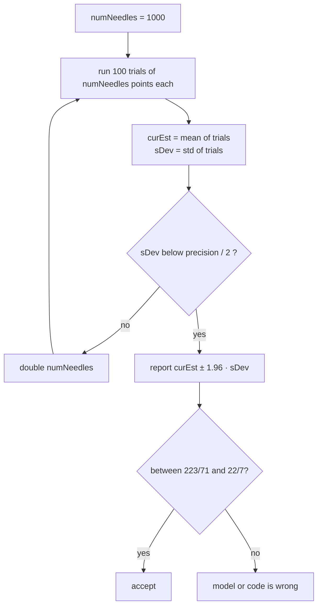

A simulation returns a number, and the number alone says nothing about how far it could be from the quantity it estimates. Lecture 7 of MIT 6.0002, *Introduction to Computational Thinking and Data Science*, gives the tools to attach an error bar to that number: the normal distribution and its density function, the empirical rule that turns a standard deviation into a coverage probability, and the central limit theorem that explains why the rule still applies when the underlying data are not normal at all.

The lecture ends with a Monte Carlo estimate of $$\pi$$ obtained by dropping random points in a square. It is used twice: once to show how to keep sampling until an estimate is precise enough, and once, after a one-character bug, to show that a tight and statistically valid confidence interval can sit around the wrong value. This article follows the lecture, reproduces its code, checks its numbers, and states precisely what a 95 % confidence interval guarantees, which the lecture phrases more loosely.

> This article has been made with the help of [Claude Code](https://claude.com/product/claude-code) and several custom skills

> **Source and currency note.** This article is based on lecture 7, "Confidence Intervals", of [MIT 6.0002 Introduction to Computational Thinking and Data Science](https://ocw.mit.edu/courses/6-0002-introduction-to-computational-thinking-and-data-science-fall-2016/) (JG, MIT OpenCourseWare, Fall 2016), its slides, transcript and lecture code, and the [lecture video](https://www.youtube.com/watch?v=rUxP7TM8-wo). The course uses Python 3.5 and `pylab`. Since then, `pylab` has been discouraged by the matplotlib developers in favour of importing `matplotlib.pyplot` and `numpy` explicitly, `numpy.random.default_rng()` has replaced the global random state for new code, and SciPy is still the place to find `scipy.integrate.quad`. The code below keeps the lecture's logic; where it is condensed or rewritten with NumPy, the text says so.

[TOC]

## What you need to know first

The article assumes basic Python and the following notions, which the course introduced in earlier lectures.

- **Random variable, expectation and variance.** A random variable is a quantity whose value is drawn from a distribution; its expectation $$\mu$$ is the long-run average and its variance $$\sigma^2$$ the average squared distance to $$\mu$$. The standard deviation $$\sigma$$ is the square root of the variance, in the same unit as the variable.
- **Population and sample.** A population is the full set of possible examples; a sample is a subset drawn from it. Statistics computed on a sample (the sample mean, the sample standard deviation) estimate the corresponding population quantities.
- **Independence.** Draws are independent when the outcome of one gives no information on another. The central limit theorem below needs independent draws from one distribution, which is what calls to `random.random()` provide.
- **Monte Carlo simulation.** Estimating a quantity by running a random experiment many times and averaging the results. The previous lecture used it on roulette; [Monte Carlo Simulation for DeFi Risk Analysis - From Random Sampling to a Stay-or-Exit Decision]({{site.url_complet}}/2026/10/10/monte-carlo-defi-risk-analysis/) applies the same method, with the same $$\pm 1.96\,\hat\sigma/\sqrt N$$ error bar, to the loss distribution of a DeFi position.
- **Integral as area.** The definite integral $$\int_a^b f(x)\,dx$$ is the area under $$f$$ between $$a$$ and $$b$$, and differentiation undoes integration. Both facts are needed to read a probability density function.
- **The empirical rule.** Stated in the previous lecture: for a normal distribution, about 68 % of values lie within one standard deviation of the mean, 95 % within 1.96 and 99.7 % within three. This lecture checks it and asks why it applies to non-normal data.

## Generating normal values and reading a histogram

Python's standard library draws normal (Gaussian) values with `random.gauss(mu, sigma)`. The lecture draws one million values with mean 0 and standard deviation 100 and plots them:

```python
import random, pylab

dist, numSamples = [], 1000000
for i in range(numSamples):
    dist.append(random.gauss(0, 100))

v = pylab.hist(dist, bins=100,
               weights=[1/numSamples]*len(dist))
pylab.xlabel('x')
pylab.ylabel('Relative Frequency')
print('Fraction within ~200 of mean =', sum(v[0][30:70]))
```

Two features of `pylab.hist` are new in this code:

- **`weights`.** By default each value adds 1 to the height of its bin, so the y-axis shows counts. Giving every value the weight $$1/N$$ makes the bar heights fractions of the sample that sum to 1, which is easier to read.
- **The return value.** `hist` returns a tuple whose first element holds the bar heights and whose second describes the bins (the lecture says "patches"; in matplotlib the tuple is `(n, bins, patches)`). Summing `v[0][30:70]` adds up 40 of the 100 bars.

The lecture's run prints `0.957147`, and the lecture reads it as the fraction within two standard deviations, slightly above 95 % because the exact factor for 95 % is 1.96 and not 2. The exact fraction within $$\pm 2\sigma$$ is 95.45 %.

**A caveat the lecture does not mention.** `hist` spreads its 100 bins between the minimum and maximum of the data, not over a fixed range, so bars 30 to 69 cover "about $$\pm 200$$" only because a million normal draws happen to end near $$\pm 500$$. With a NumPy run of the same experiment (seed 1), the extremes were −481 and +504, so the 40 central bins spanned −185.7 to +208.4 and held 94.99 % of the values. The robust form counts directly: `sum(abs(x) <= 200 for x in dist) / numSamples`.

## Probability density functions

A continuous distribution is described by its probability density function (PDF) $$f$$. For the normal distribution with mean $$\mu$$ and standard deviation $$\sigma$$:

$$
\begin{aligned}
f(x) = \frac{1}{\sigma\sqrt{2\pi}}\, e^{-\frac{(x-\mu)^2}{2\sigma^2}}
\end{aligned}
$$

The lecture implements the formula literally and plots it for the standard normal ($$\mu = 0$$, $$\sigma = 1$$) on $$[-4, 4]$$, in steps of 0.05:

```python
def gaussian(x, mu, sigma):
    factor1 = 1.0 / (sigma * (2 * pylab.pi) ** 0.5)
    factor2 = pylab.e ** -(((x - mu) ** 2) / (2 * sigma ** 2))
    return factor1 * factor2
```

Nothing in this function is random: it maps $$x$$ to a number. The question is what that number means.

**The y-values are not probabilities.** The peak of the standard normal is $$1/\sqrt{2\pi} \approx 0.399$$, yet the probability that a continuous variable takes any single exact value is 0. The y-value can also exceed 1: shrink $$\sigma$$ and the peak $$1/(\sigma\sqrt{2\pi})$$ grows without bound. The lecture says that $$\sigma = 0.1$$ gives a peak "something like 40"; the formula gives 3.99 for $$\sigma = 0.1$$, and a peak near 40 needs $$\sigma = 0.01$$. The argument holds either way.

**They are densities.** A density is the derivative of the cumulative distribution function $$F(x) = P(X \le x)$$, so $$f = F'$$. Probabilities are areas under the density:

$$
\begin{aligned}
P(a \le X \le b) = \int_a^b f(x)\,dx = F(b) - F(a)
\end{aligned}
$$

A density is a probability per unit of $$x$$: $$f(x)\,\Delta x$$ approximates the probability of a small interval of width $$\Delta x$$ around $$x$$. That is why the scale of the y-axis depends on the unit of the x-axis, and why the only questions worth asking of a PDF are questions about area.

## Checking the empirical rule by numerical integration

`scipy.integrate.quad(func, a, b, args)` integrates `func` over $$[a, b]$$ and returns a pair: the estimated integral and an estimate of its absolute error. The optional `args` tuple supplies every argument of `func` after the first, which is how `gaussian(x, mu, sigma)` is integrated over `x` with `mu` and `sigma` fixed. The result is numerical, not symbolic: `quad` wraps the Fortran QUADPACK library, which uses adaptive Gauss–Kronrod quadrature.

The lecture checks the rule for randomly chosen normal distributions:

```python
import random, scipy.integrate

def checkEmpirical(numTrials):
    for t in range(numTrials):
        mu = random.randint(-10, 10)
        sigma = random.randint(1, 10)
        print('For mu =', mu, 'and sigma =', sigma)
        for numStd in (1, 1.96, 3):
            area = scipy.integrate.quad(gaussian,
                                        mu - numStd*sigma,
                                        mu + numStd*sigma,
                                        (mu, sigma))[0]
            print(' Fraction within', numStd, 'std =', round(area, 4))
```

The slides show three trials, with $$\mu = 9, \sigma = 6$$, then $$\mu = -6, \sigma = 5$$, then $$\mu = 2, \sigma = 6$$. All three print the same values, which match the exact values from the normal CDF:

| Interval | `quad` result (lecture) | Exact value |
|---|---|---|
| $$\mu \pm 1\sigma$$ | 0.6827 | 0.682689 |
| $$\mu \pm 1.96\sigma$$ | 0.95 | 0.950004 |
| $$\mu \pm 3\sigma$$ | 0.9973 | 0.997300 |

The values do not depend on $$\mu$$ and $$\sigma$$, and this has a one-line reason: the substitution $$z = (x-\mu)/\sigma$$ turns every normal into the standard normal, so $$P(|X - \mu| \le k\sigma) = \operatorname{erf}(k/\sqrt 2)$$. The lecture presents the check as illustrating the rule, not proving it, which is accurate. Without SciPy, the standard library computes the same numbers exactly:

```python
import math
for k in (1, 1.96, 3):
    print(k, math.erf(k / math.sqrt(2)))   # 0.6827, 0.9500, 0.9973
```

The left panel of the figure in the next section shows the three areas.

## The assumptions behind the empirical rule

The previous lecture used the rule to put confidence intervals on simulated roulette returns. It rests on two assumptions:

- **The mean estimation error is zero.** The estimator is unbiased: averaged over many runs, it is centred on the quantity being estimated.
- **The errors are normally distributed.** The 68 / 95 / 99.7 percentages are areas under a normal curve, and they are wrong for other distributions.

Normal distributions are common in data: the lecture shows SAT scores, percentage changes in oil prices and the heights of men and women, all close to bell curves.

Not everything is normal. The outcome of one roulette spin is uniform over the pockets, and the return of a 1-unit bet on one pocket of the lecture's fair 36-pocket wheel is −1 with probability 35/36 and +35 with probability 1/36. The lecture hesitates between 35 and 36; the code's `pocketOdds` is 35. That distribution is two spikes, as far from a bell as a distribution can be.

The empirical rule nevertheless gave correct intervals in the previous lecture, because those intervals were about the **mean** return over many spins, not about one spin. The central limit theorem is the reason.

## The central limit theorem

The lecture states the theorem in three parts. Given a sufficiently large sample size $$n$$:

1. the means of many samples (the *sample means*) are approximately normally distributed;
2. that normal distribution has a mean close to the population mean $$\mu$$;
3. its variance is close to the population variance divided by the sample size, $$\sigma^2/n$$.

In precise form (the Lindeberg–Lévy theorem), if $$X_1, X_2, \ldots$$ are independent and identically distributed with mean $$\mu$$ and **finite** variance $$\sigma^2 \gt 0$$, and $$\bar X_n$$ is the mean of the first $$n$$, then the standardised mean converges in distribution to the standard normal:

$$
\begin{aligned}
\frac{\bar X_n - \mu}{\sigma / \sqrt n} \;\xrightarrow{d}\; \mathcal N(0, 1)
\qquad (n \to \infty)
\end{aligned}
$$

Three points sharpen the lecture's version:

- **Parts 2 and 3 are not approximations.** For independent draws, $$E[\bar X_n] = \mu$$ and $$\operatorname{Var}(\bar X_n) = \sigma^2/n$$ hold exactly for every $$n$$. Only the normal shape of the distribution is a large-$$n$$ approximation.
- **The variance must be finite.** "Sufficiently large" means nothing for a distribution without a finite variance. The mean of $$n$$ independent Cauchy variables has the same Cauchy distribution as a single draw, so averaging does not narrow it at all. Heavy-tailed data, such as the Pareto distributions with tail exponent $$\alpha \le 2$$ covered in [Power-Law Curves - Scale Invariance, Log-Log Lines, Bonding Curves and Heavy Tails]({{site.url_complet}}/2026/10/22/power-law-curves/), converge slowly or not at all.
- **How large is large depends on the data.** A symmetric bounded distribution such as a uniform one looks normal after a few dozen draws; a skewed one, like the roulette return, needs more. The Berry–Esseen theorem bounds the error of the normal approximation by a term proportional to the third absolute moment divided by $$\sigma^3 \sqrt n$$.

### Continuous dice

To see the theorem at work, the lecture rolls a "continuous die" that returns a real number uniformly distributed on $$[0, 5)$$ (`5*random.random()`). It compares one million single rolls with the means of 50 rolls:

```python
def plotMeans(numDice, numRolls, numBins, legend, color, style):
    means = []
    for i in range(numRolls // numDice):
        vals = 0
        for j in range(numDice):
            vals += 5 * random.random()
        means.append(vals / float(numDice))
    pylab.hist(means, numBins, color=color, label=legend,
               weights=[1/len(means)]*len(means), hatch=style)
    return getMeanAndStd(means)

mean, std = plotMeans(1, 1000000, 19, '1 die', 'b', '*')
mean, std = plotMeans(50, 1000000, 19, 'Mean of 50 dice', 'r', '//')
```

`numRolls` is a budget of rolls, so 50 dice per sample leave 20,000 samples. The lecture reports a mean of 2.4976 and a standard deviation of 1.4439 for one die, and a mean of 2.4999 and a standard deviation of 0.2049 for the means of 50 dice. Both match the theory: a uniform variable on $$[0, 5)$$ has mean 2.5 and standard deviation $$5/\sqrt{12} \approx 1.4434$$, and the CLT predicts $$1.4434/\sqrt{50} \approx 0.2041$$ for the mean of 50.


The right panel reproduces the experiment with NumPy. The single rolls form a flat histogram, every value in $$[0, 5)$$ equally likely; the means of 50 rolls pile up around 2.5 in a bell whose width is about one seventh of the original spread. The lecture explains that the histogram is "not quite Gaussian" because the experiment was not repeated an infinite number of times. There is a second reason: the mean of 50 uniforms is bounded in $$[0, 5)$$ and has a density that is a piecewise polynomial (the Irwin–Hall distribution, rescaled), so it is never exactly normal for finite $$n$$.

### Roulette

The same experiment on the mean return of 200 spins of fair roulette, repeated one million times, also gives a bell, with one visible defect: the mean return cannot go below −1, so the left side is truncated while the right tail is long. The theory gives a per-spin standard deviation of $$\sqrt{35} \approx 5.92$$ and a standard deviation of $$5.92/\sqrt{200} \approx 0.418$$ for the mean of 200 spins. The lecture asks what happens with 1,000 spins instead of 200: losing every bet becomes far less likely ($$(35/36)^{200} \approx 0.36\,\%$$, against $$(35/36)^{1000} \approx 5.8 \times 10^{-13}$$), so the truncated left edge carries less weight and the distribution looks more normal.

The lecture's conclusion: whatever the distribution of the original values, if the quantity estimated is a mean and the samples are large enough, the CLT justifies using the empirical rule to compute confidence intervals.

## Monte Carlo estimation of pi

The constant $$\pi$$ is the ratio of a circle's circumference to its diameter, and a circle of radius $$r$$ has area $$\pi r^2$$. The lecture traces early estimates of its value:

- **Rhind Papyrus** (Egypt): $$4 \times (8/9)^2 \approx 3.16$$.
- **1 Kings 7:23**: a basin "ten cubits from the one brim to the other" with "a line of thirty cubits" around it, which implies $$\pi = 3$$.
- **Archimedes**, with a 96-sided polygon: $$223/71 \lt \pi \lt 22/7$$, that is, between 3.1408 and 3.1429.
- **Buffon and Laplace**: a random experiment, what would now be called a Monte Carlo simulation.

The experiment the lecture attributes to Buffon and Laplace inscribes a circle of radius 1 in a square of side 2. The square has area 4 and the circle area $$\pi$$. Points dropped uniformly at random in the square land inside the circle with probability equal to the ratio of the areas:

$$
\begin{aligned}
P(\text{inside}) = \frac{\text{area of circle}}{\text{area of square}} = \frac{\pi}{4},
\qquad
\hat\pi = 4 \times \frac{\text{points inside the circle}}{\text{points in the square}}
\end{aligned}
$$

Two imprecisions in the lecture's account:

- **The ratio is stated upside down.** The transcript says the needles in the circle over the needles in the square equal "the area of the square over the area of the circle". It is the area of the circle over the area of the square, as the formula for $$\hat\pi$$ that follows makes clear. The word "exactly" is also too strong: the fraction converges to $$\pi/4$$ with probability 1 as the number of points grows (the strong law of large numbers), and is never guaranteed to equal it.
- **Buffon's needle is a different experiment.** Georges-Louis Leclerc, comte de Buffon, studied a needle of length $$l$$ dropped on a floor ruled with parallel lines a distance $$d \ge l$$ apart; it crosses a line with probability $$2l/(\pi d)$$. Laplace later proposed using that experiment to estimate $$\pi$$. The point-in-a-circle scheme is the textbook Monte Carlo method of the same family, not Buffon's original setup.

The code samples a quarter of the picture: $$x$$ and $$y$$ uniform in $$[0, 1)$$, a quarter disc of radius 1 inside the unit square. The ratio of areas is still $$\pi/4$$.

```python
def throwNeedles(numNeedles):
    inCircle = 0
    for Needles in range(1, numNeedles + 1, 1):
        x = random.random()
        y = random.random()
        if (x*x + y*y)**0.5 <= 1.0:
            inCircle += 1
    return 4*(inCircle/float(numNeedles))

def getEst(numNeedles, numTrials):
    estimates = []
    for t in range(numTrials):
        estimates.append(throwNeedles(numNeedles))
    sDev = numpy.std(estimates)
    curEst = sum(estimates)/len(estimates)
    print('Est. =', curEst, ', Std. dev. =', round(sDev, 6),
          ', Needles =', numNeedles)
    return (curEst, sDev)

def estPi(precision, numTrials):
    numNeedles = 1000
    sDev = precision
    while sDev >= precision/2:
        curEst, sDev = getEst(numNeedles, numTrials)
        numNeedles *= 2
    return curEst

estPi(0.005, 100)
```

`estPi` follows a common structure for simulations: the number of samples needed is not known in advance, so the program starts small and doubles until the spread of the estimates is below a target. The stopping rule `sDev < precision/2` means that two standard deviations fit inside the requested precision of 0.005; the lecture notes that 1.96 would be the exact factor for 95 %. The square root is unnecessary, since `x*x + y*y <= 1.0` is the same test.

A vectorised NumPy version (a rewrite, not the lecture's code) runs the same experiment much faster, because the loop over needles moves into compiled NumPy code:

```python
import numpy as np

rng = np.random.default_rng(0)

def throw_needles(n):
    x, y = rng.random(n), rng.random(n)
    return 4 * np.count_nonzero(x*x + y*y <= 1.0) / n

def get_est(n, trials):
    est = np.array([throw_needles(n) for _ in range(trials)])
    return est.mean(), est.std(), est.std() / np.sqrt(trials)  # last: standard error of the mean
```

The workflow, including the sanity check discussed at the end of the article:



### How many needles

The lecture's run prints ten lines:

| Needles per trial | Estimate | Error vs $$\pi$$ | Std. dev. of trials |
|---:|---:|---:|---:|
| 1,000 | 3.14844 | +0.00685 | 0.047886 |
| 2,000 | 3.13918 | −0.00241 | 0.035495 |
| 4,000 | 3.14108 | −0.00051 | 0.02713 |
| 8,000 | 3.141435 | −0.00016 | 0.016805 |
| 16,000 | 3.141355 | −0.00024 | 0.0137 |
| 32,000 | 3.141314 | −0.00028 | 0.008476 |
| 64,000 | 3.141172 | −0.00042 | 0.007028 |
| 128,000 | 3.1415897 | −0.000003 | 0.004035 |
| 256,000 | 3.1417414 | +0.00015 | 0.003536 |
| 512,000 | 3.1415567 | −0.000036 | 0.002101 |

The lecture draws two observations from it:

- **The estimates do not improve monotonically.** Doubling the number of needles sometimes moves the estimate further from $$\pi$$. The lecture's own example is wrong: going from 1,000 to 2,000 needles reduced the error from 0.00685 to 0.00241. The estimate does get worse from 8,000 to 16,000, to 32,000 and to 64,000 needles, and again from 128,000 to 256,000.
- **The standard deviations do decrease monotonically** in this run, as the lecture says, although nothing guarantees it, since the standard deviation is itself estimated from random trials. What improves reliably is not the estimate but the knowledge of how far off it may be.

The number of needles needed can be predicted before running anything. Each needle is a Bernoulli trial with success probability $$p = \pi/4$$, so one trial of $$n$$ needles gives an estimate with standard deviation:

$$
\begin{aligned}
\sigma_n = 4\sqrt{\frac{p(1-p)}{n}}, \qquad p = \frac{\pi}{4}
\end{aligned}
$$

This gives 0.0519 for $$n = 1{,}000$$ and 0.00230 for $$n = 512{,}000$$, close to the observed 0.0479 and 0.0021. Solving $$\sigma_n \lt 0.0025$$ gives $$n \gt 16p(1-p)/0.0025^2 \approx 431{,}483$$ needles per trial, so the doubling sequence 1,000, 2,000, …, 512,000 is expected to stop at 512,000, as it did. Halving the standard deviation costs four times as many needles, because $$\sigma_n$$ falls as $$1/\sqrt n$$.

**What `sDev` measures.** `getEst` returns the standard deviation of the 100 individual estimates, each made with $$n$$ needles. That is the uncertainty of **one trial**. The reported `curEst` is the mean of 100 trials, which used $$100n$$ needles (51.2 million on the last line), and its standard deviation, the standard error, is ten times smaller: $$0.002101/\sqrt{100} \approx 0.00021$$. The lecture's stopping rule is therefore conservative by a factor of ten for the number it returns; it would be the right rule for a single trial.

## What a 95 % confidence interval means

At 512,000 needles the lecture computes $$3.14155671875 \pm 1.96 \times 0.002101$$, that is, the interval $$[3.13744, 3.14567]$$, and puts two statements to the class:

1. "95 % of the time we run this simulation, we will estimate that the value of pi is between 3.13743875875 and 3.14567467875."
2. "With a probability of 0.95, the actual value of pi is between 3.13743875875 and 3.14567467875."

The lecture says both are true, but only the first can be inferred from the simulation, and that with probability 1 the second is also true, since $$\pi = 3.14159\ldots$$ lies in the interval. The intent is right. The wording of both statements needs tightening.

**The precise frequentist statement.** A 95 % confidence interval is the output of a *procedure*. Before the data are drawn, the random interval $$[\hat\theta - 1.96\,\widehat{SE}, \hat\theta + 1.96\,\widehat{SE}]$$ contains the true parameter $$\theta$$ with probability about 0.95, where $$\theta$$ here is the expectation of the simulation's output. Repeat the whole experiment many times, and about 95 % of the intervals produced will contain $$\theta$$. The probability belongs to the procedure, not to any one interval.

Read against that statement:

- **Statement 2 is not a valid probability statement in this framework.** Once computed, $$[3.13744, 3.14567]$$ is a fixed interval and $$\pi$$ a fixed number; the interval either contains $$\pi$$ or not, with no probability left. The lecture's "with probability 1" remark makes the same point in a joke. Attaching a probability to the parameter itself requires a Bayesian credible interval, which needs a prior.
- **Statement 1 is close to correct only for a different reason.** Because `sDev` is the spread of single trials, the interval says that a new single trial of 512,000 needles will land within it about 95 % of the time. That is a prediction interval for one more trial, not a confidence interval for the mean of 100 trials.
- **The 95 % CI for the reported mean** uses the standard error: $$3.14156 \pm 1.96 \times 0.00021 = 3.14156 \pm 0.00041$$, ten times narrower. It still contains $$\pi$$, whose distance to the estimate is 0.000036.

A quick coverage experiment makes the difference concrete. With 100 trials of 10,000 needles, repeated 2,000 times, the lecture's interval (mean $$\pm 1.96 \times$$ `sDev`) contained $$\pi$$ in all 2,000 repetitions, a coverage near 100 % rather than 95 %, while the interval built with the standard error contained it in about 94 % of them, as a 95 % procedure should up to simulation noise.

## Statistically valid is not the same as true

The lecture ends with a deliberate bug. JG changes one character in `throwNeedles`, returning `2*(inCircle/float(numNeedles))` instead of `4*(...)`. The lecture code shipped with that line, which is why the file's last call prints estimates of about 1.5708. The rerun produces exactly the same sequence of shrinking standard deviations and tight confidence intervals, now centred on $$2 \times \pi/4 = \pi/2 \approx 1.5708$$.

Every statistical step is still valid. The CLT applies, the intervals have their nominal coverage, and they cover the expectation of the simulation's output, which is now $$\pi/2$$. What a confidence interval measures is how reproducible the simulation is: how far its output would move if it were run again with fresh random numbers. It says nothing about whether the simulation computes the quantity the programmer intended. That requires a check from outside the simulation:

- **A sanity bound.** Archimedes' polygon bounds $$3.1408 \lt \pi \lt 3.1429$$ rule out 1.57 at a glance.
- **A known special case.** Running the same code on a region whose area is known, such as a square inside the square, catches a wrong scaling constant.
- **An independent implementation.** A second method (a series for $$\pi$$, a different sampling scheme) that agrees within the interval gives evidence the first did not provide.

[The DeFi Monte Carlo article]({{site.url_complet}}/2026/10/10/monte-carlo-defi-risk-analysis/) comes to the same conclusion from the other side: its confidence interval on an expected loss measures sampling error only, and says nothing about whether the frequencies and severities fed into the model are right.

### The general technique

The $$\pi$$ estimate is one instance of a general method for areas and integrals. To estimate the area of a region $$R$$:

1. choose an enclosing region $$E$$ whose area is easy to compute, with $$R \subseteq E$$;
2. draw random points uniformly in $$E$$;
3. let $$f$$ be the fraction of points that fall in $$R$$;
4. estimate the area of $$R$$ as $$f \times \operatorname{area}(E)$$.

The lecture's closing slide applies it to $$\int \sin x\,dx$$: points in a rectangle around the curve, counting those below it. The same reasoning attaches an error bar to the result, since $$f$$ is a sample mean of hit-or-miss indicators. In one or two dimensions, deterministic quadrature such as `quad` is far more accurate for the same effort; Monte Carlo integration pays off in many dimensions, because its error falls as $$1/\sqrt n$$ whatever the dimension. The lecture's remark that numerical integration algorithms "use randomness" is true of Monte Carlo integration, but not of `quad`, which is deterministic.

## Conclusion

Lecture 7 connects three things that are often taught separately: the density of the normal distribution, the central limit theorem, and the use of a simulation's own variability to bound its error.

- **A PDF gives densities, not probabilities.** Its y-values can exceed 1; probabilities are areas, $$P(a \le X \le b) = F(b) - F(a)$$.
- **The empirical rule is a property of the normal distribution**, checked numerically with `scipy.integrate.quad`: 68.27 %, 95.00 % and 99.73 % within 1, 1.96 and 3 standard deviations, for any $$\mu$$ and $$\sigma$$.
- **The CLT extends the rule to means of non-normal data.** For independent draws with finite variance, the sample mean is approximately normal with mean $$\mu$$ and standard deviation $$\sigma/\sqrt n$$; continuous dice and roulette show it, and heavy tails without finite variance break it.
- **A Monte Carlo estimate of $$\pi$$** drops points in a square and needs about 431,000 points per trial for a standard deviation of 0.0025; the error falls as $$1/\sqrt n$$.
- **A 95 % confidence interval** covers the expectation of the estimator in about 95 % of repetitions of the procedure. The standard error of a mean of 100 trials is the trial standard deviation divided by 10, which the lecture's interval omits.
- **A valid confidence interval can be centred on the wrong value.** Changing a 4 into a 2 produces tight intervals around $$\pi/2$$. Statistics measure reproducibility; a sanity check against an independent bound is what detects a wrong model.


## Annex

### Key Terms

| Term | Definition |
|------|------------|
| **Random variable** | A quantity whose value is drawn from a probability distribution, such as the result of one roll of the lecture's continuous die. |
| **Expectation (mean)** | The long-run average value $$\mu$$ of a random variable; for a uniform variable on $$[0, 5)$$ it is 2.5. |
| **Variance** | The expected squared distance $$\sigma^2$$ between a random variable and its mean. |
| **Standard deviation** | The square root of the variance, in the unit of the variable; for a uniform variable on $$[0, 5)$$ it is $$5/\sqrt{12} \approx 1.443$$. |
| **Population** | The full set of possible examples from which samples are drawn. |
| **Sample** | A subset of the population; its mean is the sample mean, used to estimate the population mean. |
| **Probability density function (PDF)** | A function whose integral over an interval gives the probability that a continuous variable falls in it; its values are densities, not probabilities. |
| **Cumulative distribution function (CDF)** | The function $$F(x) = P(X \le x)$$; the PDF is its derivative. |
| **Normal (Gaussian) distribution** | The bell-shaped distribution with density $$e^{-(x-\mu)^2/(2\sigma^2)}/(\sigma\sqrt{2\pi})$$, generated in Python by `random.gauss(mu, sigma)`. |
| **Standard normal** | The normal distribution with $$\mu = 0$$ and $$\sigma = 1$$, to which any normal reduces by $$z = (x-\mu)/\sigma$$. |
| **Empirical rule** | For a normal distribution, 68.27 %, 95.00 % and 99.73 % of values lie within 1, 1.96 and 3 standard deviations of the mean. |
| **Numerical integration (quadrature)** | Approximating a definite integral by a weighted sum of function values; `scipy.integrate.quad` returns the estimate and an error bound. |
| **Independent and identically distributed (i.i.d.)** | Draws that come from one distribution and give no information about each other, the setting of the central limit theorem. |
| **Central limit theorem (CLT)** | For i.i.d. draws with finite variance, the sample mean is approximately normal with mean $$\mu$$ and standard deviation $$\sigma/\sqrt n$$ when $$n$$ is large. |
| **Standard error** | The standard deviation of an estimator, here of a sample mean: $$\sigma/\sqrt n$$, estimated by $$s/\sqrt n$$. |
| **Monte Carlo simulation** | Estimating a quantity by repeating a random experiment and averaging, as in dropping random points to estimate $$\pi$$. |
| **Confidence interval** | An interval produced by a procedure that contains the true parameter in a stated fraction (the confidence level) of repetitions. |
| **Coverage** | The fraction of repetitions in which a confidence-interval procedure contains the true parameter; 95 % for a correct 95 % interval. |
| **Prediction interval** | An interval expected to contain a future single observation, wider than the confidence interval for the mean. |
| **Sanity check** | A test of a result against independent knowledge, such as Archimedes' bounds on $$\pi$$, that detects a wrong model a confidence interval cannot. |

## Frequently Asked Questions

**Q: The standard normal PDF reaches about 0.4 at its peak. Does that mean the value 0 occurs with probability 0.4?**

No. The y-values of a PDF are densities, the derivative of the CDF. The probability of any single exact value of a continuous variable is 0, and probabilities are areas under the curve over an interval. A density can exceed 1: a normal with $$\sigma = 0.01$$ peaks near 40.

**Q: Why does `checkEmpirical` print the same three fractions whatever `mu` and `sigma` it picks?**

Because the substitution $$z = (x - \mu)/\sigma$$ maps every normal distribution to the standard normal, the probability of lying within $$k$$ standard deviations of the mean is $$\operatorname{erf}(k/\sqrt 2)$$ for all $$\mu$$ and $$\sigma$$. The integration only confirms numerically what the change of variables shows.

**Q: A single roulette spin has a two-spike distribution. Why can the empirical rule be used for the return over 200 spins?**

The return over 200 spins is a mean of 200 independent, identically distributed returns with finite variance. By the central limit theorem, its distribution is approximately normal with mean equal to the expected return per spin and standard deviation $$\sqrt{35}/\sqrt{200} \approx 0.418$$ for a 1-unit bet on fair roulette.

The approximation is imperfect at the left edge, where the mean cannot go below −1, and improves with more spins.

**Q: The lecture's run stopped at 512,000 needles with a standard deviation of 0.002101. What is the 95 % confidence interval for the reported estimate, and why does it differ from the lecture's?**

The reported estimate 3.14156 is the mean of 100 trials, so its standard error is $$0.002101/\sqrt{100} \approx 0.00021$$, and the interval is $$3.14156 \pm 0.00041$$.

The lecture used $$\pm 1.96 \times 0.002101 = \pm 0.0041$$, which is the spread of a single 512,000-needle trial. Applied to the mean of 100 trials, that interval is ten times too wide and covers the expectation almost every time rather than 95 % of the time.

**Q: Why is "with probability 0.95, pi lies in [3.13744, 3.14567]" not a correct frequentist statement?**

After the data are drawn, both the interval and $$\pi$$ are fixed numbers, so the statement is either true or false and carries no probability. The 95 % describes the procedure: before sampling, the random interval it will produce contains the true expectation with probability 0.95, so about 95 % of intervals from repeated runs cover it. A probability about the parameter itself needs a Bayesian credible interval.

**Q: How many needles per trial does a standard deviation of 0.0025 require, and why does halving it cost four times as much?**

One trial's estimate has standard deviation $$4\sqrt{p(1-p)/n}$$ with $$p = \pi/4$$. Setting it below 0.0025 gives $$n \gt 16p(1-p)/0.0025^2 \approx 431{,}483$$. The standard deviation falls as $$1/\sqrt n$$, so dividing it by 2 multiplies $$n$$ by 4.

**Q: The buggy simulation returns `2*(inCircle/numNeedles)`. Does its confidence interval fail to have 95 % coverage?**

No. It is a valid 95 % interval for what the simulation computes, the expectation $$2 \times \pi/4 = \pi/2$$, and it covers that value at the nominal rate. It never contains $$\pi$$, because the model is wrong, not the statistics. A confidence interval measures reproducibility; only a check against independent knowledge, such as $$223/71 \lt \pi \lt 22/7$$, reveals that 1.57 cannot be right.

**Q: Does the central limit theorem apply to every distribution once the sample is large enough?**

No. The classical theorem needs independent, identically distributed draws with finite variance. The mean of $$n$$ Cauchy variables is Cauchy-distributed for every $$n$$, and power-law tails with exponent $$\alpha \le 2$$ have infinite variance. For such data the $$\sigma/\sqrt n$$ standard error does not exist, and an interval built from the empirical rule has no guaranteed coverage.

## Gaps

The following points were added from general knowledge or derived in this article, or could not be settled from the lecture material.

| Gap | Why it matters | What to read or verify |
|-----|----------------|------------------------|
| The coverage experiment (100 % for the lecture's interval, about 94 % with the standard error) was run for this article with 10,000 needles per trial, not in the lecture. | The claim that the lecture's interval is ten times too wide for the mean rests on it and on the $$1/\sqrt{100}$$ argument. | Rerun `getEst` with a coverage loop at several needle counts and seeds. |
| The histogram-bin caveat (bins 30 to 69 covering −185.7 to +208.4) comes from a NumPy run with seed 1, not from the lecture's run. | The exact window, and the 0.957147 value, depend on the sample's minimum and maximum. | Print `v[1][30]` and `v[1][70]` in the lecture's code. |
| The attribution of the point-in-circle method to Buffon and Laplace is the lecture's; the historical Buffon problem uses needles crossing parallel lines. | The article corrects the lecture on this from general knowledge. | Buffon, *Essai d'arithmétique morale* (1777); Laplace, *Théorie analytique des probabilités* (1812). |
| The precise CLT statement (Lindeberg–Lévy), the Cauchy counterexample and the Berry–Esseen bound are not in the lecture. | The finite-variance condition is what the lecture's "sufficiently large" leaves out. | Any probability textbook, e.g. Feller, *An Introduction to Probability Theory and Its Applications*, vol. 2. |
| The slide numbers (mean 2.4976 and std 1.4439 for one die; 2.4999 and 0.2049 for 50 dice; the three $$\mu$$, $$\sigma$$ pairs of `checkEmpirical`) were decoded from the slide PDF, whose text extraction uses a shifted glyph encoding. | A decoding error would change quoted values. | Compare with the slides on the MIT OpenCourseWare course page. |
| The description of `scipy.integrate.quad` as QUADPACK adaptive Gauss–Kronrod quadrature comes from SciPy's documentation, not the lecture. | The lecture says only that quad uses "quadrature". | [SciPy `quad` documentation](https://docs.scipy.org/doc/scipy/reference/generated/scipy.integrate.quad.html). |
| The SAT, oil-price and height plots shown in the lecture were not reproduced, and their data sources are not given in the material read. | The claim that these data are close to normal rests on the lecture's figures. | The slides of lecture 7 on MIT OpenCourseWare. |

## References

- [MIT OpenCourseWare, 6.0002 Introduction to Computational Thinking and Data Science, Fall 2016](https://ocw.mit.edu/courses/6-0002-introduction-to-computational-thinking-and-data-science-fall-2016/), lecture 7 "Confidence Intervals", JG, slides, transcript and lecture code (source lecture)
- [Lecture 7 video, "Confidence Intervals"](https://www.youtube.com/watch?v=rUxP7TM8-wo), MIT OpenCourseWare
- Guttag, *Introduction to Computation and Programming Using Python: With Application to Understanding Data*, 2nd ed., MIT Press, 2016
- [SciPy documentation, `scipy.integrate.quad`](https://docs.scipy.org/doc/scipy/reference/generated/scipy.integrate.quad.html)
- [Python documentation, `random.gauss`](https://docs.python.org/3/library/random.html#random.gauss)
- [NumPy documentation, random generator `default_rng`](https://numpy.org/doc/stable/reference/random/generator.html)
- [Claude Code](https://claude.com/product/claude-code)

### Related articles

- [Monte Carlo Simulation for DeFi Risk Analysis - From Random Sampling to a Stay-or-Exit Decision]({{site.url_complet}}/2026/10/10/monte-carlo-defi-risk-analysis/)
- [Power-Law Curves - Scale Invariance, Log-Log Lines, Bonding Curves and Heavy Tails]({{site.url_complet}}/2026/10/22/power-law-curves/)
- [The Black-Scholes Model - Pricing Options and Corporate Liabilities]({{site.url_complet}}/2026/07/18/black-scholes-option-pricing-model/)
