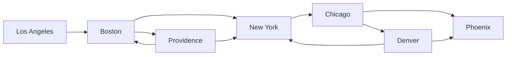

A graph is a set of nodes joined by edges, and a large part of what a program can say about a road map, a computer network or a molecule comes down to questions asked of one: is there a path from A to B, and which path is the shortest? The third lecture of MIT's *Introduction to Computational Thinking and Data Science* (6.0002, Fall 2016), given by EG, moves from the decision trees used for the knapsack problem to graphs in general, builds a small graph library in Python and uses it to compare two search algorithms.

This article follows that lecture: why graphs are a useful modelling tool, how to store one in memory, the `Node` / `Edge` / `Digraph` / `Graph` classes from the lecture code, and the two searches it implements, depth-first search (DFS) and breadth-first search (BFS). It then goes one step further than the lecture on three points it only touches: the cost of each representation and algorithm, the reason BFS returns the path with the fewest edges, and why that path need not be the cheapest one once edges carry weights.

> This article has been made with the help of [Claude Code](https://claude.com/product/claude-code) and several custom skills

> **Source and currency note.** This article is based on lecture 3, *Graph-theoretic Models*, of [MIT OpenCourseWare 6.0002 Introduction to Computational Thinking and Data Science](https://ocw.mit.edu/courses/6-0002-introduction-to-computational-thinking-and-data-science-fall-2016/) (EG, MIT, Fall 2016), its slides, its [lecture video](https://www.youtube.com/watch?v=V_TulH374hw) and the lecture code written by JG and revised by EG. The course targets Python 3.5, and later lectures plot with `pylab`, which Matplotlib now discourages in favour of `matplotlib.pyplot` and `numpy`. This lecture uses neither: its code is plain classes, lists and dictionaries, and it still runs unchanged on Python 3.14. The listings below are condensed from the lecture code; where a listing is modernised (a `deque` instead of `list.pop(0)`, a `visited` set), the text says so.

[TOC]

## What you need to know first

The lecture assumes the first two lectures of the course and an introductory Python course. The concepts below are used without being re-derived.

- **Optimisation model.** An objective function to minimise or maximise subject to constraints. The previous lectures solved the 0/1 knapsack problem this way, and the shortest-path problem here is another instance: minimise the number of edges, or the total weight, over all valid paths.
- **Search tree and backtracking.** The knapsack lectures explored a decision tree left-first, going as deep as possible, then backing up to try the next branch. DFS on a graph is the same procedure with one extra check, because a graph, unlike a tree, can lead back to a node already visited.
- **Recursion.** A function that solves a problem by calling itself on a smaller instance. The lecture's DFS finds a path from `start` to `end` by finding a path from one of `start`'s children to `end`.
- **Stack and queue.** A stack returns the most recently added item first (LIFO), a queue the oldest (FIFO). Recursive DFS uses the call stack implicitly; BFS keeps an explicit FIFO queue of partial paths.
- **Big-O notation.** $$O(f(n))$$ bounds how running time or memory grows with input size. For graphs the sizes are $$V$$, the number of nodes, and $$E$$, the number of edges.
- **Python objects as dictionary keys.** A user-defined class without `__eq__` and `__hash__` hashes by identity, so two `Node` objects with the same name are two different keys. The lecture's `Digraph` relies on this.
- **Liskov substitution principle.** A subtype should be usable wherever its supertype is expected. EG uses it to justify making `Graph` a subclass of `Digraph` rather than the reverse.

## Why model the world as a graph

A graph keeps only the entities of a system and the relations between them, and throws away everything else. The lecture lists the kinds of network this covers:

- **Transport.** Cities joined by rail links (Paris to London), roads, or flights.
- **Computer networks.** Routers forwarding a message hop by hop; EG cites Akamai, founded by an MIT professor, for moving web content.
- **Financial networks.** Money moving between accounts or institutions.
- **Distribution networks.** Water, sewer and electricity, where edge weights are pipe or line capacities.
- **Molecules.** Atoms and bonds, with questions such as the energy needed to turn one molecule into another (the slide's "drug discovery" example).
- **Social, political and criminal networks.** Who interacts with whom.

The slide on social networks shows a graph of *The Wizard of Oz*: one node per character, sized by the number of scenes in which the character speaks, and one edge per pair of characters who share dialogue. Colours mark clusters of characters who talk mostly among themselves, such as the Kansas characters, or Glinda and the Munchkins, and EG notes that the Wizard, who gives the book its title, is a small and weakly connected node.

### Inference on a graph

A graph supports questions, not only pictures. The lecture names four:

1. **Reachability.** Is there a sequence of edges from A to B, and which one?
2. **Shortest path.** Which path from A to B is the least expensive, measured in edges or in total weight?
3. **Partitioning.** Can the nodes be split into groups? EG describes this as finding the connected components, groups of nodes with no edge from one group to another.
4. **Clustering by cuts.** Which groups of nodes interact a lot internally and little with the rest?

Two of these are stated loosely in the lecture. The standard *graph partitioning problem* asks for a split into parts of given sizes that cuts as few edges as possible, which is NP-hard; finding connected components is a different and much easier task, solved by one DFS or BFS per component in $$O(V+E)$$.

The transcript also names the cut problem "min-flow or max-cut" and later "min-cut max-flow": the theorem is **max-flow min-cut**. It states that the maximum flow from a source to a sink equals the total capacity of the smallest set of edges whose removal separates them. The clustering shown in the Wizard of Oz picture is closer to community detection than to a single source-sink cut.

### Choosing what an edge weight means

EG's own commute from Lexington to Cambridge is the running example for weights. Intersections and destinations are nodes, drivable road segments are edges, and the graph is directed because some streets are one-way. Each edge then needs a number, and the lecture gives three candidates:

- **Expected travel time**, which is what a navigation app such as Waze optimises.
- **Distance**, related to time but not proportional to it, because of traffic.
- **Average speed** on the segment. EG says he prefers routes that keep him moving fast, even when they are longer.

The graph is the same in all three cases; the optimisation problem, and therefore the answer, changes with the weight. One remark the lecture does not make: the third option cannot be minimised as a sum the way the first two can, because speeds along a route do not add up. A route that "feels fast" is a different objective, such as maximising the minimum speed, and needs a different algorithm.

### The bridges of Königsberg

The first recorded use of graph theory answered a navigation question. Königsberg had four land masses (two river banks and two islands) joined by seven bridges, and the question was whether a walk could cross every bridge exactly once. Leonhard Euler's 1736 answer modelled each land mass as a node and each bridge as an undirected edge, discarding the size of the islands and the length of the bridges. EG uses the example for exactly that abstraction step, states that the answer is no, and leaves the proof to the reader.

The argument is short. A walk that enters a land mass on one bridge must leave on another, so every land mass other than the start and the end of the walk is touched by an even number of bridges. In Königsberg the four land masses have degrees 5, 3, 3 and 3 (the degrees add up to 14, twice the 7 bridges), so all four are odd. A walk crossing each edge once allows at most two odd nodes, hence no such walk exists.

## Vocabulary: nodes, edges, digraphs, weights and trees

A **graph** has two components:

- **Nodes**, also called **vertices**. A node can carry any information: a name in the lecture, a student record in EG's other example.
- **Edges**, also called **arcs**. An edge connects a pair of nodes.

An **undirected** edge can be travelled both ways. In a **directed graph**, or **digraph**, each edge goes from a **source** to a **destination** (a parent to a child), and nothing prevents a second edge going the other way. A **weighted** graph attaches a number to each edge, such as a cost, a distance, a time or a capacity.

A **tree** is a special graph. The slide defines it as "a directed graph in which each pair of nodes is connected by a single path", and EG adds that a tree has no loops. That definition is loose on two points, which matter later when DFS has to deal with cycles:

- An undirected tree is a graph that is connected and has no cycle; equivalently, every pair of nodes is joined by exactly one simple path. A tree on $$n$$ nodes has exactly $$n-1$$ edges.
- A directed tree, the kind drawn root-first in computer science (EG's "upside-down" trees), is a *rooted* tree, or arborescence: one root, and exactly one directed path from the root to every other node. Two arbitrary nodes, such as two siblings, are not connected by any directed path at all.

EG's family-tree example also needs a correction. Every person has two parents, so a genealogy is a directed acyclic graph (DAG), not a tree, and as soon as two ancestors share an ancestor of their own, two different paths lead to the same person. The site's [hypergraph and hypertree article]({{site.url_complet}}/2025/11/25/hypergraph-hypertree/) covers the generalisation in the other direction, where an edge can join more than two nodes.

## Representing a graph: adjacency matrix or adjacency list

The lecture presents two ways to store a digraph and picks the second.

An **adjacency matrix** has one row per source node and one column per destination node; the cell holds 1 if the edge exists and 0 otherwise (or the weight, in a weighted graph). For a digraph the matrix is not symmetric, because an edge from S to D says nothing about an edge from D to S.

An **adjacency list** associates each node with the list of nodes it reaches through one edge, its *children*. The lecture implements it as a Python dictionary: the keys are the nodes and each value is a list of destination nodes.

EG argues against the matrix that it is less convenient to look things up in and wasteful when there are few edges. The second point is correct; the first is backwards for one operation, since testing whether one particular edge exists is a single cell read in a matrix and a list scan in an adjacency list. The full trade-off:

| Operation | Adjacency matrix | Adjacency list |
|-----------|------------------|----------------|
| Memory | $$O(V^2)$$ | $$O(V+E)$$ |
| Is there an edge from u to v? | $$O(1)$$ | $$O(\deg u)$$ |
| List the children of u | $$O(V)$$ | $$O(\deg u)$$ |
| Add an edge | $$O(1)$$ | $$O(1)$$ (amortised append) |
| Add a node | $$O(V^2)$$ to resize | $$O(1)$$ |

Graph search does little else than "list the children of u", so the adjacency list wins for DFS and BFS, and it wins on memory whenever the graph is **sparse**, with $$E$$ much smaller than $$V^2$$. The lecture's seven-city graph already shows it: a $$7 \times 7$$ matrix has 49 cells, of which only 10 are edges and 39 are zeros.

A road network with a million intersections would need $$10^{12}$$ cells, 125 GB even at one bit per cell, while each intersection has only a handful of outgoing roads. A matrix is the better choice for **dense** graphs, and for algorithms that are naturally written as matrix operations, such as Floyd-Warshall all-pairs shortest paths or spectral clustering.

## The lecture's classes: Node, Edge, Digraph, Graph

The lecture builds the graph from four classes. The listing below is the lecture code with docstrings shortened; the method names (`getName`, `childrenOf`) are kept as in the course.

```python
class Node(object):
    def __init__(self, name):
        self.name = name                 # assumed to be a string
    def getName(self):
        return self.name
    def __str__(self):
        return self.name

class Edge(object):
    def __init__(self, src, dest):       # src and dest are Node objects, not names
        self.src = src
        self.dest = dest
    def getSource(self):
        return self.src
    def getDestination(self):
        return self.dest
    def __str__(self):
        return self.src.getName() + '->' + self.dest.getName()

class Digraph(object):
    """edges maps each node to the list of its children (adjacency list)."""
    def __init__(self):
        self.edges = {}
    def addNode(self, node):
        if node in self.edges:
            raise ValueError('Duplicate node')
        self.edges[node] = []
    def addEdge(self, edge):
        src, dest = edge.getSource(), edge.getDestination()
        if not (src in self.edges and dest in self.edges):
            raise ValueError('Node not in graph')
        self.edges[src].append(dest)
    def childrenOf(self, node):
        return self.edges[node]
    def hasNode(self, node):
        return node in self.edges
    def getNode(self, name):
        for n in self.edges:
            if n.getName() == name:
                return n
        raise NameError(name)
    def __str__(self):
        lines = [src.getName() + '->' + dest.getName()
                 for src in self.edges for dest in self.edges[src]]
        return '\n'.join(lines)          # the lecture builds the string and drops the last '\n'

class Graph(Digraph):
    def addEdge(self, edge):
        Digraph.addEdge(self, edge)
        rev = Edge(edge.getDestination(), edge.getSource())
        Digraph.addEdge(self, rev)
```

Several design choices in this code are worth stating explicitly:

- **Nodes, not names, are the keys.** `Node` defines neither `__eq__` nor `__hash__`, so the dictionary hashes each node by identity. Two `Node('Boston')` objects would be two distinct nodes, which is why the code always retrieves nodes through `getNode` rather than creating new ones.
- **`getNode` is a linear scan.** It loops over every key, so each call costs $$O(V)$$. A second dictionary from names to nodes would make it $$O(1)$$; for seven cities it does not matter.
- **The `raise` in `getNode` is reached only on failure.** EG points this out: the `return` inside the loop leaves the method as soon as the name matches.
- **`Graph` stores an undirected edge as two directed edges.** Only `addEdge` is overridden, and everything else, including the search algorithms, works unchanged. As a side effect, printing a `Graph` lists each undirected edge twice.

EG justifies the direction of inheritance with the substitution principle: an algorithm that works on any digraph also works on a graph, because a graph is just a digraph in which every edge has a reverse. That holds for read-only clients such as the searches below. It is less clean for a client that calls `addEdge` and then expects the reverse edge to be absent, since `Graph.addEdge` does more than its parent promises; the lecture does not raise this.

### The example: seven cities

The running example is a small flight network. Its adjacency list is:

| Source | Children |
|--------|----------|
| Boston | Providence, New York |
| Providence | Boston, New York |
| New York | Chicago |
| Chicago | Denver, Phoenix |
| Denver | Phoenix, New York |
| Phoenix | none |
| Los Angeles | Boston |



Phoenix has no outgoing edge, so once a path reaches it there is nowhere else to go, and Los Angeles has no incoming edge, so no search starting elsewhere ever reaches it. There is also a cycle, New York to Chicago to Denver and back to New York, which is what the search algorithms must not loop on.

The graph is built by a function that takes the graph class as a parameter, so the same code builds a `Digraph` or a `Graph`:

```python
def buildCityGraph(graphType):
    g = graphType()
    for name in ('Boston', 'Providence', 'New York', 'Chicago',
                 'Denver', 'Phoenix', 'Los Angeles'):
        g.addNode(Node(name))
    for src, dest in [('Boston', 'Providence'), ('Boston', 'New York'),
                      ('Providence', 'Boston'), ('Providence', 'New York'),
                      ('New York', 'Chicago'), ('Chicago', 'Denver'),
                      ('Chicago', 'Phoenix'), ('Denver', 'Phoenix'),
                      ('Denver', 'New York'), ('Los Angeles', 'Boston')]:
        g.addEdge(Edge(g.getNode(src), g.getNode(dest)))
    return g
```

The lecture writes the ten `addEdge` calls out one by one; the loop is a condensation. EG notes in class that the distributed slide omits the final `return g`, and the slide version of the test function also calls the class `DiGraph` instead of `Digraph` and lacks a comma between two arguments. The code file published with the lecture is correct on all three points.

## Shortest-path problems

A **path** from node $$n_1$$ to node $$n_k$$ is a sequence of edges in which the source of the first edge is $$n_1$$, the destination of the last edge is $$n_k$$, and the destination of each edge is the source of the next one. The lecture distinguishes two versions of the shortest-path problem:

- **Fewest edges.** Minimise the number of edges in the path (each edge counts as one step).
- **Minimum weight.** Minimise the sum of the edge weights along the path.

Route planning and communication network design are the lecture's examples; the first version answers "fewest flights" or "fewest router hops", the second "shortest flying time" or "lowest latency". Both versions ask for a **simple path** in practice, one that does not visit a node twice. With non-negative weights a shortest path never needs to repeat a node, since cutting out the loop cannot make it longer.

## Depth-first search

DFS starts at the source, follows the first edge out of it, then the first edge out of the node it reached, and so on, going as deep as it can. When it reaches the goal it records the path; when it reaches a node with no unexplored child it **backtracks** to the previous node and tries the next edge. It is the same left-first exploration as the knapsack decision tree, with one addition: since a graph can contain cycles, the search never extends a path with a node that is already on it.

EG presents it as divide and conquer: a path from the source to the goal is a path from the source to some intermediate node followed by a path from that node to the goal, so the search can recurse.

```python
def DFS(graph, start, end, path, shortest, toPrint=False):
    path = path + [start]                      # a new list; the caller's path is unchanged
    if toPrint:
        print('Current DFS path:', printPath(path))
    if start == end:
        return path
    for node in graph.childrenOf(start):
        if node not in path:                   # avoid cycles
            if shortest is None or len(path) < len(shortest):
                newPath = DFS(graph, node, end, path, shortest, toPrint)
                if newPath is not None:
                    shortest = newPath
        elif toPrint:
            print('Already visited', node)
    return shortest

def shortestPath(graph, start, end, toPrint=False):
    return DFS(graph, start, end, [], None, toPrint)
```

The lecture writes `shortest == None`; `is None` is the idiomatic test and behaves the same here. `printPath` joins the node names with `->`.

How the function finds the *shortest* path rather than the first one:

- **`shortest` carries the best path found so far** down each recursive call and back up through its return value.
- **The pruning test `len(path) < len(shortest)`** stops extending a path that is already as long as the best solution. A path that extends `path` by at least one node cannot be shorter than `len(path) + 1` nodes, so a strictly tighter bound, `len(path) + 1 < len(shortest)`, would also be correct and would skip a few calls that can only find ties. The test as written is safe, and it never lets a longer path replace a shorter one.
- **`node not in path`** prevents cycles, and only cycles. It does not stop the search from reaching the same node again by a different route, which is what makes this DFS enumerate every simple path that the pruning does not cut.

A student asks in class which child DFS explores first, and EG answers that it is "essentially random". It is not: the order is the order in which `addEdge` appended the children, so the search is deterministic, and a different insertion order can change which of two equally short paths is returned.

### Traces on the city graph

Searching from Chicago to Boston, DFS goes Chicago, Denver, Phoenix (a dead end), backtracks to Denver, tries New York, finds that New York's only child Chicago is already on the path, backtracks to Chicago and tries Phoenix. No path exists, and the function returns `None`:

```text
Current DFS path: Chicago
Current DFS path: Chicago->Denver
Current DFS path: Chicago->Denver->Phoenix
Current DFS path: Chicago->Denver->New York
Already visited Chicago
Current DFS path: Chicago->Phoenix
There is no path from Chicago to Boston
```

From Boston to Phoenix, the first path found has five edges: `Boston->Providence->New York->Chicago->Denver->Phoenix`. The search continues, finds shorter ones, and returns `Boston->New York->Chicago->Phoenix` after 12 calls to `DFS`. The trace shows the typical depth-first pattern of paths growing by one node, then collapsing back to a short prefix after a dead end.

### Cost of this DFS

Textbook DFS, which marks each node as visited the first time it sees it and never enters it again, runs in $$O(V+E)$$ on an adjacency list.

The lecture's version is different, because it un-marks a node when it backtracks (the node leaves `path`) so that the node can be reached again by another route. That is necessary to find the shortest path by exhaustive search, and it costs the guarantee: in the worst case the search visits every simple path between the two nodes, and that number grows exponentially.

In a complete digraph on 10 nodes (90 edges), there are 109,601 simple paths between two given nodes. Pruning with `shortest` helps on average and does not change the worst case.

A second, smaller cost: `node not in path` scans a list, $$O(\text{length of the path})$$ per test. A set kept in step with the list would make the test $$O(1)$$.

## Breadth-first search

BFS explores in layers: first every path of one edge from the source, then every path of two edges, then three. The first time it reaches the goal, it can stop, because no path still waiting in the queue is shorter.

The lecture implements it with a queue of *paths*, each path being a list of nodes:

```python
def BFS(graph, start, end, toPrint=False):
    pathQueue = [[start]]
    while len(pathQueue) != 0:
        tmpPath = pathQueue.pop(0)               # oldest path first (FIFO)
        if toPrint:
            print('Current BFS path:', printPath(tmpPath))
        lastNode = tmpPath[-1]
        if lastNode == end:
            return tmpPath
        for nextNode in graph.childrenOf(lastNode):
            if nextNode not in tmpPath:
                pathQueue.append(tmpPath + [nextNode])
    return None
```

On the Boston to Phoenix query, BFS dequeues eight paths and returns the same answer as DFS:

```text
Current BFS path: Boston
Current BFS path: Boston->Providence
Current BFS path: Boston->New York
Current BFS path: Boston->Providence->New York
Current BFS path: Boston->New York->Chicago
Current BFS path: Boston->Providence->New York->Chicago
Current BFS path: Boston->New York->Chicago->Denver
Current BFS path: Boston->New York->Chicago->Phoenix
```

### Why the first path found has the fewest edges

The argument is an invariant of the queue. The initial queue holds one path of length 0. Each path appended is one edge longer than the path just removed, and paths leave the queue in the order they entered. So the queue always holds paths of at most two consecutive lengths $$k$$ and $$k+1$$, with all the length-$$k$$ ones in front, and paths are dequeued in non-decreasing order of length.

When the first path ending at the goal is dequeued, every shorter path has already been dequeued and none of them ended at the goal. EG states the conclusion ("once I find a solution, I know it's the shortest path"); this is the reason it holds.

The guarantee concerns the **number of edges** only. It says nothing about weights, which is the subject of the next section.

### Cost of this BFS, and the textbook version

The lecture's BFS has the same weakness as its DFS. It checks `nextNode not in tmpPath`, which stops a path from looping back on itself, but it does not stop two different paths from reaching the same node: in the trace above, Chicago is reached by two paths, and both are extended. On a graph with many routes between nodes the queue can hold exponentially many paths, each a copy of a list. `list.pop(0)` also shifts every remaining element, so each dequeue costs $$O(\text{queue length})$$.

The textbook BFS fixes both. It marks a node as visited the first time it is reached and never enqueues it again: the first path to reach a node is already a fewest-edge path to it (by the invariant above), so later paths to the same node can only tie or be longer. It also stores one parent pointer per node instead of full paths, and rebuilds the path at the end. The modernised version below, which is not lecture code, runs in $$O(V+E)$$ time and $$O(V)$$ memory:

```python
from collections import deque

def bfs(graph, start, end):
    parent = {start: None}                 # doubles as the visited set
    queue = deque([start])
    while queue:
        node = queue.popleft()             # O(1), unlike list.pop(0)
        if node == end:
            path = []
            while node is not None:
                path.append(node)
                node = parent[node]
            return path[::-1]
        for child in graph.childrenOf(node):
            if child not in parent:
                parent[child] = node
                queue.append(child)
    return None
```

A plain DFS with the same `visited` set also runs in $$O(V+E)$$ and answers reachability, but it does not find shortest paths, which is why the lecture's DFS gives up the `visited` set.


## Weighted shortest path: where BFS stops working

The lecture closes with weighted edges in two sentences: DFS "is easily modified" to minimise the sum of the weights, while BFS "can't easily be modified because the short weighted path may have many more than the minimum number of" hops (the transcript says "loops", the slide says "hops"). The city graph shows why, once weights are added. The weights below are illustrative costs chosen for the example, not real flight times:

| Edge | Cost |
|------|-----:|
| Boston → Providence | 1 |
| Boston → New York | 4 |
| Providence → Boston | 1 |
| Providence → New York | 2 |
| New York → Chicago | 5 |
| Chicago → Denver | 3 |
| Chicago → Phoenix | 9 |
| Denver → Phoenix | 2 |
| Denver → New York | 6 |
| Los Angeles → Boston | 13 |

There are four simple paths from Boston to Phoenix:

| Path | Edges | Total cost |
|------|:-----:|-----------:|
| Boston → New York → Chicago → Phoenix | 3 | 18 |
| Boston → New York → Chicago → Denver → Phoenix | 4 | 14 |
| Boston → Providence → New York → Chicago → Phoenix | 4 | 17 |
| Boston → Providence → New York → Chicago → Denver → Phoenix | 5 | 13 |

BFS returns the first row, the path with the fewest edges and the highest cost. The cheapest path is the last row, which has the *most* edges. Stopping at the first path that reaches the goal is exactly what makes BFS correct for edge counts, and exactly what makes it wrong here: a path with more edges can still be cheaper, so reaching the goal first proves nothing about cost.

Weighted DFS needs only the comparison changed. The version below (not lecture code) carries the cost of the current path and prunes a branch as soon as its cost reaches the best total found:

```python
def weighted_dfs(adj, start, end, path=(), cost=0, best=(None, float('inf'))):
    """adj maps a node to a list of (child, weight) pairs; weights must be >= 0."""
    path = path + (start,)
    if start == end:
        return (path, cost) if cost < best[1] else best
    for child, w in adj[start]:
        if child not in path and cost + w < best[1]:
            best = weighted_dfs(adj, child, end, path, cost + w, best)
    return best
```

On the table above it returns the five-edge path with cost 13. The pruning is valid only for non-negative weights: with a negative edge, a path that is already too expensive could still become the cheapest. The search remains exponential in the worst case, for the same reason as the unweighted DFS.

The lecture's statement that BFS cannot easily be adapted is a simplification. Replace the FIFO queue with a **priority queue** ordered by path cost, so that the cheapest partial path is always extended first, and the result is Dijkstra's algorithm, which finds minimum-weight paths in $$O((V+E)\log V)$$ with a binary heap as long as no weight is negative.

The site's article [Dijkstra vs Bellman-Ford — Two Ways to Compute Shortest Paths]({{site.url_complet}}/2026/10/05/dijkstra-vs-bellman-ford/) derives it, together with Bellman-Ford, which also handles negative weights and detects negative cycles. On the example, Dijkstra gives the same cost of 13 to Phoenix, with intermediate distances of 1 to Providence, 3 to New York, 8 to Chicago and 11 to Denver.

The three algorithms side by side:

| Algorithm | Finds | Time on an adjacency list | Condition |
|-----------|-------|---------------------------|-----------|
| Lecture DFS (path-only cycle check) | fewest edges, or minimum weight with the weighted variant | exponential in the worst case | weighted pruning needs weights $$\geq 0$$ |
| BFS with a visited set | fewest edges | $$O(V+E)$$ | none |
| Dijkstra (BFS with a priority queue) | minimum weight | $$O((V+E)\log V)$$ | weights $$\geq 0$$ |

## What the lecture simplifies

The lecture is an introduction, and some statements in it are loose. The points below are discussed in the sections above; this table collects them.

| Lecture statement | More precise version |
|-------------------|----------------------|
| A tree is a directed graph in which each pair of nodes is connected by a single path. | An undirected tree is connected and acyclic; a rooted directed tree has one directed path from the root to each node, and none between siblings. |
| Family trees "really are trees". | A genealogy is a DAG: each person has two parents, and shared ancestors create several paths to one person. |
| The matrix is inconvenient for lookups. | The matrix tests a given edge in $$O(1)$$; its drawbacks are $$O(V^2)$$ memory and $$O(V)$$ to list a node's children. |
| Graph partition means separating connected sets. | Finding connected components is an $$O(V+E)$$ search; graph partitioning into balanced parts with few cut edges is NP-hard. |
| "Min-flow or max-cut" / "min-cut max-flow". | The theorem is max-flow min-cut; the Wizard of Oz colouring is a community-detection result. |
| DFS picks the next child "essentially at random". | It follows the insertion order of the adjacency list; the search is deterministic. |
| BFS cannot easily be modified for weights. | BFS with a priority queue instead of a FIFO queue is Dijkstra's algorithm, for non-negative weights. |
| The weighted path may have more than the minimum number of "loops". | Hops, that is edges, as the slide says. |

## Conclusion

The lecture turns a family of real-world questions (routes, networks, molecules) into one abstraction, a set of nodes and edges, and shows that two short functions answer the most common question asked of it.

- **Modelling.** A graph keeps the entities and their relations and drops everything else, as Euler did with the bridges of Königsberg. Directed edges model one-way relations, weights model costs, and the choice of weight decides what "shortest" means.
- **Representation.** An adjacency list takes $$O(V+E)$$ memory and lists a node's children in time proportional to their number, which is what searches need. An adjacency matrix tests a single edge in constant time and suits dense graphs.
- **Code.** The lecture's `Digraph` is a dictionary from `Node` objects to child lists, and `Graph` subclasses it by adding each edge in both directions.
- **DFS.** Recursion with backtracking, a path-based cycle check and pruning by the best length so far. It finds the fewest-edge path by enumerating simple paths, which is exponential in the worst case.
- **BFS.** A FIFO queue of paths; because paths are dequeued in order of length, the first one reaching the goal has the fewest edges. With a visited set and parent pointers it runs in $$O(V+E)$$.
- **Weights.** The fewest-edge path can be the most expensive one: 18 against 13 on the example. Weighted DFS still works by exhaustive search, and replacing BFS's queue with a priority queue gives Dijkstra's algorithm.


## Annex

### Key Terms

| Term | Definition |
|------|------------|
| **Graph** | A set of nodes together with a set of edges, each edge connecting a pair of nodes. |
| **Node (vertex)** | An element of a graph; it can carry data such as a name or a record. |
| **Edge (arc)** | A connection between two nodes; undirected edges can be travelled both ways. |
| **Directed graph (digraph)** | A graph whose edges go from a source node to a destination node, in one direction only. |
| **Weighted graph** | A graph in which each edge carries a number, such as a cost, time, distance or capacity. |
| **Degree** | The number of edges touching a node; in a digraph, split into in-degree and out-degree. |
| **Path** | A sequence of edges in which the destination of each edge is the source of the next. |
| **Simple path** | A path that visits no node more than once. |
| **Cycle** | A path that starts and ends at the same node. |
| **Tree** | A connected graph with no cycle, in which any two nodes are joined by exactly one simple path; a rooted tree has one path from the root to each node. |
| **Directed acyclic graph (DAG)** | A digraph with no directed cycle; genealogies and dependency graphs are DAGs. |
| **Adjacency matrix** | A $$V \times V$$ table whose cell (u, v) records whether, or with what weight, an edge goes from u to v. |
| **Adjacency list** | A map from each node to the list of nodes it reaches with one edge, its children. |
| **Sparse graph** | A graph whose number of edges is far below the square of its number of nodes. |
| **Shortest-path problem** | Finding a path between two nodes that minimises either the number of edges or the total weight. |
| **Depth-first search (DFS)** | A search that follows one edge as deep as possible, then backtracks to try the next one. |
| **Backtracking** | Returning from a dead end to the most recent node with an unexplored edge. |
| **Breadth-first search (BFS)** | A search that examines all paths of length k before any path of length k+1, using a FIFO queue. |
| **Priority queue** | A queue that always returns the item with the smallest key; with path cost as the key, it turns BFS into Dijkstra's algorithm. |
| **Eulerian path** | A walk that uses every edge exactly once; it exists in a connected graph only if zero or two nodes have odd degree. |

## Frequently Asked Questions

**Q: Why does the lecture store the graph as an adjacency list rather than an adjacency matrix?**

Searches spend their time listing the children of a node. An adjacency list does that in time proportional to the number of children and uses $$O(V+E)$$ memory, while a matrix needs $$O(V)$$ per node to find its children and $$O(V^2)$$ memory, mostly zeros when the graph is sparse. The matrix keeps one advantage: it tells whether a specific edge exists in constant time.

**Q: Why is `Graph` a subclass of `Digraph`, and what does it change?**

An undirected edge is the same as two directed edges in opposite directions, so a graph is a special digraph. `Graph` overrides only `addEdge`, which adds the edge and its reverse; every other method, and every search written for a `Digraph`, works on a `Graph` unchanged. EG justifies the direction with the substitution principle: code that works for a digraph also works for a graph, not the other way round.

**Q: The lecture's DFS checks `node not in path`. What does that check prevent, and what does it not prevent?**

It prevents a path from visiting the same node twice, so the search never loops around a cycle such as New York, Chicago, Denver, New York. It does not prevent the search from reaching a node again through a different path. That is deliberate, because the shortest path to the goal may go through a node that an earlier, longer path also visited, but it also means the search can enumerate an exponential number of simple paths.

**Q: Why can BFS stop at the first path that reaches the goal, while DFS has to keep searching?**

BFS dequeues paths in non-decreasing order of length, because each new path is one edge longer than the one it extends and the queue is FIFO. When the first path ending at the goal comes out, all shorter paths have already been examined.

DFS explores paths in depth order, so its first solution can be long. On the city graph, its first path from Boston to Phoenix has five edges, while the shortest has three. It must keep searching, using the best length so far to prune.

**Q: On the weighted city graph, BFS returns a path of cost 18 while the cheapest costs 13. What goes wrong, and how is it fixed?**

Two things combine:

- BFS orders paths by number of edges, and the cheapest path has five edges against three for the BFS answer.
- Stopping at the first path that reaches the goal proves the path has the fewest edges, but says nothing about the sum of the weights.

The fix is to order by cost instead of length. Exhaustive weighted DFS with cost pruning finds the cost-13 path; a priority queue keyed by path cost turns BFS into Dijkstra's algorithm, which does it in $$O((V+E)\log V)$$ provided no weight is negative.

**Q: Why did Euler conclude that no walk crosses each bridge of Königsberg exactly once?**

Every time a walk passes through a land mass, it uses one bridge to arrive and another to leave, so each land mass except the start and the end must have an even number of bridges. All four Königsberg land masses have an odd number (5, 3, 3 and 3), and a walk allows at most two odd ones, so no such walk exists.

**Q: The textbook BFS and DFS both run in $$O(V+E)$$. Why is the lecture's DFS exponential?**

The textbook versions mark a node visited the first time they reach it and never enter it again, so each node and edge is processed a constant number of times.

The lecture's DFS removes a node from `path` when it backtracks, so the node can be visited again along another route. That lets it compare every route, and the number of simple paths grows exponentially: 109,601 between two nodes of a complete digraph on 10 nodes.

BFS does not need to revisit nodes to find the fewest-edge path, which is why it can keep the visited set and stay linear.

## Gaps

The points below come from general knowledge or inference rather than from the lecture, or could not be checked against the sources.

| Gap | Why it matters | What to read or verify |
|-----|----------------|------------------------|
| The Königsberg degree argument (5, 3, 3, 3) and the 1736 date come from general knowledge; the lecture only says "early 1700s", and the paper was presented in 1735 and printed in 1741 in a volume dated 1736. | The body states both as facts. | Euler's paper *Solutio problematis ad geometriam situs pertinentis* (Euler Archive, E53). |
| The claim that the Wizard of Oz colouring is community detection rather than a min-cut is an inference from the picture; the slide's source is not identified on the OCW copy. | The body corrects the lecture on this basis. | The original graph and its method, if the source website named in the lecture can be found. |
| The complexity table for adjacency matrices and lists, and the $$O(V+E)$$ and $$O((V+E)\log V)$$ bounds, are standard results not stated in the lecture. | The comparison and the corrections rely on them. | Cormen, Leiserson, Rivest and Stein, *Introduction to Algorithms*, chapters on elementary graph algorithms and single-source shortest paths. |
| The edge weights of the weighted example are invented for illustration; the lecture gives no weights for the city graph. | The 18 against 13 comparison depends on them. | Recompute with any weights in which the three-edge path is not the cheapest. |
| The statement that graph partitioning into balanced parts is NP-hard is from general knowledge. | It supports the correction to the lecture's description of the partition problem. | Garey and Johnson, *Computers and Intractability*, problem "Graph Partitioning". |
| The Python 3.14 compatibility was checked by running the lecture code file; the condensed listings in this article were not run through the lecture's test functions verbatim. | A reader copying the listings may hit a difference with the original file. | The lecture code on the OCW course page, lecture 3 resources. |
| The textbook chapter assigned for this lecture was not read. | It may present the material differently from the slides. | Guttag, *Introduction to Computation and Programming Using Python*, 2nd ed., chapter on graph optimisation problems. |

## References

### Course material

- [MIT OpenCourseWare 6.0002 Introduction to Computational Thinking and Data Science, Fall 2016](https://ocw.mit.edu/courses/6-0002-introduction-to-computational-thinking-and-data-science-fall-2016/), lecture 3 *Graph-theoretic Models*, EG, MIT (slides, lecture code, transcript)
- [Lecture 3 video: Graph-theoretic Models](https://www.youtube.com/watch?v=V_TulH374hw), MIT OpenCourseWare, YouTube
- John V. Guttag, *Introduction to Computation and Programming Using Python: With Application to Understanding Data*, 2nd ed., MIT Press, 2016

### Background

- Leonhard Euler, [*Solutio problematis ad geometriam situs pertinentis*](https://scholarlycommons.pacific.edu/euler-works/53/) (E53), 1736, the Königsberg bridges paper
- Thomas H. Cormen, Charles E. Leiserson, Ronald L. Rivest and Clifford Stein, *Introduction to Algorithms*, 3rd ed., MIT Press, 2009
- [Python documentation: `collections.deque`](https://docs.python.org/3/library/collections.html#collections.deque)
- [NetworkX](https://networkx.org/), a Python library for graphs that provides BFS, DFS and Dijkstra out of the box
- [Claude Code](https://claude.com/product/claude-code)

### Related articles

- [Dijkstra vs Bellman-Ford — Two Ways to Compute Shortest Paths]({{site.url_complet}}/2026/10/05/dijkstra-vs-bellman-ford/)
- [Hypergraph and Hypertree - Overview]({{site.url_complet}}/2025/11/25/hypergraph-hypertree/)
- [Merkle DAGs(IPFS, GIT) - Overview]({{site.url_complet}}/2025/04/09/merkle-dag/)
- [Arbre recouvrant de poids minimum (MST / ACM)]({{site.url_complet}}/2021/08/22/arbre-recouvrant-poids-minimum/)
