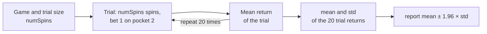

Monte Carlo simulation estimates an unknown quantity by drawing random samples from a model and computing statistics on them, instead of deriving the answer analytically. It is the technique behind the random walks of the previous lecture in this series, and it reappears wherever a probability or an expectation is too tedious to compute by hand: neutron transport, option pricing, the risk of a lending position.

Lecture 6 of MIT's *Introduction to Computational Thinking and Data Science* (6.0002) builds the method on a game whose answer is already known, so that every simulated number can be checked. A single-number bet at roulette pays 35 to 1; on a fair wheel of 36 pockets it returns nothing on average, on a European wheel it loses $$1/37$$ of the stake per spin, and on an American wheel $$2/38$$. The lecture uses those three wheels to introduce the law of large numbers, the gambler's fallacy, regression to the mean, the standard deviation and the empirical rule, which turns a simulation's output into a confidence interval. This article follows the lecture, completes it, and corrects the places where the slides or the spoken explanation are imprecise.

> This article has been made with the help of [Claude Code](https://claude.com/product/claude-code) and several custom skills

> **Source and currency note.** This article is based on Lecture 6, *Monte Carlo Simulation*, of [MIT 6.0002 Introduction to Computational Thinking and Data Science](https://ocw.mit.edu/courses/6-0002-introduction-to-computational-thinking-and-data-science-fall-2016/) (JG, MIT OpenCourseWare, Fall 2016), its slides, its [video](https://www.youtube.com/watch?v=OgO1gpXSUzU) and the lecture code. The course dates from 2016 and uses Python 3.5 with `pylab`. `pylab` is now discouraged in favour of importing `matplotlib.pyplot` and `numpy` explicitly, and NumPy's `Generator` API (`numpy.random.default_rng`) has replaced the legacy global random state for new code. The lecture's roulette code itself still runs unchanged: with `random.seed(0)`, Python 3.14 reproduces the six results of slide 13 to the last digit. Code below is condensed from the lecture code, and the vectorised version is a modernisation, not the course's own.

[TOC]

## What you need to know first

The article assumes basic Python and school-level probability, and relies on the following notions without developing them:

- **Random variable and expectation.** A random variable takes values according to a probability distribution; its expectation $$\mathbb E[X]$$ is the probability-weighted average of those values. The return of one roulette bet is a random variable with two values, $$+35$$ and $$-1$$.
- **Independence.** Two events are independent when the outcome of one does not change the probability of the other. Successive spins of an honest wheel are independent, which is the fact the gambler's fallacy ignores.
- **Pseudo-random numbers and seeds.** Python's `random` module produces a deterministic sequence that behaves statistically like random draws; `random.seed(0)` fixes the starting point so that a run can be reproduced exactly. The lecture seeds every experiment.
- **Python classes and inheritance.** The three roulette wheels are a base class and two subclasses that only add pockets. Reading the code needs `__init__`, `__str__` and calling a parent constructor.
- **The binomial distribution.** The number of successes in $$n$$ independent trials, each with probability $$p$$, has mean $$np$$ and variance $$np(1-p)$$. The number of winning spins in a roulette session is binomial, which the vectorised code uses.
- **Random walks in the previous lecture.** The series' previous article simulated many random walks and averaged their final distances. The lecture presents Monte Carlo simulation as a name for exactly that procedure.

## A little history

The lecture opens with the story of [Stanislaw Ulam](https://en.wikipedia.org/wiki/Stanis%C5%82aw_Ulam), a Polish-American mathematician at Los Alamos. In 1946, recovering from a serious illness, he played a great deal of solitaire and tried to compute the probability of winning a hand. The combinatorics proved intractable. Playing many hands and counting the wins would have given an estimate, but would have taken years. Ulam's idea was to have a computer play the hands instead, and he took it to John von Neumann, who saw how to run it on the [ENIAC](https://en.wikipedia.org/wiki/ENIAC), one of the first general-purpose electronic computers.

Several details are worth stating more precisely than the lecture does:

- **The name.** "Monte Carlo" was proposed by Nicholas Metropolis, a colleague at Los Alamos, as an allusion to the casino and, by most accounts, to an uncle of Ulam's who gambled there. The method was published under that name by [Metropolis and Ulam in 1949](https://doi.org/10.1080/01621459.1949.10483310).
- **The machine.** The ENIAC was designed and built by J. Presper Eckert and John Mauchly at the University of Pennsylvania. It was not von Neumann's machine, although he worked on its conversion to stored-program operation. The lecture's remark that von Neumann "is often viewed as the inventor of the stored program computer" is a common attribution that historians contest.
- **The first application.** The first Monte Carlo calculations run on the ENIAC, in 1948, followed neutrons through the materials of a fission weapon. The lecture says the method was then used "in the design of the hydrogen bomb"; statistical sampling did feed into thermonuclear work at Los Alamos, but the early runs concerned fission.
- **Precursors.** Sampling to estimate a quantity is older than the name: Buffon's needle problem (18th century) estimates $$\pi$$ by random throws, and Enrico Fermi used statistical sampling for neutron problems in the 1930s without publishing it.

The historical details that come from general knowledge rather than from the lecture are listed in [Gaps](#gaps).

## Monte Carlo as inferential statistics

The lecture defines Monte Carlo simulation as "a method of estimating the value of an unknown quantity using the principles of inferential statistics". Three terms carry that definition:

- **Population.** The set of all possible examples: every game of solitaire that could be played, every possible sequence of roulette spins.
- **Sample.** A proper subset of the population, that is, not all of it. In a simulation, the sample is the set of trials actually run.
- **The key fact.** A sample drawn *at random* tends to exhibit the same properties as the population it is drawn from. Statistics computed on the sample (a mean, a fraction, a spread) are then estimates of the same quantities on the population.

The randomness of the sample is what makes the inference legitimate. A sample chosen by a biased procedure has no reason to resemble the population, and later lectures of the course return to the ways a sample that looks random is not.

In the notation of the site's [applied article on Monte Carlo for DeFi risk analysis]({{site.url_complet}}/2026/10/10/monte-carlo-defi-risk-analysis/), which builds on the same principle, the quantity of interest is an expectation $$\mathbb E[L]$$, and $$N$$ independent samples $$x_1, \dots, x_N$$ give the estimate:

$$
\begin{aligned}
\mathbb E[L] \approx \hat\mu_N = \frac{1}{N} \sum_{i=1}^{N} f(x_i)
\end{aligned}
$$

where $$f$$ is any program that turns one random draw into one outcome. For the solitaire problem, $$f$$ plays one hand and returns 1 for a win and 0 for a loss, so $$\hat\mu_N$$ is the fraction of hands won.

## How much confidence does a sample deserve?

The lecture builds the intuition with a coin whose fairness is unknown. The question is: what fraction of heads would an infinite number of flips produce?

- **One flip, heads.** Answering "1.0" would be absurd; nobody would be confident even that the next flip is heads.
- **Two flips, both heads.** Slightly more inclined to guess heads next, still not confident.
- **100 flips, all heads.** Now a guess of heads for the 101st flip is reasonable; the coin may well be two-headed or weighted.
- **100 flips, 52 heads and 48 tails.** The best estimate of the probability of heads is $$52/100$$, but confidence in that number should be low: with a fair coin, 52 heads is an ordinary outcome, and so would 48 or 55 be.

Two properties of the sample explain the difference. The first is its **size**: 100 flips support a stronger conclusion than 2. The second is its **variance**: 100 identical results leave little doubt, whereas a near even split leaves the next flip almost unpredictable. As the variance grows, a larger sample is needed for the same degree of confidence. The rest of the lecture turns both properties into numbers.

## Roulette as a test bench

Roulette needs no simulation: its probabilities follow from counting pockets. That is the reason the lecture uses it. A simulation whose exact answer is known shows how far, and how fast, the estimates approach it.

A wheel has numbered pockets; the player bets on a number, a ball is spun and settles in one pocket. The lecture only models a bet on a single number (no colours), paid at **35 to 1**: a winning bet of one unit returns the stake plus 35, a losing bet loses the unit.

### The fair wheel

The lecture's `FairRoulette` class has 36 pockets numbered 1 to 36, and pays `len(pockets) - 1 = 35` times the stake on a win:

```python
import random

class FairRoulette():
    def __init__(self):
        self.pockets = []
        for i in range(1, 37):
            self.pockets.append(i)
        self.ball = None
        self.pocketOdds = len(self.pockets) - 1   # 35 to 1
    def spin(self):
        self.ball = random.choice(self.pockets)
    def betPocket(self, pocket, amt):
        if str(pocket) == str(self.ball):
            return amt * self.pocketOdds
        else:
            return -amt
    def __str__(self):
        return 'Fair Roulette'
```

The comparison is done on strings because the subclasses add pockets named `'0'` and `'00'` next to the integers.

### Casinos are not fair

A real wheel adds green pockets that the payout ignores. A European wheel has one, numbered 0; an American wheel has two, 0 and 00. The payout stays at 35 to 1, so the bet wins less often for the same prize. In the lecture, each is a subclass that appends pockets:

```python
class EuRoulette(FairRoulette):
    def __init__(self):
        FairRoulette.__init__(self)
        self.pockets.append('0')
    def __str__(self):
        return 'European Roulette'

class AmRoulette(EuRoulette):
    def __init__(self):
        EuRoulette.__init__(self)
        self.pockets.append('00')
    def __str__(self):
        return 'American Roulette'
```

`pocketOdds` is computed in `FairRoulette.__init__` *before* the subclass appends its pocket, so it stays at 35. That ordering is what models the casino's edge; computing it after the append would make the European wheel pay 36 to 1 and be fair again.

### The exact expected return

With $$m$$ pockets, a single-number bet of one unit wins 35 with probability $$1/m$$ and loses 1 with probability $$(m-1)/m$$. Its expected return per spin is:

$$
\begin{aligned}
\mu = \frac{35 - (m - 1)}{m} = \frac{36 - m}{m}
\end{aligned}
$$

| Wheel | Pockets $$m$$ | Expected return per spin | As a percentage |
|---|---|---|---|
| Fair | 36 | $$0$$ | 0 % |
| European | 37 | $$-1/37$$ | about −2.70 % |
| American | 38 | $$-2/38 = -1/19$$ | about −5.26 % |

These are the values every simulation below should approach.

## Simulating the wheel

`playRoulette` bets the same amount on the same pocket for `numSpins` spins and returns the mean return per spin:

```python
def playRoulette(game, numSpins, pocket, bet, toPrint):
    totPocket = 0
    for i in range(numSpins):
        game.spin()
        totPocket += game.betPocket(pocket, bet)
    if toPrint:
        print(numSpins, 'spins of', game)
        print('Expected return betting', pocket, '=',
              str(100*totPocket/numSpins) + '%\n')
    return totPocket/numSpins

random.seed(0)
game = FairRoulette()
for numSpins in (100, 1000000):
    for i in range(3):
        playRoulette(game, numSpins, 2, 1, True)
```

The function prints an "expected return", but what it computes is the *observed* mean return of one simulated session; the expected return is the quantity it estimates. Slide 12 shows the same function without the `toPrint` parameter while still using it; the lecture code file has the corrected signature.

With seed 0, the six sessions give:

| Spins | Session 1 | Session 2 | Session 3 |
|---|---|---|---|
| 100 | −100 % | +44 % | −28 % |
| 1,000,000 | −0.046 % | +0.602 % | +0.7964 % |

In the video the third 100-spin result is read as "positive 28 %"; the slide and a re-run both give −28 %.

At 100 spins the result swings from losing everything to winning 44 %. Losing every one of 100 spins is not rare: the probability is $$(35/36)^{100}$$, about 6 %. At a million spins, all three results sit within 1 % of the true value 0, and close to each other. A gambler plays a hundred spins and sees the variance; a casino plays millions and sees the mean.

## The law of large numbers

The lecture's explanation is the **law of large numbers**, which it also calls Bernoulli's law after Jacob Bernoulli, who proved it in *Ars Conjectandi* (published in 1713):

> In repeated independent tests with the same actual probability $$p$$ of a particular outcome in each test, the chance that the fraction of times that outcome occurs differs from $$p$$ converges to zero as the number of trials goes to infinity.

As worded on the slide, the statement is slightly too strong: the probability that the fraction differs from $$p$$ *at all* does not go to zero, and for a fraction of $$n$$ trials to equal an irrational $$p$$ exactly is impossible. The precise form, the weak law of large numbers, fixes a tolerance $$\varepsilon \gt 0$$ first. If $$\hat p_n$$ is the observed fraction after $$n$$ trials:

$$
\begin{aligned}
\lim_{n \to \infty} \mathbb P\left( \left\lvert \hat p_n - p \right\rvert \gt \varepsilon \right) = 0 \quad \text{for every } \varepsilon \gt 0
\end{aligned}
$$

The same holds for the mean of any independent, identically distributed variables with a finite expectation, such as the return per spin. The figure below shows it for a European wheel: three seeded sessions of a million spins, the running mean return after each spin, and the exact value $$-1/37$$.


Early in each session the running mean jumps by tens of percent at every win; after 100,000 spins all three paths stay within a few percent of the exact value. The shaded band is derived in the section on the empirical rule below; its width falls as $$1/\sqrt n$$.

### The gambler's fallacy

The law says the *fraction* converges; it says nothing about future outcomes compensating for past ones. Believing that they do is the **gambler's fallacy**: a baseball batter who has struck out six times is "due for a hit", a student who failed the midterm "has to" do better on the final.

The lecture's example, quoted from Huff and Geis' *How to Take a Chance*, is set at the Monte Carlo casino on 18 August 1913: black came up 26 times in a row, and from about the fifteenth black onwards players rushed to bet on red in the belief that red was overdue. The casino made millions of francs. The slide then contrasts two probabilities, treating red and black as equally likely:

- **26 reds in a row**, computed before the first spin: $$(1/2)^{26} = 1/67{,}108{,}864$$.
- **A 26th red after 25 reds**: $$1/2$$, because the spins are independent.

Two corrections to the slide. It prints the first probability as 1/67,108,865, one more than $$2^{26}$$. And it switches from the black run in the anecdote to "reds" in the computation, which changes nothing by symmetry. On a real European wheel, the green zero makes each colour come up with probability $$18/37$$, so a specific run of 26 has probability $$(18/37)^{26}$$, about one in 137 million.

### Regression to the mean

A related idea that is *not* a fallacy is **regression to the mean**, a term Francis Galton introduced in the 1880s. Galton's data on heights showed that children of unusually tall parents tend to be shorter than their parents, and children of unusually short parents taller, closer to the average in both cases. The lecture states the principle as: following an extreme random event, the next random event is likely to be less extreme.

The roulette version uses a wheel where red and black are equally likely. Ten reds in ten spins has probability $$(1/2)^{10} = 1/1024$$, an extreme event. For the next ten spins, the two ideas predict different things:

| | Gambler's fallacy | Regression to the mean |
|---|---|---|
| Next 10 spins | fewer than 5 reds, to "even out" | fewer than 10 reds, because 10 was extreme |
| Expected reds in the next 10 | below 5 (wrongly) | exactly 5, as for any 10 spins |
| Mean over all 20 spins | 50 % or less | expected $$(10 + 5)/20 = 75\,\%$$, closer to 50 % than the first 100 % |

A student in the lecture asked whether this contradicts independence. It does not. Regression to the mean requires independence: because the next ten spins ignore the first ten, they are expected to look like any ten spins, which is less extreme than a run selected *because* it was extreme. The average over all twenty spins moves towards 50 % by dilution, not by compensation.

## Comparing the three wheels

The lecture then plays 20 trials of each length on each wheel and averages the 20 trial returns:

| Spins per trial | Fair | European | American |
|---|---|---|---|
| 1,000 | +6.56 % | −2.26 % | −8.92 % |
| 10,000 | −1.234 % | −4.168 % | −5.752 % |
| 100,000 | +0.8144 % | −2.6506 % | −5.113 % |
| 1,000,000 | −0.0723 % | −2.7329 % | −5.212 % |
| Exact | 0 | −2.70 % | −5.26 % |

With a million spins per trial, every estimate is within 0.08 percentage points of the exact value. With 1,000 spins, the fair wheel shows a 6.56 % gain and the European wheel loses less than the exact value; neither is evidence of anything. The lecture's spoken summary, "you'll lose 2.7 % in Europe and over 5 % in Las Vegas", matches the exact values.

The question this raises is the central one of computational statistics: sampling never guarantees an exact answer, although a session can happen to hit it, for instance one win in 36 spins on the fair wheel. So **how many samples are needed before the answer deserves justified confidence?** The coin flips already suggested the answer depends on the variability of the underlying distribution, so the next step is to measure it.

## Quantifying variation

### Variance and standard deviation

For a collection $$X$$ of $$N$$ values $$x_1, \dots, x_N$$ with mean $$\mu$$, the lecture defines the variance as the mean squared distance from the mean:

$$
\begin{aligned}
\sigma^2(X) = \frac{1}{N} \sum_{i=1}^{N} (x_i - \mu)^2
\end{aligned}
$$

and the **standard deviation** $$\sigma(X)$$ as its square root. In code:

```python
def getMeanAndStd(X):
    mean = sum(X)/float(len(X))
    tot = 0.0
    for x in X:
        tot += (x - mean)**2
    std = (tot/len(X))**0.5
    return mean, std
```

Four remarks from the lecture, and one addition:

- **Dividing by $$N$$** keeps a large collection from having a large variance merely because it has many members. A thousand copies of 6 have variance 0.
- **Squaring** makes the sign of a deviation irrelevant, as an absolute value would, and also gives outliers extra weight, which can be a strength or a weakness.
- **A standard deviation means nothing on its own.** A standard deviation of 100 is large around a mean of 100 and negligible around a mean of a billion. It has to be read relative to the mean.
- **Python** now has `statistics.pstdev` (divide by $$N$$, as above) and `numpy.std` with its default `ddof=0`, which compute the same quantity.
- **Population versus sample.** The formula divides by $$N$$, which is the variance of the collection itself. When the values are a sample used to estimate the variance of a larger population, dividing by $$N - 1$$ (Bessel's correction, `statistics.stdev`, `numpy.std(ddof=1)`) removes a downward bias. With 20 trials the difference is about 2.6 % on the standard deviation, small next to the noise discussed below, but the lecture does not mention the distinction.

### The spread of one spin

The roulette bet has a standard deviation that can be computed exactly, which the lecture does not do but which explains every interval it reports. A single spin returns $$+35$$ with probability $$1/m$$ and $$-1$$ otherwise, so:

$$
\begin{aligned}
\sigma^2 = \mathbb E[X^2] - \mu^2 = \frac{35^2 + (m - 1)}{m} - \mu^2
\end{aligned}
$$

| Wheel | Variance per spin | Standard deviation per spin |
|---|---|---|
| Fair, $$m = 36$$ | 35 | $$\sqrt{35} \approx 5.92$$ |
| European, $$m = 37$$ | $$46656/1369$$ | $$216/37 \approx 5.84$$ |
| American, $$m = 38$$ | about 33.21 | about 5.76 |

The standard deviation is about 5.8 units for a mean of zero or a few hundredths of a unit: this bet is noisy relative to the edge it carries. The mean return over $$n$$ independent spins has standard deviation $$\sigma/\sqrt n$$, which is why 100 spins swing by tens of percent and a million spins by about half a percent.

## Confidence intervals and the empirical rule

### What a confidence interval says

Rather than reporting a single estimate, a **confidence interval** gives a range that is likely to contain the unknown value, together with a level of confidence that it does. The lecture's example (slide 23):

> The return on betting a pocket 10k times in European roulette is −3.3 %. The margin of error is ±3.5 % with a 95 % level of confidence.

and its reading: if an infinite number of trials of that many bets each were run, the expected average return would be −3.3 %, and the return of a trial would lie between −6.8 % and +0.2 % in 95 % of them. The interval says nothing about how far outside it the other 5 % fall. In the video, a student corrected the upper bound, which the slide first printed as 9.2 %.

The slide has a second error that the lecture does not catch. The figures −3.3 % ± 3.5 % come from the run with **100,000** spins per trial (−3.313 % ± 3.515 % in the results below), not 10,000. For trials of 10,000 spins on a European wheel, the exact 95 % half-width is $$1.96 \times 5.84 / \sqrt{10{,}000}$$, about 11.4 %, more than three times wider.

### The empirical rule

The lecture computes intervals with the **empirical rule**, also called the 68-95-99.7 rule. Under assumptions given below:

- about **68 %** of the data lie within one standard deviation of the mean;
- about **95 %** lie within **1.96** standard deviations of the mean;
- about **99.7 %** lie within three standard deviations of the mean.

The 95 % level with its factor 1.96 is the usual choice when a confidence interval is quoted without qualification. The transcript of the video renders the factor as "1.6" several times; the slides and the code use 1.96.

### Applying it to roulette

The lecture's code wraps `playRoulette` in `findPocketReturn`, which returns the mean return of each of 20 trials, then reports their mean plus or minus 1.96 standard deviations. The structure of the experiment is:



Slide 26 prints the results below. The code on slide 25 loops over 100, 1,000 and 10,000 spins, but the printed output is for 1,000, 100,000 and 1,000,000 spins, so the code shown is not the code that produced it.

| Spins per trial | Fair | European | American |
|---|---|---|---|
| 1,000 | 3.68 % ± 27.189 % | −5.5 % ± 35.042 % | −4.24 % ± 26.494 % |
| 100,000 | 0.125 % ± 3.999 % | −3.313 % ± 3.515 % | −5.594 % ± 4.287 % |
| 1,000,000 | 0.012 % ± 0.846 % | −2.679 % ± 0.948 % | −5.176 % ± 1.214 % |

The exact values of the previous section predict what the half-widths should be, since one trial's return has standard deviation $$\sigma/\sqrt n$$:

| Spins per trial | Fair | European | American |
|---|---|---|---|
| 1,000 | ± 36.7 % | ± 36.2 % | ± 35.7 % |
| 100,000 | ± 3.67 % | ± 3.62 % | ± 3.57 % |
| 1,000,000 | ± 1.16 % | ± 1.14 % | ± 1.13 % |

The lecture's half-widths scatter around these values, from about 0.7 to 1.2 times them. That scatter is what a standard deviation estimated from only 20 values looks like: a quick re-simulation of 10,000 such experiments at 1,000 spins on the European wheel put the reported half-width between about 26 % and 44 % in 90 % of them. The point the lecture makes holds regardless: each hundredfold increase in spins narrows the interval tenfold, and every interval contains the exact value.

A shorter, vectorised version of the experiment draws the number of wins in each trial directly from a binomial distribution, since the spins are independent:

```python
import numpy as np

def pocket_returns(num_pockets, num_spins, num_trials, rng):
    """Mean return per spin of each trial: bet 1 on one pocket, num_spins times, paid 35:1."""
    wins = rng.binomial(num_spins, 1 / num_pockets, size=num_trials)
    return (36 * wins - num_spins) / num_spins      # 35 per win, -1 per loss

rng = np.random.default_rng(0)
for name, pockets in (("Fair", 36), ("European", 37), ("American", 38)):
    r = pocket_returns(pockets, 100_000, 20, rng)
    print(f"{name:9s} {100 * r.mean():7.3f} % +/- {100 * 1.96 * r.std():6.3f} %")
```

It runs a million-spin experiment in milliseconds instead of minutes. Its numbers differ from the lecture's because the random streams differ, which is itself a reminder that each row of the tables above is one sample.

### What the interval describes

The lecture's interval, mean ± 1.96 × std of the 20 trial returns, describes the spread of **one trial**: where the return of a single session of $$n$$ spins falls 95 % of the time. That is the reading given on slide 23, and it is what the reported numbers measure. It is not the uncertainty of the *mean of the 20 trials*, which is smaller by a factor $$\sqrt{20}$$, about 4.5.

The spoken commentary blurs the two when it concludes that the computed mean is close to the true mean "because my confidence interval has shrunk". The distinction is the subject of the next lectures, where it becomes the **standard error** $$\sigma/\sqrt N$$ used in the [applied DeFi article]({{site.url_complet}}/2026/10/10/monte-carlo-defi-risk-analysis/) as $$\hat\mu_N \pm 1.96\, \hat\sigma/\sqrt N$$.

## The assumptions behind the empirical rule

The rule holds under two assumptions that the lecture states:

- **The mean estimation error is zero.** Errors are as likely to be high as low, so there is no systematic bias. This is usually true of a simulation of a correctly coded model; a laboratory measurement can have a bias that depends on technique.
- **The errors are normally distributed.** The 68 %, 95 % and 99.7 % figures are properties of the normal distribution, and do not hold for an arbitrary one.

### Probability distributions and densities

A **probability distribution** describes the relative frequency with which a random variable takes each value:

- A **discrete** random variable takes values in a finite set, and its distribution lists one probability per value, summing to 1. A coin flip has two.
- A **continuous** random variable takes real values in an interval. Each single value has probability zero, so the distribution is given instead by a **probability density function** (PDF): the probability of falling between two values is the area under the curve between them, and the total area is 1.

### The normal distribution

The normal, or Gaussian, distribution with mean $$\mu$$ and standard deviation $$\sigma$$ has density:

$$
\begin{aligned}
f(x) = \frac{1}{\sigma \sqrt{2\pi}} \, e^{-\frac{(x - \mu)^2}{2 \sigma^2}}
\end{aligned}
$$

It is symmetric about its mean, which is also its most probable value. With $$\mu = 0$$ and $$\sigma = 1$$ it is the standard normal distribution, and the area under it between −1 and 1 is about 0.68, between −1.96 and 1.96 about 0.95. The text extracted from slide 30 shows only $$e = \sum 1/n!$$: the lecture displayed that series next to the density as a reminder of what $$e$$ is.

### Why a normal distribution here?

A single spin is nothing like a normal variable: it takes two values, $$-1$$ and $$+35$$. The lecture defers the explanation to the next one. In short, the mean of many independent spins *is* approximately normal, by the **central limit theorem**, and that is the result that justifies applying the empirical rule to the mean return of a long session. The approximation is good for the trial sizes used here; the series' next article develops the theorem and the confidence intervals built on it.

The approximation also has limits that matter in practice. The number of wins in a 100-spin session averages under 3 and is visibly skewed, so the 95 % figure is only approximate there. And financial returns, unlike roulette spins, are often heavy-tailed, so the empirical rule understates their extremes, a point the site's [article on power-law curves]({{site.url_complet}}/2026/10/22/power-law-curves/) develops.

## Conclusion

Monte Carlo simulation estimates an unknown quantity from a random sample of a model's outcomes, and a confidence interval says how far that estimate can be trusted. Lecture 6 of MIT 6.0002 shows both on roulette, where the exact answer is known.

- **The method** rests on inferential statistics: a random sample tends to have the properties of its population, and confidence grows with sample size and falls with variance.
- **The test bench** is a single-number bet paid 35 to 1, with exact expected returns of 0, $$-1/37$$ and $$-2/38$$ per spin on fair, European and American wheels.
- **The law of large numbers** makes the observed mean converge on those values; it does not make outcomes compensate, which is the gambler's fallacy, and it is consistent with regression to the mean.
- **The standard deviation** of one spin is about 5.8 units, so the mean of $$n$$ spins varies by $$\sigma/\sqrt n$$: tens of percent at 100 spins, about one percent at a million.
- **The empirical rule** turns a mean and a standard deviation into a 95 % interval of ± 1.96 standard deviations, under the assumptions of unbiased and normally distributed errors.
- **The lecture's intervals** describe the spread of one trial, not of the mean of 20 trials; the standard error and the central limit theorem that justify the normal assumption come in the next lecture.
- **Corrections** to the slides: $$2^{26}$$ is 67,108,864, slide 23's interval comes from 100,000-spin trials, not 10,000, and the law of large numbers needs a tolerance $$\varepsilon$$ to be stated correctly.


## Annex

### Key Terms

| Term | Definition |
|------|------------|
| **Random variable** | A quantity whose value is determined by chance according to a probability distribution, such as the return of one roulette bet. |
| **Expected value** | The probability-weighted average of a random variable; for a single-number bet on a wheel of m pockets paid 35 to 1, (36 − m)/m per unit staked. |
| **Independence** | The property that the outcome of one trial does not change the probabilities of another; successive spins of an honest wheel are independent. |
| **Population** | The set of all possible examples about which an inference is made, such as every possible sequence of spins. |
| **Sample** | A proper subset of the population, here the trials actually simulated. |
| **Inferential statistics** | Drawing conclusions about a population from statistics computed on a random sample of it. |
| **Monte Carlo simulation** | Estimating an unknown quantity by running a model on many random inputs and computing statistics on the outputs. |
| **Seed** | The value that fixes the starting point of a pseudo-random number generator, so that a simulation can be reproduced exactly. |
| **Law of large numbers** | The theorem, due to Jacob Bernoulli, that the probability of the observed fraction or mean differing from its expected value by more than any fixed tolerance tends to zero as the number of independent trials grows. |
| **Gambler's fallacy** | The mistaken belief that past deviations from the expected outcome will be compensated by opposite deviations in future independent trials. |
| **Regression to the mean** | The tendency, described by Galton, of an event following an extreme random event to be less extreme, because it is drawn from the same distribution. |
| **Variance** | The mean squared distance of values from their mean; the lecture divides by the number of values. |
| **Standard deviation** | The square root of the variance, in the same unit as the data, to be read relative to the mean. |
| **Bessel's correction** | Dividing by N − 1 instead of N when estimating a population's variance from a sample, to remove a downward bias. |
| **Confidence interval** | A range that contains the unknown value with a stated level of confidence, such as ± 1.96 standard deviations at 95 %. |
| **Empirical rule** | For a normal distribution, about 68 %, 95 % and 99.7 % of values lie within 1, 1.96 and 3 standard deviations of the mean. |
| **Probability density function** | A curve whose area between two values gives the probability that a continuous random variable falls between them. |
| **Normal distribution** | The symmetric, bell-curve distribution determined by its mean and standard deviation, under which the empirical rule holds exactly. |
| **Central limit theorem** | The theorem that the mean of many independent samples is approximately normal, which justifies the empirical rule for simulation estimates; developed in the next lecture. |
| **Standard error** | The standard deviation of an estimate such as a sample mean, equal to σ divided by the square root of the sample size. |

## Frequently Asked Questions

**Q: Why does the lecture simulate roulette when its probabilities can be computed exactly?**

Because the exact answer is known, every simulated number can be compared with it. That makes visible how far a 100-spin estimate can be from the truth, how a million-spin estimate converges, and whether the confidence intervals produced by the empirical rule actually contain the true value. Once the method has been checked on a problem with a known answer, it can be applied to problems without one, such as Ulam's solitaire.

**Q: What are the expected returns per spin of a one-unit single-number bet on the three wheels, and where does the casino's edge come from?**

With $$m$$ pockets, the bet wins 35 with probability $$1/m$$ and loses 1 otherwise, so the expected return is $$(36 - m)/m$$:

- **Fair wheel**, 36 pockets: 0.
- **European wheel**, 37 pockets: $$-1/37$$, about −2.70 %.
- **American wheel**, 38 pockets: $$-2/38$$, about −5.26 %.

The edge comes from the green pockets: they lower the probability of winning without raising the payout above 35 to 1. In the lecture's code, this is why `pocketOdds` is computed before the subclasses append their pockets.

**Q: After ten reds in a row on a wheel where red and black are equally likely, how many reds should be expected in the next ten spins, and how do the gambler's fallacy and regression to the mean differ on this?**

Five, as for any ten spins, because the spins are independent.

The gambler's fallacy predicts fewer than five, so that the run "evens out". Regression to the mean predicts only that the next ten are likely to be less extreme than ten out of ten, which five is.

Over the twenty spins the expected fraction of reds is 75 %, closer to 50 % than the first 100 %: the extreme run is diluted, not compensated.

**Q: Slide 23 says a European-roulette session of 10,000 bets returns −3.3 % ± 3.5 % at 95 % confidence. What is wrong with that figure?**

The figures come from the run with 100,000 spins per trial, which reported −3.313 % ± 3.515 %.

One spin on a European wheel has a standard deviation of $$216/37 \approx 5.84$$. A 10,000-spin session therefore has a standard deviation of about 0.0584 and a 95 % half-width of about 11.4 %, while a 100,000-spin session has a half-width of about 3.62 %, consistent with the slide. The central value −3.3 % is itself a sample estimate of the exact −2.70 %.

**Q: What does the lecture's "± 1.96 × std" measure, and why is it not the uncertainty of the mean of the 20 trials?**

The standard deviation is computed over the 20 trial returns, so 1.96 times it covers about 95 % of single trials: it says where the return of one session of that length is likely to fall.

The mean of 20 independent trials varies less than a single trial, by a factor $$\sqrt{20}$$, about 4.5. Its uncertainty is the standard error $$\sigma/\sqrt{20}$$, which the next lecture introduces with the central limit theorem.

**Q: A single roulette spin takes only the values −1 and +35. How can a normal-distribution rule apply to it?**

It does not apply to a single spin. It applies to the mean return of a session of many spins, which by the central limit theorem is approximately normal when the session is long. The approximation is close for sessions of thousands of spins and rougher for 100 spins, where the number of wins averages under 3 and its distribution is skewed. The lecture states the normality assumption and defers the justification to the next lecture.

**Q: How many spins per trial would be needed for the 95 % half-width of a European-wheel session to fall to about 0.36 %?**

The half-width is $$1.96 \times 5.84 / \sqrt n$$. It is about 3.62 % at $$n = 100{,}000$$. Dividing it by 10 requires multiplying $$n$$ by 100, so about 10,000,000 spins. This $$1/\sqrt n$$ cost, a hundred times more samples for ten times more precision, is the reason for the variance-reduction techniques covered in the applied DeFi article.

## Gaps

The following points rest on general knowledge rather than on the lecture's materials, or could not be settled from them.

| Gap | Why it matters | What to read or verify |
|-----|----------------|------------------------|
| Ulam's illness, the year 1946 and the solitaire variant (often given as Canfield) come from later recollections, not from the lecture. | The history section states the year. | R. Eckhardt, "Stan Ulam, John von Neumann, and the Monte Carlo Method", *Los Alamos Science* 15, 1987. |
| The attribution of the name to Metropolis, and the allusion to Ulam's uncle, come from Metropolis' own account. | The history section states both. | N. Metropolis, "The Beginning of the Monte Carlo Method", *Los Alamos Science* 15, 1987. |
| The claim that the first ENIAC Monte Carlo runs (1948) concerned fission rather than the hydrogen bomb is from general knowledge. | The article corrects the lecture on this point. | Haigh, Priestley and Rope, *ENIAC in Action*, MIT Press, 2016, chapters on the Monte Carlo runs. |
| The date of 18 August 1913 and the 26-black run at Monte Carlo come only from the book quoted on the slide. | The anecdote is presented as historical. | Huff and Geis, *How to Take a Chance*, 1959, and contemporary press reports. |
| Galton's "regression" is dated 1885 in the lecture; the classic paper appeared in 1886. | The article says "the 1880s". | F. Galton, "Regression towards Mediocrity in Hereditary Stature", *Journal of the Anthropological Institute* 15, 1886. |
| The lecture's code for slide 26's results is not in the published code file, which stops before the empirical-rule experiment. | The 20-trial results could not be re-run with the original code and seed. | The lecture code on the MIT OpenCourseWare course page and the textbook, chapter 16. |
| The 90 % range of 26 % to 44 % for the reported half-width at 1,000 spins comes from one re-simulation (NumPy, 10,000 experiments), not from the lecture. | It supports the claim that the lecture's scatter is sampling noise. | Re-run with another seed, or compute the distribution of the sample standard deviation of 20 binomial means. |
| The statement that slide 30 displayed $$e = \sum 1/n!$$ next to the normal density is inferred from the extracted slide text and the transcript. | The article explains the garbled slide. | The slide PDF on the MIT OpenCourseWare course page. |

## References

### Course material

- *Lecture 6: Monte Carlo Simulation*, JG, [MIT 6.0002 Introduction to Computational Thinking and Data Science](https://ocw.mit.edu/courses/6-0002-introduction-to-computational-thinking-and-data-science-fall-2016/), MIT OpenCourseWare, Fall 2016 (slides, transcript and lecture code).
- [Lecture 6 video on YouTube](https://www.youtube.com/watch?v=OgO1gpXSUzU), MIT OpenCourseWare.
- J. Guttag, *Introduction to Computation and Programming Using Python: With Application to Understanding Data*, 2nd ed., MIT Press, 2016, sections 15.1 to 15.4 and chapter 16.

### History and theory

- N. Metropolis and S. Ulam, ["The Monte Carlo Method"](https://doi.org/10.1080/01621459.1949.10483310), *Journal of the American Statistical Association* 44(247), 1949.
- R. Eckhardt, "Stan Ulam, John von Neumann, and the Monte Carlo Method", *Los Alamos Science* 15, 1987.
- N. Metropolis, "The Beginning of the Monte Carlo Method", *Los Alamos Science* 15, 1987.
- J. Bernoulli, *Ars Conjectandi*, Basel, 1713.
- F. Galton, "Regression towards Mediocrity in Hereditary Stature", *Journal of the Anthropological Institute of Great Britain and Ireland* 15, 1886.
- D. Huff and I. Geis, *How to Take a Chance*, W. W. Norton, 1959.

### Tools

- [Python `random` module](https://docs.python.org/3/library/random.html) and [`statistics` module](https://docs.python.org/3/library/statistics.html).
- [NumPy random `Generator` documentation](https://numpy.org/doc/stable/reference/random/generator.html).
- [Claude Code](https://claude.com/product/claude-code).

### Related articles

- [Monte Carlo Simulation for DeFi Risk Analysis - From Random Sampling to a Stay-or-Exit Decision]({{site.url_complet}}/2026/10/10/monte-carlo-defi-risk-analysis/)
- [Power-Law Curves - Scale Invariance, Log-Log Lines, Bonding Curves and Heavy Tails]({{site.url_complet}}/2026/10/22/power-law-curves/)
- [The Black-Scholes Model - Pricing Options and Corporate Liabilities]({{site.url_complet}}/2026/07/18/black-scholes-option-pricing-model/)
