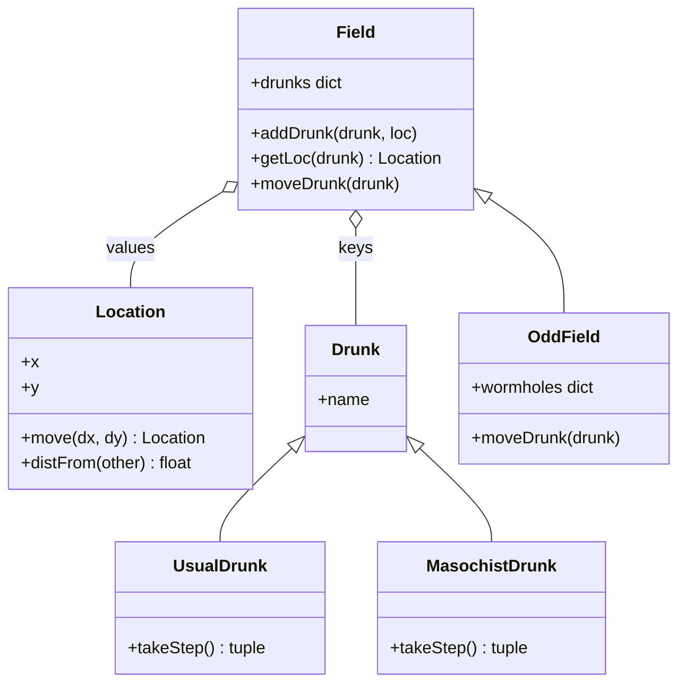

A random walk is a sequence of positions in which each step is drawn at random, independently of the steps before it. The model describes a pollen grain jostled by water molecules, heat spreading through a bar and, for some economists, the daily move of a stock price. Lecture 5 of MIT's *Introduction to Computational Thinking and Data Science* (6.0002) uses the simplest version, a drunk wandering on a grid, to show how a simulation is built, tested and compared against the answer that analysis predicts.

The question the lecture asks is simple: after $$n$$ random steps, how far from the start does the walker end up? A show of hands split the room almost evenly on whether the distance grows with $$n$$. The simulation first agreed with them, because of a one-word bug, and a check on 0, 1 and 2 steps found the problem. Fixed, it shows the distance growing as $$\sqrt n$$ for an unbiased walk and linearly in $$n$$ as soon as the walk has a bias. This article follows the lecture's code and results, then adds the derivation of the $$\sqrt n$$ law that the lecture only observes on a plot.

> This article has been made with the help of [Claude Code](https://claude.com/product/claude-code) and several custom skills

> **Source and currency note.** This article is based on Lecture 5, *Random Walks*, of [MIT 6.0002 Introduction to Computational Thinking and Data Science](https://ocw.mit.edu/courses/6-0002-introduction-to-computational-thinking-and-data-science-fall-2016/) (JG, MIT, Fall 2016), published on MIT OpenCourseWare, with the [lecture video](https://www.youtube.com/watch?v=6wUD_gp5WeE), slides and Python file. The course targets Python 3.5 and draws its figures with `pylab`. Matplotlib's documentation now discourages `pylab` in favour of `import matplotlib.pyplot as plt` together with `import numpy as np`, and NumPy recommends the `numpy.random.default_rng()` generator over the legacy global functions. The code below is condensed from the lecture file and keeps its class and method names; changes are pointed out where they matter.

[TOC]

## What you need to know first

The article assumes basic Python and school probability. A few mechanisms one level below that are used without being re-derived:

- **Expected value and variance.** $$\mathbb E[X]$$ is the probability-weighted average of a random variable, and $$\operatorname{Var}(X) = \mathbb E[X^2] - \mathbb E[X]^2$$ measures its spread. The $$\sqrt n$$ derivation below is a computation of $$\mathbb E[d^2]$$.
- **Linearity of expectation, and variance of a sum.** The expectation of a sum is the sum of expectations, always. The variance of a sum of *independent* variables is the sum of their variances, because every cross term $$\mathbb E[X_i X_j]$$ factorises and vanishes when the means are zero.
- **Pseudo-random generators and seeds.** Python's `random` module produces a deterministic sequence from a seed; `random.seed(0)` makes a run reproducible, and `random.choice(seq)` returns one element of `seq` with equal probability.
- **Classes, inheritance and overriding.** A subclass inherits its parent's methods and may replace one; `Field.moveDrunk(self, drunk)` calls the parent's version explicitly from inside an override.
- **Dictionary keys and hashing.** A Python `dict` stores keys by their hash. A key must be hashable, and its hash must not change while it is in the dictionary.
- **Euclidean distance.** The distance between $$(x_1, y_1)$$ and $$(x_2, y_2)$$ is $$\sqrt{(x_1 - x_2)^2 + (y_1 - y_2)^2}$$, Pythagoras' theorem, which the lecture's `distFrom` method implements.

## Why random walks matter

JG gives three reasons for spending a lecture on random walks:

- **They model real processes.** The opening picture is of Brownian motion, the erratic movement of particles in a fluid (JG remarks that Robert Brown "probably did not discover it"). Diffusion of heat or of molecules in suspension is modelled the same way.
- **Finance uses them.** JG cites Burton Malkiel's book *A Random Walk Down Wall Street*, which argues that price movements are best modelled as a random walk, and notes that much of modern portfolio analysis builds on that assumption. The continuous-time version of the same idea, prices following a geometric Brownian motion, is the starting assumption of [The Black-Scholes Model - Pricing Options and Corporate Liabilities]({{site.url_complet}}/2026/07/18/black-scholes-option-pricing-model/).
- **They illustrate simulation, classes and plotting.** The stated purpose of the lecture is less the walks themselves than "how we built them": classes and subclasses, a layered simulation, a sanity check, and plots.

## The drunkard's walk

Picture a field mown to look like graph paper. A drunk starts at the origin and, at each tick, takes one step of length 1 north, south, east or west, each with probability $$1/4$$. After $$n$$ steps, what is the expected distance from the origin?

### One and two steps by hand

After one step the drunk is at $$(0, 1)$$, $$(0, -1)$$, $$(1, 0)$$ or $$(-1, 0)$$, always exactly 1 away from the origin.

For two steps, assume without loss of generality that the first step went east, to $$(1, 0)$$. The second step leads to four equally likely places:

| Second step | Position | Distance from origin |
|-------------|----------|----------------------|
| East | $$(2, 0)$$ | 2 |
| West | $$(0, 0)$$ | 0 |
| North | $$(1, 1)$$ | $$\sqrt 2 \approx 1.414$$ |
| South | $$(1, -1)$$ | $$\sqrt 2 \approx 1.414$$ |

The average is:

$$
\begin{aligned}
\mathbb E[d_2] = \frac{2 + 0 + 2\sqrt 2}{4} \approx 1.207
\end{aligned}
$$

So the drunk is, on average, a little further away after two steps than after one. The lecture stops here with the hand analysis: a walk of $$n$$ steps has $$4^n$$ equally likely paths, and enumerating them for 100,000 steps is out of the question. The lecture turns to simulation.

### Structure of the simulation

The simulation follows the pattern used throughout the course:

1. simulate one walk of $$k$$ steps;
2. simulate $$n$$ such walks;
3. report the average distance from the origin over those walks.

## Three abstractions: Location, Drunk and Field

Before writing the loop, JG defines three classes. The diagram shows how they relate; the code follows.



### Location, an immutable point

A `Location` holds two numbers. Its `move` method does not modify the object; it returns a new `Location`, which is what makes the type immutable (JG concedes that `move` is perhaps a poor name for it). The coordinates are not restricted to integers, so the same class serves walks with steps of any length.

```python
class Location(object):
    def __init__(self, x, y):
        self.x, self.y = x, y

    def move(self, deltaX, deltaY):
        return Location(self.x + deltaX, self.y + deltaY)

    def getX(self):
        return self.x

    def getY(self):
        return self.y

    def distFrom(self, other):
        xDist = self.x - other.getX()
        yDist = self.y - other.getY()
        return (xDist**2 + yDist**2)**0.5

    def __str__(self):
        return '<' + str(self.x) + ', ' + str(self.y) + '>'
```

JG points out an asymmetry that classes impose: distance is symmetric, but `self.distFrom(other)` treats its two operands differently in the syntax.

### Drunk, a base class, and two kinds of drunks

`Drunk` carries only a name. It is a **base class**, not meant to be used on its own, only to be inherited. Its subclasses supply the one method that matters, `takeStep`, which returns a displacement `(dx, dy)`.

```python
import random

class Drunk(object):
    def __init__(self, name=None):
        self.name = name

    def __str__(self):
        if self != None:          # as in the lecture; see the note below
            return self.name
        return 'Anonymous'

class UsualDrunk(Drunk):
    def takeStep(self):
        stepChoices = [(0, 1), (0, -1), (1, 0), (-1, 0)]
        return random.choice(stepChoices)

class MasochistDrunk(Drunk):
    def takeStep(self):
        stepChoices = [(0.0, 1.1), (0.0, -0.9),
                       (1.0, 0.0), (-1.0, 0.0)]
        return random.choice(stepChoices)
```

The `UsualDrunk` takes a unit step in one of the four directions. The `MasochistDrunk`, a New Englander in JG's telling who keeps heading north towards the Maine winter, chooses among the same four directions with equal probability, but a step north is 1.1 long and a step south only 0.9. This is a **biased random walk**: the choice of direction is fair, the step lengths are not.

The `__str__` method in the lecture tests `self != None`, which is always true for an instance. With the default `name=None`, `str(drunk)` therefore returns `None` and Python raises `TypeError: __str__ returned non-string`. The intended test is `self.name != None`. The bug never shows in the lecture because no drunk is ever printed.

### Field, the only mutable object

A `Field` is a dictionary mapping each drunk to its current location:

```python
class Field(object):
    def __init__(self):
        self.drunks = {}

    def addDrunk(self, drunk, loc):
        if drunk in self.drunks:
            raise ValueError('Duplicate drunk')
        self.drunks[drunk] = loc

    def getLoc(self, drunk):
        if drunk not in self.drunks:
            raise ValueError('Drunk not in field')
        return self.drunks[drunk]

    def moveDrunk(self, drunk):
        if drunk not in self.drunks:
            raise ValueError('Drunk not in field')
        xDist, yDist = drunk.takeStep()
        # use move method of Location to get new location
        self.drunks[drunk] = self.drunks[drunk].move(xDist, yDist)
```

The lecture polls the class on mutability. Locations are immutable, drunks are immutable (`takeStep` returns a step without changing the drunk), and the field is mutable: `addDrunk` and `moveDrunk` both rebind entries of its dictionary. The design keeps all the changing state in one place.

JG adds that drunks had to be immutable "because they have to be hashable so I can use them as a key in a dictionary". That is stricter than Python requires. An instance of a user-defined class is hashable by default whatever its attributes do, because the default `__hash__` and `__eq__` are based on object identity; a mutable class becomes unhashable only when it defines `__eq__` without `__hash__`. The sound part of the advice is that a key's hash must not change while the key is in a dictionary, which identity hashing guarantees here.

## Simulating walks

Three functions mirror the three levels of the simulation. `walk` runs one walk and returns the distance between the start and the end:

```python
def walk(f, d, numSteps):
    """Moves d numSteps times; returns the distance between the
       final location and the location at the start of the walk."""
    start = f.getLoc(d)
    for s in range(numSteps):
        f.moveDrunk(d)
    return start.distFrom(f.getLoc(d))
```

`simWalks` runs `numTrials` walks of the same length, each in a fresh field, for a drunk of class `dClass`. Passing the class rather than an instance lets the same function simulate any kind of drunk:

```python
def simWalks(numSteps, numTrials, dClass):
    Homer = dClass('Homer')
    origin = Location(0, 0)
    distances = []
    for t in range(numTrials):
        f = Field()
        f.addDrunk(Homer, origin)
        distances.append(round(walk(f, Homer, numTrials), 1))   # the bug
    return distances
```

`drunkTest` loops over walk lengths and prints the mean, maximum and minimum distance. It uses `dClass.__name__`, the built-in attribute holding a class's name, for the report:

```python
def drunkTest(walkLengths, numTrials, dClass):
    for numSteps in walkLengths:
        distances = simWalks(numSteps, numTrials, dClass)
        print(dClass.__name__, 'random walk of', numSteps, 'steps')
        print(' Mean =', round(sum(distances)/len(distances), 4))
        print(' Max =', max(distances), 'Min =', min(distances))
```

## The sanity check that found the bug

The first run, `drunkTest((10, 100, 1000, 10000), 100, UsualDrunk)` with `random.seed(0)`, prints:

| Steps | Mean | Max | Min |
|-------|------|-----|-----|
| 10 | 8.634 | 21.6 | 1.4 |
| 100 | 8.57 | 22.0 | 0.0 |
| 1000 | 9.206 | 21.6 | 1.4 |
| 10000 | 8.727 | 23.5 | 1.4 |

The mean barely moves between 10 and 10,000 steps. A student offered a plausible argument for it: after the first steps the drunk is as likely to move closer as further away. JG's remark is that he could have convinced half the room this was a reasonable answer.

The test that exposed it is a **sanity check**: run the simulation on cases whose answer is known. Zero steps must give a distance of 0, and one step a distance of exactly 1. Running `drunkTest((0, 1, 2), 100, UsualDrunk)` prints a mean of 8.634 for 0 steps, 8.57 for 1 step and 9.206 for 2 steps, which cannot be right.

The cause is in `simWalks`: it calls `walk(f, Homer, numTrials)` where it means `walk(f, Homer, numSteps)`. `numTrials` is the constant 100, so every walk, whatever length was asked for, was a 100-step walk. JG says he made exactly this typo the first time he wrote the simulation.

Two details of the buggy output follow from that diagnosis:

- **The numbers repeat.** With the same seed, the sanity-check run consumes the generator exactly as the first run did, so the "0, 1, 2 steps" rows of slide 25 are identical to the "10, 100, 1000 steps" rows of slide 23. Running the lecture code reproduces both tables to the last digit.
- **The level is predictable.** As derived below, the mean distance after $$n$$ unit steps is close to $$0.886\sqrt n$$. For $$n = 100$$ that is about 8.86, the level every buggy row sits at.

With `numSteps` restored, the sanity check passes: a mean, max and min of 0 for 0 steps, exactly 1 for 1 step, and for 2 steps a maximum of 2 and a minimum of 0. Rerunning the corrected code with seed 0 gives a 2-step mean of 1.218, close to the exact expectation of 1.207 computed above. The full run now grows with the number of steps:

| Steps | Mean | Max | Min |
|-------|------|-----|-----|
| 10 | 2.863 | 7.2 | 0.0 |
| 100 | 8.296 | 21.6 | 1.4 |
| 1000 | 27.297 | 66.3 | 4.2 |
| 10000 | 89.241 | 226.5 | 10.0 |

JG's comment on passing the check is measured: it "doesn't mean my simulation is right, but at least I have reason to be hopeful". A sanity check can refute a simulation; it cannot validate it.

The Python file distributed with the lecture still contains the `numTrials` line, so anyone running it as published gets the buggy numbers.

## How far does the unbiased drunk get: the √n law

### What the lecture shows

JG plots the mean distance of the `UsualDrunk` for walks of 10 to 100,000 steps (100 trials each), notices that the curve looks like $$\sqrt n$$, overlays `pylab.array(numSteps)**0.5`, and finds them "pretty darn close". He adds that the drunk "seems to be moving just a tad faster than the square root". The lecture leaves it there: the $$\sqrt n$$ law is shown empirically, from a plot.

Both halves of that statement can be made precise, and the second is the wrong way round.

### Deriving E[d²] = n

Write the walk as a sum of independent steps. Step $$i$$ is a vector $$s_i = (a_i, b_i)$$ equal to $$(1, 0)$$, $$(-1, 0)$$, $$(0, 1)$$ or $$(0, -1)$$ with probability $$1/4$$ each. After $$n$$ steps the position is

$$
\begin{aligned}
P_n = \sum_{i=1}^{n} s_i
\end{aligned}
$$

and the squared distance from the origin is the dot product of $$P_n$$ with itself:

$$
\begin{aligned}
d_n^2 = P_n \cdot P_n = \sum_{i=1}^{n} s_i \cdot s_i + \sum_{i \neq j} s_i \cdot s_j
\end{aligned}
$$

Two facts finish the computation:

- **Every step has length 1**, so $$s_i \cdot s_i = 1$$ and the first sum is exactly $$n$$, whatever the directions.
- **Distinct steps are independent with mean zero.** $$\mathbb E[s_i] = (0, 0)$$ by symmetry, so for $$i \neq j$$, $$\mathbb E[s_i \cdot s_j] = \mathbb E[s_i] \cdot \mathbb E[s_j] = 0$$.

Taking expectations:

$$
\begin{aligned}
\mathbb E[d_n^2] = n
\end{aligned}
$$

The root-mean-square distance is therefore exactly $$\sqrt{\mathbb E[d_n^2]} = \sqrt n$$. The argument holds in any dimension and for any step distribution with mean zero and $$\mathbb E[s_i \cdot s_i] = 1$$; nothing in it depends on the grid.

### From E[d²] to the mean distance

The lecture's simulation reports the mean distance $$\mathbb E[d_n]$$, not the root-mean-square. Because the square root is concave, Jensen's inequality gives $$\mathbb E[d_n] \le \sqrt{\mathbb E[d_n^2]} = \sqrt n$$: the mean distance sits *below* $$\sqrt n$$.

For large $$n$$ the central limit theorem gives the constant. Half of the steps, on average, move along each axis, so each coordinate of $$P_n$$ is approximately normal with mean 0 and variance $$n/2$$, and the two coordinates are asymptotically independent. The distance is then Rayleigh distributed with $$\sigma^2 = n/2$$, whose mean is

$$
\begin{aligned}
\mathbb E[d_n] \approx \sigma \sqrt{\pi/2} = \frac{\sqrt{\pi n}}{2} \approx 0.886 \sqrt n
\end{aligned}
$$

The lecture's corrected results agree with this prediction within the noise of 100 trials:

| Steps $$n$$ | $$\sqrt n$$ | $$0.886\sqrt n$$ | Lecture (100 trials) |
|-------------|-------------|------------------|----------------------|
| 10 | 3.16 | 2.80 | 2.863 |
| 100 | 10 | 8.86 | 8.296 |
| 1000 | 31.62 | 28.02 | 27.297 |
| 10000 | 100 | 88.62 | 89.241 |

The ratio of the lecture's mean to $$\sqrt n$$ stays between about 0.83 and 0.91. On JG's linear plot up to 100,000 steps the $$\sqrt n$$ curve and the data are visually close, which is why the comparison looks good; the remaining gap of about 11 % is the factor $$\sqrt\pi / 2$$, and it puts the drunk slightly *slower* than $$\sqrt n$$, not faster.

The practical reading is the one the poll missed: the drunk does drift away, but slowly. Going 10 times further on average takes 100 times more steps.

## The biased walk: drift grows linearly

### What the lecture shows

Rerunning with both kinds of drunks (`simAll((UsualDrunk, MasochistDrunk), (1000, 10000), 100)` after `random.seed(0)`) gives:

| Drunk | Steps | Mean | Max | Min |
|-------|-------|------|-----|-----|
| UsualDrunk | 1000 | 26.828 | 66.3 | 4.2 |
| UsualDrunk | 10000 | 90.073 | 210.6 | 7.2 |
| MasochistDrunk | 1000 | 58.425 | 133.3 | 6.7 |
| MasochistDrunk | 10000 | 515.575 | 694.6 | 377.7 |

On the trend plot, the masochistic drunk's distance follows a straight line, which JG fits by eye as `numSteps*0.05`. His explanation is the right one: east-west behaviour is the same for both drunks; on the north-south axis, a quarter of the steps go 1.1 north and a quarter go 0.9 south, so half of the steps are unbalanced by a small amount, and "0.1 half the time, divided" gives 0.05.

### The drift, computed

The expected vertical displacement of one step is

$$
\begin{aligned}
\mathbb E[b_i] = \tfrac14 (1.1) + \tfrac14 (-0.9) + \tfrac12 (0) = 0.05
\end{aligned}
$$

so the expected position after $$n$$ steps is $$(0, 0.05\,n)$$, a **drift** that grows linearly. Around that moving centre the walk still diffuses. The same expansion as before, now with a non-zero mean, gives the second moment as a diffusion term plus the square of the drift. Horizontally, $$\mathbb E[a_i^2] = 1/2$$; vertically, $$\mathbb E[b_i^2] = (1.21 + 0.81)/4 = 0.505$$ and $$\operatorname{Var}(b_i) = 0.505 - 0.05^2 = 0.5025$$. Hence

$$
\begin{aligned}
\mathbb E[d_n^2] &= (0.5\,n + 0.5025\,n) + (0.05\,n)^2 \\
&= 1.0025\,n + 0.0025\,n^2
\end{aligned}
$$

The diffusion term grows as $$n$$ and the drift term as $$n^2$$, so their square roots grow as $$\sqrt n$$ and $$n$$ respectively. They are equal when $$0.05\,n = \sqrt n$$, at $$n = 400$$. Below a few hundred steps the masochistic drunk is hard to tell apart from the usual one; above a few thousand its distance is essentially $$0.05\,n$$. At 10,000 steps the formula gives a root-mean-square distance of about 509.9, against the lecture's mean of 515.6.

The figure below reproduces the trend plot from 1000 simulated walks per length, on linear axes as in the lecture and on log-log axes, where a power law becomes a straight line whose slope is the exponent.


On the log-log panel the `UsualDrunk` runs parallel to $$\sqrt n$$ (slope 1/2) and just under it, and the `MasochistDrunk` bends from the diffusive regime onto the line $$0.05\,n$$ (slope 1) around a few hundred steps. The simulation draws each final position directly from the multinomial distribution of the step counts rather than looping over steps, which gives the same distribution far faster; the script sits next to the figure.

### Where the drunks end up

The lecture's second plot shows the end points of 1000 walks of 10,000 steps for each drunk, as unconnected markers. The two clouds have about the same east-west spread, but the masochistic cloud is displaced north: after 10,000 steps JG expects none of its points below zero, where about half of the usual drunk's points are, and the plot bears that out. The legend reports the mean absolute $$x$$ and $$y$$ of each cloud; the $$x$$ values are similar, the $$y$$ values differ widely. JG's point is that this structure is easy to see in a picture and hard to see in a table of 2000 end points.

## Plotting with pylab, and what to use today

The lecture introduces four libraries:

- **NumPy** adds arrays, matrices and many vectorised mathematical functions.
- **SciPy** adds scientific routines on top of NumPy.
- **Matplotlib** adds an object-oriented plotting API.
- **PyLab** combines them into one namespace with a MATLAB-like interface.

The core command is `plot(xVals, yVals, style, label=...)`. Its first two arguments are sequences of the same length, the points are plotted in order, and by default each point is joined to the previous one by a line, which is why the order of the points matters. The style string combines a colour, a marker and a line style:

```python
import pylab
xVals = [1, 2, 3, 4]
yVals1 = [1, 2, 3, 4]
pylab.plot(xVals, yVals1, 'b-', label='first')    # blue, solid line
yVals2 = [1, 7, 3, 5]
pylab.plot(xVals, yVals2, 'r--', label='second')  # red, dashed line
pylab.legend()
```

The rest of the lecture code relies on three more conventions:

- **Marker-only styles** for the end-point scatter: `'k+'` draws black plus signs with no line, `'r^'` red triangles, `'bo'` blue circles.
- **Defaults set once** through `pylab.rcParams`, for instance a line width of 4 and a title size of 20.
- **A `styleIterator` class** that hands out the next style string for each new series.

Two slips in the spoken lecture: `'m'` is magenta, not maroon, and the transcript's `'b0'` is the letter o, `'bo'`.

The same trend plot in current style uses the explicit `Figure`/`Axes` interface and `itertools.cycle` in place of `styleIterator`:

```python
import itertools
import matplotlib.pyplot as plt
import numpy as np

def plot_trends(walk_lengths, results):          # results: {name: [mean distances]}
    styles = itertools.cycle(['-', '--', '-.'])
    fig, ax = plt.subplots()
    for name, means in results.items():
        ax.plot(walk_lengths, means, next(styles), label=name)
    n = np.asarray(walk_lengths)
    ax.plot(n, np.sqrt(n), ':', label='sqrt(n)')
    ax.set(xlabel='Number of steps', ylabel='Distance from origin',
           title='Mean distance from origin')
    ax.legend(loc='best')
    return fig
```

## Fields with wormholes: OddField

The last elaboration changes the field rather than the drunk. An `OddField` behaves like a `Field` except at a set of wormholes: a drunk who lands on one is teleported to another, fixed, location.

```python
class OddField(Field):
    def __init__(self, numHoles=1000, xRange=100, yRange=100):
        Field.__init__(self)
        self.wormholes = {}
        for w in range(numHoles):
            x = random.randint(-xRange, xRange)
            y = random.randint(-yRange, yRange)
            newX = random.randint(-xRange, xRange)
            newY = random.randint(-yRange, yRange)
            self.wormholes[(x, y)] = Location(newX, newY)

    def moveDrunk(self, drunk):
        Field.moveDrunk(self, drunk)
        x = self.drunks[drunk].getX()
        y = self.drunks[drunk].getY()
        if (x, y) in self.wormholes:
            self.drunks[drunk] = self.wormholes[(x, y)]
```

`moveDrunk` overrides the parent method and calls it explicitly as `Field.moveDrunk(self, drunk)`, then applies the teleport. The lecture's plot traces a single 500-step walk of a `UsualDrunk` in a plain field and in an `OddField`: the plain walk stays in a compact tangle near the origin, the wormhole walk jumps across the field.

A few properties of this code are not discussed in the lecture:

- **Fewer than 1000 wormholes.** Entrances are drawn on a $$201 \times 201$$ grid of 40,401 cells, and a repeated draw overwrites the earlier entry. The expected number of distinct entrances is $$40401\,(1 - (1 - 1/40401)^{1000}) \approx 988$$, about 2.4 % of the cells.
- **One jump per step.** The teleport is checked once. A drunk sent onto another entrance stays there until its next step.
- **Only lattice walkers use the holes.** The keys are integer pairs. A `UsualDrunk` stays on integer coordinates, but a `MasochistDrunk` accumulates sums of 1.1 and 0.9 in floating point, so its $$y$$ is rarely exactly an integer and it almost never matches an entrance.
- **The published file differs from the slides.** In the distributed `lec5.py`, `getFinalLocs`, the helper behind the end-location plot, creates an `OddField` rather than a `Field`, so running `plotLocs` as published does not reproduce the slide's plain-field picture.

## Checking a simulation against analysis

JG's summary is that the simulations were the excuse; the method is the content:

- **Abstractions first.** Location, Drunk and Field were defined before any simulation code, with the changing state kept in the one mutable class.
- **One function per level.** One trial (`walk`), many trials (`simWalks`), reporting (`drunkTest`).
- **A simple version that works, then one change at a time.** A new kind of drunk, then a new kind of field, each a subclass that leaves the rest untouched.
- **A sanity check on known cases.** It is what caught the bug; a plausible-looking result did not.
- **Plots to see structure.** Trends against $$n$$, end-point clouds, a traced walk.

The lecture's analysis stops at fitting $$\sqrt n$$ and $$0.05\,n$$ by eye. The derivation above shows what that step can add: it confirms the exponent, it supplies the constant $$\sqrt\pi/2$$ that the eye misread as "a tad faster", and it predicts the crossover at 400 steps, which a reader can then check against the simulation. Simulation and analysis check each other: the simulation catches an algebra mistake, the analysis catches a bug like `numTrials`. The next lecture of the course takes up the question this one leaves open, how far a simulation's results can be trusted.

## Conclusion

Lecture 5 builds a random walk simulation in small, tested steps and uses it to answer how far a random walker gets in $$n$$ steps.

- **Design.** Immutable `Location` and `Drunk` objects, a mutable `Field` holding a drunk-to-location dictionary, and subclasses (`UsualDrunk`, `MasochistDrunk`, `OddField`) to vary one thing at a time.
- **Testing.** A run on 0, 1 and 2 steps exposed `walk(f, Homer, numTrials)`, which made every walk 100 steps long; the buggy numbers looked plausible until compared with a known answer.
- **Unbiased walk.** $$\mathbb E[d_n^2] = n$$ exactly, so the root-mean-square distance is $$\sqrt n$$ and the mean distance is about $$0.886\sqrt n$$. The lecture shows the $$\sqrt n$$ trend empirically; its "a tad faster" should read "slightly slower".
- **Biased walk.** A drift of 0.05 per step gives $$\mathbb E[d_n^2] = 1.0025\,n + 0.0025\,n^2$$; past roughly 400 steps the distance is dominated by $$0.05\,n$$.
- **Tooling.** The `pylab` interface of the lecture maps directly onto `matplotlib.pyplot` and NumPy, which are what current code should use.


## Annex

### Key Terms

| Term | Definition |
|------|------------|
| **Random variable** | A quantity whose value is determined by a random experiment, such as the displacement of one step or the final distance of a walk. |
| **Expected value** | The probability-weighted average of a random variable, written $$\mathbb E[X]$$; the simulation estimates it by averaging over trials. |
| **Variance** | $$\mathbb E[X^2] - \mathbb E[X]^2$$, the expected squared deviation from the mean; variances of independent variables add. |
| **Independence** | Two random variables are independent when knowing one says nothing about the other; it makes $$\mathbb E[XY] = \mathbb E[X]\,\mathbb E[Y]$$. |
| **Random walk** | A sequence of positions where each new position is the previous one plus an independent random step. |
| **Brownian motion** | The irregular movement of particles suspended in a fluid, and the continuous-time limit of a random walk. |
| **Diffusion** | The spreading of heat or particles from a source, modelled by many independent random walks. |
| **Drunkard's walk** | The lecture's lattice random walk: unit steps north, south, east or west with probability 1/4 each. |
| **Biased random walk** | A random walk whose steps have a non-zero mean; here a fair choice of direction with longer steps north than south. |
| **Drift** | The expected displacement per step of a biased walk, 0.05 north for the `MasochistDrunk`, which accumulates linearly in the number of steps. |
| **Root-mean-square distance** | $$\sqrt{\mathbb E[d^2]}$$, equal to $$\sqrt n$$ for an unbiased walk of $$n$$ unit steps. |
| **Rayleigh distribution** | The distribution of the length of a 2D vector with independent normal coordinates of equal variance; its mean is $$\sigma\sqrt{\pi/2}$$. |
| **Jensen's inequality** | For a concave function such as the square root, $$\mathbb E[f(X)] \le f(\mathbb E[X])$$; it puts the mean distance below $$\sqrt n$$. |
| **Simulation** | Estimating a quantity by running a random model many times and summarising the outcomes, used when enumerating all cases is impractical. |
| **Sanity check** | Running a simulation on inputs whose answer is known, such as 0 or 1 step, to catch errors before trusting the general results. |
| **Seed** | The value that initialises a pseudo-random generator; `random.seed(0)` makes every run produce the same sequence. |
| **Base class** | A class written only to be inherited, like `Drunk`, which supplies a name but no `takeStep`. |
| **Method overriding** | A subclass redefining a parent method, as `OddField.moveDrunk` does while still calling `Field.moveDrunk`. |
| **Immutable type** | A type whose instances do not change after creation; `Location.move` returns a new object instead of modifying the old one. |
| **Hashable** | An object with a hash that does not change during its lifetime, so it can be a dictionary key; Python objects are hashable by identity by default. |

## Frequently Asked Questions

**Q: Why did the first simulation report a mean of about 8.6 to 9.2 for every walk length?**

Because `simWalks` passed `numTrials` (always 100) to `walk` instead of `numSteps`, so every walk was 100 steps long whatever length was requested. The mean distance after 100 unit steps is close to $$0.886 \times 10 \approx 8.86$$, the level every row showed.

**Q: Why are 0, 1 and 2 steps good sanity-check inputs?**

Their answers are known without simulation. Zero steps must give a distance of exactly 0, and one step exactly 1, with no randomness in either. Two steps give a small spread with a computable mean of about 1.207. A result that disagrees with any of them proves a bug; agreeing does not prove the simulation correct.

**Q: Derive the expected squared distance after n steps of the unbiased walk.**

Write the position as the sum of the step vectors $$s_1, \dots, s_n$$. The squared distance is $$\sum_i s_i \cdot s_i + \sum_{i \neq j} s_i \cdot s_j$$:

- each $$s_i \cdot s_i$$ equals 1 because every step has length 1, so the first sum is $$n$$;
- for $$i \neq j$$ the steps are independent with mean zero, so $$\mathbb E[s_i \cdot s_j] = 0$$.

Hence $$\mathbb E[d_n^2] = n$$ and the root-mean-square distance is $$\sqrt n$$.

**Q: The lecture says the usual drunk moves "a tad faster" than the square root of the number of steps. Is that right?**

No. The simulation reports the mean distance, and by Jensen's inequality $$\mathbb E[d_n] \le \sqrt{\mathbb E[d_n^2]} = \sqrt n$$. For large $$n$$ the mean is about $$\sqrt{\pi n}/2 \approx 0.886\sqrt n$$, roughly 11 % below $$\sqrt n$$. The lecture's own numbers (27.3 at 1000 steps against $$\sqrt{1000} \approx 31.6$$) sit below the curve.

**Q: Why does the masochistic drunk's distance grow linearly, and when does the bias start to dominate?**

Each step has an expected northward displacement of $$\tfrac14(1.1) - \tfrac14(0.9) = 0.05$$, so the centre of the walk moves $$0.05\,n$$ north, while the random spread around it grows only as $$\sqrt n$$. The two are equal at $$0.05\,n = \sqrt n$$, that is $$n = 400$$. Beyond a few thousand steps the distance is essentially $$0.05\,n$$, which is the line JG fitted by eye.

**Q: Why are drunks used as dictionary keys, and does that require them to be immutable?**

The `Field` maps each drunk to its location, so a drunk must be hashable. In Python an instance of a plain class is hashable by identity regardless of its attributes, so immutability is not what makes it work. What matters is that the hash never changes while the drunk is a key, which identity hashing guarantees; the risk appears only if the class defines `__eq__` and `__hash__` on attributes that later change.

**Q: Would a MasochistDrunk be affected by the wormholes of an OddField?**

Rarely. Wormhole entrances are integer pairs, and the lookup is an exact dictionary match on `(x, y)`. The masochistic drunk's $$y$$ coordinate is a floating-point sum of 1.1 and 0.9 terms, which is seldom exactly an integer, so it almost never lands on an entrance. The `UsualDrunk`, whose coordinates stay integers, is the one the lecture traces.

## Gaps

The lecture and its files leave a few points open, and several statements in this article come from general knowledge rather than from the lecture:

| Gap | Why it matters | What to read or verify |
|-----|----------------|------------------------|
| The constant $$\sqrt\pi/2 \approx 0.886$$ and the Rayleigh argument come from the central limit theorem, not from the lecture. | The correction of "a tad faster" rests on it. | A probability text on random walks and the Rayleigh distribution, or the simulation script next to the figure. |
| The Rayleigh limit treats the two coordinates as independent normals; on the lattice they are dependent for finite $$n$$. | The 0.886 factor is asymptotic, not exact for 10 or 100 steps. | Compare the exact mean for small $$n$$ by enumeration against $$0.886\sqrt n$$. |
| The textbook's chapter on random walks uses other biased drunks (named `ColdDrunk` and `EWDrunk` in the 2nd edition, from memory) instead of `MasochistDrunk`. | A reader following the book will meet different class names and step values. | Guttag, *Introduction to Computation and Programming Using Python*, 2nd ed., chapter on random walks. |
| The claim that Robert Brown "probably did not discover" Brownian motion is not sourced in the lecture. | It is a historical aside repeated in the article. | A history of Brownian motion (earlier observations by Ingenhousz are usually cited). |
| The slide 27 masochistic-drunk numbers come from `simAll` run after other draws on the same seed; this article's script uses NumPy's generator and different trial counts. | Figures and tables in the article do not match slide-for-slide. | Run `lec5.py` with the `simAll` call uncommented and `random.seed(0)`. |
| The published `lec5.py` still contains the `numTrials` bug and builds `OddField` inside `getFinalLocs`. | Running the file as published reproduces the buggy table and a different end-location plot. | Lines `walk(f, Homer, numTrials)` and `f = OddField()` in the OCW lecture code. |
| The textbook was not read for this article; only slides, transcript and code were. | The book may state the $$\sqrt n$$ result or the bias analysis differently. | Guttag, 2nd ed., chapters 11 and 14 (the slide's "relevant reading"). |

## References

- [MIT 6.0002 Introduction to Computational Thinking and Data Science, Fall 2016](https://ocw.mit.edu/courses/6-0002-introduction-to-computational-thinking-and-data-science-fall-2016/), JG and EG, MIT OpenCourseWare (lecture slides, code and transcript)
- [Lecture 5: Random Walks (video)](https://www.youtube.com/watch?v=6wUD_gp5WeE), JG, MIT OpenCourseWare, Fall 2016
- J. Guttag, *Introduction to Computation and Programming Using Python: With Application to Understanding Data*, 2nd ed., MIT Press, 2016
- B. G. Malkiel, *A Random Walk Down Wall Street*, W. W. Norton (first published 1973)
- [matplotlib.pyplot documentation](https://matplotlib.org/stable/api/pyplot_summary.html), including the note on the discouraged `pylab` interface
- [NumPy random Generator](https://numpy.org/doc/stable/reference/random/generator.html)
- [Python data model: `__hash__`](https://docs.python.org/3/reference/datamodel.html#object.__hash__)
- [Claude Code](https://claude.com/product/claude-code)

### Related articles

- [Monte Carlo Simulation for DeFi Risk Analysis - From Random Sampling to a Stay-or-Exit Decision]({{site.url_complet}}/2026/10/10/monte-carlo-defi-risk-analysis/)
- [The Black-Scholes Model - Pricing Options and Corporate Liabilities]({{site.url_complet}}/2026/07/18/black-scholes-option-pricing-model/)
