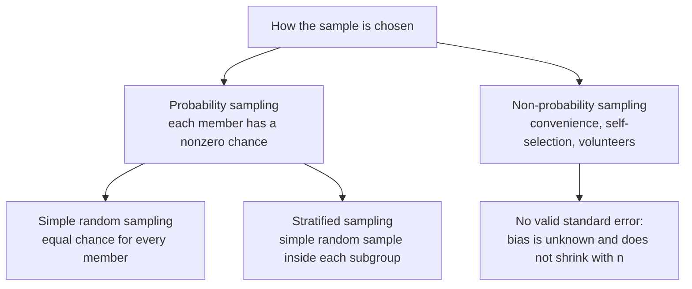

A Monte Carlo simulation can be rerun a thousand times, so the spread of its answers can be measured directly. A poll, a lab experiment or a survey of real data usually happens once. Lecture 8 of MIT's *Introduction to Computational Thinking and Data Science* (6.0002, JG) answers the question that follows: what can be concluded about a population from a single random sample?

The answer is the standard error of the mean, $$\text{SE} = \sigma/\sqrt{n}$$, combined with the sample standard deviation as a stand-in for the unknown $$\sigma$$. The lecture builds it up on 55 years of daily high temperatures from 21 US cities, checks each step by simulation, and ends with a five-step procedure for estimating a mean from one sample. This article follows that path, adds the points the lecture leaves out (Bessel's correction, the Student $$t$$ quantile, the finite population correction) and corrects a few statements that are imprecise.

> This article has been made with the help of [Claude Code](https://claude.com/product/claude-code) and several custom skills

> **Source and currency note.** This article is based on lecture 8, *Sampling and Standard Error*, of [MIT OpenCourseWare 6.0002, Fall 2016](https://ocw.mit.edu/courses/6-0002-introduction-to-computational-thinking-and-data-science-fall-2016/) (JG, MIT), its slides, its [video](https://www.youtube.com/watch?v=soZv_KKax3E) and the course file `lect8.py`. The course dates from 2016 and uses Python 3.5 with `pylab`. `pylab` is now discouraged by the Matplotlib developers in favour of explicit `import numpy as np` and `import matplotlib.pyplot as plt`, and the code below follows that style. The data file `temperatures.csv` is described from the code and the slides only. The statistics have not changed since 2016.

[TOC]

## What you need to know first

The lecture sits at the end of a run of lectures on simulation and inference, and relies on the following.

- **Mean, variance and standard deviation.** For values $$x_1,\dots,x_n$$ the mean is $$\bar x = \frac1n\sum x_i$$ and the standard deviation measures their spread around it. The article distinguishes the population values ($$\mu$$, $$\sigma$$) from the sample values ($$\bar x$$, $$s$$).
- **Normal distribution and the empirical rule.** About 95 % of a normal distribution lies within 1.96 standard deviations of its mean. Every 95 % interval in this article uses that factor.
- **Central limit theorem (CLT).** The means of samples of size $$n$$ drawn from almost any population with finite variance are approximately normally distributed for large enough $$n$$, centred on $$\mu$$. The lecture recalls its three parts and uses the third one here.
- **Confidence interval.** An interval computed from data by a procedure that, over repeated samples, contains the true parameter a stated fraction of the time (95 % here). The previous lecture of the series built such intervals from repeated Monte Carlo runs.
- **Sampling with and without replacement.** Without replacement, an element drawn once cannot be drawn again; Python's `random.sample(population, k)` works this way, `random.choices` does not.
- **Skewness and kurtosis.** Skewness measures the asymmetry of a distribution; kurtosis measures the weight of its tails. Both come up when deciding how large a sample must be.

## Why one sample is the normal case

Inferential statistics draws conclusions about a population from one or more random samples of it. In the Monte Carlo lectures the samples were free: the program could generate a thousand of them and measure their spread. The lecture opens with a case where that is impossible, a poll from October 2016 quoted on the slides: Clinton led Trump by 3.2 points in swing states, the registered-voter sample was 835, and the margin of error was plus or minus 4 points. The pollster ran one poll, not a thousand, and still reported something that works like a confidence interval.

The rest of the lecture explains how that is possible. It needs two things: a sample drawn so that it represents the population, and a way to estimate the spread of the sample mean from that one sample.

## Probability sampling

A **probability sample** is one in which every member of the population has a nonzero probability of being included. Two designs are covered:

- **Simple random sampling.** Every member has the same probability of being chosen. This is what `random.sample` does and what the rest of the lecture uses.
- **Stratified sampling.** The population is partitioned into subgroups (strata), and a simple random sample is drawn from each, usually in proportion to the size of the stratum.



The lecture motivates stratification with a survey of MIT undergraduates: most majors are in engineering and science, so a sample of 100 students picked at random may contain no architecture student at all. Stratified sampling is used when small subgroups must be represented, or when subgroups must appear in proportion to their size.

Because the variability inside each stratum is lower than in the whole population, it can also reduce the sample size needed for a given precision. JG adds that most political polls are stratified, and that the 2016 polls may have gone wrong through poor stratification. The lecture then sets stratification aside: "it can be tricky to do it properly".

### Non-representative samples

The lecture's examples of bad samples are a stratification that misses a group and, at the end, a sample taken as a contiguous slice of a file sorted by city. The classic case outside the lecture is the *Literary Digest* poll of the 1936 US presidential election.

The magazine mailed ballots to names taken largely from its subscriber lists, telephone directories and car registrations, received about 2.4 million replies and predicted a clear win for Alf Landon; Franklin Roosevelt won with about 61 % of the popular vote. A sample of millions did not help, because the error came from who was asked and who answered, not from the sample size.

The point carries over to everything that follows: the standard error measures only the random error of a probability sample. It says nothing about selection bias, and a larger biased sample is a more precise estimate of the wrong quantity.

## The temperature data

The running example comes from the US National Centers for Environmental Information (NCEI): daily high and low temperatures for 21 US cities from 1961 to 2015, 421,848 rows according to the slides. The cities are Albuquerque, Baltimore, Boston, Charlotte, Chicago, Dallas, Detroit, Las Vegas, Los Angeles, Miami, New Orleans, New York, Philadelphia, Phoenix, Portland, San Diego, San Francisco, San Juan, Seattle, St Louis and Tampa.

The course code reads only one value per line, the second comma-separated field, as a temperature in degrees Celsius, and skips any line where that conversion fails (the header, for instance). The file is ordered by city, a detail that matters at the end of the lecture.

```python
def get_highs(path="temperatures.csv"):
    """Daily highs in degrees C: second column of each line, header skipped."""
    highs = []
    with open(path) as f:
        for line in f:
            try:
                highs.append(float(line.split(",")[1]))
            except (ValueError, IndexError):
                continue
    return highs
```

This is a condensed version of `getHighs` from `lect8.py`. The original uses a bare `except:`, which also hides errors unrelated to parsing.

The population histogram on the slides is not normal: it has a tail of cold days on the left. Its mean is 16.3 °C and its standard deviation about 9.44 °C.

## One sample of 100, then a thousand

The first experiment draws one simple random sample of 100 days. Its standard deviation is about 10.4 °C, and its mean is 17.1 °C on the slide (17.7 in the spoken lecture). Both are close to the population values, which raises JG's question: a happy accident, or something to expect?

To find out, the code draws 1,000 samples of 100 and records each sample mean. The histogram of those means looks much closer to a normal distribution than the population did, which is what the CLT predicts. The results:

- the mean of the 1,000 sample means is 16.28 °C, close to the population mean of 16.3 °C;
- the standard deviation of the sample means is 0.94 °C.

The slide then computes a "95 % confidence interval" as $$16.28 \pm 1.96 \times 0.94$$, which gives 14.44 to 18.12 °C (14.5 to 18.1 on the slide). That interval contains the population mean, but it is wide.

That interval needs a precise reading, which the lecture does not give. It is the range in which the mean of **one** sample of 100 falls about 95 % of the time. It is not the uncertainty of the average of the 1,000 means, which is far smaller ($$0.94/\sqrt{1000}$$), and in practice only one sample exists, so the 1,000 means are a teaching device rather than a procedure.

### More samples, or larger samples?

To tighten the interval, there are two options:

- **Draw more samples of the same size.** Going from 1,000 to 2,000 samples moves the standard deviation of the means from 0.943 to 0.946. The number of samples only makes the measurement of that spread more precise; it does not change the spread itself, because the spread is a property of the size-100 mean.
- **Draw larger samples.** Going from $$n = 100$$ to $$n = 200$$ lowers it from 0.943 to 0.662.

The second figure is what the standard error formula below predicts: doubling $$n$$ divides the spread by $$\sqrt2$$, and $$0.943/\sqrt2 \approx 0.667$$.

## Error bars and overlapping intervals

The lecture digresses into error bars, the usual way to draw this uncertainty. Its example (a Wikimedia figure of resting pulse rate against exercise frequency) shows a mean and a 95 % interval for each group. The rule the slides state:

- if two 95 % confidence intervals **do not overlap**, the two means are statistically significantly different at the 95 % level;
- if they **overlap**, no conclusion follows either way, and another test is needed.

Both statements are correct, and the first is conservative. Two intervals can overlap somewhat while a direct test of the difference is still significant: for two independent means with equal standard errors, the standard error of the difference is $$\sqrt2$$ times each one, not twice it. Overlap of the intervals is therefore a weaker criterion than a test on the difference.

In Matplotlib, error bars come from `errorbar`, which takes a sequence of half-widths as `yerr`:

```python
import matplotlib.pyplot as plt
import numpy as np

def show_error_bars(population, sizes, trials):
    mu = np.mean(population)
    means, sds = [], []
    for n in sizes:
        m = [np.mean(random.sample(population, n)) for _ in range(trials)]
        means.append(np.mean(m))
        sds.append(np.std(m))
    plt.errorbar(sizes, means, yerr=1.96 * np.array(sds), fmt="o",
                 label="95 % interval of one sample mean")
    plt.axhline(mu, color="r", label="Population mean")
    plt.xlabel("Sample size"); plt.ylabel("Mean"); plt.legend()
```

With 100 trials per size from 50 to 600, the bars shrink steadily, while the point estimates do not necessarily move closer to the true mean: the estimate at one size can be further off than at a smaller one. Larger samples buy confidence in the estimate, not a guarantee that a given estimate is better, as with the needle-dropping estimate of π in the previous lecture. The slides quote the spread falling from about 1.2 °C at $$n = 50$$ to about 0.34 °C at $$n = 600$$. In the video JG corrects the slide: these are standard deviations of the sample means, not confidence intervals.

The slide then remarks that the experiment looked at 600 × 100 = 600,000 examples, more than the 421,848 in the population, so sampling "bought absolutely nothing". The multiplication is wrong: 100 samples of 600 are 60,000 values, and the whole experiment, over all seven sizes, drew $$100 \times (50 + 100 + 200 + 300 + 400 + 500 + 600) = 215{,}000$$. The conclusion survives, since a procedure that needs hundreds of samples to measure its own uncertainty is pointless when one sample is all there is, but the arithmetic on the slide does not support it.

## The standard error of the mean

The CLT, as recalled in the lecture, makes three claims about the means of samples of size $$n$$:

1. they are approximately normally distributed;
2. their distribution has a mean close to the population mean;
3. their variance is close to the population variance divided by $$n$$.

The third gives the **standard error of the mean** (SEM, or SE):

$$
\begin{aligned}
\text{SE} = \frac{\sigma}{\sqrt{n}}
\end{aligned}
$$

where $$\sigma$$ is the population standard deviation and $$n$$ the sample size. In the course code:

```python
def sem(pop_sd, sample_size):
    return pop_sd / sample_size ** 0.5
```

A small correction to the attribution. The third claim is not really a consequence of the CLT. For independent draws with variance $$\sigma^2$$, $$\operatorname{Var}(\bar x) = \sigma^2/n$$ holds **exactly**, for every $$n$$ and every distribution with a finite variance; it follows from the variance of a sum of independent variables. What the CLT adds is the first claim, normality, which is what allows the factor 1.96 to be read off a normal table.

The lecture tests the formula: for $$n$$ from 25 to 600, it draws 50 samples per size, takes the standard deviation of their means, and plots it against $$9.44/\sqrt n$$. The two curves track each other closely, and almost coincide for the largest sizes.


The left panel is the formula with $$\sigma = 9.44$$ °C: 1.89 at $$n = 25$$, 0.94 at $$n = 100$$, 0.67 at $$n = 200$$ and 0.39 at $$n = 600$$. The two squares are the lecture's measured values for 1,000 samples, which sit on the curve. Because SE falls as $$1/\sqrt n$$, halving it costs four times as many observations.

**Standard deviation versus standard error.** JG stops on this distinction because the class asked. The standard deviation of the sample means is measured by drawing many samples and looking at how their means vary. The standard error is computed from one sample with a formula, and it predicts that same number. Having the formula is what removes the need for the other 49 samples.

## Estimating σ from the sample

The formula has a catch: it needs $$\sigma$$, the standard deviation of the population, and anyone who knew it would have no reason to sample. The only quantity available is the standard deviation $$s$$ of the one sample, so the estimate becomes:

$$
\begin{aligned}
\widehat{\text{SE}} = \frac{s}{\sqrt{n}}
\end{aligned}
$$

How good is $$s$$ as a proxy? The lecture plots the mean relative difference $$\lvert s - \sigma\rvert / \sigma$$ over 100 samples, for every $$n$$ from 20 to 599. For the temperatures it is about 14 % at the smallest sizes and about 2 % at $$n = 600$$; JG judges it good enough from roughly 500 onwards. Once the sample has a reasonable size, the sample standard deviation is a good approximation of the population one.

### Bessel's correction, and what the course code does

The sample variance has two common definitions:

$$
\begin{aligned}
s_0^2 = \frac{1}{n}\sum_{i=1}^{n}(x_i - \bar x)^2, \qquad s_1^2 = \frac{1}{n-1}\sum_{i=1}^{n}(x_i - \bar x)^2
\end{aligned}
$$

Dividing by $$n - 1$$ (**Bessel's correction**) makes $$s_1^2$$ an unbiased estimator of $$\sigma^2$$. Dividing by $$n$$ underestimates it on average, because the deviations are measured from $$\bar x$$, which is itself fitted to the sample and sits closer to the data than $$\mu$$ does. Even $$s_1$$, the square root, is slightly biased low, but much less.

The lecture does not mention the distinction, and its code uses `numpy.std`, whose default is `ddof=0`, the division by $$n$$. That is correct for the population standard deviation, where all $$N$$ values are known, and slightly low for the sample one. The size of the effect is the factor $$\sqrt{n/(n-1)}$$: about 1.005 at $$n = 100$$ and 1.0025 at $$n = 200$$, which is negligible in the lecture's experiments and matters only for small samples. Python libraries differ in their default:

| Function | Divides by | Use for |
|---|---|---|
| `numpy.std(x)` | $$n$$ (`ddof=0`) | a complete population |
| `numpy.std(x, ddof=1)` | $$n - 1$$ | a sample |
| `statistics.pstdev(x)` | $$n$$ | a complete population |
| `statistics.stdev(x)` | $$n - 1$$ | a sample |
| `pandas.Series.std()` | $$n - 1$$ (`ddof=1`) | a sample |

### When n is small, use t rather than 1.96

Replacing $$\sigma$$ by $$s$$ adds a second source of randomness, and the ratio $$(\bar x - \mu)/(s/\sqrt n)$$ then follows a Student $$t$$ distribution with $$n - 1$$ degrees of freedom when the population is normal, not a standard normal. The 95 % quantile is about 2.064 for $$n = 25$$ and about 1.972 for $$n = 200$$, against 1.96 for the normal. At the lecture's sizes the difference is a fraction of a percent of the interval width; at $$n = 10$$ it is not. The lecture uses 1.96 throughout without comment.

## What the population distribution changes

The temperature result might be specific to a roughly symmetric population. The lecture repeats the sample-SD experiment on three synthetic populations of 100,000 points each: uniform (`random.random()`), normal (`random.gauss(0, 1)`) and exponential (`random.expovariate(0.5)`). The exponential population is the worst by far, about 25 % relative error at the smallest sizes against about 14 % for the normal, and the uniform is the best.

JG attributes the difference to **skew**, the asymmetry of the distribution: the more skewed the population, the larger the sample needed. The conclusion for practice is sound, since skewed populations do need larger samples, but skew alone does not explain the plot. The uniform and the normal distributions are both perfectly symmetric, with zero skew, yet the uniform does clearly better. The precision of $$s$$ depends on the population's fourth moment, its **kurtosis**: for large $$n$$,

$$
\begin{aligned}
\operatorname{Var}(s^2) \approx \frac{\sigma^4}{n}\left(\kappa - 1\right)
\end{aligned}
$$

where $$\kappa$$ is the kurtosis ($$\kappa = 3$$ for a normal). The uniform has $$\kappa = 1.8$$ (light tails), the exponential $$\kappa = 9$$ (a heavy right tail, together with a skewness of 2). The right panel of the figure above comes from a simulation run for this article. That run, and a second one with 2,000 samples per size, give at $$n = 25$$ a mean relative error of about 7.5 % for the uniform, 11.6 % for the normal and 21.5 % for the exponential, and at $$n = 600$$ about 1.5 %, 2.4 % and 4.6 %. The ordering follows kurtosis.

Skew also matters for the second ingredient, the normality of $$\bar x$$: the CLT converges more slowly for a skewed population. In the same simulation, intervals built with $$1.96\,s/\sqrt n$$ at $$n = 25$$ missed the mean about 7 % of the time for the uniform and the normal populations and about 9 % for the exponential, instead of 5 %; at $$n = 200$$ all three were close to 5 %.

## Population size does not matter (almost)

The second question is whether a larger population needs a larger sample. The lecture runs the sample-SD experiment on populations of 10,000, 100,000 and 1,000,000 points and finds the three curves nearly identical. JG found this counter-intuitive the first time: a poll of 1,000 people serves Massachusetts as well as it would serve a much larger state.

Two details on this experiment:

- The spoken lecture says the populations are uniform and the plot title in the code says "Uniform", but the code that builds them calls `random.expovariate(0.5)`, so the populations are exponential. The conclusion is the same either way.
- The result holds when the population is much larger than the sample. Sampling **without** replacement reduces the variance of the mean by the **finite population correction**:

$$
\begin{aligned}
\text{SE} = \frac{\sigma}{\sqrt n}\sqrt{\frac{N - n}{N - 1}}
\end{aligned}
$$

For $$N = 421{,}848$$ and $$n = 600$$ the factor is about 0.9993, invisible. It becomes relevant when the sample is a sizeable fraction of the population (a common rule of thumb is above 5 %), and it reaches zero when $$n = N$$, where the "sample" is the whole population and the mean has no sampling error. The population size enters the precision only through this factor; $$n$$ is what drives it.

## The procedure for one sample

The lecture's conclusion, slide 31, is a five-step recipe for estimating a population mean from one sample:

1. Choose the sample size $$n$$ from an estimate of how skewed (and heavy-tailed) the population is. The smallest adequate $$n$$ is the most economical.
2. Draw one random sample of size $$n$$ from the population.
3. Compute the mean $$\bar x$$ and the standard deviation $$s$$ of that sample.
4. Estimate the standard error as $$s/\sqrt n$$.
5. Build the confidence interval around the sample mean, $$\bar x \pm 1.96\,s/\sqrt n$$ for 95 %.

JG insists on step 4: the result is an **estimate** of the standard error, not the standard error itself, which would need $$\sigma$$. And the whole recipe assumes independent random samples, which "political pollsters keep learning" is not easy to achieve; treating US states as independent in an election model is the example he gives.

Applied to the first sample of the lecture ($$n = 100$$, $$\bar x = 17.1$$, $$s = 10.4$$), step 4 gives $$\widehat{\text{SE}} = 1.04$$ and step 5 the interval 15.06 to 19.14 °C, which contains the true 16.3 °C. That interval was built from 100 values; the thousand-sample interval of 14.44 to 18.12 needed 100,000.

Step 1 can be made quantitative, which the lecture does not do. For a target half-width $$E$$ of the 95 % interval, solve $$1.96\,\sigma/\sqrt n = E$$ for $$n$$:

$$
\begin{aligned}
n = \left(\frac{1.96\,\sigma}{E}\right)^2
\end{aligned}
$$

With a planning value $$\sigma \approx 9.44$$ °C, a margin of ±1 °C needs 343 days and a margin of ±0.5 °C needs 1,370. The planning value of $$\sigma$$ has to come from a pilot sample or from earlier data, which is where the estimate of the population's spread and tails in step 1 comes in.

### Does it work? A coverage test

The lecture checks the recipe on the temperatures with $$n = 200$$ and 10,000 trials: each trial draws one sample, builds the interval with `numpy.std(sample)/sampleSize**0.5`, and counts a miss when $$\lvert\mu - \bar x\rvert \gt 1.96\,\widehat{\text{SE}}$$. The printed fraction of misses is 0.0511.

The target is 0.05, not 0. JG puts it in one line: "If your answer is too good, you've messed up." A 95 % interval that never misses is too wide. With 10,000 trials the binomial standard deviation of the observed fraction is about 0.0022, so 0.0511 is half a standard deviation away from 0.05, as close as the experiment can show.

A condensed, modern version of the procedure and of its check:

```python
import random
import numpy as np

def one_sample_ci(population, n, z=1.96, ddof=0):
    """Mean and 95 % interval from a single simple random sample."""
    sample = np.array(random.sample(population, n))   # without replacement
    mean = sample.mean()
    se = sample.std(ddof=ddof) / np.sqrt(n)           # estimated standard error
    return mean, mean - z * se, mean + z * se

def coverage(population, n, trials=10_000, **kw):
    """Fraction of intervals that miss the population mean (target: about 5 %)."""
    mu = sum(population) / len(population)
    misses = 0
    for _ in range(trials):
        _, lo, hi = one_sample_ci(population, n, **kw)
        misses += not (lo <= mu <= hi)
    return misses / trials
```

`ddof=0` reproduces the course code; `ddof=1` is the textbook choice for a sample.

### The bug JG made first

The commented-out code in `lect8.py` keeps an earlier version of this test. Instead of `random.sample`, it picked a random starting index and took the next 200 rows, `temps[start:start+200]`. Because the file is ordered by city, such a slice usually contains days from a single city: starting on the first day of Phoenix gives 200 Phoenix days, a poor estimate of the US mean, and the intervals missed far more often than 5 %. Each slice was random, but the 200 values inside it were not independent draws from the population. It is the *Literary Digest* error in miniature, and the standard error cannot detect it.

## Conclusion

A single random sample gives a usable estimate of a population mean together with a measure of its precision, provided the sample is a probability sample with independent draws.

- **The sample design comes first.** Simple random and stratified samples support a standard error; a convenience sample or a contiguous slice of sorted data does not, however large it is.
- **The spread of the sample mean is $$\sigma/\sqrt n$$.** It shrinks with the sample size, not with the number of samples, and halving it takes four times the data. The temperature experiments (0.94 °C at $$n = 100$$, 0.66 °C at $$n = 200$$) match the formula.
- **The unknown $$\sigma$$ is replaced by the sample's $$s$$.** The proxy is good at moderate sizes for the temperatures; heavy-tailed or skewed populations need more data. The lecture credits skew alone, but the uniform-versus-normal comparison shows that tail weight (kurtosis) drives the precision of $$s$$.
- **Population size barely matters** while the sample is a small fraction of it, which is why a 1,000-person poll can describe a state; the finite population correction covers the other case.
- **The procedure is: choose $$n$$, draw one sample, compute $$\bar x$$ and $$s$$, estimate SE, report $$\bar x \pm 1.96\,\widehat{\text{SE}}$$.** The course code uses `numpy.std` with `ddof=0` and the normal factor 1.96; for small samples, Bessel's $$n - 1$$ and a Student $$t$$ quantile are the standard refinements.
- **A correct 95 % procedure misses about 5 % of the time**, and the lecture's 0.0511 over 10,000 trials is consistent with that.


## Annex

### Key Terms

| Term | Definition |
|------|------------|
| **Population** | The complete set of values a study wants to describe, here the 421,848 daily highs; its mean is $$\mu$$ and its standard deviation $$\sigma$$. |
| **Sample** | A subset of the population actually observed, of size $$n$$, with sample mean $$\bar x$$ and sample standard deviation $$s$$. |
| **Inferential statistics** | Drawing conclusions about a population from one or more random samples of it. |
| **Probability sampling** | Any sampling design in which every member of the population has a nonzero, known probability of being selected. |
| **Simple random sampling** | Probability sampling in which every member has the same chance of selection, as done by `random.sample`. |
| **Stratified sampling** | Partitioning the population into subgroups and drawing a simple random sample from each, usually in proportion to subgroup size. |
| **Sampling without replacement** | Drawing so that a selected member cannot be selected again within the same sample. |
| **Selection bias** | A systematic difference between the sample and the population caused by how the sample was chosen; it does not shrink as $$n$$ grows. |
| **Sampling distribution of the mean** | The distribution of $$\bar x$$ over all possible samples of size $$n$$; centred on $$\mu$$ with standard deviation $$\sigma/\sqrt n$$. |
| **Central limit theorem** | The result that sample means are approximately normally distributed for large enough $$n$$, whatever the population's distribution (given finite variance). |
| **Standard error of the mean (SE, SEM)** | The standard deviation of the sampling distribution of the mean, $$\sigma/\sqrt n$$, estimated in practice by $$s/\sqrt n$$. |
| **Confidence interval** | An interval produced by a procedure that contains the true parameter in a stated fraction of repeated samples; $$\bar x \pm 1.96\,\widehat{\text{SE}}$$ for 95 %. |
| **Error bar** | A graphical mark showing the uncertainty of a plotted estimate, often its 95 % confidence interval. |
| **Bessel's correction** | Dividing the sum of squared deviations by $$n - 1$$ instead of $$n$$, which makes the sample variance an unbiased estimator of $$\sigma^2$$. |
| **`ddof`** | NumPy's "delta degrees of freedom" argument; `numpy.std` divides by $$n -$$ `ddof`, with a default of 0. |
| **Student t distribution** | The distribution of $$(\bar x - \mu)/(s/\sqrt n)$$ for a normal population; its quantiles replace 1.96 for small samples. |
| **Skewness** | A measure of the asymmetry of a distribution; 0 for symmetric distributions, 2 for the exponential. |
| **Kurtosis** | A measure of tail weight; it controls how variable the sample standard deviation is, 1.8 for the uniform, 3 for the normal, 9 for the exponential. |
| **Finite population correction** | The factor $$\sqrt{(N-n)/(N-1)}$$ that reduces the standard error when sampling without replacement from a population of size $$N$$. |
| **Coverage** | The fraction of repeated intervals that contain the true value; a correct 95 % procedure has coverage near 0.95. |

## Frequently Asked Questions

**Q: What is the difference between the standard deviation of the sample means and the standard error?**

The standard deviation of the sample means is measured: draw many samples, compute each mean, and take the standard deviation of those means. The standard error is computed from a formula, $$\sigma/\sqrt n$$, or $$s/\sqrt n$$ from one sample. The lecture shows that the second predicts the first, which is what makes a single sample sufficient.

**Q: To narrow a confidence interval, why does drawing more samples not help while drawing larger samples does?**

The spread of a sample mean depends on the size of each sample, through $$\sigma/\sqrt n$$, not on how many samples are drawn. More samples of size 100 only measure the spread of the size-100 mean more precisely (0.943 became 0.946 with 2,000 samples). A larger $$n$$ changes the quantity itself: from 100 to 200 it fell to 0.662, close to the predicted $$0.943/\sqrt2$$.

**Q: Two 95 % confidence intervals overlap slightly. Can you conclude that the two means are not significantly different?**

No. Non-overlapping 95 % intervals do imply a significant difference at that level, but overlapping intervals settle nothing. For two independent means, the standard error of the difference is smaller than the sum of the two standard errors, so a test on the difference can be significant while the intervals still overlap. The lecture says to investigate further with another test.

**Q: The course code computes the sample standard deviation with `numpy.std(sample)`. What does it divide by, and does it matter?**

`numpy.std` divides by $$n$$ by default (`ddof=0`). For a sample, the usual estimator divides by $$n - 1$$ (Bessel's correction), which makes the variance estimate unbiased. The difference is a factor $$\sqrt{n/(n-1)}$$, about 1.0025 at $$n = 200$$, so it is negligible for the lecture's sizes. For small samples, pass `ddof=1` (or use `statistics.stdev`) and use a Student $$t$$ quantile instead of 1.96.

**Q: Why does a poll of about 1,000 people work for a state and for a whole country alike?**

The standard error depends on $$\sigma$$ and $$n$$, not on the population size $$N$$, as long as the sample is a small fraction of the population. The exact correction for sampling without replacement multiplies SE by $$\sqrt{(N-n)/(N-1)}$$, which is essentially 1 when $$N$$ is much larger than $$n$$. The lecture shows the same result empirically with populations of 10,000 to 1,000,000.

**Q: The lecture says skew determines how many samples are needed. What does its own uniform-versus-normal comparison suggest instead?**

Both distributions have zero skew, yet the sample standard deviation is markedly more accurate for the uniform. The variability of $$s$$ depends on the population's kurtosis, its tail weight:

- the uniform has light tails (kurtosis 1.8);
- the normal has kurtosis 3;
- the exponential is both skewed and heavy-tailed (kurtosis 9).

Skew still matters for how quickly the sample mean becomes normal, so the practical advice holds: a skewed or heavy-tailed population needs a larger sample.

**Q: A 95 % interval procedure, run 10,000 times, never misses the true mean. Is that good news?**

No. A correct 95 % procedure should miss about 5 % of the time; one that never misses produces intervals that are too wide, so its stated confidence level is wrong. The lecture's result of 0.0511 is within about half a binomial standard deviation of 0.05, which is what a correct procedure produces.

**Q: Why did JG's first version of the 200-sample test give wrong results?**

It took 200 consecutive rows from a random starting point. The file is ordered by city, so most slices covered a single city, and the 200 values were not independent draws from the national population. The standard error formula assumes independent random sampling; with a contiguous slice, the intervals were centred on one city's mean and missed the national mean far more often than 5 %.

## Gaps

These points come from general knowledge or from inference rather than from the lecture material, or could not be checked against the sources.

| Gap | Why it matters | What to read or verify |
|-----|----------------|------------------------|
| The *Literary Digest* 1936 figures (about 2.4 million replies, Roosevelt at about 61 %) are from general knowledge, not from the lecture. | They support the example of a large biased sample. | A history of the poll, e.g. Squire, "Why the 1936 Literary Digest Poll Failed", *Public Opinion Quarterly* 52(1), 1988. |
| `temperatures.csv` was not available; its layout (second field = daily high in °C, file ordered by city) is inferred from `getHighs` and from the lecture. | The description of the data and of the contiguous-slice bug depends on it. | The data file in the lecture 8 zip on the OCW course page. |
| The slide gives a sample mean of 17.1 °C and the spoken lecture 17.7 °C for the first sample of 100. | The worked one-sample interval uses the slide value. | Rerun `getMeansAndSDs` with `random.seed(0)` on the course data. |
| The kurtosis explanation, the variance formula for $$s^2$$, the Student $$t$$ quantiles (2.064, 1.972) and the finite population correction are standard statistics added by this article. | They correct or complete what the lecture states. | Any mathematical statistics text, or Guttag's textbook chapter 17 for what the course itself covers. |
| The simulation figures (7.5 / 11.6 / 21.5 % at $$n = 25$$, the 7 % and 9 % miss rates) come from this article's own runs with a fixed seed, not from the lecture. | They vary somewhat with the seed and the number of repetitions. | The script `sampling-standard-error-vs-sample-size.py` in the article's assets, rerun with other seeds. |
| The ±4-point margin of the October 2016 poll is larger than the 3.4 points that $$1.96\sqrt{0.25/835}$$ gives for one proportion; pollsters usually inflate the margin for weighting (design effect), and a margin on a *lead* between two candidates is roughly twice that on one share. | The lecture quotes the margin without explaining how it was computed. | The pollster's methodology note for that poll, and AAPOR guidance on the margin of sampling error. |
| The Wikimedia pulse-rate figure used for error bars is not reproduced here. | The overlap discussion is stated without it. | The file `Pulse_Rate_Error_Bar_By_Exercise_Level.png` on Wikimedia Commons. |

## References

- [Claude Code](https://claude.com/product/claude-code)

### Course material

- [MIT OpenCourseWare, 6.0002 Introduction to Computational Thinking and Data Science, Fall 2016](https://ocw.mit.edu/courses/6-0002-introduction-to-computational-thinking-and-data-science-fall-2016/), lecture 8 *Sampling and Standard Error*, JG, MIT (slides, transcript, `lect8.py`)
- [Lecture 8 video, *Sampling and Standard Error*](https://www.youtube.com/watch?v=soZv_KKax3E), MIT OpenCourseWare on YouTube
- Guttag, *Introduction to Computation and Programming Using Python: With Application to Understanding Data*, 2nd ed., MIT Press, 2016, chapter 17

### Documentation

- [NumPy `numpy.std`](https://numpy.org/doc/stable/reference/generated/numpy.std.html) (the `ddof` argument)
- [Python `statistics` module](https://docs.python.org/3/library/statistics.html) (`stdev` and `pstdev`)
- [Python `random.sample`](https://docs.python.org/3/library/random.html#random.sample)
- [Matplotlib `errorbar`](https://matplotlib.org/stable/api/_as_gen/matplotlib.pyplot.errorbar.html)
- [Matplotlib note on `pylab`](https://matplotlib.org/stable/api/index.html#module-pylab)

### Related articles

- [Monte Carlo Simulation for DeFi Risk Analysis - From Random Sampling to a Stay-or-Exit Decision]({{site.url_complet}}/2026/10/10/monte-carlo-defi-risk-analysis/)
- [L'analyse de données avec pandas]({{site.url_complet}}/2022/03/09/pandas-analyse-donnee/)
