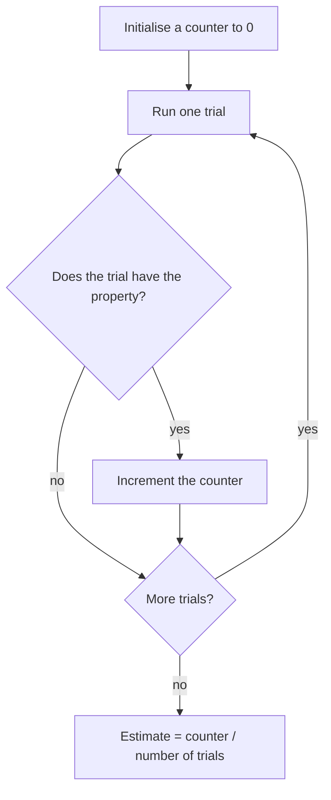

Most of an introductory programming course deals with functional code: the same input always gives the same output. Lecture 4 of MIT's 6.0002 *Introduction to Computational Thinking and Data Science* leaves that world. It argues that, whether or not the universe is deterministic, we never know enough about it to predict outcomes with certainty, so programs that model the world should treat it as random.

From that starting point the lecture builds the tools the rest of the course relies on: a definition of a stochastic process, discrete probability computed by counting, the complement and multiplication rules, and the simulation loop that estimates a probability as hits divided by trials. It applies them to five dice showing 11111 and to the birthday problem. The second example shows the case where a simulation is easier to adapt than the formula: three people sharing a birthday, and birthdays that are not equally likely. The lecture also explains what Python's "random" numbers are and why a seed makes a run reproducible.

> This article has been made with the help of [Claude Code](https://claude.com/product/claude-code) and several custom skills

> **Source and currency note.** This article is based on lecture 4, *Stochastic Thinking*, of [MIT OpenCourseWare 6.0002, Fall 2016](https://ocw.mit.edu/courses/6-0002-introduction-to-computational-thinking-and-data-science-fall-2016/) (instructor JG, MIT), on its slides and lecture code, and on the [lecture video](https://www.youtube.com/watch?v=-1BnXEwHUok). The course dates from 2016 and uses Python 3.5. The code below is condensed from the lecture file and runs unchanged on current Python 3 (checked on 3.14, where `random.seed(0)` still reproduces the lecture's printed outputs). Later lectures of the course plot with `pylab`, which matplotlib now discourages in favour of `matplotlib.pyplot` and `numpy`; for new numerical code, `numpy.random.default_rng(seed)` is the recommended generator. Where the lecture simplifies or is imprecise, the article says so in the relevant section and collects the points in [What the lecture simplifies](#what-the-lecture-simplifies).

[TOC]

## What you need to know first

The lecture assumes basic Python and no probability course. A few notions are used without being developed:

- **Sample space and equally likely outcomes.** The set of all outcomes of an experiment, such as the $$6^5$$ sequences of five die rolls. Counting-based probability is valid only when every outcome in that set has the same chance, which is an assumption about the experiment, not a property of the arithmetic.
- **Factorial and permutations.** $$n! = 1 \cdot 2 \cdots n$$. The number of ordered ways to give $$N$$ people distinct birthdays out of $$D$$ dates is $$D!/(D-N)!$$, which is the numerator of the birthday formula.
- **Relative frequency.** Repeating an experiment $$n$$ times and dividing the number of successes by $$n$$ gives a *sample* probability. That it converges to the true probability as $$n$$ grows (the law of large numbers) is used here informally and made precise in later lectures of the series.
- **Python's `random` module.** The standard library module that produces pseudo-random numbers. `random.choice(seq)` returns one element of a sequence, each with the same probability, and `random.seed(x)` fixes the generator's starting state.
- **Pigeonhole principle.** If more items than boxes are placed in boxes, at least one box holds two items. The lecture uses it for the upper end of the birthday problem.

## Determinism, uncertainty and predictive nondeterminism

### Newtonian mechanics and the Copenhagen doctrine

The lecture opens with two views of the physical world. In **Newtonian mechanics** every effect has a cause: an apple falls because of gravity, and knowing the initial conditions tells you where it lands. The world can be understood causally.

In the early twentieth century the **Copenhagen doctrine**, associated with Bohr and Heisenberg, proposed **causal nondeterminism**: at its most fundamental level the physical world behaves in a way that cannot be predicted. One may say that an event is highly likely, never that it is certain. Einstein and Schrödinger objected, and Einstein's remark that "God does not play dice" became the short form of that objection.

### Two coins under a hand: predictive nondeterminism

JG then borrows two coins from the audience, shakes them, covers them on the table and asks whether they show two heads, two tails, or one of each. Most of the audience picks "one of each", the most probable outcome (probability $$1/2$$, against $$1/4$$ for each of the other two). Yet nothing is undetermined here: the coins have landed, and the instructor can see them. The students still cannot predict the answer, because they lack the information.

That is the lecture's moral. Whether or not the world is inherently unpredictable, our knowledge of it is incomplete, so we might as well treat it as unpredictable. The lecture calls this **predictive nondeterminism**, and it is the stance behind every model in the rest of the course.

## Stochastic processes and random choices in Python

A **stochastic process** is an ongoing process in which the next state may depend both on the previous states and on a random element. Code written so far in the course depended only on the code before it; from here on, randomness is part of the computation.

The lecture shows the difference with two specifications of the same function:

```python
def rollDie():
    """returns an int between 1 and 6"""

def rollDie():
    """returns a randomly chosen int between 1 and 6"""
```

The first specification is **underdetermined**: an implementation that returns 3 on every call satisfies it. The second requires randomness, so only a stochastic implementation meets it. The implementation uses `random.choice`, which draws one element of a sequence uniformly, that is, each element with the same probability:

```python
import random

def rollDie():
    """returns a random int between 1 and 6"""
    return random.choice([1, 2, 3, 4, 5, 6])

def testRoll(n=10):
    print(''.join(str(rollDie()) for _ in range(n)))   # condensed from the lecture's loop
```

## Probability as counting

### Five rolls of a die

How probable is it that `testRoll(5)` prints `11111`? For discrete problems the lecture defines probability by counting: count the possible outcomes, count those with the property of interest, and divide. Five rolls have $$6^5 = 7776$$ possible sequences. JG compares them with five-digit numbers in base 6, as the knapsack lectures used binary vectors to list every choice of items. Exactly one of them is `11111`:

$$
\begin{aligned}
P(11111) = \frac{1}{6^5} = \frac{1}{7776} \approx 0.0001286
\end{aligned}
$$

A sequence such as `53421` *looks* more likely than five 1s, but it is not: every specific sequence has the same probability $$1/7776$$. What is more likely is the *event* "the five values 1 to 5 appear in some order", which contains $$5! = 120$$ sequences and so has probability $$120/7776 \approx 0.0154$$. The intuition that `53421` is "more typical" confuses one sequence with the class of sequences that resemble it.

The counting definition has a precondition the slide leaves implicit: all the counted outcomes must be equally likely. It holds for a fair die and for `random.choice`; it fails for the birthday data later in the lecture, which is exactly why that case becomes harder to analyse.

### Three facts about probability

The lecture uses three rules throughout:

- **Range.** A probability lies between 0 (impossible) and 1 (certain). With the counting definition this is immediate: the numerator counts a subset of the outcomes the denominator counts.
- **Complement.** If an event has probability $$p$$, the probability that it does not occur is $$1 - p$$. Often the complement is easier to compute, so one computes $$P(\text{not } A)$$ and takes $$P(A) = 1 - P(\text{not } A)$$. The birthday problem uses this.
- **Multiplication for independent events.** If events are independent, the probability that all of them occur is the product of their probabilities. For $$P(A) = 0.5$$ and $$P(B) = 0.4$$, $$P(A \text{ and } B) = 0.5 \times 0.4 = 0.2$$, smaller than either.

$$
\begin{aligned}
P(\text{not } A) &= 1 - P(A) \\
P(A \text{ and } B) &= P(A) \cdot P(B) \quad \text{only if } A \text{ and } B \text{ are independent}
\end{aligned}
$$

Two events are **independent** when the outcome of one has no influence on the outcome of the other. Successive rolls of a die are modelled as independent, and so were the two coins: JG did not look at one coin and set the other to match.

### When independence fails: the Patriots and the Broncos

The lecture's warning about the multiplication rule uses American football. At the time, the New England Patriots had won 7 of their 8 games and the Denver Broncos 6 of 8. Taking these as the chance of each team winning next Sunday, and assuming the two games are independent:

$$
\begin{aligned}
P(\text{both win}) &= \frac{7}{8} \cdot \frac{6}{8} = \frac{42}{64} = 0.65625 \\
P(\text{at least one loses}) &= 1 - \frac{42}{64} = \frac{22}{64} = 0.34375
\end{aligned}
$$

That calculation is reasonable when the teams play different opponents. On Sunday 18 December the two teams played *each other*. The outcomes are then not independent: one team's win is the other's loss, and the probability that at least one loses is close to 1, not about one third. The slide says "much closer to 1"; strictly it is 1 minus the probability of a tie, since an NFL regular-season game can end tied after overtime.

The example is easy because the dependence is obvious. The general point is that a probability computed under a false independence assumption can be badly wrong (here, 0.34 against nearly 1), and that in many real problems checking independence takes real work.

## Estimating a probability by simulation

### The structure of a simulation

Instead of computing $$1/7776$$, the lecture estimates it by rolling simulated dice. The code is the lecture's, unchanged apart from layout:

```python
def runSim(goal, numTrials, txt):
    total = 0
    for i in range(numTrials):
        result = ''
        for j in range(len(goal)):
            result += str(rollDie())
        if result == goal:
            total += 1
    print('Actual probability of', txt, '=', round(1/(6**len(goal)), 8))
    estProbability = round(total/numTrials, 8)
    print('Estimated Probability of', txt, '=', round(estProbability, 8))

random.seed(0)
runSim('11111', 1000, '11111')
```

JG points out that almost every simulation in the course has the same structure:



An outer loop runs the trials; inside it, one trial (here, five rolls) is generated and tested; at the end the count of successes is divided by the number of trials, which is the counting definition applied to a sample.

### Why 1,000 trials gave 0

With seed 0 and 1,000 trials, the program prints an actual probability of 0.0001286 and an estimated probability of 0.0. The estimate is 0 because none of the 1,000 trials produced `11111`. That is not surprising: the expected number of hits in 1,000 trials is $$1000/7776 \approx 0.129$$, and the probability of seeing none at all is

$$
\begin{aligned}
\left(1 - \frac{1}{7776}\right)^{1000} \approx 0.879
\end{aligned}
$$

so about 88 % of 1,000-trial runs print 0. The lecture's distinction is between the **actual probability**, a property of the model, and the **sample probability**, the frequency observed in one finite run.

With 1,000,000 trials the run prints 0.000128. The expected number of hits is then $$10^6/7776 \approx 128.6$$, with a standard deviation of about $$\sqrt{np(1-p)} \approx 11.3$$ hits, so 128 observed hits is well within the normal spread. The estimate's standard error is about $$1.1 \times 10^{-5}$$, roughly 9 % of the probability being estimated. The later lectures on confidence intervals and sample size in this series make "how many trials are enough" precise.

### Three morals

The lecture draws three conclusions from the dice:

- **Rare events need many trials.** A good estimate of a small probability requires enough trials for the event to occur many times.
- **Do not confuse the sample probability with the actual probability.** An estimate should be reported as an estimate.
- **This simulation was unnecessary.** The closed form $$1/6^5$$ is exact and immediate. Simulation pays off when no such formula is at hand, which the birthday problem shows next.

## Pseudo-random numbers and seeds

How did JG know in advance that the slide would show 0.0? Because `random.choice` is not random. No deterministic algorithm can produce truly random numbers, so libraries generate **pseudo-random** numbers: an algorithm takes the current internal state and produces the next number of a sequence that looks random, and the sequence starts from a **seed**. The same seed always gives the same sequence.

The lecture file calls `random.seed(0)`, which is why its output can be predicted and put on a slide. A rerun on Python 3.14 with seed 0 still prints 0.0 for 1,000 trials and 0.000128 for 1,000,000.

Fixed seeds are a debugging tool. The lecture's advice:

- set a seed while developing a program with randomness, so each run produces the same output and a bug can be reproduced;
- test with several different seeds, so the program is not correct only because one seed happened to be lucky;
- remove the fixed seed (or vary it deliberately) when the program is meant to produce different runs.

Two details of the lecture need correcting:

- **The default seed.** JG says computers typically seed from a clock counting microseconds since 1 January 1978, and hedges that he does not know if that is still true. Unix time counts seconds since **1 January 1970**, and current Python does not use the clock when a better source exists: `random.seed()` with no argument takes its seed from the operating system's randomness source (`os.urandom`) and falls back to the system time only when there is none.
- **True randomness.** The claim that one can prove a computer cannot generate truly random numbers holds for a deterministic algorithm, not for a computer.

Hardware random number generators, which sample physical noise, are standard in current processors and operating systems; the [analysis of a hardware RNG that was never called]({{site.url_complet}}/2026/07/31/coldcard-rng-entropy-incident/) on this site shows what depends on them.

The generator behind Python's `random` module is the Mersenne Twister. It is fast and its output passes common statistical tests, which suits simulation, but its future output can be predicted from enough past output. The Python documentation states it is unsuitable for security purposes; keys, tokens and passwords come from the `secrets` module or `os.urandom`. A predictable seed is the same weakness in another setting: the Fomo3D airdrop derived its "random" draw from public block fields, so attackers computed the result before buying, as described in [The Technical Concepts Behind the 2018 Crypto Hacks]({{site.url_complet}}/2026/10/07/crypto-hacks-2018-technical-concepts/).

## The birthday problem

### The question, the pigeonhole bound and the closed form

What is the probability that at least two people in a group share a birthday? With 367 people it is 1, by the pigeonhole principle: there are only 366 possible dates, so two people must share one.

For smaller groups, the lecture assumes every date is equally likely and uses the complement. The complement of "at least two share" is "all birthdays are distinct", and counting the ordered assignments of distinct dates gives, for $$N$$ people and 366 dates:

$$
\begin{aligned}
P(\text{at least two share}) = 1 - \frac{366!}{366^N \cdot (366-N)!}
\end{aligned}
$$

The fraction counts $$366 \cdot 365 \cdots (366-N+1)$$ ways to give everyone a different date, out of $$366^N$$ equally likely assignments. JG calls the proof "a little bit elaborate"; it is the counting argument just described, plus the independence of different people's birthdays.

| $$N$$ | $$P$$, 366 equally likely dates | $$P$$, 365 equally likely dates |
|---:|---:|---:|
| 10 | 0.1166 | 0.1169 |
| 20 | 0.4106 | 0.4114 |
| 23 | 0.5063 | 0.5073 |
| 40 | 0.8905 | 0.8912 |
| 57 | 0.9900 | 0.9901 |
| 100 | 0.99999968 | 0.99999969 |

The usual textbook version uses 365 dates and ignores 29 February; the lecture uses 366, which treats 29 February as being as common as any other day. The table shows the choice barely matters. The result that surprises people is the row for 23: half a classroom is enough for an even chance of a shared birthday, and with 57 people a coincidence is close to certain.

The same counting is behind the *birthday attack* on hash functions. With $$2^n$$ equally likely hash values, a collision becomes likely after roughly $$2^{n/2}$$ inputs rather than $$2^n$$, which is why [RFC 2104](https://datatracker.ietf.org/doc/html/rfc2104) puts the birthday attack against HMAC with the 128-bit MD5 at about $$2^{64}$$ messages, as the [HMAC article]({{site.url_complet}}/2024/11/27/hmac/) on this site recalls.

### Simulating it

The simulation draws a birthday for each person and checks whether any date received at least `numSame` people:

```python
import math, random

def sameDate(numPeople, numSame):
    possibleDates = range(366)
    birthdays = [0]*366
    for p in range(numPeople):
        birthDate = random.choice(possibleDates)
        birthdays[birthDate] += 1
    return max(birthdays) >= numSame

def birthdayProb(numPeople, numSame, numTrials):
    numHits = 0
    for t in range(numTrials):
        if sameDate(numPeople, numSame):
            numHits += 1
    return numHits/numTrials

for numPeople in [10, 20, 40, 100]:
    print('For', numPeople, 'est. prob. of a shared birthday is',
          birthdayProb(numPeople, 2, 10000))
    numerator = math.factorial(366)
    denom = (366**numPeople)*math.factorial(366-numPeople)
    print('Actual prob. for N =', numPeople, '=', 1 - numerator/denom)
```

The structure is the one from the dice: an outer loop of trials, one trial per call to `sameDate`, a hit counter, and a division. The last `print` is corrected here: the lecture file prints the label `'Actual prob. for N = 100 ='` for every group size. With 10,000 trials and seed 0, a rerun of the lecture file estimates 0.1183, 0.4116 and 0.8941 for 10, 20 and 40 people, against exact values of 0.1166, 0.4106 and 0.8905.

For 100 people the estimate is exactly 1.0, a sample probability again: the actual value is $$1 - 3.2 \times 10^{-7}$$, and 10,000 trials are far too few to observe a group of 100 with no shared date.

### Three people sharing: why the formula gets harder

Now ask for the probability that at least *three* people share a birthday. In the simulation, the change is the argument `numSame=3` instead of 2. The analysis changes much more. For two people the complement was a single case, "all birthdays distinct". For three, the complement is "no date has three or more people", which is a disjunction:

- all birthdays distinct, or
- exactly one pair shares a date and the rest are distinct, or
- two pairs share and the rest are distinct, or
- and so on, up to as many pairs as $$N$$ allows.

The lecture calls this complicated and, as far as it goes, the point holds. The uniform case still has an exact formula. It sums over the number $$k$$ of pairs: choose which people form the pairs, then give the resulting $$N - k$$ groups distinct dates.

$$
\begin{aligned}
P(\text{no three share}) = \sum_{k=0}^{\lfloor N/2 \rfloor} \frac{N! \; D!}{2^k \, k! \, (N-2k)! \, (D-N+k)! \; D^N}, \quad D = 366
\end{aligned}
$$

For $$N = 100$$ this gives $$P(\text{at least three share}) \approx 0.644$$, against 0.99999968 for two. The lecture's simulation printed about 0.63; a rerun with seed 0 and 10,000 trials gives 0.6359. Deriving the sum takes some care; changing the simulation took one character.

### Birthdays are not equally likely

The uniform assumption is itself wrong. The lecture shows a heat map of US birth dates (by Matt Stiles, *The Daily Viz*): 29 February is rare, as expected, and so are 4 July and 25 December, while late summer and early autumn are crowded. JG's guess for the holidays is that births are scheduled around them.

Rather than enter a probability for each of the 366 days, JG approximates the heat map by giving dates different weights in the list passed to `random.choice`. Only relative frequencies matter, so a date that appears four times in the list is four times as likely as a date that appears once:

```python
def sameDate(numPeople, numSame):
    possibleDates = 4*list(range(0, 57)) + [58] \
                    + 4*list(range(59, 366)) \
                    + 4*list(range(180, 270))
    birthdays = [0]*366
    for p in range(numPeople):
        birthDate = random.choice(possibleDates)
        birthdays[birthDate] += 1
    return max(birthdays) >= numSame
```

Most dates appear 4 times, the dates of the summer band (indices 180 to 269) appear 8 times, and one date, intended to be 29 February, appears once. With this distribution and three people sharing, the probability for 100 people rises from about 0.64 to 0.75 (the lecture reports 0.75; a rerun gives 0.7501). Concentrating births on fewer dates makes coincidences more likely, and here it adds about 0.1.


The figure shows exact values rather than simulated ones. The solid curve is the two-person case; the dashed and dotted curves show that requiring three people pushes the curve far to the right, and that the non-uniform weights shift it back to the left.

Two remarks on the weighted list. First, it contains an off-by-one error. With index 0 for 1 January in a leap year, 29 February is index 59, not 58; the transcript calls it "the 58th day of the year", but it is the 60th. As written, index 57 (27 February) never appears in the list, index 58 (28 February) gets the weight of 1, and 29 February keeps the ordinary weight of 4. The corrected list, `4*list(range(0, 59)) + [59] + 4*list(range(60, 366)) + 4*list(range(180, 270))`, gives 0.747 instead of 0.749, so the conclusion stands.

The error is the kind the lecture's advice on testing would catch: a check that every index from 0 to 365 appears in the list with the intended weight.

Second, the lecture says it has no idea how to compute the non-uniform case analytically. It does have an exact answer, which a short program computes. With probability $$p_d$$ for date $$d$$, the probability that no date receives $$k$$ or more people is a coefficient of a product of truncated exponential series:

$$
\begin{aligned}
P(\text{no date has } k \text{ or more}) = N! \cdot \left[x^N\right] \prod_{d=1}^{366} \left( \sum_{j=0}^{k-1} \frac{(p_d \, x)^j}{j!} \right)
\end{aligned}
$$

where $$\left[x^N\right]$$ denotes the coefficient of $$x^N$$. Multiplying 366 small polynomials gives 0.749 for the lecture's weights, matching the simulation. The lecture's point survives in a weaker form: the analytic route needs a technique (generating functions) that most programmers do not have at hand, while the simulation needed one changed line.

### The class's own birthdays

During the lecture the students filled in an anonymous form with their birth dates. The class data had 146 responses with 112 distinct dates. Some entries were doubtful: 31 February, removed by the teaching assistant, and five people on 12 February, which JG suspects were invented. JG concludes that "the probability does work", without checking the claim.

 Under the uniform model with 366 dates, 146 people are expected to cover about 120.5 distinct dates; a simulation of 20,000 groups gives a standard deviation of about 3.9 and about a 2 % chance of 112 or fewer. If "112 unique birthdays" means distinct dates, which the transcript does not say, the class shows somewhat more clustering than the uniform model predicts, consistent with the doubtful entries.

## Simulation models

The lecture ends by naming what it has been building. A **simulation model** is a program that describes a computation giving information about the possible behaviours of a system. The lecture adds three properties:

- **Descriptive, not prescriptive.** A simulation answers "if I do this, what happens?". An optimisation model, like the knapsack and shortest-path models of the earlier lectures, answers "what should I do to get the best outcome?". The course needs both.
- **An approximation to reality.** The birthday weights were a rough approximation of the heat map. JG quotes the statistician George Box: "All models are wrong, but some are useful."
- **Built by successive refinement.** The birthday model started with two people and uniform dates, then asked about three people, then changed the distribution. Each step was a small edit followed by a "what if" run.

Simulations are used to model systems that are mathematically intractable, to extract intermediate results that a closed form does not expose, and to explore variations of a model cheaply. The next lecture of the series applies this to random walks. On this site, [Monte Carlo simulation for DeFi risk analysis]({{site.url_complet}}/2026/10/10/monte-carlo-defi-risk-analysis/) uses the same loop of trials, hits and averages on a financial position.

## What the lecture simplifies

The lecture is an introduction, and several statements are simplified or loose. The table collects them with the correction.

| Lecture statement | What is more precise |
|---|---|
| Copenhagen doctrine: "nothing has a probability of one" | The doctrine says that physical outcomes cannot be predicted with certainty; in probability theory certain events, and events of probability 1, exist. |
| "Probability is about counting" | Counting gives probabilities only when all counted outcomes are equally likely; the non-uniform birthday case needs weights. |
| Patriots versus Broncos: P(one loses) "much closer to 1" | It is exactly 1 minus the probability of a tie. |
| Computers seed from microseconds since 1 January 1978 | Unix time counts seconds since 1 January 1970; current Python seeds from `os.urandom` when available. |
| One can prove a computer cannot generate truly random numbers | True of deterministic algorithms; hardware generators sample physical noise. |
| Birthday dates "range from 1 to 366" | The code uses `range(366)`, indices 0 to 365. |
| 29 February is "the 58th day of the year" | It is the 60th day (index 59 when 1 January is 0); the weighted list is off by one and drops 27 February. |
| `'Actual prob. for N = 100 ='` | The label is printed for every N; it should print the current N. |
| Three people sharing: "1 minus a very complicated formula" | The uniform case has a finite exact sum; it is harder, not intractable. |
| Non-uniform dates: no way to do it mathematically | Exact via generating functions, computed by a short program. |

## Conclusion

Lecture 4 replaces the functional view of programs with a probabilistic one and gives the tools to compute or estimate probabilities.

- **Predictive nondeterminism** justifies treating the world as random: even when the outcome is fixed, as with covered coins, incomplete knowledge prevents prediction.
- **Discrete probability by counting** works when outcomes are equally likely: $$P(11111) = 1/7776$$, and every specific five-roll sequence has the same probability.
- **The complement rule** turns "at least one" questions into "none" questions, and **the multiplication rule** requires independence. The Patriots-Broncos game shows a probability of about 0.34 becoming nearly 1 once the independence assumption fails.
- **A simulation** is an outer loop of trials, a test per trial, a counter and a division. Its result is a sample probability: 1,000 trials gave 0 for an event of probability 0.0001286, and 1,000,000 gave 0.000128.
- **The birthday problem** has a closed form for two people sharing (0.506 at 23 people). Three people sharing (0.644 at 100) and non-uniform dates (0.749) are harder to derive by hand, while the simulation changes by one argument or one list.
- **Pseudo-random generators** are deterministic sequences started from a seed. A fixed seed makes runs reproducible for debugging, several seeds guard against a lucky one, and the `random` module is not for security.


## Annex

### Key Terms

| Term | Definition |
|------|------------|
| **Sample space** | The set of all possible outcomes of an experiment, such as the 7,776 sequences of five die rolls. |
| **Event** | A subset of the sample space, such as "the five rolls are all 1" or "two people share a birthday". |
| **Probability by counting** | The number of outcomes in an event divided by the number of outcomes in the sample space, valid when all outcomes are equally likely. |
| **Uniform distribution** | A distribution in which every outcome has the same probability; `random.choice` draws uniformly from its sequence. |
| **Complement rule** | $$P(\text{not } A) = 1 - P(A)$$, used to compute "at least one" probabilities from "none" probabilities. |
| **Independence** | Two events are independent when the outcome of one has no influence on the probability of the other. |
| **Multiplication rule** | For independent events, the probability that all occur is the product of their probabilities. |
| **Causal nondeterminism** | The Copenhagen view that the physical world, at its most fundamental level, cannot be predicted. |
| **Predictive nondeterminism** | The view that, deterministic or not, the world cannot be predicted because our knowledge is incomplete, so it is modelled as random. |
| **Stochastic process** | An ongoing process whose next state depends on previous states and on a random element. |
| **Underdetermined specification** | A specification that allows several behaviours without requiring randomness, such as "returns an int between 1 and 6". |
| **Simulation model** | A program that computes information about the possible behaviours of a system; descriptive rather than prescriptive. |
| **Trial** | One run of the random experiment inside a simulation's outer loop, such as five rolls or one group of birthdays. |
| **Actual probability** | The probability defined by the model, computed exactly when a closed form exists. |
| **Sample probability** | The frequency of an event in a finite number of trials; an estimate of the actual probability. |
| **Birthday problem** | The question of how likely it is that at least two (or k) people in a group share a birth date. |
| **Pigeonhole principle** | With more items than boxes, some box holds at least two items; it makes a shared birthday certain with 367 people. |
| **Pseudo-random number generator** | A deterministic algorithm whose output sequence looks random; Python's `random` module uses the Mersenne Twister. |
| **Seed** | The value that fixes a pseudo-random generator's starting state; the same seed always reproduces the same sequence. |
| **Generating function** | A power series whose coefficients encode a counting problem; it gives the exact non-uniform birthday probability. |

## Frequently Asked Questions

**Q: What is the difference between causal and predictive nondeterminism?**

Causal nondeterminism, the Copenhagen view, claims that the physical world itself is unpredictable at its most basic level. Predictive nondeterminism makes no claim about the world: it notes that we never have complete information, so even a determined outcome (two coins already lying under a hand) cannot be predicted by us. The lecture adopts predictive nondeterminism as the reason to model systems as stochastic.

**Q: Why is `53421` not more likely than `11111` as the result of five rolls?**

Each specific sequence of five rolls is one outcome among $$6^5 = 7776$$ equally likely ones, so both have probability $$1/7776$$. What feels more likely is the event "the values 1 to 5 appear in some order", which contains $$5! = 120$$ sequences and has probability $$120/7776 \approx 0.0154$$.

**Q: A simulation of 1,000 trials estimates the probability of `11111` as 0. Is the code wrong?**

No. The expected number of hits in 1,000 trials is about 0.13, and the probability of observing none is about 0.879. The 0 is a sample probability from a run too short for a rare event. With 1,000,000 trials, about 128.6 hits are expected and the lecture's run produced an estimate of 0.000128.

**Q: Why does the lecture call the Patriots-Broncos calculation of 22/64 wrong for 18 December?**

The product $$7/8 \times 6/8$$ assumes that the two teams' results are independent. On that date the teams played each other, so one team's win is the other's loss. The probability that at least one of them loses is then 1 minus the probability of a tie, close to 1, not about 0.34. The example shows that the multiplication rule gives a confident but wrong answer when the independence assumption is false.

**Q: Why is the three-person birthday problem harder to solve analytically than the two-person one, and how does the simulation handle it?**

For two people, the complement of "some pair shares" is the single case "all birthdays distinct", which has a short product formula. For three, the complement is "no date has three people", a disjunction of cases: all distinct, one pair, two pairs, and so on. Adding them up takes careful counting.

The simulation only checks `max(birthdays) >= numSame`, so moving from two to three means changing one argument. The same holds when the birthday distribution becomes non-uniform: the simulation changes one list.

**Q: Why set `random.seed(0)`, and what can go wrong if every test uses that same seed?**

A fixed seed makes the pseudo-random sequence, and so the program's output, identical on every run. A failure can then be reproduced and debugged, and a slide can show the output in advance. If every test uses one seed, the program may pass only because that particular sequence avoids a bug, so the lecture recommends testing with several seeds before trusting the result.

**Q: Could the `random` module be used to generate a password reset token?**

No. The Mersenne Twister behind `random` is designed for simulation: its output looks statistically random, but its internal state can be reconstructed from enough observed output, after which every future value is predictable. Security-sensitive values should come from the `secrets` module or `os.urandom`, which draw on the operating system's cryptographic randomness source.

## Gaps

Several statements in this article come from general knowledge or from computations made for it rather than from the lecture.

| Gap | Why it matters | What to read or verify |
|-----|----------------|------------------------|
| The Einstein quote is a paraphrase of a 1926 letter to Max Born, not a verbatim sentence. | The article repeats the lecture's wording. | The Born-Einstein letters, letter of 4 December 1926. |
| The George Box quote is cited from memory of Box and Draper's *Empirical Model-Building and Response Surfaces* (1987) and earlier papers. | The quote's exact wording and source are not given in the lecture. | Box, G. E. P. and Draper, N. R., *Empirical Model-Building and Response Surfaces*, Wiley, 1987. |
| Python's default seeding from `os.urandom`, the Mersenne Twister and its unsuitability for security come from the Python documentation, not the lecture. | The correction of the lecture's seeding claim depends on it. | Python documentation, `random` module, "Bookkeeping functions" and the security warning. |
| The possibility of an NFL regular-season tie is general knowledge. | It is the only reason the Patriots-Broncos probability is not exactly 1. | NFL rulebook, overtime rules for the regular season. |
| The exact three-person and non-uniform birthday values (0.644, 0.749) come from programs written for this article; qalc confirmed the uniform three-person sum and the non-uniform two-person value, not the non-uniform three-person value. | The comparison with the lecture's 0.63 and 0.75 relies on them. | Re-run `stochastic-thinking-birthday-curves.py` in the article's asset directory, or a Monte Carlo run with 10^6 trials. |
| The birthday-attack bound of about $$2^{n/2}$$ inputs for an $$n$$-bit hash is general knowledge, not from the lecture. | The link between the lecture's problem and hash collisions rests on it. | RFC 2104, section 6, and any cryptography textbook's treatment of the birthday bound. |
| The meaning of "146 with 112 unique birthdays" is not stated (distinct dates or dates with one person). | The comparison with the uniform model (120.5 expected distinct dates) assumes distinct dates. | The lecture video at the class-data segment, or the course's form data if published. |
| The US birth-date heat map (Matt Stiles, *The Daily Viz*) was not read; its data source is not in the slides. | The lecture's weights are an approximation of it. | The Daily Viz post "How common is your birthday?" and its underlying CDC/SSA data. |

## References

- [MIT OpenCourseWare, 6.0002 Introduction to Computational Thinking and Data Science, Fall 2016](https://ocw.mit.edu/courses/6-0002-introduction-to-computational-thinking-and-data-science-fall-2016/) (course page, slides and code)
- [Lecture 4: Stochastic Thinking (video)](https://www.youtube.com/watch?v=-1BnXEwHUok), JG, MIT OpenCourseWare, Fall 2016 (source lecture)
- Guttag, *Introduction to Computation and Programming Using Python: With Application to Understanding Data*, 2nd ed., MIT Press, 2016, chapter 14 and pp. 235-238 (reading assigned by the lecture)
- [RFC 2104 — HMAC: Keyed-Hashing for Message Authentication](https://datatracker.ietf.org/doc/html/rfc2104)
- [Python documentation, `random` — Generate pseudo-random numbers](https://docs.python.org/3/library/random.html)
- [Python documentation, `secrets` — Generate secure random numbers for managing secrets](https://docs.python.org/3/library/secrets.html)
- [NumPy documentation, Random Generator](https://numpy.org/doc/stable/reference/random/generator.html)
- [Claude Code](https://claude.com/product/claude-code)

### Related articles

- [Monte Carlo Simulation for DeFi Risk Analysis - From Random Sampling to a Stay-or-Exit Decision]({{site.url_complet}}/2026/10/10/monte-carlo-defi-risk-analysis/)
- [When the Hardware RNG Was Not Called - Anatomy of an Entropy Defect]({{site.url_complet}}/2026/07/31/coldcard-rng-entropy-incident/)
- [HMAC - Hash-Based Message Authentication Code]({{site.url_complet}}/2024/11/27/hmac/)
- [The Technical Concepts Behind the 2018 Crypto Hacks]({{site.url_complet}}/2026/10/07/crypto-hacks-2018-technical-concepts/)
