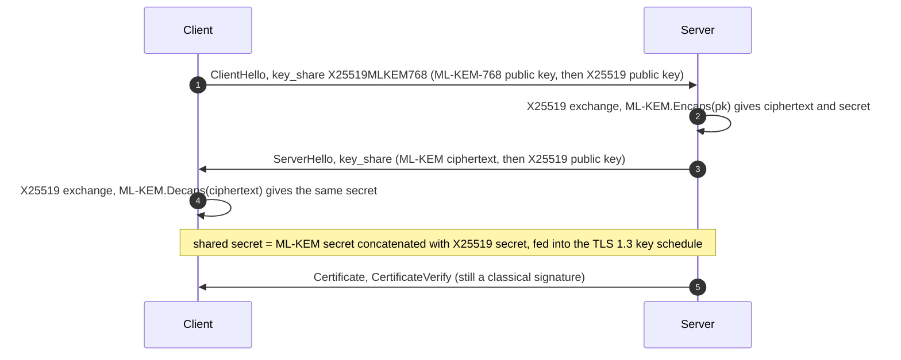

Every public-key algorithm deployed at scale today, RSA, elliptic-curve Diffie-Hellman, ECDSA and EdDSA, rests on factoring or on a discrete logarithm. A large enough quantum computer running Shor's algorithm solves both problems in polynomial time, so the question is no longer whether these algorithms will have to be replaced but how far the replacement has progressed.

This article answers that question for late 2026. It lists the post-quantum algorithms that NIST has standardised or is about to standardise, explains what each one does and what it costs in key and signature size, and then goes through the deployments: browsers, content-delivery networks, operating systems, cloud key-management services and messaging applications. Blockchains have their own constraints, so they get a [companion article]({{site.url_complet}}/2026/10/29/post-quantum-cryptography-blockchains/).

The short version is that key exchange has largely moved, while signatures and certificates have barely started.

> This article has been made with the help of [Claude Code](https://claude.com/product/claude-code) and several custom skills

[TOC]

## What you need to know first

The article uses a few cryptographic notions without deriving them:

- **Key encapsulation mechanism (KEM).** A public-key primitive that lets a sender produce a random shared secret and an encapsulation of it that only the private-key holder can open. Post-quantum key exchange is built from KEMs rather than from Diffie-Hellman, because no efficient post-quantum Diffie-Hellman with the same properties is standardised.
- **Shor's algorithm.** A quantum algorithm that factors integers and computes discrete logarithms, including on elliptic curves, in polynomial time. It breaks RSA, DH, ECDH, ECDSA, EdDSA, Schnorr and pairing-based schemes completely.
- **Grover's algorithm.** A quantum search algorithm with a quadratic speed-up. Against a symmetric key or a hash preimage it roughly halves the security in bits, which is why AES-256 and SHA-256 are considered adequate after the transition.
- **Learning With Errors (LWE).** A lattice problem: recover a secret vector from linear equations perturbed by small noise. Its module variant (Module-LWE) underlies ML-KEM and ML-DSA, and no quantum algorithm is known to solve it much faster than classical ones.
- **Harvest now, decrypt later.** An adversary records encrypted traffic today and decrypts it once a quantum computer exists. It makes key exchange urgent for any data that must stay confidential for years, whereas a signature only has to be secure at the moment it is verified.
- **Hybrid mode.** A construction that combines a classical algorithm with a post-quantum one, so that the result is secure as long as either of the two is unbroken. Almost every deployment in this article is hybrid.
- **NIST security categories.** Levels 1, 3 and 5 are defined as being at least as hard to break as AES-128, AES-192 and AES-256 key search respectively.

## What a quantum computer breaks

Public-key cryptography is where the damage is. Symmetric cryptography survives with longer keys.

| Primitive | Examples | Quantum attack | Status after the transition |
|-----------|----------|----------------|------------------------------|
| Factoring-based | RSA encryption and signatures | Shor | Broken |
| Discrete log (finite field) | DH, DSA | Shor | Broken |
| Discrete log (elliptic curves) | ECDH, X25519, ECDSA, Ed25519, Schnorr | Shor | Broken |
| Pairing-based | BLS signatures, KZG commitments, Groth16 | Shor | Broken |
| Block ciphers | AES-128, AES-256 | Grover | AES-256 recommended |
| Hash functions | SHA-256, SHA-3 | Grover (preimage), BHT (collision) | Unchanged at 256-bit output |

How far away such a machine is remains an estimate, but the estimates have dropped quickly. In May 2025, Craig Gidney published a [resource estimate](https://arxiv.org/abs/2505.15917) for factoring RSA-2048 with fewer than one million noisy qubits in under a week, down from twenty million in his 2019 estimate.

On 31 March 2026, [Google Quantum AI](https://research.google/blog/safeguarding-cryptocurrency-by-disclosing-quantum-vulnerabilities-responsibly/) published two circuits for the 256-bit elliptic-curve discrete logarithm, the problem behind Bitcoin and Ethereum keys: fewer than 1,200 logical qubits and 90 million Toffoli gates, or fewer than 1,450 logical qubits and 70 million Toffoli gates. Google translates this into fewer than 500,000 physical qubits on a superconducting machine running for a few minutes, and it published a zero-knowledge proof of the estimate instead of the circuits themselves.

No machine of that size exists in 2026. The point of the estimates is that the margin keeps shrinking, and that any data encrypted today with a classical key exchange is exposed to harvest-now-decrypt-later.

## The algorithms

NIST ran its post-quantum competition from 2016 to 2022 and published the first three standards on 13 August 2024. Two more are in progress.

| Standard | Algorithm | Type | Hard problem | Origin |
|----------|-----------|------|--------------|--------|
| [FIPS 203](https://csrc.nist.gov/pubs/fips/203/final) | ML-KEM | KEM | Module-LWE (lattice) | CRYSTALS-Kyber |
| [FIPS 204](https://csrc.nist.gov/pubs/fips/204/final) | ML-DSA | Signature | Module-LWE and Module-SIS (lattice) | CRYSTALS-Dilithium |
| [FIPS 205](https://csrc.nist.gov/pubs/fips/205/final) | SLH-DSA | Signature | Hash functions only | SPHINCS+ |
| FIPS 206 (draft) | FN-DSA | Signature | NTRU lattices | Falcon |
| FIPS 207 (planned) | HQC | KEM | Quasi-cyclic codes | HQC |
| [SP 800-208](https://csrc.nist.gov/pubs/sp/800/208/final) | LMS, XMSS | Stateful signature | Hash functions only | IETF RFC 8554, RFC 8391 |

### ML-KEM, the default key exchange

[ML-KEM]({{site.url_complet}}/2026/06/29/ml-kem-fips-203-post-quantum-key-encapsulation/) is the algorithm that carries almost all post-quantum traffic today. A public key and a ciphertext are a little over a kilobyte each at the middle parameter set, ML-KEM-768 (security category 3), and encapsulation and decapsulation are faster than an X25519 operation on most hardware. The size, not the speed, is its cost: a TLS ClientHello carrying an ML-KEM-768 key share no longer fits in a single small packet on some networks.

### ML-DSA, the general-purpose signature

[ML-DSA]({{site.url_complet}}/2026/06/29/ml-dsa-fips-204-post-quantum-signatures/) is the lattice signature NIST recommends for most uses. It signs and verifies quickly and needs no floating-point arithmetic, but a signature at ML-DSA-65 is about 3.3 KB against 64 bytes for Ed25519. In a certificate chain, with one signature and one public key per certificate plus OCSP and SCT signatures, that multiplies into tens of kilobytes per handshake.

### SLH-DSA, the conservative signature

[SLH-DSA]({{site.url_complet}}/2026/06/29/slh-dsa-fips-205-hash-based-signatures/) relies only on the security of a hash function, which makes it the most conservative choice: if SHA-256 or SHAKE holds, the signature holds. The price is size and speed. A public key is 32 bytes, but a signature is about 7.9 KB for the small variant (`-128s`, slow to sign) and 17 KB for the fast one (`-128f`). It suits rarely-issued, long-lived signatures such as firmware or root certificates.

### FN-DSA, the compact signature

FN-DSA, standardised from Falcon, has the smallest signatures of the lattice schemes: about 666 bytes with an 897-byte public key at Falcon-512. Its signing algorithm samples from a discrete Gaussian distribution using floating-point arithmetic, which is hard to implement in constant time, and this is the main reason NIST kept it as a separate standard. As of October 2026 FIPS 206 is still a draft; an [IETF draft](https://datatracker.ietf.org/doc/html/draft-ietf-lamps-fn-dsa-certificates) of May 2026 expects publication in late 2026 or early 2027. Its compactness is why two Solana client teams and Algorand chose it (see the companion article).

### HQC, the backup KEM

In March 2025 NIST selected HQC, a code-based KEM, as a second KEM built on a different hard problem, so that a cryptanalytic break of lattices would not leave key exchange without a standard. NIST presented it as [FIPS 207 (HQC-KEM)](https://csrc.nist.gov/presentations/2025/fips-207-hqc-kem) in September 2025, with a final standard expected in 2027.

### LMS and XMSS, the stateful signatures

The stateful hash-based schemes of SP 800-208, and the [Winternitz one-time signature]({{site.url_complet}}/2024/05/30/winternitz-signature-scheme/) they are built on, produce small signatures but require the signer to never reuse a one-time key. Losing track of that state, after a backup restore for example, breaks security. NIST approves them for firmware signing, where a single well-controlled signer exists.

### Sizes compared

| Scheme | Category | Public key (bytes) | Signature or ciphertext (bytes) |
|--------|---------:|-------------------:|--------------------------------:|
| X25519 (classical) | n/a | 32 | 32 (key share) |
| ML-KEM-768 | 3 | 1,184 | 1,088 (ciphertext) |
| Ed25519 (classical) | n/a | 32 | 64 |
| ECDSA P-256 (classical) | n/a | 64 | 64 |
| ML-DSA-44 | 2 | 1,312 | 2,420 |
| ML-DSA-65 | 3 | 1,952 | 3,309 |
| FN-DSA-512 (Falcon-512) | 1 | 897 | about 666 |
| SLH-DSA-SHA2-128s | 1 | 32 | 7,856 |
| SLH-DSA-SHA2-128f | 1 | 32 | 17,088 |

The table shows why the two halves of the transition move at different speeds. Replacing a 32-byte key share by a 1.2 KB one costs one extra packet in a handshake. Replacing 64-byte signatures by 3 KB ones in every certificate, every transaction or every block multiplies storage and bandwidth.

## Hybrid key exchange in practice

Nearly every deployment pairs ML-KEM with X25519 rather than replacing it. The client sends both public keys in one TLS 1.3 key share entry, the server answers with an ML-KEM ciphertext and an X25519 share, and the two shared secrets are concatenated, ML-KEM first, into the key schedule. An attacker has to break both algorithms.

The group is named X25519MLKEM768 (TLS code point `0x11EC`), and the IETF published it with two NIST-curve variants in [RFC 10024, PQ/T Hybrids for TLS 1.3](https://www.rfc-editor.org/rfc/rfc10024.html), in August 2026. The last line of the diagram is the gap that remains: the server still authenticates itself with an RSA or ECDSA certificate. That is acceptable today, because a signature only needs to resist the computers that exist when it is checked, but it has to change before a quantum computer can forge certificates.

## Who deploys it

### Browsers and the web

- **Google Chrome** enabled the pre-standard hybrid X25519Kyber768 by default in Chrome 124 (April 2024) and moved to the standardised X25519MLKEM768 in Chrome 131 (November 2024), because the final ML-KEM is not interoperable with the Kyber draft it shipped first.
- **Cloudflare** supports the hybrid group on all its edge servers. Its 2025 review reported that about half of human-initiated traffic to its network used post-quantum key exchange, and later coverage put the figure at more than 65% in April 2026, together with a target of full post-quantum security, authentication included, by 2029.
- **Apple** made X25519MLKEM768 the default in TLS 1.3 for [iOS 26, iPadOS 26, macOS Tahoe 26 and visionOS 26](https://support.apple.com/en-gb/122756), released in September 2025.

### Libraries and protocols

- **OpenSSL 3.5** (8 April 2025, a long-term-support release) added ML-KEM, ML-DSA and SLH-DSA, and its [release notes](https://openssl-library.org/news/openssl-3.5-notes/) state that X25519MLKEM768 is offered by default as a TLS key share.
- **OpenSSH 10.0** (9 April 2025) made the hybrid `mlkem768x25519-sha256` its default key exchange, according to its [release notes](https://www.openssh.com/txt/release-10.0). OpenSSH had already shipped an earlier hybrid with NTRU Prime (`sntrup761x25519-sha512`) as default since version 9.0.

### Messaging

- **Signal** added ML-KEM (then Kyber) to its initial key agreement with [PQXDH](https://signal.org/blog/pqxdh/) in 2023, and in October 2025 extended post-quantum protection to the ongoing ratchet with [SPQR, the Sparse Post-Quantum Ratchet](https://signal.org/blog/spqr/), which spreads ML-KEM-768 messages over several chat messages using erasure coding to keep each message small.
- **Apple iMessage** moved to its [PQ3 protocol](https://security.apple.com/blog/imessage-pq3/) in 2024, which uses Kyber both at session start and in periodic rekeying.

### Cloud and operating systems

- **AWS Key Management Service** has offered [ML-DSA signing keys](https://aws.amazon.com/about-aws/whats-new/2025/06/aws-kms-post-quantum-ml-dsa-digital-signatures) (ML-DSA-44, 65 and 87) since June 2025, which is one of the first managed services to issue post-quantum signatures rather than only post-quantum key exchange.
- **Microsoft** made ML-KEM and ML-DSA [generally available](https://techcommunity.microsoft.com/blog/microsoft-security-blog/-/4469093) in the Windows cryptographic API (CNG) and certificate functions of Windows 11 and Windows Server 2025 in November 2025.

### Certificates, the part that has not moved

Standards for post-quantum certificates exist: [RFC 9881](https://www.rfc-editor.org/rfc/rfc9881.html) (October 2025) defines ML-DSA in X.509 certificates and [RFC 9935](https://www.rfc-editor.org/rfc/rfc9935.html) (March 2026) defines ML-KEM keys in X.509. No browser-trusted certificate authority issues them yet. The size problem in the table above is the obstacle, and the main proposal to get around it is **Merkle Tree Certificates**, which Cloudflare and Chrome began testing in October 2025: a certificate authority signs a batch of certificates once, as a Merkle tree, and a server presents an inclusion proof instead of a full signature chain. Early results presented at IETF 125 measured landmark certificates as about 9% faster at the median than the classical chain they replaced.

### Blockchains

Blockchains are the opposite case. They have almost no confidentiality to protect from harvest-now-decrypt-later, but every transaction is a signature verified by every node and stored forever, so the size of ML-DSA or SLH-DSA weighs far more than in TLS. A few systems already use post-quantum signatures: Algorand signs its state proofs with Falcon, the Quantum Resistant Ledger uses XMSS and [Quantus]({{site.url_complet}}/2026/08/25/ml-dsa-rust-implementation-quantus/) uses ML-DSA. Bitcoin, Ethereum and Solana are at the proposal and devnet stage. The [companion article]({{site.url_complet}}/2026/10/29/post-quantum-cryptography-blockchains/) covers them chain by chain.

## Deadlines

- **NIST IR 8547** (initial public draft, November 2024) proposes to deprecate quantum-vulnerable public-key algorithms after 2030 and to disallow them after 2035 for NIST-conformant systems. As of October 2026 it is still a draft.
- **NSA CNSA 2.0** sets the transition timeline for US national-security systems, with quantum-resistant algorithms required across them in the early 2030s.
- **Industry targets** cluster around 2029 to 2033: Cloudflare names 2029 for full post-quantum security including authentication.

## Conclusion

Post-quantum cryptography is standardised and deployed for key exchange, and still at the standards stage for authentication.

- **Three standards are final** since August 2024: ML-KEM for key exchange, ML-DSA as the general-purpose signature and SLH-DSA as the hash-based conservative signature. FN-DSA (Falcon) and the code-based HQC are drafts expected in 2026-2027.
- **Hybrid X25519MLKEM768 is the default key exchange** in Chrome, Apple's operating systems, OpenSSL 3.5 and, as `mlkem768x25519-sha256`, OpenSSH 10. It was published as RFC 10024 in August 2026, and it protects most human traffic through Cloudflare.
- **Messaging went further**: Signal and iMessage protect both the initial key agreement and the ratchet.
- **Signatures lag** because they are 10 to 270 times larger than Ed25519 (from Falcon-512 to SLH-DSA-128f). Cloud services (AWS KMS, Windows CNG) offer ML-DSA keys, but no browser-trusted certificate is post-quantum, and Merkle Tree Certificates are being tested to reduce the size cost.
- **The threat estimates keep falling**: under one million noisy qubits for RSA-2048 (2025) and under 500,000 physical qubits for 256-bit elliptic curves (Google, March 2026).

## Annex

### Key Terms

| Term | Definition |
|------|------------|
| **Cryptographically relevant quantum computer (CRQC)** | A quantum computer large and reliable enough to run Shor's algorithm against keys in actual use, such as RSA-2048 or 256-bit elliptic curves. |
| **Logical qubit** | An error-corrected qubit built from many physical qubits; resource estimates count logical qubits for the algorithm and physical qubits for the hardware. |
| **Shor's algorithm** | Quantum algorithm that factors integers and computes discrete logarithms in polynomial time, breaking RSA and all elliptic-curve schemes. |
| **Grover's algorithm** | Quantum search algorithm with a quadratic speed-up, which roughly halves the bit security of symmetric keys and hash preimages. |
| **Harvest now, decrypt later** | Recording ciphertext today to decrypt it once a quantum computer exists; the reason key exchange was migrated first. |
| **KEM** | Key encapsulation mechanism: produces a shared secret and an encapsulation that only the private-key holder can open. |
| **Module-LWE** | Learning With Errors over module lattices, the hardness assumption behind ML-KEM and ML-DSA. |
| **NTRU lattice** | The structured lattice used by Falcon (FN-DSA), which allows very short signatures through hash-and-sign. |
| **ML-KEM** | The NIST lattice KEM (FIPS 203), derived from Kyber, used in all hybrid TLS deployments. |
| **ML-DSA** | The NIST general-purpose lattice signature (FIPS 204), derived from Dilithium. |
| **SLH-DSA** | The NIST stateless hash-based signature (FIPS 205), derived from SPHINCS+, secure if the hash function is. |
| **FN-DSA** | The forthcoming NIST signature (FIPS 206) derived from Falcon, with the smallest lattice signatures. |
| **HQC** | Hamming Quasi-Cyclic, a code-based KEM selected in 2025 as a backup to ML-KEM. |
| **Stateful hash-based signature** | LMS or XMSS: small hash-based signatures that require the signer to track which one-time keys have been used. |
| **Hybrid key exchange** | Combining a classical and a post-quantum key exchange so the result is secure if either holds. |
| **X25519MLKEM768** | The hybrid TLS 1.3 group combining X25519 and ML-KEM-768, code point `0x11EC`, specified in RFC 10024. |
| **Merkle Tree Certificates** | A proposed certificate format in which a CA signs a batch of certificates as a Merkle tree, so each handshake carries an inclusion proof instead of several large signatures. |

## Frequently Asked Questions

**Q: Which of the three final NIST standards is a key exchange, and which are signatures?**

ML-KEM (FIPS 203) is the key encapsulation mechanism. ML-DSA (FIPS 204) and SLH-DSA (FIPS 205) are signature schemes: ML-DSA is lattice-based and fast with medium-sized signatures, SLH-DSA is hash-based with small keys and large signatures.

**Q: Why did key exchange migrate years before signatures?**

Two reasons:

- **Harvest now, decrypt later** applies to key exchange: traffic recorded today can be decrypted once a quantum computer exists, so protection must start now. A signature only has to be unforgeable at the time it is verified, so it can be replaced later.
- **Cost**: an ML-KEM key share adds about a kilobyte to one handshake message, while ML-DSA signatures multiply across every certificate of a chain.

**Q: Why does almost every deployment use a hybrid such as X25519MLKEM768 rather than ML-KEM alone?**

The lattice schemes are newer than elliptic curves and have less cryptanalysis behind them, and their implementations are less mature. A hybrid stays secure as long as either X25519 or ML-KEM is unbroken, so a flaw in the new algorithm or its code does not make the connection weaker than it was before the migration.

**Q: When would you choose SLH-DSA over ML-DSA?**

When the signature must stay trustworthy for a long time, is produced rarely and verified by systems that can afford a large signature: firmware images, root certificates, code-signing roots. Its security rests only on the hash function, so it does not depend on lattice assumptions, at the cost of signatures of 7.9 KB to 17 KB and slow signing.

**Q: A website uses Chrome's default settings and a Let's Encrypt ECDSA certificate. Which part of its TLS connection is quantum-resistant?**

The key exchange: Chrome negotiates X25519MLKEM768 with any server that supports it, so the session keys are protected against harvest-now-decrypt-later. The authentication is not: the server proves its identity with an ECDSA signature on a classical certificate chain, which a future quantum computer could forge. That is not a risk for past recordings, but it would allow impersonation once such a machine exists, which is why post-quantum certificates and Merkle Tree Certificates are being worked on.

**Q: Why are FN-DSA and HQC still being standardised when ML-DSA and ML-KEM already exist?**

They answer different needs. FN-DSA gives signatures three to five times smaller than ML-DSA, which matters for certificates and blockchains, at the cost of a harder constant-time implementation. HQC rests on error-correcting codes rather than lattices, so it remains available if a cryptanalytic advance weakens Module-LWE.

## Gaps

Several facts above come from secondary coverage or from general knowledge rather than from a primary source checked for this article.

| Gap | Why it matters | What to read or verify |
|-----|----------------|------------------------|
| Cloudflare's April 2026 figure of more than 65% post-quantum human traffic and its 2029 target come from press coverage, not the Cloudflare blog. | The deployment section quotes both numbers. | Cloudflare Radar post-quantum adoption page and the Cloudflare blog post behind the April 2026 coverage. |
| FIPS 206 (FN-DSA) status: no NIST page confirming an initial public draft was found. | The article says it is a draft expected in late 2026 or early 2027. | NIST CSRC page for FIPS 206. |
| HQC draft (FIPS 207) release date. | The article gives 2027 for the final standard, based on NIST's 2025 statements. | NIST CSRC publications list for FIPS 207. |
| NSA CNSA 2.0 milestones are stated from general knowledge. | The deadlines section summarises them in one line. | NSA CNSA 2.0 algorithms advisory, current revision. |
| Chrome 124 and 131 dates are taken from secondary coverage of Google's September 2024 announcement. | The browsers section cites both versions. | Google Security Blog, "A new path for Kyber on the web" (September 2024). |
| The algorithm sizes table is from the FIPS documents as summarised in the site's earlier articles, and the Falcon-512 signature size is an average. | Readers may use the table for capacity planning. | FIPS 203, 204 and 205 parameter tables and the Falcon specification. |
| Firefox, Meta and Google Cloud deployments were not verified and are not listed. | The deployment list may look shorter than reality. | Mozilla release notes, Meta engineering blog, Google Cloud KMS documentation. |

## References

### Standards

- [FIPS 203, Module-Lattice-Based Key-Encapsulation Mechanism Standard](https://csrc.nist.gov/pubs/fips/203/final)
- [FIPS 204, Module-Lattice-Based Digital Signature Standard](https://csrc.nist.gov/pubs/fips/204/final)
- [FIPS 205, Stateless Hash-Based Digital Signature Standard](https://csrc.nist.gov/pubs/fips/205/final)
- [NIST SP 800-208, Recommendation for Stateful Hash-Based Signature Schemes](https://csrc.nist.gov/pubs/sp/800/208/final)
- [NIST presentation, FIPS 207 HQC-KEM (September 2025)](https://csrc.nist.gov/presentations/2025/fips-207-hqc-kem)
- [NIST IR 8547 (initial public draft), Transition to Post-Quantum Cryptography Standards](https://csrc.nist.gov/pubs/ir/8547/ipd)
- [RFC 10024, PQ/T Hybrids for TLS 1.3](https://www.rfc-editor.org/rfc/rfc10024.html)
- [RFC 9881, ML-DSA in X.509 certificates](https://www.rfc-editor.org/rfc/rfc9881.html)
- [RFC 9935, ML-KEM in the X.509 Public Key Infrastructure](https://www.rfc-editor.org/rfc/rfc9935.html)
- [draft-ietf-lamps-fn-dsa-certificates, FN-DSA in certificates](https://datatracker.ietf.org/doc/html/draft-ietf-lamps-fn-dsa-certificates)

### Quantum resource estimates

- [Craig Gidney, How to factor 2048 bit RSA integers with less than a million noisy qubits (2025)](https://arxiv.org/abs/2505.15917)
- [Google Research, Safeguarding cryptocurrency by disclosing quantum vulnerabilities responsibly (31 March 2026)](https://research.google/blog/safeguarding-cryptocurrency-by-disclosing-quantum-vulnerabilities-responsibly/)

### Deployments

- [Apple, Prepare your network for quantum-secure encryption in TLS](https://support.apple.com/en-gb/122756)
- [Apple Security Research, iMessage with PQ3](https://security.apple.com/blog/imessage-pq3/)
- [Signal, Quantum resistance and the Signal protocol (PQXDH)](https://signal.org/blog/pqxdh/)
- [Signal, SPQR, the Sparse Post-Quantum Ratchet](https://signal.org/blog/spqr/)
- [OpenSSL 3.5 release notes](https://openssl-library.org/news/openssl-3.5-notes/)
- [OpenSSH 10.0 release notes](https://www.openssh.com/txt/release-10.0)
- [AWS, AWS KMS adds support for post-quantum ML-DSA digital signatures (June 2025)](https://aws.amazon.com/about-aws/whats-new/2025/06/aws-kms-post-quantum-ml-dsa-digital-signatures)
- [Microsoft Security Blog, post-quantum cryptography APIs generally available on Windows (November 2025)](https://techcommunity.microsoft.com/blog/microsoft-security-blog/-/4469093)
- [IETF 125 PLANTS, Merkle Tree Certificates experiment, early results](https://datatracker.ietf.org/meeting/125/materials/slides-125-plants-mtc-experiment-early-results-01)
- [Cloudflare Radar, post-quantum encryption adoption](https://radar.cloudflare.com/adoption-and-usage#post-quantum-encryption)

### Related articles

- [ML-KEM — The Module-Lattice Key-Encapsulation Standard (FIPS 203)]({{site.url_complet}}/2026/06/29/ml-kem-fips-203-post-quantum-key-encapsulation/)
- [ML-DSA — The Module-Lattice Digital Signature Standard (FIPS 204)]({{site.url_complet}}/2026/06/29/ml-dsa-fips-204-post-quantum-signatures/)
- [SLH-DSA — The Stateless Hash-Based Signature Standard (FIPS 205)]({{site.url_complet}}/2026/06/29/slh-dsa-fips-205-hash-based-signatures/)
- [Lattice-Based Cryptography - The Short Integer Solution (SIS) Problem]({{site.url_complet}}/2025/04/24/short-integer-solution/)
- [Winternitz One-Time Signature(OTS)]({{site.url_complet}}/2024/05/30/winternitz-signature-scheme/)
- [Post-Quantum Cryptography on Blockchains — Where Bitcoin, Ethereum, Solana and Others Stand in 2026]({{site.url_complet}}/2026/10/29/post-quantum-cryptography-blockchains/)
