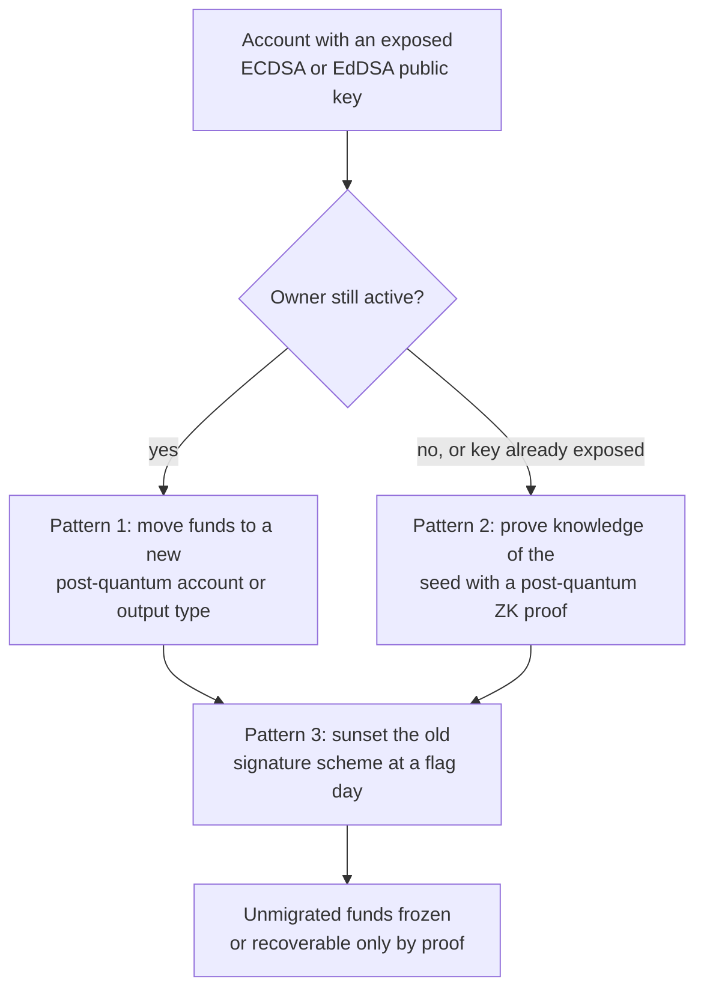

A blockchain account is a public key, and almost every chain derives it from an elliptic curve: secp256k1 for Bitcoin and Ethereum, Ed25519 for Solana, Cardano, Aptos and Sui. Shor's algorithm recovers the private key from such a public key, so a sufficiently large quantum computer would let its owner spend other people's coins rather than merely read their traffic.

The [previous article]({{site.url_complet}}/2026/10/29/post-quantum-cryptography-algorithms-overview/) covered the NIST post-quantum standards and their adoption in TLS, messaging and the cloud. This one looks at blockchains, where the constraints are different: no confidentiality to protect against harvest-now-decrypt-later in most cases, but signatures that every node verifies and stores forever, keys that are already public, and owners who may never come back to migrate.

It goes chain by chain through what each one uses today, what a quantum computer would break, and what has been proposed, tested or shipped as of October 2026.

> This article has been made with the help of [Claude Code](https://claude.com/product/claude-code) and several custom skills

[TOC]

## What you need to know first

The article relies on a few blockchain and cryptography mechanisms:

- **Address versus public key.** Most chains publish a hash of the public key as the address and reveal the public key only when the account first signs. While the key is hidden behind the hash, Shor's algorithm has nothing to attack. [Bitcoin Keys 101]({{site.url_complet}}/2024/10/28/bitcoin-keys-101/) explains the derivation for Bitcoin.
- **Signature schemes in use.** ECDSA and Schnorr (BIP-340) on secp256k1, EdDSA on Ed25519, and BLS aggregate signatures on BLS12-381 for Ethereum consensus. All of them are broken by Shor's algorithm.
- **Post-quantum signatures.** ML-DSA (FIPS 204) and FN-DSA/Falcon on lattices, SLH-DSA (FIPS 205) and the XMSS and Winternitz families on hash functions alone. Their signatures are 10 to 270 times larger than an Ed25519 signature.
- **Soft fork and hard fork.** A soft fork tightens the rules so that old nodes still accept new blocks; a hard fork changes the rules in a way old nodes reject. Adding a new output type is a soft fork in Bitcoin; disabling old signatures can be either, depending on the design.
- **Account abstraction.** Letting an account's validation logic be code instead of a fixed signature scheme, as in Ethereum's [ERC-4337]({{site.url_complet}}/2025/05/02/erc-4337-overview/). A chain with account abstraction can accept a new signature scheme as a contract, without a protocol change.
- **Zero-knowledge proof of a secret.** A proof that one knows a value, such as the seed a key was derived from, without revealing it. Several migration proposals use it to let owners prove ownership after their public key is no longer trustworthy.

## What a quantum computer breaks on a blockchain

Three different things depend on elliptic curves in a blockchain, and they fail differently.

- **User accounts** are the main target. A **long-exposure attack** targets public keys already visible on-chain: early Bitcoin pay-to-public-key outputs, reused addresses, Taproot outputs (whose tweaked public key is in the output), and any account that has signed before. A **short-exposure attack** must recover the key in the window between a transaction's broadcast and its confirmation, which requires a much faster machine.
- **Consensus** depends on validator signatures (Ed25519 in most proof-of-stake chains, BLS12-381 in Ethereum). Forging them would allow equivocation or fake finality, but validators can rotate keys at a coordinated upgrade, which is far easier than migrating every user.
- **Privacy and proof systems** built on pairings or elliptic-curve commitments (Groth16, KZG, PLONK over BN254) lose soundness or hiding. Here harvest-now-decrypt-later does apply: data encrypted on-chain today can be decrypted later.

Hash functions survive. Grover's algorithm halves preimage security, which leaves SHA-256 and Keccak-256 at around 128 bits, so proof-of-work, Merkle trees and hash-based addresses are not the problem.

The timing estimate that matters here dropped in 2026. On 31 March 2026, [Google Quantum AI](https://research.google/blog/safeguarding-cryptocurrency-by-disclosing-quantum-vulnerabilities-responsibly/) published circuits that solve the 256-bit elliptic-curve discrete logarithm with fewer than 1,200 logical qubits and 90 million Toffoli gates, which it translates into fewer than 500,000 physical qubits running for a few minutes. Earlier estimates were around nine million physical qubits. Google disclosed the result with a zero-knowledge proof of the estimate instead of the circuits, and named cryptocurrency explicitly as the reason for caution.

## Three migration patterns

Every proposal below combines some of these three ideas.

1. **Add a post-quantum account or output type.** Opt-in, usually a soft fork or a new account scheme. It protects only those who move.
2. **Prove ownership without the vulnerable key.** If a wallet was derived from a seed by hashing, the owner can prove knowledge of that seed with a hash-based zero-knowledge proof (a STARK), which a quantum adversary who only has the public key cannot produce.
3. **Retire the classical signature.** After a deadline, stop accepting ECDSA or EdDSA spends, so that a quantum attacker cannot use stolen keys. This is the contentious step, because it freezes coins whose owners never migrate.

## Chain by chain

### Bitcoin

Bitcoin signs with ECDSA and, since Taproot, Schnorr signatures, both on secp256k1. Estimates of the coins sitting in outputs with an exposed public key range around six to seven million BTC, including roughly one million in early pay-to-public-key outputs attributed to Satoshi Nakamoto.

Three lines of work are active, all of them drafts:

- **[BIP-360, Pay-to-Merkle-Root (P2MR)](https://github.com/bitcoin/bips/blob/master/bip-0360.mediawiki)** defines a SegWit version 2 output that commits only to a script tree, removing Taproot's key-path spend and with it the exposed public key. The text states that it "does not include the introduction of post-quantum signature schemes"; those are left to a later proposal. It was renamed twice (P2QRH, then P2TSH) before taking its current name.
- **[BIP-361, Post Quantum Migration and Legacy Signature Sunset](https://bips.dev/361/)**, by Jameson Lopp and co-authors, is the pattern-3 proposal: first stop sends to quantum-vulnerable output types, then, about five years after activation, invalidate legacy ECDSA and Schnorr spends except through a recovery protocol.
- **[SHRINCS](https://groups.google.com/g/bitcoindev/c/HbVboXIFiG8)**, from Blockstream researchers, is a hash-based signature tailored to Bitcoin: stateful signatures of about 324 bytes with a stateless SPHINCS+ fallback, so a wallet that loses its state still has a safe if larger signature. A proof-of-concept library and an opcode sketch exist; it has not been peer reviewed.

### Ethereum

Ethereum accounts sign with ECDSA on secp256k1 and validators with BLS12-381 aggregate signatures, so both the execution and the consensus layer need replacing. The Ethereum Foundation formed a dedicated Post-Quantum Security team in January 2026 and publishes its roadmap on [pq.ethereum.org](https://pq.ethereum.org/) and on the [ethereum.org quantum-resistance page](https://ethereum.org/roadmap/security/quantum-resistance/).

- **Consensus**: the "lean Ethereum" track replaces BLS with hash-based signatures (leanSig, an XMSS variant) aggregated with STARKs, so that thousands of validator signatures still fit in a block. More than ten client teams run post-quantum interoperability devnets; the roadmap names around 2029 as a tentative target.
- **Accounts**: two draft precompiles would make post-quantum verification cheap enough for smart accounts, [EIP-8051 for ML-DSA](https://eips.ethereum.org/EIPS/eip-8051) and [EIP-8052 for Falcon](https://eips.ethereum.org/EIPS/eip-8052). Combined with account abstraction ([ERC-4337]({{site.url_complet}}/2025/05/02/erc-4337-overview/), or [EIP-7702]({{site.url_complet}}/2025/05/09/eip-7702-overview/) for existing addresses), a user could switch to a post-quantum key without a new address.
- **Emergency plan**: Vitalik Buterin's 2024 post "How to hard fork to save most users' funds in a quantum emergency" describes pattern 2 and 3 together: roll back to before large-scale theft, disable ECDSA transactions, and let users recover by proving knowledge of their seed with a STARK.

### Solana

Solana uses Ed25519. In April 2026 the [Solana Foundation](https://solana.com/news/quantum-readiness) reported that both validator-client teams, Anza and Firedancer, studied the options independently and both chose Falcon, with initial implementations on GitHub, and that no protocol change is needed yet. In the meantime, an opt-in **Winternitz vault** program lets users hold funds behind a hash-based one-time signature, using a new key pair for every transaction.

### Cardano

Cardano uses Ed25519 for transactions and its block production. Input Output's [Cardano Vision 2026](https://cardano.org/news/2026-06-19-cardano-vision-2026/) research programme includes a post-quantum framework for replacing the core consensus primitives, and public statements point towards lattice signatures and Mithril certificates. No Cardano Improvement Proposal specifies a scheme yet.

### Aptos

Aptos supports Ed25519 and keyless accounts. [AIP-137](https://cointelegraph.com/news/aptos-introduces-post-quantum-signatures-proposal), proposed in December 2025, adds opt-in accounts signed with SLH-DSA-SHA2-128s, the small-signature variant of the hash-based standard. Aptos accounts are separable from their authentication key, so an existing account could rotate to such a key.

### Sui

Sui supports Ed25519, secp256k1, secp256r1 and zkLogin. Mysten Labs researchers published [Post-Quantum Readiness in EdDSA Chains](https://eprint.iacr.org/2025/1368) (accepted at Financial Cryptography 2026), which is pattern 2 applied to EdDSA: because an Ed25519 key is derived from a seed by hashing (RFC 8032), the owner can prove knowledge of the seed in zero knowledge and bind a new post-quantum key to the same address, even if the old public key is already exposed. The proof of concept takes about 6 seconds to prove and produces 5.4 MB proofs.

### XRP Ledger

The XRP Ledger supports secp256k1 ECDSA and Ed25519. Ripple published a [four-phase post-quantum roadmap](https://ripple.com/insights/post-quantum-readiness-on-the-xrp-ledger/) starting with an emergency plan, and ML-DSA prototypes run on the AlphaNet development network. No amendment has been adopted; coverage of the roadmap gives 2028 as the target for readiness.

### Algorand

Algorand is the one large chain with a post-quantum component in production. Its [state proofs](https://algorand.co/blog/technical-brief-quantum-resistant-transactions-on-algorand-with-falcon-signatures), which certify the chain's history for light clients and bridges, have been signed with Falcon since 2022. In November 2025 the first Falcon-signed user transaction was executed on mainnet through a logic signature verifying Falcon in the virtual machine. User accounts still default to Ed25519.

### Zama

The Zama protocol encrypts balances with TFHE, which rests on the Learning With Errors problem and is therefore post-quantum. As covered in [an earlier article]({{site.url_complet}}/2026/10/02/zama-post-quantum/), two parts are not: the zero-knowledge proof that a ciphertext is well formed uses pairings, and the transactions themselves are signed with the host chain's ECDSA. The confidentiality of amounts holds against a quantum adversary; the integrity of the system does not yet.

### Canton

Canton participants and synchronizers sign with Ed25519 or ECDSA, according to the [Canton crypto schemes reference](https://docs.canton.network/global-synchronizer/reference/crypto-schemes). No post-quantum plan has been published. Because Canton is permissioned and its parties' keys are managed by known operators, a future scheme could be rolled out by configuration rather than by a community fork.

### Aztec

Aztec, a privacy Layer 2 on Ethereum, depends on elliptic curves everywhere: its proofs are over BN254 and its note encryption uses the Grumpkin curve, as described in [Ephemeral Keys on Aztec]({{site.url_complet}}/2026/09/17/aztec-ephemeral-keys-ecdh-encryption-post-quantum/). On 15 October 2026 Aztec announced a migration roadmap to full post-quantum security by the end of 2030, according to [press coverage](https://cryptobriefing.com/aztec-post-quantum-migration-2030/): a post-quantum signature scheme selected in March 2027, a public-key encryption scheme in July 2027 and a post-quantum proving system in November 2027. Replacing the proving system without losing client-side proving and cheap verification is named as the hardest part, and the full migration depends on changes to Ethereum's data availability.

### Chains designed as post-quantum

- **[QRL (Quantum Resistant Ledger)](https://www.theqrl.org/)** has run on XMSS hash-based signatures since its 2018 mainnet, which makes it the oldest post-quantum chain in production. Its successor, QRL 2.0 (Zond), is an EVM-compatible proof-of-stake chain using ML-DSA-87 throughout; its testnet was completed in early 2026 and its mainnet had not launched as of mid-2026.
- **Quantus Network** launched a proof-of-work mainnet in September 2026 with ML-DSA-65 and ML-DSA-87 signatures, and transactions of about 7 KB. Its ML-DSA implementation is the subject of [ML-DSA in Rust]({{site.url_complet}}/2026/08/25/ml-dsa-rust-implementation-quantus/).

## Summary

| Chain | Signatures today | Post-quantum status (October 2026) | Pattern |
|-------|------------------|------------------------------------|---------|
| Bitcoin | ECDSA, Schnorr (secp256k1) | BIP-360 (P2MR) and BIP-361 drafts; SHRINCS prototype | 1 and 3 |
| Ethereum | ECDSA (secp256k1), BLS12-381 | EF post-quantum team; leanSig devnets; EIP-8051 and EIP-8052 drafts | 1, 2 and 3 |
| Solana | Ed25519 | Falcon chosen by Anza and Firedancer; opt-in Winternitz vault | 1 |
| Cardano | Ed25519 | Research framework (Vision 2026) | Not specified |
| Aptos | Ed25519, keyless | AIP-137, SLH-DSA accounts (proposal) | 1 |
| Sui | Ed25519, secp256k1, secp256r1 | Research: ZK proof of the EdDSA seed | 2 |
| XRP Ledger | secp256k1, Ed25519 | ML-DSA prototypes on AlphaNet | 1 |
| Algorand | Ed25519; Falcon for state proofs | Falcon state proofs in production; Falcon transactions possible | 1 |
| Zama | Host-chain ECDSA; TFHE is lattice-based | Encryption post-quantum; pairing-based proof and signatures are not | Not specified |
| Canton | Ed25519, ECDSA | No published plan | Not specified |
| Aztec | BN254, Grumpkin | Roadmap to full migration by end 2030 | 1 |
| QRL | XMSS; ML-DSA-87 in 2.0 | Post-quantum since 2018 | Native |
| Quantus | ML-DSA-65, ML-DSA-87 | Mainnet since September 2026 | Native |

The pattern column is the article's reading of each proposal against the three patterns above.

## The size problem

The choice of scheme on each chain follows from block space. An Ed25519 signature is 64 bytes; ML-DSA-65 is 3,309 bytes, SLH-DSA-SHA2-128s is 7,856 bytes and Falcon-512 about 666 bytes. That explains the pattern in the summary table:

- **Falcon** is chosen where every transaction is affected (Solana, Algorand, one of Ethereum's precompiles), because it is the smallest standard-track scheme, even though its signing is the hardest to implement safely.
- **Hash-based signatures** are chosen where assumptions must be minimal (Bitcoin's SHRINCS, Ethereum's consensus, Aptos), and made smaller either with state (XMSS, Winternitz) or by aggregating many of them in one STARK.
- **ML-DSA** is chosen by chains that accept larger transactions in exchange for the main NIST standard (XRP Ledger prototypes, QRL 2.0, Quantus).

## Conclusion

No major smart-contract chain has migrated its user accounts to post-quantum signatures, but most of them now have a published plan, and the plans converge on the same three patterns.

- **The threat is to signatures, not to hashes.** Long-exposure attacks on already-published public keys are the main risk; proof-of-work and Merkle structures are unaffected.
- **Bitcoin** has draft proposals for a key-path-free output (BIP-360, P2MR), a legacy-signature sunset (BIP-361) and a compact hash-based signature (SHRINCS).
- **Ethereum** has a dedicated team, hash-based consensus signatures on devnets, and draft ML-DSA and Falcon precompiles that account abstraction could use; its tentative target is around 2029.
- **Solana, Aptos and the XRP Ledger** have chosen a scheme (Falcon, SLH-DSA, ML-DSA) and are at prototype or proposal stage; **Sui** has a recovery construction for EdDSA keys; **Cardano** and **Canton** have no concrete scheme yet.
- **Algorand** runs Falcon state proofs in production, and **QRL** and **Quantus** are post-quantum by design.
- **Privacy systems** are split: Zama's encryption is already lattice-based, while Aztec plans a full migration of curves and proving system by 2030.

## Annex

### Key Terms

| Term | Definition |
|------|------------|
| **secp256k1** | The elliptic curve used for ECDSA and Schnorr signatures in Bitcoin and Ethereum. |
| **Ed25519** | The EdDSA signature scheme over Curve25519, used by Solana, Cardano, Aptos, Sui and many validators. |
| **BLS12-381** | A pairing-friendly curve used for Ethereum's aggregate validator signatures; broken by Shor's algorithm like any elliptic curve. |
| **Long-exposure attack** | Recovering a private key from a public key that has been visible on-chain for a long time, such as a P2PK output or a reused address. |
| **Short-exposure attack** | Recovering a private key between a transaction's broadcast and its confirmation, which requires a much faster quantum computer. |
| **P2PK** | Pay-to-public-key, an early Bitcoin output type that places the public key itself in the output. |
| **P2MR** | Pay-to-Merkle-Root, the BIP-360 output type that removes Taproot's key-path spend so no public key is exposed. |
| **Legacy signature sunset** | A flag day after which a chain stops accepting classical signatures, as proposed by BIP-361. |
| **leanSig** | The hash-based (XMSS-variant) signature designed for Ethereum validators in the lean Ethereum roadmap. |
| **STARK** | A hash-based zero-knowledge proof system, post-quantum, used to aggregate hash-based signatures or to prove knowledge of a seed. |
| **Precompile** | A built-in Ethereum contract at a fixed address that executes an expensive operation natively, such as signature verification. |
| **Winternitz vault** | A Solana program that holds funds behind a Winternitz one-time signature, rotating to a new key at each use. |
| **State proof** | Algorand's certificate of the chain's history for light clients, signed with Falcon. |
| **Falcon** | The compact lattice signature being standardised as FN-DSA (FIPS 206). |
| **SHRINCS** | A Bitcoin-oriented hash-based signature with a small stateful mode and a stateless SPHINCS+ fallback. |
| **Proof of seed knowledge** | A zero-knowledge proof that the signer knows the seed from which an account key was derived, used to recover accounts whose public key is exposed. |

## Frequently Asked Questions

**Q: Why are hash functions not the problem for blockchains?**

Grover's algorithm only gives a quadratic speed-up against preimages, which leaves a 256-bit hash at about 128 bits of security. Proof-of-work, Merkle trees and addresses that are hashes of public keys keep their security; what breaks is the elliptic-curve signature behind each account and validator.

**Q: What is the difference between a long-exposure and a short-exposure attack, and which one comes first?**

A long-exposure attack targets public keys already on-chain, such as P2PK outputs, reused addresses, Taproot outputs and any account that has signed, so the attacker has unlimited time. A short-exposure attack must recover a key from a pending transaction before it is confirmed, which needs a far faster machine. Long-exposure attacks become possible first, which is why proposals focus on moving funds out of exposed outputs.

**Q: What does BIP-360 (P2MR) change, and why does it not contain a post-quantum signature?**

It defines a SegWit version 2 output that commits only to a script tree, removing the key-path spend that exposes a Taproot output's public key. It deliberately leaves the post-quantum signature scheme to a later proposal, so that the output type can be agreed independently of the choice between SHRINCS, SLH-DSA or another scheme.

**Q: Why did Solana's two client teams choose Falcon rather than ML-DSA?**

Signature size. Every Solana transaction carries signatures that each validator verifies and stores, and a Falcon-512 signature is about 666 bytes against 2,420 to 3,309 bytes for ML-DSA. The cost is that Falcon signing uses floating-point Gaussian sampling, which is harder to implement in constant time.

**Q: How can a Sui or Solana user recover an account whose Ed25519 public key is already public?**

An Ed25519 private key is derived from a 32-byte seed by hashing. A quantum attacker can compute the private scalar from the public key, but not the seed. The owner can therefore prove knowledge of the seed in zero knowledge, with a hash-based proof that is itself post-quantum, and use that proof to authorise a new post-quantum key for the same address. This is the construction of the Mysten Labs paper.

**Q: Zama's TFHE is lattice-based. Is a Zama confidential token therefore quantum-safe?**

Only partly. The encryption of balances rests on LWE and holds against a quantum adversary, so amounts stay confidential. The proof that a submitted ciphertext is well formed uses pairings, and transactions are signed with the host chain's ECDSA; both could be forged by a quantum computer, which affects integrity rather than confidentiality.

## Gaps

Several statements come from press coverage or from proposals that are still changing.

| Gap | Why it matters | What to read or verify |
|-----|----------------|------------------------|
| The six to seven million BTC in exposed outputs is from secondary reporting of Project Eleven and Chaincode Labs figures. | The Bitcoin section quotes it. | The Chaincode Labs quantum report and Project Eleven's own data. |
| Aptos AIP-137: governance approval and activation status were not confirmed. | The summary table calls it a proposal. | The AIP text in the aptos-foundation/AIPs repository and governance records. |
| The Aztec roadmap is cited from press coverage of the 15 October 2026 announcement. | All Aztec dates come from it. | Aztec's own announcement and the Williamson and Connor technical paper. |
| The launch date of Solana's Winternitz vault differs between sources. | The article gives no date for it. | The vault's repository and the Solana Foundation's April 2026 post. |
| Cardano's lattice and Mithril direction comes from public statements, not a specification. | The Cardano section describes it as a direction. | IOG research publications under Cardano Vision 2026. |
| The XRP Ledger 2028 target comes from press coverage. | The XRP section quotes it. | Ripple's roadmap post and XRPL amendment discussions. |
| QRL 2.0 mainnet status after June 2026 was not checked. | The article says the mainnet had not launched as of mid-2026. | The QRL roadmap and blog. |
| Ethereum's EIP-8355 (ML-DSA levels II, III and V) overlaps EIP-8051 and was not analysed. | The precompile landscape may consolidate. | Ethereum Magicians discussion of EIP-8355. |
| The URL of Vitalik Buterin's 2024 emergency hard-fork post was not fetched. | The post is named but not linked. | ethresear.ch, "How to hard fork to save most users' funds in a quantum emergency". |

## References

### Quantum threat

- [Google Research, Safeguarding cryptocurrency by disclosing quantum vulnerabilities responsibly (31 March 2026)](https://research.google/blog/safeguarding-cryptocurrency-by-disclosing-quantum-vulnerabilities-responsibly/)

### Bitcoin

- [BIP-360, Pay-to-Merkle-Root (P2MR)](https://github.com/bitcoin/bips/blob/master/bip-0360.mediawiki)
- [BIP-361, Post Quantum Migration and Legacy Signature Sunset](https://bips.dev/361/)
- [SHRINCS, first draft on the bitcoin-dev mailing list (December 2025)](https://groups.google.com/g/bitcoindev/c/HbVboXIFiG8)
- [Delving Bitcoin, Major BIP-360 update](https://delvingbitcoin.org/t/major-bip-360-update/2170)

### Ethereum

- [Ethereum Foundation, post-quantum hub](https://pq.ethereum.org/)
- [ethereum.org, Quantum resistance roadmap](https://ethereum.org/roadmap/security/quantum-resistance/)
- [EIP-8051, Precompile for ML-DSA signature verification](https://eips.ethereum.org/EIPS/eip-8051)
- [EIP-8052, Precompile for Falcon signature verification](https://eips.ethereum.org/EIPS/eip-8052)

### Other chains

- [Solana Foundation, Quantum readiness (April 2026)](https://solana.com/news/quantum-readiness)
- [Cardano Vision 2026](https://cardano.org/news/2026-06-19-cardano-vision-2026/)
- [Cointelegraph, Aptos introduces post-quantum signatures proposal (AIP-137)](https://cointelegraph.com/news/aptos-introduces-post-quantum-signatures-proposal)
- [Baldimtsi, Chalkias, Roy, Sedaghat, Post-Quantum Readiness in EdDSA Chains (ePrint 2025/1368)](https://eprint.iacr.org/2025/1368)
- [Ripple, Post-quantum readiness on the XRP Ledger](https://ripple.com/insights/post-quantum-readiness-on-the-xrp-ledger/)
- [Algorand, Quantum-resistant transactions on Algorand with Falcon signatures](https://algorand.co/blog/technical-brief-quantum-resistant-transactions-on-algorand-with-falcon-signatures)
- [Canton Network, crypto schemes reference](https://docs.canton.network/global-synchronizer/reference/crypto-schemes)
- [Crypto Briefing, Aztec targets full post-quantum migration by end of 2030](https://cryptobriefing.com/aztec-post-quantum-migration-2030/)

### Post-quantum chains

- [QRL, Quantum Resistant Ledger](https://www.theqrl.org/)
- [QRL roadmap](https://www.theqrl.org/roadmap.md)

### Related articles

- [Post-Quantum Cryptography in 2026 — The Algorithms, What They Do and Who Deploys Them]({{site.url_complet}}/2026/10/29/post-quantum-cryptography-algorithms-overview/)
- [Zama and Post-Quantum Cryptography: Everything Is Lattice-Based Except One Pairing]({{site.url_complet}}/2026/10/02/zama-post-quantum/)
- [Ephemeral Keys on Aztec — Encrypting to an Address, the Curve Behind It, and What a Quantum Computer Would Break]({{site.url_complet}}/2026/09/17/aztec-ephemeral-keys-ecdh-encryption-post-quantum/)
- [ML-DSA in Rust — Inside the Quantus qp-rusty-crystals Implementation]({{site.url_complet}}/2026/08/25/ml-dsa-rust-implementation-quantus/)
- [Overview of ECDSA - Elliptic Curve Digital Signature Algorithm]({{site.url_complet}}/2024/10/23/ecdsa-overview/)
- [Winternitz One-Time Signature(OTS)]({{site.url_complet}}/2024/05/30/winternitz-signature-scheme/)
