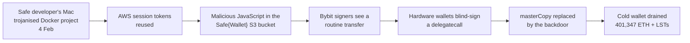
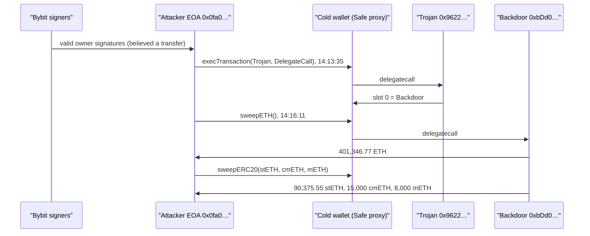
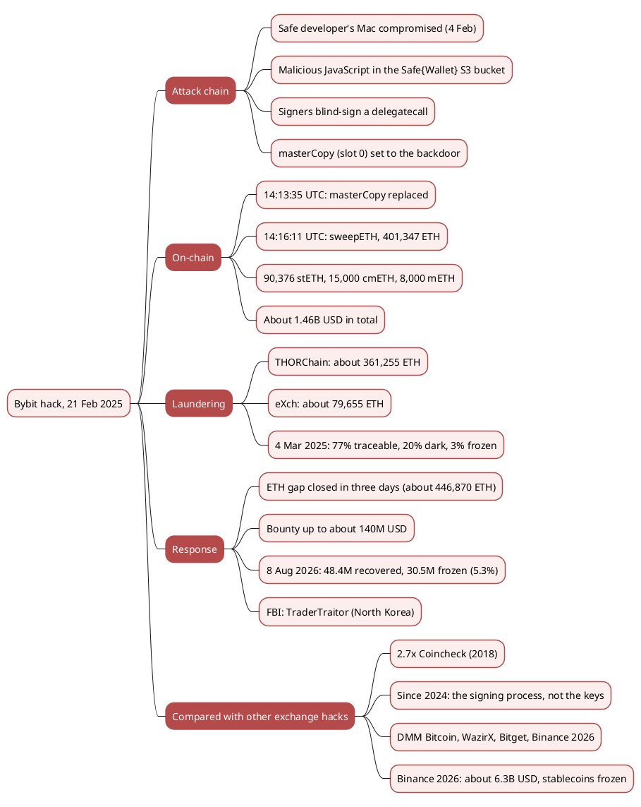

On 21 February 2025, at 14:13 UTC, the Ethereum cold wallet of the exchange [Bybit](https://www.bybit.com/) stopped being a multisig. One transaction, carrying valid signatures from Bybit's own signers, replaced the wallet's code with a contract written by the attacker. Two and a half minutes later the attacker emptied it: about 401,347 ETH plus 113,376 liquid-staking tokens, roughly 1.46 billion USD. The FBI attributed the theft to North Korea's TraderTraitor group five days later. Until the Binance hot-wallet drain of 29 October 2026, it was the largest theft in the history of crypto.

No smart contract had a bug and no private key was stolen. The signers approved a transaction they could not read, because the web interface they used had been modified to show them something else. This article reconstructs the attack from the on-chain record and the forensic reports, follows the laundering and the recovery, and compares Bybit with the other large exchange hacks covered in this site's yearly series.

> This article has been made with the help of [Claude Code](https://claude.com/product/claude-code) and several custom skills

[TOC]

## What you need to know first

The attack combines a standard multisig wallet with a feature of that wallet that is rarely used.

- **Safe multisig.** [Safe](https://safe.global/) (formerly Gnosis Safe) is a smart-contract wallet that executes a transaction once m of its n owners have signed it. Bybit's cold wallet was a Safe. See [How to create a multisig wallet with Gnosis Safe]({{site.url_complet}}/2022/08/12/multisig-wallet-gnosis/).
- **Proxy and `masterCopy`.** Each Safe is a small proxy contract that forwards every call to a shared implementation. The address of that implementation sits in storage slot 0, under the name `masterCopy`. Whoever controls slot 0 controls the wallet's logic.
- **`delegatecall`.** A Safe can execute a transaction in two ways. With `call`, the target runs in its own storage. With `delegatecall`, the target's code runs in the Safe's storage. The second form is meant for batching libraries, and it can also overwrite slot 0.
- **Blind signing.** The owners sign a hash of the transaction fields (EIP-712). A hardware wallet that cannot decode those fields shows only the hash, so the signer trusts whatever the web interface displays.
- **Cold and hot wallets.** An exchange keeps most of its reserves in a cold wallet that signs rarely, under several approvals, and a float in hot wallets that sign automatically. Bybit's loss came from the cold wallet.
- **Liquid-staking tokens.** stETH (Lido), mETH and cmETH (Mantle) represent staked ETH. They can be swapped for ETH, which the attacker did within days.
- **TraderTraitor.** The North Korean unit, part of what is usually called the Lazarus Group, that the FBI named for this theft. It is also behind DMM Bitcoin (2024) and, according to TRM Labs, the Binance drain of 2026.

## Key facts

| Item | Value | Source |
|------|-------|--------|
| Date and time | 21 February 2025, 14:13:35 UTC (`masterCopy` replaced), 14:16:11 UTC (ETH swept) | On-chain, blocks 21,895,238 and 21,895,251 |
| Victim | Bybit's Ethereum multisig cold wallet `0x1Db92e2EeBC8E0c075a02BeA49a2935BcD2dFCF4` (Safe v1.1.1) | On-chain |
| Stolen | 401,346.77 ETH, 90,375.55 stETH, 15,000 cmETH, 8,000 mETH, about 1.46 billion USD | Hack registry write-up, from the transaction trace |
| Attacker | EOA `0x0fa09C3A328792253f8dee7116848723b72a6d2e`, Trojan contract `0x96221423681A6d52E184D440a8eFCEbB105C7242`, backdoor contract `0xbDd077f651EBe7f7b3cE16fe5F2b025BE2969516` | On-chain, hack registry |
| Root cause | Compromised Safe{Wallet} front end: signers shown a routine transfer, blind-signed a `delegatecall` that overwrote `masterCopy` | Safe statement, Sygnia and Verichains via [The Block](https://www.theblock.co/post/343530) |
| Attribution | North Korea, TraderTraitor | [FBI IC3, 26 February 2025](https://www.ic3.gov/PSA/2025/PSA250226) |
| Recovered, 18 months later | about 48.4 million USD recovered and 30.5 million USD frozen (about 5.3%) | [Ben Zhou, 8 August 2026](https://x.com/benbybit/status/2085969090225815768) |

On 30 October 2026, slot 0 of the cold wallet still holds the backdoor's address (`0x…bdd077f6…`), and the wallet holds 0 ETH.

## Timeline

All times are UTC.

| Date | Event | Source |
|------|-------|--------|
| 4 Feb 2025 | A Safe{Wallet} developer's macOS machine is compromised through a trojanised Docker project delivered by social engineering. The attackers later reuse live AWS session tokens | Safe, Sygnia and Verichains via [The Block](https://www.theblock.co/post/343530) |
| ~19 Feb | Malicious JavaScript is placed in the Safe{Wallet} front-end bucket on AWS S3. It activates only for Bybit's Safe and one other address | same |
| 21 Feb, 14:13:35 | Bybit's signers approve what their screens show as a routine transfer. The attacker's EOA submits it: an `execTransaction` with `operation = DelegateCall` to the Trojan contract, which writes the backdoor's address into slot 0 | On-chain (tx `0x46deef0f…7882`) |
| 21 Feb, 14:16:11 | The attacker calls `sweepETH()` on the wallet, now running the backdoor's code: 401,346.77 ETH leave. The stETH, cmETH and mETH follow through `sweepERC20()` | On-chain (tx `0xb61413c4…072c`), hack registry |
| 21 Feb | The malicious files are replaced with clean ones about two minutes after the theft | Safe, via [The Block](https://www.theblock.co/post/343530) |
| 21–22 Feb | Bybit's CEO Ben Zhou says a bridge loan from partners covers about 80% of the lost ETH, and that withdrawals keep running | [The Block](https://www.theblock.co/post/342739/bybit-secures-80-lost-eth-bridge-loan-partners-liquidity-crunch-following-hack) |
| 24 Feb | Zhou says Bybit has "fully closed the ETH gap". Lookonchain estimates 446,870 ETH (about 1.23 billion USD) acquired through loans, whale deposits and purchases | [The Block](https://www.theblock.co/post/342896/bybit-ceo-says-exchange-has-closed-shortfall-in-eth-reserves-plans-to-release-audited-por-report), [Decrypt](https://decrypt.co/307447/bybit-closes-ethereum-deficit-with-1-23-billion-post-hack-purchase-ceo) |
| 26 Feb | The FBI attributes the theft to North Korea's TraderTraitor and publishes attacker addresses | [FBI IC3](https://www.ic3.gov/PSA/2025/PSA250226) |
| ~3 Mar | The first phase of laundering ends, about ten days after the theft | [Cointelegraph](https://cointelegraph.com/news/bybit-hack-280m-untraceable-1b-trackable-thorchain-okx-exch), [TRM Labs](https://www.trmlabs.com/resources/blog/bybit-hack-update-north-korea-moves-to-next-stage-of-laundering) |
| 4 Mar | Zhou: 77% of the funds still traceable, 20% "gone dark", 3% frozen | [Cointelegraph](https://cointelegraph.com/news/bybit-hack-280m-untraceable-1b-trackable-thorchain-okx-exch) |
| 8 Aug 2026 | Zhou: about 48.4 million USD recovered and 30.5 million USD frozen across more than 28 exchanges and custodians. Bybit sues the DPRK and the Lazarus Group and obtains a preliminary injunction | [Ben Zhou](https://x.com/benbybit/status/2085969090225815768), [Bybit](https://www.bybit.com/en/press/post/bybit-sues-north-korea-and-lazarus-group-secures-preliminary-injunction-freezing-stolen-assets-in-landmark-crypto-asset-recovery-effort-bb55bb16f1710f487aa) |

The two on-chain times in this table were read from the transactions with Blockscout. The rest comes from the cited reports.

## How the attack worked

### Off-chain: the signing interface

The attacker never touched Bybit's keys or Bybit's infrastructure. They compromised the service Bybit's signers used to prepare transactions, the Safe{Wallet} web application, and through it the content of what the signers approved:

1. **Developer machine.** A Safe{Wallet} developer ran a trojanised Docker project, which gave the attackers access to the developer's AWS session tokens.
2. **Front-end bucket.** With those tokens, the attackers modified the JavaScript served from Safe{Wallet}'s S3 bucket. The code checked the connected Safe address and stayed dormant for every wallet except Bybit's and one other.
3. **Signing session.** When Bybit's signers prepared a routine transfer from the cold wallet, the modified code replaced the transaction they signed while the interface kept showing the transfer. The hardware wallets displayed a hash they could not decode, and the signers approved it.



### On-chain: one `delegatecall`, then the sweeps

The signed transaction was valid in every respect the Safe checks: correct nonce, enough owner signatures. Its operation type was `delegatecall`, which runs the target contract's code inside the Safe's own storage, and the target was the attacker's Trojan contract. Its whole effect, as reconstructed in the hack registry from the verified trace, fits in one line:

```solidity
// Trojan contract (0x9622…7242), reconstruction from the transaction trace
// Called by the Safe with delegatecall, so `masterCopy` is the SAFE's storage slot 0
function transfer(address to, uint256 /* value */) external {
    masterCopy = to;   // to = backdoor 0xbDd0…9516
}
```

After that single write, every call to the cold wallet ran the backdoor's code instead of the Safe's. The backdoor exposed two functions, `sweepETH()` and `sweepERC20()`, callable by the attacker without any signature. The attacker called them four times, for ETH, mETH, cmETH and stETH.



### Why the Safe contracts were not at fault

The proxy delegates to whatever address slot 0 holds. The Safe checks signatures and then executes the requested operation, including `delegatecall`. The signatures were genuine.

The failure was that the signers could not verify what they signed. Three controls would each have stopped this transaction:

- **Clear signing on the signing device.** A hardware wallet that decodes Safe transactions would have shown `operation = DelegateCall` to an unknown contract.
- **A transaction guard on the cold wallet.** Safe versions after 1.1.1 support guards that can refuse any `delegatecall`, or allow only known library targets. Bybit's wallet ran v1.1.1.
- **Independent verification.** A second tool, on a separate machine, that recomputes and decodes the Safe transaction hash before anyone signs would not have been affected by the compromised front end.

## Laundering

The theft was all ETH or ETH-denominated tokens, so no issuer could freeze it, and the attacker converted it fast. Ben Zhou's breakdown of 4 March 2025, as reported by [Cointelegraph](https://cointelegraph.com/news/bybit-hack-280m-untraceable-1b-trackable-thorchain-okx-exch):

- **THORChain:** about 361,255 ETH (about 900 million USD), swapped mostly for bitcoin through the cross-chain DEX.
- **eXch:** about 79,655 ETH, through an instant-exchange service without identity checks.
- **OKX Web3 proxy and others:** smaller amounts.
- **State of the funds on 4 March:** 77% still traceable, 20% "gone dark", 3% frozen.

The liquid-staking tokens were swapped for ETH within the first days, and the first laundering phase ended around 3 March, about ten days after the theft. [TRM Labs](https://www.trmlabs.com/resources/blog/bybit-hack-update-north-korea-moves-to-next-stage-of-laundering) then saw a first tranche of the resulting BTC deposited into mixers, including Wasabi and CryptoMixer.

## Response and recovery

**Reserves.** Bybit kept withdrawals open. Within three days it had replaced the missing ETH through a bridge loan from partners, deposits from large holders and direct purchases: about 446,870 ETH according to Lookonchain's estimate. On 24 February Zhou said client assets were back at 1:1 and promised an audited proof of reserves.

**Bounty.** Bybit launched a bounty programme ("LazarusBounty") offering up to 10% of any recovered funds, with a ceiling of about 140 million USD ([CryptoSlate](https://cryptoslate.com/bybit-restores-ethereum-reserves-following-1-4b-breach-launches-140m-bounty-program/)).

**Recovery after 18 months.** On 8 August 2026, Zhou [reported](https://x.com/benbybit/status/2085969090225815768) about 48.4 million USD recovered and another 30.5 million USD frozen across more than 28 exchanges and custodians, about 5.3% of the theft in total. The same day, Bybit announced a [civil lawsuit against the DPRK and the Lazarus Group](https://www.bybit.com/en/press/post/bybit-sues-north-korea-and-lazarus-group-secures-preliminary-injunction-freezing-stolen-assets-in-landmark-crypto-asset-recovery-effort-bb55bb16f1710f487aa), with a preliminary injunction freezing identified stolen assets.

The recovery rate is low because ETH has no issuer that can freeze it, so recovery depended on exchanges and custodians catching the funds after the swaps. In the Binance drain of October 2026, by contrast, a large part of the stolen value was in USDT and USDC, and about 3 billion USD was frozen within hours ([Binance, 30 October 2026](https://x.com/binance/status/2115993361517891592)).

## Comparison with other exchange hacks

The table lists the largest exchange thefts covered in this site's yearly hack articles, plus Bybit and the 2026 incidents. Losses are the figures reported at the time, in nominal USD, with ranges where sources disagree.

| Date | Exchange | Reported loss | What failed | Attribution | Covered in |
|------|----------|---------------|-------------|-------------|------------|
| Jan 2018 | Coincheck | ~534M USD (NEM) | Hot wallet holding NEM | Lazarus (Group-IB) | [Crypto Hacks of 2018]({{site.url_complet}}/2026/10/07/crypto-hacks-2018/) |
| May 2019 | Binance | 40M USD (7,074 BTC) | User API keys and 2FA codes collected by phishing and malware | not attributed | [Crypto Hacks of 2019]({{site.url_complet}}/2026/10/07/crypto-hacks-2019/) |
| Nov 2019 | Upbit | 49M USD (342,000 ETH) | Hot wallet emptied | Lazarus and Andariel (Korean police, 2024) | [Crypto Hacks of 2019]({{site.url_complet}}/2026/10/07/crypto-hacks-2019/) |
| Sep 2020 | KuCoin | 150M to 281M USD (about 84% recovered) | Hot-wallet private keys leaked | Lazarus (Chainalysis) | [Crypto Hacks of 2020]({{site.url_complet}}/2026/10/07/crypto-hacks-2020/) |
| Aug 2021 | Liquid | 91M to 97M USD | Warm wallets compromised | North Korea (Chainalysis) | [Crypto Hacks of 2021]({{site.url_complet}}/2026/10/07/crypto-hacks-2021/) |
| Dec 2021 | BitMart | 150M to 196M USD | ETH and BSC hot-wallet private key stolen | not attributed | [Crypto Hacks of 2021]({{site.url_complet}}/2026/10/07/crypto-hacks-2021/) |
| Nov 2022 | FTX (post-bankruptcy drain) | 477M USD | SIM swap of an employee's phone number, per a DOJ indictment | not North Korea (indictment) | [Crypto Hacks of 2022]({{site.url_complet}}/2026/10/07/crypto-hacks-2022/) |
| Nov 2023 | Poloniex | 114M to 130M USD | Hot-wallet private keys compromised | not attributed in the 2023 article | [Crypto Hacks of 2023]({{site.url_complet}}/2026/10/07/crypto-hacks-2023/) |
| Nov 2023 | HTX and HECO bridge | 99M to 113M USD | Bridge operator key and hot-wallet keys compromised | Lazarus (Elliptic, via Cointelegraph) | [Crypto Hacks of 2023]({{site.url_complet}}/2026/10/07/crypto-hacks-2023/) |
| May 2024 | DMM Bitcoin | 305M USD (4,502.9 BTC) | Wallet software provider compromised, a legitimate transaction request altered | TraderTraitor (FBI) | [Crypto Hacks of 2024]({{site.url_complet}}/2026/10/07/crypto-hacks-2024/) |
| Jul 2024 | WazirX | 235M USD | Safe multisig: signers approved a malicious upgrade while the interface showed something else | North Korea (US, Japan and South Korea joint statement) | [Crypto Hacks of 2024]({{site.url_complet}}/2026/10/07/crypto-hacks-2024/) |
| Feb 2025 | **Bybit** | **~1.46B USD** | **Safe multisig: blind-signed `delegatecall` through a compromised front end** | **TraderTraitor (FBI)** | this article |
| Sep 2026 | Bitget | 387.5M USD | Third-party security appliances compromised, wallet job server taken over, forged withdrawals | North Korea (Chainalysis, Elliptic) | [Crypto Hacks of 2026 So Far]({{site.url_complet}}/2026/10/07/crypto-hacks-2026-year-to-date/) |
| Oct 2026 | Binance | ~6.3B USD (Binance), ~6.36B USD (TRM Labs) | Initial finding: a compromised DevOps laptop gave access to a service container that submitted unauthorized withdrawals | TraderTraitor (TRM Labs) | [Binance](https://x.com/binance/status/2115993361517891592), [TRM Labs](https://www.trmlabs.com/resources/blog/north-korea-steals-usd-6-36-billion-from-binance-in-the-largest-hack-in-history) |


### Three patterns

**The point of attack moved from keys to the signing process.** From 2018 to 2021, the large exchange losses in the table came from hot-wallet keys that were stolen or leaked (Coincheck, Upbit, KuCoin, BitMart). From 2024 onwards, the largest ones came from a process that made legitimate keys sign something else:

- **DMM Bitcoin** had a transaction request altered at its wallet software provider.
- **WazirX and Bybit** had signers approve what a compromised interface misrepresented.
- **Bitget** had a wallet job server submit forged withdrawals.
- **Binance**, according to its initial finding, had a service container do the same.

In each of these cases the keys were used as designed.

**North Korea is behind most of the largest.** Ten of the fourteen incidents in the table are attributed to North Korean groups, and so are all five since 2024 (DMM Bitcoin, WazirX, Bybit, Bitget, Binance), by governments, Chainalysis, Elliptic or TRM Labs.

**What is stolen decides what is recovered.** Bybit lost ETH and recovered or froze about 5.3% in 18 months. Binance lost a large share in USDT and USDC, and issuers froze about 3 billion USD of it within hours. The method of the theft was similar; the asset mix made the difference.

### Scale

According to PeckShield's figures, cited in [Crypto Hacks of 2026 So Far]({{site.url_complet}}/2026/10/07/crypto-hacks-2026-year-to-date/), hacks cost about 2.67 billion USD in 2025. Bybit alone accounts for more than half of that year's total.

Bybit was about 2.7 times the largest exchange theft before it, the 534 million USD taken from Coincheck in 2018. Twenty months later, the Binance drain was more than four times larger still.

## Conclusion

Bybit lost 1.46 billion USD because three humans approved a transaction they could not read. Nothing in the contracts or the cryptography failed.

- **Mechanism.** One `execTransaction` with `operation = DelegateCall` made the Safe run the attacker's Trojan, which wrote the backdoor's address into slot 0. The sweeps then needed no signature at all.
- **Root cause.** The Safe{Wallet} front end was compromised through a developer's machine and its AWS session tokens, and the code targeted Bybit specifically.
- **Laundering.** About 361,255 ETH went through THORChain and 79,655 ETH through eXch within about ten days. Only 3% was frozen by early March 2025.
- **Recovery.** About 5.3% was recovered or frozen after 18 months. Bybit stayed solvent by replacing the ETH within three days.
- **Comparison.** The largest exchange hacks since 2024 all compromised the signing process rather than the keys, and all five are attributed to North Korea. The asset stolen, more than the method, determines how much can be frozen.



## Annex

### Key Terms

| Term | Definition |
|------|------------|
| **`masterCopy`** | The storage slot 0 variable of a Safe proxy, holding the address of the implementation every call is delegated to. |
| **`delegatecall`** | An EVM call that runs the target's code in the caller's storage context. In a Safe it is an allowed operation type, meant for batching libraries. |
| **Trojan contract** | The attacker's contract whose function body writes its argument into slot 0 when executed by `delegatecall`. |
| **Backdoor contract** | The contract that became the wallet's logic after slot 0 was overwritten. It exposed `sweepETH()` and `sweepERC20()`. |
| **Blind signing** | Approving a transaction on a device that shows only a hash, so the signer relies on another screen to know what is signed. |
| **Transaction guard** | A Safe module, available after v1.1.1, that can reject transactions by rule, for example any `delegatecall`. |
| **TraderTraitor** | The North Korean hacking unit named by the FBI for Bybit and DMM Bitcoin. |
| **THORChain** | A cross-chain DEX that swaps native assets, such as ETH for BTC, without identity checks. |

### Addresses and transactions

| Role | Address / hash |
|------|----------------|
| Bybit cold wallet (Safe proxy) | `0x1Db92e2EeBC8E0c075a02BeA49a2935BcD2dFCF4` |
| Safe v1.1.1 implementation (original `masterCopy`) | `0x34CfAC646f301356fAa8B21e94227e3583Fe3F5F` |
| Attacker EOA | `0x0fa09C3A328792253f8dee7116848723b72a6d2e` |
| Trojan contract | `0x96221423681A6d52E184D440a8eFCEbB105C7242` |
| Backdoor contract (new `masterCopy`) | `0xbDd077f651EBe7f7b3cE16fe5F2b025BE2969516` |
| `masterCopy` change, 14:13:35 UTC | `0x46deef0f52e3a983b67abf4714448a41dd7ffd6d32d32da69d62081c68ad7882` |
| ETH sweep, 14:16:11 UTC | `0xb61413c495fdad6114a7aa863a00b2e3c28945979a10885b12b30316ea9f072c` |

## Frequently Asked Questions

**Q: Was the Bybit hack a bug in the Safe smart contracts?**

No. The Safe executed exactly what was signed: an `execTransaction` with `operation = DelegateCall`, carrying enough valid owner signatures. The failure was off-chain: the Safe{Wallet} front end had been modified to show the signers a routine transfer while their devices signed the malicious transaction.

---

**Q: Why did one transaction give the attacker control of the whole wallet?**

A Safe is a proxy that delegates every call to the implementation whose address sits in storage slot 0. The signed `delegatecall` ran the attacker's Trojan inside the proxy's storage, and the Trojan wrote the backdoor's address into slot 0. From then on, the wallet's code was the backdoor's, and its `sweepETH()` and `sweepERC20()` functions needed no signature.

---

**Q: What would have stopped the transaction?**

Any one of three controls:

- A hardware wallet with clear signing would have shown a `delegatecall` to an unknown contract.
- A transaction guard on the Safe could have refused every `delegatecall`, but Bybit's wallet ran v1.1.1, which predates guards.
- An independent tool recomputing and decoding the transaction hash on a separate machine would not have been fooled by the compromised web interface.

---

**Q: Why was so little of the Bybit theft recovered, compared with the Binance drain of 2026?**

Bybit lost ETH and ETH staking tokens, which no issuer can freeze. Recovery depended on exchanges catching the funds after they moved through THORChain and eXch, and reached about 5.3% in 18 months. Much of the Binance theft was in USDT and USDC, which Tether and Circle froze within hours.

---

**Q: How did Bybit stay solvent after losing about 1.46 billion USD in one afternoon?**

It kept withdrawals open and replaced the ETH within three days through a bridge loan from partners, deposits from large holders and purchases, about 446,870 ETH according to Lookonchain. On 24 February 2025 its CEO said client assets were back at 1:1.

---

**Q: What do Bybit, DMM Bitcoin, WazirX and Bitget have in common?**

In each case, keys that were never extracted signed something their holders did not intend. DMM Bitcoin had a transaction request altered at its wallet software provider. WazirX and Bybit signers approved what a compromised interface misrepresented. Bitget's wallet job server submitted forged withdrawals.

All four are attributed to North Korea.

## Gaps

The following points could not be verified from the sources used here.

| Gap | Why it matters | What to read or verify |
|-----|----------------|------------------------|
| The exact amounts laundered through each service after 4 March 2025 | The laundering section stops at Zhou's March breakdown | Later TRM Labs, Elliptic or Chainalysis updates on the Bybit funds |
| Whether Bybit published the audited proof of reserves it promised on 24 February 2025 | Confirms the 1:1 claim | Bybit's proof-of-reserves page |
| The loss figures of older incidents come from this site's yearly articles, not re-checked here | The comparison table depends on them | The yearly articles' own sources |
| The HTX attribution comes from Elliptic through the press, and Poloniex has none in this site's 2023 article | The North Korea count in the patterns section | FBI or Treasury statements on those incidents |
| The Binance 2026 root cause is an initial finding | The comparison row may change | Binance's detailed post-mortem |

## References

- [Claude Code](https://claude.com/product/claude-code)

### Official statements and attribution

- [FBI IC3 - North Korea responsible for 1.5 billion USD Bybit hack](https://www.ic3.gov/PSA/2025/PSA250226) (26 February 2025)
- [Ben Zhou (Bybit CEO) - recovery update, 8 August 2026 (on X)](https://x.com/benbybit/status/2085969090225815768)
- [Bybit - lawsuit against the DPRK and the Lazarus Group, preliminary injunction](https://www.bybit.com/en/press/post/bybit-sues-north-korea-and-lazarus-group-secures-preliminary-injunction-freezing-stolen-assets-in-landmark-crypto-asset-recovery-effort-bb55bb16f1710f487aa)
- [Binance - initial investigation of the 29 October 2026 incident (on X)](https://x.com/binance/status/2115993361517891592)

### Forensics, laundering and recovery

- [The Block - Sygnia and Verichains findings on Bybit](https://www.theblock.co/post/343530)
- [The Block - Bybit secures a bridge loan for 80% of the lost ETH](https://www.theblock.co/post/342739/bybit-secures-80-lost-eth-bridge-loan-partners-liquidity-crunch-following-hack)
- [The Block - Bybit CEO says the exchange has closed its ETH shortfall](https://www.theblock.co/post/342896/bybit-ceo-says-exchange-has-closed-shortfall-in-eth-reserves-plans-to-release-audited-por-report)
- [Decrypt - Bybit closes its Ethereum deficit with 1.23 billion USD in purchases and loans](https://decrypt.co/307447/bybit-closes-ethereum-deficit-with-1-23-billion-post-hack-purchase-ceo)
- [Cointelegraph - Bybit CEO: 20% of stolen funds gone dark](https://cointelegraph.com/news/bybit-hack-280m-untraceable-1b-trackable-thorchain-okx-exch)
- [TRM Labs - Bybit hack update: North Korea moves to the next stage of laundering](https://www.trmlabs.com/resources/blog/bybit-hack-update-north-korea-moves-to-next-stage-of-laundering)
- [CryptoSlate - Bybit restores Ethereum reserves and launches a bounty programme](https://cryptoslate.com/bybit-restores-ethereum-reserves-following-1-4b-breach-launches-140m-bounty-program/)
- [TRM Labs - North Korea steals USD 6.36 billion from Binance](https://www.trmlabs.com/resources/blog/north-korea-steals-usd-6-36-billion-from-binance-in-the-largest-hack-in-history)

### On-chain data and code

- [Etherscan - change-`masterCopy` transaction](https://etherscan.io/tx/0x46deef0f52e3a983b67abf4714448a41dd7ffd6d32d32da69d62081c68ad7882) and [ETH sweep](https://etherscan.io/tx/0xb61413c495fdad6114a7aa863a00b2e3c28945979a10885b12b30316ea9f072c); timestamps and current slot 0 read with Blockscout and an Ethereum RPC on 30 October 2026
- [DeFiHackLabs](https://github.com/SunWeb3Sec/DeFiHackLabs) Bybit entry and the [evm-hack-registry](https://github.com/sanbir/evm-hack-registry) write-up `2025-02-Bybit_exp` (local copy, read 30 October 2026): figures from the transaction trace, the Trojan reconstruction and the remediation list

### Related articles

- [How Fireblocks Works - MPC Custody, Enclaves, HSMs and Lessons from Real Hacks]({{site.url_complet}}/2026/10/14/how-fireblocks-works-mpc-custody/)
- [Crypto Hacks of 2024 - DMM Bitcoin, WazirX and a Year of Exchange Breaches]({{site.url_complet}}/2026/10/07/crypto-hacks-2024/)
- [Crypto Hacks of 2026 So Far - January to September, from Truebit to Bitget]({{site.url_complet}}/2026/10/07/crypto-hacks-2026-year-to-date/)
- [Crypto Hacks of 2018 - Coincheck, BitGrail and the Year of Exchange Breaches]({{site.url_complet}}/2026/10/07/crypto-hacks-2018/)
- [How to create a multisig wallet with Gnosis Safe]({{site.url_complet}}/2022/08/12/multisig-wallet-gnosis/)
- [Security of Cryptocurrency Exchanges - Overview]({{site.url_complet}}/2025/11/06/crypto-exchange-security-overview/)
