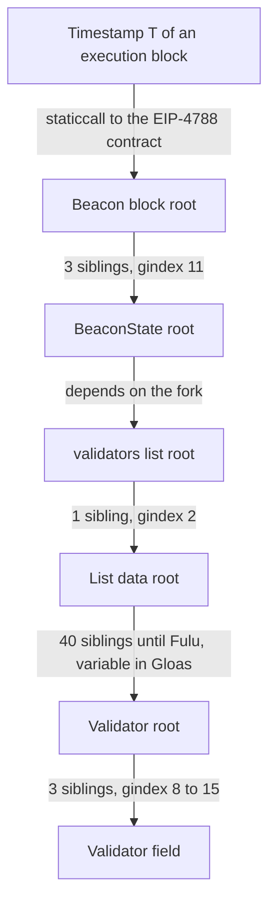
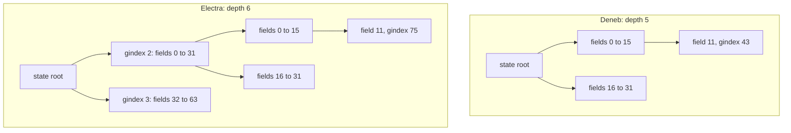
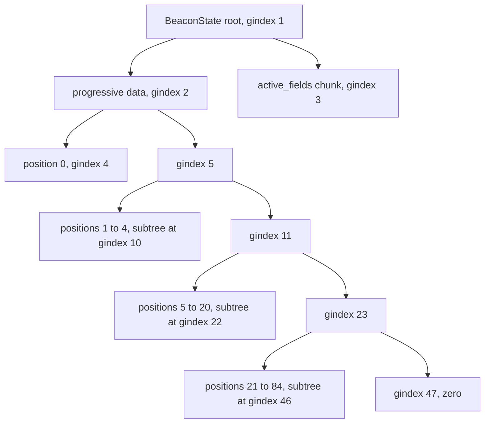
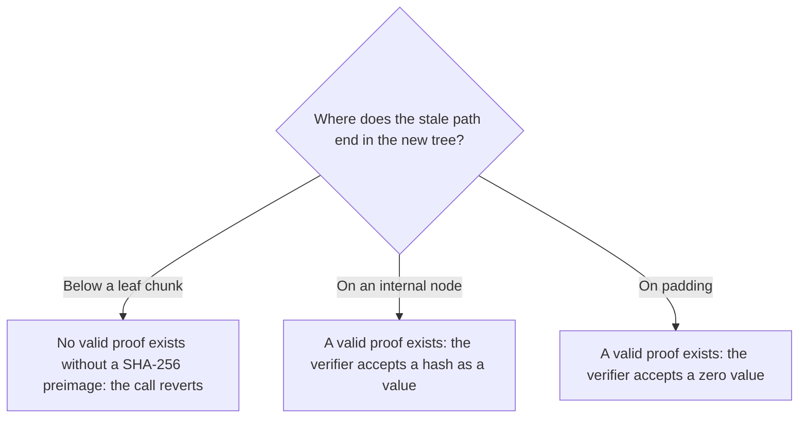
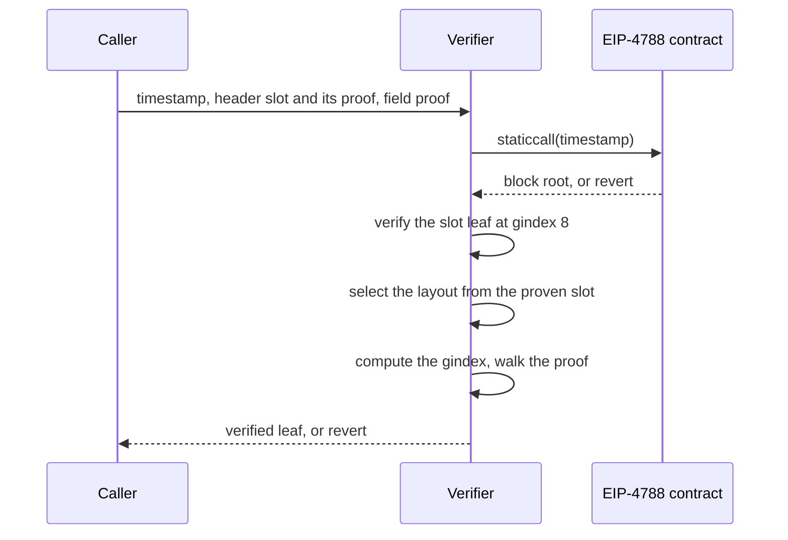
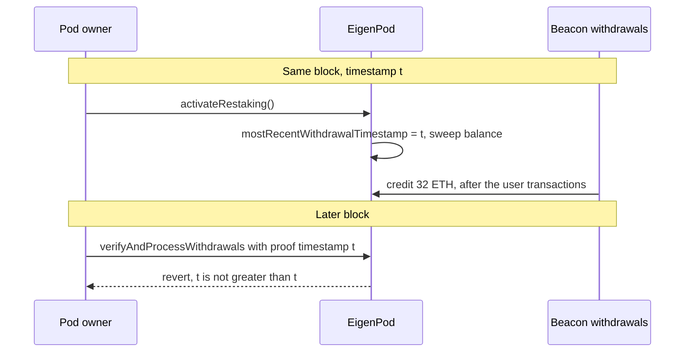

Liquid staking and restaking contracts need facts that live on the consensus layer: a validator's withdrawal credentials, its balance, whether it was slashed. Since Dencun they can check those facts without an oracle. [EIP-4788](https://eips.ethereum.org/EIPS/eip-4788) exposes each parent beacon block root to the EVM, and an SSZ Merkle branch connects that root to any field of the beacon state.

The branch has a weakness that an ordinary Merkle proof does not have. Its position in the tree is derived from the layout of a container, and a hard fork can change that layout without touching the field being proven. Electra took `BeaconState` from 28 to 37 fields, the tree went from depth 5 to depth 6, and hardcoded generalized indices stopped matching. Fulu added a field with no depth change. Gloas, which is unscheduled, moves to progressive containers, so positions change once more and the proof length starts to depend on the validator index.

This article derives the arithmetic, then checks it on a real mainnet state: the whole `BeaconState` at slot 15,580,064 was hashed locally, and a 53-sibling proof was verified against the root returned by the EIP-4788 contract. On the same state, deep stale proofs revert, but shallow ones verify and return something else.

> This article has been made with the help of [Claude Code](https://claude.com/product/claude-code) and several custom skills

[TOC]

## What you need to know first

The article assumes familiarity with Ethereum staking and Solidity, and relies on these mechanisms without developing them:

- **Execution and consensus layers.** Ethereum runs an execution layer, which handles the EVM, transactions and accounts, and a consensus layer, the beacon chain, which handles validators, attestations and finality. Until Gloas, each beacon block carries one execution payload, and the two layers are joined by the root described in the next section.
- **Merkle branch.** To prove that a leaf belongs to a binary hash tree, a prover supplies one sibling hash per level. The verifier recomputes the path to the root, and needs to know at each level whether the current node is a left or a right child.
- **System contract.** A contract at a fixed address that the protocol calls in each block with no user transaction. [Ethereum Upgrade Dencun - Overview]({{site.url_complet}}/2026/10/23/ethereum-dencun-upgrade-overview/) introduces the EIP-4788 one; this article continues from there.
- **Fork names.** Consensus forks and execution forks have separate names: Deneb pairs with Cancun (Dencun), Electra with Prague (Pectra), Fulu with Osaka (Fusaka), and Gloas with Amsterdam (Glamsterdam). Beacon state layouts follow the consensus names, and `consensus-specs` keeps one directory per consensus fork.
- **Withdrawal credentials.** A 32-byte value in each validator record. Prefix `0x01` or `0x02` means that withdrawals go to the 20-byte execution address held in the last 20 bytes.
- **Balance and effective balance.** `balances[i]` is the exact amount in gwei, kept in a separate list. `effective_balance` is a value in the `Validator` record, which moves with hysteresis. A proof has to target the one the contract means to use.
- **Withdrawal ordering.** [EIP-4895](https://eips.ethereum.org/EIPS/eip-4895) credits beacon withdrawals to execution addresses after the user transactions of the block. One of the two findings below depends on this order.

## The proof chain

A contract that verifies a validator field goes through six steps. Only some of them depend on the fork.



### The EIP-4788 ring buffer

The contract lives at `0x000F3df6D732807Ef1319fB7B8bB8522d0Beac02`. At the start of each execution block, before any transaction, the protocol calls it from `SYSTEM_ADDRESS` (`0xfffffffffffffffffffffffffffffffffffffffe`) with `header.parent_beacon_block_root`. The source in `sys-asm` (`src/beacon_root/main.eas`) keeps two ring buffers of `BUFLEN = 8191` entries:

| Storage slot | Value |
|--------------|-------|
| `T % 8191` | the timestamp `T` |
| `T % 8191 + 8191` | the root stored for `T` |

A read takes exactly 32 bytes of calldata, the timestamp in big-endian. It reverts with empty data if the size is wrong, if the timestamp is zero, or if the timestamp stored at that index differs from the input. The timestamp check is why two buffers exist: without it, a skipped slot with the same value modulo 8191 would return an old root.

A root stays readable until another block timestamp falls on the same index. With 12-second slots that is at least 8,191 slots, or 98,292 seconds, about 27.3 hours. A missed slot writes nothing, so an entry can last longer. EIP-4788 describes the window as "about a day" with current mainnet values, and picks a prime length so that the contract keeps using at most 8,191 storage slots if slot times change. A contract should therefore treat 27.3 hours as a consequence of the 12-second slot, not as a constant of the protocol.

### What the stored root means

The stored value is the hash tree root of the **parent** beacon block, not of the block that carries the payload at timestamp `T`. Three consequences follow:

- **The proven slot is older than the block.** Querying with `block.timestamp` returns a header whose slot is strictly below the current one, and several slots below after missed slots. A slot derived from the timestamp is therefore wrong, and the header's own `slot` field has to be proven if it matters.
- **It is a block root, not a state root.** One more step is needed to obtain `state_root`. EIP-4788 chose block roots so that the work per execution block stays constant when slots are skipped.
- **A block root and a header root are the same value.** `BeaconBlock` and `BeaconBlockHeader` have the same five positions, and the header stores `body_root`, the hash tree root of the `body` field, at the position of `body`.

Gloas keeps the same semantics in the current draft: `specs/gloas/builder.md` sets `envelope.parent_beacon_block_root` to `block.parent_root`.

### From the block root to a Validator field

`BeaconBlockHeader` has five fields and `Validator` has eight, and neither has changed since phase0. [EIP-7688](https://eips.ethereum.org/EIPS/eip-7688) keeps both as plain containers, so these two tables are stable:

| `BeaconBlockHeader` field | gindex |
|---------------------------|--------|
| `slot` | 8 |
| `proposer_index` | 9 |
| `parent_root` | 10 |
| `state_root` | 11 |
| `body_root` | 12 |

| `Validator` field | gindex |
|-------------------|--------|
| `pubkey` | 8 |
| `withdrawal_credentials` | 9 |
| `effective_balance` | 10 |
| `slashed` | 11 |
| `activation_eligibility_epoch` | 12 |
| `activation_epoch` | 13 |
| `exit_epoch` | 14 |
| `withdrawable_epoch` | 15 |

Everything between those two containers belongs to `BeaconState`, and this is where forks act.

## SSZ merkleization

The SSZ specification files are no longer in the analysed checkout of `consensus-specs`: there is no `ssz/` directory, and `pyproject.toml` depends on `eth-ssz-specs==0.1.0` instead. The rules below come from the "Hash Tree Roots and Merkleization" chapter of the [Upgrading Ethereum](https://eth2book.info/) book, from [EIP-7916](https://eips.ethereum.org/EIPS/eip-7916) and from [EIP-7495](https://eips.ethereum.org/EIPS/eip-7495). The book's chapter on generalized indices is an empty `TODO`, so the index arithmetic comes from [`ssz/merkle-proofs.md`](https://github.com/ethereum/consensus-specs/blob/b5c3b619887c7850a8c1d3540b471092be73ad84/ssz/merkle-proofs.md) at the older commit that EIP-7916 links to.

| Type | `hash_tree_root` |
|------|------------------|
| `uint64` | 8 bytes little-endian, right-padded with zeros to 32 bytes |
| `boolean` | `0x01` or `0x00`, then 31 zero bytes |
| `Bytes32` | the 32 bytes |
| `Bytes48` (`BLSPubkey`) | two chunks: `sha256(pubkey ‖ 16 zero bytes)` |
| `Container` | merkleize the field roots, padded with zero chunks to the next power of two |
| `Vector[T, N]` | merkleize `N` elements, or their packed chunks for a basic type |
| `List[T, N]` | `sha256(merkleize(elements up to the limit) ‖ uint256_le(length))` |
| `ProgressiveList[T]` | `sha256(merkleize_progressive(elements) ‖ uint256_le(length))` |
| `ProgressiveContainer` | `sha256(merkleize_progressive(field roots) ‖ pack_bits(active_fields))` |

Two details cause most of the mistakes:

- **The depth of a list comes from its limit, not from its length.** `validators` has a limit of $$2^{40}$$, so its data tree has depth 40 whether the registry holds one validator or two million.
- **The limit counts chunks, not elements.** Basic types are packed. `balances` holds 4 values per chunk, so its depth is 38 for the same limit, and `previous_epoch_participation`, with one byte per element, has depth 35.

The hash tree root of the mainnet state below confirmed these rules, and also how sensitive they are: the first run of the script used depth 38 for the participation lists and depth 6 for `proposer_lookahead` (64 values, so 16 chunks and depth 4), and the state root did not match until both were corrected.

## Generalized index arithmetic

A generalized index, or gindex, numbers the nodes of a tree breadth-first. The root is 1, and the children of $$g$$ are $$2g$$ and $$2g+1$$. A leaf $$i$$ of a tree of depth $$d$$ has gindex $$2^d + i$$:

$$
\begin{aligned}
\text{left}(g) &= 2g \\
\text{right}(g) &= 2g + 1 \\
\text{leaf}(i, d) &= 2^d + i \\
\text{length}(g) &= \lfloor \log_2 g \rfloor
\end{aligned}
$$

The binary form of a gindex is the path itself. After the leading `1`, each bit read from the top says left (`0`) or right (`1`), and the number of those bits is the number of siblings in the proof. The gindex encodes both the position and the depth, which is why it is a better constant than an index with a separate height.

Nested trees concatenate. Dropping the leading bit of $$b$$ and appending the rest to $$a$$ gives:

$$
\begin{aligned}
\text{concat}(a, b) &= a \cdot 2^{\lfloor \log_2 b \rfloor} + \left(b - 2^{\lfloor \log_2 b \rfloor}\right)
\end{aligned}
$$

A `List` has its data tree at gindex 2 and its length at gindex 3. A `ProgressiveContainer` has its data at 2 and its `active_fields` chunk at 3. And the consensus specification's verifier, `is_valid_merkle_branch(leaf, branch, depth, index, root)`, starts with `if depth != len(branch): return False`, where `index` is the gindex without its leading bit (`get_subtree_index` in the light client specification).

The spec's light client constants allow a check of the arithmetic. `finalized_checkpoint` is field 20 and `root` is the second field of `Checkpoint`, so the gindex is 105 for a depth-5 state, 169 for a depth-6 state and 735 for the Gloas layout. All three match `FINALIZED_ROOT_GINDEX`, `FINALIZED_ROOT_GINDEX_ELECTRA` and `FINALIZED_ROOT_GINDEX_GLOAS` in `specs/{altair,electra,gloas}/light-client/sync-protocol.md`.

## Worked example: validator 1,000,000 on mainnet

The target is the `withdrawal_credentials` of validator 1,000,000 under Fulu, the fork active at the time of writing (`current_version` `0x06000000`).

### The gindex

Starting from the beacon block root:

| Step | Operation | Result |
|------|-----------|--------|
| `state_root` in the header | gindex 11 | 11 |
| `validators` in a depth-6 state | field 11, so $$64 + 11$$ | 75 |
| Header to field | `concat(11, 75)` | 715 |
| List data | `concat(715, 2)` | 1,430 |
| Element in a depth-40 tree | `concat(1430, 2**40 + 1000000)` | 1,572,301,628,719,680 |
| Field 1 of `Validator` | `concat(…, 9)` | 12,578,413,029,757,441 |

The result has 53 bits after the leading one, so the proof has 53 siblings: $$3 + 6 + 1 + 40 + 3$$. Its binary path, split by step:

```text
1   011      001011   0      0000000000000000000011110100001001000000   001
    header   state    data   validator index, 40 bits                   field
```

### The data

The inputs were collected on 2026-11-04:

- **Header.** The finalized header at slot 15,580,064, from the PublicNode beacon API, with `state_root` `0x966c88c1…e72a`.
- **State.** The finalized `BeaconState` from the Attestant checkpoint sync endpoint: 339,268,193 bytes of SSZ, version `fulu`, 2,398,408 validators.
- **On-chain root.** The next beacon block, slot 15,580,065, carries execution block 26,340,577 with timestamp 1793784803. That is the mainnet genesis time 1606824023 plus 15,580,065 × 12.

A script written for this article parsed the 38 fields and computed `hash_tree_root` from the bytes. The result was `0x966c88c1…e72a`, equal to the header's `state_root`. Merkleizing the header gave `0xa544aac2…36b3`, and an `eth_call` to the EIP-4788 contract returned the same value:

```bash
$ cast call 0x000F3df6D732807Ef1319fB7B8bB8522d0Beac02 \
    --data $(cast abi-encode 'f(uint256)' 1793784803) --rpc-url <rpc>
0xa544aac2197593cc74205def3af75bdb35bdc6e9da212a79bea40eb5919e36b3
```

The field `parentBeaconBlockRoot` of execution block 26,340,577 has the same value. The contract reads it from index `1793784803 % 8191 = 4949`, and from storage slot 13,140 for the root. The same call with timestamp 1793784804 reverts with empty data, since no block has that timestamp.

### The walk

Validator 1,000,000 has exited: `activation_epoch` 239,886, `exit_epoch` 252,630, `withdrawable_epoch` 252,886, `effective_balance` 0, and a balance of 0. Exited validators stay in the registry, so the proof works all the same. Its credentials start with `0x01`, followed by 11 zero bytes and the withdrawal address.

Each level hashes the current node with one sibling, and the walk passes through these nodes:

| After siblings | Node | Value |
|----------------|------|-------|
| 0 | `withdrawal_credentials` | `0x0100000000000000…60936f` |
| 3 | `Validator` root | `0x1d90dc6e…5d104c` |
| 43 | list data root | `0x34af4e59…089263` |
| 44 | `validators` list root, after the length 2,398,408 | `0x40665bcf…b816c5` |
| 50 | `BeaconState` root | `0x966c88c1…ece72a` |
| 53 | beacon block root | `0xa544aac2…9e36b3` |

The first sibling is the root of `pubkey`, because `withdrawal_credentials` is a right child: the low bit of the gindex is 1. The 44th sibling is not a hash: it is the length 2,398,408 as a little-endian 32-byte value, because the mix-in of a list hashes the data root with its length.

Of the 40 siblings in the list data tree, 18 are the precomputed roots of empty subtrees (levels 22 to 39), since the registry is smaller than $$2^{22}$$. These levels exist because of the limit, and a proof costs them whatever the registry size.

The same walk for the balance of the validator uses `concat(11, 76, 2, 2**38 + 250000)`, or 393,625,162,993,808, with 48 siblings. The leaf is chunk 250,000, which holds four balances, and validator 1,000,000 is lane 0, the first 8 bytes.

Both proofs pass a Python port of `is_valid_merkle_branch` and the Solidity verifier given later in this article. The verifier costs 43,417 gas for the 53-sibling proof, and 55,659 gas for the full flow on forked mainnet, which adds the 4788 read and the slot proof. These are Foundry gas reports with solc 0.8.28 and 200 optimizer runs, without intrinsic transaction costs. A 64-byte input costs $$60 + 2 \times 12 = 84$$ gas in the SHA-256 precompile, so the precompile accounts for only $$53 \times 84 = 4452$$ of the first figure. The remainder is the memory and loop cost of a readable implementation.

## `BeaconState` fork by fork

### Size and depth

The depth of a container is $$\lceil \log_2 n \rceil$$. All the figures below come from `specs/*/beacon-chain.md` and `configs/mainnet.yaml` at the pinned `consensus-specs` commit, recomputed with the script below rather than copied.

| Fork | Epoch | First slot | Mainnet timestamp | Fields | Merkle type | State depth |
|------|-------|------------|-------------------|--------|-------------|-------------|
| Deneb | 269,568 | 8,626,176 | 1710338135 | 28 | `Container` | 5 |
| Electra | 364,032 | 11,649,024 | 1746612311 | 37 | `Container` | **6** |
| Fulu | 411,392 | 13,164,544 | 1764798551 | 38 | `Container` | 6 |
| Gloas | $$2^{64}-1$$ (unscheduled) | n/a | n/a | 46 | `ProgressiveContainer` | per field |
| Heze | $$2^{64}-1$$ (unscheduled) | n/a | n/a | 42 | `ProgressiveContainer` | per field |

Gloas and Heze are in development: every value in their columns is taken from the pinned commit and may change. EIP-7688 has status Review, and is listed as Scheduled for Inclusion in Glamsterdam by [EIP-7773](https://eips.ethereum.org/EIPS/eip-7773) at the pinned EIPs commit.

### State field gindices

Each cell gives the gindex inside `BeaconState`, then the gindex from the beacon block root.

| Field | Deneb | Electra and Fulu | Gloas (draft) |
|-------|-------|------------------|---------------|
| `slot` | 34 / 354 | 66 / 706 | 41 / 361 |
| `validators` | 43 / 363 | 75 / 715 | 358 / 2918 |
| `balances` | 44 / 364 | 76 / 716 | 359 / 2919 |
| `finalized_checkpoint` | 52 / 372 | 84 / 724 | 367 / 2927 |
| `current_sync_committee` | 54 / 374 | 86 / 726 | 2945 / 23425 |
| `latest_execution_payload_header` | 56 / 376 | 88 / 728 | removed |
| `historical_summaries` | 59 / 379 | 91 / 731 | 2950 / 23430 |
| `earliest_exit_epoch` | n/a | 95 / 735 | 2954 / 23434 |
| `pending_deposits` | n/a | 98 / 738 | 2957 / 23437 |
| `pending_partial_withdrawals` | n/a | 99 / 739 | 2958 / 23438 |
| `pending_consolidations` | n/a | 100 / 740 | 2959 / 23439 |
| `proposer_lookahead` | n/a | Fulu only: 101 / 741 | 2960 / 23440 |

`pending_deposits` and the two lists after it did not exist before Electra, and they matter to accounting: amounts sitting in those queues are absent from `balances`, or still present in it.

### Validator and balance leaves

| Leaf, from the block root | Deneb | Electra and Fulu | Gloas (draft) |
|---------------------------|-------|------------------|---------------|
| Validator field, proof length | 52 | 53 | depends on `i` |
| Balance chunk, proof length | 47 | 48 | depends on `i // 4` |
| `withdrawal_credentials` of validator 0 | 6385963534123009 | 12578413021757441 | 93377 (length 16) |
| `withdrawal_credentials` of validator 1,000,000 | 6385963542123009 | 12578413029757441 | 100278884853593 (length 46) |
| Balance chunk of validator 1,000,000 | 200111116505232 | 393625162993808 | 1567394265915 (length 40) |

### Electra: one more sibling

Electra appended nine fields: `deposit_requests_start_index` ([EIP-6110](https://eips.ethereum.org/EIPS/eip-6110)), then `deposit_balance_to_consume`, `exit_balance_to_consume`, `earliest_exit_epoch`, `consolidation_balance_to_consume`, `earliest_consolidation_epoch`, `pending_deposits`, `pending_partial_withdrawals` and `pending_consolidations` ([EIP-7251](https://eips.ethereum.org/EIPS/eip-7251)). With 37 fields, the state no longer fits in 32 leaves, so the tree gained a level.

No field moved: `validators` is still field 11. The tree simply grew on top:



In binary, 43 is `101011` and 75 is `1001011`: the same path with one more `0` after the leading bit. A Deneb-style proof therefore still works up to gindex 2, and one more sibling closes the tree. On the mainnet state above, the five lower siblings verify the `validators` root against gindex 2 (`0x8b6c017a…7fdc9d`), and hashing with gindex 3 (`0xa5a2aef7…37e90d`) gives the state root.

The change is one sibling, but a verifier with `STATE_DEPTH = 5` cannot absorb it. A length check rejects the proof, and a verifier with no length check stops one level too early.

### Fulu: a field, no depth change

Fulu appended `proposer_lookahead` ([EIP-7917](https://eips.ethereum.org/EIPS/eip-7917)). With 38 fields out of 64, no existing gindex moved, and a verifier updated for Electra kept working unchanged.

A team that checks only whether its proofs still pass after a fork will observe that Fulu was safe, and learn nothing about the next fork. The depth changed at Electra because a power of two was crossed, which is a property of a count of fields.

### Gloas: progressive containers (in development)

[Ethereum Upgrade Glamsterdam - Overview]({{site.url_complet}}/2026/10/23/ethereum-glamsterdam-upgrade-overview/) introduces EIP-7688 and the update it requires from verifiers; this section gives the numbers. EIP-7688 converts `BeaconState` to a `ProgressiveContainer`, and `validators`, `balances`, both participation lists, `inactivity_scores` and the three pending lists to `ProgressiveList`. Serialization is unchanged, and only merkleization differs. The tree is now a chain of subtrees of 1, 4, 16, 64 … leaves, each one a left child, with the continuation on the right:



`validators` keeps position 11, which falls in the 16-leaf subtree: $$22 \times 16 + 6 = 358$$. `current_sync_committee` has position 22 and lands in the next subtree, at $$46 \times 64 + 1 = 2945$$. `latest_execution_payload_header` is removed by [EIP-7732](https://eips.ethereum.org/EIPS/eip-7732), and `latest_block_hash` takes position 24. Positions are assigned once at this conversion, so the rule on appending fields applies from then on.

The goal of EIP-7688 is stability after this one break. If a fork appends a field, `active_fields` gains a trailing `1`, and if it removes a field, its bit becomes `0` and the position stays reserved. The draft Heze spec illustrates this: it removes `eth1_data`, `eth1_data_votes`, `eth1_deposit_index` and `deposit_requests_start_index` as gaps at positions 8, 9, 10 and 28, and the script confirms that every remaining field keeps its Gloas gindex.

Element `i` of a `ProgressiveList` falls in subtree $$k$$, defined by $$(4^k - 1)/3 \le i \lt (4^{k+1} - 1)/3$$. The path is $$k$$ right turns, one left turn, then $$2k$$ bits of offset, so the length inside the list data is $$3k + 1$$. A validator field adds 15 siblings around it: 3 for the header, 8 for the state position, 1 for the length and 3 for the `Validator` fields.

| Validator index | $$k$$ | In list data | Field proof from the block root |
|-----------------|-------|--------------|---------------------------------|
| 0 | 0 | 1 | 16 |
| 1 to 4 | 1 | 4 | 19 |
| 5 to 20 | 2 | 7 | 22 |
| 87,381 to 349,524 | 9 | 28 | 43 |
| 349,525 to 1,398,100 | 10 | 31 | 46 |
| 1,398,101 to 5,592,404 | 11 | 34 | 49 |

Proofs become shorter than today's 53 for the whole current registry, but a fixed-length check can no longer express the rule: the expected length is a function of the index.

To check these numbers by hashing, the 2,398,408 real `Validator` roots were merkleized as a `ProgressiveList`, placed at position 11 of a synthetic 46-field state, and wrapped in a synthetic header. Proofs for validators 0, 1,000,000 and 2,398,407 verified at lengths 16, 46 and 49. This tests the arithmetic against the EIP definitions, not against a real Gloas state, since none exists on mainnet.

Three things stay outside the stable set. `Validator` remains a plain `Container` on purpose: EIP-7688 does not anticipate a change before a post-quantum transition, which may bring a new hash function and invalidate existing proofs anyway. `historical_summaries` and `historical_roots` stay `List`. And the "Retroactive application" section of EIP-7688 states that verifiers of data predating the change still need the original merkleization.

## Why a stale proof fails, or verifies something else

A stale verifier uses constants from an older fork against a newer state. The outcome depends on where the stale path ends in the new tree. The tree is finite, so three cases exist:



The first case is a denial of service. The other two return a wrong value, and they are the reason a fork needs more than a test that proofs still pass.

### Deep paths end below a leaf

A Deneb verifier asking for a validator field uses the 52-bit path `011 01011 0 <40 bits> <3 bits>`. In the Fulu tree, gindex 43 is an internal node over fields 22 and 23. The path goes left into `current_sync_committee`, and the zeros of the index go to the first chunk of the first public key. That chunk sits at depth 20 and it is a leaf: it contains key bytes, not a hash of two children. Continuing for the 32 remaining levels would require a SHA-256 preimage of those bytes.

The stale balance path ends the same way. It enters `latest_execution_payload_header`, stops at the `parent_hash` leaf at depth 14 and needs 33 more levels.

No valid proof exists, so validator and balance proofs revert for all validators from the first post-fork root. Funds that depend on them wait for a verifier upgrade. For this path a stale verifier fails closed.

### Shallow paths land on internal nodes

A depth-5 gindex is a real node of a depth-6 tree. It is an internal node, so it has a valid branch of five siblings, and a verifier that fixes the depth at 5 accepts that branch. The leaf it receives is a hash of two fields.

The table evaluates the Deneb gindices on the mainnet Fulu state at slot 15,580,064. Each row was verified with a five-sibling branch against the real state root, with `is_valid_merkle_branch` at depth 5.

| Deneb field | Stale gindex | Node in the Fulu tree | Value accepted as the field |
|-------------|--------------|-----------------------|-----------------------------|
| `slot` | 34 | hash of `latest_block_header`, `block_roots` | `0xf6c0cf2d…`, or 5,674,632,966,883,492,086 read as a `uint64` |
| `validators` | 43 | hash of `current_sync_committee`, `next_sync_committee` | `0x3a752dcb…`, instead of `0x40665bcf…` |
| `balances` | 44 | hash of `latest_execution_payload_header`, `next_withdrawal_index` | `0x88a146c5…` |
| `finalized_checkpoint` | 52 | padding | `0xf5a5fd42…`, the hash of two zero chunks |
| `current_sync_committee` | 54 | padding | same |
| `historical_summaries` | 59 | padding | same |

A verifier that reads `state.slot` at gindex 34 would accept a value of about $$5.7 \times 10^{18}$$. Any check of the form `provenSlot >= something` passes. Values taken from internal nodes are not chosen by the prover, because they are fixed by the state. But a prover who is free to pick the moment and the path picks among many such values, and the state changes in each slot.

A contract that caches a proven `validators` list root and later verifies elements against it would hold `0x3a752dcb…`, and every later element proof would fail. The failure appears in another function, some time after the bad value was accepted.

### Padding proves zero

Fields 38 to 63 of the Fulu tree are zero chunks, and every chunk has a valid branch.

The pre-Electra `FINALIZED_ROOT_GINDEX`, 105, is a depth-6 gindex. In a depth-5 state it pointed to `finalized_checkpoint.root`. In a depth-6 state it is leaf 41, which is padding. On the mainnet state, a six-sibling branch at 105 verifies with leaf `0x00…00`, while the real finalized checkpoint root is elsewhere in the tree. A light client that kept 105 would verify a finalized root of zero.

The spec prevents this by defining `FINALIZED_ROOT_GINDEX_ELECTRA` and by selecting the constant per fork (`finalized_root_gindex_at_slot`).

Progressive containers do not remove this case. An inactive position contains `Bytes32()`, so after Heze a Gloas-era proof of `eth1_deposit_index` at position 10 would verify and return zero, with no change of gindex (*derived from EIP-7495 and the draft Heze spec*). Stable gindices mean that the proof keeps working, including after the field has lost its meaning.

### A depth taken from the caller

Some verifiers take the index from a constant and the depth from `proof.length`. Such a verifier looks fork-resilient: index 11 with six siblings verifies `validators` on Fulu, since the leading zero bit needs no storage. It also accepts fewer siblings, which turns any internal node on the path into a valid leaf. And a library loop that consumes one index bit per sibling ignores the bits left over at the end, so it does not bind the index to the depth either.

The limit of this behaviour is zero siblings, where `leaf == root` verifies. That is the first finding below.

### A Fulu verifier on a Gloas tree

The same analysis on the draft Gloas layout gives a different mix, because gindices 4 and 3 become leaves. The results below follow from the positions at the pinned commit, not from a real Gloas state:

| Fulu field | Fulu gindex | Node in the Gloas tree | Fixed-depth outcome |
|------------|-------------|------------------------|---------------------|
| `slot` | 66 | below the `genesis_time` leaf | reverts |
| `validators` | 75 | below the `genesis_time` leaf | reverts |
| `balances` | 76 | below the `genesis_time` leaf | reverts |
| `finalized_checkpoint` | 84 | left node of `fork` | verifies a hash |
| `current_sync_committee` | 86 | left node of `latest_block_header` | verifies a hash |
| `latest_execution_payload_header` | 88 | node over positions 5 to 8 | verifies a hash |
| `historical_summaries` | 91 | node over positions 17 to 20 | verifies a hash |
| `pending_deposits` | 98 | below the `active_fields` leaf | reverts |
| `proposer_lookahead` | 101 | below the `active_fields` leaf | reverts |

The main validator and balance paths revert, which is the safe outcome. Other paths do not: the Electra finalized root gindex 169 lands on `fork.current_version` in a Gloas tree, so it verifies a version number as a block root. The list of paths that verify is different from Electra's, so the audit has to be repeated for each new layout.

## Designing a verifier for forks

The workflow below applies to any contract in this family. The code in this section is a reference for discussion and it has not undergone an audit.



### Select the layout from the proven header slot

The fork of a proof is the fork of the state it proves, not the fork at the time of the call. On mainnet, the first Electra block is at slot 11,649,024, with execution block 22,431,084 and timestamp 1746612311, which is the Electra fork timestamp. Its `parentBeaconBlockRoot` is `0x947d2274…552967`, the root of slot 11,649,023, a Deneb block.

A verifier that compares `block.timestamp >= ELECTRA_TIMESTAMP` selects the Electra layout for a Deneb state on that block. The two choices that avoid the error:

- **Prove `header.slot`** at gindex 8, against the same root, and compare it to the fork's first slot with `<`. The header layout does not depend on the fork, so this step needs no selection of its own.
- **Use the timestamp passed to 4788 with a margin of one block.** This is weaker, because missed slots make the distance larger than one slot.

The proven state is at the fork's layout when `header.slot >= forkSlot`, since `upgrade_to_electra` runs at the epoch transition, before the block at that slot is processed. A proof of slot 11,649,024 uses gindex 715, and a proof of slot 11,649,023 uses 363.

### Derive the length from the gindex

The verifier below walks the bits of the gindex. The caller has no input on the depth, and any wrong length reverts, including an empty proof. There is no separate height constant that can drift away from the index.

```solidity
library BeaconProof {
    address internal constant BEACON_ROOTS = 0x000F3df6D732807Ef1319fB7B8bB8522d0Beac02;

    uint64 internal constant ELECTRA_SLOT = 11_649_024; // 364032 * 32

    uint256 internal constant SLOT_GINDEX = 8; // BeaconBlockHeader.slot
    uint256 internal constant VALIDATORS_DENEB = 363; // concat(11, 43)
    uint256 internal constant VALIDATORS_ELECTRA = 715; // concat(11, 75), Fulu included

    error NoRoot();
    error BadProofLength();
    error BadProof();
    error IndexTooLarge();

    /// Reverts when 4788 has no root for `timestamp`.
    function blockRoot(uint256 timestamp) internal view returns (bytes32 root) {
        (bool ok, bytes memory ret) = BEACON_ROOTS.staticcall(abi.encode(timestamp));
        if (!ok || ret.length != 32) revert NoRoot();
        root = abi.decode(ret, (bytes32));
        if (root == bytes32(0)) revert NoRoot();
    }

    /// The gindex fixes the number of steps. The caller cannot choose the depth.
    function verify(bytes32 root, bytes32 leaf, bytes32[] calldata proof, uint256 gindex) internal view {
        if (gindex < 2) revert BadProofLength();
        bytes32 node = leaf;
        uint256 i;
        for (uint256 g = gindex; g > 1; g >>= 1) {
            if (i == proof.length) revert BadProofLength();
            bytes32 sibling = proof[i++];
            node = g & 1 == 1 ? sha256(abi.encodePacked(sibling, node)) : sha256(abi.encodePacked(node, sibling));
        }
        if (i != proof.length) revert BadProofLength();
        if (node != root) revert BadProof();
    }

    /// concat(validators, 2, 2**40 + index, 8 + field), for a header proven at `headerSlot`.
    function validatorFieldGindex(uint64 headerSlot, uint256 index, uint256 field) internal pure returns (uint256) {
        if (index >= 1 << 40 || field >= 8) revert IndexTooLarge();
        uint256 base = headerSlot < ELECTRA_SLOT ? VALIDATORS_DENEB : VALIDATORS_ELECTRA;
        return (((base << 41) | index) << 3) | field;
    }
}
```

In `validatorFieldGindex`, `base << 41` appends the `0` of the data subtree and 40 zero bits, `| index` fills them, and `<< 3 | field` appends the path in `Validator`. The bound on `index` is needed because `index >= 2**40` would overflow into the data bit and move the proof to the length node.

This code passed tests in Foundry with the real proof of the worked example and the Deneb and Electra gindices of the tables. It rejected a 52-sibling truncation and an empty proof with `leaf == root`.

Gloas needs one more function, which computes the path from `i`. It is the same arithmetic as the tables above, and it was tested against the synthetic Gloas proof:

```solidity
/// EIP-7916 position of chunk `i` in a progressive tree, root = 1.
function progressiveGindex(uint256 i) internal pure returns (uint256) {
    uint256 g = 1;
    uint256 start;
    uint256 size = 1;
    while (i >= start + size) {
        g = 2 * g + 1;
        start += size;
        size <<= 2;
    }
    return 2 * g * size + (i - start);
}
```

### Plan the unknown fork

A slot switch only knows forks that have a date. Two designs handle the fork after the last known one:

- **An upper bound.** The verifier stores `validUntilSlot` and reverts for any header at or beyond it. Governance moves the bound after checking the next layout. The failure is closed, and it stops all proofs if governance is late.
- **A version sentinel.** The verifier also proves `state.fork.current_version`, at `concat(11, 67, 5)` = 2,829 on Fulu, with 11 siblings. This was verified on the mainnet state, with leaf `0x06000000` followed by zeros. Any new fork changes the value, so the proof fails from the first post-fork state without any schedule. The cost is that the verifier stops at every fork, including those like Fulu that changed nothing it reads (*derived*).

Under Gloas, a similar check becomes possible at lower cost. The sibling at gindex 3 of the state is the `active_fields` chunk, `0xffffffffff3f00…` for 46 active fields and `0xfff8ffefff3f00…` for the draft Heze gaps. A verifier that pins this sibling detects that a position was deactivated (*derived*).

Who may change a layout is itself a trust assumption. A verifier upgradable by an owner can be fixed before a fork, and that owner can also point `VALIDATORS` at any node. A timelock shorter than the time to react gives little protection, and a timelock that ends after the fork leaves the protocol stopped until then. State this in the protocol's risk documentation, with the number of signers and the delay.

### Check each layer of the system

Layout is one source of breakage among others, and an auditor reviewing a verifier checks them together:

- **Keep older layouts while they can arrive.** A root stays readable for at least 27.3 hours, so a proof of a pre-fork header can be submitted well after the fork. The verifier needs both layouts in that interval, and permanently if it accepts historical proofs.
- **Test the boundary with real data.** Keep real proofs per fork, including the last slot before the fork and the first after it. Generate the gindices from the spec in CI instead of copying them.
- **Decode by type.** A `uint64` leaf is little-endian. A balance leaf holds four lanes, selected by `i % 4`. A `pubkey` leaf is `sha256(pubkey ‖ bytes16(0))`.
- **Re-read the semantics at each fork.** Electra added `0x02` credentials, a cap of 2,048 ETH on effective balance, and queues that move value out of `balances`. A proof can be valid and the accounting built on it can be wrong.

## Two real findings

Neither finding below was caused by a fork. They are in this article because each one breaks a rule that forks put under pressure: the length of a proof, and the comparison at a boundary. Both are from EigenLayer audits, and identifiers `20056` and `40684` are those of the AuditVault index used by the local corpus.

### Code4rena 2023-04, H-01: an empty proof verifies

The [EigenLayer contest report](https://code4rena.com/reports/2023-04-eigenlayer), published on 2023-07-06, lists as its first high-severity finding "Slot and block number proofs not required for verification of withdrawal (multiple withdrawals possible)", submitted by 0xTheC0der and also found by windowhan001 and volodya.

The report starts from the Merkle library, whose verifiers "will always return true if proof.length < 32 (e.g. empty proof) and leaf == root". The caller, `verifyWithdrawalProofs`, checked the length of several proofs, but not of `slotProof` or `blockNumberProof`. The warden's change to a valid proof is short:

```solidity
proofs.slotProof = bytes("");                     // empty slot proof
proofs.slotRoot = proofs.blockHeaderRoot;         // make leaf == root
proofs.blockNumberProof = bytes("");              // empty block number proof
proofs.blockNumberRoot = proofs.executionPayloadRoot; // make leaf == root
```

The verification passes, and the rest of the contract interprets a hash as a number. The block number guard `proofIsForValidBlockNumber` reads `blockNumberRoot`, so it can be bypassed "depending on the actual value of `executionPayloadRoot`". The replay guard in `_processPartialWithdrawal` is keyed by slot, and "`slotRoot = blockHeaderRoot` leads to a different slot than suggested by the original proof". The same partial withdrawal can then be processed twice. The judge's comment gives the severity reasoning: "The Warden has shown how, due to a lack of length check, an empty proof could be provided; which would pass validation."

This is the shallow-path case with zero levels. On the header of the worked example, the empty proof decodes a "slot" of 14,741,254,758,814,336,165, the first 8 bytes of the root.

The report recommends to "Require a minimum length (tree height)", and adds "At least require non-empty proofs" with a diff that uses `length >= 32`. Only the first form closes the class.

On the same header, a one-sibling proof with index 0 and leaf gindex 2 verifies, and decodes a slot of 11,533,380,310,597,772,962. A two-sibling proof also verifies. Only three siblings return the true value 15,580,064 (*derived*). The length has to be equal to the depth, which is what a gindex-driven walk enforces. What EigenLayer shipped is not covered by the sources of this article, as the Gaps section records.

An exact length is a constant, and at Electra that constant changed for every path through `BeaconState`. Removing the check to survive a fork reopens this finding.

### Cantina, March 2024: `>` instead of `>=`

The [Cantina competition report](https://cdn.cantina.xyz/reports/cantina_competition_eigenlayer_mar2024.pdf) covers a competition held from February 27 to March 18, and is dated April 5, 2024. Its only high-severity finding, numbered 3.1.1 in the report and `40684` in AuditVault, is "Beacon chain withdrawals that occur at lastwithdrawaltimestamp will be lost", submitted by hash.

The guard is a strict comparison on the proof timestamp:

```solidity
modifier proofIsForValidTimestamp(uint64 timestamp) {
    require(
        timestamp > mostRecentWithdrawalTimestamp,
        "EigenPod.proofIsForValidTimestamp: beacon chain proof must be for timestamp after mostRecentWithdrawalTimestamp"
    );
    _;
}
```

`activateRestaking` calls `_processWithdrawalBeforeRestaking`, which sets `mostRecentWithdrawalTimestamp = uint32(block.timestamp)` and sends out `address(this).balance`. The report explains why this loses funds: "the withdrawals from the beacon chain are executed after all the user transactions according to EIP-4895". A withdrawal in the same block is credited after the sweep, and its proof carries a timestamp equal to the stored one, which the strict comparison rejects. The report's proof of concept uses 32 ETH, its stated impact is that "Beacon chain withdrawals will be lost in case any user activates restaking in the block which also contains one of their withdrawal", and its recommendation is to "Use >= mostRecentWithdrawalTimestamp instead."



The proof in this finding is valid at every level, and the error lies in the ordering of events inside one block. The lesson carries over to the fork selection above: each comparison between a proven time and a stored time has a boundary case, and that case depends on when in the block each value is written. Withdrawals come after transactions, a 4788 root comes before them, and a header's slot is below the block's.

## Conclusion

Beacon proofs tie a contract to a container layout that the protocol changes for its own reasons. The verified facts from this article:

- **The chain.** A 4788 root is the parent block root. Three siblings lead to `state_root`, then a fork-dependent path leads to the list, the element and the field: 53 siblings on Fulu, verified against a mainnet root at slot 15,580,064.
- **The break.** Electra crossed 32 fields, so state gindices went from $$32 + i$$ to $$64 + i$$ and every proof through the state gained one sibling. Fulu added a field and moved nothing.
- **Gloas, in development.** Progressive containers move every state and list gindex once, make proof length a function of the validator index, and then keep positions stable across forks. Values at the pinned commit may change.
- **Stale proofs.** Deep validator and balance paths end below a leaf and revert. Shallow paths verify and return an internal hash or zero, as shown on the real state.
- **Design.** Select the layout from the proven `header.slot`, derive the length from the gindex, keep old layouts while their roots are readable, and decide in advance how the verifier behaves at an unknown fork.
- **Findings.** The Code4rena finding shows why the length has to be exact, and the Cantina finding shows how a one-character comparison at a boundary loses a withdrawal.


## Annex

### Key Terms

| Term | Definition |
|------|------------|
| **Beacon chain** | The consensus layer of Ethereum, which holds validators and produces the blocks that carry execution payloads. |
| **Hard fork** | A coordinated change of protocol rules at a fixed epoch or timestamp, which can change consensus data structures. |
| **Slot and epoch** | A slot is a 12-second interval on mainnet, and an epoch is 32 slots. Forks activate at an epoch boundary. |
| **Chunk** | A 32-byte unit of SSZ merkleization. Values are packed or split into chunks before hashing. |
| **SSZ** | Simple Serialize, the encoding and merkleization scheme of consensus data structures. |
| **Hash tree root** | The Merkle root of an SSZ value, computed with SHA-256 from its type and its content. |
| **Container** | An SSZ structure with named fields, merkleized as a binary tree padded to a power of two. |
| **Length mix-in** | The final hash of a list root with its length, which places the length at gindex 3 of the list. |
| **Generalized index (gindex)** | A number for a node of a Merkle tree: root 1, children `2g` and `2g + 1`. Its bits give the path and its bit length gives the depth. |
| **Merkle branch** | The sibling hashes on the path from a leaf to the root, ordered from the leaf upwards. |
| **Parent beacon block root** | The value stored by EIP-4788 for a timestamp: the root of the beacon block preceding the one that carries that execution block. |
| **Ring buffer** | The 8,191-entry storage of the EIP-4788 contract, indexed by `timestamp % 8191`. |
| **`BeaconState`** | The consensus state container: 28 fields at Deneb, 37 at Electra, 38 at Fulu. |
| **Validator registry** | The `state.validators` list, which keeps exited validators. |
| **Progressive Merkle tree** | The EIP-7916 tree: a chain of subtrees of 1, 4, 16, 64 … leaves, with no fixed capacity. |
| **`ProgressiveContainer`** | The EIP-7495 container whose `active_fields` bits assign each field a stable position. |
| **`active_fields`** | The bit configuration of a progressive container, mixed into its root at gindex 3. |
| **Stale proof** | A proof built or checked with constants from an older fork against a newer state. |
| **Version sentinel** | A check of `state.fork.current_version` that makes a verifier revert at the first block of any new fork. |

### Security Implementation Checklist

These properties apply to any contract that verifies beacon data, in the wording of a review. The failure modes are those shown in the body.

#### Root source

| Check | Security requirement | Failure mode if violated |
|:---:|------------|------------|
| ☐ | The root is read from the EIP-4788 contract or from a documented trusted relay, never from calldata alone. | A prover supplies a root of their own and any proof verifies. |
| ☐ | `success` and `returndata.length == 32` are checked, and a zero root is rejected. | A failed read falls through with a zero root. On a chain with no code at the address, the call succeeds with empty data. |
| ☐ | The timestamp is bound to the proof, and a minimum and maximum age are enforced. | A prover selects an older root, such as a balance from before a slashing. |
| ☐ | A revert for a root outside the buffer leaves no partial state. | A keeper flow is stuck after 27.3 hours. |

#### Proof structure

| Check | Security requirement | Failure mode if violated |
|:---:|------------|------------|
| ☐ | The proof length equals `floor(log2(gindex))` exactly, and is never taken from the caller. | An empty or short proof presents an internal node as a leaf (Code4rena 2023-04 H-01). |
| ☐ | Hashes are SHA-256, ordered by position bit. | Keccak or sorted-pair libraries cannot match SSZ trees. |
| ☐ | `validatorIndex < 2**40` is enforced for `List` layouts before the gindex is composed. | The index overflows into the data bit and the proof moves to another node. |
| ☐ | Unused index bits cannot remain after the loop. | One index maps to several nodes. |
| ☐ | The SHA-256 precompile call is checked in assembly verifiers. | A failed call leaves a stale buffer that is treated as a hash. |

#### Fork handling

| Check | Security requirement | Failure mode if violated |
|:---:|------------|------------|
| ☐ | The layout is selected from the proven `header.slot`, with `slot < forkSlot` for the older layout. | The first post-fork block selects the new layout for a pre-fork state. |
| ☐ | Constants are generated from the spec for each fork, including `Balances` and pending lists. | One stale constant turns into a revert or a wrong value. |
| ☐ | Older layouts stay available for as long as their roots can be submitted. | Valid pre-fork proofs are rejected after the fork. |
| ☐ | Behaviour at an unknown fork is defined and tested: an upper bound, a sentinel or a pause. | Shallow stale paths verify and return hashes or zero. |
| ☐ | Layout changes go through a documented timelock, with its signers and delay stated. | The owner can repoint a gindex at any node. |
| ☐ | For Gloas, the proof length is computed from the index, not fixed. | All proofs of indices outside one range are rejected. |

#### Values and accounting

| Check | Security requirement | Failure mode if violated |
|:---:|------------|------------|
| ☐ | `uint64` leaves are decoded as little-endian, and the balance lane comes from `i % 4`. | A wrong value or another validator's balance is used. |
| ☐ | `pubkey` is hashed as `sha256(pubkey ‖ bytes16(0))` and bound to the index. | A proof for another validator is accepted. |
| ☐ | Credentials check the accepted prefixes, 11 zero bytes and the expected address. | `0x02` validators are rejected, or foreign credentials are accepted. |
| ☐ | Gwei is converted once, and the choice between `balance` and `effective_balance` is deliberate. | Rewards or losses are mispriced. |
| ☐ | Electra queues (`pending_deposits`, `pending_partial_withdrawals`, `pending_consolidations`) are part of the accounting model. | Amounts are double counted or omitted. |

#### Ordering and replay

| Check | Security requirement | Failure mode if violated |
|:---:|------------|------------|
| ☐ | Timestamp comparisons account for EIP-4895: withdrawals are credited after the transactions of the block. | A withdrawal in the same block is lost (Cantina March 2024, 3.1.1). |
| ☐ | Replay keys are built from proven values, whose proofs have exact lengths. | A forged key bypasses the replay guard. |
| ☐ | All proofs in one checkpoint use one root. | Mixed snapshots double count or hide a slashed validator. |

## Frequently Asked Questions

**Q: What does the EIP-4788 contract return, and why is one more proof step always needed?**

It returns the hash tree root of the parent beacon block of the execution block with that timestamp. This is a block root, equal to the root of the `BeaconBlockHeader`. Validator data is in the state, so the first proof step goes from the block root to `state_root`, at gindex 11 with three siblings.

**Q: Why did Electra change every state proof while adding fields only at the end of the container?**

A container's tree has a depth of $$\lceil \log_2 n \rceil$$. With 28 fields the tree has 32 leaves, and with 37 it needs 64. Field 11 keeps its index, but its gindex goes from $$32 + 11 = 43$$ to $$64 + 11 = 75$$, and every path through the state gains one sibling.

**Q: Why does a stale proof of a validator field revert, while a stale proof of `state.slot` verifies?**

The difference is whether the stale path stays inside the new tree:

- The `slot` gindex 34 has depth 5, and a depth-6 tree has a node there: the hash of `latest_block_header` and `block_roots`. A valid five-sibling branch exists for it.
- A stale validator path needs 52 levels. It enters a sync committee, ends on a public key chunk at depth 20, and continuing requires a SHA-256 preimage.

**Q: A verifier selects the layout by comparing `block.timestamp` with the Electra timestamp. What goes wrong on the first Electra block?**

The root stored for that block is the parent block's root. On mainnet, execution block 22,431,084 at timestamp 1746612311 stores the root of slot 11,649,023, a Deneb block. The verifier selects gindex 715 for a state that needs 363. The fix is to prove `header.slot` at gindex 8 and compare it with the fork slot 11,649,024.

**Q: Does a `require(proof.length >= 32)` fix the Code4rena H-01 finding?**

It stops only the empty proof. On a header, one-sibling and two-sibling proofs with index 0 also verify, by presenting an internal node as the slot leaf. Only the exact depth of three returns the slot, so the check has to be `proof.length == 32 * depth`, or a walk driven by the gindex.

**Q: After Gloas, will a verifier need no further updates?**

Not in all cases. Field positions and element positions become stable, so an appended field no longer moves a gindex. Three cases remain:

- The conversion itself is one break, and the verifier has to compute the length from the index.
- A removed field keeps its position and returns zero, so a proof can verify after the field has lost its meaning.
- Verifiers of data from before the change keep the old merkleization, and `Validator` and the history lists have their own rules.

**Q: How can a team detect an unknown fork on-chain without a schedule?**

Prove `state.fork.current_version` with the same root. On Fulu it is at gindex 2,829, with 11 siblings. Any new fork changes the value, or moves the path, so the proof fails. The price is a stop at every fork, including forks that do not touch the fields the contract reads, so the team needs an update process that runs before each fork.

## Gaps

The points below are open, and should be checked before relying on the corresponding part of the article.

| Gap | Why it matters | What to read or verify |
|-----|----------------|------------------------|
| EigenLayer's current constants and how it handled Electra are not stated, because no `BeaconChainProofs.sol` was available locally and the article does not cite them from memory. | The article cannot say whether EigenLayer was affected at Electra or how its verifier selects a fork. | `Layr-Labs/eigenlayer-contracts`, `BeaconChainProofs.sol`, at the release active at Electra and at the current one. |
| What EigenLayer shipped for H-01 and for the Cantina finding was not read. A local PoC note names release `v0.2.3-mainnet-m2` for the `>=` fix, unverified. | The article quotes the recommendations, not the fixes, and its remark on `>= 32` applies to that recommendation only. | `Layr-Labs/eigenlayer-contracts`, `verifyWithdrawalProofs` and `proofIsForValidTimestamp` after each fix. |
| Gloas and Heze are in development, with fork epochs at `2**64-1`, and EIP-7688, EIP-7495 and EIP-7916 have status Review. | Every Gloas or Heze gindex, the field list and the `active_fields` values may change. | `specs/gloas/beacon-chain.md`, `specs/heze/beacon-chain.md`, and `FINALIZED_ROOT_GINDEX_GLOAS` as a quick check. |
| The SSZ spec files are absent from the analysed `consensus-specs` checkout, and the book's gindex chapter is an empty `TODO`. | Gindex rules were taken from `ssz/merkle-proofs.md` at an older commit. Light client constants and the mainnet state root support them, but no current normative text was read. | The `eth-ssz-specs` 0.1.0 package and its documentation; only its `gindex.py` was read here. |
| The book describes the Capella version of the spec, v1.3.0. | Its merkleization chapter predates Deneb. The rules used here were confirmed against a Fulu state. | The Preface and "Version information" sections of the book. |
| No deployed verifier was surveyed, so the article does not know of any contract that accepted a stale proof on mainnet. | The accepted-value outcomes are shown on real data, but their impact on any specific protocol is not. | Verifiers that read state-level fields with fixed-depth constants. |
| The two PoCs in the local corpus are synthetic reductions, and they were not re-run for this article. | The quotations come from the reports. The `output.txt` of 40684 records a pass, and 20056 has no recorded output. | `evm-hack-registry` folders `20056-…` and `40684-…`. |
| The Gloas proofs use real `Validator` roots inside a synthetic state and header. The "reverts" and "verifies" outcomes for a Gloas tree are deduced from positions. | They test the arithmetic, not a real Gloas state, and ePBS semantics of `state_root` were not studied. | Re-run on a Gloas devnet state, with `specs/gloas/beacon-chain.md` and EIP-7732. |
| The mainnet data is one finalized state and one header from public endpoints, on 2026-11-04. | The state is not archived with the article, and the 4788 root leaves the buffer after about 27.3 hours. | Re-run on any recent finalized state, using a block in the buffer. |
| Gas figures come from a readable reference implementation, in a Foundry gas report. | An assembly verifier costs less, and calldata costs are excluded. | Re-measure on the implementation under review. |

## References

- [Claude Code](https://claude.com/product/claude-code)

### Analyzed source

- [ethereum/consensus-specs](https://github.com/ethereum/consensus-specs): analyzed at commit [`065bcd5c6ad96186cd2c0ac1c435f620a0b25373`](https://github.com/ethereum/consensus-specs/tree/065bcd5c6ad96186cd2c0ac1c435f620a0b25373), 2026-11-04
- [ethereum/sys-asm](https://github.com/ethereum/sys-asm): analyzed at commit [`f808a29f280f0b844d83fec592d3e1c592d1c92a`](https://github.com/ethereum/sys-asm/tree/f808a29f280f0b844d83fec592d3e1c592d1c92a), 2026-11-04
- [ethereum/EIPs](https://github.com/ethereum/EIPs): analyzed at commit [`41a838decba33325d01bd99b1cd6072c51214fac`](https://github.com/ethereum/EIPs/tree/41a838decba33325d01bd99b1cd6072c51214fac), 2026-11-04
- [benjaminion/upgrading-ethereum-book](https://github.com/benjaminion/upgrading-ethereum-book): analyzed at commit [`e013f03c85a050f4fec6a3fa352672ddbdb197ce`](https://github.com/benjaminion/upgrading-ethereum-book/tree/e013f03c85a050f4fec6a3fa352672ddbdb197ce), 2026-11-04
- [ethereum/execution-specs](https://github.com/ethereum/execution-specs): analyzed at commit [`aaae5abd382b6c0612add96bd8400d6fa4eb0617`](https://github.com/ethereum/execution-specs/tree/aaae5abd382b6c0612add96bd8400d6fa4eb0617), 2026-11-04
- [sanbir/evm-hack-registry](https://github.com/sanbir/evm-hack-registry): analyzed at commit [`52d0b80becc6a02b4a0a4abba4c5b3f748dab217`](https://github.com/sanbir/evm-hack-registry/tree/52d0b80becc6a02b4a0a4abba4c5b3f748dab217), 2026-11-04

### Specifications

- [EIP-4788: Beacon block root in the EVM](https://eips.ethereum.org/EIPS/eip-4788)
- [EIP-4895: Beacon chain push withdrawals as operations](https://eips.ethereum.org/EIPS/eip-4895)
- [EIP-6110: Supply validator deposits on chain](https://eips.ethereum.org/EIPS/eip-6110)
- [EIP-7251: Increase the MAX_EFFECTIVE_BALANCE](https://eips.ethereum.org/EIPS/eip-7251)
- [EIP-7495: SSZ ProgressiveContainer](https://eips.ethereum.org/EIPS/eip-7495)
- [EIP-7688: Forward compatible consensus data structures](https://eips.ethereum.org/EIPS/eip-7688)
- [EIP-7732: Enshrined Proposer-Builder Separation](https://eips.ethereum.org/EIPS/eip-7732)
- [EIP-7773: Hardfork Meta - Glamsterdam](https://eips.ethereum.org/EIPS/eip-7773)
- [EIP-7916: SSZ ProgressiveList](https://eips.ethereum.org/EIPS/eip-7916)
- [EIP-7917: Deterministic proposer lookahead](https://eips.ethereum.org/EIPS/eip-7917)
- [`ssz/merkle-proofs.md`](https://github.com/ethereum/consensus-specs/blob/b5c3b619887c7850a8c1d3540b471092be73ad84/ssz/merkle-proofs.md), at the commit linked by EIP-7916
- [`eth-ssz-specs` 0.1.0](https://pypi.org/project/eth-ssz-specs/), the package that `consensus-specs` now depends on
- [Upgrading Ethereum](https://eth2book.info/), Ben Edgington

### Findings

- [EigenLayer Contest, Findings & Analysis Report](https://code4rena.com/reports/2023-04-eigenlayer), Code4rena, 2023-07-06
- [Eigenlayer contracts Competition](https://cdn.cantina.xyz/reports/cantina_competition_eigenlayer_mar2024.pdf), Cantina, April 5, 2024
- [AuditVault finding 40684](https://github.com/Auditware/AuditVault/blob/main/findings/40684-beacon-chain-withdrawals-that-occur-at-lastwithdrawaltimesta.md)

### Related articles

- [Ethereum Upgrade Dencun - Overview]({{site.url_complet}}/2026/10/23/ethereum-dencun-upgrade-overview/)
- [Ethereum Upgrade Pectra - Overview]({{site.url_complet}}/2025/05/02/ethereum-pectra-upgrade/)
- [Ethereum Upgrade Fusaka - Overview]({{site.url_complet}}/2026/10/23/ethereum-fusaka-upgrade-overview/)
- [Ethereum Upgrade Glamsterdam - Overview]({{site.url_complet}}/2026/10/23/ethereum-glamsterdam-upgrade-overview/)
- [Ethereum Staking - How It Works]({{site.url_complet}}/2024/03/28/ethereum-staking/)
- [Ethereum's Hidden Contracts: The System Contracts Behind Every Block]({{site.url_complet}}/2026/11/04/ethereum-system-contracts/)
- [How Ethereum Finalises Blocks: LMD GHOST and Casper FFG]({{site.url_complet}}/2026/11/04/ethereum-finality-lmd-ghost-casper-ffg/)
- [SSZ vs RLP: How Ethereum Serialises Data on Each Layer]({{site.url_complet}}/2026/11/04/ssz-vs-rlp-ethereum-serialization/)
