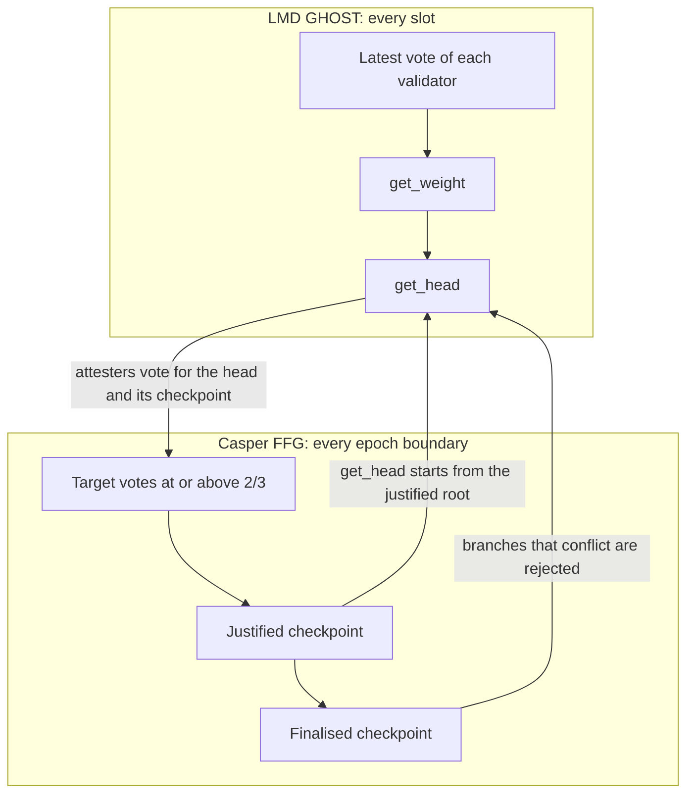
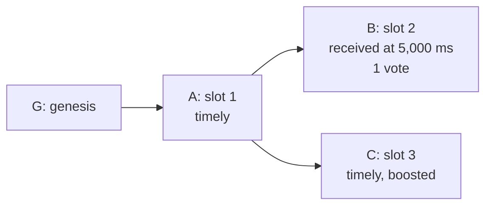

Ethereum answers two different questions about its chain. Which block should a validator build on and vote for right now? Which blocks can no longer be reverted unless a third of the stake pays for it? LMD GHOST answers the first in every slot, and [Casper FFG](https://arxiv.org/abs/1710.09437) answers the second about every 6.4 minutes.

The combination is called [Gasper](https://arxiv.org/abs/2003.03052), and most of its subtle rules sit where the two meet. The fork choice starts from the latest justified checkpoint, a filter removes branches that would force honest validators to get slashed, and justification reached inside an epoch is tracked before the state transition has recorded it. This article reads those rules from the current [consensus specifications](https://github.com/ethereum/consensus-specs), at a pinned commit and in the newest fork that redefines each function. A simulation that executes the spec's own functions produces every number in the worked example.

The reference book on the subject, Ben Edgington's [Upgrading Ethereum](https://eth2book.info/), describes Capella, and the specification has moved on since. Where a function was renamed or rewritten, this article says so.

> This article has been made with the help of [Claude Code](https://claude.com/product/claude-code) and several custom skills

[TOC]

## What you need to know first

The article assumes you know Ethereum and proof of stake in general. It relies on these mechanisms without developing them:

- **Effective balance.** A validator's stake as the protocol counts it: a rounded value updated with hysteresis, capped at 32 ETH for ordinary validators and 2,048 ETH for compounding ones since [EIP-7251](https://eips.ethereum.org/EIPS/eip-7251). Every vote weight below is an effective balance.
- **Beacon state and fork-choice store.** The `BeaconState` is the consensus object that every node computes identically for a given block. The `Store` is a node's private view: all the blocks and votes it has received. Each holds a justified and a finalised checkpoint, and the two can differ.
- **Fork layering in the specs.** Each fork's document states only what it changes and inherits the rest. Finding a function's current behaviour means finding the newest fork that redefines it. Mainnet runs Fulu at the pinned commit, while Gloas and Heze have no mainnet epoch.
- **Aggregate signatures.** BLS signatures over the same message can be combined into one, which is why a committee's votes fit in a block. This article does not model them.
- **Safety and liveness.** Safety means two honest nodes never decide conflicting histories. Liveness means the chain keeps deciding. During a network partition a protocol has to give up one of them (the CAP theorem), which is the reason for the design in the next section.
- **Slashing.** The removal of part of a validator's stake and its forced exit, on proof that it signed two contradictory messages. The [staking article]({{site.url_complet}}/2024/03/28/ethereum-staking/) covers keys and duties.

## Why a chain needs two layers

A fork-choice rule always returns a block. Give it any tree and any set of votes, and it names a head, so the chain keeps growing when half the validators disappear or the network splits. Each side of a partition follows its own head, which is the behaviour you want from an available chain and the behaviour you do not want from a settled one: a fork-choice head can be reorganised by later votes.

A classical BFT protocol such as [Tendermint]({{site.url_complet}}/2026/10/01/tendermint-bft-consensus/) makes the opposite choice. It decides only with more than two thirds of the votes, and it stops when it cannot get them.

Ethereum runs both. [Ebb-and-Flow Protocols](https://arxiv.org/abs/2009.04987) gave the construction its formal name: a live "available" ledger, and a finalised prefix of it that falls behind during a partition and catches up afterwards.



| | LMD GHOST | Casper FFG |
|---|---|---|
| Question answered | Which block is the head? | Which prefix is settled? |
| Runs | On demand, from each node's `Store` | In `process_epoch`, inside the state transition |
| Agreement | None required: views can differ | Identical for every node on the same block |
| Under a partition | Keeps producing a head | Stops finalising |
| Guarantee | Heuristic, depends on synchrony | Accountable safety: conflicting finality costs at least 1/3 of the stake |

## Time, committees and attestations

### Slots and epochs

A slot lasts `SLOT_DURATION_MS` = 12,000 ms and an epoch `SLOTS_PER_EPOCH` = 32 slots, so 384 seconds or 6.4 minutes. Each slot has one proposer, and each active validator attests once per epoch.

Inside a slot, deadlines are basis points of the slot duration. `ATTESTATION_DUE_BPS` is 3333, so at the pinned commit `get_attestation_due_ms()` returns 3,999 ms with floor division. Upstream [PR 5756](https://github.com/ethereum/consensus-specs/pull/5756), merged after the pin, rounds to the nearest millisecond and makes it 4,000 ms.

### Committees

`get_beacon_committee` splits the active validators into `committees_per_slot × SLOTS_PER_EPOCH` shuffled groups. `get_committee_count_per_slot` aims for `TARGET_COMMITTEE_SIZE` = 128 validators per committee, with at most `MAX_COMMITTEES_PER_SLOT` = 64 committees per slot, and `MAX_VALIDATORS_PER_COMMITTEE` is 2,048. Since [EIP-7549](https://eips.ethereum.org/EIPS/eip-7549) (Electra), `AttestationData.index` is 0 on chain: an aggregate covers several committees of a slot through `committee_bits`, which `process_attestation` checks with `assert data.index == 0`.

A validator casts one vote per epoch, but its one message serves both protocols.

### The three votes in an attestation

`AttestationData` has `slot`, `index`, `beacon_block_root`, `source` and `target`. The honest rules in `specs/phase0/validator.md` set them from `head_state`, the state of the head advanced to the current slot:

| Field | Value | Consumed by | Participation flag |
|---|---|---|---|
| `beacon_block_root` | The head block from `get_head` | LMD GHOST | `TIMELY_HEAD`, only if included after exactly 1 slot |
| `source` | `head_state.current_justified_checkpoint` | Casper FFG | `TIMELY_SOURCE`, included within $$\lfloor\sqrt{32}\rfloor = 5$$ slots |
| `target` | The checkpoint of the current epoch on the head's chain | Casper FFG | `TIMELY_TARGET`, no limit beyond the attestation's validity window |

The flag logic is `get_attestation_participation_flag_indices`, last modified in Deneb by [EIP-7045](https://eips.ethereum.org/EIPS/eip-7045), which removed the target's 32-slot limit. EIP-7045 gives LMD GHOST security and the confirmation rule as its motivation. An attestation is valid only for the current or previous epoch, by the assert at the top of `process_attestation`. Casper FFG reads only the `TIMELY_TARGET` flag: justification counts validators who got it, in `process_justification_and_finalization`.

The flag requires a matching source, and the `get_attestation_participation_flag_indices` code goes further with `assert is_matching_source`, so an attestation with a wrong source is simply invalid for inclusion on that chain.

## LMD GHOST in the spec

LMD GHOST means Latest Message Driven Greedy Heaviest-Observed Sub-Tree: each validator counts once, through its latest vote, and a vote for a block supports all the block's ancestors. The handlers below keep a `Store` up to date, and `get_head` reads it.

### `on_attestation`: recording votes

`on_attestation` runs for attestations from gossip and from blocks. `validate_on_attestation` applies the checks that matter for the rule:

- the target epoch matches the slot, and for gossip it is the current or previous epoch;
- the target and head blocks are known, and the head block is not newer than the attestation slot;
- **the LMD vote agrees with the FFG vote**: `target.root` must equal `get_checkpoint_block(store, beacon_block_root, target.epoch)`;
- `get_current_slot(store) >= attestation.data.slot + 1`, so a vote affects the fork choice only from the next slot.

`update_latest_messages` then stores one `LatestMessage(epoch, root)` per validator, replacing the previous one only if `target.epoch` is higher, and skipping anyone in `store.equivocating_indices`. A stored vote stays in force until replaced, which is the "latest message" in the name.

### `on_block`: adding to the tree

The current definition is in `specs/fulu/fork-choice.md`; Bellatrix, Capella, Deneb and Fulu each restated it for payload and data-availability reasons. The steps that concern consensus are:

1. Reject a block from the future, one not later than the finalised slot, or one that does not descend from `store.finalized_checkpoint`. This is the line that makes finality binding for a node.
2. Run `state_transition` on a copy of the parent's state, and store the block and post-state.
3. Call `record_block_timeliness`: the block is timely if it is from the current slot and arrived before the attestation deadline.
4. Call `update_proposer_boost_root`.
5. Call `update_checkpoints` with the post-state's checkpoints, then `compute_pulled_up_tip`, discussed under [unrealised justification](#unrealised-justification).

### `get_weight` and `get_head`

```python
def get_head(store: Store) -> ForkChoiceNode:
    # Get filtered node tree that only includes viable branches
    nodes = get_filtered_node_tree(store)
    # Execute the LMD-GHOST fork choice
    head = ForkChoiceNode(root=store.justified_checkpoint.root)
    while True:
        children = [child for child in get_node_children(store, head) if child in nodes]
        if len(children) == 0:
            return head
        # Sort by latest attesting balance with ties broken lexicographically
        # Ties broken by favoring block with lexicographically higher root
        head = max(children, key=lambda child: (get_weight(store, child), child.root))
```

Two things differ from a textbook GHOST. The walk starts at the justified root rather than at genesis, and it visits only nodes that passed `filter_node_tree`.

`get_weight` adds two terms. `get_attestation_score` sums the effective balances, in the justified checkpoint's state, of active unslashed validators whose latest vote descends from the node and who are not in `equivocating_indices`. `get_proposer_score` adds the boost if the node is an ancestor of `store.proposer_boost_root`.

The book shows these as one function on a block root. At the pinned commit they are split, and the arguments are `ForkChoiceNode` objects. That abstraction exists because Gloas adds a payload status to each node.

### Proposer boost

A vote-weighted fork choice has a timing weakness: an attacker can release a block or votes late, so that honest committees see different things. The [balancing attack](https://ethresear.ch/t/a-balancing-attack-on-gasper-the-current-candidate-for-eth2s-beacon-chain/8079) and ex-ante reorgs both use that. [Proposer boost](https://notes.ethereum.org/@vbuterin/lmd_ghost_mitigation) answers it by giving a timely block temporary weight, so that the proposer can impose its view for the rest of the slot.

- **Amount.** `PROPOSER_SCORE_BOOST` is 40, a percentage of one slot's committee weight: `calculate_committee_fraction` computes `total_balance // SLOTS_PER_EPOCH * 40 // 100`.
- **Condition.** `update_proposer_boost_root` sets the root only if the block is timely, is the first such block in the slot, and has the same shuffling dependent root as the head.
- **Lifetime.** `on_tick_per_slot` resets `proposer_boost_root` to `Root()` when a new slot starts.

According to the book, the first implementation in November 2021 used 70, then 33 in May 2022, then 40 eleven days later after an off-by-one was found in the analysis ([PR 2730](https://github.com/ethereum/consensus-specs/pull/2730), [PR 2888](https://github.com/ethereum/consensus-specs/pull/2888), [PR 2895](https://github.com/ethereum/consensus-specs/pull/2895)). The trade-off is between ex-ante reorgs, which a small boost fails to stop, and ex-post reorgs, which a large boost makes easier.

### Honest reorgs of late blocks

A second use of the boost is defensive. `get_proposer_head` lets an honest proposer build on the parent of a late, weak block rather than on the block itself. The helpers are marked optional in the spec. The main conditions are:

- `is_head_late`: the block missed the attestation deadline;
- `is_head_weak`: its weight is below `REORG_HEAD_WEIGHT_THRESHOLD` = 20 % of a committee;
- `is_parent_strong`: the parent has more than `REORG_PARENT_WEIGHT_THRESHOLD` = 160 % of a committee;
- `is_ffg_competitive`, `is_finalization_ok` (at most `REORG_MAX_EPOCHS_SINCE_FINALIZATION` = 2 epochs since finality), `is_proposing_on_time` and a single-slot reorg.

Fulu removed the `shuffling_stable` condition, because the proposer lookahead fixes proposers before the epoch boundary, so this reorg is now allowed at epoch boundaries. The book describes the behaviour as a Lighthouse feature that might be adopted; at the pin it is in the spec, as an optional helper.

### Equivocation

The stored vote for a validator is its latest one per epoch. A validator that signs two conflicting votes can therefore show different votes to different nodes, and keep doing so. That is the [LMD balancing attack](https://ethresear.ch/t/balancing-attack-lmd-edition/11853), described formally in [Two Attacks On Proof-of-Stake GHOST/Ethereum](https://arxiv.org/abs/2203.01315).

The defence is `on_attester_slashing`, added in [PR 2845](https://github.com/ethereum/consensus-specs/pull/2845). It checks the evidence with `is_slashable_attestation_data` and adds the common indices to `store.equivocating_indices`. From then on `get_attestation_score` ignores their stored votes and `update_latest_messages` ignores new ones. The evidence is any slashable pair, so a surround vote also removes a validator from the fork choice, not only a double vote.

The spec requires clients to keep this set from at least the latest finalised checkpoint.

## Casper FFG

Casper FFG does not choose blocks. It takes the chain that the fork choice produces and adds votes over checkpoints.

### Checkpoints and supermajority links

A checkpoint is `Checkpoint(epoch, root)`, where `root` is the block at the first slot of the epoch, or the latest block before it if that slot is empty. `get_checkpoint_block` finds it with `get_ancestor`. The same block can therefore be the checkpoint of several epochs, which is why the epoch is part of the identity.

A vote is a link from a source checkpoint to a target checkpoint. A **supermajority link** is one signed by at least 2/3 of the total active balance. The check in `weigh_justification_and_finalization` uses integers and allows equality:

```python
if previous_epoch_target_balance * 3 >= total_active_balance * 2:
```

The cross-check in the verification code confirms that exactly two thirds passes.

### Justification

A checkpoint is justified if it is the target of a supermajority link from a justified checkpoint. On chain this happens at the epoch boundary. `process_justification_and_finalization` (Altair definition) computes two balances from the `TIMELY_TARGET` flag, one for the previous and one for the current epoch, and passes them to `weigh_justification_and_finalization`. Epochs 0 and 1 are skipped: the function returns if `get_current_epoch(state) <= GENESIS_EPOCH + 1`.

The state keeps a four-bit history in `justification_bits`, where index 0 is the current epoch. Two details of the code are easy to miss:

- It tests the previous epoch as well as the current one. Votes for epoch $$e - 1$$ can still arrive during epoch $$e$$, so a checkpoint that missed the threshold at its own boundary can be justified one epoch later.
- It does not check that the attestations' source is the justified checkpoint. That was enforced earlier, because the `TIMELY_TARGET` flag requires a matching source.

### Finalisation: four rules

In the Casper paper, a justified checkpoint is finalised when a supermajority link connects it to its direct child. The specification also accepts a link that skips one justified checkpoint, the generalisation the book calls k-finality. With $$e$$ the epoch being processed, the code has four cases, and the test suite names them after the bit positions:

| Name | Condition | Link | Finalises | Typical cause |
|---|---|---|---|---|
| 12 | `all(bits[0:2])`, `old_current.epoch + 1 == e` | $$e - 1 \rightarrow e$$ | $$e - 1$$ | Normal operation |
| 123 | `all(bits[0:3])`, `old_current.epoch + 2 == e` | $$e - 2 \rightarrow e$$ | $$e - 2$$ | $$e - 1$$ justified late, $$e$$ on time |
| 23 | `all(bits[1:3])`, `old_previous.epoch + 2 == e` | $$e - 2 \rightarrow e - 1$$ | $$e - 2$$ | Votes for $$e - 1$$ counted late, $$e$$ not yet justified |
| 234 | `all(bits[1:4])`, `old_previous.epoch + 3 == e` | $$e - 3 \rightarrow e - 1$$ | $$e - 3$$ | A sustained run of late justification |

`old_previous` and `old_current` are the values before this boundary, so the source of the link is identified. The checks run in the order 234, 23, 123, 12, and each assignment overwrites the previous one.

### How long finality takes

A checkpoint is finalised at the earliest at the end of the epoch after its own, 2 epochs or 12.8 minutes after the checkpoint block. A transaction in a later block of the same epoch has to wait for the next checkpoint, which is up to 3 epochs or 19.2 minutes. This matches the 13 to 19 minutes quoted in the [Fast Confirmation Rule paper](https://arxiv.org/abs/2405.00549). The arithmetic is derived here from the rules above and assumes full participation.

### The two slashing conditions

`is_slashable_attestation_data` is short:

```python
def is_slashable_attestation_data(data_1: AttestationData, data_2: AttestationData) -> bool:
    """
    Check if ``data_1`` and ``data_2`` are slashable according to Casper FFG rules.
    """
    return (
        # Double vote
        (data_1 != data_2 and data_1.target.epoch == data_2.target.epoch)
        or
        # Surround vote
        (data_1.source.epoch < data_2.source.epoch and data_2.target.epoch < data_1.target.epoch)
    )
```

Three consequences follow from the code, and an auditor should keep them in mind:

- **A different head vote is a double vote.** Two attestations with the same source and target and different heads have `data_1 != data_2`, so the single rule also covers LMD equivocation within an epoch. There is no separate slashing condition for head votes. The run below prints `True` for this case.
- **The surround test is not symmetric.** `attestation_1` must be the outer one. With the arguments swapped the function returns `False`, and `process_attester_slashing` asserts the result, so evidence submitted in the wrong order is rejected.
- **Only pairs are tested.** Adjacent links and links with a shared source are allowed; the run prints `False` for both.

### Accountable safety

The guarantee is about what must have happened if two conflicting checkpoints are finalised. Two supermajority sets overlap by at least a third:

$$
\begin{aligned}
|A \cap B| \ge |A| + |B| - |V| \ge \tfrac{2}{3}|V| + \tfrac{2}{3}|V| - |V| = \tfrac{1}{3}|V|
\end{aligned}
$$

The Casper paper's argument, reproduced in the book, shows that if conflicting checkpoints are finalised, there exist two supermajority links that either target the same height or have one surrounding the other. Each validator in the overlap then signed a slashable pair. So finality never claims that a reversion is impossible. It claims that a reversion identifies at least a third of the stake, by signature.

Its price comes from two penalties in `slash_validator` and `process_slashings`:

- **Initial.** `effective_balance // MIN_SLASHING_PENALTY_QUOTIENT_ELECTRA`, with a quotient of 4,096 since Electra, so 0.0078125 ETH for 32 ETH. The book's figure of 1/32 predates EIP-7251.
- **Correlated.** Applied halfway through the `EPOCHS_PER_SLASHINGS_VECTOR` = 8,192 epoch window. The sum of recent slashed balances, multiplied by `PROPORTIONAL_SLASHING_MULTIPLIER_BELLATRIX` = 3, is taken as a share of total balance and capped at the whole of it.

With a third of the stake slashed, the multiplied sum hits the cap and the offenders lose their entire effective balance. With isolated slashings the correlated term rounds to little or nothing.

## How the two layers connect

### The filter

Every path through the fork choice has to respect finality, and it also has to keep honest validators from being trapped. If the head's voting source were older than a source a validator has already used, voting for it could be a surround vote. `filter_node_tree` removes such leaves. The book calls this function `filter_block_tree`: [PR 5509](https://github.com/ethereum/consensus-specs/pull/5509) renamed it, along with `get_filtered_node_tree`, and it now works on `ForkChoiceNode` objects.

It walks the tree from the justified root and keeps a branch only if some leaf passes both tests:

```python
    current_epoch = get_current_store_epoch(store)
    voting_source = get_voting_source(store, node.root)

    # The voting source should be either at the same height as the store's justified checkpoint or
    # not more than two epochs ago
    correct_justified = (
        store.justified_checkpoint.epoch == GENESIS_EPOCH
        or voting_source.epoch == store.justified_checkpoint.epoch
        or voting_source.epoch + 2 >= current_epoch
    )

    finalized_checkpoint_block = get_checkpoint_block(
        store,
        node.root,
        store.finalized_checkpoint.epoch,
    )

    correct_finalized = (
        store.finalized_checkpoint.epoch == GENESIS_EPOCH
        or store.finalized_checkpoint.root == finalized_checkpoint_block
    )
```

The book quotes a longer `correct_justified` built on `is_previous_epoch_justified`; that helper no longer exists. According to the book, the `+ 2` clause is safe: an honest target is the current epoch, so with a source at most two epochs back, the link spans at most two epochs, which is too short to surround an earlier vote.

`get_voting_source` returns the source that attesters would use on that block. For a block from the current epoch this is its post-state's `current_justified_checkpoint`. For a block from an earlier epoch, it is the stored unrealised value, because the state would be pulled up at the boundary.

### Unrealised justification

Block states update justification only at the epoch boundary, while the votes that cause it accumulate through the epoch. Before Capella, this gap was exploitable. The filter compared a tip's post-state with the store. As a result a block in the first slot of a new epoch, which has crossed the boundary, could pass while the previous head, with the same votes behind it, could not.

The [unrealised justification reorg](https://notes.ethereum.org/@adiasg/unrealized-justification) used this to remove the last blocks of an epoch, and the [justification withholding attack](https://hackmd.io/o9tGPQL2Q4iH3Mg7Mma9wQ) used a similar path. [PR 3290](https://github.com/ethereum/consensus-specs/pull/3290) answered with the mechanism below.

`compute_pulled_up_tip` runs on every block:

```python
def compute_pulled_up_tip(store: Store, block_root: Root) -> None:
    state = store.block_states[block_root].copy()
    # Pull up the post-state of the block to the next epoch boundary
    process_justification_and_finalization(state)

    store.unrealized_justifications[block_root] = state.current_justified_checkpoint
    update_unrealized_checkpoints(
        store, state.current_justified_checkpoint, state.finalized_checkpoint
    )

    # If the block is from a prior epoch, apply the realized values
    block_epoch = compute_epoch_at_slot(store.blocks[block_root].slot)
    current_epoch = get_current_store_epoch(store)
    if block_epoch < current_epoch:
        update_checkpoints(store, state.current_justified_checkpoint, state.finalized_checkpoint)
```

It runs the epoch-boundary justification code on a throwaway copy, so the store knows what each block would justify. `on_tick_per_slot` then applies the unrealised values at the first slot of each epoch. Together with `get_voting_source`, this means a node treats a tip as if it had crossed the boundary.

The store therefore has four checkpoints, and the state three:

| Holder | Field | Updated |
|---|---|---|
| `BeaconState` | `current_justified_checkpoint`, `previous_justified_checkpoint`, `finalized_checkpoint` | At the epoch boundary, in `process_epoch` |
| `Store` | `justified_checkpoint`, `finalized_checkpoint` | From block post-states, and pulled up at each epoch start |
| `Store` | `unrealized_justified_checkpoint`, `unrealized_finalized_checkpoint` | On every block |

`update_checkpoints` only moves forward, so `store.justified_checkpoint.epoch` never decreases. The book identifies this as the property that keeps honest voting safe: a validator using the store's justified checkpoint as its source can never surround its own earlier vote.

## The inactivity leak

Casper FFG cannot finalise if more than a third of the stake is offline, and LMD GHOST keeps producing blocks regardless. The inactivity leak connects the two by shrinking the stake of absent validators until the present ones hold two thirds again.

`is_in_inactivity_leak` returns true when `get_finality_delay(state) > MIN_EPOCHS_TO_INACTIVITY_PENALTY`, which is 4. The delay is the previous epoch minus the finalised epoch. Three behaviours change or apply:

- **Scores.** `process_inactivity_updates` adds `INACTIVITY_SCORE_BIAS` = 4 for a missed target and subtracts 1 for a correct one. Outside a leak every eligible validator also loses `INACTIVITY_SCORE_RECOVERY_RATE` = 16.
- **Penalties.** `get_inactivity_penalty_deltas` (Bellatrix definition) charges every validator without a correct target, based on its score, as in the formula below.
- **Rewards.** `get_flag_index_deltas` pays no attestation rewards during a leak, and penalties for missing source and target continue.

$$
\begin{aligned}
p_i = \frac{s_i B_i}{4 \cdot 2^{24}}
\end{aligned}
$$

For a validator fully offline $$t$$ epochs into a leak, $$s_i = 4t$$, so the penalty grows linearly per epoch and the cumulative loss is quadratic in time. The score, not the global finality delay, sets the size of the penalty. The charge applies only in epochs without a correct target, so a validator that returns pays nothing from its first correct vote, whatever its score. Its score then falls by 1 per epoch during the leak, and a validator online throughout pays nothing.

Justification reads effective balances, so they decide when the leak ends. They fall in 1 ETH steps with `HYSTERESIS_DOWNWARD_MULTIPLIER` = 1 and `HYSTERESIS_QUOTIENT` = 4. So a 32 ETH validator's effective balance drops to 31 ETH when its balance goes below 31.75 ETH, not when it has lost a full ether.

## Worked example

### The model

The code is in [`verification/ethereum-finality-lmd-ghost-casper-ffg`](https://github.com/rya-sge/access-denied/tree/main/verification/ethereum-finality-lmd-ghost-casper-ffg). `extract_spec.py` copies 92 definitions verbatim from the pinned Markdown, taking for each one the newest fork up to Fulu that defines it, and `sim.py` executes them with `exec`. So `get_head`, `on_block`, `on_attestation`, `filter_node_tree`, `weigh_justification_and_finalization` and the inactivity functions are the spec's own code and were not re-implemented.

**It is a model.** SSZ, BLS, shuffling, blob availability, deposits, exits and proposer rewards are stubbed or absent, and scenarios use 64 validators of 32 ETH with `SLOTS_PER_EPOCH` = 8, the value of the spec's minimal preset. A committee is the 8 validators with a given index modulo 8, and every slot has a block unless stated. Other constants are the mainnet values. The output quoted below comes from a run of that code and is stored next to it as `run_output.txt`.

`cross_check.py` replays cases from the spec's own test suite: the four finalisation rules with sufficient and insufficient support, three `test_get_head.py` scenarios and `test_ex_ante_vanilla`. All 21 checks pass. The pyspec harness itself was not run, because it needs dependencies this environment does not have, so these are restatements of the tests against the verbatim functions.

### Full participation

Each row is the state after the boundary at the end of that epoch. The target columns are read from the last block before the boundary.

| Epoch ended | Previous target | Current target | `bits[0..3]` | Current justified | Finalised | Rule |
|---|---|---|---|---|---|---|
| 0 | 0 % | 75 % | 0000 | 0 | 0 | |
| 1 | 87.5 % | 87.5 % | 0000 | 0 | 0 | |
| 2 | 100 % | 87.5 % | 1100 | 2 | 0 | |
| 3 | 100 % | 87.5 % | 1110 | 3 | 2 | 12 |
| 4 | 100 % | 87.5 % | 1111 | 4 | 3 | 12 |
| 5 | 100 % | 87.5 % | 1111 | 5 | 4 | 12 |

The current share stays below 100 %, even with everyone voting. The last committee of an epoch is included in the first block of the next one, and by then the boundary has passed: 7 of 8 committees is 87.5 %. On mainnet that share is 31/32. Justification needs only 2/3, so it is unaffected, and the late committee counts in the next epoch's "previous" balance.

Nothing happens in epochs 0 and 1 because of the genesis guard. The first finalisation is at the end of epoch 3, not 2, because the end of epoch 1 left no bit set.

### Every finalisation rule

The second run keeps all validators honest but delays the inclusion of votes. In epochs 5 and 7 to 11, the votes of committees 3 to 7 are included in blocks only in the next epoch, although they arrive at the fork choice on time. So 37.5 % is counted at the boundary. In epochs 13 and 14, committees 5 to 7 are absent, leaving 62.5 %, just under the threshold. Epochs 0 to 3 match the previous table and are omitted.

| Epoch ended | Previous target | Current target | `bits[0..3]` | Previous justified | Current justified | Finalised | Rule |
|---|---|---|---|---|---|---|---|
| 4 | 100 % | 87.5 % | 1111 | 3 | 4 | 3 | 12 |
| 5 | 100 % | 37.5 % | 0111 | 4 | 4 | 3 | |
| 6 | 100 % | 87.5 % | 1111 | 4 | 6 | 4 | 123 |
| 7 | 100 % | 37.5 % | 0111 | 6 | 6 | 4 | |
| 8 | 100 % | 37.5 % | 0111 | 6 | 7 | 6 | 23 |
| 9 | 100 % | 37.5 % | 0111 | 7 | 8 | 6 | |
| 10 | 100 % | 37.5 % | 0111 | 8 | 9 | 7 | 234 |
| 11 | 100 % | 37.5 % | 0111 | 9 | 10 | 8 | 234 |
| 12 | 100 % | 87.5 % | 1111 | 10 | 12 | 10 | 123 |
| 13 | 100 % | 62.5 % | 0111 | 12 | 12 | 10 | |
| 14 | 62.5 % | 62.5 % | 0011 | 12 | 12 | 10 | |
| 15 | 62.5 % | 87.5 % | 1001 | 12 | 15 | 10 | |
| 16 | 100 % | 87.5 % | 1100 | 15 | 16 | 15 | 12 |
| 17 | 100 % | 87.5 % | 1110 | 16 | 17 | 16 | 12 |

Read a few rows against the rule table:

- **End of 6.** Epoch 5 was justified as "previous", epoch 6 as "current", and the old current justified was 4, so rule 123 finalises 4. Rule 23 also matches here and gives the same checkpoint; the code simply assigns twice.
- **End of 8.** Epoch 7 was justified late and epoch 8 not yet, so only rule 23 fires, and it finalises 6.
- **End of 10.** With lateness sustained, the old previous justified is 7, three epochs back. Rule 234 finalises it. The link is $$7 \rightarrow 9$$, and it skips the justified checkpoint 8.
- **End of 15.** After two epochs below the threshold, epoch 15 is justified from source 12 at once, with bits 1001. Nothing is finalised because a skip of three epochs matches no rule. Finality returns one epoch later through rule 12.

During the stall, the finalised checkpoint stayed at 10 from the end of epoch 12 to the end of epoch 15, then jumped to 15. The chain kept producing a block every slot throughout.

### Realised and unrealised justification

The third run prints the store during epoch 3 of a full-participation chain:

| Slot | Position | Block-state justified | `store.justified` | `store.unrealized_justified` | `store.finalized` | `store.unrealized_finalized` |
|---|---|---|---|---|---|---|
| 29 | 5 | 2 | 2 | 2 | 0 | 0 |
| 30 | 6 | 2 | 2 | 3 | 0 | 2 |
| 31 | 7 | 2 | 2 | 3 | 0 | 2 |
| 32 | 0 of epoch 4 | 3 | 3 | 3 | 2 | 2 |

The block at slot 30 carries votes from six committees, which is 75 %, so the threshold is crossed there. Five committees would be 62.5 %. Scaled to mainnet, the same crossing happens with 22 of 32 committees, about the last third of the epoch, which matches the book's description of when justification becomes unrealised.

The next run reproduces the setup of the reorg from the previous section. W is the block at slot 30 and X its child at slot 31, with the votes of slot 31 behind it. At slot 32 an attacker publishes Z on W, in time to receive the boost.

| Leaf | `get_voting_source` epoch | Viable under `filter_node_tree` | Passes the pre-Capella test | Weight |
|---|---|---|---|---|
| X | 3 | Yes | No | 256 ETH |
| Z | 3 | Yes | Yes | 102.4 ETH |

The head stays X. With the old comparison of a tip's post-state against the store, X's state still says 2 while the store says 3. Only Z would survive, and a block with no votes would have reorganised the chain.

### The fork choice in one slot

The fourth run isolates a late block. It starts at genesis, with a committee weight of 2,048 / 8 = 256 ETH.



Block B arrives 5,000 ms into slot 2, after the 3,999 ms deadline. Seven of the eight attesters have seen nothing and vote for A; one votes for B. At the start of slot 3:

| Quantity | Value |
|---|---|
| Weight of A, B | 512 ETH, 32 ETH |
| Head from `get_head` | B: the only child wins, however small its weight |
| `is_head_late`, `is_head_weak`, `is_parent_strong` | all true |
| Reorg thresholds | head below 51.2 ETH, parent above 409.6 ETH |
| `get_proposer_head` at slot 3 | A |

So the proposer of slot 3 builds C on A, skipping B. The boost is 40 % of 256 ETH, which is 102.4 ETH:

| After C arrives | Weight of B | Weight of C | Head |
|---|---|---|---|
| With proposer boost | 32 ETH | 102.4 ETH | C |
| Same store with a zero boost | 32 ETH | 0 ETH | B |
| Slot 4: boost expired, slot 3 committee counted | 32 ETH | 256 ETH | C |
| Then `on_attester_slashing` for 5 of the 8 C voters | 32 ETH | 96 ETH | C |

In the last row, the five validators' stored votes stop counting at once, 160 ETH disappears from C, and a later vote by one of them does not change its stored message.

### Conflicting finality

The fifth run builds the case accountable safety talks about. It runs two isolated nodes from the same genesis, with 22 validators signing on both sides and 21 on each side only. Each side sees 43 of 64 validators, which is 67.19 %, above 2/3.

Both sides finalise epoch 5 with different roots. For each of the 22 double signers, `is_slashable_attestation_data` returns `True` on its last votes from the two sides, so 704 of 2,048 ETH is provably slashable, or 34.375 %.

The count follows from the integers: two sets of 43 in 64 overlap by at least 22. Applying the correlated penalty, 704 × 3 = 2,112 ETH exceeds the total of 2,048 ETH, so `process_slashings` takes the full effective balance of each offender.

### The leak

This run is state-only: it calls the verbatim epoch functions on a state and sets participation directly. Validators go offline at epoch 8. `is_in_inactivity_leak` first returns true after epoch 11 in all three cases.

| Validators | Offline | Attestation penalties | Finality back after | Offline balance then | Effective balance | Online share |
|---|---|---|---|---|---|---|
| 300 | 34 % | Excluded | 517 epochs | 31.7476 ETH | 31 ETH | 66.71 % |
| 300 | 34 % | Included | 348 epochs | 31.7469 ETH | 31 ETH | 66.71 % |
| 30 | 50 % | Excluded | 4,690 epochs | 16.7407 ETH | 16 ETH | 66.67 % |

The first row can be checked by hand. Losing 0.25 ETH from 32 ETH at the leak's rate takes $$t \approx 512$$ epochs, since $$32 \cdot t^2 / (2 \cdot 2^{24}) = 0.25$$ gives $$t^2 = 2^{18}$$. The run adds the epochs before the leak starts and those needed to justify and finalise. That is about 2.3 days for a failure just beyond one third, as an upper bound, because attestation penalties shorten it.

The third row is the extreme where half the stake is gone: 4,690 epochs is about 20.8 days. The book's own simulation of an offline validator, included in `sim.py` and re-run, gives 4,686 epochs, which agrees once the epochs before the leak are counted.

The second row should not be read as a mainnet estimate. Base rewards scale with the inverse square root of total balance, so a 300-validator set has far larger attestation penalties than mainnet. On mainnet the result should lie between the first two rows. That last statement is a reasoned expectation, not a measurement. The runs also exclude churn: at 16 ETH a validator is ejected, and the third row does not model the exit queue.

## Attacks that shaped the rules

| Attack | Source | What it exploits | Rule it shaped |
|---|---|---|---|
| Balancing attack | [Neu, Tas, Tse, 2020](https://arxiv.org/abs/2009.04987) | Splitting honest committees between two branches, so finality stalls | Proposer boost, [PR 2730](https://github.com/ethereum/consensus-specs/pull/2730) |
| Refined reorg and balancing attacks | [Three Attacks on Proof-of-Stake Ethereum](https://arxiv.org/abs/2110.10086) | Short-range reorganisations for profit; relaxed stake and timing assumptions | Boost tuning; the book describes the ex-ante versus ex-post trade-off |
| Ex-ante reorg | Book, Part 3; `test_ex_ante.py` in the spec tests | A proposer withholds its block and votes, so the next honest block loses | Boost size: `test_ex_ante_vanilla` confirms a single vote cannot beat a boosted block |
| LMD equivocation balancing | [Two Attacks On Proof-of-Stake GHOST/Ethereum](https://arxiv.org/abs/2203.01315) | Slashable votes shown selectively, which boost does not stop | `on_attester_slashing`, [PR 2845](https://github.com/ethereum/consensus-specs/pull/2845) |
| Unrealised justification reorg and deadlock | [Asgaonkar's note](https://notes.ethereum.org/@adiasg/unrealized-justification) | The gap between votes and the boundary in the filter | Pull-up logic and `get_voting_source`, [PR 3290](https://github.com/ethereum/consensus-specs/pull/3290) |
| Justification withholding | [HackMD write-up](https://hackmd.io/o9tGPQL2Q4iH3Mg7Mma9wQ) | Releasing withheld blocks that change a branch's justification | The same PR |

According to the book, on 25 May 2022 mainnet had a [seven-block reorganisation](https://barnabe.substack.com/p/pos-ethereum-reorg) while proposer boost was only partly deployed, because fork-choice changes can ship without a hard fork. In July 2023 the Goerli testnet lost most of an epoch to Casper's "follow the highest justified checkpoint" rule, and the book lists the tight attestation inclusion window among the causes, which it expected EIP-7045 to help.

The book also notes the first mainnet inactivity leak, nine epochs of delayed finality from epoch 200,750 on 12 May 2023.

## What Gloas, the Fast Confirmation Rule and later proposals change

Status below was checked on 2026-11-04 against the upstream repositories, not only the local pin.

| Item | Status | Where |
|---|---|---|
| Glamsterdam (Gloas + Amsterdam) | Sepolia 2026-10-06, Hoodi listed for 2026-10-26, mainnet blank | [EIP-7773](https://eips.ethereum.org/EIPS/eip-7773), status Review; the Hoodi row is upstream of the local EIP pin |
| [EIP-7732](https://eips.ethereum.org/EIPS/eip-7732) ePBS | Scheduled for Glamsterdam, status Last Call | `specs/gloas/`; `GLOAS_FORK_EPOCH` is the far-future value in `configs/mainnet.yaml` |
| Fast Confirmation Rule | Specified, no EIP, no hard fork needed | `specs/phase0/fast-confirmation.md`, added by [PR 4747](https://github.com/ethereum/consensus-specs/pull/4747) |
| [EIP-7805](https://eips.ethereum.org/EIPS/eip-7805) FOCIL | Scheduled for Hegotá, status Draft | `specs/heze/`; [EIP-8081](https://eips.ethereum.org/EIPS/eip-8081) is itself a Draft |
| [EIP-8198](https://eips.ethereum.org/EIPS/eip-8198) Quick Slots | Considered for Hegotá, status Draft | `specs/_features/eip8198/`; [PR 5743](https://github.com/ethereum/consensus-specs/pull/5743) to move it into Heze is open |
| Single-slot finality | Research; no EIP or spec file found | [ethereum.org roadmap page](https://ethereum.org/en/roadmap/single-slot-finality/) |

### Gloas

The finality gadget does not change. `process_justification_and_finalization`, `weigh_justification_and_finalization`, `is_slashable_attestation_data`, `filter_node_tree` and `get_voting_source` have no new definition in `specs/gloas/`. The fork choice changes considerably, because under [enshrined proposer-builder separation]({{site.url_complet}}/2026/10/23/ethereum-glamsterdam-upgrade-overview/) a beacon block no longer contains its payload:

- **Tree nodes.** `ForkChoiceNode` gains `payload_status`: `PENDING`, `EMPTY` or `FULL`. A block now branches into an empty and a full variant in `get_node_children`, so the head is a block plus a statement about its payload.
- **Votes.** `LatestMessage` tracks `slot` rather than `epoch`, and adds `payload_present`, which comes from `attestation.data.index` (0 or 1). `update_latest_messages` compares slots.
- **Weight.** `get_weight` returns 0 for an empty or full variant of a block from the previous slot, so `get_payload_status_tiebreaker` decides, not votes.
- **Boost.** `should_apply_proposer_boost` withholds the boost when the parent is weak, from the previous slot, and its proposer equivocated early.
- **Head.** `get_head` returns the justified root's `EMPTY` node if the filter leaves nothing viable.
- **Timing.** `get_attestation_due_ms` uses `ATTESTATION_DUE_BPS_GLOAS` = 2500, so 3,000 ms. `PAYLOAD_DUE_BPS` is 5000 and `PAYLOAD_ATTESTATION_DUE_BPS` is 7500, for a payload timeliness committee of `PTC_SIZE` = 512 with a threshold of 256.
- **What the head flag requires.** `get_attestation_participation_flag_indices` makes `TIMELY_HEAD` depend on matching payload availability.
- **Finalised hash.** `notify_forkchoice_updated` must pass `finalized_block_bid.parent_block_hash` as the finalised hash, and the safe hash follows the same logic, so a finalised beacon block now vouches for its parent's payload.

`slash_validator` also clears the pending builder payments of a slashed proposer. Open [PR 5644](https://github.com/ethereum/consensus-specs/pull/5644) would add an `on_proposer_slashing` handler to the Gloas fork choice; it is not merged, so nothing here relies on it.

### Fast Confirmation Rule

The rule is a separate algorithm that a node runs over its `Store`, with no change to consensus. Under a synchrony assumption stated in the spec, that honest attestations are received by the end of their slot, it decides whether a block will stay canonical. The [paper](https://arxiv.org/abs/2405.00549) gives a best case of one 12-second slot. The spec warns that if the assumption fails, "confirmed blocks can be reorged without any adversarial behavior and without slashing".

`is_one_confirmed` tests LMD support against `compute_safety_threshold`. At the pin, the threshold is half of the sum of the committee weight since the block's parent and the proposer score, less a discount, plus an adversarial term. It assumes `CONFIRMATION_BYZANTINE_THRESHOLD` = 25 %, a config whose maximum value is also 25. On the FFG side `will_current_target_be_justified` and `will_no_conflicting_checkpoint_be_justified` check that the confirmed block will not be reverted through the justification rules.

The Bellatrix document says `safe_block_hash` "MUST be set to return value of `get_safe_execution_block_hash(fcr_store)`", and Beacon API has a `fast_confirmation` event. Several client repositories show work on the rule (Lighthouse, Prysm, Lodestar and Nimbus), but I did not establish which releases enable it by default on mainnet.

After the pin, [PR 5670](https://github.com/ethereum/consensus-specs/pull/5670) replaced the committee-weight estimate with an exact computation and removed `COMMITTEE_WEIGHT_ESTIMATION_ADJUSTMENT_FACTOR`, and the open PR 5789 changes the discount. Treat the description of the threshold above as true at the pin only.

### Later proposals

For FOCIL, `specs/heze/fork-choice.md` makes `should_extend_payload` return false if `is_payload_inclusion_list_satisfied` is false. The payload-status tie-break in `get_head` therefore stops favouring a payload that ignored the inclusion lists.

EIP-8198 would make the slot duration a schedule rather than a constant, and proposes 10,000 ms from the Heze fork. The EIP keeps `SLOTS_PER_EPOCH`, so epochs would last 320 seconds, and because deadlines are in basis points they scale with it. It is Considered, not Scheduled.

No specification changes the 32-slot epoch or the two-round Casper structure at the pinned commit, so "two to three epochs to finality" holds for everything listed here except single-slot finality, which has no specification to read. The ethereum.org page says it is in the research phase, though the page's text carries a February 2023 date in one passage.

## Conclusion

Gasper is two protocols that take one message. An attestation's head vote feeds a fork choice that always has an answer, and its source and target votes feed a gadget that answers only at two thirds.

- **LMD GHOST** finds the head by walking from the justified root over viable nodes, weighing each validator's latest vote at its effective balance in the justified state.
- **Proposer boost** adds 40 % of a committee to a timely block for the rest of the slot, and equivocators are removed from the weight on evidence.
- **Casper FFG** justifies a checkpoint at 2/3 of the active balance and finalises through four bit patterns. In normal operation that is rule 12, 2 to 3 epochs after inclusion.
- **Slashing** needs only one predicate: two attestations with the same target epoch, or one surrounding the other. A head equivocation is covered by the first case.
- **Accountable safety** says that conflicting finality exposes at least a third of the stake. The simulation produced 22 of 64 validators, and with the multiplier of 3 they lose their whole effective balance.
- **The connection** is made by `filter_node_tree`, `get_voting_source` and `compute_pulled_up_tip`, which keep honest validators from surround votes and remove the epoch boundary as a reorg tool.
- **The inactivity leak** restores finality after a loss of over a third of the stake, in about 517 epochs just past one third and about 4,690 at one half, counting inactivity penalties alone.
- **Gloas** leaves the finality gadget's functions unchanged and rewrites the fork choice around payload status, while the Fast Confirmation Rule offers a weaker, faster guarantee without a consensus change.


## Annex

### Key Terms

| Term | Definition |
|------|------------|
| **Safety** | Honest nodes never decide conflicting histories. |
| **Liveness** | The protocol keeps making decisions. |
| **Byzantine fault** | A participant that deviates arbitrarily from the protocol, including by lying. |
| **Slot** | The 12-second unit of block production, with one proposer. |
| **Epoch** | 32 slots, the period in which each active validator attests once and at whose boundary justification is computed. |
| **Committee** | A shuffled group of validators assigned to attest in a slot. |
| **Attestation** | A signed vote carrying a head block, a source checkpoint and a target checkpoint. |
| **Effective balance** | The rounded, hysteresis-smoothed stake used for all vote weights and rewards. |
| **Fork-choice rule** | The function that selects a head block from a node's view of the tree. |
| **Finality gadget** | A voting layer over an existing chain that marks a prefix as irreversible under stated conditions. |
| **LMD GHOST** | Fork choice that counts each validator's latest vote and follows the heaviest subtree at each fork. |
| **Casper FFG** | Finality gadget that votes on checkpoint links and finalises through supermajority links. |
| **Gasper** | The combination of the two, as idealised in the 2020 paper. |
| **Store** | A node's local fork-choice data: blocks, states, latest votes and checkpoints. |
| **Checkpoint** | A pair of an epoch and the block at, or latest before, its first slot. |
| **Supermajority link** | A source-to-target link signed by at least 2/3 of the active balance. |
| **Justified** | The target of a supermajority link from a justified checkpoint. |
| **Finalised** | A justified checkpoint connected to a descendant by the conditions of the four rules, and not revertible without slashing. |
| **Unrealised justification** | Justification that a block's votes already imply, before the epoch boundary records it. |
| **Proposer boost** | Temporary weight of 40 % of a committee for a timely block. |
| **Equivocation** | Signing two contradictory messages. |
| **Accountable safety** | The guarantee that conflicting finality implies at least 1/3 of the stake is provably slashable. |
| **Inactivity leak** | The mode, after more than 4 epochs without finality, that drains absent validators until finality can resume. |

### Invariants

| Invariant | Enforced by | Breaks if |
|-----------|-------------|-----------|
| A finalised checkpoint is never left behind by a node. | `on_block` asserts descent from `store.finalized_checkpoint`; `correct_finalized` in `filter_node_tree`. | A client accepts blocks that conflict with its finalised root. |
| `store.justified_checkpoint.epoch` never decreases. | `update_checkpoints` compares epochs. | A store is rolled back without restoring its checkpoints, so honest source votes can go backwards. |
| One stored vote per validator, and none for a known equivocator. | `update_latest_messages`, `on_attester_slashing`. | The equivocation set is pruned beyond the latest finalised checkpoint. |
| An LMD vote and its FFG target agree. | `validate_on_attestation` compares `target.root` with `get_checkpoint_block`. | A client skips the check, and a fork-choice weight can come from a vote for a different chain. |
| A vote cannot change the head in its own slot. | `get_current_slot(store) >= attestation.data.slot + 1`. | Timing checks are relaxed, which reopens split-view attacks. |
| Justification needs at least 2/3 of total active balance, on target flags with a correct source. | `weigh_justification_and_finalization`, `get_attestation_participation_flag_indices`. | Rounding, or a balance taken from a different set of validators than the total. |
| An honest validator never makes a surround vote. | `filter_node_tree`, `get_voting_source`, slashing-protection records in `validator.md`. | A filter change lets the voting source fall behind, or a key is run twice. |

### Integration Notes

| Behaviour | What an integrator should do |
|-----------|------------------------------|
| A head can be reorganised without any slashing. | Do not treat `latest` as settled; use `finalized` for anything irreversible. |
| `safe` is defined by the Fast Confirmation Rule in the spec at the pin. Its guarantee rests on synchrony. | Check which behaviour your client version implements before relying on the tag, because adoption was not established here. |
| Finality is 2 to 3 epochs behind inclusion in normal operation, and can stop entirely. | Do not build timeouts on a fixed 13 minutes; a bridge or exchange needs a defined behaviour when finality stalls. |
| Under Gloas the finalised and safe hashes refer to a parent payload. | Expect one more block of lag for execution data, and re-check any code that maps a beacon block to its own payload. |
| A checkpoint's root is the latest block at or before the epoch's first slot. | Identify a checkpoint by epoch and root, not by root alone. |
| `is_slashable_attestation_data` is asymmetric for surround votes. | A slasher or test harness must try both orders of a pair. |
| The justification check allows equality, and uses effective balances. | Compute participation from effective balance, with `>=`, when monitoring. |

## Frequently Asked Questions

**Q: Why does Ethereum need a finality gadget if LMD GHOST already picks a chain?**

LMD GHOST always returns a head, so it stays available, but the head can be reorganised by later votes. It gives no point after which a block is settled. Casper FFG adds that point, at the price of stopping when two thirds cannot be reached.

**Q: What are the three votes in an attestation, and which protocol uses each?**

The attestation carries three values:

- `beacon_block_root` is the head vote, used by LMD GHOST.
- `source` is the latest justified checkpoint the validator knows, used by Casper FFG.
- `target` is the checkpoint of the current epoch, used by Casper FFG.

`validate_on_attestation` requires the head and target to be on the same chain.

**Q: Why is the current-epoch target share 87.5 % in the simulation with everyone voting?**

A vote can be included only in a later slot, so the last committee of an epoch is included after the boundary. With 8 slots per epoch, that leaves 7 of 8 committees at the boundary, and the eighth counts as previous-epoch participation at the next one. On mainnet the share is 31/32.

**Q: Is voting for two heads in one epoch slashable, given that there are only two conditions?**

Yes. The attestations differ, and their target epochs are the same, so the double-vote condition is true, even when the source and target are identical.

**Q: How can a checkpoint be finalised when its child was not justified on time?**

Justification is checked for the previous epoch as well as the current one, and the specification accepts links that skip one justified checkpoint. In the simulation, sustained late inclusion finalises through rule 234: at the end of epoch 10, checkpoint 7 is finalised by the link from 7 to 9.

**Q: What would happen in the old filter to a chain with unrealised justification, and what does the new one do?**

The old test compared a tip's post-state with the store. A block from the first slot of the next epoch had crossed the boundary and matched the store, while the previous head had not, so it was removed although it had the votes. `get_voting_source` now returns the stored unrealised value for a tip from an earlier epoch, so both stay viable and weight decides. In the simulation the head stays X, with 256 ETH against 102.4 ETH.

**Q: Combining the leak and accountable safety: can a partition finalise both sides?**

Yes. If validators split in two and each side stays online only on its own branch, each side leaks the validators it cannot see. Eventually each side's online validators hold two thirds of its remaining balance, so both can finalise.

No validator needs to equivocate, because each signs on one side only. Accountable safety therefore identifies nobody here: it speaks of validators who signed on both sides.

The book describes this as a permanent split that the design accepts in exchange for availability. This reasoning is derived from the rules and was not simulated.

## Gaps

These points were not settled by the sources or were not checked.

| Gap | Why it matters | What to read or verify |
|-----|----------------|------------------------|
| Upstream is 19 commits past the pinned consensus-specs commit, at `204fb4a19774eabb7a2e91505365deed6b8afef8` on 2026-11-04. | The FCR threshold and the 3,999 ms deadline differ upstream; the finality and fork-choice functions quoted here do not. | `git diff` between the two commits for `specs/phase0/fast-confirmation.md` and `specs/phase0/fork-choice.md`. |
| Which client releases enable the Fast Confirmation Rule by default on mainnet was not established. | The practical meaning of the `safe` tag depends on it. | Release notes of each consensus client, and Lighthouse issue 10389 for current work. |
| The Hoodi activation comes from the upstream EIP-7773 table, and no check was made that the network forked or is finalising. | The status table repeats a planned value. | The EIP-7773 activation table and a Hoodi explorer. |
| Papers were read at abstract level, and the proofs through the book's account. | The Gasper paper proves properties of an idealised protocol, which lacks proposer boost and the current filter; those results are not claimed for the spec here. | [Gasper](https://arxiv.org/abs/2003.03052), [Casper FFG](https://arxiv.org/abs/1710.09437). |
| The book's Gasper and ex-ante sections in Part 2 are empty (TODO), and its Part 3 describes Capella. | The rationale for the filter and the attack history rest on it, while code claims were re-read at the pin. | `src/book.md` sections "Issues and Fixes" and the annotated fork choice. |
| The simulation stubs SSZ, BLS, shuffling, blobs, exits and proposer rewards, and uses 8-slot epochs. | Numbers show rule behaviour, not mainnet durations, except where scaled in the text. | `verification/ethereum-finality-lmd-ghost-casper-ffg/README.md`. |
| The official test harness was not run; test cases were restated. | A restatement can miss setup details. | `tests/core/pyspec/eth_consensus_specs/test/phase0/` with a built pyspec. |
| The mainnet leak time between 348 and 517 epochs is a reasoned bound, and it ignores exits and any proposer income. | The article gives no direct mainnet figure. | A run with a mainnet-sized validator set. |
| The single-slot finality status comes from a roadmap page with text dated 2023, and a search of the local EIPs. | Research work outside these repositories was not surveyed. | ethresear.ch and the Ethereum Foundation research pages. |
| The overview of CAP, safety and liveness in the prerequisites comes from general knowledge, as does the partition FAQ's derivation. | These are stated without a direct citation. | The book's Preliminaries section and [Ebb-and-Flow Protocols](https://arxiv.org/abs/2009.04987). |

## References

### Analyzed source

- [ethereum/consensus-specs](https://github.com/ethereum/consensus-specs) — analyzed at commit [`065bcd5c6ad96186cd2c0ac1c435f620a0b25373`](https://github.com/ethereum/consensus-specs/tree/065bcd5c6ad96186cd2c0ac1c435f620a0b25373), 2026-11-04 (after v1.7.0-beta.4, not a release)
- [ethereum/EIPs](https://github.com/ethereum/EIPs) — analyzed at commit [`41a838decba33325d01bd99b1cd6072c51214fac`](https://github.com/ethereum/EIPs/tree/41a838decba33325d01bd99b1cd6072c51214fac), 2026-11-04; statuses re-read from upstream `master` the same day
- [benjaminion/upgrading-ethereum-book](https://github.com/benjaminion/upgrading-ethereum-book) — analyzed at commit [`e013f03c85a050f4fec6a3fa352672ddbdb197ce`](https://github.com/benjaminion/upgrading-ethereum-book/tree/e013f03c85a050f4fec6a3fa352672ddbdb197ce), 2026-11-04 (Capella edition)
- [ethereum/beacon-APIs](https://github.com/ethereum/beacon-APIs) — analyzed at commit [`79b9b05e354da4f80d8f18879871af6f0068108d`](https://github.com/ethereum/beacon-APIs/tree/79b9b05e354da4f80d8f18879871af6f0068108d), 2026-11-04
- [ethereum/ethereum-org-website](https://github.com/ethereum/ethereum-org-website) — analyzed at commit [`002f5f3c23d1a1b1cb2e8f22a8272fdc7bc1ce09`](https://github.com/ethereum/ethereum-org-website/tree/002f5f3c23d1a1b1cb2e8f22a8272fdc7bc1ce09), 2026-11-04
- [Verification code for this article](https://github.com/rya-sge/access-denied/tree/main/verification/ethereum-finality-lmd-ghost-casper-ffg)

### Specification changes after the pin

- [PR 5756: Round slot component durations to the nearest millisecond](https://github.com/ethereum/consensus-specs/pull/5756)
- [PR 5670: Precisely compute committee weight in FCR](https://github.com/ethereum/consensus-specs/pull/5670)

### Specification history

- [PR 2730: proposer boost](https://github.com/ethereum/consensus-specs/pull/2730)
- [PR 2845: `on_attester_slashing`](https://github.com/ethereum/consensus-specs/pull/2845)
- [PR 2888](https://github.com/ethereum/consensus-specs/pull/2888) and [PR 2895](https://github.com/ethereum/consensus-specs/pull/2895): value of `PROPOSER_SCORE_BOOST`
- [PR 3290: unrealised justification in the filter](https://github.com/ethereum/consensus-specs/pull/3290)
- [PR 4747: Fast Confirmation Rule](https://github.com/ethereum/consensus-specs/pull/4747)
- [PR 5509: viable payload-status variants, `filter_node_tree`](https://github.com/ethereum/consensus-specs/pull/5509)
- [PR 5644: `on_proposer_slashing` (open)](https://github.com/ethereum/consensus-specs/pull/5644)
- [PR 5743: EIP-8198 in Heze (open)](https://github.com/ethereum/consensus-specs/pull/5743)

### EIPs

- [EIP-7045: Increase max attestation inclusion slot](https://eips.ethereum.org/EIPS/eip-7045)
- [EIP-7251: Increase the MAX_EFFECTIVE_BALANCE](https://eips.ethereum.org/EIPS/eip-7251)
- [EIP-7549: Move committee index outside Attestation](https://eips.ethereum.org/EIPS/eip-7549)
- [EIP-7732: Enshrined Proposer-Builder Separation](https://eips.ethereum.org/EIPS/eip-7732)
- [EIP-7773: Hardfork Meta - Glamsterdam](https://eips.ethereum.org/EIPS/eip-7773)
- [EIP-7805: Fork-choice enforced Inclusion Lists (FOCIL)](https://eips.ethereum.org/EIPS/eip-7805)
- [EIP-8081: Hardfork Meta - Hegotá](https://eips.ethereum.org/EIPS/eip-8081)
- [EIP-8198: Quick Slots](https://eips.ethereum.org/EIPS/eip-8198)

### Papers

- [Casper the Friendly Finality Gadget](https://arxiv.org/abs/1710.09437), Vitalik Buterin, Virgil Griffith, 2017
- [Combining GHOST and Casper](https://arxiv.org/abs/2003.03052), Buterin et al., 2020 (Gasper)
- [Ebb-and-Flow Protocols: A Resolution of the Availability-Finality Dilemma](https://arxiv.org/abs/2009.04987), Neu, Tas, Tse, 2020
- [Three Attacks on Proof-of-Stake Ethereum](https://arxiv.org/abs/2110.10086), Schwarz-Schilling et al., 2021
- [Two Attacks On Proof-of-Stake GHOST/Ethereum](https://arxiv.org/abs/2203.01315), Neu, Tas, Tse, 2022
- [A Fast Confirmation Rule for the Ethereum Consensus Protocol](https://arxiv.org/abs/2405.00549), Saltini et al., 2024

### Attack write-ups and references

- [Upgrading Ethereum](https://eth2book.info/), Ben Edgington
- [A Balancing Attack on Gasper](https://ethresear.ch/t/a-balancing-attack-on-gasper-the-current-candidate-for-eth2s-beacon-chain/8079), ethresear.ch
- [Balancing attack: LMD edition](https://ethresear.ch/t/balancing-attack-lmd-edition/11853), ethresear.ch
- [LMD GHOST mitigation](https://notes.ethereum.org/@vbuterin/lmd_ghost_mitigation), Vitalik Buterin
- [Unrealized justification reorg](https://notes.ethereum.org/@adiasg/unrealized-justification), Aditya Asgaonkar
- [Justification withholding attack](https://hackmd.io/o9tGPQL2Q4iH3Mg7Mma9wQ), HackMD
- [Post-mortem of the seven-block reorganisation](https://barnabe.substack.com/p/pos-ethereum-reorg), Barnabé Monnot
- [Single slot finality](https://ethereum.org/en/roadmap/single-slot-finality/), ethereum.org

### Related articles

- [Ethereum Upgrade Paris (The Merge) - Overview]({{site.url_complet}}/2026/10/23/ethereum-paris-merge-upgrade-overview/)
- [Ethereum Upgrade Glamsterdam - Overview]({{site.url_complet}}/2026/10/23/ethereum-glamsterdam-upgrade-overview/)
- [Ethereum Staking - How It Works]({{site.url_complet}}/2024/03/28/ethereum-staking/)
- [When a Merkle Proof Breaks at a Hard Fork: Beacon State Proofs from Deneb to Gloas]({{site.url_complet}}/2026/11/04/beacon-state-proofs-hard-fork-deneb-to-gloas/)
- [Tendermint — BFT Consensus over Gossip, Locks and the validValue Termination Mechanism]({{site.url_complet}}/2026/10/01/tendermint-bft-consensus/)
- [HotStuff — Linear and Responsive BFT Consensus, from Basic HotStuff to the Event-Driven Pacemaker]({{site.url_complet}}/2026/10/01/hotstuff-bft-consensus/)
