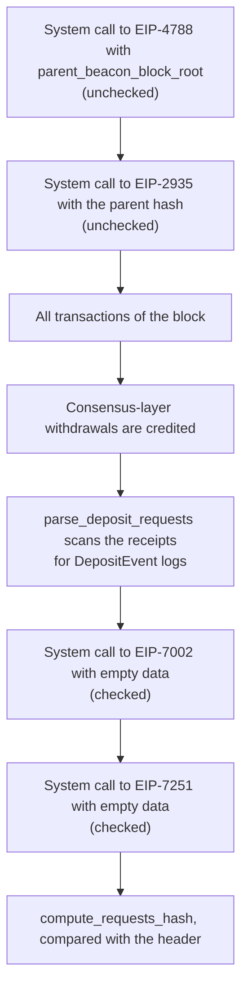
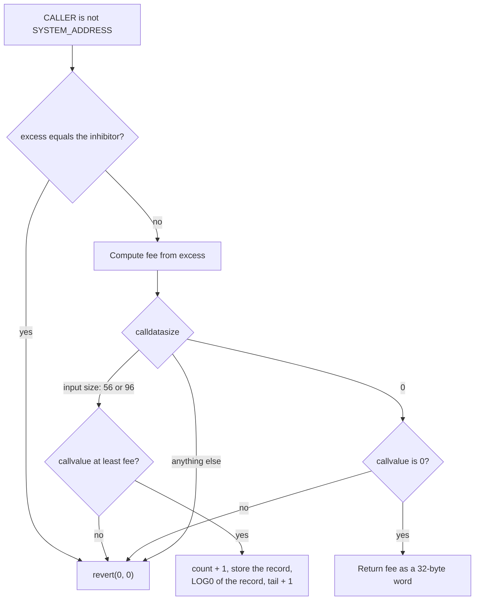
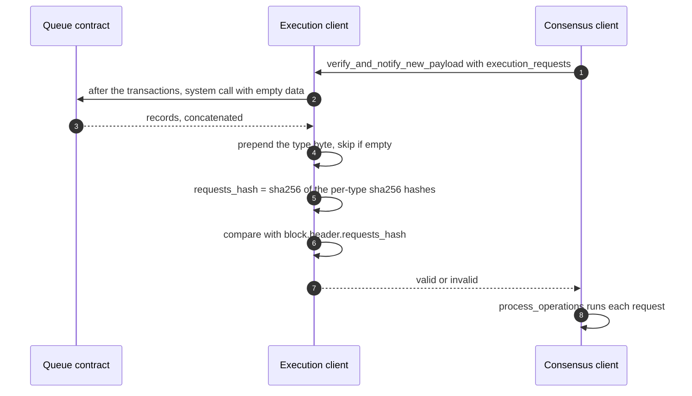
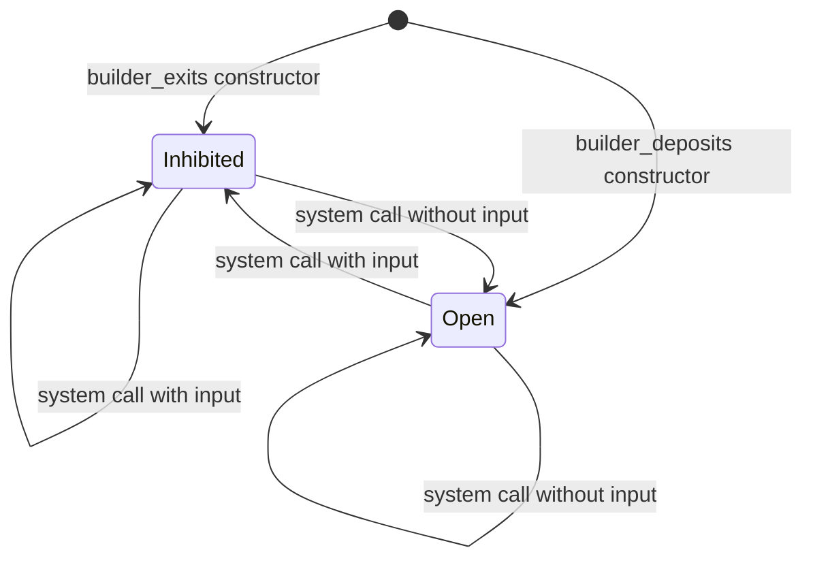

For two years, the repository that holds the assembly source of Ethereum's system contracts, [`ethereum/sys-asm`](https://github.com/ethereum/sys-asm), built a `bytecode/beacon_root/main.hex` of 93 bytes. A mainnet node returns 97 bytes for the [EIP-4788](https://eips.ethereum.org/EIPS/eip-4788) address, with a different code hash. The logic was the same, and the gap was closed upstream on 2026-10-29; the first section explains the four extra bytes. The check takes one command, because the contract in question is an ordinary account with ordinary bytecode.

Since Cancun (2024-03-13) and Prague (2025-05-07), an execution client calls such contracts at every block from a reserved address. Part of what used to be protocol logic now lives in programs of a few hundred bytes that anyone can read: EIP-4788 beacon roots, [EIP-2935](https://eips.ethereum.org/EIPS/eip-2935) block hashes, and the [EIP-7002](https://eips.ethereum.org/EIPS/eip-7002) and [EIP-7251](https://eips.ethereum.org/EIPS/eip-7251) request queues. This article walks through how the client calls them, what each one stores, what happens to a block when a call fails, and what a Solidity developer has to check before integrating with them.

> This article has been made with the help of [Claude Code](https://claude.com/product/claude-code) and several custom skills

[TOC]

## What you need to know first

The article assumes familiarity with Solidity and the EVM. These mechanisms are used without being derived:

- **Fork names.** Cancun, Prague and Amsterdam are the execution-layer halves of the [Dencun]({{site.url_complet}}/2026/10/23/ethereum-dencun-upgrade-overview/), [Pectra]({{site.url_complet}}/2025/05/02/ethereum-pectra-upgrade/) and [Glamsterdam]({{site.url_complet}}/2026/10/23/ethereum-glamsterdam-upgrade-overview/) upgrades. Specifications use the execution-layer name, so this article does too.
- **Execution and consensus layers.** The execution layer (EL) runs the EVM and holds accounts. The consensus layer (CL) runs proof of stake and holds validators in the beacon state. Each CL block carries one EL payload, and contracts see only the EL.
- **Beacon block root.** The SSZ `hash_tree_root` of a beacon block, a Merkle root that commits to the block and through it to the beacon state. A contract holding a trusted root can verify a Merkle proof of any validator field.
- **Withdrawal credentials.** A 32-byte field on each validator that names who owns the stake. The prefix `0x01` means an execution address in the last 20 bytes, and `0x02` means the same with [compounding]({{site.url_complet}}/2024/03/28/ethereum-staking/) enabled.
- **EVM assembly and geas.** The contracts here have no Solidity source. They are hand-written in [`geas`](https://github.com/fjl/geas), an assembler for EVM opcodes, so they have no function selectors and no ABI.
- **Nick's method.** A deployment by a transaction with a made-up signature: the sender is recovered from that signature, nobody holds its key, and the contract address is therefore bound to the deployment code.

## Two versions of one contract

Here is what mainnet returned on 2026-11-04 (block 26,340,639) for the four system contracts live today, compared with the `main.hex` files of `sys-asm` at commit `f808a29`:

| Contract | Runtime size on mainnet | keccak256 of the runtime code on mainnet | `sys-asm` `main.hex` |
|---|---|---|---|
| EIP-4788 beacon roots | 97 bytes | `0xf57acd40259872606d76197ef052f3d35588dadf919ee1f0e3cb9b62d3f4b02c` | **different**: 93 bytes |
| EIP-2935 block hashes | 83 bytes | `0x6e49e66782037c0555897870e29fa5e552daf4719552131a0abce779daec0a5d` | identical |
| EIP-7002 withdrawals | 504 bytes | `0x0345a365d2f4c5975b9f1599abe0a2ee76b7a3a731bc68781bd04c84e4858f50` | identical |
| EIP-7251 consolidations | 414 bytes | `0x78c6cb5202685228bbcbfb992b1c4e116c7ec5ef11e25b8e92716cfc628ddd60` | identical |

In all four cases the deployment input printed in the EIP ends with the mainnet runtime code. So the EIP text and the chain agree, and at this commit `sys-asm` was the one that differed, for one contract. Disassembling both versions and comparing them line by line gives this complete list of differences:

```text
                        sys-asm (93 bytes)     mainnet and EIP-4788 (97 bytes)
instruction 4           PUSH1 0x4b             PUSH1 0x4d
instruction 19          PUSH1 0x47             PUSH1 0x49
instruction 21          PUSH2 0x1fff           PUSH3 0x001fff
instruction 28          PUSH1 0x3b             PUSH1 0x3c
instruction 34          PUSH2 0x1fff           PUSH3 0x001fff
instruction 47          PUSH2 0x1fff           PUSH3 0x001fff
instruction 56          PUSH2 0x1fff           PUSH3 0x001fff
```

The constant `0x1fff` is 8191, the length of the ring buffer. It fits in two bytes, and the deployed contract pushes it with three. That happens four times, hence four extra bytes, and the three `PUSH1` lines are jump targets that move because of them. Applying these seven replacements to the `sys-asm` hex yields the mainnet bytecode exactly, which confirms that nothing else differs.

The original source spelled the instruction `push3 BUFLEN`, and commit [`bf907ca`](https://github.com/ethereum/sys-asm/commit/bf907ca02c2f46ce685b0e0371f6f238b94972a1) ("all: tidy up", 2024-10-27) turned it into `push BUFLEN`, which lets the assembler pick the smallest width. The source file kept its meaning and lost its byte-for-byte link with the deployment.

Reversing that one edit proves it, and upstream did the same in [`d9ade46`](https://github.com/ethereum/sys-asm/commit/d9ade46ea44c81a0035068ef799a628af6d9d036) on 2026-10-29, after the commit analysed here. The current upstream file is 97 bytes, with the mainnet hash. In our own test, with `push3 BUFLEN` restored on the four lines in `src/beacon_root/main.eas`, geas 0.3.3 emits exactly the 97 bytes on mainnet.

This never affected the running contract. It mattered to tooling, and it still does for anything pinned to a commit before the fix:

- `checksums.txt` pinned the 93-byte file (`d7ca3af8…`), so a `make checksums` that passed said nothing about what was on mainnet.
- The `sys-asm` README stated that the bytecode of deployed contracts must not change, while printing the 93-byte hex as its example.
- A contract or script comparing `EXTCODEHASH` against a hash computed from an older `sys-asm` fails for this one address. The value to use is the mainnet hash in the table.

The rest of this article is about what those bytes do.

## What a system call is

A system call is a message that the client itself creates during block processing. It is not a transaction: it has no signature, no nonce and no receipt. The executable specification builds it in `process_unchecked_system_transaction` (`forks/prague/fork.py`) with these values:

| Field | Value |
|---|---|
| `caller` and `origin` | `SYSTEM_ADDRESS`, `0xfffffffffffffffffffffffffffffffffffffffe` |
| `gas` | `SYSTEM_TRANSACTION_GAS`, 30,000,000 |
| `value` | 0, and `should_transfer_value=False` |
| `depth` | 0 |
| `tx_hash`, `index_in_block` | `None` |

The gas is a dedicated allowance: EIP-7002 states that it does not count against the block's gas usage or gas limit, and nothing is charged for it. Every contract the client calls uses the same first test: if `CALLER` equals `SYSTEM_ADDRESS`, jump to the privileged routine; otherwise run the public one. There is no owner, no role and no upgrade path, only that comparison.

### Call order in `apply_body`

`apply_body` fixes the order of everything in a block. In Prague it is:



A transaction can read the beacon root and the parent hash of its own block, because both were written before it ran. A request queued by a transaction can also leave the queue in the same block, because the drain comes after all transactions, provided the queue is short enough.

### Checked and unchecked calls

The two call types differ in one thing: what the client does when the call does not work.

| | Unchecked (EIP-4788, EIP-2935) | Checked (EIP-7002, EIP-7251) |
|---|---|---|
| No code at the address | The message runs nothing, the block stays valid | `InvalidBlock` |
| The call fails | The result is ignored, the block stays valid | `InvalidBlock` |
| Return data | Ignored | Becomes the block's requests of that type |
| Function | `process_unchecked_system_transaction` | `process_checked_system_transaction` |

A failed checked call therefore invalidates the whole block, and EIP-7002 describes the consequence: if the failure comes from a transaction in the block, the mempool may keep that transaction, so it can be included again and cost further slots. It recommends that block producers shuffle their transaction set. The code check runs after the block's transactions, which leaves one recovery path if a fork activated without the contract: a block that deploys the contract can itself be valid.

The difference follows what each call carries (*derived*). Beacon roots and block hashes serve contracts, while the queues return requests that move stake, and a block must not silently lose those.

## Reading the past: two ring buffers

The two read-oriented contracts each keep the chain's recent commitments in exactly 8191 positions, so their storage never grows. With 12-second slots, 8191 blocks is 98,292 seconds, about 27.3 hours.

### EIP-4788: beacon roots by timestamp

The client passes the header's `parent_beacon_block_root` as calldata. The contract, in `src/beacon_root/main.eas`, writes two storage slots:

```text
slot  t % 8191            = t       (block.timestamp)
slot (t % 8191) + 8191    = root    (calldata[0:32])
```

A reader sends exactly 32 bytes containing a timestamp `t` and receives the root. The contract reverts if the input is not 32 bytes, if `t` is zero, or if the stored timestamp differs from `t`.

The second buffer is what makes the lookup safe. With a single buffer, EIP-4788 explains, a skipped slot could make a timestamp with the same remainder return an old root. Storing the timestamp next to the root rules that out, and the modulus is prime so that no entry is overwritten before the buffer is saturated, even if slot times change.

Three semantics catch integrators:

- **The key is a timestamp, not a slot.** It must be the exact timestamp of an execution block, so a missed slot has no entry.
- **The root is the parent's.** `get(t)` returns the root of the beacon block before the one carrying that execution payload.
- **There is no value check.** A read that sends ETH succeeds and the ETH stays in the contract.

As a live check, on 2026-11-04 a call at block 26,340,652 with the timestamp of block 26,340,651 returned `0x11739383…efd2458`, the `parentBeaconBlockRoot` of that block's header. The same call with the timestamp plus one second reverted.

### EIP-2935: block hashes by number

`src/execution_hash/main.eas` is simpler, at 83 bytes. The client passes the parent hash, and the contract stores it at `(block.number - 1) % 8191`. A reader sends a 32-byte block number `n` and gets `storage[n % 8191]`, with reverts if the input is not 32 bytes or if `n` is outside `[block.number - 8191, block.number - 1]`.

The `BLOCKHASH` opcode itself did not change and still serves 256 blocks. Access to the older hashes goes through this contract, with a plain call. Reading block 26,339,652 from block 26,340,652, which is 1,000 blocks back and out of range for the opcode, returned the correct hash on mainnet.

No timestamp check is needed here, because the block number grows by exactly one per block. EIP-2935 says so itself, and notes that 8191 is kept for consistency rather than for being prime.

One edge case applies to any new chain or fork: the buffer holds only hashes from the parent of the fork block onward. A number inside the range but before the fork returns zero rather than reverting, until the buffer has filled once.

## Writing to the consensus layer: two request queues

Before Prague, as EIP-7002 puts it, "only the active key can initiate a validator exit". A staking contract that held withdrawal credentials could not force its own validator out. The fix could not be a simple call into the CL, since the EVM has no such thing, so the design uses a contract as a mailbox: users write requests to it during the block, and the client empties it at the end. [EIP-7685](https://eips.ethereum.org/EIPS/eip-7685) then defines how the content travels to the CL.

### Inputs and outputs

Neither contract has an ABI. Each dispatches only on `CALLER` and `CALLDATASIZE`:

```text
EIP-7002 input, 56 bytes                 EIP-7251 input, 96 bytes
+-----------+--------------------+       +-----------------+-----------------+
| pubkey 48 | amount 8           |       | source_pubkey 48| target_pubkey 48|
|           | big-endian, gwei   |       |                 |                 |
+-----------+--------------------+       +-----------------+-----------------+

EIP-7002 record, 76 bytes
+----------------+-----------+--------------------------+
| source_addr 20 | pubkey 48 | amount 8 (little-endian) |
+----------------+-----------+--------------------------+

EIP-7251 record, 116 bytes
+----------------+-----------------+-----------------+
| source_addr 20 | source_pubkey 48| target_pubkey 48|
+----------------+-----------------+-----------------+
```

The amount changes endianness on the way through, and `source_addr` is not supplied by the user: the contract stores `CALLER`. Authorisation rests on that one field. An `amount` of 0 means a full exit, and in EIP-7251 a request whose source equals its target asks to switch the validator to compounding credentials.

A public call takes one of these paths:



The contract validates nothing else. It does not check that the public key exists, that the caller owns the validator, or that the amount makes sense. The source comment says it directly: "No verification of ownership is done by the pre-deploy or the execution layer."

### Storage and the end-of-block drain

Both contracts share a layout:

- Slot 0 holds `excess`.
- Slot 1 holds the count of requests added in this block.
- Slots 2 and 3 hold the queue head and tail.
- The records start at slot 4, using 3 slots per record in EIP-7002 and 4 in EIP-7251.

The system call dequeues at most `MAX_PER_BLOCK` records, oldest first, and returns them concatenated. It resets head and tail to zero when the queue empties, updates `excess`, and resets the count. The queue has no upper bound: requests above the maximum wait for a later block.

| Parameter | EIP-7002 | EIP-7251 |
|---|---|---|
| `TARGET_PER_BLOCK` | 2 | 1 |
| `MAX_PER_BLOCK` | 16 | 2 |
| `MIN_FEE` | 1 wei | 1 wei |
| `FEE_UPDATE_FRACTION` | 17 | 17 |
| Request type | `0x01` | `0x02` |

### The fee

Since gas alone would let an attacker fill the queue cheaply, each request pays a fee that depends on `excess`, the running surplus of requests over the target. At the end of block $$n$$, with $$c_n$$ requests added and target $$T$$, and with the fee approximating an exponential:

$$
\begin{aligned}
E_{n+1} &= \max(0,\; E_n + c_n - T) \\
\text{fee} &\approx \text{minFee} \cdot e^{E / 17}
\end{aligned}
$$

The contract computes the second line with integer arithmetic, in the Taylor loop of `src/common/fake_expo.eas`, which is the `fake_exponential` function printed in EIP-7002. The values below come from that algorithm with its integer rounding:

| excess | fee in wei | approximate value | loop iterations |
|---:|---:|---|---:|
| 0 | 1 | minimum | 1 |
| 17 | 2 | | 4 |
| 50 | 18 | | 9 |
| 100 | 357 | | 17 |
| 200 | 128,545 | | 33 |
| 300 | 46,130,791 | 0.046 gwei | 48 |
| 353 | 1,042,005,754 | first value above 1 gwei | 57 |
| 400 | 16,542,427,319 | 16.5 gwei | 64 |
| 500 | 5,933,467,376,577 | 0.0000059 ETH | 80 |
| 600 | 2,128,277,912,950,772 | 0.0021 ETH | 96 |
| 700 | 763,291,859,702,149,480 | 0.76 ETH | 112 |
| 705 | 1,024,319,536,763,752,658 | first value above 1 ETH | 113 |


The left panel is a straight line because the axis is logarithmic: 17 extra requests multiply the fee by about $$e$$. The right panel shows the recovery. With no new requests, a spike to excess 705 decays by the target per block, so it takes 353 blocks (about 71 minutes) on the withdrawal queue and 705 blocks (141 minutes) on the consolidation queue to return to 1 wei. Excess 705 is an illustration, not an observed value.

Three properties follow from the code:

- **The fee does not move within a block.** `excess` changes only in the system call, so every request in a block pays the same fee however many precede it.
- **Overpayment is not refunded.** The write path checks `callvalue >= fee` and keeps all of it. EIP-7002 is direct: "Overpaid fees are not returned to the caller". It adds that using an EOA "will always result in overpayment of fees", since an EOA cannot read the fee and pay in one step.
- **The ETH cannot leave.** The contracts contain no opcode that sends value. On mainnet at block 26,340,652 the fee was 1 wei on both queues, and the balances were 0.1568 ETH (EIP-7002) and 2.796 ETH (EIP-7251).

The loop count also matters for gas: the getter runs more iterations as `excess` grows, so it should not be called with a tight gas budget.

### From return data to the beacon state

The contract's return value is opaque to the EVM. The client wraps it, commits to it in the header, and the consensus layer executes it:



Types appear in ascending order, and a type with no data is left out. A block with no requests therefore has a fixed commitment, the SHA-256 of the empty string: block 26,340,651 carried `requestsHash = 0xe3b0c442…b855`.

The beacon block holds the same requests in `body.execution_requests`, because EIP-7002 requires the CL to run without a synchronous EL. `get_execution_requests_list` re-encodes them for the engine call, and `requests_hash` lets both layers confirm that they saw the same set.

### What the consensus layer does with a request

`process_withdrawal_request` and `process_consolidation_request` in `specs/electra/beacon-chain.md` are where validity is decided, and they never fail: an invalid request hits a bare `return`. Validity is not visible to the EL, so success on the EL means queued, not accepted. Among other checks, a request is dropped when:

- the public key is unknown, or `source_address` does not equal `withdrawal_credentials[12:]`;
- the validator has no execution credentials, is not active, already has an exit initiated, or has not been active for `SHARD_COMMITTEE_PERIOD`;
- it is a full exit and the validator has a pending partial withdrawal;
- it is a partial withdrawal on a validator without `0x02` credentials, or the balance above 32 ETH is insufficient;
- it is a consolidation and the target has no `0x02` credentials, or the churn limit is too low, or the pending queue already holds 262,144 entries.

In each case the fee is gone. Nothing emits an error, and nothing on the EL records the outcome.

## The deposit contract and the EIP-6110 path

The deposit contract at `0x00000000219ab540356cBB839Cbe05303d7705Fa` looks like it belongs to the same family and does not. It dates from Phase 0, it is written in Solidity 0.6.11 with a real ABI, and the client never calls it. It has no `SYSTEM_ADDRESS` branch.

`deposit()` checks that the public key is 48 bytes, the credentials 32 and the signature 96, that the value is at least 1 ether, a whole number of gwei, and fits in 64 bits. It emits `DepositEvent`, recomputes the SSZ root of the deposit data and requires it to equal `deposit_data_root`, then inserts the root as a leaf in a Merkle tree of depth 32. It does not verify the BLS signature, and the source has no withdrawal function. On 2026-11-04 it reported 2,583,889 deposits and held 93,039,687.6 ETH, a balance that only grows.

Before Prague, the CL learned about deposits by polling this contract with a long follow distance, through the `Eth1Data` vote. [EIP-6110](https://eips.ethereum.org/EIPS/eip-6110) replaced that with a direct path that uses logs:

1. After the transactions, `parse_deposit_requests` walks the block's receipts and keeps logs where the address is the deposit contract and the first topic is the `DepositEvent` hash.
2. `extract_deposit_data` requires exactly 576 bytes, the offsets 160, 256, 320, 384 and 512, and the sizes 48, 32, 8, 96 and 8. Any deviation raises `InvalidBlock`.
3. The 192-byte result, `pubkey ‖ credentials ‖ amount ‖ signature ‖ index`, becomes a request of type `0x00`.
4. On the CL, `process_deposit_request` appends to `pending_deposits`. The BLS signature is checked later, in `apply_pending_deposit`, and only for a public key not yet registered.

Compared with the request queues:

| | Deposit contract | Request queues |
|---|---|---|
| Language | Solidity, ABI | geas, no ABI |
| Client interaction | Reads logs from receipts | System call |
| Rate limit on the EL | Minimum 1 ETH per deposit | Fee, plus a per-block maximum |
| Requests per payload on the CL | 8,192 (`MAX_DEPOSIT_REQUESTS_PER_PAYLOAD`) | 16 and 2 |
| Queue | `pending_deposits` in the beacon state | In contract storage |

## Still in development: the Amsterdam contracts

Everything in this section describes work that has not activated on mainnet. In `execution-specs` at the pinned commit, Amsterdam is `Unscheduled(order_index=3)`, and no date is given for it here. The constants below are subject to change.

| Proposal | Status in the pinned EIPs copy | Contract in `sys-asm` | Execution-specs |
|---|---|---|---|
| [EIP-8282](https://eips.ethereum.org/EIPS/eip-8282) builder requests | Last Call | `builder_deposits`, `builder_exits` | In the Amsterdam fork |
| [EIP-7997](https://eips.ethereum.org/EIPS/eip-7997) factory | Last Call | `factory` | In the Amsterdam fork |
| [EIP-8272](https://eips.ethereum.org/EIPS/eip-8272) recent roots | Draft | `recent_root` | In no fork |

### EIP-8282: builder queues

[EIP-7732](https://eips.ethereum.org/EIPS/eip-7732) makes block builders a staked actor of the protocol. EIP-8282 gives them two more queues on the same design, with checked calls, request types `0x03` and `0x04`, and a drain after the two existing queues:

| | `builder_deposits` | `builder_exits` |
|---|---|---|
| Address | `0x0000bFF46984e3725691FA540a8C7589300D8282` | `0x000064D678505ad48F8cCb093BC65613800E8282` |
| Target and maximum per block | 8 and 64 | 2 and 16 |
| Input | 184 bytes: pubkey 48, credentials 32, amount 8, signature 96 | 48 bytes: pubkey |
| Record | 184 bytes, amount little-endian, no source address | 68 bytes: source address and pubkey |
| Value required | `fee + amount`, with `amount` at least 1 ETH | `fee` |

One rule differs from EIP-7002: the fee rises per request. The user path adds `count - TARGET` to `excess` before computing the fee, so the price goes up inside a block once the count passes the target. Reading the fee once and reusing it for a batch stops working here.

On 2026-11-04 (block 26,340,668), mainnet already held bytecode at both addresses, identical to the `sys-asm` files. The EIP requires this ("MUST be deployed before the fork"). What does not exist yet is any system call to them, so nothing can leave the queues until Amsterdam activates.

### A spec sentence the code does not follow

EIP-8282's section on the system call says: "If any calldata is included, the queue is permanently disabled via an inhibitor. If no calldata is included, it MUST dequeue up to its per-block maximum of records". The code does something else on both counts. In `update_excess`, non-empty calldata stores the inhibitor, and the next call without calldata clears it:

```text
;; If inhibitor is set, restore excess to zero, i.e. re-enable the queue.
dup2                   ; [excess, added_count, excess, count]
push INHIBITOR         ; [inhibitor, excess, added_count, excess, count]
eq                     ; [excess==inhibitor, added_count, excess, count]
jumpi @zero_excess     ; [added_count, excess, count]
```

`testSystemCallWithInput` asserts this in both test files: it disables the queue, checks that the getter and a new request fail, then runs a system call without input, checks that excess is 0, and adds a request again. Its comment reads "Now re-enable the queue through a system call with no input." All 17 builder tests pass when run on a copy of the repository at `f808a29`. The source is unchanged since commit `3bba94c`, the one the EIP links as its reference implementation.

There is a second, smaller gap: the EIP places the dequeue under the no-calldata case, whereas the code drains on the disabling call too, and the test asserts that its return data contains the record.



The diagram also suggests why the code works this way (*derived*). `excess = 2**256 - 1` already meant "not active yet" in EIP-7002, and the first system call clears it, as it has to. Since the same value is reused as the off switch, the same branch clears it. A value that one path must clear cannot also be permanent without another flag.

This is a wording mismatch in a specification under review, not a vulnerability. The reversibility is deliberate: [`sys-asm` PR #49](https://github.com/ethereum/sys-asm/pull/49), which added the branch, describes a temporary disable that can be undone, and [EIPs PR #12120](https://github.com/ethereum/EIPs/pull/12120), open at the time of writing, replaces "permanently disabled" in the text. Only `SYSTEM_ADDRESS` can enter this branch, no user call can set the inhibitor, and `execution-specs` always passes `data=b""`, so no block as specified triggers it.

In practice, a future fork that wanted the queue off would have to send input on every block from then on. The queue would be off for as long as clients keep doing that, which is a different thing from "permanently".

### The deposit queue is already open

The two constructors differ, on purpose. `builder_exits/ctor.eas` stores the inhibitor "to avoid requests being queued before the fork", and `builder_deposits/ctor.eas` stores nothing. During review of the [pull request that added both contracts](https://github.com/ethereum/sys-asm/pull/43#discussion_r3468418015), a contributor wrote: "We want builders to queue before the fork begins. So long as the excess updates with each call, it won't be a DDOS issue." Another [questioned the benefit](https://github.com/ethereum/sys-asm/pull/43#discussion_r3468811102). The merged EIP text does not mention pre-fork requests yet, and [EIPs PR #12120](https://github.com/ethereum/EIPs/pull/12120), still open, adds that "pre-fork deposits are accepted".

On mainnet, slot 0 of the exit contract holds `0xff…ff`, and its fee getter reverts. Slot 0 of the deposit contract holds 0, and its getter returns 1 wei. A read-only `eth_call` of a 184-byte request with 1 ETH plus 1 wei succeeded, and the same call with 1 ETH alone reverted.

So a deposit sent today is accepted, and its stake stays in the contract until Amsterdam activates. The `count` slot is reset only by the system call, so before activation the fee rises with every request past the eighth, however many blocks pass.

On the deployed bytecode in a local test, the fee reached 1 ETH at the 713th request, after about 16.9 ETH of fees and 713 ETH of stake. A backlog of 635 requests drained in 10 blocks at activation, and the fee was back to 1 wei 68 blocks later. PR #12120 lists this accumulation as an open question. At block 26,340,668 the queue was empty and the balance was 0. Neither builder contract has an entry in `checksums.txt`, unlike the other contracts of `sys-asm`.

The contract checks neither the signature nor the credentials, so a mistake surfaces only on the consensus layer. `process_builder_deposit_request` in `specs/gloas/beacon-chain.md` returns immediately when the credentials do not start with `0xB0`, even for a top-up, and that stake stays locked in the contract for good. The merged EIP says the credentials of a top-up are ignored; [EIPs PR #12572](https://github.com/ethereum/EIPs/pull/12572), open at the time of writing, corrects this.

### EIP-7997: the factory

EIP-7997 is a requirement rather than a new contract. It makes the existing keyless `CREATE2` factory at `0x4e59b44847b379578588920cA78FbF26c0B4956C` mandatory. On mainnet it is already there, and its 69 bytes match `sys-asm`. It has no system path: the client does not call it, and clients "MUST NOT check for the existence of the contract at the fork boundary". For Solidity callers, two details matter: calldata is `salt ‖ initcode`, and a successful call returns exactly 20 bytes with no padding, so `abi.decode` to an address does not apply.

### EIP-8272: recent roots

EIP-8272 is a Draft that depends on [EIP-8141](https://eips.ethereum.org/EIPS/eip-8141) frame transactions and on [EIP-7843](https://eips.ethereum.org/EIPS/eip-7843) `SLOTNUM`, and no code exists at its address on mainnet. It also has no `SYSTEM_ADDRESS` path: anyone writes to it. A 64-byte call stores a root under `keccak256(caller ‖ salt)` and `SLOTNUM % 8192`. A call of `n * 72` bytes, with `n` from 1 to 16, validates tuples `(source_id, slot, root)` and reverts if any is wrong or older than 8191 slots. Its purpose is to let a public-mempool validation frame check recent application state without reading another account's storage.

## What a Solidity integrator must watch for

The [full list is in the annex](#integration-notes).

**Read defensively.** A call to an empty account succeeds and returns no data, so on a chain without these contracts the success flag alone proves nothing. Check the return length:

```solidity
address constant BEACON_ROOTS = 0x000F3df6D732807Ef1319fB7B8bB8522d0Beac02;

error RootUnavailable(uint256 timestamp);

function beaconRootAt(uint256 timestamp) public view returns (bytes32) {
    (bool ok, bytes memory data) = BEACON_ROOTS.staticcall(abi.encode(timestamp));
    if (!ok || data.length != 32) revert RootUnavailable(timestamp);
    return abi.decode(data, (bytes32));
}
```

**Pay the fee you read, and cap it.** This is the pattern from EIP-7002's security section, with the length of the fee data checked as well. Note `abi.encodePacked`: `abi.encode` would pad the input, the size would not be 56, and the call would revert.

```solidity
address constant WITHDRAWAL_REQUESTS = 0x00000961Ef480Eb55e80D19ad83579A64c007002;

error FeeReadFailed();
error FeeTooHigh(uint256 fee, uint256 limit);
error RequestFailed();

function requestExit(bytes calldata pubkey, uint64 amountGwei, uint256 feeLimit) internal {
    require(pubkey.length == 48, "pubkey");

    (bool readOk, bytes memory feeData) = WITHDRAWAL_REQUESTS.staticcall("");
    if (!readOk || feeData.length != 32) revert FeeReadFailed();
    uint256 fee = abi.decode(feeData, (uint256));
    if (fee > feeLimit) revert FeeTooHigh(fee, feeLimit);

    (bool writeOk, ) = WITHDRAWAL_REQUESTS.call{value: fee}(abi.encodePacked(pubkey, amountGwei));
    if (!writeOk) revert RequestFailed();
}
```

**Treat success as "queued".** The contract calling the queue must be the address in the validator's credentials, because the queue records `CALLER`. A router or helper in between records the wrong address, the call succeeds, the fee is spent, and the CL drops the request. Accounting should reconcile from the beacon state, proved against an [EIP-4788 root](#eip-4788-beacon-roots-by-timestamp), and not from the fact that a call returned.

## Conclusion

A few hundred bytes of assembly at fixed addresses now carry part of Ethereum's block processing. The client calls them as `SYSTEM_ADDRESS` with 30 million gas of its own.

- **Bytes.** The EIP-4788 contract on mainnet is 97 bytes, as the EIP prints it. `sys-asm` built 93 bytes from a tidied source from 2024 until a fix on 2026-10-29. The other three live contracts always matched.
- **Call rules.** EIP-4788 and EIP-2935 run before transactions and may fail without consequence. EIP-7002 and EIP-7251 run after them, and a missing contract or a failed call invalidates the block.
- **Ring buffers.** Both keep 8191 entries. Beacon roots are keyed by exact timestamp and return the parent's root. Block hashes are keyed by number and extend the 256 blocks of `BLOCKHASH`.
- **Queues.** They accept 56 or 96 bytes, charge an exponential fee on `excess`, keep any overpayment, and hand records to the CL through `requests_hash`. The CL can then drop a request with no signal to the EL.
- **Deposits.** The deposit contract is an ordinary Solidity contract, and EIP-6110 reads its logs from receipts rather than calling it.
- **Amsterdam.** It is unscheduled in `execution-specs`. The EIP-8282 contracts are already deployed but not yet called. The EIP's "permanently disabled" does not match code that re-enables the queue on the next call without input. By design, the deposit queue accepts requests today while the exit queue does not; open pull requests bring the EIP text in line.


## Annex

### Key Terms

| Term | Definition |
|------|------------|
| **Execution layer (EL)** | The part of an Ethereum node that runs the EVM and holds accounts and contract storage. |
| **Consensus layer (CL)** | The part of an Ethereum node that runs proof of stake and holds validators in the beacon state. |
| **Beacon block root** | The SSZ hash tree root of a beacon block, a commitment against which fields of the beacon state can be proved. |
| **Withdrawal credentials** | A 32-byte validator field naming the owner of the stake; prefixes `0x01` and `0x02` carry an execution address. |
| **Validator exit** | The process that removes a validator from the active set so that its balance can be withdrawn. |
| **System call** | A message built by the client during block processing, sent from `SYSTEM_ADDRESS` with 30,000,000 gas and zero value. |
| **`SYSTEM_ADDRESS`** | The address `0xff…fe`, which the contracts compare with `CALLER` to select their privileged routine. |
| **Unchecked system call** | A system call whose missing code or failure is ignored; used for EIP-4788 and EIP-2935. |
| **Checked system call** | A system call whose missing code or failure raises `InvalidBlock`; used for the request queues. |
| **Predeploy** | A contract that must exist at a fixed address before a fork activates. |
| **Ring buffer** | A fixed-length store written at an index modulo its length, so that new entries overwrite the oldest. |
| **`fake_exponential`** | The integer Taylor loop that approximates `factor * e**(numerator / denominator)` in the fee computation. |
| **Excess** | The running surplus of requests over the per-block target, stored in slot 0 and used to compute the fee. |
| **Inhibitor** | The value `2**256 - 1` stored in slot 0, which makes every public call revert. |
| **Request (EIP-7685)** | A type byte followed by opaque data, produced by the EL for the CL to process. |
| **`requests_hash`** | The header field committing to the block's requests, the SHA-256 of the SHA-256 hash of each non-empty request. |
| **Compounding validator** | A validator with `0x02` credentials, required for partial withdrawals through EIP-7002. |
| **`pending_deposits`** | The beacon-state queue that holds EIP-6110 deposits until they are applied. |
| **`geas`** | The assembler in which `sys-asm` is written; it compiles EVM mnemonics to bytecode. |
| **Nick's method** | A deployment by a transaction with a chosen signature, whose sender has no known key. |

### Integration Notes

| Behaviour | What an integrator should do |
|-----------|------------------------------|
| The queue records `CALLER`, and the CL compares it with the credentials. | Call from the contract named in the credentials, directly. With [EIP-7702](https://eips.ethereum.org/EIPS/eip-7702), an EOA running delegated code calls as itself (*derived*). |
| Overpayment stays in the contract. | From a contract, read the fee and send exactly that. From an EOA, simulate and accept a small overpayment. |
| The fee can rise between signing and inclusion. | Compare it with a limit in the same transaction and revert above it. |
| The fee getter reverts on the inhibitor and on non-zero value. | Handle `success == false`; do not decode empty data as zero. |
| A failed write reverts with no data. | Check the call result, otherwise the protocol believes an exit was requested. |
| Sizes are exact: 56 and 96 bytes. | Use `abi.encodePacked` for EIP-7002 and `bytes.concat` for EIP-7251; `abi.encode` pads and reverts. |
| `amount` is in gwei, big-endian on input, and 0 means a full exit. | Never pass wei. A partial amount needs `0x02` credentials, otherwise the CL drops it. |
| Success means queued. | Reconcile the validator's state from a proof; do not book an exit from the call result. |
| The CL drops invalid requests with no signal and no refund. | Check validator status before paying, and expect the fee to be lost if the check is stale. |
| Queues drain at 16 and 2 per block, then the CL applies its own churn. | Do not assume a fixed delay. A spammed queue also raises what the next caller pays. |
| A permissionless "trigger exit" function can be called repeatedly at the protocol's expense. | Rate-limit it and cap the total fee. |
| The getter's loop grows with `excess`. | Do not call it with a tight gas limit. |
| EIP-4788 needs an exact block timestamp and reverts when overwritten. | Pass a real block timestamp, and treat a revert as "too old or unknown". |
| EIP-4788 returns the parent beacon root. | Build the proof against that beacon block, not the one carrying the payload. |
| EIP-2935 reverts out of range but returns zero for numbers before activation. | Treat a zero hash as "unknown" on a young chain. |
| Reads on EIP-4788 and EIP-2935 have no value check. | Send zero value: ETH sent there stays locked. |
| A call to an account with no code succeeds with empty data. | Check `returndata.length == 32` on L2s and other chains. |
| The EIP-4788 hash of `sys-asm` is not the mainnet hash. | Pin `0xf57acd40…f4b02c` for `EXTCODEHASH` checks. |
| The deposit contract does not check the BLS signature, and a first deposit fixes the credentials. | Verify the signature off-chain before sending, since a deposit with a bad signature for a new key is lost. |
| EIP-8282's fee rises per request, in development. | Read the fee again before each call in a batch. Treat all constants as subject to change. |
| The EIP-7997 factory returns 20 unpadded bytes. | Do not use `abi.decode` on the result. |

## Frequently Asked Questions

**Q: What separates a system call from a transaction?**

A system call is built by the client during block processing and has no signature, nonce or receipt. It comes from `SYSTEM_ADDRESS`, carries zero value and has its own 30,000,000 gas, which is not counted in the block's gas usage.

**Q: Why does a failed EIP-7002 system call invalidate a block when a failed EIP-4788 call does not?**

The two use different functions. `process_unchecked_system_transaction` ignores the outcome, which suits data that only serves contracts. `process_checked_system_transaction` raises `InvalidBlock` on missing code or failure, since the queue's return data is the block's list of stake-moving requests, and a block must not silently lose it.

**Q: Why does EIP-4788 use two ring buffers while EIP-2935 uses one?**

Timestamps are not consecutive, because slots can be missed. Two timestamps can share a remainder modulo 8191, so the contract stores the timestamp beside the root and checks it on read. Block numbers grow by exactly one, so `n % 8191` cannot collide inside the window and no second buffer is needed.

**Q: A contract reads the fee in a transaction, then pays it. Can the fee differ between those two steps?**

Not on EIP-7002 or EIP-7251. `excess` changes only in the end-of-block system call, so the fee is fixed for the block.

The fee can still differ between signing and inclusion, which is why the caller should compare it with a limit. On the in-development EIP-8282 contracts, the fee can also rise between two calls in the same block.

**Q: A staking contract's exit call succeeded, yet the validator did not exit. What are the likely causes?**

Success on the EL only means the request was queued. The likely causes are:

- the caller was not the address in the credentials, for instance a router;
- the validator was not active, was already exiting, or had not been active for `SHARD_COMMITTEE_PERIOD`;
- it was a partial amount on a validator without `0x02` credentials;
- it was a full exit with a partial withdrawal pending.

In each case the CL returns without effect, and the fee is not refunded.

**Q: How does the consensus layer learn about deposits without any system call to the deposit contract?**

`parse_deposit_requests` scans the block's receipts for `DepositEvent` logs from the deposit contract, after the transactions. Each log becomes a 192-byte request of type `0x00`, committed with the others in `requests_hash`.

A malformed log makes the block invalid. The CL appends the deposit to `pending_deposits` and checks the BLS signature later.

**Q: Does the EIP-8282 inhibitor permanently disable the queue?**

The EIP says so, and the code does not behave that way. A system call with input stores the inhibitor, and the next system call without input resets `excess` to 0, which re-enables the queue. `testSystemCallWithInput` asserts this.

It is a mismatch in a specification still under review, and not a vulnerability: only `SYSTEM_ADDRESS` can enter the branch, `execution-specs` always passes empty data, and the reversible behaviour is intended, as sys-asm PR #49 states.

**Q: Why was the sys-asm bytecode for EIP-4788 four bytes shorter than the deployed one?**

The deployed code pushes 8191 with `PUSH3 0x001fff` in four places. A 2024 cleanup changed the source from `push3` to `push`, so the assembler emitted `PUSH2`. That removed four bytes and shifted three jump targets, leaving the logic unchanged and the code hash different. Upstream restored `push3` on 2026-10-29.

## Gaps

These points were not settled by the sources read, or rest on inference, and should be checked before relying on them.

| Gap | Why it matters | What to read or verify |
|-----|----------------|------------------------|
| No document says why the original source used `push3`; the commit only says "all: tidy up". | The article explains the difference, not the original intent. | The earlier etk source, and commit `75e602a` of `sys-asm`. |
| The EIP copy was read at its 2026-10-19 commit, and EIP-8282 and EIP-7997 show a Last Call deadline of 2026-11-01, already past. | Their status or text may have changed. | The live pages on eips.ethereum.org. |
| The deployment transactions and salts of the EIP-8282 contracts were not identified; the EIP does not print the salt. | The bytes were compared, not the provenance. | An archive node or explorer for both addresses. |
| The balances of 0.1568 ETH and 2.796 ETH were not split into fees, overpayments and direct transfers. | The article cannot say how much users overpaid. | Historical traces of both addresses. |
| No client (Geth, Reth, Nethermind and others) was read; the article describes `execution-specs`. | Client code may differ in structure, though it must agree on results. | The system-call code of each client. |
| That nobody holds a key for `SYSTEM_ADDRESS`, the 12-second slot and the fork-name pairs come from general knowledge rather than the analysed files. | The 27.3-hour figure assumes no missed slots, and the access control assumes the address cannot sign. | `SECONDS_PER_SLOT` in consensus-specs, and the EIP-4788 discussion of the address. |
| The 7702 note in the annex is an inference from `CALLER` semantics, not a tested case. EIP-7002 itself still says an EOA always overpays. | An EOA delegated to code might pay the exact fee. | A fork test with a 7702-delegated EOA. |

## References

- [Claude Code](https://claude.com/product/claude-code)

### Analyzed source

- [ethereum/sys-asm](https://github.com/ethereum/sys-asm) — analyzed at commit [`f808a29f280f0b844d83fec592d3e1c592d1c92a`](https://github.com/ethereum/sys-asm/tree/f808a29f280f0b844d83fec592d3e1c592d1c92a), 2026-11-04
  Later upstream discussion read through the GitHub API on 2026-11-04: [PR #43](https://github.com/ethereum/sys-asm/pull/43), [PR #49](https://github.com/ethereum/sys-asm/pull/49), [EIPs PR #12120](https://github.com/ethereum/EIPs/pull/12120), [EIPs PR #12572](https://github.com/ethereum/EIPs/pull/12572), and commit [`d9ade46`](https://github.com/ethereum/sys-asm/commit/d9ade46ea44c81a0035068ef799a628af6d9d036).
- [ethereum/solidity-deposit-contract](https://github.com/ethereum/solidity-deposit-contract) — analyzed at commit [`5bf2741b50c58b844225f89018041c5d54726f8e`](https://github.com/ethereum/solidity-deposit-contract/tree/5bf2741b50c58b844225f89018041c5d54726f8e), 2026-11-04
- [ethereum/execution-specs](https://github.com/ethereum/execution-specs) — analyzed at commit [`aaae5abd382b6c0612add96bd8400d6fa4eb0617`](https://github.com/ethereum/execution-specs/tree/aaae5abd382b6c0612add96bd8400d6fa4eb0617), 2026-11-04
- [ethereum/consensus-specs](https://github.com/ethereum/consensus-specs) — analyzed at commit [`065bcd5c6ad96186cd2c0ac1c435f620a0b25373`](https://github.com/ethereum/consensus-specs/tree/065bcd5c6ad96186cd2c0ac1c435f620a0b25373), 2026-11-04
- [ethereum/EIPs](https://github.com/ethereum/EIPs) — analyzed at commit [`41a838decba33325d01bd99b1cd6072c51214fac`](https://github.com/ethereum/EIPs/tree/41a838decba33325d01bd99b1cd6072c51214fac), 2026-11-04
- On-chain values read from Ethereum mainnet on 2026-11-04 through the public [PublicNode](https://www.publicnode.com/) RPC, blocks 26,340,639 to 26,340,668

### Specifications

- [EIP-2935: Serve historical block hashes from state](https://eips.ethereum.org/EIPS/eip-2935)
- [EIP-4788: Beacon block root in the EVM](https://eips.ethereum.org/EIPS/eip-4788)
- [EIP-6110: Supply validator deposits on chain](https://eips.ethereum.org/EIPS/eip-6110)
- [EIP-7002: Execution layer triggerable withdrawals](https://eips.ethereum.org/EIPS/eip-7002)
- [EIP-7251: Increase the MAX_EFFECTIVE_BALANCE](https://eips.ethereum.org/EIPS/eip-7251)
- [EIP-7685: General purpose execution layer requests](https://eips.ethereum.org/EIPS/eip-7685)
- [EIP-7702: Set Code for EOAs](https://eips.ethereum.org/EIPS/eip-7702)
- [EIP-7732: Enshrined Proposer-Builder Separation](https://eips.ethereum.org/EIPS/eip-7732)
- [EIP-7843: SLOTNUM opcode](https://eips.ethereum.org/EIPS/eip-7843)
- [EIP-7997: Deterministic Factory Contract](https://eips.ethereum.org/EIPS/eip-7997)
- [EIP-8141: Frame Transaction](https://eips.ethereum.org/EIPS/eip-8141)
- [EIP-8272: Recent Roots for Frame Transactions](https://eips.ethereum.org/EIPS/eip-8272)
- [EIP-8282: Builder Execution Requests](https://eips.ethereum.org/EIPS/eip-8282)

### Related articles

- [Ethereum Upgrade Pectra - Overview]({{site.url_complet}}/2025/05/02/ethereum-pectra-upgrade/)
- [Ethereum Upgrade Dencun - Overview]({{site.url_complet}}/2026/10/23/ethereum-dencun-upgrade-overview/)
- [Ethereum Upgrade Glamsterdam - Overview]({{site.url_complet}}/2026/10/23/ethereum-glamsterdam-upgrade-overview/)
- [Ethereum Staking - How It Works]({{site.url_complet}}/2024/03/28/ethereum-staking/)
- [EIP-7702: Set Code for EOAs - Overview]({{site.url_complet}}/2025/05/09/eip-7702-overview/)
- [When a Merkle Proof Breaks at a Hard Fork: Beacon State Proofs from Deneb to Gloas]({{site.url_complet}}/2026/11/04/beacon-state-proofs-hard-fork-deneb-to-gloas/)
- [SSZ vs RLP: How Ethereum Serialises Data on Each Layer]({{site.url_complet}}/2026/11/04/ssz-vs-rlp-ethereum-serialization/)
