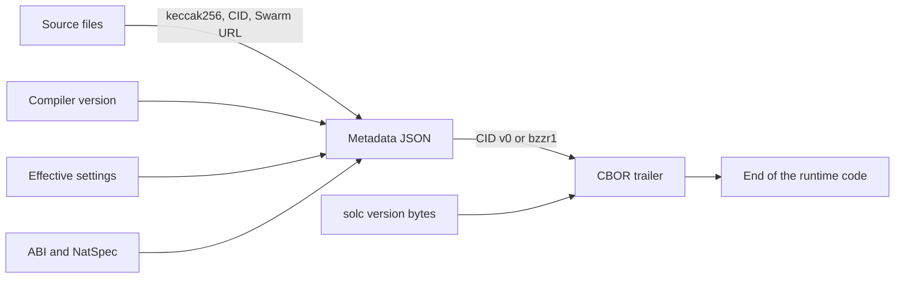
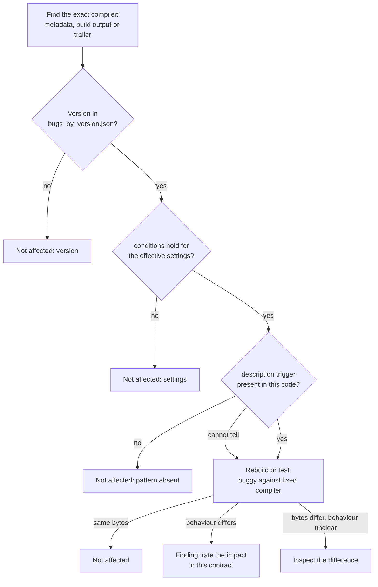

Two builds of one Solidity file can differ although nobody changed a line of logic. The deployed bytes carry a CBOR trailer that commits to the source text, the file paths and the compiler settings, and the code in front of that trailer depends on the optimizer, the pipeline and the EVM target. "Same source" therefore does not mean "same bytes", and a byte difference on its own says little.

This matters in two audit tasks: checking that a deployment matches a reviewed commit, and deciding whether a compiler bug listed for a version affects a contract. Both tasks get more reliable once the auditor controls how the bytes are built, instead of cutting them apart afterwards. This article decodes a real trailer, recomputes its IPFS hash, shows why hand-stripping fails on a factory, and reproduces `TransientStorageClearingHelperCollision` on solc 0.8.33.

> This article has been made with the help of [Claude Code](https://claude.com/product/claude-code) and several custom skills

[TOC]

## What you need to know first

The article assumes Solidity and the EVM, and relies on the following mechanisms without developing them.

- **Creation code and runtime code.** Creation code runs once inside the deployment transaction and returns the runtime code, which is what the account stores. Constructor arguments are appended to the creation code, and a contract that uses `new` embeds the creation code of the contract it deploys.
- **CBOR.** [Concise Binary Object Representation](https://datatracker.ietf.org/doc/html/rfc7049) is a binary encoding of maps, strings, byte strings and integers. solc uses a small map of it to store the metadata hash and the compiler version.
- **Legacy and via-IR pipelines.** The default legacy code generator emits EVM assembly directly. With `--via-ir`, solc first generates Yul, then compiles that Yul. Both pipelines accept the same source and emit different bytes.
- **Standard JSON.** This is the compiler's JSON input and output interface, the one Foundry and Hardhat use. Its option names do not always match the CLI flags.
- **Immutables and linked libraries.** An `immutable` value is written into the runtime code by the constructor, and a library address is patched in at link time. Both make deployed bytes differ from the compiler's output for reasons unrelated to the source.
- **IPFS CID v0.** An IPFS content identifier here is a multihash: the prefix `0x1220` (sha2-256, 32 bytes) followed by a digest. The familiar `Qm...` string is its base58 form. The digest covers a small protobuf wrapper around the file, not the raw file.
- **Transient storage.** The `TSTORE` and `TLOAD` opcodes of [EIP-1153](https://eips.ethereum.org/EIPS/eip-1153) give a contract a storage area that is cleared at the end of the transaction. The [Dencun overview]({{site.url_complet}}/2026/10/23/ethereum-dencun-upgrade-overview/) covers the opcodes.

Every output below comes from a scratch directory, run with solc `0.8.38+commit.1835d247` unless a version is named, `0.8.33+commit.64118f21`, `0.8.34+commit.80d5c536`, and Foundry 1.5.0 with a local anvil node on the `osaka` hardfork.

## The structure of runtime bytecode

The example contract is deliberately small:

```solidity
// SPDX-License-Identifier: MIT
pragma solidity ^0.8.33;

/// @title Minimal counter
contract Counter {
    uint256 public count;

    function increment() external {
        count += 1;
    }
}
```

```bash
solc --optimize --bin-runtime --metadata -o out --overwrite Counter.sol
```

The runtime code is 197 bytes. Its first 144 bytes are executable: the free memory pointer setup (`6080604052`), the callvalue check, the selector dispatch, the function bodies and a final `fe`, the `INVALID` opcode. Everything after that `fe` is data. The compiler's own assembly output names it `auxdata`:

```text
auxdata: 0xa2646970667358221220e0a903a063d549d9d242376e14ae378a984b9873cfb262ae8a698d26e938416d64736f6c63430008260033
```

Decoded field by field, with decimal offsets:

```text
offset   bytes                       meaning
0-142    6080604052...5b9291505056   executable code
143      fe                          INVALID, separates code from data
144      a2                          CBOR map with 2 pairs
145      64                          text string of 4 bytes
146-149  69706673                    "ipfs"
150-151  5822                        byte string of 34 bytes
152-153  1220                        multihash prefix: sha2-256, 32 bytes
154-185  e0a903a0...e938416d         digest
186      64                          text string of 4 bytes
187-190  736f6c63                    "solc"
191      43                          byte string of 3 bytes
192-194  000826                      compiler version 0.8.38
195-196  0033                        CBOR length: 0x33 = 51
```

A disassembler does not know where the code ends. `cast disassemble` prints the digest as if it were instructions, with `UNKNOWN(0xE0)` at offset `0x9a` and later a `PUSH4` and a `PUSH15`. A trailing run of meaningless opcodes in such a listing is usually this trailer.

### Reading the length suffix

The [metadata documentation](https://docs.soliditylang.org/en/latest/metadata.html) gives the parsing rule: the last two bytes are the big-endian length of the CBOR data, and the data should be read with a real decoder. It warns against relying on a `0xa264` or `0xa2 0x64 'i' 'p' 'f' 's'` prefix, because the map can hold other keys. Four builds of `Counter` show why:

| Flag | Map starts with | Keys | CBOR length | Suffix | Runtime bytes |
|------|-----------------|------|-------------|--------|---------------|
| default | `a264` | `ipfs`, `solc` | 51 | `0033` | 197 |
| `--metadata-hash swarm` | `a265` | `bzzr1`, `solc` | 50 | `0032` | 196 |
| `--metadata-hash none` | `a164` | `solc` | 10 | `000a` | 156 |
| `--experimental` | `a364` | `ipfs`, `experimental`, `solc` | 65 | `0041` | 211 |

The code part is the same 144 bytes in all four. Only `--no-cbor-metadata` removes the data entirely, giving 143 bytes: the final `fe` goes too.

On a release build `solc` holds three bytes, one each for major, minor and patch. `metadata.rst` states that a pre-release build stores a full version string instead, so a decoder must not assume a fixed length. `bzzr0` is the key used by older compilers: `Changelog.md` moves to `bzzr1` in 0.5.11.

## What the metadata JSON holds

The trailer holds a hash, and the hash commits to a separate file. For `Counter` that file is 918 bytes of minified JSON with sorted keys:

| Field | Content in this build |
|-------|-----------------------|
| `compiler.version` | `0.8.38+commit.1835d247` |
| `language` | `Solidity` |
| `output.abi`, `output.devdoc`, `output.userdoc` | The interface and the NatSpec text, including `"title": "Minimal counter"` |
| `settings` | `compilationTarget`, `evmVersion`, `libraries`, `metadata`, `optimizer`, `remappings` |
| `sources` | For each file: `keccak256`, `license`, and `urls` with one `bzz-raw://` and one `dweb:/ipfs/` entry |
| `version` | `1` |

`metadata.settings` is a normalised record of what the compiler used, not a copy of the input. `metadata.rst` lists three differences: `compilationTarget` is added, `libraries` changes format, and `stopAfter`, `debug.debugInfo` and `outputSelection` are removed. Running Standard JSON with varied inputs shows more:

| Standard JSON input | `metadata.settings` on 0.8.38 |
|---------------------|-------------------------------|
| `settings: {}` | `evmVersion: "osaka"`, `bytecodeHash: "ipfs"` and `optimizer: {enabled: false, runs: 200}` are filled in |
| `optimizer.details` listing every component as true, with `enabled: true` | `optimizer: {enabled: true, runs: 200}`, `details` dropped |
| The same `details` with `enabled: false` | `optimizer: {enabled: true, runs: 200}`, because `details` decides the final state |
| `details: {yul: false}` with `enabled: true` | The full `details` object, and no `enabled` key |
| `remappings: ["x=y"]` | `remappings: [":x=y"]` |
| `viaIR: false` | No `viaIR` key; it appears only when true |
| `debug: {revertStrings: "strip", debugInfo: ["location"]}` | `debug: {revertStrings: "strip"}` |
| `libraries: {"Counter.sol": {"L": "0x11..."}}` | `libraries: {"Counter.sol:L": "0x11..."}` |
| `appendCBOR: false` | `appendCBOR: false` with `bytecodeHash: "ipfs"`, although the bytecode holds no hash |

As the third row shows, an `enabled: true` in metadata does not prove the project's configuration said so. Metadata records the effective settings, so an auditor should compare effects rather than the text of two configuration files.

The normalised form is still sufficient for a rebuild. Feeding `metadata.settings` back as Standard JSON input, with `compilationTarget` removed, reproduced byte-identical code and byte-identical metadata in the four cases tested: `enabled: false` with full `details`, `yul: false`, plain `enabled: true`, and `runs: 1`. None of those four cases used libraries, whose format would need converting back.

### The IPFS and Swarm hash

The `ipfs` value is not the SHA-256 of the metadata file. `metadata.rst` says so, and a direct check agrees: `sha256` of the file gives `49786c8d...`, which appears nowhere in the trailer. The digest covers a protobuf node that wraps the file. For a file small enough to fit one chunk, the following standard-library Python reproduces it:

```python
import hashlib

def varint(n):
    out = bytearray()
    while True:
        b = n & 0x7f
        n >>= 7
        out.append(b | (0x80 if n else 0))
        if not n:
            return bytes(out)

def field(tag, payload):
    """Protobuf length-delimited field."""
    return bytes([tag]) + varint(len(payload)) + payload

def cid_v0(content):
    """CID v0 of a file that fits one chunk: a dag-pb node wrapping a UnixFS File."""
    unixfs = b"\x08\x02" + field(0x12, content) + b"\x18" + varint(len(content))
    node = field(0x0a, unixfs)
    return b"\x12\x20" + hashlib.sha256(node).digest()
```

Run against the 918-byte metadata file and compared with the decoded trailer, with the raw hex line left out:

```text
total bytes   : 197
code bytes    : 144
cbor length   : 51 (suffix 0033)
last code byte: fe
  ipfs: 1220e0a903a063d549d9d242376e14ae378a984b9873cfb262ae8a698d26e938416d (34 bytes)
  solc: 000826 (3 bytes)
metadata bytes: 918
sha256(file)  : 49786c8d2e82b53bc49aad6e6a791ff050482f1a9daf2194bf2e2ee8c74e8ec2
recomputed    : 1220e0a903a063d549d9d242376e14ae378a984b9873cfb262ae8a698d26e938416d
base58        : QmdTdWaf5g52WJg9m3qjhvvmkn6xMRwp82MUj6zRJLJyt8
matches trailer: True
```

The same function applied to `Counter.sol` gives `QmSbyrh4e7gRYRPXnyLfEm7AYAuyGxuJyNU9BMbUBqKQf7`, the `dweb:/ipfs/` URL recorded in the metadata, and the keccak-256 of the file gives `0x7ce634be...e87da8d7`, its `keccak256` field. The commitment therefore runs from each source byte down to the trailer:



With `--metadata-hash swarm` the trailer holds a 32-byte digest under `bzzr1`, here `fd5e6613...1fef4e0d57`. That digest was decoded but not recomputed, as the Gaps section records.

## Same source, different bytes

Settings change the code; text and paths change only the trailer.

### Settings change the code

The same `Counter.sol` under different settings, each with the default trailer:

| Settings | Runtime bytes |
|----------|---------------|
| none | 303 |
| `--optimize` | 197 |
| `--optimize --optimize-runs 1` | 197 |
| `--optimize --optimize-runs 100000` | 222 |
| `--optimize --evm-version paris` | 204 |
| `--via-ir` | 614 |
| `--via-ir --optimize` | 177 |

A reproducible build therefore needs at least the exact compiler, the pipeline, the optimizer state and `runs`, the EVM target, and any `details`. Foundry adds a trap of its own: with an empty configuration, forge 1.5.0 reports `evm_version = "prague"`, while solc 0.8.38 defaults to `osaka`. A plain `solc` build and a plain `forge build` of one file are not the same compilation.

### Text and paths change the trailer

Four variants were built with the optimizer on: the original, a changed NatSpec `@title`, an added `//` comment, and the same content under another file name. All four produced different default output and identical code once the trailer was removed. Between the original and the NatSpec variant, the first differing byte is 154 and the last is 185, exactly the 32-byte digest. This is the behaviour `metadata.rst` warns about: "a single whitespace change results in different metadata, and different bytecode."

### Deployment changes the bytes again

The compiler's runtime output is not always what ends up on-chain. A one-variable contract with `uint256 public immutable x`, deployed on anvil with the argument `48879`, shows the effect. Standard JSON reports `immutableReferences: {"3": [{"length": 32, "start": 46}]}`, and `cast code` then differs from the compiler output in two bytes only, 76 and 77:

```text
compiler  000000008156
on-chain  0000beef8156
```

`0xbeef` is 48879, written into the last two bytes of the 32-byte range that starts at offset 46. The trailer stayed identical. Any comparison against deployed code has to mask those ranges first, and do the same for linked library addresses.

## How verification works

`metadata.rst` describes the principle under "Usage for Source Code Verification": retrieve the metadata, take the sources and settings from it, recompile, and compare with the deployed bytecode. Because the metadata hash is part of the bytecode and the source hashes are part of the metadata, a full match proves the sources and settings, and the document calls the metadata "a fingerprint of the whole compilation". It names [Sourcify](https://sourcify.dev) as using this for "full/perfect verification".

Sourcify's [Exact Match vs Match](https://docs.sourcify.dev/docs/exact-match-vs-match/) page defines the two levels:

- **Exact match**, also called perfect match. The on-chain code is byte-for-byte the recompiled output, "excluding libraries and immutables", and the metadata hashes agree. The page states that this guarantees the source file contents are exactly the same.
- **Match**, also called partial match. The bytes agree "except the metadata hash". The page says this allows "differences in source code comments, variable names, or other metadata fields such as source paths".

The `Counter` experiment above is that second case: the original and the NatSpec variant have equal code and different digests, so one would be a match for the other and not an exact match. The practical reading (*derived*) is that a match proves the logic and says nothing about the comments or NatSpec that sit beside it, so a reader of partially matched source should treat those comments as unverified. Sourcify's page does not discuss contracts built with no metadata hash, and this article did not test how a verifier classifies one; explorers other than Sourcify use their own terms, which `## Gaps` records.

## Comparing two builds

The question here is narrower than verification: given two builds, did the logic change? The obvious approach is to cut the trailer off both sides and compare.

### Stripping the tail works until a factory appears

Removing the last `2 + length` bytes works for a contract with one trailer. On the `Counter` runtime it gave the same 144 bytes for `ipfs`, `swarm` and `none`. It stops working as soon as the contract embeds another one:

```solidity
contract Child {
    uint256 public value = 7;
}

contract Factory {
    event Deployed(address child);

    function make() external returns (address child) {
        child = address(new Child());
        emit Deployed(child);
    }
}
```

The `Factory` runtime contains the creation code of `Child`, and that creation code ends with `Child`'s own trailer. A second file differs from the first by one comment above `contract Child`. The `Factory` runtime of both builds, from a comparison script with its output condensed:

```text
lengths 395 395
trailers (a2 64 "ipfs") at offsets [289, 342]
stripped 342 342 equal False
stripped diff count 32 first 299 last 330
hash A 122089bea80529caa0fb9436b87ec0fdefa80e4e1d7dd6e550df57994c4a3c60d0e6
hash B 1220081ca925e44be38272b0f971192d112a24f25130e3c1a2714ae6c50fe53f0e74
```

The last-two-bytes rule finds only the outer trailer at offset 342. The inner one starts at 289, its digest occupies bytes 299 to 330, and those are the only stripped bytes that differ. A hand-stripped comparison reports a logic change where only a comment was added. Searching for `a264697066735822` to catch every trailer is not a fix either: `metadata.rst` warns against that prefix, and it changes with the hash method.

### Creation code has two more problems

Two builds with one hash method and no embedded child do strip cleanly in creation code as well. Between hash methods they do not: creation code pushes the runtime length, so the method changes one byte of the code. For `Counter`, stripped creation code under `ipfs` and `swarm` differs at offset 17 only, `0xc5` against `0xc4`, and under `none` the same byte is `0x9c`.

`metadata.rst` says the hash goes at the end of the runtime bytecode, "not necessarily the creation bytecode". A parent that deploys its child in the constructor shows why:

```solidity
contract Parent {
    address public immutable child;

    constructor() {
        child = address(new Child());
    }
}
```

Its 412-byte creation code holds two trailers, at offsets 208 and 359. The one at 359, which the length suffix points to, is `Child`'s. `Parent`'s own trailer is the one at 208, inside the embedded runtime. This held under both pipelines, so reading the end of such creation code gives the child's hash, and stripping it removes the wrong trailer.

### The reliable method: `--metadata-hash none`

With `--metadata-hash none`, solc writes no hash, in the parent or in any embedded child. The two `Factory` variants become byte-identical, at 313 bytes:

```text
trailers (a1 64 "solc") at offsets [289, 301]
lengths 313 313
IDENTICAL
```

Both trailers remain but hold only the version, so a comment or path can no longer change them. The result holds for creation code too (341 bytes, identical). The price is that this needs the sources and a rebuild: it compares two builds, and it does not help with a deployed contract that was built with a hash.

### `--no-cbor-metadata` and its constraints

`--no-cbor-metadata` goes further and removes the trailer, along with the final `fe`. The two `Factory` variants are identical here as well, at 288 bytes of runtime code. It has constraints that `none` lacks:

- **It conflicts with a hash method.** `--no-cbor-metadata --metadata-hash ipfs` and the same with `swarm` stop with `Error: Cannot specify a metadata hashing method when --no-cbor-metadata is set.` Only `none` or no `--metadata-hash` flag is accepted. Standard JSON behaves alike: `appendCBOR: false` with `bytecodeHash: "ipfs"` gives `When the parameter "appendCBOR" is set to false, the parameter "bytecodeHash" cannot be set to "ipfs".`
- **It needs solc 0.8.18 or later.** 0.8.17 rejects the option and 0.8.18 accepts it, matching `Changelog.md`.
- **Its output is not comparable with a stripped build.** Stripped `Counter` runtime code is 144 bytes and `--no-cbor-metadata` code is 143, because the stripped form keeps the `fe`. Creation code differs at offset 17 as well, since it pushes a different length.

`--metadata-hash none` is older: `Changelog.md` adds it in 0.6.0, 0.5.17 rejects it and 0.6.12 accepts it.

### `swarm` on the CLI, `bzzr1` in Standard JSON

The same hash method has two spellings, and each interface rejects the other's:

| Interface | Option | Accepted | Rejected with |
|-----------|--------|----------|---------------|
| CLI | `--metadata-hash` | `ipfs`, `swarm`, `none` | `bzzr1`: `Invalid option for --metadata-hash: bzzr1` |
| Standard JSON | `settings.metadata.bytecodeHash` | `ipfs`, `bzzr1`, `none` | `swarm`: `"settings.metadata.bytecodeHash" must be "ipfs", "bzzr1" or "none"` |

### Comparing across compiler versions

`--metadata-hash none` keeps the compiler version, so two compiler versions can never produce identical bytes with it, however equal their code is. The comparison between versions needs `--no-cbor-metadata`. `Counter` on four compilers:

| Pipeline | `--metadata-hash none` | `--no-cbor-metadata` |
|----------|------------------------|----------------------|
| Legacy, no optimizer | All four differ | All four identical |
| Legacy, `--optimize` | All four differ | All four identical |
| `--via-ir --optimize` | All four differ | 0.8.33, 0.8.34, 0.8.36 identical; 0.8.38 differs |

The versions compared are 0.8.33, 0.8.34, 0.8.36 and 0.8.38. A difference across compilers proves nothing alone, since any release can change the output, as the last row shows for a contract this small. Identical bytes are the conclusive result. For a compiler older than 0.8.18, the option does not exist, so the version bytes would have to be masked at each trailer (*derived, not run*).

In Foundry the same controls are `bytecode_hash` and `cbor_metadata`. On forge 1.5.0 the `Counter` runtime was 197 bytes by default, 156 with `bytecode_hash = "none"`, and 143 with `cbor_metadata = false` added.

| Task | Method |
|------|--------|
| Same compiler, did the logic change? | Rebuild both with `--metadata-hash none` or `bytecode_hash = "none"` |
| Different compilers, is the code equal? | Rebuild both with `--no-cbor-metadata` or `cbor_metadata = false` |
| Deployed code against a reviewed commit | Rebuild with the recorded settings, mask immutables and libraries, compare, then read the trailer for an exact or partial result |
| Single contract, no rebuild possible, no `new` | Read the length suffix and strip the tail, runtime code only |

## Does a known compiler bug affect this contract?

The Solidity repository publishes its [list of known bugs](https://docs.soliditylang.org/en/latest/bugs.html) as data. `docs/bugs.rst` describes it as "known security-relevant bugs", going back to version 0.3.0.

### `bugs.json` and `bugs_by_version.json`

`docs/bugs.json` is an array of 67 entries at the pinned commit. Each has a `uid`, `name`, `summary`, `description`, `severity`, a `fixed` version and optionally `introduced`, `link`, `conditions` and `check`. `docs/bugs_by_version.json` maps each of 122 versions to the bug names that apply to it.

```bash
jq -r '."0.8.33".bugs | length' docs/bugs_by_version.json
# 7
jq -c '.[] | select(.name=="TransientStorageClearingHelperCollision")
       | {uid,introduced,fixed,severity,conditions}' docs/bugs.json
# {"uid":"SOL-2026-1","introduced":"0.8.28","fixed":"0.8.34","severity":"high",
#  "conditions":{"viaIR":true,"evmVersion":">=cancun"}}
```

The version file uses version ranges only and carries no conditions, so its seven names for 0.8.33 are an upper bound:

| Bug listed for 0.8.33 | Severity | `conditions` |
|-----------------------|----------|--------------|
| `TransientStorageClearingHelperCollision` | high | `viaIR: true`, `evmVersion: ">=cancun"` |
| `InheritanceOrderReversalOnStorageEndWarning` | medium | none |
| `UnsoundSpillInMutualRecursion` | medium | `viaIR: true` |
| `MemoryByteArrayElementDeleteClearsWholeWord` | low/medium | `viaIR: false` |
| `SpillSlotCollisionAcrossMutualRecursion` | low/medium | `viaIR: true` |
| `YulOptimizerKnowledgeBaseStaleBookkeeping` | low | `yulOptimizer: true` |
| `MisorderedNamedParametersInRequireWithCustomErrors` | very low | `viaIR: true` |

### Conditions

`conditions` can hold `optimizer`, `yulOptimizer`, `ABIEncoderV2`, `viaIR` and `evmVersion`, and 29 of the 67 entries set at least one. `bugs.rst` separates the two optimizers: `optimizer` means the opcode-based optimizer and "says nothing about the Yul optimizer". It also states that with no conditions, one should "assume that the bug is present".

For 0.8.33 unoptimized, via-IR leaves five of the seven names, and legacy leaves two: the `viaIR: false` entry and the unconditional one. The automated `check` field is of little help, as only 3 entries have one, and they were all fixed by 0.4.25.

### A listing is not a finding

A listing states what the compiler can get wrong under some settings. It does not state that a given contract triggers it. The `conditions` field is also not the complete trigger: for the worked case, it mentions neither `delete` nor transient variables, and those are in the prose `description`. Treat a bug as a finding only after four gates:



The pragma is not evidence for the first gate, since `^0.8.28` allows many compilers. `severity` is the compiler team's rating across all contracts, weighing discoverability, likelihood and damage, and `bugs.rst` defines it that way. A contract's own finding gets its own rating.

## Worked case: `TransientStorageClearingHelperCollision`

### The bug

`bugs.json` describes it as a helper name collision in the IR code generator. Yul has no generics, so helpers are specialised by name. The `set_to_zero` helper for clearing storage was missing the location in its name, so the persistent and the transient variants for one type got the same name, and only one was included. The [Solidity team's advisory](https://www.soliditylang.org/blog/2026/02/18/transient-storage-clearing-helper-collision-bug/) reports that Hexens disclosed it on 2026-02-11, and that a scan of EVM chains found three deployed contracts matching the pattern, none in production applications with external users.

The trigger has three parts, from the `description`:

- via-IR with a target of `cancun` or later;
- `delete` on a transient variable, the only operation on such variables that calls the helper;
- a clear of persistent storage in the same bytecode, through `delete`, `pop()`, or overwriting a longer array with a shorter one.

### Reproduction

Two contracts differ only in statement order:

```solidity
contract PersistentFirst {
    uint256 public s = 1;
    uint256 transient t;

    function run() external returns (uint256, uint256) {
        t = 1;
        delete s;
        delete t;
        return (s, t);
    }
}

contract TransientFirst {
    uint256 public s = 1;
    uint256 transient t;

    function run() external returns (uint256, uint256) {
        t = 1;
        delete t;
        delete s;
        return (s, t);
    }
}
```

Deployed on anvil, `run()` was read with `cast call`, then sent as a transaction and slot 0 read with `cast storage`. The expected result is `(0, 0)` with slot 0 going from 1 to 0.

| Build | `PersistentFirst` `run()` returns `(s, t)` | Slot 0 after | `TransientFirst` `run()` returns `(s, t)` | Slot 0 after |
|-------|------------------------------------------|--------------|-----------------------------------------|--------------|
| 0.8.33 via-IR | `(0, 1)` | 0 | `(1, 0)` | **1** |
| 0.8.33 via-IR, `--optimize` | `(0, 1)` | 0 | `(1, 0)` | **1** |
| 0.8.33 legacy | `(0, 0)` | 0 | `(0, 0)` | 0 |
| 0.8.33 legacy, `--optimize` | `(0, 0)` | 0 | `(0, 0)` | 0 |
| 0.8.34 via-IR | `(0, 0)` | 0 | `(0, 0)` | 0 |
| 0.8.34 via-IR, `--optimize` | `(0, 0)` | 0 | `(0, 0)` | 0 |

In `TransientFirst` on 0.8.33 via-IR, `delete s` left `s` set and cleared `t`, and in `PersistentFirst`, `delete t` left `t` set. Legacy 0.8.33 and via-IR 0.8.34 behaved correctly. The optimizer made no difference, and that matches `bugs.json`, which has no optimizer condition.

### Where the bytes show it

The Yul from `solc --via-ir --ir` shows the collision for `TransientFirst`. The excerpt below is abbreviated, and the statement names in parentheses are annotations:

```text
solc 0.8.33
    function storage_set_to_zero_t_uint256(slot, offset) {
        let zero_0 := zero_value_for_split_t_uint256()
        update_transient_storage_value_t_uint256_to_t_uint256(slot, offset, zero_0)
    }
    call: storage_set_to_zero_t_uint256(0x00, 0)     (delete t)
    call: storage_set_to_zero_t_uint256(0x00, 0)     (delete s)

solc 0.8.34
    function transient_storage_set_to_zero_t_uint256(slot, offset) { ...transient... }
    function storage_set_to_zero_t_uint256(slot, offset) { ...storage... }
    call: transient_storage_set_to_zero_t_uint256(0x00, 0)
    call: storage_set_to_zero_t_uint256(0x00, 0)
```

Listing the storage-writing opcodes of the optimized runtime code of `TransientFirst` with `cast disassemble`, built with `--no-cbor-metadata`:

```text
0.8.33 (116 bytes)        0.8.34 (115 bytes)
00000041: TSTORE          00000041: TSTORE
00000044: TSTORE          00000044: TSTORE
00000047: TSTORE          00000047: SSTORE
```

The 0.8.33 build has no `SSTORE` anywhere in its runtime code, although the source contains `delete s`. This is the check the [advisory](https://www.soliditylang.org/blog/2026/02/18/transient-storage-clearing-helper-collision-bug/) recommends for deployed projects: compare the unoptimized `--ir` output against 0.8.34 and look for calls that became `transient_storage_set_to_zero_`.

### When the wrong location is persistent

A transient `delete` that lands in persistent storage writes to the slot with the same number. This example follows the advisory's first scenario, with a lock at transient slot 0 and `owner` at persistent slot 0:

```solidity
contract Guard {
    address public owner = msg.sender;
    mapping(address => uint256) public approvals;
    uint256 transient lock;

    function revoke(address who) external {
        require(lock == 0, "locked");
        lock = 1;
        delete approvals[who];
        delete lock;
    }
}
```

On 0.8.33 via-IR, with and without the optimizer, one call to `revoke` took `owner()` from `0xf39Fd6e51aad88F6F4ce6aB8827279cffFb92266` to zero. The lock also stayed set: a variant calling the same steps twice in one transaction reverted with `locked`. On legacy 0.8.33 and via-IR 0.8.34, `owner` kept its value and the double call succeeded.

### Which location wins

`bugs.json` says the outcome "depended on the order in which the code generator processed the input". With both clears in separate external functions, that order is not the source order:

| Contract | Functions, in source order | Selector order | Result on 0.8.33 via-IR |
|----------|---------------------------|----------------|--------------------------|
| A | `clearPersistent`, `clearTransient` | transient first | `t` cleared, `s` not cleared |
| B | `clearTransient`, `clearPersistent` | transient first | `t` cleared, `s` not cleared |
| C | `aClearTransient`, `zClearPersistent` | transient first | `t` cleared, `s` not cleared |
| D | `bClearPersistent_x`, `aClearTransient_y` | persistent first | `t` left set, `s` zeroed by `delete t` |

Swapping the source order (A and B) changed nothing, while a pair with persistent lower in selector value (D) flipped the outcome. The likely reason (*derived*): `IRGenerator.cpp` walks `interfaceFunctions()`, a `std::map` keyed by the 4-byte selector. So reading the source cannot tell an auditor which way a contract fails, and any test has to check both locations.

### Why the listing alone was not enough

Other contracts built with the same 0.8.33 via-IR settings carry the same listing and behave correctly. Comparing their runtime code with `--no-cbor-metadata` against 0.8.34 gives the conclusive form of the bytecode diff:

| Contract | What it does | Result on 0.8.33 via-IR | Identical to 0.8.34, unoptimized | Identical to 0.8.34, `--optimize` |
|----------|-------------|-------------------------|---------------------------------|----------------------------------|
| `PersistentOnly` | `delete s`, no transient variable | Correct | Yes | Yes |
| `ZeroAssign` | `delete s`, then `t = 0` | Correct, `(0, 0)` | Yes | Yes |
| `SplitCode` | `delete` of persistent state in the constructor, `delete t` at runtime | Correct | Yes | Yes |
| `TransientFirst` | Both clears in `run()` | Wrong | No | No |
| `PersistentFirst` | Both clears in `run()` | Wrong | No | No |
| `SplitFunctions` | Both clears, in two functions | Wrong | No | No |

`ZeroAssign` is the advisory's interim workaround, and `SplitCode` confirms the `description`'s statement that one operation in creation code and the other in deployed code does not trigger the bug. The identical-bytes test needed `--no-cbor-metadata`: with `--metadata-hash none` the version bytes would have made every row differ.

## A build that stops: `--optimize --no-optimize-yul`

One related behaviour affects build scripts rather than deployed code. `Changelog.md` for 0.8.21 says the `--optimize --no-optimize-yul` combination "now allows enabling EVM assembly optimizer without enabling Yul optimizer". On every local binary from 0.8.23 to 0.8.38 that requested binary output, the combination stopped with an internal compiler error and exit code 2. 0.8.20 and 0.8.22 completed. The message on 0.8.38, truncated:

```text
Internal compiler error:
/solidity/libsolidity/interface/CompilerStack.cpp(1715): Throw in function std::string solidity::frontend::CompilerStack::createMetadata(const Contract&, bool) const
Dynamic exception type: boost::wrapexcept<solidity::langutil::InternalCompilerError>
std::exception::what: Solidity assertion failed
```

Line 1715 of the pinned source is `solAssert(m_optimiserSettings.optimizeStackAllocation == false);`, inside metadata generation. On 0.8.38, `--abi` alone, `--no-cbor-metadata`, and Standard JSON with `details: {yul: false}` all completed, while `--metadata-hash none` and `--metadata` stopped with the same error.

The compilation stops, so no bytecode comes out and it cannot produce wrong bytecode. It is absent from `bugs.json`, which is expected for that reason: the list covers "known security-relevant bugs", and an observation on 13 binaries is all this section claims.

## Conclusion

Deployed Solidity bytecode is executable code plus a data trailer, and each of those depends on more than the logic of the source. The reliable way to compare builds or to test a compiler bug is to control how the bytes are produced.

- **The trailer** is a CBOR map, located from the two-byte length suffix. It holds `ipfs` or `bzzr1`, optionally `experimental`, and `solc`. The `ipfs` value recomputes from the metadata file as a CID v0.
- **The metadata JSON** records effective settings in a normalised form, so it can differ from the input while still rebuilding the same bytes.
- **Verification** rests on that chain of hashes: Sourcify's exact match covers the source text, and its match covers the code without the hash.
- **Stripping by hand** breaks on factories, because the child's trailer stays embedded, and on creation code, which pushes the runtime length and can end with the child's trailer.
- **`--metadata-hash none`** is the reliable method for one compiler. Between compilers it leaves different version bytes, so `--no-cbor-metadata` is needed there, from 0.8.18, and it refuses `ipfs` and `swarm`.
- **A bug listing** is an upper bound. `bugs_by_version.json` ignores `conditions`, and `conditions` omit the code pattern, which lives in `description`.
- **`TransientStorageClearingHelperCollision`** was reproduced on 0.8.33 via-IR in both directions, with an `owner` wiped by a transient `delete`. Legacy 0.8.33 and via-IR 0.8.34 behaved correctly, and three trigger-free contracts compiled to bytes identical to 0.8.34.


## Annex

### Key Terms

| Term | Definition |
|------|------------|
| **Creation code** | The code run once during deployment, which returns the runtime code; constructor arguments are appended to it. |
| **Runtime code** | The code stored at the contract's address and executed on each call. |
| **Legacy pipeline** | solc's default code generator, which emits EVM assembly directly from the AST. |
| **Via-IR pipeline** | The code generator enabled by `--via-ir`, which goes through Yul. |
| **Yul** | The intermediate language of the via-IR pipeline, with helpers specialised by name. |
| **Standard JSON** | The compiler's JSON input and output interface, used by Foundry and Hardhat. |
| **CBOR** | The binary encoding of the map appended to the bytecode. |
| **CBOR trailer** | The compiler's `auxdata`: the CBOR map plus its two-byte length suffix, at the end of runtime code. |
| **Metadata JSON** | The canonical JSON file recording compiler, sources, settings, ABI and NatSpec. |
| **Normalised settings** | The effective settings as metadata records them, which can differ from the input text. |
| **CID v0** | An IPFS identifier: `0x1220` plus the SHA-256 of a dag-pb node wrapping the file. |
| **`bzzr1`** | The CBOR key of the Swarm hash; the CLI selects it as `swarm`. |
| **Exact match** | Sourcify's level where code and metadata hash agree, excluding libraries and immutables; also called perfect match. |
| **Match** | Sourcify's level where code agrees except for the metadata hash; also called partial match. |
| **Immutable reference** | A byte range in runtime code that the constructor fills, reported by `immutableReferences`. |
| **`bugs.json`** | The Solidity repository's array of known security-relevant compiler bugs. |
| **`bugs_by_version.json`** | The map from each compiler version to bug names, built from version ranges alone. |
| **Conditions** | The `bugs.json` field listing compiler settings a bug needs; it does not describe the code pattern. |
| **Transient storage** | The EIP-1153 storage area cleared at the end of each transaction. |

### Invariants

Each row was observed on the versions named in the body.

| Invariant | Enforced by | Breaks if |
|-----------|-------------|-----------|
| The last two bytes of runtime code give the length of its CBOR data. | solc appending the trailer to the runtime object. | The build used `--no-cbor-metadata` or `appendCBOR: false`, or the bytes are not solc output. |
| The trailer's `ipfs` value equals the CID v0 of the exact metadata bytes. | solc hashing the canonical metadata file. | The metadata file is reformatted: any byte changes the digest. |
| A source byte change alters the metadata hash. | `keccak256` and URLs of each source in `sources`. | The hash is disabled with `none` or `--no-cbor-metadata`. |
| Without a hash, comments and file names do not change the code of one compiler build. | The hash being the only text-dependent input in these runs. | The edit alters the AST (*derived*). |
| A `delete` on a transient variable and a persistent clear use distinct helpers from 0.8.34. | The location in the helper name. | The compiler is 0.8.28 to 0.8.33 under via-IR. |

### Integration Notes

| Behaviour | What an integrator should do |
|-----------|------------------------------|
| A factory's runtime code contains its child's trailer. | Do not strip by hand; rebuild with `--metadata-hash none`. |
| Creation code can end with a child's trailer, not the parent's. | Read the contract's trailer from runtime code. |
| `--metadata-hash none` keeps the `solc` version bytes. | Use `--no-cbor-metadata` to compare across compilers. |
| The CLI says `swarm`, Standard JSON says `bzzr1`. | Use the spelling of the interface in use; each rejects the other. |
| `--no-cbor-metadata` rejects `ipfs` and `swarm`. | Leave the hash method unset or use `none`. |
| Stripped code keeps the `fe` and `--no-cbor-metadata` code does not. | Compare builds made with one method only. |
| Deployed code carries immutable values and linked addresses. | Mask `immutableReferences` and library ranges before comparing. |
| `enabled: true` in metadata can come from `enabled: false` with `details`. | Compare effective settings, not configuration text. |
| forge 1.5.0 defaults to `prague`, solc 0.8.38 to `osaka`. | Set `evm_version` explicitly before comparing with a `solc` build. |
| `--optimize --no-optimize-yul` stops with an internal compiler error from 0.8.23. | Add `--no-cbor-metadata` or use Standard JSON `details: {yul: false}`. |

## Frequently Asked Questions

**Q: How does a tool find the CBOR data in runtime bytecode?**

It reads the last two bytes as a big-endian length, then decodes that many bytes in front of them with a CBOR parser. It should not search for `0xa264`, because the map can start differently: `a265` with `bzzr1`, `a164` with `none`, `a364` in experimental mode.

**Q: Why does the SHA-256 of the metadata file not appear in the trailer?**

The `ipfs` value is a CID v0. It is the SHA-256 of a dag-pb node that wraps the file, prefixed with `0x1220`. The recomputation in this article matched the trailer of `Counter` with that construction, while the plain file hash did not appear.

**Q: What is the difference between an exact match and a match on Sourcify?**

An exact match means the on-chain bytes equal the recompilation, excluding libraries and immutables, including the metadata hash. Sourcify says this guarantees the source contents are the same.

A match means the bytes agree except for the metadata hash, which allows different comments, variable names or paths. The logic agrees, and the surrounding comments are not covered.

**Q: Why does stripping the last `2 + length` bytes fail for a factory?**

A factory embeds its child's creation code, and that code carries the child's own trailer. The length suffix locates only the outer trailer, so the inner digest stays in the "stripped" bytes. In the `Factory` example a single comment changed 32 stripped bytes, at offsets 299 to 330, with no logic change.

**Q: When should `--no-cbor-metadata` replace `--metadata-hash none`?**

Use it when two different compilers are compared:

- `--metadata-hash none` keeps the version in the trailer, so the bytes differ whatever the code does.
- `--no-cbor-metadata` removes the trailer and allows an identical result.

It needs solc 0.8.18 or later, and it cannot be combined with `ipfs` or `swarm`.

**Q: A project on 0.8.33 uses `via_ir`, `delete` on a transient lock, and `pop()` on a storage array. What is the correct conclusion, and how is it confirmed?**

The version, the settings and both trigger parts match, so it is a candidate for `TransientStorageClearingHelperCollision`, not yet a finding. Confirm in two steps:

- Rebuild with 0.8.33 and 0.8.34 using `--no-cbor-metadata`. Identical bytes rule the bug out.
- If they differ, test the contract and check both the transient and the persistent location.

Then rate the impact in that contract. The `high` in `bugs.json` describes the bug across all contracts.

**Q: Why can reading the source not tell which location the bug clears?**

The location depends on which clear the code generator processes first. With clears in two external functions, swapping their source order changed nothing, while a pair of functions with a different selector order flipped the outcome.

**Q: Is the `--optimize --no-optimize-yul` crash a security problem?**

Nothing observed suggests so. The compiler stops with an internal error and emits no bytecode, so there is no output to be wrong. It affects build scripts, and `--no-cbor-metadata` or Standard JSON avoid it.

## Gaps

These points were not settled by the sources or the runs.

| Gap | Why it matters | What to read or verify |
|-----|----------------|------------------------|
| The `bzzr1` digest was decoded but not recomputed. | The article proves the hash chain for IPFS only. | Reimplement the Swarm hash per `libsolutil/SwarmHash.cpp` and compare with a `--metadata-hash swarm` build. |
| The CID code covers a file that fits one chunk. | `Changelog.md` notes multi-chunk support for large files, and metadata with long sources could need it. | Compare with `ipfs add` on a large `--metadata-literal` file. |
| The `solc` value on a pre-release build was not observed; only release binaries were run. | A decoder could assume three bytes. | Compile with a nightly and decode the tail, per `docs/metadata.rst`. |
| `bzzr0` trailers were not decoded, because the oldest local compiler, 0.5.17, is after 0.5.11. | Older verified contracts carry them. | Compile with a release before 0.5.11. |
| Explorer terms other than Sourcify's were not read. | "Partial match" can mean something else on another service. | Read Etherscan's verification documentation. |
| How a verifier classifies a contract built with no hash was not tested. | Such a contract has no hash to agree on. | Submit one to Sourcify and read the result. |
| The advisory says "compilation unit" where `bugs.json` says "same piece of bytecode". | The wording changes the scope. | The runs here support `bugs.json`: `SplitCode` was not affected, but no contract with both clears in unrelated contracts was run. |
| Selector order as the cause of "which location wins" is an inference from four contracts and `IRGenerator.cpp`. | The body marks it as derived. | Read `IRGenerationContext` and its function queue. |
| `--optimize --no-optimize-yul` was not run on 0.8.21, 0.8.31, 0.8.32 or 0.8.35, which were not available locally, or on 0.8.39. | The observed range rests on 13 binaries. | Run those releases, and search the `argotorg/solidity` issues. |
| Comments and paths were shown not to change code on small contracts with one file. | A large project with imports or via-IR could behave differently. | Run the same experiment on a project's test suite. |
| The Foundry and solc runs used local anvil only, with no mainnet deployment. | Real deployments can use custom flows. | Decode a real contract with `cast code` and compare. |
| Two prerequisite statements come from general knowledge: that Foundry and Hardhat use Standard JSON, and the protobuf field meanings behind the CID code. | The second is backed by the recomputation only, not by a cited specification. | Read the Foundry and Hardhat compiler integrations and the IPFS UnixFS specification. |

## References

### Analyzed source

- [argotorg/solidity](https://github.com/argotorg/solidity) — analyzed at commit [`3bd40f0a7c58b69bcf3d7fa7ead53479cb1632c6`](https://github.com/argotorg/solidity/tree/3bd40f0a7c58b69bcf3d7fa7ead53479cb1632c6), 2026-11-04. This commit is 11 commits after [v0.8.38](https://github.com/argotorg/solidity/releases/tag/v0.8.38). Files read: `docs/metadata.rst`, `docs/bugs.rst`, `docs/bugs.json`, `docs/bugs_by_version.json`, `Changelog.md`, `libsolidity/interface/CompilerStack.cpp`, `libsolidity/codegen/ir/IRGenerator.cpp`.

### Solidity documentation

- [Contract Metadata](https://docs.soliditylang.org/en/latest/metadata.html)
- [List of Known Bugs](https://docs.soliditylang.org/en/latest/bugs.html)
- [Using the Compiler](https://docs.soliditylang.org/en/latest/using-the-compiler.html)
- [Transient Storage Clearing Helper Collision Bug](https://www.soliditylang.org/blog/2026/02/18/transient-storage-clearing-helper-collision-bug/), Solidity team, 2026-02-18

### Verification and standards

- [Exact Match vs Match](https://docs.sourcify.dev/docs/exact-match-vs-match/), Sourcify documentation
- [Metadata Playground](https://playground.sourcify.dev/), Sourcify
- [EIP-1153: Transient storage opcodes](https://eips.ethereum.org/EIPS/eip-1153)
- [RFC 7049: Concise Binary Object Representation](https://datatracker.ietf.org/doc/html/rfc7049), the version the Solidity documentation links

### Related articles

- [How indicates the solidity version of your smart contract]({{site.url_complet}}/2022/10/29/solidity-version/)
- [Tools to create documentation for Solidity Smart Contracts]({{site.url_complet}}/2023/06/03/solidity-smart-contracts-doc/)
- [Solidity Modifier Patterns: Gas, Bytecode Size, and Security Trade-offs]({{site.url_complet}}/2026/02/18/solidity-modifier-patterns-gas-bytecode-security/)
- [Ethereum Upgrade Dencun - Overview]({{site.url_complet}}/2026/10/23/ethereum-dencun-upgrade-overview/)
- [Transient Storage in Practice: Reentrancy Locks, Solidity's `transient` and Two Real Failures]({{site.url_complet}}/2026/11/04/transient-storage-solidity-reentrancy-locks/)

### Tooling

- [Claude Code](https://claude.com/product/claude-code)
