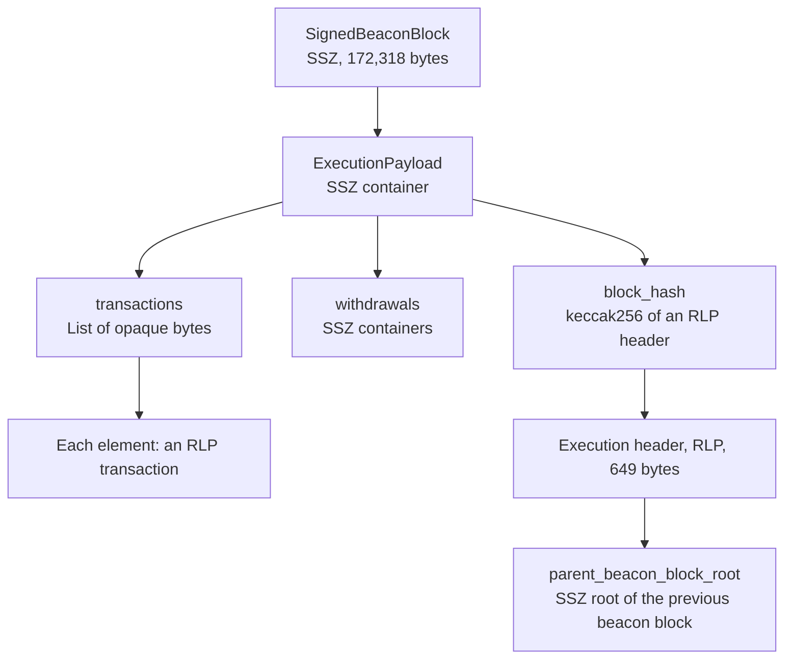
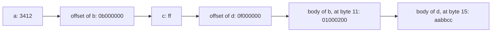

Ethereum encodes the same facts twice. A validator withdrawal in block 26,341,215 exists as 35 bytes of RLP on the execution layer, where it is hashed with Keccak-256 into a Merkle-Patricia trie, and as 44 bytes of SSZ on the consensus layer, where it is merkleized with SHA-256. The two encodings give two different roots for the same list.

RLP asks how to write a nested value compactly. SSZ asks how to give a typed value a Merkle root in which any field can be proven and any change rehashed cheaply. This article compares them at byte level and measures size and gas on that real block. Every byte shown comes from code that first reproduced the block's hash and its beacon root, and the last section reads the fork meta EIPs to separate what is scheduled from what is only proposed.

> This article has been made with the help of [Claude Code](https://claude.com/product/claude-code) and several custom skills

[TOC]

## What you need to know first

The article assumes familiarity with Ethereum and Solidity, and relies on these mechanisms without developing them:

- **Execution and consensus layers.** The execution layer runs the EVM and holds accounts, the consensus layer (the beacon chain) holds validators and finality. Each beacon block carries one execution payload.
- **Merkle-Patricia trie (MPT).** The authenticated key-value trie of the execution layer. Its nodes are RLP-encoded and hashed with Keccak-256, and the keys of the per-block tries are RLP-encoded indices. [Merkle Patricia Forestry on Cardano — How It Differs From Other Merkle Trees]({{site.url_complet}}/2026/08/28/merkle-patricia-forestry-cardano/) explains its structure.
- **Merkle branch.** To prove a leaf of a binary hash tree, a prover gives one sibling per level. This article only counts siblings: [When a Merkle Proof Breaks at a Hard Fork: Beacon State Proofs from Deneb to Gloas]({{site.url_complet}}/2026/11/04/beacon-state-proofs-hard-fork-deneb-to-gloas/) derives generalized indices and proof verification.
- **Typed transaction envelope.** [EIP-2718](https://eips.ethereum.org/EIPS/eip-2718) writes a transaction as one type byte followed by a payload, RLP in all current types. Legacy transactions have no type byte.
- **Calldata pricing.** Under [EIP-2028](https://eips.ethereum.org/EIPS/eip-2028) a zero byte costs 4 gas and a non-zero byte 16. [EIP-7623](https://eips.ethereum.org/EIPS/eip-7623) adds a floor for data-heavy transactions. Zero bytes therefore matter when comparing encodings.
- **Fork names.** Fusaka (Fulu on the consensus side, Osaka on the execution side) is the current mainnet fork. Glamsterdam (Gloas, Amsterdam) is the next one, and Hegotá (Heze, Bogota) the one after.

## Why two encodings exist

RLP dates from the original execution layer design. When the beacon chain was specified, its authors rejected reusing it. The [Upgrading Ethereum](https://eth2book.info/) book records the reasons: RLP was regarded as overly complex for the purpose, off-the-shelf formats did not guarantee deterministic output, and tree hashing, added in late 2018, is what settled the choice of a bespoke format. Offsets were adopted in April 2019 and limits on lists in June 2019.

The layers were then joined at the Merge without migrating either side, so each block now contains both formats, nested in each other:



| Data | Encoding today | Commitment |
|------|----------------|------------|
| Execution header, block hash | RLP | `keccak256(rlp(header))` |
| Transactions | EIP-2718 envelope around RLP | MPT root in the header, and `keccak256` per transaction |
| Receipts | EIP-2718 envelope around RLP | MPT root in the header |
| Withdrawals on the execution side | RLP | MPT root in the header |
| Accounts and trie nodes | RLP | State trie root |
| `CREATE` address, [EIP-7702](https://eips.ethereum.org/EIPS/eip-7702) authorizations | RLP | `keccak256` |
| Devp2p, node records | RLP on the execution network; [EIP-778](https://eips.ethereum.org/EIPS/eip-778) records are also used by consensus clients for discovery | Not applicable |
| Beacon blocks and state | SSZ | `hash_tree_root` |
| Consensus gossip and requests | SSZ with Snappy compression | Not applicable |
| Deposit data on the execution side | SSZ root computed in Solidity by the deposit contract | `deposit_data_root` |
| Execution requests ([EIP-7685](https://eips.ethereum.org/EIPS/eip-7685)) | One type byte followed by SSZ bytes | SHA-256 based `requests_hash` |

The execution rows can be read in `execution-specs`, for example `fork.py` and `blocks.py` under `forks/osaka`. The consensus side treats a transaction as bytes it does not parse: `Transaction` is a `ByteList` in the Fulu types, which is why the same bytes appear unchanged on both sides.

## RLP

### The rules

RLP knows two things: a byte string and a list of items. Its first byte says which of the two follows and how long it is:

| First byte | Meaning | Payload length |
|------------|---------|----------------|
| `0x00`–`0x7f` | One byte, its own encoding | 1 |
| `0x80`–`0xb7` | Short string | first byte − `0x80`, at most 55 |
| `0xb8`–`0xbf` | Long string | big-endian length in the next (first byte − `0xb7`) bytes |
| `0xc0`–`0xf7` | Short list | first byte − `0xc0`, at most 55 |
| `0xf8`–`0xff` | Long list | big-endian length in the next (first byte − `0xf7`) bytes |

Integers are not a type. By convention they are written as big-endian strings with no leading zero, so zero is the empty string.

```text
value                encoding
""                   80
integer 0            80
byte 0x00            00
integer 15           0f
byte 0x80            8180
integer 1024         820400
"dog"                83646f67
[]                   c0
["cat","dog"]        c88363617483646f67
[[],[[]],[[],[[]]]]  c7c0c1c0c3c0c1c0

55-byte string       prefix b7
56-byte string       prefix b838
1024-byte string     prefix b90400
list, 56-byte body   prefix f838
```

### A real withdrawal

The first withdrawal of block 26,341,215 has index 148,900,059, validator 572,344, address `0xb9d7…293f` and amount 12,663,254 gwei. In RLP it takes 35 bytes:

```text
e2                                                 list, 34-byte body
84 08e008db                                        index
83 08bbb8                                          validator_index
94 b9d7934878b5fb9610b3fe8a5e441e8fad7e293f        address
83 c139d6                                          amount
```

The encoding removes every zero it can, and pays one prefix byte per field.

### How strict the decoder is

For a given item RLP allows exactly one encoding, and a conforming decoder rejects the others. Both `ethereum_rlp` and Geth's `rlp` package do so. Run through the strict decoder written for this article, which agrees with the 72 upstream cases listed under "Verification":

| Input | Problem | Verdict |
|-------|---------|---------|
| `8105` | `0x05` written with a prefix | refused |
| `b80105` | long form for a short string | refused |
| `b8000000`, `f800` | length byte is zero | refused |
| `b90038…` | length has a leading zero | refused |
| `c2640102` | one byte after the list ends | refused |
| `83646f` | string shorter than announced | refused |
| `c4640102` | list overruns its input | refused |
| `8000` | extra byte after an empty string | refused |

A fuzz run of 200,000 inputs accepted 10,736, and each of them re-encoded to the same bytes. A decoder like this gives one encoding per value, so equal values have equal `keccak256` hashes.

`00` and `820004` are structurally valid RLP, and they are only rejected when the *schema* asks for an integer. The `ethereum_rlp` code shows the split: `decode` returns `b"\x00"`, and the leading-zero check lives in `_deserialize_to_uint`. A decoder that stops at the structural step accepts two encodings of the same integer.

### What RLP lacks

**No schema.** The bytes `820400` decode to `0x0400`, which can be the integer 1024, two raw bytes or a string. `rlp(0)`, `rlp("")` and `rlp(False)` are all `80`. The meaning lives in the client, so each transaction type adds its own field order, and typed fields such as a Geth `rlp:"optional"` tag exist only in code.

**No Merkle structure.** A hash of RLP bytes commits to all of them at once. To prove one field a verifier needs the whole item, and EIP-6404 lists this as the first shortcoming of RLP transactions: the signing hash of a large transaction requires the whole calldata. The trie adds per-item proofs, not per-field proofs.

## SSZ

SSZ, for Simple Serialize, is not self-describing: nothing in the bytes says what they are. Both sides must know the type in advance.

The normative text is no longer in `consensus-specs`: commit `498449f` removed `ssz/simple-serialize.md` and `ssz/merkle-proofs.md` in August 2026, and the project now depends on `eth-ssz-specs==0.1.0`. That package is built from [ethereum/ssz-specs](https://github.com/ethereum/ssz-specs), a Python reference implementation "which serves as the official specifications". This article uses release `v0.1.0`, the version `consensus-specs` pins, and read the code at a later commit as well.

The commits after the release add validation, such as a refusal of widths and lengths that do not fit, and the parts compared here did not change a root. The type names follow that source: `Uint64`, `BitList` and `BitVector` replace the older `uint64`, `Bitlist` and `Bitvector`, which EIPs still use.

### Basic and fixed-size types

- `UintN` is little-endian in exactly N/8 bytes.
- `Boolean` is one byte, `00` or `01`.
- `Vector[T, N]` holds exactly N elements, and `ByteVector[N]` exactly N bytes.
- A container concatenates its fields.

The same withdrawal is `Container(index: Uint64, validator_index: Uint64, address: Bytes20, amount: Uint64)`, all fixed-size, 44 bytes with no prefix at all:

```text
offset  0  db08e00800000000                            index
offset  8  b8bb080000000000                            validator_index
offset 16  b9d7934878b5fb9610b3fe8a5e441e8fad7e293f    address
offset 36  d639c10000000000                            amount
```

Compare `amount`: `c139d6` in RLP, `d639c10000000000` in SSZ. The bytes are reversed and padded. Across the whole withdrawal SSZ uses 9 more bytes, and in exchange the field is always at offset 36.

### Variable-size types and offsets

A `List[T, N]` holds up to N elements. A type is variable-size if it is a list, a bitlist, or contains one. Inside a composite, serialisation has two parts: the fixed part, where each variable field is replaced by a 4-byte little-endian offset, and then the variable bodies.



That is `Foo(a: Uint16, b: List[Uint16, 4], c: Uint8, d: List[Uint8, 8])` with `a = 0x1234`, `b = [1, 2]`, `c = 0xff`, `d = [0xaa, 0xbb, 0xcc]`:

```text
SSZ, 18 bytes: 3412 0b000000 ff 0f000000 01000200 aabbcc
RLP, 16 bytes: cf 821234 c20102 81ff c681aa81bb81cc
```

The lengths are never written. The length of `b` is the distance between two offsets, and the last body ends where the data ends. An offset is relative to the start of the object containing it, so an object serialises the same way wherever it sits. The first 4 bytes of the real block are an instance: `64000000` is 100, past the offset itself and the 96-byte signature, and the `message` starts there.

A list of variable-size elements begins with a table of offsets, so its element count is the first offset divided by 4:

```text
Vector[List[Uint8,3],4]([1,2],[3,4,5],[],[6])
10000000 12000000 15000000 15000000 0102 030405 06
```

The limit N of a list never appears in the bytes. It is enforced on decoding, and it sets the depth of the Merkle tree. Offsets also bound the format: `check_composite_size` in the specification refuses an encoding of 4 GiB or more, where RLP lengths go up to 8 bytes.

### Bitfields

`BitVector[N]` packs N bits, the first one in the lowest bit of the first byte. `BitList[N]` adds a sentinel: a `1` bit just above the last element marks the length, since a byte count alone cannot say how many bits are used.

```text
BitVector[5](1,0,1,0,1)   15          five bits, one byte
Vector[Boolean,5]         0100010001  five bytes
BitList[8](1,0,1)         0d          bits 101 plus the sentinel at bit 3
BitList[8](0,0,0)         08
BitList[8](eight zeros)   0001        the sentinel needs a new byte
BitVector[8](eight zeros) 00
```

The first attestation of the block has `aggregation_bits` of 25,414 bits with 25,309 set, stored in 3,177 bytes, and its last byte `7f` holds the sentinel.

### How strict the decoder is

SSZ is equally strict about canonical form. Its rules differ because lengths come from offsets:

| Input | Type | Problem | Verdict |
|-------|------|---------|---------|
| `010007000000000708` | `{Uint16, List[Uint8,4]}` | first offset leaves a gap after the fixed part | refused |
| `0100050000000708` | same | first offset inside the fixed part | refused |
| `01000600` | same | offset truncated | refused |
| `0100060000000102030405` | same | list above its limit | refused |
| `0800000007000000aabb` | two lists | offsets out of order | refused |
| `0800000011000000aabb` | two lists | last offset past the end | refused |
| `02` | `Boolean` | not 0 or 1 | refused |
| `0500` | `BitList[16]` | last byte zero, no sentinel | refused |
| `e0` | `BitVector[5]` | padding bits set | refused |
| `0100ff` | `Uint16` | spare byte | refused |

The first-offset rule closes the gap that would otherwise allow hidden bytes between the two parts. With 200,000 mutated inputs against a mixed container, 27,067 were accepted, and each of them re-encoded to the same bytes.

Without a type, however, the bytes mean nothing. `0100020003000400` is `Vector[Uint16,4](1,2,3,4)`, `Vector[Uint8,8](1,0,2,0,3,0,4,0)` and `List[Uint16,4](1,2,3,4)`.

## hash_tree_root compared with hashing bytes

### The algorithm

`hash_tree_root` is defined over the type, not over the serialised bytes:

- **Basic value.** The little-endian bytes, right-padded to a 32-byte chunk. No hash at all.
- **Bytes and packed vectors.** Serialised, split into chunks, and merkleized.
- **Containers and vectors of composites.** One chunk per element, its own `hash_tree_root`, merkleized.
- **Lists and bitlists.** The tree width comes from the limit, not the length, then the length is mixed in: `sha256(root ‖ uint256_le(length))`.

The tree is padded with zero chunks up to a power of two. An implementation does not build that tree: the roots of all-zero subtrees are precomputed, so an empty `List` with a limit of `2^40` costs no real work. Without the mix-in, a list ending in zeros would share its root with the shorter list.

For the real withdrawal, four fields give four chunks and three hashes:

```text
c0 index            db08e00800000000000000000000000000000000000000000000000000000000
c1 validator_index  b8bb080000000000000000000000000000000000000000000000000000000000
c2 address          b9d7934878b5fb9610b3fe8a5e441e8fad7e293f000000000000000000000000
c3 amount           d639c10000000000000000000000000000000000000000000000000000000000
sha256(c0,c1)       db1768e0a64e730597e3ffab9029ff3fba668ad3e77f297069af1719c20139cc
sha256(c2,c3)       181b12d072706332392761c8bbf443d307f0b709f3d0ab40d0229e4ed1ab9f79
root                3f941324cd5d327ee7c72a2d72f6859601d042dbec06715bd42314185d1f3fc1
```

Hashing the bytes gives other values: `sha256` of the 44 bytes is `86e4b09e…57ae`, and `keccak256` of the 35 RLP bytes is `fbce3397…a3ae`. The root is not the hash of the serialisation, and a contract that hashes SSZ bytes has computed something else.

### Why the design pays off

Tree hashing costs more the first time and much less afterwards. The block itself shows the first half:

| Object | Flat SHA-256 | `hash_tree_root` |
|--------|--------------|------------------|
| Real `BeaconBlock`, 172,218 bytes | 2,692 compressions | 11,790 hashes, 23,580 compressions |
| `List[Uint64, 2^40]`, 2,000,000 synthetic values, 16,000,000 bytes | 250,001 compressions | 500,027 hashes |
| One value changes in that list | 250,001 again | 39 hashes |

The compression figure assumes two per 64-byte hash, without an implementation that precomputes the padding block. In the first computation the tree is about four times the work of a flat hash on the list. After that, one update walks 38 levels and one mix-in, and the code checks that the incremental root equals a full recomputation. This is what makes a monolithic beacon state practical: only the path of each changed value is rehashed.

The other property is summaries. Any subtree can be replaced by its root without changing the result. On the real block, the 112-byte `BeaconBlockHeader`, whose `body_root` replaces a body, has the same root as the 172,218-byte `BeaconBlock`: `0xe74a493e…542a`.

### Two limits worth knowing

**The root is not bound to the type.** The same run shows that `Vector[Uint16,4](1,2,3,4)` and `Vector[Uint8,8](1,0,2,0,3,0,4,0)` have equal bytes and an equal root, since both fit one chunk. `List[Uint16,4]` and `List[Uint16,8]` also share a root for the same values, as both limits round to one chunk, while `List[Uint16,64]` differs. Consensus signatures add a domain for this reason, and a contract that compares roots needs to know the type on its own.

**The limit is part of the commitment.** Changing a limit can change every root of that type. This is the weakness that progressive lists address, and [the beacon state proofs article]({{site.url_complet}}/2026/11/04/beacon-state-proofs-hard-fork-deneb-to-gloas/) follows its effect on proofs across forks.

## The same data in both, measured

### Verification

All numbers below come from `verification/ssz-vs-rlp-ethereum-serialization/`, standard-library Python and a Foundry project. Before measuring, the two codecs were checked against outside values:

| Check | Result |
|-------|--------|
| [`RLPTests`](https://github.com/ethereum/tests/tree/develop/RLPTests) valid and invalid files, Geth decode cases | 72 of 72 |
| `ssz-specs` v0.1.0 reference vectors | 117 of 117, of which 8 rejections |
| Book examples and known Keccak digests | 11 of 11 |
| Re-serialising the downloaded `SignedBeaconBlock` | byte-identical, 172,318 bytes |
| `hash_tree_root(BeaconBlock)` | equals the block root |
| `keccak256(rlp(header))` | equals the block hash |
| 260 transaction hashes | all equal |
| MPT roots of transactions, withdrawals, receipts | all equal the header |
| Length of `rlp(block)` | equals the node's 166,000 |

The block is slot 15,580,704, finalized, with 260 transactions, 16 withdrawals and 10 blob commitments. Its two commitments to the same withdrawals are `0x1a876dcd…5dd9` on the execution side and `0x30c5ce9c…5acc` on the consensus side. No conversion exists between them other than recomputing from the data.

### Size

`transactions` are compared against the SSZ form of [EIP-6404](https://eips.ethereum.org/EIPS/eip-6404). That EIP is a Draft and has no test vectors, so those rows are this article's reading of it.

| Data | RLP bytes | SSZ bytes | SSZ / RLP | Calldata gas RLP | Calldata gas SSZ | zlib RLP | zlib SSZ |
|------|-----------|-----------|-----------|------------------|------------------|----------|----------|
| One withdrawal | 35 | 44 | 1.257 | 560 | 536 | 46 | 46 |
| 16 withdrawals | 565 | 704 | 1.246 | 9,040 | 8,600 | 208 | 205 |
| 260 transactions | 164,232 | 198,453 | 1.208 | 1,563,108 | 1,673,520 | 61,566 | 62,606 |

For this one block:

- **Raw size favours RLP.** SSZ is about 20 to 26% larger here, and all 260 transactions grew, by 101 to 183 bytes with a median of 133.
- **Larger is not always dearer.** Withdrawals are 139 bytes longer in SSZ and 440 gas cheaper as calldata, because the extra bytes are zeros. For transactions the fixed 32-byte integers and offsets outweigh that effect.
- **Compression removes most of the gap.** The transaction difference falls from 34,221 bytes to 1,040. zlib is a stand-in: the consensus network uses Snappy, which was not measured.

The gas columns use the standard 4 and 16 gas per byte, without the EIP-7623 floor. The zero-byte advantage is specific to that pricing: [EIP-7976](https://eips.ethereum.org/EIPS/eip-7976), scheduled for Glamsterdam, sets a floor of 64 gas per calldata byte, zero or not, and a data-heavy transaction that pays this floor would be charged on length alone.

Some objects are similar in size overall, without being field-for-field equal: the RLP execution block is 166,000 bytes and the `SignedBeaconBlock` 172,318, and the RLP header is 649 bytes against 608 for the `ExecutionPayloadHeader`.

### Proof size

Counting only, on the same block. For a transaction, the median MPT proof is 1,354 bytes including the transaction, and the largest 18,765, driven by a large transaction in the final node. An SSZ branch to an element of `Transactions` is 21 siblings, 672 bytes, whatever the size of the element. For a withdrawal, a median of 621 bytes compares with 5 siblings, 160 bytes.

## Decoding in Solidity

Neither format has EVM support, so a contract needs its own reader. The project reads calldata with a strict RLP reader and a small SSZ reader, compiled with solc 0.8.30, optimizer 200 runs, EVM version `osaka`.

- **RLP reader.** It must parse each header, check canonical form, and walk through earlier items, since an item's position depends on the lengths before it.
- **SSZ reader.** It checks the total length, reads at a constant offset, and swaps endianness. `uint64` needs a byte swap, as the [deposit contract's](https://github.com/ethereum/solidity-deposit-contract) `to_little_endian_64` does in the other direction.

Gas is the cost of the function minus that of a no-op with the same calldata, both already warm, so it excludes intrinsic calldata cost:

| Operation | RLP | SSZ |
|-----------|-----|-----|
| Read `amount` from one withdrawal | 4,102 | 296 |
| Read `amount` from element 0 of 16 | 5,489 | 518 |
| Read `amount` from element 15 of 16 | 15,885 | 518 |
| Decode all fields of all 16 | 93,069 | 19,776 |
| Read `value` from a real 180-byte type-2 transaction | 6,145 | 944 |
| Read `value` from a real 17,527-byte type-2 transaction | 6,265 | 945 |
| Hash element 0 of 32 real transactions | 2,886 | 1,699 |
| Hash element 31 of 32 real transactions | 42,484 | 1,290 |


RLP grows by about 693 gas per element skipped, and SSZ does not depend on position. The ratios (about 14 for one field) depend on the implementation, because this RLP reader favours clarity and an assembly version would be cheaper. The linear growth and the flat line do not depend on it.

- **Size of the skipped data is not the cost.** Reading `value` costs almost the same in a 180-byte and a 17,527-byte transaction: RLP reads a length and jumps. The cost follows the number of items passed, not the number of bytes.
- **The last two rows include different work.** Each hashes one element of its own length, so the SSZ figure varies with the transaction rather than with its position.

For comparison, reading `amount` from an ABI-encoded struct argument costs 871 gas gross, including the call, against 979 gross for the no-op that takes 44 bytes as `bytes`. The ABI form takes 132 bytes of calldata.

### Committing costs more than reading

Measured on the same withdrawal, hashing favours RLP:

| Commitment | Net gas |
|------------|---------|
| `keccak256` of the RLP bytes | 177 |
| `sha256` of the SSZ bytes | 445 |
| `hash_tree_root` in Solidity | 2,732 |

SHA-256 is a precompile, and each hash needs a call, while `keccak256` is an opcode. A root here costs about 15 times a Keccak hash of the bytes. So SSZ reduces the cost of locating a field, and increases the cost of committing to one.

With an SSZ tree, a verifier that wants one field from a large object needs the branch only, rather than the whole object, which is the case EIP-6404 makes for transactions.

## The direction of travel

The status below was read from the local EIPs checkout and compared with the upstream `master` branch on 2026-11-04.

| Proposal | Status | Fork meta EIP |
|----------|--------|---------------|
| [EIP-7688](https://eips.ethereum.org/EIPS/eip-7688), forward-compatible consensus structures | Review | Scheduled for Inclusion in Glamsterdam ([EIP-7773](https://eips.ethereum.org/EIPS/eip-7773)) |
| [EIP-7916](https://eips.ethereum.org/EIPS/eip-7916), `ProgressiveList` | Review | Required by EIP-7688, not itself listed; [PR #12449](https://github.com/ethereum/EIPs/pull/12449) to add it is open |
| [EIP-7495](https://eips.ethereum.org/EIPS/eip-7495), `ProgressiveContainer` | Review | Same as EIP-7916 |
| [EIP-8016](https://eips.ethereum.org/EIPS/eip-8016), `CompatibleUnion` | Draft | Not listed in EIP-7773 or EIP-8081 |
| [EIP-6404](https://eips.ethereum.org/EIPS/eip-6404), SSZ transactions | Draft | Not listed in EIP-7773 or EIP-8081 |
| [EIP-6466](https://eips.ethereum.org/EIPS/eip-6466), SSZ receipts | Draft | Not listed in EIP-7773 or EIP-8081 |
| [EIP-7807](https://eips.ethereum.org/EIPS/eip-7807), SSZ execution blocks | Draft | Declined for Inclusion in Hegotá ([EIP-8081](https://eips.ethereum.org/EIPS/eip-8081)) |
| [EIP-7919](https://eips.ethereum.org/EIPS/eip-7919), Pureth meta | Stagnant | Not listed |

### Progressive types: scheduled with EIP-7688

A `ProgressiveList` removes the limit from the tree. Instead of one tree of fixed depth, it uses a spine of subtrees of 1, 4, 16, 64 chunks and so on, and appending never moves an existing element. A `ProgressiveContainer` declares `active_fields`, a bit per position, so a field that is removed leaves a gap and the others keep their place. Both serialise like their ordinary counterparts; only the tree differs. The code checks this against the `ssz-specs` vectors, 117 in all with those types among them.

So the consensus layer changes its Merkle tree layouts in Glamsterdam, and its encoding does not change. In the Gloas specification `Validators`, `Balances`, `Attestations` and many others become `ProgressiveList`, and `ExecutionPayloadBid` a `ProgressiveContainer`. A related point from this reading (*derived*, not stated in the EIPs): progressive containers stabilise Merkle positions, not serialised offsets, so a contract that reads SSZ bytes at a constant offset still breaks when a field is added.

Glamsterdam has no mainnet date: the activation table of EIP-7773 is empty for mainnet, and `GLOAS_FORK_EPOCH` is `2**64-1` at `consensus-specs` head. The upstream table has Sepolia at 2026-10-06 and Hoodi at 2026-10-26, and the local pin has only Sepolia.

### Transactions and receipts: not scheduled

EIP-6404 and EIP-6466 are Drafts, and neither appears in the Glamsterdam or the Hegotá meta EIP. EIP-7807, the block-level migration, was declined for Hegotá, and the Pureth meta EIP that bundled them is Stagnant. None of this says they are abandoned; [PR #9788](https://github.com/ethereum/EIPs/pull/9788) on EIP-6404 is still open and the EIP was edited in June 2026. It says that no fork currently includes them.

Recent decisions go the other way on the execution side:

- **Block-level access lists.** [EIP-7928](https://eips.ethereum.org/EIPS/eip-7928), scheduled for Glamsterdam, commits to `keccak256(rlp.encode(...))`, and its size analysis mentions an earlier SSZ-based design.
- **Frame transactions.** [EIP-8141](https://eips.ethereum.org/EIPS/eip-8141), scheduled for Hegotá, defines its payload as an RLP serialization.
- **The Gloas types.** `Transaction` and `BlockAccessList` become `ProgressiveList[Byte]`: a new SSZ tree around bytes that are still RLP.

The boundary therefore moves inside the consensus layer, and the execution layer keeps adding RLP structures. Nothing read here schedules the end of RLP.

## Conclusion

RLP and SSZ answer different questions, and Ethereum's blocks use both, one inside the other.

- **RLP** is compact and untyped. The schema lives in the clients, and a commitment covers the bytes as one unit.
- **SSZ** is typed and positional. Fixed fields sit at known offsets, variable ones behind 4-byte offsets, and limits set the depth of the tree.
- **Both decoders are strict.** Each accepted input has one encoding, and RLP integers need one additional typed check.
- **`hash_tree_root` is a tree over the type.** It costs about four times a flat hash at first and 39 hashes per update on the measured list, and bytes alone do not determine the type.
- **Measured on one block**, SSZ was 20 to 26% larger, cheaper as calldata for withdrawals, dearer for transactions, and close to RLP after zlib.
- **In Solidity**, reading a field cost 296 gas against 4,102, and committing cost 2,732 against 177.
- **What is scheduled:** EIP-7688 for Glamsterdam, which requires the progressive types. SSZ transactions and receipts are in no fork, and EIP-7807 was declined for Hegotá.


## Annex

### Key Terms

| Term | Definition |
|------|------------|
| **Serialisation** | Writing a structured value as bytes so that it can be stored, sent or hashed. |
| **Canonical encoding** | The only encoding a decoder accepts for a value, so that equal values have equal bytes. |
| **Self-describing format** | A format whose bytes reveal their structure. RLP reveals strings and lists, SSZ reveals nothing. |
| **RLP** | Recursive Length Prefix, the execution layer's encoding of byte strings and nested lists. |
| **SSZ** | Simple Serialize, the consensus layer's typed encoding and its merkleization rules. |
| **Merkle-Patricia trie** | The execution layer's authenticated key-value trie, built from RLP nodes and Keccak-256. |
| **Fixed-size type** | An SSZ type whose encoded length is known from the type alone. |
| **Variable-size type** | A list, a bitlist, or any type containing one. |
| **Offset** | A 4-byte little-endian position of a variable body, relative to the enclosing object. |
| **Container** | An SSZ type with named fields of possibly different types. |
| **Vector** | An SSZ sequence of exactly N elements. |
| **List** | An SSZ sequence of at most N elements, where N is not serialised. |
| **Sentinel bit** | The `1` bit above the last element of a `BitList`, which marks its length. |
| **Chunk** | A 32-byte unit of SSZ merkleization. |
| **Merkleization** | Building a binary hash tree over chunks, padded with zero chunks to a power of two. |
| **Hash tree root** | The Merkle root of an SSZ value, computed with SHA-256 from its type and content. |
| **Length mix-in** | Hashing a list's root with its length, so that trailing zero elements change the root. |
| **Summary** | A value in which a subtree is replaced by its root, keeping the same hash tree root. |
| **Progressive list** | A list merkleized over subtrees of growing width, with no limit fixing its depth. |
| **Active fields** | The bit per position of a `ProgressiveContainer`, which keeps fields at stable Merkle positions. |

### Security Implementation Checklist

#### RLP readers

| Check | Security requirement | Failure mode if violated |
|:---:|------------|------------|
| ☐ | Reject a single byte below `0x80` written with a prefix. | Two encodings of one value, so equal values can hash differently. |
| ☐ | Reject long forms for payloads under 56 bytes and lengths with a leading zero. | Same malleability through the length field. |
| ☐ | Reject trailing bytes after the outer item. | Attacker-chosen data sits beside a value that still decodes. |
| ☐ | Bound every item by its enclosing list, not by the whole input. | An inner item reads beyond its parent, so fields can be forged across boundaries. |
| ☐ | Reject leading zeros in integers at the typed step. | Structural decoding alone accepts `820004`, a second encoding of 4. |
| ☐ | Check the field count of each list against the schema. | Extra or missing fields are read as something else. |
| ☐ | Bound the list walk when the index comes from a caller. | Gas grows with position, which can be used to exhaust a call. |

#### SSZ readers

| Check | Security requirement | Failure mode if violated |
|:---:|------------|------------|
| ☐ | Require the first offset to equal the end of the fixed part. | A gap can hide bytes, and two encodings exist for one value. |
| ☐ | Require offsets to be non-decreasing and within the input. | Bodies overlap or read out of bounds. |
| ☐ | Enforce list limits when decoding. | The value exceeds what the type allows and has no valid root. |
| ☐ | Require exact length for fixed-size types. | Spare bytes go unnoticed. |
| ☐ | Reject `Boolean` bytes other than 0 and 1, set padding bits, and a `BitList` with no sentinel. | Several encodings of one value. |
| ☐ | Convert endianness on every integer read. | A contract reads a wrong amount with no revert. |
| ☐ | Do not hash serialised bytes in place of `hash_tree_root`. | The digest never matches the protocol's root. |
| ☐ | Tie a compared root to a known type or domain. | Different types can share bytes and a root. |

### Integration Notes

| Behaviour | What an integrator should do |
|-----------|------------------------------|
| `transactionsRoot` in the execution header and the `transactions` root of the consensus layer differ for the same transactions. | Pick the commitment that matches the proof format. They cannot be converted into each other. |
| `Transaction` is opaque bytes on the consensus side. | Parse it as an EIP-2718 envelope. An SSZ branch to it proves bytes, not fields. |
| An SSZ `uint64` is little-endian, and an EVM word is big-endian. | Swap bytes. Check the result against a known value. |
| A fixed offset depends on the container layout of a fork. | Treat offsets like generalized indices: version them by fork. |
| `Uint256` costs a 32-byte field in SSZ even for small values. | Compare calldata gas, not lengths. Zeros are cheap. |
| The EIPs still say `uint64` and `Bitlist`, while `ssz-specs` says `Uint64` and `BitList`. | Treat these as renames, not as different types. |

## Frequently Asked Questions

**Q: Why does integer 0 encode to `80` and not `00` in RLP?**

Integers are big-endian strings with no leading zero, so 0 is the empty string, whose encoding is `80`. `00` is the one-byte string `0x00`. Reading it as an integer is refused at the typed step.

**Q: How does an SSZ decoder find the length of a list inside a container, when no length is stored?**

It subtracts offsets. A body runs from its own offset to the next offset, and the last body runs to the end of the data. The number of elements is that span divided by the element size. For a list of variable-size elements it is the first offset divided by 4.

**Q: What is the difference between a `Vector` and a `List` with the same elements?**

Alone, they serialise identically. They differ in two ways:

- Inside a container, a list adds an offset, as it is variable-size.
- In the tree, a list has its width set by the limit, and its length is mixed in.

**Q: Why is `hash_tree_root` more expensive than one SHA-256, and why is it used anyway?**

It hashes every level of a tree, and on the 16,000,000-byte list that took about four times the compressions of a flat hash. After that an update costs one branch: 39 hashes, against 250,001 compressions for rehashing flat. It also allows a proof of one field, and a subtree can stand in for its root.

**Q: Two types give the same SSZ bytes and root. How can that be safe?**

Both sides must already know the type, so the root alone is not a statement about what the value is. The consensus layer signs with a domain and has one type per context. A contract must provide that context itself, by fixing the type and the position being proven.

**Q: A contract reads the third field of many RLP items and hashes each one. Would SSZ reduce its total cost?**

Reading would be cheaper, as the field offset is constant.

Hashing depends on what must match. If the contract needs the protocol's `hash_tree_root`, it pays for SHA-256 precompile calls, 2,732 gas here against 177 for `keccak256` over the RLP bytes. Calldata may rise or fall with the share of zero bytes. So the answer needs a measurement of the three costs together.

**Q: Are SSZ transactions coming in Glamsterdam?**

No fork lists them. EIP-6404 and EIP-6466 are Drafts, absent from EIP-7773 and EIP-8081. Glamsterdam schedules EIP-7688, whose Gloas types keep transactions as opaque bytes inside a progressive list.

## Gaps

The points below were not settled by the sources or by the runs.

| Gap | Why it matters | What to read or verify |
|-----|----------------|------------------------|
| Sizes come from one block, the latest finalized when the data was taken, and a planned sample of one epoch was not run. | The ratios describe slot 15,580,704 and its mix of 229 type-2, 25 legacy, 3 blob and 3 set-code transactions; they may differ on other blocks. | Repeat `measure_sizes.py` over many blocks. |
| The EIP-6404 conversion has no upstream vectors, and the EIP is a Draft. | The transaction SSZ sizes and the 945 gas read are a reading of the text. | Compare with an EIP-6404 implementation or later vectors. |
| Snappy was not measured, as the Python standard library has no codec. | The zlib columns only suggest the wire comparison. | Re-run with a Snappy implementation on the same bytes. |
| The Solidity readers are written for clarity. | An assembly RLP reader would lower the RLP figures, and the ratios with them. | Measure a production library, keeping the same strictness. |
| EIP-6466 receipts were not converted. | No size comparison exists for receipts. | The containers of EIP-6466, with `eip-8116` which it requires. |
| The rules were read from the `ssz-specs` Python source; the Lean specification was not read, and vectors are `v0.1.0`, older than the head that was read. | A divergence after the release would not show in the vectors. | `lean/` in `ethereum/ssz-specs`, and vectors of a later release. |
| PR #12449 is open, with merge conflicts, and EIP-7773 was read on one date. | EIP-7495 and EIP-7916 may become formally listed, and activation rows change quickly. | EIP-7773 and the PR at reading time. |
| Historical reasons for leaving RLP come from the book, which describes the v1.3.0 spec. | The motives are a secondary account. | Issues linked in the book's SSZ chapter. |
| The remark that progressive containers leave serialised offsets unstable is derived, not stated by an EIP. | Integrators should test it for their case. | EIP-7495 and any reader of SSZ bytes on-chain. |

## References

- [Claude Code](https://claude.com/product/claude-code)

### Analyzed source

- [ethereum/ssz-specs](https://github.com/ethereum/ssz-specs), normative SSZ source — release [v0.1.0](https://github.com/ethereum/ssz-specs/releases/tag/v0.1.0), commit [`7bce07ff7d51b1a3c66ff4e2bd3233ac248ede70`](https://github.com/ethereum/ssz-specs/tree/7bce07ff7d51b1a3c66ff4e2bd3233ac248ede70), and code read at [`fcfb114f53768e08d74640e2b40b0d44d03ba099`](https://github.com/ethereum/ssz-specs/tree/fcfb114f53768e08d74640e2b40b0d44d03ba099), 2026-11-04
- [ethereum/consensus-specs](https://github.com/ethereum/consensus-specs) — analyzed at commit [`065bcd5c6ad96186cd2c0ac1c435f620a0b25373`](https://github.com/ethereum/consensus-specs/tree/065bcd5c6ad96186cd2c0ac1c435f620a0b25373), 2026-11-04; upstream head at that date was [`204fb4a19774eabb7a2e91505365deed6b8afef8`](https://github.com/ethereum/consensus-specs/tree/204fb4a19774eabb7a2e91505365deed6b8afef8), checked for the Gloas epoch and types
- [ethereum/consensus-specs at `802485e`](https://github.com/ethereum/consensus-specs/tree/802485ec74a6986542bd53bf153189623aab440c), the last commit with `ssz/simple-serialize.md`, before [`498449f`](https://github.com/ethereum/consensus-specs/commit/498449f83228304263b05cce1b052f44b7531d8c)
- [ethereum/execution-specs](https://github.com/ethereum/execution-specs) — analyzed at commit [`aaae5abd382b6c0612add96bd8400d6fa4eb0617`](https://github.com/ethereum/execution-specs/tree/aaae5abd382b6c0612add96bd8400d6fa4eb0617), 2026-11-04
- [ethereum/ethereum-rlp](https://github.com/ethereum/ethereum-rlp) — analyzed at commit [`8c0a5af58259b3457952cdfa6a58f61fcface6df`](https://github.com/ethereum/ethereum-rlp/tree/8c0a5af58259b3457952cdfa6a58f61fcface6df), equal to upstream head, 2026-11-04
- [ethereum/go-ethereum](https://github.com/ethereum/go-ethereum) — `rlp` package at commit [`8b8bb43a732d5d3441c646e62352d25bdaccb30f`](https://github.com/ethereum/go-ethereum/tree/8b8bb43a732d5d3441c646e62352d25bdaccb30f), 2026-11-04
- [ethereum/EIPs](https://github.com/ethereum/EIPs) — analyzed at commit [`41a838decba33325d01bd99b1cd6072c51214fac`](https://github.com/ethereum/EIPs/tree/41a838decba33325d01bd99b1cd6072c51214fac), compared with [`46976b2a9bf99f727fb87dc8c809e3a3cdc6b445`](https://github.com/ethereum/EIPs/tree/46976b2a9bf99f727fb87dc8c809e3a3cdc6b445), 2026-11-04
- [ethereum/tests](https://github.com/ethereum/tests) — `RLPTests` at commit [`c67e485ff8b5be9abc8ad15345ec21aa22e290d9`](https://github.com/ethereum/tests/tree/c67e485ff8b5be9abc8ad15345ec21aa22e290d9), 2026-11-04
- [ethereum/solidity-deposit-contract](https://github.com/ethereum/solidity-deposit-contract) — analyzed at commit [`5bf2741b50c58b844225f89018041c5d54726f8e`](https://github.com/ethereum/solidity-deposit-contract/tree/5bf2741b50c58b844225f89018041c5d54726f8e), 2026-11-04
- [benjaminion/upgrading-ethereum-book](https://github.com/benjaminion/upgrading-ethereum-book) — analyzed at commit [`e013f03c85a050f4fec6a3fa352672ddbdb197ce`](https://github.com/benjaminion/upgrading-ethereum-book/tree/e013f03c85a050f4fec6a3fa352672ddbdb197ce), 2026-11-04
- [Verification code](https://github.com/rya-sge/access-denied/tree/main/verification/ssz-vs-rlp-ethereum-serialization) for this article

### Specifications

- [EIP-778: Ethereum Node Records](https://eips.ethereum.org/EIPS/eip-778)
- [EIP-2028: Transaction data gas cost reduction](https://eips.ethereum.org/EIPS/eip-2028)
- [EIP-2718: Typed Transaction Envelope](https://eips.ethereum.org/EIPS/eip-2718)
- [EIP-6404: SSZ transactions](https://eips.ethereum.org/EIPS/eip-6404)
- [EIP-6466: SSZ receipts](https://eips.ethereum.org/EIPS/eip-6466)
- [EIP-7495: SSZ ProgressiveContainer](https://eips.ethereum.org/EIPS/eip-7495)
- [EIP-7623: Increase calldata cost](https://eips.ethereum.org/EIPS/eip-7623)
- [EIP-7685: General purpose execution layer requests](https://eips.ethereum.org/EIPS/eip-7685)
- [EIP-7688: Forward compatible consensus data structures](https://eips.ethereum.org/EIPS/eip-7688)
- [EIP-7702: Set Code for EOAs](https://eips.ethereum.org/EIPS/eip-7702)
- [EIP-7773: Hardfork Meta - Glamsterdam](https://eips.ethereum.org/EIPS/eip-7773)
- [EIP-7807: SSZ execution blocks](https://eips.ethereum.org/EIPS/eip-7807)
- [EIP-7916: SSZ ProgressiveList](https://eips.ethereum.org/EIPS/eip-7916)
- [EIP-7919: Pureth Meta](https://eips.ethereum.org/EIPS/eip-7919)
- [EIP-7928: Block-Level Access Lists](https://eips.ethereum.org/EIPS/eip-7928)
- [EIP-7976: Increase Calldata Floor Cost](https://eips.ethereum.org/EIPS/eip-7976)
- [EIP-8016: SSZ CompatibleUnion](https://eips.ethereum.org/EIPS/eip-8016)
- [EIP-8081: Hardfork Meta - Hegotá](https://eips.ethereum.org/EIPS/eip-8081)
- [EIP-8141: Frame Transaction](https://eips.ethereum.org/EIPS/eip-8141)

### Books and proposals tracking

- [Upgrading Ethereum](https://eth2book.info/), chapters "SSZ: Simple Serialize" and "Hash Tree Roots and Merkleization"
- [PR #12449: Update EIP-7773: Add EIP-7495 and EIP-7916 to Glamsterdam](https://github.com/ethereum/EIPs/pull/12449)
- [PR #9788: Update EIP-6404: Add some suggestions or corrections](https://github.com/ethereum/EIPs/pull/9788)

### Related articles

- [When a Merkle Proof Breaks at a Hard Fork: Beacon State Proofs from Deneb to Gloas]({{site.url_complet}}/2026/11/04/beacon-state-proofs-hard-fork-deneb-to-gloas/)
- [Ethereum's Hidden Contracts: The System Contracts Behind Every Block]({{site.url_complet}}/2026/11/04/ethereum-system-contracts/)
- [Solidity ABI Encoding – Overview]({{site.url_complet}}/2025/07/29/solidity-abi-encoding-overview/)
- [Merkle Patricia Forestry on Cardano — How It Differs From Other Merkle Trees]({{site.url_complet}}/2026/08/28/merkle-patricia-forestry-cardano/)
- [Ethereum Upgrade Glamsterdam - Overview]({{site.url_complet}}/2026/10/23/ethereum-glamsterdam-upgrade-overview/)
