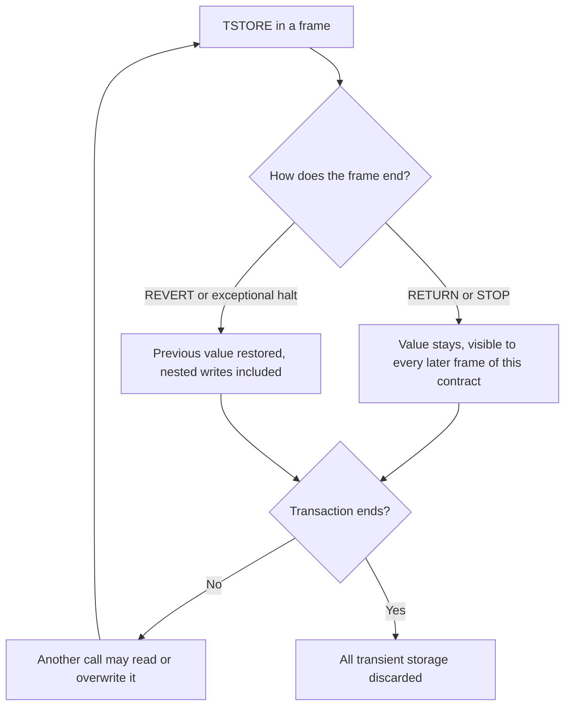
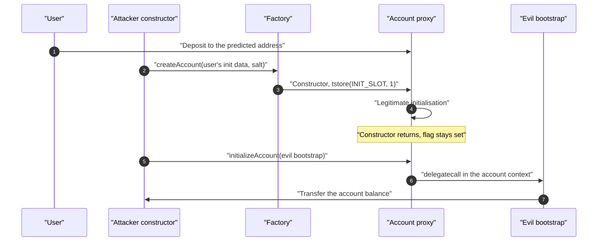

Transient storage gives a contract a key-value store that behaves like storage during a transaction and is empty when the next one starts. In a reentrancy lock it costs about a fifth of a storage lock, and OpenZeppelin now marks its storage guard for removal in v6.0. The same lifetime is also the main source of bugs: the value ends with the transaction, not with the call that wrote it.

This article reads [EIP-1153](https://eips.ethereum.org/EIPS/eip-1153) as implemented in the execution specs, follows the Solidity support release by release, and measures six locks with real transaction receipts. It then tests what goes wrong and examines two real failures: the Startale account drain, and the solc bug `TransientStorageClearingHelperCollision`. Every measured value comes from the [verification code](https://github.com/rya-sge/access-denied/tree/main/verification/transient-storage-solidity-reentrancy-locks).

> This article has been made with the help of [Claude Code](https://claude.com/product/claude-code) and several custom skills

[TOC]

## What you need to know first

The article assumes Solidity and the EVM call model, and relies on these mechanisms:

- **Call frame.** Each `CALL`, `DELEGATECALL`, `STATICCALL` or `CREATE` runs in its own frame. A frame that reverts undoes its state changes, and one that returns keeps them. Reentrancy is a second frame of a contract opening while the first is still running.
- **Warm and cold access.** Since [EIP-2929](https://eips.ethereum.org/EIPS/eip-2929), the first access to a storage slot in a transaction costs 2,100 gas and later ones 100. The address being executed is warm, which matters for the stipend section.
- **Gas refunds.** Restoring a slot to its original value in the same transaction earns a refund. [EIP-3529](https://eips.ethereum.org/EIPS/eip-3529) caps the refund at one fifth of the gas used, so a small transaction can lose most of it.
- **The 2,300 gas stipend.** `transfer` and `send` forward 2,300 gas. [EIP-2200](https://eips.ethereum.org/EIPS/eip-2200) makes `SSTORE` fail when 2,300 gas or less remains. [The 2,300 Gas Stipend in Ethereum]({{site.url_complet}}/2026/10/23/ethereum-2300-gas-stipend/) covers the history.
- **Counterfactual account.** An [ERC-4337](https://eips.ethereum.org/EIPS/eip-4337) account has a `CREATE2` address known before deployment, so it can receive funds before any code exists there.
- **Via-IR.** solc has two pipelines: the legacy code generator, and via-IR, which goes through the Yul intermediate language.

## EIP-1153 as the specification implements it

The references below are to `src/ethereum/forks/cancun/` in [execution-specs](https://github.com/ethereum/execution-specs), at the commit pinned in the references. Upstream `HEAD` was 26 commits ahead on 2026-11-04, with no change under the Cancun source directory.

| Property | Behaviour | Where |
|----------|-----------|-------|
| Opcodes | `TLOAD` (`0x5c`) and `TSTORE` (`0x5d`) | `vm/instructions/storage.py` |
| Gas | 100 each, flat, `OPCODE_TLOAD` and `OPCODE_TSTORE` equal `WARM_ACCESS` | `vm/gas.py:156-157` |
| Key | `(address, key)`, so one space per contract, separate from storage | `state_tracker.py:84` |
| Empty slot | Reads as zero | `state_tracker.py:258` |
| Scope | The whole transaction, across all frames | `state_tracker.py:714` clears it once the transaction is merged into the block |
| Reverted frame | Snapshot taken on entry, restored on failure | `state_tracker.py:655,677`, `vm/interpreter.py:158,197` |
| Successful return | Nothing happens to the value | No clearing code exists at frame level |
| `DELEGATECALL` | Uses `current_target`, so the caller's space | `storage.py:151,179` |
| Static context | `TSTORE` raises `WriteInStaticContext`, `TLOAD` works | `storage.py:175-176` |
| 2,300 gas check | Absent from `tstore`, present in `sstore` | `storage.py:73` for `sstore` |

The instruction is short enough to quote, and the absence of a stipend check is visible:

```python
def tstore(evm: Evm) -> None:
    # STACK
    key = pop(evm.stack).to_be_bytes32()
    new_value = pop(evm.stack)

    # GAS
    charge_gas(evm, GasCosts.OPCODE_TSTORE)
    if evm.message.is_static:
        raise WriteInStaticContext
    set_transient_storage(
        evm.message.tx_env.state,
        evm.message.current_target,
        key,
        new_value,
    )
```

go-ethereum, at its pinned commit, matches on the points checked: `opTstore` refuses a read-only context, a journal entry restores the previous value on revert (`core/state/journal.go`), and `StateDB.Prepare` allocates a new transient store at the start of each transaction.

`test/Semantics.t.sol` confirms each row on the EVM used by Foundry, including:

- A revert restores the **previous** value, not zero. With 5 written and a later reverted frame writing 6, the slot reads 5. The revert also covers writes made by calls nested inside the reverted frame.
- A `TSTORE` in a static frame is an exceptional halt, not a soft failure. With 50,000 gas forwarded, the call failed and the caller measured 52,976 gas gone, which includes the overhead of the call itself.

Both `DELEGATECALL` and `CALLCODE` wrote to the caller's space and left the implementation's space empty. A proxy and its implementation therefore share one space under the proxy's address, as they do for storage.



## Solidity support

### Version history

The history below comes from `Changelog.md`, and each row was checked by compiling with that release. The matrix is in `compile/matrix.py`.

| Release | Date | What changed |
|---------|------|--------------|
| 0.8.24 | 2024-01-25 | Yul builtins `tload()` and `tstore()`. On 0.8.23 the same assembly fails with `DeclarationError 4619`. |
| 0.8.25 | 2024-03-14 | Default EVM target becomes `cancun`, and the Yul warning is emitted only for the first `tstore`. |
| 0.8.27 | 2024-09-04 | `transient` accepted by the parser, "no code generation yet". Compiling fails with `UnimplementedFeatureError 1834`. `--transient-storage-layout` is added. |
| 0.8.28 | 2024-10-09 | "Transient storage state variables of value types are now fully supported." Works on both pipelines. |
| 0.8.29 | 2025-03-12 | A storage-size check stops counting transient variables. |
| 0.8.34 | 2026-02-18 | Fix of the helper collision covered below. |
| 0.8.35 | 2026-04-29 | Warning that `transient` will become a keyword. `tload` and `tstore` are listed for promotion to Yul keywords. |

### Declaration and layout

`transient` is a data location on a state variable, placed before or after the visibility. Values pack as in storage, and the numbering starts at slot 0 in a space of its own:

```solidity
contract C layout at 0x10 {
    uint256 stored;       // storage slot 16
    uint128 transient a;  // transient slot 0, offset 0
    uint128 transient b;  // transient slot 0, offset 16
    bool transient c;     // transient slot 1, offset 0
    address transient d;  // transient slot 1, offset 1
    uint256 transient e;  // transient slot 2
}
```

Those positions are the output of `solc --transient-storage-layout` on 0.8.38. As the documentation states, `layout at` moves storage variables and leaves transient ones at zero. In a contract with an upgradeable layout or a fixed slot convention, a transient variable at slot 0 is safe from storage collisions. It can still collide with another transient user of the same proxy, such as an assembly library that also picks slot 0.

Solidity treats transient state as state for mutability: a write in a `view` function is `TypeError 8961` and a read in a `pure` function is `TypeError 2527`. A `public` variable gets a normal getter, and assembly can reach a variable with `x.slot`.

### What is not supported

On 0.8.38, with both pipelines:

| Form | Result |
|------|--------|
| Mapping, array (fixed or dynamic), `bytes`, `string`, struct | `UnimplementedFeatureError 1834`: "Transient data location is only supported for value types." |
| Local variable or function parameter | `ParserError 2314` |
| File-level variable | `ParserError 2314` |
| State variable of a library | `TypeError 9957` |
| Initializer at declaration (`= 1`) | `DeclarationError 9825` |
| `constant` or `immutable` | `DeclarationError 2197` |
| Target below `cancun` | `DeclarationError 7985` for the keyword, `TypeError 6243` for assembly |

All value types compiled, including `address`, an enum, a user-defined value type, `bytes32`, a contract type and an external function type. `uint256 transient;` still declares a storage variable named `transient`, and 0.8.38 answers with warning 6335.

Upstream issue [#15007](https://github.com/argotorg/solidity/issues/15007) tracks reference types and mappings as open tasks. A comment of July 2026 in that issue points to a proof of concept for value types in Core Solidity, with arrays and structs not ready. Mappings keyed by caller therefore still need assembly with a hashed slot, which is how [ERC-7674](https://eips.ethereum.org/EIPS/eip-7674) temporary approvals are built. The same issue records that automatic clearing was left out on purpose: the tendency was to expose the EVM behaviour directly and consider opt-in clearing separately.

### `delete`

`delete x` on a transient value type writes zero, like `x = 0`. There is no refund to collect, so `delete` has no gas advantage over an assignment. On compilers from 0.8.28 to 0.8.33 under via-IR it can clear the wrong location, as the last failure shows.

### The composability warning

Inline `tstore` triggers warning 2394, which says transient storage can break composability because it is cleared at the end of the transaction, not of the outermost call. On 0.8.38 a high-level write such as `x = 1` compiled without it, so a contract written only with the keyword gets no such notice. This was reported in issue [#16691](https://github.com/argotorg/solidity/issues/16691), open with no maintainer reply on 2026-11-04, so whether it is intended is not settled. An auditor should not read a clean build as a sign that transient storage was absent or reviewed.

## Reentrancy locks

Reentrancy locks are the first use case listed by the EIP, and the Solidity documentation calls them the expected canonical one. The lock works as a storage lock does, since every frame of the contract reads the same slot:

```solidity
uint256 private transient lock;

modifier nonReentrant() {
    require(lock == 0, "locked");
    lock = 1;
    _;
    lock = 0;
}
```

No constructor is needed, because the slot starts at zero, which removes the initialisation problem of a proxy. And on a revert the lock releases itself through the rollback.

OpenZeppelin's `ReentrancyGuardTransient` exists from v5.1, and the local copies in the hack corpus are v5.1.0, the version measured here. The current release, v5.7.0, adds `nonReentrantView` and an overridable slot, and its `ReentrancyGuard` carries the note "Deprecated. This storage-based reentrancy guard will be removed and replaced by the {ReentrancyGuardTransient} variant in v6.0." The [modifier patterns article]({{site.url_complet}}/2026/02/18/solidity-modifier-patterns-gas-bytecode-security/) shows that code and gives estimates; the numbers here are receipts.

### Gas, measured from receipts

`scripts/gas.py` deployed six locks on anvil with Cancun rules and sent real transactions, so each figure is the `gasUsed` of a receipt, after refunds and with the cap applied. All contracts expose the same functions in the same order. "One call" guards a single external call to an empty address. "With work" guards five writes to fresh slots, a transaction of about 133,000 gas. Overhead is the difference from the same function without the modifier.

| Lock | One call, `gasUsed` | Overhead | Overhead with work | Ten calls in one tx |
|------|--------------------|----------|-------------------|--------------------|
| Unguarded baseline | 23,983 | | | |
| Assembly `tload`/`tstore` | 24,267 | 284 | 284 | 38,402 |
| `uint256 transient` | 24,278 | 295 | 295 | 38,512 |
| OpenZeppelin `ReentrancyGuardTransient` v5.1.0 | 24,405 | 422 | 422 | 39,782 |
| `bool transient` | 24,511 | 528 | 528 | 40,842 |
| OpenZeppelin `ReentrancyGuard` v5.1.0 (1, 2, 1) | 26,310 | 2,327 | 2,327 | 55,066 |
| `bool` in storage (0, 1, 0) | 37,126 | 13,143 | 2,524 | 193,432 |

Overheads are close to, but not exactly, the opcode sums, because the guarded and unguarded functions sit at different dispatcher positions. Comparisons between locks are unaffected.

- **Transient against the storage guard.** With OpenZeppelin on both sides, one call saves 1,905 gas. Over ten calls in a transaction the saving is 15,284 gas.
- **A refund is not a discount you can rely on.** The storage `bool` costs 2,524 with a large transaction and 13,143 with a small one. The gas it pays is the same, but the refund of 19,900 is capped at a fifth of the gas used. In the small transaction, 37,126 of `gasUsed` implies about 46,407 before refunds, so only about 9,281 came back (*derived*). This is why OpenZeppelin uses 1 and 2 rather than 0 and 1, and the 10-call figure of 193,432 shows the cost of ignoring it.
- **The storage guard also meets the cap in a batch.** Each call earns 2,800, and across ten lock-only calls that exceeds a fifth of the gas used, so its batch cost grows faster than its single-call cost suggests.
- **`bool transient` is the most expensive transient form.** A write to a packed type reads the slot first. Counting opcodes in a one-function contract on 0.8.38 gave three `TLOAD` for a `bool` lock and one for a `uint256` lock, each with two `TSTORE`. The `bool` example in the Solidity documentation is clearer to read, and costs 233 gas more per call.

One trap in measuring this: a guarded function with an empty body is not a valid benchmark. The legacy optimizer drops the first `SSTORE` of the storage `bool` as a dead store, and a one-function test compiled with one `SSTORE` instead of two. That is correct optimisation, since nothing can observe the intermediate value. The benchmark therefore guards an external call, which is what a lock exists for.

## What can go wrong

Clearing only at the end of the transaction, and the absence of a stipend check, are both written into the EIP. The errors are in the assumptions made by the contracts.

### Flags that survive a successful return

The Security Considerations of the EIP warn developers not to skip clearing to save gas, and to leave non-zero values only when later calls in the transaction are meant to read them. The Solidity documentation gives the same advice about the 100 gas of the reset. Each case below ran in `test/Failures.t.sol`, and each one passes in separate transactions and fails in one. That is the reason unit tests miss them.

- **Batches and multicall.** A lock with its reset removed accepted two calls in two transactions. In one transaction the second call reverted with `locked`. This is a denial of service for anything that composes the contract, such as a [multicall]({{site.url_complet}}/2025/04/03/solidity-multicall/) or a router.
- **An exit that skips the reset.** A Solidity `return` still runs the code after `_` in a modifier. An assembly `return` ends the frame, so the reset never runs and the next call in the transaction reverts. solc did report `Warning 5740: Unreachable code` on the reset line, which in a guarded function means the lock stays set. A revert is safe on the same contract, since the rollback releases the lock.
- **Flash-loan callbacks.** A lender set `inCallback = true` and left it set after the callback. A stranger calling `settle()` later in the same transaction passed the `require(inCallback)` check. In a later transaction it reverted. The authorisation meant "during the callback" and the code implemented "after the callback began, until the transaction ends".
- **ERC-4337 bundles.** Transient storage is keyed by contract, not by user. In a model of a bundle, sender A set a budget of 100 on a shared module and spent 40, and unrelated sender B then spent the remaining 60. ERC-4337 requires manual cleanup here: transient storage "MUST be cleaned up manually if contains any sensitive information or is used for access control". Clearing at the end of A's operation made B's spend revert. `MiniBundler` in the test is a stand-in, not the real EntryPoint.

For a flag that gates authorisation, the review question is not "does it reset?" but "between the moment it is set and the moment it is cleared, who can call?". The answer must hold on every path that returns successfully.

### `TSTORE` under the 2,300 gas stipend

This is intended behaviour, stated in the abstract of the EIP: "`TSTORE` is not subject to the gas stipend check". ChainSecurity [described the consequence](https://www.chainsecurity.com/blog/tstore-low-gas-reentrancy) in November 2023, before Cancun activated. Solidity 0.8.31 later added a deprecation warning for `send` and `transfer`.

[The 2,300 gas article]({{site.url_complet}}/2026/10/23/ethereum-2300-gas-stipend/) measured a recipient writing its own transient slot. Transient space is per contract, so that alone touches nothing else. The stronger case is the recipient calling back into the payer, whose address is warm during the payment, as `test/Stipend.t.sol` shows:

```solidity
contract CallsBack {
    receive() external payable {
        Payer(payable(msg.sender)).mark(); // Payer.mark() writes `uint256 transient marked`
    }
}
```

| Recipient behaviour, through `transfer` or `send` | Result |
|---------------------------------------------------|--------|
| Writes its own transient slot | Succeeds |
| Writes its own storage slot | Fails, payment refused |
| Calls back, payer writes transient state | Succeeds, the payer reads the changed flag after the payment |
| Calls back, payer writes storage | Fails |
| Calls back into a function behind a transient lock | The guard stops it |

The recipient entered with 2,241 gas and had 1,608 left after the call back, so the whole round trip used 633 gas. The stipend therefore stops persistent writes only, and code that treats it as a reentrancy guard for transient state is wrong. The last row is the remedy: a lock works inside the stipend.

## Failure 1: Startale

Startale's [ERC-7579](https://eips.ethereum.org/EIPS/eip-7579) smart accounts were drained on Ethereum on 2026-09-16 through a transient initialisation flag. The amounts are small, but the mechanism is the lifetime error: a flag set in a constructor stayed set after it returned. No official Startale post-mortem was found, and the [September recap]({{site.url_complet}}/2026/10/06/crypto-hacks-september-2026/) reached the same result. The sources are the verified contract code, the transaction receipt, a registry write-up and a PoC.

### The code

The proxy sets the flag in its constructor, and its comment claims this prevents reinitialisation:

```solidity
/// @dev A proxy contract that uses the ERC1967 upgrade pattern and sets the initializable flag
///      in the constructor to prevent reinitialization
contract AccountProxy is Proxy {
  constructor(address implementation, bytes memory data) payable {
    Initializable.setInitializable();                     // tstore(INIT_SLOT, 1)
    ERC1967Utils.upgradeToAndCall(implementation, data);
  }
}
```

`initializeAccount` accepts an external caller if the flag is set, and then runs a caller-supplied bootstrap with `delegatecall`:

```solidity
function initializeAccount(bytes calldata initData) external payable virtual {
    if (msg.sender != address(this)) {
      Initializable.requireInitializable();               // tload(INIT_SLOT) != 0
    }
    _initializeAccount(initData);                         // bootstrap.delegatecall(bootstrapCall)
}
```

The flag was still set after the constructor returned, because a successful return does nothing to transient storage. Three facts then combine:

- The flag was never cleared, so it stayed set for the rest of the transaction.
- `initializeAccount` did not check that the account was already initialised, and did not bind the caller to the factory.
- `createAccount` is permissionless, and the address of a pre-funded account is public.



### What the attack transaction shows

The example transaction is [`0x1a021a27…a036a2`](https://etherscan.io/tx/0x1a021a27c8db5ecd6428a567cedf008872f205c55e590d4dcd2ea10e31a036a2), in block 25,987,506 at 04:00:23 UTC. It has no `to` address, so the drain runs in a constructor, as the registry says.

The [registry write-up](https://github.com/sanbir/evm-hack-registry) and the DeFiHackLabs entry give 427.551160 USDC from 23 accounts. The receipt, read for this article, has 23 USDC `Transfer` logs, but they are not 23 sweeps:

- 22 logs go from accounts created in that transaction to the collector contract, and sum to 213.775580 USDC.
- The 23rd moves 213.775580 USDC from the collector to the attacker's EOA.

So 427.551160 is exactly twice the amount, the sum of all logs with the forwarding transfer included. This transaction drained **22 of the 40 accounts it created, for 213.775580 USDC**. The first three inflows are the 10.100000, 11.145075 and 11.310486 USDC used by the PoC, which sum to 32.555561 USDC, about 15.2% of the transaction.

The campaign total is reported by ExVul, through the registry and the [DeFiHackLabs PR](https://github.com/SunWeb3Sec/DeFiHackLabs/pull/1270), as about $2,876 in USDC and USDT across about 330 accounts and about 41 batches. It could not be recomputed, since the free RPC endpoints refused the historical log range. Given the double count above, treat it as a reported figure.

### Reproduction

The registry PoC ran offline from its saved state, and passed with the expected result:

```text
[PASS] testExploit() (gas: 1442926)
  Attacker Before exploit USDC Balance: 0.000000
  USDC drained from 3 reconstructed victims: 32.555561
  Attacker After exploit USDC Balance: 32.555561
```

`test/InitFlag.t.sol` reduces the mechanism to a small model with three outcomes. With the flag left set, the second call in the deploying transaction swept the account. In a later transaction, the same call reverted with `NotInitializable()`, so an account that is already deployed is not exposed. With the flag consumed on first use, the attacking transaction reverted.

### The fix existed upstream

The Startale source credits Biconomy's [Nexus](https://github.com/bcnmy/nexus), on which it is "highly based", and Nexus has the same proxy constructor and the same `Initializable` library. Nexus fixed this before the attack. [PR #302](https://github.com/bcnmy/nexus/pull/302), "fix: consume transient init flag on initializeAccount", was merged on 2026-08-07, 40 days before the example transaction. The change is one opcode:

```solidity
function requireInitializable() internal {       // no longer `view`
    bytes32 slot = INIT_SLOT;
    assembly {
        let isInitializable := tload(slot)
        if iszero(isInitializable) {
            mstore(0x0, 0xaed59595) // NotInitializable()
            revert(0x1c, 0x04)
        }
        tstore(slot, 0x00)
    }
}
```

Its `SECURITY.md` names the issue a "Stale transient initialization flag", and scopes it to classic accounts of version 1.2.0 and above, "only while they hold a balance and have not yet been deployed". The PR also notes that an older test appeared to prove the guard while passing for an unrelated reason. It reverted only because the test reinstalled the same validator, and different init data would not have been stopped.

The Startale implementation was compiled with 0.8.30, and its verified source still has the `view` version. Nothing in the sources links the attack to the Nexus disclosure, and whether Startale has patched its contracts is not known. An audit of a fork should compare `SECURITY.md` and recent fixes in the upstream project, not only the diff at the fork point.

The registry also records [SIR.trading](https://github.com/sanbir/evm-hack-registry) (March 2025, about $353.8K), where a transient slot left set after a mint was the only authorisation of a callback. That entry was read but not reproduced for this article.

## Failure 2: `TransientStorageClearingHelperCollision`

The second failure is a compiler bug, listed in `docs/bugs.json` as `SOL-2026-1`, severity high, introduced in 0.8.28, fixed in 0.8.34. Conditions: via-IR and a target of `cancun` or later. [The advisory](https://www.soliditylang.org/blog/2026/02/18/transient-storage-clearing-helper-collision-bug/) credits Hexens, and reports three matching contracts found across EVM chains. Upstream `bugs.json` had no new entry on 2026-11-04.

[What's Really in Your Bytecode?]({{site.url_complet}}/2026/11/04/solc-bytecode-metadata-compiler-bugs/) analyses this bug at length, including the Yul and the audit gates, so only its link to locks is covered here. In short, the `set_to_zero` helper name lacked the location, so a persistent and a transient clear of one type shared one helper. Which location gets cleared depends on which `delete` the generator meets first.

Both outcomes were reproduced with the same two contracts as that article, plus a guard released with `delete`:

```solidity
function close(address who) external {
    require(lock == 0, "locked");
    lock = 1;
    delete credit[who];   // persistent clear met first
    delete lock;          // on 0.8.33 via-IR, an SSTORE on persistent slot 0
}
```

| Build | `delete s; delete t;` returns `(s, t)` | `delete t; delete s;` returns `(s, t)` | `owner` after `close` | Second `close` in one tx |
|-------|---------------------------------------|---------------------------------------|----------------------|-------------------------|
| 0.8.33 via-IR, optimizer on or off | `(0, 1)`, `t` left set | `(1, 0)`, `s` left set | **zeroed** | **reverts `locked`** |
| 0.8.33 legacy | `(0, 0)` | `(0, 0)` | kept | passes |
| 0.8.34 via-IR | `(0, 0)` | `(0, 0)` | kept | passes |
| 0.8.38 via-IR | `(0, 0)` | `(0, 0)` | kept | passes |

The guard is the worst case for this bug, since `delete lock` does two things wrong at once. The lock stays set, and the write lands on persistent slot 0, here the `owner`. Transient and persistent slot numbers overlap by design, which is what makes the misdirected write harmful.

For a project that cannot upgrade, `lock = 0` avoids the condition, since `delete` on a transient variable is a necessary trigger per `bugs.json`. The same contract with an assignment passed on 0.8.33 via-IR: `owner` was kept, the mapping entry was cleared, and the second `close` succeeded.

## Conclusion

Transient storage has a simple rule: writes follow frame reverts, and the value ends with the transaction. Most problems come from reading "transaction" as "call".

- **Semantics.** `TLOAD` and `TSTORE` cost a flat 100 gas, per contract, with the caller's space under `DELEGATECALL` and no write in a static frame. A reverted frame restores the previous value, and a successful return changes nothing.
- **Solidity.** Yul builtins date from 0.8.24 and `transient` state variables from 0.8.28, for value types only. Mappings, arrays, structs and local variables are still rejected on 0.8.38.
- **Locks.** A transient lock cost 284 to 528 gas against 2,327 for the storage guard, and it does not depend on a refund. A `uint256` is cheaper than a `bool`.
- **Clearing.** A flag left set is visible to the rest of the transaction, including unrelated senders in a bundle. Tests must call the contract twice in one transaction.
- **Stipend.** A `transfer` recipient can change the payer's transient state in 633 gas, by design. A transient lock still stops it.
- **Startale.** A constructor flag stayed set, and 22 accounts lost 213.775580 USDC in the transaction examined, half the figure in the corpus. Nexus, the upstream project, had published the one-opcode fix 40 days earlier.
- **Compiler.** On 0.8.28 to 0.8.33 via-IR, `delete` on a transient variable can clear the wrong location. Use 0.8.34 or later.


## Annex

### Key Terms

| Term | Definition |
|------|------------|
| **Transient storage** | The per-contract key-value store of EIP-1153, read with `TLOAD`, written with `TSTORE`, and discarded at the end of the transaction. |
| **Call frame** | One execution context opened by a call or a contract creation, whose state changes are undone if it reverts. |
| **Static context** | A frame opened by `STATICCALL`, or nested in one, where state changes are refused. |
| **Reentrancy lock** | A flag that makes a contract refuse a nested call while one of its guarded functions is running. |
| **Gas stipend** | The 2,300 gas given to the recipient of a `transfer` or `send`. |
| **EIP-2200 check** | The rule that makes `SSTORE` fail when 2,300 gas or less remains. It does not apply to `TSTORE`. |
| **Refund cap** | The EIP-3529 limit that returns at most one fifth of the gas used by a transaction. |
| **Warm address** | An address already accessed in the transaction, which costs 100 gas to access again. |
| **Via-IR** | The solc pipeline that compiles through Yul, as opposed to the legacy code generator. |
| **Value type** | A Solidity type held in one word or less, the only kind of type allowed in `transient`. |
| **Counterfactual account** | A smart account whose address is computed and funded before it is deployed. |
| **Bootstrap** | The contract an account calls with `delegatecall` during initialisation. |
| **Bundle** | One transaction carrying `UserOperation`s from several ERC-4337 senders. |
| **Flag consumption** | Clearing a transient flag in the same step that checks it, which makes the flag single-use. |
| **Helper collision** | Two specialised Yul helpers ending up with one name, so that only one of them is generated. |

### Security Implementation Checklist

| Check | Security requirement | Failure mode if violated |
|:---:|------------|------------|
| ☐ | Every transient slot is cleared on every path that returns successfully, unless a later call in the transaction is meant to read it. | The value is visible to later calls: a lock blocks a batch, or a flag stays open. |
| ☐ | A transient flag used for authorisation is consumed when checked, or cleared before control leaves the protected scope. | Any caller in the same transaction passes the check, as in Startale. |
| ☐ | A transient flag is not the only protection of a function that runs `delegatecall` on caller-supplied data. | One lifetime error becomes arbitrary code in the contract's context. |
| ☐ | Functions under a transient lock have no assembly `return` or `stop` before the reset. | The reset is skipped, and the lock stays set for the transaction. |
| ☐ | Shared contracts key transient values by account, and clear them per operation. | A later sender in a bundle uses a residue left by an earlier one. |
| ☐ | Tests call each entry point twice in one transaction, and call it from a batch. | Unit tests in separate calls of separate transactions pass while composition fails. |
| ☐ | In Foundry, `isolate` is enabled where the test depends on transaction boundaries. | A test body runs as one transaction by default, so results differ from production. |
| ☐ | No logic relies on the 2,300 gas stipend to prevent reentrancy into transient state. | The recipient can call back and change the payer's transient state. |
| ☐ | Reads of transient state after an external call treat it as changed. | The callee can have written it, even under the stipend, through a call back. |
| ☐ | Transient slots of a proxy, its implementation and its libraries are reviewed together. | All of them share the proxy's space, and slot 0 is a common default. |
| ☐ | The compiler is 0.8.34 or later, or via-IR code has no `delete` on a transient variable. | `delete` can clear the wrong location and zero persistent slot 0. |
| ☐ | The target chain has Cancun, and the `evm_version` is set for it. | `TLOAD` and `TSTORE` are invalid opcodes on a chain without EIP-1153. |
| ☐ | A fork is compared with upstream security advisories and fixes, not only with the code at the fork point. | A fix published upstream is missing from the fork. |

## Frequently Asked Questions

**Q: What are the gas costs of `TLOAD` and `TSTORE`, and do they vary?**

Both cost a flat 100 gas, defined as `WARM_ACCESS` in the Cancun gas table. There is no cold access, no set cost and no refund, because the value never touches disk.

**Q: A function writes a transient slot and returns normally. Its caller then reverts. What happens to the value?**

It is rolled back. The caller's frame took a snapshot on entry, and the write happened inside that frame. The value is kept only while no enclosing frame reverts, and the slot goes back to its previous value, which is not necessarily zero.

**Q: Which location does a `TSTORE` reach under `DELEGATECALL`, and why does it matter for proxies?**

The caller's. The instruction uses `current_target`, which stays the proxy. A proxy, its implementation and any library called with `delegatecall` therefore share one transient space, so a fixed slot chosen by one of them can collide with another.

**Q: Why is a `uint256 transient` lock cheaper than a `bool transient` lock?**

A `bool` can share its slot with other variables, so each write reads the slot first and merges the value. A `uint256` fills the slot, and the write is a single `TSTORE`. Measured overhead was 295 gas against 528 gas.

**Q: Why not simply leave a transient lock set, since it clears itself?**

The reset costs 100 gas and removes a real problem. Without it the lock stays set until the transaction ends, so a second call to any guarded function reverts. The contract then works in unit tests, and fails in multicalls, batches and bundles. Both the EIP and the Solidity documentation warn against this.

**Q: Why did the Startale attack not work on accounts that were already deployed?**

The flag exists only during the deploying transaction. It was set by the constructor, and a later transaction starts with an empty transient store, so `requireInitializable()` reverts with `NotInitializable()`. Only an account deployed by the attacker's own transaction was exposed, and an attacker could do that because `createAccount` is permissionless and the user's init data is public.

**Q: A contract on 0.8.33 via-IR uses `transfer`, a transient lock released with `delete`, and `delete` on a mapping entry. What are the risks?**

Two independent ones:

- The compiler bug applies: `delete lock` can write to persistent slot 0 and leave the lock set. The check is to compare the `--ir` output with 0.8.34.
- If the contract relies on the stipend for reentrancy safety, a recipient can still call back and change its transient state.

Upgrading to 0.8.34 or later removes the first. Replacing `delete lock` with `lock = 0` also avoids it. The second needs the lock on every function reachable from the callback.

## Gaps

These points remain open, and the article states them as limits rather than as settled facts.

| Gap | Why it matters | What to read or verify |
|-----|----------------|------------------------|
| No official Startale post-mortem was found. | The root cause rests on verified code, the receipt and third-party write-ups. | Startale's channels and the [Olympix entry](https://olympix.security/resources/exploits), whose listing shows $0 while its URL says $2.9K. |
| The campaign total of about $2,876 could not be recomputed. | Free RPC endpoints refused the log range, and the corpus double-counts one transaction, so the total may have the same error. | Recompute with an archive node: USDC and USDT transfers to `0x901DafdE…7AAB` around block 25,987,506. |
| The ExVul post is the origin of that figure and could not be opened. | The article quotes it only through the registry and DeFiHackLabs. | [ExVul alert](https://x.com/exvulsec/status/2100111910524072258). |
| The 427.551160 USDC figure in the local corpus differs from this article's 213.775580 USDC. | Other articles or tools reading the corpus will repeat the double count. | The registry's `Startale_exp.md` and the DeFiHackLabs README entry, against the transaction receipt. |
| Whether Startale patched or redeployed its contracts is unknown. | Users with funds on undeployed addresses may still be exposed. | The source repository was not found publicly (`StartaleGroup/scs-aa-contracts` returns 404); check the addresses in `scs-aa-sdk`. |
| Advisory `GHSA-q47q-h6x2-f5qg` could not be opened. | Nexus's `SECURITY.md` cites it, the GitHub page returned 404, and the text used here comes from that file and PR #302. | The advisory page, and whether it was ever published. |
| `SECURITY.md` names commit `272c408` for the fix, while `main` has the merged commit `9007ba13`. | A reader looking for the fix may find either one. | `git log contracts/lib/Initializable.sol` in `bcnmy/nexus`. |
| Nothing shows whether the attacker knew of the Nexus fix. | The 40 days are a fact about dates, not a causal claim. | Any attacker analysis, if one appears. |
| Warning 2394 on high-level writes has no maintainer position. | The article cannot say whether the omission is intended. | Issue [#16691](https://github.com/argotorg/solidity/issues/16691). |
| Runs used Foundry's EVM and anvil, not a mainnet client. | The EVM rules were read in execution-specs and go-ethereum but executed on revm. | The tests under `tests/cancun/eip1153_tstore/` in execution-specs. |
| `MiniBundler` and the Startale model are simplified. | They demonstrate the mechanism, not the behaviour of the real EntryPoint or accounts. | The registry PoC for Startale; `EntryPoint.sol` of account-abstraction for bundles. |
| The SIR.trading entry was read but not reproduced, and other sources give about $355K. | It is cited as a further example only. | `2025-03-LeverageSIR_exp` in the registry. |
| Only 0.8.33 was run for the affected range of the compiler bug. | 0.8.28 to 0.8.32 are stated from `bugs.json`. | Add profiles for those versions in `foundry.toml`. |

## References

### Analyzed source

- [Verification code for this article](https://github.com/rya-sge/access-denied/tree/main/verification/transient-storage-solidity-reentrancy-locks)
- [ethereum/execution-specs](https://github.com/ethereum/execution-specs) — analyzed at commit [`aaae5abd382b6c0612add96bd8400d6fa4eb0617`](https://github.com/ethereum/execution-specs/tree/aaae5abd382b6c0612add96bd8400d6fa4eb0617), 2026-11-04; upstream [`118c4328c1909b8e5ba2eb2b0689352c2cc2b2b7`](https://github.com/ethereum/execution-specs/tree/118c4328c1909b8e5ba2eb2b0689352c2cc2b2b7) has no change under the Cancun source
- [argotorg/solidity](https://github.com/argotorg/solidity) — analyzed at commit [`3bd40f0a7c58b69bcf3d7fa7ead53479cb1632c6`](https://github.com/argotorg/solidity/tree/3bd40f0a7c58b69bcf3d7fa7ead53479cb1632c6) (11 commits after v0.8.38), 2026-11-04; latest release v0.8.38; `develop` at [`765afa060216e348392261f5fa7d60188b3d1410`](https://github.com/argotorg/solidity/tree/765afa060216e348392261f5fa7d60188b3d1410) changes neither `bugs.json` nor the transient documentation
- [ethereum/go-ethereum](https://github.com/ethereum/go-ethereum) — analyzed at commit [`8b8bb43a732d5d3441c646e62352d25bdaccb30f`](https://github.com/ethereum/go-ethereum/tree/8b8bb43a732d5d3441c646e62352d25bdaccb30f) (5 commits after v1.17.9), 2026-11-04
- [ethereum/EIPs](https://github.com/ethereum/EIPs) — analyzed at commit [`41a838decba33325d01bd99b1cd6072c51214fac`](https://github.com/ethereum/EIPs/tree/41a838decba33325d01bd99b1cd6072c51214fac), 2026-11-04
- [ethereum/ERCs](https://github.com/ethereum/ERCs) — analyzed at commit [`48ef4b2c145b95f2d12632405704be00fe66e2bd`](https://github.com/ethereum/ERCs/tree/48ef4b2c145b95f2d12632405704be00fe66e2bd), 2026-11-04
- [OpenZeppelin/openzeppelin-contracts](https://github.com/OpenZeppelin/openzeppelin-contracts) — measured at [v5.1.0](https://github.com/OpenZeppelin/openzeppelin-contracts/releases/tag/v5.1.0), commit [`69c8def5f222ff96f2b5beff05dfba996368aa79`](https://github.com/OpenZeppelin/openzeppelin-contracts/tree/69c8def5f222ff96f2b5beff05dfba996368aa79); current state read at [v5.7.0](https://github.com/OpenZeppelin/openzeppelin-contracts/releases/tag/v5.7.0), commit [`cab19933c33c2ad1d4c7a84864a3601dddfd16f3`](https://github.com/OpenZeppelin/openzeppelin-contracts/tree/cab19933c33c2ad1d4c7a84864a3601dddfd16f3), 2026-11-04
- [bcnmy/nexus](https://github.com/bcnmy/nexus) — read at commit [`9007ba1352e606575e32456512e25c41a9bf449c`](https://github.com/bcnmy/nexus/tree/9007ba1352e606575e32456512e25c41a9bf449c), 2026-11-04
- [sanbir/evm-hack-registry](https://github.com/sanbir/evm-hack-registry) — read at commit [`52d0b80becc6a02b4a0a4abba4c5b3f748dab217`](https://github.com/sanbir/evm-hack-registry/tree/52d0b80becc6a02b4a0a4abba4c5b3f748dab217), entry `2026-09-Startale_exp`, 2026-11-04
- [SunWeb3Sec/DeFiHackLabs](https://github.com/SunWeb3Sec/DeFiHackLabs) — read at commit [`5a792da3a222730d8dfa5a49c4f94dfc9322d39b`](https://github.com/SunWeb3Sec/DeFiHackLabs/tree/5a792da3a222730d8dfa5a49c4f94dfc9322d39b), 2026-11-04

### Specifications

- [EIP-1153: Transient storage opcodes](https://eips.ethereum.org/EIPS/eip-1153)
- [EIP-2200: Structured Definitions for Net Gas Metering](https://eips.ethereum.org/EIPS/eip-2200)
- [EIP-2929: Gas cost increases for state access opcodes](https://eips.ethereum.org/EIPS/eip-2929)
- [EIP-3529: Reduction in refunds](https://eips.ethereum.org/EIPS/eip-3529)
- [ERC-4337: Account Abstraction Using Alt Mempool](https://eips.ethereum.org/EIPS/eip-4337)
- [ERC-7579: Minimal Modular Smart Accounts](https://eips.ethereum.org/EIPS/eip-7579)
- [ERC-7674: Temporary Approval Extension for ERC-20](https://eips.ethereum.org/EIPS/eip-7674)

### Solidity

- [Transient storage in the Solidity documentation](https://docs.soliditylang.org/en/latest/contracts/transient-storage.html)
- [Transient Storage Clearing Helper Collision Bug](https://www.soliditylang.org/blog/2026/02/18/transient-storage-clearing-helper-collision-bug/), Solidity team, 2026-02-18
- [Issue #15007: High-Level Language Support for Transient Storage](https://github.com/argotorg/solidity/issues/15007)
- [Issue #16691: Warning 2394 is emitted for inline assembly tstore but not for high-level transient state variable writes](https://github.com/argotorg/solidity/issues/16691)

### Incidents and analyses

- [Startale example transaction](https://etherscan.io/tx/0x1a021a27c8db5ecd6428a567cedf008872f205c55e590d4dcd2ea10e31a036a2)
- [DeFiHackLabs PR #1270: Startale PoC](https://github.com/SunWeb3Sec/DeFiHackLabs/pull/1270)
- [Nexus PR #302: consume transient init flag on initializeAccount](https://github.com/bcnmy/nexus/pull/302)
- [Olympix exploit list](https://olympix.security/resources/exploits)
- [ExVul alert on Startale](https://x.com/exvulsec/status/2100111910524072258)
- [TSTORE Low Gas Reentrancy](https://www.chainsecurity.com/blog/tstore-low-gas-reentrancy), ChainSecurity, 2023-11-10
- [Claude Code](https://claude.com/product/claude-code)

### Related articles

- [What's Really in Your Bytecode? solc Metadata, Comparing Builds, and Known Compiler Bugs]({{site.url_complet}}/2026/11/04/solc-bytecode-metadata-compiler-bugs/)
- [The 2,300 Gas Stipend in Ethereum - Origin, Breakages and Alternatives]({{site.url_complet}}/2026/10/23/ethereum-2300-gas-stipend/)
- [Ethereum Upgrade Dencun - Overview]({{site.url_complet}}/2026/10/23/ethereum-dencun-upgrade-overview/)
- [Solidity Modifier Patterns: Gas, Bytecode Size, and Security Trade-offs]({{site.url_complet}}/2026/02/18/solidity-modifier-patterns-gas-bytecode-security/)
- [Multicall in Solidity: CALL vs DELEGATECALL Explained]({{site.url_complet}}/2025/04/03/solidity-multicall/)
- [ERC-4337: Account Abstraction Using Alt Mempool]({{site.url_complet}}/2025/05/02/erc-4337-overview/)
- [Crypto Hacks of September 2026 - Bitget, Liquid Network and 50 Smaller Incidents]({{site.url_complet}}/2026/10/06/crypto-hacks-september-2026/)
