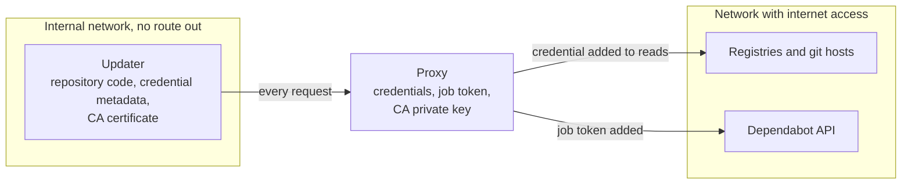
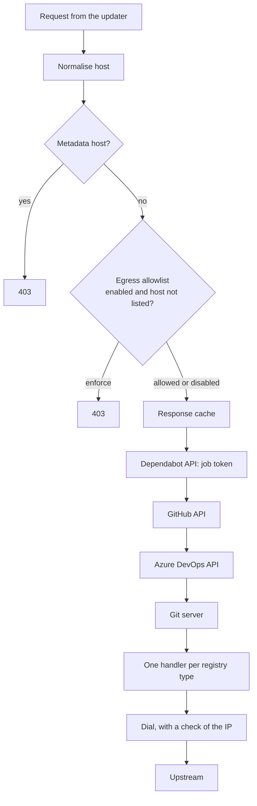

Updating a dependency means running the project's own tooling, and manifest files such as `setup.py` and `.gemspec` are code that the package manager executes. [Dependabot](https://docs.github.com/en/code-security/dependabot) still has to reach private registries while it does this, so it needs credentials in a process that may be running hostile code.

Its answer is a separate proxy that holds the secrets. The worker has no route to the internet and no credentials, and the proxy adds them to outbound requests. [An earlier article]({{site.url_complet}}/2026/11/05/how-github-dependabot-works/) describes how a Dependabot job runs; this one reads the source of `dependabot/proxy` to see which guarantees the design provides, and which it does not.

The pattern applies well beyond Dependabot: any CI job, build service or agent that runs untrusted code with access to private resources faces the same problem. The main findings are that the proxy refuses to authenticate registry and git writes, which is a strong and simple control, and that its egress allowlist is off unless a job turns it on.

> This article has been made with the help of [Claude Code](https://claude.com/product/claude-code) and several custom skills

[TOC]

## What you need to know first

The article relies on a few mechanisms from web security and containers.

- **CONNECT and TLS interception.** An HTTPS client asks a forward proxy to open a tunnel with `CONNECT`. A proxy can instead terminate TLS itself, using a certificate for the requested host signed by a CA the client trusts, and then read each request. This is often called man-in-the-middle mode.
- **Internal Docker network.** A Docker network created as `internal` has no route to the outside. Containers on it can reach only each other.
- **Cloud metadata endpoint.** Cloud hosts expose instance credentials at a link-local address, commonly `169.254.169.254`. Reaching it from a workload is a classic way to escalate.
- **DNS rebinding.** A host name passes a check, then resolves to a forbidden address when the connection is made. A defence has to check the address being dialled.
- **OIDC token exchange.** A workload proves its identity to a registry and receives a short-lived token, so no long-lived secret has to be stored.
- **Git smart HTTP.** A fetch uses the `git-upload-pack` service, and a push uses `git-receive-pack`. The two can be told apart from the request.

## The problem: secrets next to untrusted code

The core README describes the risk directly. If credentials pass through `dependabot-core` to native package managers, a malicious manifest can force the package manager to expose them, so a compromised package in the tree can steal registry secrets.

The obvious fixes do not work. Avoiding the package manager means reimplementing every ecosystem's resolver. Sandboxing it does not help if the sandbox still holds the secret.

The design moves the secret out of the process instead:

| Component | Holds | Can reach |
|-----------|-------|-----------|
| **Updater** | Repository code, credential metadata, the CA certificate | The proxy only, over an internal network |
| **Proxy** | Credentials, job token, the CA private key | The internal network and the internet |

*Credential metadata* is the list of the job's credentials with every secret field removed: each entry keeps its type and its host or URL, so the updater still knows which private registries exist and can point its package managers at them. The requests it sends there carry no secret, and the proxy adds one.

The CLI, which runs a job locally, shows both halves of the split:

- **Two networks.** It creates one internal network and one with internet access. The updater joins only the internal one, and the proxy joins both.
- **The proxy's configuration** receives all the credentials and the CA, private key included.
- **The updater** receives only the CA certificate, without its key, and the job file.
- **The job file's credential metadata** is built by copying each credential without its `username`, `token`, `password`, `key` and `auth-key` fields.

*Implementation:* `dependabot/cli`, `NewNetworks`, `NewProxy` and `putUpdaterInputs` in `internal/infra`, and the credential loop in `cmd/dependabot/internal/cmd/update.go`.



The updater also reports its results through the proxy. It sends the file changes and the pull request text to the Dependabot API, and the proxy adds the job token to those calls. This API is the job's write path: a Dependabot pull request is created by an API call such as `create_pull_request`, not by the updater pushing to the repository.

*Source:* `dependabot-core`, `updater/lib/dependabot/api_client.rb`.

The private key stays on the proxy's side of the boundary, which matters. Code in the updater can trust the certificates the proxy presents, but it cannot sign certificates of its own. The CA is useful to the proxy alone, and a key the updater never holds cannot be copied out of it.

## The request path

The proxy is a Go program built on `elazarl/goproxy`. It sets `HandleConnect(goproxy.AlwaysMitm)`, so every HTTPS connection is decrypted, and `newProxy` registers handlers that run in a fixed order. Each handler does one of two things: it passes the request on to the next handler, possibly with a header added, or it answers the request with a response of its own, such as a 403, which ends the chain.



The egress decision comes before any credential handler, so the handlers that attach secrets do not run for a blocked host. Logging and metrics handlers also sit in the chain and are left out of the chart.

Each handler checks whether the request is one it recognises, and passes it on unchanged if not. Credentials live in `config.json`, typed by kind such as `git_source` or `npm_registry`, and each handler reads only its own kind.

The core README also states that the proxy strips credentials from the registries' responses before they reach the updater. This review did not confirm it in the proxy's response handlers, so the claim rests on the README alone (see Gaps).

## Which requests receive a credential

Holding the secret is half of the design. The other half is deciding when to use it, since a worker that can make the proxy attach any credential to any request has lost little.

The registry handlers share one gate. This line, from the npm handler, appears almost unchanged across them:

```go
if req.URL.Scheme != "https" || !helpers.MethodPermitted(req, "GET", "HEAD") {
	return req, nil
}
```

So a request gets a credential only if it matches a configured host and uses `GET` or `HEAD`. The snippet shows the scheme and method test. Each handler also compares the request's host with its configured hosts, and the scheme rule varies between handlers:

| Handler | Host | Scheme | Methods |
|---------|------|--------|---------|
| Most registry handlers, such as npm | A configured host | HTTPS only | `GET`, `HEAD` |
| Maven and NuGet | A configured host | HTTPS or HTTP | `GET`, `HEAD` |
| Go proxy | A configured host | Not checked | `GET`, `HEAD` |
| GitHub API | The GitHub API host | Not covered here | `GET`, `HEAD` |

The effect is that credentials are usable for reading packages and not for publishing them. The HTTP exception has a cost of its own: a credential attached to a plain HTTP request travels unencrypted between the proxy and the registry.

Two handlers do not follow this rule:

- **The Dependabot API handler** attaches the job token to any request to the API, by design, since the API is the write path.
- **The Azure DevOps API handler** attaches the first `git_source` credential configured for a few `dpdbot.*` Azure DevOps hosts, whatever the method. It checks only the scheme and the host. What these hosts serve, and what the credential can do there, was not analysed (see Gaps). Later sections refer back to this paragraph.

A tool in the updater may need some value in its configuration before it sends an authenticated request, and the updater has no secret to put there. A `******` placeholder in an `Authorization` header therefore counts as no credential in the npm, Maven, NuGet, RubyGems and Docker handlers, and the proxy still adds the real one. Without this rule, a dummy value would stop injection. In most registry handlers, a credential that names a registry but holds no secret is not registered with the handler, so no empty header is attached.

### Git: reads only

Git needs more care, because a fetch uses `POST` too. The handler classifies each request:

```go
func isReadOnlyGitRequest(req *http.Request) bool {
	if helpers.MethodPermitted(req, http.MethodGet, http.MethodHead) {
		return req.URL.Query().Get("service") != "git-receive-pack"
	}
	if gitproto.IsUploadPackRequest(req) {
		return true
	}
	return isLFSDownloadRequest(req)
}
```

A `GET` is read-only unless it starts a push. A `POST` is read-only only if it is an upload-pack request, or a Git LFS batch request whose JSON body says `download`. Git LFS is git's extension for large files, and its client asks the server for those files with a batch request: a `POST` whose JSON body names the operation in an `operation` key, so the method alone cannot tell a download from an upload. The LFS parser is strict: it rejects a duplicated or wrongly cased `operation` key and any trailing content, so a body cannot be built to read as a download while acting as something else.

For anything else, `HandleRequest` returns a 403 with the message "Dependabot proxy blocked authentication for a non-read-only Git request".

The proxy refuses to *authenticate* a push. It does not ban one: a request that already carries its own Basic credential, with a non-empty password, passes through, and so does a request to a host with no configured credential. That is enough, because the updater has no credential of its own to bring. Over git smart HTTP, the updater can read with the job's identity and cannot write with it. The Azure DevOps API handler (see above) falls outside this rule.

Consistent with this, a Dependabot pull request is created through the API, the write path described in the problem section, not by a git push from the updater.

### Narrowing the identity

Two other mechanisms reduce what a credential can do:

- **Repository scope.** Git credentials can be tied to one repository. `getCredentialsForRequest` combines credentials that are valid for all repositories on the host with those scoped to the `org/repo` in the request path.
- **Short-lived tokens.** Registry handlers can take OIDC credentials, with support for Azure, AWS, GCP, JFrog and Cloudsmith parameters. These are exchanged at request time and cached until they expire, so no long-lived secret is needed.

A `jit_access` credential type goes further: if a git request fails with the known credentials, the proxy can ask the API for a token to that repository. These calls run one at a time, and each URL is tried once. The repository is taken from the request path, so the updater can make the proxy request a token for a repository outside the job's credentials; whether the API grants one was not analysed (see Gaps).

## Blocking internal targets

A proxy on two networks is a useful pivot for anyone inside. If the updater could ask it to fetch an internal address, the proxy would become a server-side request forgery primitive.

The code blocks the cloud metadata service at three levels:

The blocked addresses are `169.254.169.254` and `fd00:ec2::254`, and the code checks for them at three levels:

- **By name:** `blockMetadataAPIHosts` rejects `metadata.google.internal`.
- **After resolution:** `usableIPs` rejects a host whose addresses include one of the two blocked addresses.
- **At connection time:** `safeControl` runs on the socket, checks the address being dialled, and refuses the two blocked addresses.

The last check is what resists DNS rebinding, because it sees the real address, not a name resolved earlier. It also refuses non-TCP networks.

The two IP checks apply to the address the proxy dials, which is not always the target. The proxy's transport uses `http.ProxyFromEnvironment`, and the CLI forwards the host's `HTTP_PROXY`, `HTTPS_PROXY` and `NO_PROXY` to the proxy container. A host has these variables set when it reaches the internet through an upstream proxy, for example a self-hosted runner behind a corporate proxy. The address dialled is then that upstream proxy, so the IP checks see its address and not the target's, only the name check applies to the target, and blocking the metadata address becomes the upstream proxy's job. This comes from reading the code, not from a test.

The block list has only those two addresses. Other private ranges are not blocked here, so protection for the rest of an internal network depends on how the host is deployed. Redirect learning, described in the egress allowlist section, is stricter and never accepts an IP literal.

## The egress allowlist

The controls so far protect credentials. They do not stop data from leaving. Code in the updater can read private packages and the repository, and if it can send a request to any host, it can copy what it read.

The proxy has an answer, `EgressAllowlistHandler`, and its comment states the default clearly:

```go
// Experiment flags (job experiments) that toggle egress filtering. They are
// independent: observe logs non-allowlisted hosts, enforce drops them with a
// 403. Both default off (fail-open) when absent.
```

There are three states:

| `proxy-egress-observe` | `proxy-egress-enforce` | Behaviour |
|------------------------|------------------------|-----------|
| off | off | All traffic allowed, nothing recorded |
| on | off | Unlisted hosts are logged and still allowed |
| either | on | Unlisted hosts receive a 403 |

A *job experiment* is a named feature flag in the `experiments` map of a job definition, the document that describes one Dependabot run. For a hosted job, GitHub's service writes that definition, so the service decides which experiments are on. With the CLI, the person running it supplies the job file, but the flags reach the proxy only through the proxy's own configuration. The CLI's proxy configuration has only `all_credentials` and `ca`, with no `experiments` field, so a job run with the CLI at the analysed commits has no egress filtering.

*Source:* `dependabot/cli`, `internal/model/job.go` (the `Experiments` field). Whether GitHub's hosted jobs enforce it is not visible from public code. The handler reports each observed host for "allowlist discovery", which suggests a rollout in progress, but that is an inference.

### How the list is built

When enabled, the allowlist has three sources, with different levels of trust:

- **Static defaults**, embedded from `egress_allowlist_defaults.yaml`. This has GitHub infrastructure domains, shared artifact providers and public registry hosts: 311 distinct host entries once YAML aliases are resolved. A separate section lists *registry redirect hosts*, the download hosts that known registries redirect to, and these are added only when the job has a credential for the matching registry. They are written in the file in advance, unlike learned redirects below, which the proxy adds at run time after seeing a redirect. The union of all ecosystems is applied to every job, because a comment notes that launchers do not reliably set the package manager.
- **Dynamic hosts**, from the job's credentials. These are matched exactly, never as patterns, so a credential value such as `https://*.com` cannot widen the list. A credential that names a registry but holds no secret still adds its host here, even though no handler attaches anything for it.
- **Learned redirects.** Artifactory-style registries redirect downloads to a customer bucket whose name cannot be predicted. The proxy learns such a target only from a credentialed private registry, over TLS, to an `https` target, and never for an IP literal.

Public registries and GitHub hosts are explicitly not redirect sources, since they serve user-published content.

### Documented residual risk

The YAML file records the limit of host-based filtering: a host name is only as safe as the namespace behind it. Its header warns that globs over shared storage are unsafe when any label can be chosen by an attacker, and gives `*.blob.core.windows.net` as an example.

Two accepted exceptions remain:

- **`storage.googleapis.com`** is allowed as an exact host, because Go and Dart downloads redirect there. It is path-style: the bucket name sits in the URL path, not in the host name, so one host entry reaches every bucket, an attacker's included. The file records this as an accepted residual exfiltration risk.
- **The NuGet CDN** keeps a glob over shared storage, recorded as a known exposure.

A host allowlist also cannot look inside allowed traffic. Any allowed host that accepts data under a path an attacker controls remains a possible channel. Filtering raises the cost of exfiltration without ending it.

## What a compromised updater can still do

Putting these together gives the threat model. Assume code runs in the updater during a job. The table below is my own analysis of the source, not a statement from the project.

The last column adds egress enforcement to the controls of the middle one, so it describes both together.

| Attacker goal | With credentials on the proxy only | Plus egress enforcement |
|---------------|-------------------------------------|-------------------------|
| Read a registry secret from memory or environment | Blocked: the secret is not there | Blocked |
| Publish a package with the registry credential | Blocked: `POST` and `PUT` get no credential | Blocked |
| Push to the repository with the job's token over git smart HTTP | Blocked: the proxy refuses to authenticate | Blocked |
| Reach the cloud metadata service | Blocked by the dialler when the proxy connects directly | Blocked by the dialler when the proxy connects directly |
| Read private packages the job can read | Possible: reads are authenticated | Possible |
| Send data to an arbitrary host | Possible | Blocked, except through allowed hosts |
| Influence the pull request's content | Possible | Possible |
| Write with the Azure DevOps API credential | Not analysed (see Gaps) | Not analysed |
| Obtain a `jit_access` token for another repository | Not analysed (see Gaps) | Not analysed |
| Carry data to a later job through the response cache | Not analysed (see Gaps) | Not analysed |

No network control addresses the last row. The updater produces the file contents and the pull request text that it sends to the API. A compromised update can therefore propose a malicious change. That is the point at which human review and CI take over, and it sits outside anything a proxy can do.

The scope of a compromise is also bounded in time. The CLI generates a certificate authority per run and starts fresh containers, so an attacker's foothold in the updater ends with the job, unless the job's output carries it forward or a cache directory is reused.

The proxy's response cache is the one piece of state that can outlive a run, and it is on by default: the CLI sets `PROXY_CACHE` to `true` unless the host overrides it. Where the cache lives depends on the `--cache` flag:

- **Without `--cache`** (the default), the cache is inside the proxy container, which the CLI removes at the end of the run.
- **With `--cache <dir>`**, the CLI mounts that host directory into the proxy, so the cache persists and a later run that names the same directory reuses it.

What the cache stores, and whether a reused cache can serve authenticated content to another job, was not analysed (see Gaps).

*Implementation:* `dependabot/cli`, `internal/infra/proxy.go` (`proxyEnv`, the `CacheDir` mount, and `Close`).

## Applying the pattern elsewhere

The design transfers to other systems that run untrusted code with access to secrets, such as CI pipelines, build farms and code-running agents. These are its parts, in rough order of value:

1. **Move the secret out of the process.** A process cannot leak what it never held.
2. **Remove the direct route.** An internal network makes the proxy mandatory, so it cannot be bypassed by ignoring an environment variable.
3. **Attach credentials by operation, not by host alone.** Read-only injection removes publishing and pushing from the attacker's options. This is the control with the best ratio of value to effort: it is one check per request, on the method and, for git, on the service, and it needs no knowledge of what a package ecosystem's traffic looks like, unlike an egress allowlist.
4. **Treat write paths as a separate service.** Then the worker asks, and something else acts.
5. **Check the dialled address.** Name-based checks alone fail against DNS rebinding.
6. **Plan for egress from the start.** Allowlists are hard to add later, as Dependabot's observe mode suggests: discovering what legitimate traffic looks like takes time, and many registries redirect to shared storage.

The hardest part is the last one, and the proxy's source documents why. Package ecosystems depend on shared CDNs and object stores, so a strict list breaks real builds, and a looser one leaves a channel. This YAML file states which of those exposures the project accepted.

## Conclusion

Dependabot's proxy separates having a credential from being able to use it freely.

- **The updater holds no secrets** and has no route out, and the proxy holds the credentials, the job token and the CA key.
- **Registry and git credentials attach to reads.** Registry handlers require `GET` or `HEAD`, and the git handler refuses to authenticate anything that is not a fetch. The Dependabot API handler attaches the job token whatever the method, by design, and the Azure DevOps API handler is the one exception left open (see Gaps).
- **The proxy declines to authenticate a push; it does not ban it.** This is enough while the updater has no credential of its own.
- **The metadata service is blocked at the socket** when the proxy connects directly, which resists DNS rebinding. With an upstream proxy set, the socket check sees that proxy's address. Other private ranges are not covered by this check.
- **Egress filtering is off by default.** It depends on job experiments, the CLI does not set them, and its state on GitHub's hosted service is not public.
- **Host allowlists have documented limits.** `storage.googleapis.com` and the NuGet CDN are accepted exposures.
- **No network control protects the content of a pull request.** Review remains the last check.

The points this review left open, including the Azure DevOps handler, `jit_access` tokens and the response cache, are listed in [Gaps](#gaps).


## Annex

### Key Terms

| Term | Definition |
|------|------------|
| **Forward proxy** | A server that makes outbound requests on behalf of a client. |
| **TLS interception** | Terminating a client's TLS connection with a certificate the client trusts, in order to read and change requests. |
| **Internal network** | A Docker network with no route to the outside. |
| **Credential proxy** | A proxy that holds secrets and adds them to outbound requests. |
| **Updater** | The container that runs Dependabot's update logic and package managers. |
| **Job token** | The token that authenticates a job to the Dependabot API. |
| **Job experiment** | A named feature flag in the `experiments` map of a job definition, set by whoever writes the definition (GitHub's service for hosted jobs). |
| **Credential metadata** | The job's credentials with their secret fields removed, given to the updater so it knows which registries to use. |
| **`jit_access` credential** | A credential type that lets the proxy ask the Dependabot API for a token to a repository when known credentials fail. |
| **Git LFS batch request** | A `POST` with which a Git LFS client asks for large files, its JSON `operation` key saying download or upload. |
| **Upstream proxy** | A proxy that the credential proxy itself connects through, set by `HTTP_PROXY` and `HTTPS_PROXY`. |
| **Path-style host** | A storage host that puts the bucket name in the URL path, so one host name covers every bucket. |
| **Handler** | A function in the proxy's chain that inspects or changes a request or response. |
| **Read-only injection** | Attaching a credential only to requests that read. |
| **Upload-pack and receive-pack** | The git services used by a fetch and by a push. |
| **Egress allowlist** | A list of hosts that outbound requests may reach. |
| **Fail-open** | Allowing traffic when a control is absent or not configured. |
| **Dynamic host** | An allowlist entry derived from the job's credentials and matched exactly. |
| **Redirect learning** | Adding an exact host to the allowlist because a credentialed private registry redirected to it. |
| **DNS rebinding** | Making a name resolve to a forbidden address after it has passed a check. |
| **Exfiltration** | Moving data out of an environment without authorisation. |

### Security Implementation Checklist

The rows below derive from the design described above, for anyone building a similar worker and proxy pair.

#### Secrets and routing

| Check | Security requirement | Failure mode if violated |
|:---:|------------|------------|
| ☐ | The worker never receives secrets, in its environment, files or job definition. | Code in the worker reads them directly. |
| ☐ | The worker has no network route except through the proxy. | Hostile code ignores the proxy settings and connects directly. |
| ☐ | The interception CA's private key stays on the proxy. | The worker can forge certificates for any host it talks to. |
| ☐ | The interception CA is generated per run. | A leaked key stays useful in later runs. |

#### Credential use

| Check | Security requirement | Failure mode if violated |
|:---:|------------|------------|
| ☐ | Credentials attach only to the matching host, compared exactly. | A look-alike host receives a secret. |
| ☐ | Credentials attach only to read methods. | The worker publishes packages with the registry credential. |
| ☐ | Git pushes are identified and never authenticated by the proxy. | The worker writes to the repository with the job's token. |
| ☐ | Ambiguous request bodies are treated as writes. | A crafted body passes as a read. |
| ☐ | Tokens are short-lived and scoped to the repository where possible. | A token captured by logging stays valid and broad. |

#### Network targets

| Check | Security requirement | Failure mode if violated |
|:---:|------------|------------|
| ☐ | Forbidden addresses are checked at connect time, on the dialled IP. | DNS rebinding reaches the metadata service. |
| ☐ | The deny list covers link-local and private ranges that the deployment exposes. | The proxy becomes a route to internal services. |
| ☐ | Egress control is enforced, not just observed, before relying on it. | Data leaves while the design assumes it cannot. |
| ☐ | Allowlist entries avoid namespaces that users can register in. | An attacker's bucket satisfies the list. |
| ☐ | Values from job input are never treated as patterns. | A crafted value widens the list. |
| ☐ | Redirect targets are learned only from trusted sources, over TLS, and never as IP literals. | A public package steers the allowlist. |

#### Outputs

| Check | Security requirement | Failure mode if violated |
|:---:|------------|------------|
| ☐ | Writes go through a separate service, away from the worker. | A compromised worker acts with write privileges. |
| ☐ | Worker output is treated as untrusted and reviewed. | A compromised run proposes malicious code that is merged automatically. |

## Frequently Asked Questions

**Q: Why not give the package manager the credential and sandbox it?**

The sandbox would still contain the secret. Code run by the package manager is inside the same boundary, so it can read the credential from the environment or from configuration files. Moving the secret to a separate process removes it from what hostile code can reach.

**Q: Does the proxy block a git push?**

It refuses to authenticate one, which is a different thing. A request that is not read-only and needs a credential from the proxy gets a 403. A request that already has its own Basic credential passes through. The control works because the updater has no credential of its own.

**Q: Why is a check at connection time needed if the host name was already checked?**

A name can resolve to a different address when the connection is made, which is DNS rebinding. `safeControl` runs on the socket with the real address, so it sees what will be contacted.

**Q: Is data exfiltration from the updater prevented?**

Not by default. The egress allowlist is off unless a job experiment enables it, and the CLI does not set one. When it is enforced, unknown hosts are blocked, but allowed hosts that accept user-controlled paths remain possible channels, and the project documents `storage.googleapis.com` as an accepted one.

**Q: Why are redirects from a public registry not trusted?**

Public registries serve user-published content, so a redirect from one could be influenced by an attacker. A private registry named in the job's credentials is under the customer's control. The proxy therefore learns redirect targets only from those, only over TLS, and only as exact host names.

**Q: Combining these controls, what can a package do if it runs code during an update, with egress filtering enforced?**

The main remaining options are:

- Read what the job can read, including private packages.
- Send data only through hosts on the allowlist.
- Change the files and the text sent back for the pull request.

It cannot read a registry secret, publish with one, or push with the job's token over git smart HTTP. The Azure DevOps API handler is the exception left open in Gaps. The third option is the one that review has to catch, and auto-merging Dependabot pull requests removes that check.

## Gaps

The points below remain open after reading the source.

| Gap | Why it matters | What to read or verify |
|-----|----------------|------------------------|
| Whether GitHub's hosted jobs set `proxy-egress-enforce` is not public. | The exfiltration row of the threat model depends on it. | GitHub's documentation or a statement from the project. |
| The topology was read in the CLI, not in GitHub's production setup. | Hosted runners may differ. | `internal/infra/run.go` against any published description of hosted runs. |
| The threat table is my own analysis, and no attack was tested. | Its entries come from reading the code. | The proxy's handler tests, such as `egress_allowlist_test.go`, and a dedicated review. |
| The proxy's tests were read by name, not run. | The behaviours described rest on source reading. | Run `go test ./...` in `dependabot/proxy` with the Go version it requires. |
| The Azure DevOps API handler has no `MethodPermitted` check: it attaches the first `git_source` credential for `dpdbot.*` hosts to any method, and what those hosts serve was not analysed. | The read-only claim is stated for the registry, GitHub and git handlers only. Whether this credential can write depends on its scopes in Azure DevOps. | `internal/handlers/azdo_api.go` and the token's Azure DevOps scopes. |
| Whether the API limits `jit_access` tokens to repositories the job may read was not analysed. | The updater chooses the `org/repo` in the request path, which could widen what it can read. | `internal/apiclient/client.go` and the API's JIT endpoint. |
| Behaviour with an upstream proxy (`HTTP_PROXY`, `HTTPS_PROXY`) was read in the code, not tested. | The IP checks then apply to the upstream proxy's address, so the metadata block rests on the name check alone. | `proxy.go`, `internal/dialer/dialer.go`, and a test with an upstream proxy. |
| The statement that responses have credentials stripped comes from the core README. | The source review did not confirm response filtering. | Response handlers in `internal/handlers`. |
| Whether the response cache can serve authenticated content across jobs was not analysed. | The cache is on by default and persists when `--cache` names a directory, so a reused cache could cross a trust boundary. | `internal/cache` and the CLI's `CacheDir` option (`--cache`, with `PROXY_CACHE` defaulting to `true`). |
| The NuGet CDN glob is named but not quoted. | The size of that accepted exposure depends on the exact pattern. | The NuGet entry in `egress_allowlist_defaults.yaml`. |
| Private address ranges other than the metadata service were not tested. | The article says only that the code has no rule for them. | The deployment's network policy. |

## References

### Analyzed source

- [dependabot/proxy](https://github.com/dependabot/proxy) — analyzed at commit [`8232624e0a642edf5b77ac4927db0bb774e43777`](https://github.com/dependabot/proxy/tree/8232624e0a642edf5b77ac4927db0bb774e43777) (tag [v2.0.20261103195546](https://github.com/dependabot/proxy/releases/tag/v2.0.20261103195546)), 2026-11-05
- [dependabot/cli](https://github.com/dependabot/cli) — analyzed at commit [`41663d5a4acf0917b1e46d8117ea6a9f503eabb9`](https://github.com/dependabot/cli/tree/41663d5a4acf0917b1e46d8117ea6a9f503eabb9) (release [v1.97.0](https://github.com/dependabot/cli/releases/tag/v1.97.0)), 2026-11-05
- [dependabot/dependabot-core](https://github.com/dependabot/dependabot-core) — analyzed at commit [`6a43f5c18a7120386064c4afabb6a3e803d63d90`](https://github.com/dependabot/dependabot-core/tree/6a43f5c18a7120386064c4afabb6a3e803d63d90), 2026-11-05

### Other sources

- [elazarl/goproxy](https://github.com/elazarl/goproxy), the proxy library
- [Git HTTP protocol](https://git-scm.com/docs/http-protocol)
- [Dependabot documentation](https://docs.github.com/en/code-security/dependabot)

### Related articles

- [Firmware Supply Chain - Reproducible Builds and Code Signing]({{site.url_complet}}/2026/07/31/firmware-reproducible-builds-code-signing/)
- [Advanced GNU/Linux Security - SECCOMP and Linux Security Modules (LSM)]({{site.url_complet}}/2026/06/29/linux-advanced-security-seccomp-lsm/)
