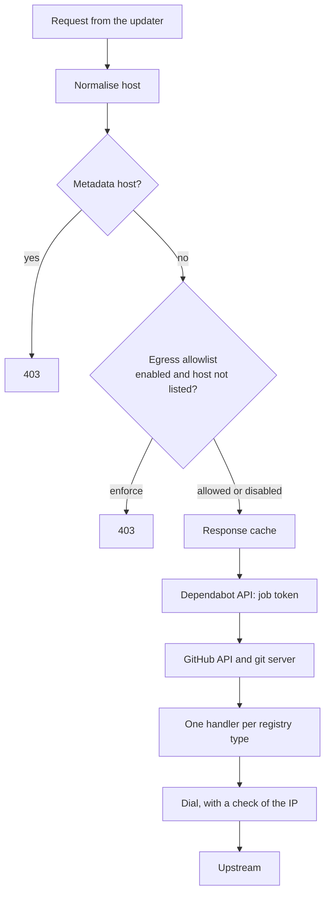

Updating a dependency means running the project's own tooling, and tools such as `setup.py` and `.gemspec` can execute arbitrary code. [Dependabot](https://docs.github.com/en/code-security/dependabot) still has to reach private registries while it does this, so it needs credentials in a process that may be running hostile code.

Its answer is a separate proxy that holds the secrets. The worker has no route to the internet and no credentials, and the proxy adds them to outbound requests. [An earlier article]({{site.url_complet}}/2026/11/05/how-github-dependabot-works/) describes how a Dependabot job runs; this one reads the source of `dependabot/proxy` to see which guarantees the design provides, and which it does not.

The pattern applies well beyond Dependabot: any CI job, build service or agent that runs untrusted code with access to private resources faces the same problem. The main findings are that the proxy refuses to authenticate writes, which is a strong and simple control, and that its egress allowlist is off unless a job turns it on.

> This article has been made with the help of [Claude Code](https://claude.com/product/claude-code) and several custom skills

[TOC]

## What you need to know first

The article relies on a few mechanisms from web security and containers.

- **CONNECT and TLS interception.** An HTTPS client asks a forward proxy to open a tunnel with `CONNECT`. A proxy can instead terminate TLS itself, using a certificate for the requested host signed by a CA the client trusts, and then read each request. This is often called man-in-the-middle mode.
- **Internal Docker network.** A Docker network created as `internal` has no route to the outside. Containers on it can reach only each other.
- **Cloud metadata endpoint.** Cloud hosts expose instance credentials at a link-local address, commonly `169.254.169.254`. Reaching it from a workload is a classic way to escalate.
- **DNS rebinding.** A host name passes a check, then resolves to a forbidden address when the connection is made. A defence has to check the address being dialled.
- **OIDC token exchange.** A workload proves its identity to a registry and receives a short-lived token, so no long-lived secret has to be stored.
- **Git smart HTTP.** A fetch uses the `git-upload-pack` service, and a push uses `git-receive-pack`. The two can be told apart from the request.

## The problem: secrets next to untrusted code

The core README describes the risk directly. If credentials pass through `dependabot-core` to native package managers, a malicious manifest can force the package manager to expose them, so a compromised package in the tree can steal registry secrets.

The obvious fixes do not work. Avoiding the package manager means reimplementing every ecosystem's resolver. Sandboxing it does not help if the sandbox still holds the secret.

The design moves the secret out of the process instead:

| Component | Holds | Can reach |
|-----------|-------|-----------|
| **Updater** | Repository code, credential metadata, the CA certificate | The proxy only, over an internal network |
| **Proxy** | Credentials, job token, the CA private key | The internal network and the internet |

The CLI shows both halves. `NewNetworks` creates one network with `Internal: true` and one without, the updater joins only the first, and the proxy joins both. `NewProxy` writes `all_credentials` and the CA into the proxy's configuration, and `putUpdaterInputs` gives the updater only the certificate.

The private key stays on the proxy's side of the boundary, which matters: code in the updater can trust the CA but cannot use it to impersonate a host to anything else.

## The request path

The proxy is a Go program built on `elazarl/goproxy`. It sets `HandleConnect(goproxy.AlwaysMitm)`, so every HTTPS connection is decrypted, and `newProxy` registers handlers that run in a fixed order. A handler that returns a response stops the chain.



The egress decision comes before any credential handler, so the handlers that attach secrets do not run for a blocked host.

Each handler checks whether the request is one it recognises, and returns it unchanged if not. Credentials live in `config.json`, typed by kind such as `git_source` or `npm_registry`, and each handler reads only its own kind.

## Which requests receive a credential

Holding the secret is half of the design. The other half is deciding when to use it, since a worker that can make the proxy attach any credential to any request has lost little.

The registry handlers share one gate. This line, from the npm handler, appears almost unchanged across them:

```go
if req.URL.Scheme != "https" || !helpers.MethodPermitted(req, "GET", "HEAD") {
	return req, nil
}
```

So a request gets a credential only if it matches a configured host, and uses `GET` or `HEAD`. In most handlers it must also use HTTPS, though the Maven and NuGet handlers also accept HTTP, and the Go proxy handler checks only the method. The effect is that credentials are usable for reading packages and not for publishing them. The GitHub API handler applies the same `GET` and `HEAD` rule.

A `******` placeholder in an `Authorization` header counts as no credential, so a dummy value in a tool's configuration does not stop injection. A credential that names a registry but holds no secret is registered as anonymous: its host stays known, but no empty header is attached.

### Git: reads only

Git needs more care, because a fetch uses `POST` too. The handler classifies each request:

```go
func isReadOnlyGitRequest(req *http.Request) bool {
	if helpers.MethodPermitted(req, http.MethodGet, http.MethodHead) {
		return req.URL.Query().Get("service") != "git-receive-pack"
	}
	if gitproto.IsUploadPackRequest(req) {
		return true
	}
	return isLFSDownloadRequest(req)
}
```

A `GET` is read-only unless it starts a push. A `POST` is read-only only if it is an upload-pack request, or a Git LFS batch request whose JSON body says `download`. The LFS parser is strict: it rejects duplicate keys, wrong casing and trailing content, so a body cannot be built to read as a download while acting as something else.

For anything else, `HandleRequest` returns a 403 with the message "Dependabot proxy blocked authentication for a non-read-only Git request".

The proxy refuses to *authenticate* a push. It does not ban one: a request that already carries its own credential passes through, and so does a request to a host with no configured credential. That is enough, because the updater has no credential of its own to bring. On a host where it matters, the updater can read with the job's identity and cannot write with it.

This is why a Dependabot pull request has to go through the API: in the proxy, the job's git token is used for reads only, and the write path is a separate call.

### Narrowing the identity

Two other mechanisms reduce what a credential can do:

- **Repository scope.** Git credentials can be tied to one repository. `getCredentialsForRequest` combines credentials that are valid for all repositories on the host with those scoped to the `org/repo` in the request path.
- **Short-lived tokens.** Registry handlers can take OIDC credentials, with support for Azure, AWS and JFrog parameters. These are exchanged at request time and cached until they expire, so no long-lived secret is needed.

A `jit_access` credential type goes further: if a git request fails with the known credentials, the proxy can ask the API for a token to that repository. Its calls are rate limited.

## Blocking internal targets

A proxy on two networks is a useful pivot for anyone inside. If the updater could ask it to fetch an internal address, the proxy would become a server-side request forgery primitive.

The code blocks the cloud metadata service at three levels:

- **By name:** `blockMetadataAPIHosts` rejects `metadata.google.internal`.
- **After resolution:** `usableIPs` rejects a host whose addresses include a blocked IP.
- **At connection time:** `safeControl` runs on the socket, checks the address being dialled, and refuses `169.254.169.254` and `fd00:ec2::254`.

The last check is what resists DNS rebinding, because it sees the real address, not a name resolved earlier. It also refuses non-TCP networks.

The list has only those two addresses. Other private ranges are not blocked here, so protection for the rest of an internal network depends on how the host is deployed. Redirect learning, described next, is stricter and never accepts an IP literal.

## The egress allowlist

The controls so far protect credentials. They do not stop data from leaving. Code in the updater can read private packages and the repository, and if it can send a request to any host, it can copy what it read.

The proxy has an answer, `EgressAllowlistHandler`, and its comment states the default clearly:

```go
// Experiment flags (job experiments) that toggle egress filtering. They are
// independent: observe logs non-allowlisted hosts, enforce drops them with a
// 403. Both default off (fail-open) when absent.
```

There are three states:

| `proxy-egress-observe` | `proxy-egress-enforce` | Behaviour |
|------------------------|------------------------|-----------|
| off | off | All traffic allowed, nothing recorded |
| on | off | Unlisted hosts are logged and still allowed |
| either | on | Unlisted hosts receive a 403 |

The flags are job experiments, set by the service. The CLI's proxy configuration has only `all_credentials` and `ca`, with no `experiments` field, so a job run with the CLI at the analysed commits has no egress filtering. Whether GitHub's hosted jobs enforce it is not visible from public code. The handler reports each observed host for "allowlist discovery", which suggests a rollout in progress, but that is an inference.

### How the list is built

When enabled, the allowlist has three sources, with different levels of trust:

- **Static defaults**, embedded from `egress_allowlist_defaults.yaml`. This has GitHub infrastructure domains, shared artifact providers and public registry hosts, 341 list items in all, including entries for redirect derivations. The union of all ecosystems is applied to every job, because a comment notes that launchers do not reliably set the package manager.
- **Dynamic hosts**, from the job's credentials. These are matched exactly, never as patterns, so a credential value such as `https://*.com` cannot widen the list.
- **Learned redirects.** Artifactory-style registries redirect downloads to a customer bucket whose name cannot be predicted. The proxy learns such a target only from a credentialed private registry, over TLS, to an `https` target, and never for an IP literal.

Public registries and GitHub hosts are explicitly not redirect sources, since they serve user-published content.

### Documented residual risk

The YAML file records the limit of host-based filtering: a host name is only as safe as the namespace behind it. Its header warns that globs over shared storage are unsafe when any label can be chosen by an attacker, and gives `*.blob.core.windows.net` as an example.

Two accepted exceptions remain:

- **`storage.googleapis.com`** is allowed as an exact host, because Go and Dart downloads redirect there. It is path-style, so it reaches every bucket, and the file records this as an accepted residual exfiltration risk.
- **The NuGet CDN** keeps a glob over shared storage, recorded as a known exposure.

A host allowlist also cannot look inside allowed traffic. Any allowed host that accepts data under a path an attacker controls remains a possible channel. Filtering raises the cost of exfiltration without ending it.

## What a compromised updater can still do

Putting these together gives the threat model. Assume code runs in the updater during a job. The table below is my own analysis of the source, not a statement from the project.

| Attacker goal | With credentials on the proxy only | With egress enforcement |
|---------------|-------------------------------------|-------------------------|
| Read a registry secret from memory or environment | Blocked: the secret is not there | Blocked |
| Publish a package with the registry credential | Blocked: `POST` and `PUT` get no credential | Blocked |
| Push to the repository with the job's token | Blocked: the proxy refuses to authenticate | Blocked |
| Reach the cloud metadata service | Blocked by the dialler | Blocked |
| Read private packages the job can read | Possible: reads are authenticated | Possible |
| Send data to an arbitrary host | Possible | Blocked, except through allowed hosts |
| Influence the pull request's content | Possible | Possible |

No network control addresses the last row. The updater produces the file contents and the pull request text that it sends to the API. A compromised update can therefore propose a malicious change. That is the point at which human review and CI take over, and it sits outside anything a proxy can do.

The scope of a compromise is also bounded in time. The CLI generates a certificate authority per run and starts fresh containers, so an attacker's foothold in the updater ends with the job, unless the job's output carries it forward.

## Applying the pattern elsewhere

The design transfers to other systems that run untrusted code with access to secrets, such as CI pipelines, build farms and code-running agents. These are its parts, in rough order of value:

1. **Move the secret out of the process.** A process cannot leak what it never held.
2. **Remove the direct route.** An internal network makes the proxy mandatory, so it cannot be bypassed by ignoring an environment variable.
3. **Attach credentials by operation, not by host alone.** Read-only injection removes publishing and pushing from the attacker's options. This is the control with the best ratio of value to effort.
4. **Treat write paths as a separate service.** Then the worker asks, and something else acts.
5. **Check the dialled address.** Name-based checks alone fail against DNS rebinding.
6. **Plan for egress from the start.** Allowlists are hard to add later, as Dependabot's observe mode shows: discovering what legitimate traffic looks like takes time, and many registries redirect to shared storage.

The hardest part is the last one, and the proxy's source documents why. Package ecosystems depend on shared CDNs and object stores, so a strict list breaks real builds, and a looser one leaves a channel. This YAML file states which of those exposures the project accepted.

## Conclusion

Dependabot's proxy separates having a credential from being able to use it freely.

- **The updater holds no secrets** and has no route out, and the proxy holds the credentials, the job token and the CA key.
- **Credentials attach to reads.** Registry handlers require `GET` or `HEAD`, and the git handler refuses to authenticate anything that is not a fetch.
- **The proxy declines to authenticate a push; it does not ban it.** This is enough while the updater has no credential of its own.
- **The metadata service is blocked at the socket**, which resists DNS rebinding. Other private ranges are not covered by this check.
- **Egress filtering is off by default.** It depends on job experiments, the CLI does not set them, and its state on GitHub's hosted service is not public.
- **Host allowlists have documented limits.** `storage.googleapis.com` and the NuGet CDN are accepted exposures.
- **No network control protects the content of a pull request.** Review remains the last check.


## Annex

### Key Terms

| Term | Definition |
|------|------------|
| **Forward proxy** | A server that makes outbound requests on behalf of a client. |
| **TLS interception** | Terminating a client's TLS connection with a certificate the client trusts, in order to read and change requests. |
| **Internal network** | A Docker network with no route to the outside. |
| **Credential proxy** | A proxy that holds secrets and adds them to outbound requests. |
| **Updater** | The container that runs Dependabot's update logic and package managers. |
| **Job token** | The token that authenticates a job to the Dependabot API. |
| **Handler** | A function in the proxy's chain that inspects or changes a request or response. |
| **Read-only injection** | Attaching a credential only to requests that read. |
| **Upload-pack and receive-pack** | The git services used by a fetch and by a push. |
| **Egress allowlist** | A list of hosts that outbound requests may reach. |
| **Fail-open** | Allowing traffic when a control is absent or not configured. |
| **Dynamic host** | An allowlist entry derived from the job's credentials and matched exactly. |
| **Redirect learning** | Adding an exact host to the allowlist because a credentialed private registry redirected to it. |
| **DNS rebinding** | Making a name resolve to a forbidden address after it has passed a check. |
| **Exfiltration** | Moving data out of an environment without authorisation. |

### Security Implementation Checklist

The rows below derive from the design described above, for anyone building a similar worker and proxy pair.

#### Secrets and routing

| Check | Security requirement | Failure mode if violated |
|:---:|------------|------------|
| ☐ | The worker never receives secrets, in its environment, files or job definition. | Code in the worker reads them directly. |
| ☐ | The worker has no network route except through the proxy. | Hostile code ignores the proxy settings and connects directly. |
| ☐ | The interception CA's private key stays on the proxy. | The worker can forge certificates for any host it talks to. |
| ☐ | The interception CA is generated per run. | A leaked key stays useful in later runs. |

#### Credential use

| Check | Security requirement | Failure mode if violated |
|:---:|------------|------------|
| ☐ | Credentials attach only to the matching host, compared exactly. | A look-alike host receives a secret. |
| ☐ | Credentials attach only to read methods. | The worker publishes packages with the registry credential. |
| ☐ | Git pushes are identified and never authenticated by the proxy. | The worker writes to the repository with the job's token. |
| ☐ | Ambiguous request bodies are treated as writes. | A crafted body passes as a read. |
| ☐ | Tokens are short-lived and scoped to the repository where possible. | A token captured by logging stays valid and broad. |

#### Network targets

| Check | Security requirement | Failure mode if violated |
|:---:|------------|------------|
| ☐ | Forbidden addresses are checked at connect time, on the dialled IP. | DNS rebinding reaches the metadata service. |
| ☐ | The deny list covers link-local and private ranges that the deployment exposes. | The proxy becomes a route to internal services. |
| ☐ | Egress control is enforced, not just observed, before relying on it. | Data leaves while the design assumes it cannot. |
| ☐ | Allowlist entries avoid namespaces that users can register in. | An attacker's bucket satisfies the list. |
| ☐ | Values from job input are never treated as patterns. | A crafted value widens the list. |
| ☐ | Redirect targets are learned only from trusted sources, over TLS, and never as IP literals. | A public package steers the allowlist. |

#### Outputs

| Check | Security requirement | Failure mode if violated |
|:---:|------------|------------|
| ☐ | Writes go through a separate service, away from the worker. | A compromised worker acts with write privileges. |
| ☐ | Worker output is treated as untrusted and reviewed. | A compromised run proposes malicious code that is merged automatically. |

## Frequently Asked Questions

**Q: Why not give the package manager the credential and sandbox it?**

The sandbox would still contain the secret. Code run by the package manager is inside the same boundary, so it can read the credential from the environment or from configuration files. Moving the secret to a separate process removes it from what hostile code can reach.

**Q: Does the proxy block a git push?**

It refuses to authenticate one, which is a different thing. A request that is not read-only and needs a credential from the proxy gets a 403. A request that already has its own credential passes through. The control works because the updater has no credential of its own.

**Q: Why is a check at connection time needed if the host name was already checked?**

A name can resolve to a different address when the connection is made, which is DNS rebinding. `safeControl` runs on the socket with the real address, so it sees what will be contacted.

**Q: Is data exfiltration from the updater prevented?**

Not by default. The egress allowlist is off unless a job experiment enables it, and the CLI does not set one. When it is enforced, unknown hosts are blocked, but allowed hosts that accept user-controlled paths remain possible channels, and the project documents `storage.googleapis.com` as an accepted one.

**Q: Why are redirects from a public registry not trusted?**

Public registries serve user-published content, so a redirect from one could be influenced by an attacker. A private registry named in the job's credentials is under the customer's control. The proxy therefore learns redirect targets only from those, only over TLS, and only as exact host names.

**Q: Combining these controls, what can a package do if it runs code during an update, with egress filtering enforced?**

The main remaining options are:

- Read what the job can read, including private packages.
- Send data only through hosts on the allowlist.
- Change the files and the text sent back for the pull request.

It cannot read a registry secret, publish with one, or push with the job's token. The third option is the one that review has to catch, and auto-merging Dependabot pull requests removes that check.

## Gaps

The points below remain open after reading the source.

| Gap | Why it matters | What to read or verify |
|-----|----------------|------------------------|
| Whether GitHub's hosted jobs set `proxy-egress-enforce` is not public. | The exfiltration row of the threat model depends on it. | GitHub's documentation or a statement from the project. |
| The topology was read in the CLI, not in GitHub's production setup. | Hosted runners may differ. | `internal/infra/run.go` against any published description of hosted runs. |
| The threat table is my own analysis, and no attack was tested. | Its entries come from reading the code. | The proxy's handler tests, such as `egress_allowlist_test.go`, and a dedicated review. |
| The proxy's tests were read by name, not run. | The behaviours described rest on source reading. | Run `go test ./...` in `dependabot/proxy` with the Go version it requires. |
| The Azure DevOps API handler has no `MethodPermitted` check, and it was not analysed. | The read-only claim is stated for the registry, GitHub and git handlers only. | `internal/handlers/azdo_api.go`. |
| The statement that responses have credentials stripped comes from the core README. | The source review did not confirm response filtering. | Response handlers in `internal/handlers`. |
| Whether the response cache can serve authenticated content across jobs was not analysed. | A shared cache could cross a trust boundary. | `internal/cache` and the CLI's `CacheDir` option. |
| Private address ranges other than the metadata service were not tested. | The article says only that the code has no rule for them. | The deployment's network policy. |

## References

### Analyzed source

- [dependabot/proxy](https://github.com/dependabot/proxy) — analyzed at commit [`8232624e0a642edf5b77ac4927db0bb774e43777`](https://github.com/dependabot/proxy/tree/8232624e0a642edf5b77ac4927db0bb774e43777) (tag [v2.0.20261103195546](https://github.com/dependabot/proxy/releases/tag/v2.0.20261103195546)), 2026-11-05
- [dependabot/cli](https://github.com/dependabot/cli) — analyzed at commit [`41663d5a4acf0917b1e46d8117ea6a9f503eabb9`](https://github.com/dependabot/cli/tree/41663d5a4acf0917b1e46d8117ea6a9f503eabb9) (release [v1.97.0](https://github.com/dependabot/cli/releases/tag/v1.97.0)), 2026-11-05
- [dependabot/dependabot-core](https://github.com/dependabot/dependabot-core) — analyzed at commit [`6a43f5c18a7120386064c4afabb6a3e803d63d90`](https://github.com/dependabot/dependabot-core/tree/6a43f5c18a7120386064c4afabb6a3e803d63d90), 2026-11-05

### Other sources

- [elazarl/goproxy](https://github.com/elazarl/goproxy), the proxy library
- [Git HTTP protocol](https://git-scm.com/docs/http-protocol)
- [Dependabot documentation](https://docs.github.com/en/code-security/dependabot)

### Related articles

- [Firmware Supply Chain - Reproducible Builds and Code Signing]({{site.url_complet}}/2026/07/31/firmware-reproducible-builds-code-signing/)
- [Advanced GNU/Linux Security - SECCOMP and Linux Security Modules (LSM)]({{site.url_complet}}/2026/06/29/linux-advanced-security-seccomp-lsm/)
