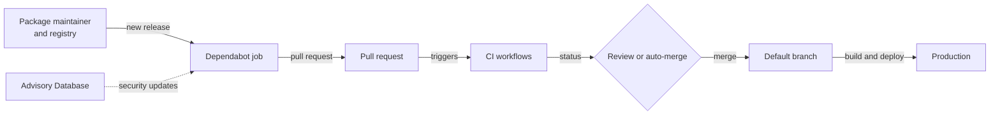

Automated dependency updates close a real gap: a project that never updates keeps every published vulnerability. [Dependabot](https://docs.github.com/en/code-security/dependabot) does this at scale, and in doing so it creates a path that delivers third-party code into a repository on a schedule, under a name developers have learned to trust.

That path is an attack surface of its own. This article builds a threat model of it from the point of view of a project using Dependabot, and tests the model against public incidents. The earlier articles in this series cover [how a job runs]({{site.url_complet}}/2026/11/05/how-github-dependabot-works/) and [how the credential proxy isolates it]({{site.url_complet}}/2026/11/05/dependabot-credential-proxy-isolation/), so this one concentrates on what happens around the job.

The model follows the four questions of the [OWASP threat modeling process](https://community.owasp.org/Threat_Modeling_Process): what are we working on, what can go wrong, what do we do about it, and did we do a good job. It stays at the level of design and defence, and contains no attack instructions. Likelihood and impact ratings are my own judgement.

> This article has been made with the help of [Claude Code](https://claude.com/product/claude-code) and several custom skills

[TOC]

## What you need to know first

The article relies on a few concepts from package ecosystems and GitHub Actions.

- **Install script.** Package managers such as npm can run a package's scripts during installation, before any application code calls it. A malicious version can therefore act when it is installed.
- **Mutable reference.** A git tag or a branch can be moved to another commit. A full commit SHA cannot, because it identifies the content.
- **`pull_request` and `pull_request_target`.** The first runs in the context of the pull request, with limited rights for forks. The second runs in the context of the base repository, with its secrets and write access, so it needs great care.
- **`github.actor`.** The account that triggered the latest workflow event. It is not necessarily the author of the pull request.
- **Confused deputy.** A privileged component is tricked into using its authority on behalf of someone who lacks it, classified as [CWE-441](https://cwe.mitre.org/data/definitions/441.html).
- **Provenance attestation.** A signed statement of how and where a package was built.
- **STRIDE.** A mnemonic for threat categories: spoofing, tampering, repudiation, information disclosure, denial of service and elevation of privilege.

## What are we working on

The system under analysis runs from a package maintainer's account to code running in production.



Each arrow crosses a trust boundary:

1. **Registry to Dependabot.** A release is written by whoever controls the maintainer's account.
2. **Dependabot to the repository.** The job writes files and text into a pull request.
3. **Pull request to CI.** New dependency code can run in the project's pipeline.
4. **CI to the default branch.** A person or a workflow decides to merge.

The assets at stake are the repository's integrity, CI secrets, signing and publishing credentials, developer machines that install the merged lockfile, and production systems.

The attackers in scope are a thief of a maintainer's account, a maintainer who turns hostile, an outside user who can open a pull request or comment on a public repository, and someone holding a stolen token. GitHub's own infrastructure is out of scope as a threat.

## What can go wrong

The table lists the main threats, with STRIDE categories in the second column. The ratings assume a typical open-source or company repository with Dependabot enabled.

| ID | Threat | STRIDE | Likelihood | Impact |
|----|--------|--------|------------|--------|
| T1 | A short-lived malicious release is proposed | Tampering | High | High |
| T2 | A patient backdoor passes every time-based control | Tampering | Medium | High |
| T3 | A dependency runs code in CI when the pull request opens | Elevation of privilege | Medium | High |
| T4 | A mutable reference changes under a pinned-looking version | Tampering | Medium | High |
| T5 | An auto-merge workflow is confused about who acted | Elevation of privilege | Medium | High |
| T6 | Commits are forged to look like Dependabot's | Spoofing | Medium | High |
| T7 | A security update ships a malicious release, with no cooldown | Tampering | Low | High |
| T8 | Third-party text in the pull request misleads a reader or a tool | Spoofing | Medium | Medium |
| T9 | Volume wears down review | Repudiation | High | Medium |

### T1: A short-lived malicious release

The most common pattern is an account takeover followed by a malicious version that lives for hours. GitHub's [case for a cooldown](https://github.blog/security/supply-chain-security/the-case-for-a-cooldown-why-dependabot-now-waits-before-issuing-version-updates/) cites compromised npm packages, including `chalk` and `debug`, that are downloaded more than 2 billion times a week. Their poisoned versions were live for roughly two hours.

The [Shai-Hulud worm](https://www.wiz.io/blog/shai-hulud-npm-supply-chain-attack) of September 2025 showed the next step: a post-install script harvested sensitive data, and npm tokens found in the environment were used to publish malicious versions of other packages. Reported package counts vary by source, from about 180 to over 500.

An update bot that reacts within minutes can deliver such a release before it is removed, which is why the cooldown exists. It is on by default [since July 2026](https://github.blog/changelog/2026-07-14-dependabot-version-updates-introduce-default-package-cooldown/): version updates wait three days, and the code confirms this with `DEFAULT_COOLDOWN_DAYS = 3`.

### T2: A patient backdoor

The same blog post states the limit: a cooldown "does little against attacks that play a longer game", such as backdoors planted in releases and left dormant. A release that stays quiet for longer than the window is proposed like any other. Time-based controls assume someone notices. If nobody does, waiting achieves nothing.

### T3: Code running in CI

A dependency pull request runs the project's tests, and that means installing the new version. So a malicious package can reach the CI runner before anyone reviews the change.

GitHub reduces this. Its documentation says Dependabot-triggered runs are treated like fork pull requests: they get a read-only `GITHUB_TOKEN`, and the only secrets available are Dependabot secrets. That limit is real, but it depends on what the project stores there. A publishing token added as a Dependabot secret to make a job pass is exposed to the code being tested.

### T4: Mutable references

The [tj-actions/changed-files compromise](https://www.stepsecurity.io/blog/harden-runner-detection-tj-actions-changed-files-action-is-compromised) of March 2025 (CVE-2025-30066) shows the risk. According to StepSecurity, attackers "retroactively updated multiple version tags to reference the malicious commit". The code read secrets from runner memory and printed them to build logs, where public repositories exposed them.

No Dependabot pull request was needed: a workflow pinned to `@v45` received the change on its next run. This threat is outside what an update tool sees, because the version number did not change. Pinning to full commit SHAs avoids it, and Dependabot's `github_actions` ecosystem handles SHA pins, so pinning does not mean giving up updates.

### T5: A confused auto-merge

Teams automate Dependabot merges with a workflow that checks the actor. Boost Security's [write-up](https://labs.boostsecurity.io/articles/weaponizing-dependabot-pwn-request-at-its-finest/) explains the flaw: `github.actor` is whoever triggered the latest event, not who wrote the pull request. If an outsider can cause Dependabot to act on a pull request, the check passes although the code came from elsewhere. Combined with `pull_request_target`, this gives a privileged workflow to untrusted code.

Kong's [post-mortem](https://konghq.com/blog/product-releases/december-2024-unauthorized-kong-ingress-controller-3-4-0-build) of the December 2024 Ingress Controller incident describes a Pwn Request "enabled through a Dependabot actor confusion attack", through which an unauthorised image containing a cryptominer was published. Two details matter here:

- The pull request targeted an old branch that still had the vulnerable workflow, because an earlier fix had missed unused branches.
- Dependabot had been allowlisted for privileged workflows, so its name opened the door.

GitHub [removed several comment commands](https://github.blog/changelog/2026-01-27-changes-to-github-dependabot-pull-request-comment-commands/) in January 2026, including `merge`, which closed one of the techniques the article describes. Boost Security notes that the other remains valid.

### T6: Forged Dependabot commits

Git authorship is a claim, not a proof. [Checkmarx reported](https://checkmarx.com/blog/surprise-when-dependabot-contributes-malicious-code/) commits to hundreds of repositories in July 2023, pushed with stolen personal access tokens and made to look like Dependabot's. It noted why this works: developers often do not review Dependabot changes closely.

Dependabot was not compromised here. Its reputation was the asset being abused. Any process that treats a bot's name as evidence of safety inherits this weakness.

### T7: A malicious security update

Security updates skip the cooldown, because delaying a fix for a public flaw has its own cost. They also choose the lowest non-vulnerable version. This combination opens a narrow path, which is my own inference and has no public incident behind it: if the release that fixes a real advisory is itself malicious, it can be proposed immediately, with urgency attached.

The bar is high, since it needs a real advisory and control of the release at the right moment. It is rated low for that reason, and it is a reason not to treat "security fix" as a synonym for "safe to auto-merge".

### T8: Text from third parties

A Dependabot pull request contains release notes, changelogs and commit messages written by the dependency's authors. `dependabot-core` runs that text through `sanitize_links_and_mentions`, which addresses unwanted notifications and links. It does not judge whether the text is truthful.

A release note can claim a change is harmless, and readers tend to believe it. This applies with more force to automated reviewers: a tool or language model that reads the pull request body is reading attacker-influenced input. That second point is my own reasoning, and I found no public incident that shows it for Dependabot.

### T9: Review fatigue

The threats above assume someone looks at the change. Yet Dependabot's volume teaches the opposite habit, and Checkmarx named it as the reason forged commits went unnoticed. A grouped update adds to this, since one approval then covers many packages.

Fatigue is rated medium in impact because it does not act alone, but it amplifies T1, T2, T6 and T8.

## What do we do about it

The controls below map to the threats. Several already exist in Dependabot, and the others are the project's own responsibility.

| Control | Addresses | Who provides it | Limit |
|---------|-----------|-----------------|-------|
| Cooldown, 3 days by default | T1 | Dependabot | Fails against T2, and does not apply to T7 |
| Pin actions to full SHAs | T4 | Project, with Dependabot updating the pins | Requires review of each pin change |
| Identify by pull request author, not actor | T5 | Project | Must apply to every branch |
| No secrets beyond what tests need | T3 | Project | Needs a review of Dependabot secrets |
| Commit signature verification | T6 | Project and GitHub | Useful only if something enforces it |
| Lockfile and install without scripts in CI | T1, T3 | Project | Some packages need scripts |
| Metadata warnings in the pull request | T1, T2 | Dependabot | Limited ecosystems, needs a reader |
| Human review of bumps | T2, T7, T8, T9 | Project | Costs time |

### Cooldown: what to expect

The evidence for a cooldown is good for what it covers. GitHub says a review of 21 incidents from 2018 to 2026 found that a cooldown could have filtered out the majority of short-lived publishes. William Woodruff's [November 2025 analysis](https://blog.yossarian.net/2025/11/21/We-should-all-be-using-dependency-cooldowns) found that 8 of 10 attacks had windows of opportunity of less than a week. The two exceptions were xz-utils, at about five weeks, and Kong Ingress Controller, at about ten days, so a three-day wait would not have covered those.

Two caveats apply. The first is that incident lists contain the attacks that were detected, which favours ones that were found quickly. The second is that a cooldown works because somebody else installs the release first, or a scanner sees it. If everyone waits, detection has to come from scanners.

Keep the default unless there is a reason to change it. For sensitive repositories, a longer window on major versions is a reasonable choice.

### Auto-merge: a stricter rule

Auto-merge is the point where most of these threats turn into incidents, because it removes the last human check. If it is used:

- Trigger on `pull_request`, not `pull_request_target`, wherever possible.
- Check who wrote the pull request, as in `github.event.pull_request.user.login`, not `github.actor`. Boost Security also warns against other contexts that can be confused, such as `github.triggering_actor`.
- Use `dependabot/fetch-metadata` over custom parsing, and pin it to a SHA.
- Limit it to patch updates of development dependencies, where a mistake is cheapest.
- Apply the same workflow fix to every branch, including old ones. Kong's case shows why.
- Do not allowlist Dependabot for privileged workflows.

```yaml
# Weak: the actor is whoever triggered the latest event
if: github.actor == 'dependabot[bot]'

# Better: the author of the pull request
if: github.event.pull_request.user.login == 'dependabot[bot]'
```

The check on the author is necessary, not sufficient. Boost Security also advises avoiding `synchronize` events where possible, and protecting `dependabot/**` branches if Dependabot has bypass privileges.

### Signals that already exist

Dependabot now reports some supply-chain signals in the pull request body. The base `MetadataFinder` has three hooks, and at the analysed commit they are implemented unevenly:

| Signal | npm and Yarn | Python | Bun |
|--------|--------------|--------|-----|
| Maintainer changes | Yes | Yes | Yes |
| Install script changes | Yes | No | No |
| Lost provenance attestation | Yes | No | No |

The npm attestation check is a good example of a useful signal: it warns when a previous version was attested and the new one is not, which is what a release published from a stolen token often looks like. A new maintainer, a new install script or a lost attestation should stop auto-merge and draw a reader's attention. These checks do nothing if no one reads the message.

### Solidity projects

Smart-contract projects need a separate note, because their dependencies can control funds directly. Dependabot's public code has no ecosystem for Foundry. Foundry's `lib/` folders are ordinarily git submodules, so the `git_submodules` ecosystem can propose updates, and npm-based projects use `npm_and_yarn`.

A submodule bump is a commit range, not a package version, and no cooldown history or attestation applies in the same way. For contract libraries, an update changes code that gets deployed and is hard to undo, so automated merging is the wrong default at any patch level. Also, the code running in CI and on developer machines handles deployment keys, which makes T3 more serious here.

## Did we do a good job

The incidents confirm most of the model, and they expose where it is weakest.

| Incident | Threat | Which control would have helped |
|----------|--------|--------------------------------|
| npm `chalk` and `debug` | T1 | Cooldown |
| Shai-Hulud, September 2025 | T1, T3 | Cooldown, scripts disabled in CI, fewer secrets |
| tj-actions/changed-files, March 2025 | T4 | SHA pinning |
| Kong Ingress Controller, December 2024 | T5 | Author check, no allowlisting, all branches fixed |
| Forged Dependabot commits, July 2023 | T6 | Fine-grained tokens, review, signature enforcement |

The right-hand column is hindsight, and it is my assessment rather than the finding of any report. Four observations follow.

**Dependabot was seldom the compromised component.** Across these cases, the job itself was not breached. The failures were in workflows built around it, in tokens, or in trust placed in its name.

**Most controls are the project's responsibility.** The defaults have improved, with the cooldown and read-only tokens. But Kong's incident came from a workflow the project itself had written.

**T7 and T8 have no incident behind them.** They are reasoned from the design. They could be wrong, or simply not yet seen.

**The counts of malicious packages are large.** GitHub reports more than 6,500 npm malware advisories in the year ending May 2026. Most of these will not affect a given project, but the rate shows that malicious versions are published every day.

The model should be revisited when GitHub changes Dependabot's comment commands or defaults, when a project adds auto-merge, and after any incident in a dependency.

## Conclusion

An update bot delivers third-party code on a schedule, under a trusted name. Its risks sit mainly around the job.

- **A cooldown addresses short-lived releases**, which is the most common pattern, and it fails against patient backdoors.
- **Mutable references bypass update tools.** tj-actions changed under an unchanged version number, and SHA pinning addresses it.
- **Workflows around Dependabot are part of the attack surface.** Kong's incident came from an actor confusion in a `pull_request_target` workflow, left on an old branch.
- **A bot's name is not authentication.** Forged commits and confused auto-merge both exploit it.
- **Dependabot-triggered runs have reduced rights**, and Dependabot secrets decide how much that is worth.
- **Auto-merge removes the last check.** It should be narrow, use the pull request author and stop on maintainer, script or attestation changes.
- **Review still matters.** No control here replaces reading a bump to an important dependency, and volume works against that.


## Annex

### Key Terms

| Term | Definition |
|------|------------|
| **Threat model** | A structured description of what can go wrong with a system and what is done about it. |
| **Trust boundary** | A point where data or control passes between parties with different levels of trust. |
| **STRIDE** | A set of threat categories: spoofing, tampering, repudiation, information disclosure, denial of service, elevation of privilege. |
| **Supply-chain attack** | Compromising a dependency in order to reach its users. |
| **Account takeover** | Gaining control of a maintainer's account in order to publish under their name. |
| **Install script** | Package code that runs during installation. |
| **Cooldown** | A delay before a new release can be proposed by a version update. |
| **Mutable reference** | A git tag or branch, which can be moved to another commit. |
| **SHA pinning** | Referring to a dependency by its full commit hash. |
| **Pwn Request** | An attack in which a pull request reaches a privileged workflow. |
| **`pull_request_target`** | A GitHub Actions event that runs with the base repository's rights. |
| **Confused deputy** | A privileged component tricked into acting for someone who lacks the privilege. |
| **Auto-merge workflow** | Automation that merges a pull request without human approval. |
| **Dependabot secrets** | The only secrets available to workflows triggered by Dependabot. |
| **Provenance attestation** | A signed statement of how and where a package was built. |

### Security Implementation Checklist

The rows below apply to a repository that uses automated dependency updates.

#### Configuration

| Check | Security requirement | Failure mode if violated |
|:---:|------------|------------|
| ☐ | The cooldown stays enabled for version updates. | A short-lived malicious release is proposed within minutes. |
| ☐ | GitHub Actions are pinned to full commit SHAs. | A moved tag changes the code with no pull request. |
| ☐ | Lockfiles are committed. | The version under review is not the version installed. |
| ☐ | Grouped updates keep risky packages separate. | One approval covers a change nobody read. |

#### CI

| Check | Security requirement | Failure mode if violated |
|:---:|------------|------------|
| ☐ | Dependabot secrets hold only what tests need. | Code under test reads a publishing token. |
| ☐ | CI installs without running scripts where the project allows it. | A package acts at install time. |
| ☐ | No workflow runs pull request code under `pull_request_target`. | Untrusted code runs with write access and secrets. |
| ☐ | Untrusted values such as branch names are passed through environment variables. | A crafted value causes command injection. |

#### Merging

| Check | Security requirement | Failure mode if violated |
|:---:|------------|------------|
| ☐ | Auto-merge checks the pull request author, not `github.actor`. | An outsider's code is merged under Dependabot's name. |
| ☐ | Auto-merge is limited to low-risk updates. | A major change or a production dependency merges unread. |
| ☐ | Auto-merge stops on maintainer, script or attestation warnings. | The warning that would have caught the release is ignored. |
| ☐ | Dependabot is not allowlisted for privileged workflows. | Its name opens a path to secrets. |
| ☐ | Workflow fixes are applied to all branches, including old ones. | An old branch keeps the vulnerable workflow. |
| ☐ | `dependabot/**` branches are protected if Dependabot has bypass rights. | Someone else's push acquires those rights. |
| ☐ | Security updates receive review despite their urgency. | "Security fix" is treated as "safe". |

#### Trust

| Check | Security requirement | Failure mode if violated |
|:---:|------------|------------|
| ☐ | A bot's name is never treated as proof of origin. | A forged commit is accepted. |
| ☐ | Tokens are fine-grained, and developers do not hold broad ones. | One stolen token reaches many repositories. |
| ☐ | Text in the pull request is treated as untrusted, including by automated reviewers. | A release note steers the decision. |

## Frequently Asked Questions

**Q: What attack does a cooldown stop, and what does it miss?**

It stops the most common pattern: a malicious release that is found and removed within hours or days. It misses backdoors that stay dormant for longer than the window, because waiting helps only if someone notices.

**Q: Why are security updates exempt from the cooldown?**

A delay would hold back a fix for a flaw that is already public, so the exemption is deliberate. The cost is that the fix release gets no waiting period, which is a reason to review it.

**Q: Why is `github.actor` unsuitable for an auto-merge check?**

It names whoever triggered the latest event, not the author of the pull request. If an outsider can cause Dependabot to act on a pull request, the actor can be Dependabot while the code came from someone else. The check should use the pull request author, and it should be part of a workflow that avoids `pull_request_target`.

**Q: How did tj-actions reach users without any update?**

The attackers moved existing version tags to a malicious commit. A workflow that used a tag ran the new code at its next run. No version number changed, so an update tool had nothing to report. A workflow pinned to a full commit SHA refers to fixed content.

**Q: Are Dependabot pull requests safe to run in CI?**

They run with reduced rights, since GitHub gives them a read-only token and only Dependabot secrets. They are not free of risk: new dependency code executes on the runner, so the risk depends on what those secrets can do.

**Q: A team enables auto-merge for all Dependabot security updates, with an actor check. Combining the threats above, what is wrong?**

Several things:

- The actor check is vulnerable to T5, especially if the workflow uses `pull_request_target`.
- Security updates skip the cooldown, so a malicious fix release gets no delay, as in T7.
- The label "security" comes from the update's purpose, and says nothing about the safety of the code.
- Auto-merge removes the review that T2 and T8 rely on.

A safer version uses the author check, a narrow scope, and a human review for anything that affects production.

## Gaps

The points below remain open.

| Gap | Why it matters | What to read or verify |
|-----|----------------|------------------------|
| The likelihood and impact ratings are my judgement. | They order the article's advice, and no data supports them. | Incident data for your own organisation. |
| T7 and T8 are reasoned from the design, with no known incident. | They may be overstated. | Future incident reports. |
| The "right-hand column" assessment of incidents is hindsight. | A control may not have stopped a real attacker. | Each incident's full report. |
| The study of 21 incidents is cited through GitHub's post. | Its method was not read. | The research linked from GitHub's blog post. |
| Whether Shai-Hulud spread through any Dependabot pull request was not established. | The table assigns T1 by pattern, not by a documented case. | The vendors' incident reports. |
| Package counts for Shai-Hulud vary across sources. | The article gives the range only. | GitHub's own statement on the removal. |
| The behaviour of `pin_to_sha?` in the `github_actions` ecosystem was only skimmed. | The article says only that SHA pins are handled. | `github_actions/lib/dependabot/github_actions/update_checker.rb`. |
| Foundry support is inferred from the absence of an ecosystem and from how `lib/` is usually set up. | A project may manage dependencies differently. | `dependabot-core` and the project's `foundry.toml`. |
| The workflow rules on `pull_request` come from one research article. | GitHub's own guidance was not fully read. | GitHub's page on automating Dependabot with GitHub Actions. |

## References

### Analyzed source

- [dependabot/dependabot-core](https://github.com/dependabot/dependabot-core) — analyzed at commit [`6a43f5c18a7120386064c4afabb6a3e803d63d90`](https://github.com/dependabot/dependabot-core/tree/6a43f5c18a7120386064c4afabb6a3e803d63d90), 2026-11-05

### Incidents and research

- Sébastien Graveline, [Weaponizing Dependabot: Pwn Request at its Finest](https://labs.boostsecurity.io/articles/weaponizing-dependabot-pwn-request-at-its-finest/), Boost Security, 2025-06-01, updated 2026-01
- Kong, [December 2024 Unauthorized Kong Ingress Controller 3.4.0 Build](https://konghq.com/blog/product-releases/december-2024-unauthorized-kong-ingress-controller-3-4-0-build), 2025-01-14
- StepSecurity, [tj-actions/changed-files Action is Compromised](https://www.stepsecurity.io/blog/harden-runner-detection-tj-actions-changed-files-action-is-compromised), 2025-03
- Checkmarx, [Surprise: When Dependabot Contributes Malicious Code](https://checkmarx.com/blog/surprise-when-dependabot-contributes-malicious-code/), 2023-09-27
- Wiz, [Shai-Hulud: Ongoing Package Supply Chain Worm Delivering Data-Stealing Malware](https://www.wiz.io/blog/shai-hulud-npm-supply-chain-attack), 2025-09-16
- William Woodruff, [We should all be using dependency cooldowns](https://blog.yossarian.net/2025/11/21/We-should-all-be-using-dependency-cooldowns), 2025-11

### GitHub

- Carlin Cherry, [The case for a cooldown](https://github.blog/security/supply-chain-security/the-case-for-a-cooldown-why-dependabot-now-waits-before-issuing-version-updates/), 2026-07-23
- [Dependabot version updates introduce default package cooldown](https://github.blog/changelog/2026-07-14-dependabot-version-updates-introduce-default-package-cooldown/), 2026-07-14
- [Changes to GitHub Dependabot pull request comment commands](https://github.blog/changelog/2026-01-27-changes-to-github-dependabot-pull-request-comment-commands/), 2026-01-27
- [Troubleshooting Dependabot on GitHub Actions](https://docs.github.com/en/code-security/dependabot/troubleshooting-dependabot/troubleshooting-dependabot-on-github-actions), read 2026-11-05

### Methods

- OWASP, [Threat Modeling Process (Historical)](https://community.owasp.org/Threat_Modeling_Process)
- MITRE, [CWE-441: Confused Deputy](https://cwe.mitre.org/data/definitions/441.html)

### Related articles

- [Crypto Hacks of 2026 So Far - January to September, from Truebit to Bitget]({{site.url_complet}}/2026/10/07/crypto-hacks-2026-year-to-date/)
- [Firmware Supply Chain - Reproducible Builds and Code Signing]({{site.url_complet}}/2026/07/31/firmware-reproducible-builds-code-signing/)
