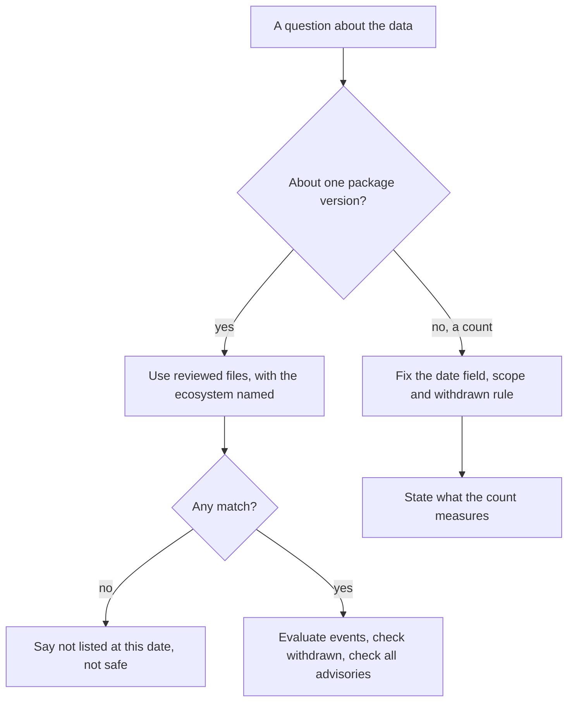

The [GitHub Advisory Database](https://github.com/advisories) is a public catalogue of vulnerabilities in open-source packages. It feeds Dependabot alerts, and its contents are published as JSON files in the `github/advisory-database` repository. That makes it a data set anyone can query, and it is tempting to read it as a measure of software security.

It is a better record of a process than of a population. This article reads every file in one snapshot to show what an advisory contains and how to interpret its version ranges. It then looks at two features that a yearly count would misread: a spike in 2022 that disappears when the data is dated differently, and a rise in 2026 that does not.

All counts come from commit `b6d0ec57e55` of 2026-11-04, and they will differ on any other date. The script that produces them is linked in the references.

> This article has been made with the help of [Claude Code](https://claude.com/product/claude-code) and several custom skills

[TOC]

## What you need to know first

The article uses the standard vocabulary of vulnerability management.

- **CVE.** A global identifier for a publicly disclosed vulnerability, assigned under the [CVE programme](https://www.cve.org/). An identifier's year is the year it was reserved, which can differ from the year of disclosure.
- **GHSA.** GitHub's own advisory identifier. Every advisory in the database has one, and most also have a CVE alias.
- **CWE.** A catalogue of weakness types, such as [CWE-79](https://cwe.mitre.org/data/definitions/79.html) for cross-site scripting.
- **CVSS.** A scheme that rates a vulnerability's severity. A [CVSS vector](https://www.first.org/cvss/) is a string of metrics, and a numeric score is computed from it.
- **NVD.** The US National Vulnerability Database, one of the sources the Advisory Database imports.
- **OSV format.** The [Open Source Vulnerability schema](https://ossf.github.io/osv-schema/), the JSON format of each file.
- **Ecosystem.** A package namespace, normally a registry such as npm or PyPI. A package name means nothing without one.

## How an advisory gets in

The repository's README lists the sources: repository security advisories reported on GitHub, the NVD, the npm advisory data, the FriendsOfPHP database, the Go Vulnerability Database, the Python Packaging Advisory Database, the Ruby Advisory Database, RustSec and community contributions.

Files sit in two trees, with a path built from the year and month of publication:

```text
advisories/github-reviewed/2025/07/GHSA-fv2p-qj5p-wqq4/GHSA-fv2p-qj5p-wqq4.json
advisories/unreviewed/2021/11/GHSA-fr68-g2qf-53vm/GHSA-fr68-g2qf-53vm.json
```

The difference between the two trees decides what the data can be used for.

| Snapshot of 2026-11-04 | `github-reviewed` | `unreviewed` |
|------------------------|-------------------|--------------|
| Files | 37,522 | 362,041 |
| Withdrawn | 1,256 | 1 |
| With an `ecosystem` field | All | 3 |
| Triggers a Dependabot alert | Yes | No |

GitHub's documentation describes reviewed advisories as mapped to packages in supported ecosystems, and unreviewed ones as published automatically. The counts show how complete that split is: an unreviewed advisory is essentially a CVE with no package attached, so it cannot be matched to a dependency.

One category is missing from both trees. The documentation also describes malware advisories, for malicious packages, but the word `malware` does not appear as a field value in any file of this snapshot. A project cannot use this repository to look for them.

## Anatomy of an advisory

This is the reviewed advisory `GHSA-fv2p-qj5p-wqq4`, a path traversal in LF Edge eKuiper, with the long text fields and references removed:

```json
{
  "schema_version": "1.4.0",
  "id": "GHSA-fv2p-qj5p-wqq4",
  "modified": "2025-07-03T14:18:04Z",
  "published": "2025-07-03T14:18:04Z",
  "aliases": [],
  "severity": [
    { "type": "CVSS_V3", "score": "CVSS:3.1/AV:N/AC:L/PR:L/UI:N/S:C/C:N/I:H/A:L" }
  ],
  "affected": [
    {
      "package": { "ecosystem": "Go", "name": "github.com/lf-edge/ekuiper/v2" },
      "ranges": [
        { "type": "ECOSYSTEM", "events": [{ "introduced": "0" }, { "fixed": "2.2.0" }] }
      ]
    },
    {
      "package": { "ecosystem": "Go", "name": "github.com/lf-edge/ekuiper" },
      "ranges": [
        { "type": "ECOSYSTEM", "events": [{ "introduced": "0" }, { "last_affected": "1.14.7" }] }
      ]
    }
  ],
  "database_specific": {
    "cwe_ids": ["CWE-24"],
    "severity": "HIGH",
    "github_reviewed": true,
    "github_reviewed_at": "2025-07-03T14:18:04Z",
    "nvd_published_at": null
  }
}
```

Several details matter when processing these files:

- **`severity` holds a vector, not a score.** The word `HIGH` is in `database_specific.severity`.
- **`aliases` can be empty.** In reviewed advisories only CVE aliases appear, and 3,692 live advisories (10.2%) have none. A join on CVE identifiers silently loses them.
- **One advisory can cover many packages.** 10,734 live advisories (29.6%) have more than one `affected` entry, with a maximum of 406, and 309 span more than one ecosystem.
- **`nvd_published_at` is null here**, which is common for advisories that originate on GitHub.

## Reading version ranges

A range is a list of events, not a pair of bounds. A version is affected from an `introduced` event until a `fixed` or `last_affected` event. The live reviewed data contains four forms:

| Form | Entries | Meaning | What it gives a developer |
|-------|---------|---------|---------------------------|
| `introduced` + `fixed` | 60,710 | Affected below the fix | A version to upgrade to |
| `introduced` + `last_affected` | 5,772 | Affected up to a known version, inclusive | No fix in this package |
| `introduced` alone | 802 | Open-ended | No fix, and every later version counts |
| `versions` list, no range | 953 | Exact versions only | Nothing about other versions |

Separately, 11,353 entries carry `database_specific.last_known_affected_version_range`, a bound that sits next to the events. It can disagree with them: `craftcms/cms` in `GHSA-xrqc-p465-2xvg` has `fixed: 5.9.53` with a last known affected range of `< 5.9.22`. The sample suggests the range records what was confirmed, and the event records where the fix landed. A version between the two is in the range, but it was not confirmed to be affected. I found no documentation of this field, so that reading is an inference.

In total, 4,913 live advisories (13.5%) have no `fixed` event for any package. For those, an update tool has no target, whatever the advisory's severity.

Two more traps come from how packages are named and released.

**Go major versions are separate packages.** The sample advisory lists `github.com/lf-edge/ekuiper/v2`, fixed in `2.2.0`, and `github.com/lf-edge/ekuiper`, with `last_affected: 1.14.7`. The fix exists only under the `/v2` path, so moving to it is a migration to another module, not a version bump.

**A fix can open another advisory.** Two lodash records show this:

```text
GHSA-xxjr-mmjv-4gpg  MODERATE  introduced=4.0.0   fixed=4.17.23
GHSA-f23m-r3pf-42rh  MODERATE  introduced=4.17.23 fixed=4.18.1
```

Version 4.17.23 closes the first and is the start of the second. Choosing the lowest fix for one advisory is correct only if every advisory on that package is then checked again. This is what Dependabot's filter does, since it tests each candidate against all of them.

## Two clocks: published and reviewed

Each reviewed file has two dates. `published` is when the advisory entered the database, and `github_reviewed_at` is when GitHub reviewed it. Plotting both for the same 36,266 live advisories gives different histories.


| Year | By published date | By review date |
|------|-------------------|----------------|
| 2021 | 2,547 | 2,817 |
| 2022 | 8,656 | 4,564 |
| 2023 | 3,270 | 4,842 |
| 2024 | 3,545 | 5,207 |
| 2025 | 3,569 | 4,086 |
| 2026, to 4 November | 11,618 | 11,690 |

### The 2022 spike is a dating effect

May 2022 alone accounts for 4,968 advisories by published date. Of these, 4,757 (95.8%) have a CVE identifier from before 2022, going back to the year 2000. Only 171 (3.4%) were reviewed that same month. Most were reviewed over the following two years, with the largest groups in July 2023 and April 2024.

This is consistent with a bulk import of old CVEs that were dated at import and reviewed later. It is not a surge of vulnerabilities in 2022. A chart of the published date would show one, and a chart of the review date mostly removes it.

Unreviewed data shows the same pattern at a larger scale, with 175,311 of its 362,041 files dated 2022.

### The 2026 rise is real, and narrow

The rise in 2026 has a different structure. It appears on both clocks, with 2,952 advisories published from January to October 2025 and 11,606 over the same months of 2026, a ratio of 3.9. It is also not old material: 9,924 of the 11,618 advisories have a 2026 CVE identifier.

Separating advisories by origin explains most of it. A reference of the form `github.com/<owner>/<repo>/security/advisories/GHSA-...` indicates that the project published a repository security advisory, which is a reasonable proxy for "came through GitHub's own reporting path".

| Published in | All | Linked to a repository advisory | Not linked |
|--------------|-----|--------------------------------|------------|
| 2025, full year | 3,569 | 1,945 (54.5%) | 1,624 |
| 2026, to 4 November | 11,618 | 9,880 (85.0%) | 1,738 |

Almost all of the increase is in the linked column. Advisories arriving by other routes barely changed, even though 2026 is not complete. The number of distinct repositories publishing also rose, from 878 to 1,986. So this is not one project: the largest, `openclaw/openclaw`, has 598 advisories, or 5.1% of the year.

These other measures moved in the same period:

- **Less NVD involvement:** 34.8% of 2026 advisories have no NVD date, against 12.6% in 2025.
- **A higher share of severe labels:** `HIGH` and `CRITICAL` together went from 41.0% to 50.3%.
- **A different weakness mix:** [server-side request forgery](https://cwe.mitre.org/data/definitions/918.html) and [missing authorization](https://cwe.mitre.org/data/definitions/862.html) entered the top six for 2026, where 2025 had [CWE-502](https://cwe.mitre.org/data/definitions/502.html) and [CWE-770](https://cwe.mitre.org/data/definitions/770.html).

The data establishes where the rise happened, not why. More maintainers using GitHub's advisories, wider use of automated vulnerability discovery, or more software being published would each produce this pattern, and this data cannot separate them. It does not show that open-source software became four times less secure. A count of advisories measures reporting, and reporting changed.

## Withdrawn advisories

A withdrawn advisory stays in the tree with a `withdrawn` timestamp. Of the 1,256 reviewed ones, 955 (76.0%) have a summary that begins with "Duplicate Advisory". Another reason seen in the sample is scope: `GHSA-q2hg-643c-gw8h` was withdrawn because it only affected example code, not an Apache Airflow release.

Withdrawals are concentrated in the recent past, with 735 (58.5%) in 2026. They are also a reminder that the database is edited after the fact: a count taken today can differ from one taken on the same date range last year. Any aggregate should state whether withdrawn records are excluded. Here they are, except where the text says otherwise.

## What severity and CWE can tell you

The severity label is the most used field, and it comes with limits:

| Severity label | Live reviewed advisories |
|----------------|--------------------------|
| `MODERATE` | 15,715 |
| `HIGH` | 13,206 |
| `CRITICAL` | 4,717 |
| `LOW` | 2,628 |

The label is a property of the vulnerability, not of your use of the package. It also rests on mixed scoring: 29,128 live advisories have a CVSS v3 vector, 9,234 have CVSS v4, 4,733 have both, and 2,637 (7.3%) have neither, though all carry a label. A comparison of numeric scores across years would mix versions.

CWE counts have a similar limit. The most common live values are [CWE-79](https://cwe.mitre.org/data/definitions/79.html) with 4,861, [CWE-22](https://cwe.mitre.org/data/definitions/22.html) with 2,158 and [CWE-200](https://cwe.mitre.org/data/definitions/200.html) with 1,632. An advisory can carry several, 1,419 carry none, and the sum therefore does not equal the number of advisories. A ranking shows what reporters assigned, in ecosystems that GitHub covers. It is a ranking of reports, not of weaknesses in software at large.

The same goes for ecosystems. npm has the most live advisories, with 7,664, ahead of Maven with 7,107 and PyPI with 6,562. That does not make npm the least secure ecosystem, because the counts are not divided by anything: not the number of packages, not usage, not scrutiny.

## Querying the data

For one advisory, the web page or the API is the best source, because it is current. For aggregate questions, a local clone works well. A clone is large, and the unreviewed tree can be left out with `git sparse-checkout` for most uses.

Plain text search narrows the files quickly, and `jq` does the rest. This lists live lodash advisories with their events:

```bash
git grep -l -F '"name": "lodash"' -- advisories/github-reviewed \
  | xargs jq -r 'select(.withdrawn == null)
      | [.id, .database_specific.severity,
         ([.affected[] | select(.package.name == "lodash")
           | .ranges[].events | map(to_entries[0] | "\(.key)=\(.value)") | join(" ")]
          | join("; "))]
      | @tsv'
```

```text
GHSA-29mw-wpgm-hmr9  MODERATE  introduced=4.0.0 fixed=4.17.21
GHSA-35jh-r3h4-6jhm  HIGH      introduced=0 fixed=4.17.21
GHSA-4xc9-xhrj-v574  HIGH      introduced=0 fixed=4.17.11
GHSA-f23m-r3pf-42rh  MODERATE  introduced=4.17.23 fixed=4.18.1
```

The output above is the first four lines, sorted, with columns aligned for reading. Comparing a version against those events needs the ecosystem's own ordering rules, for example for pre-releases, so a plain string comparison is not enough.



## Conclusion

The GitHub Advisory Database is a curated record of reported vulnerabilities, and it needs to be read as one.

- **Reviewed and unreviewed are different data.** The 37,522 reviewed files have package data, and only 3 of the 362,041 unreviewed files do.
- **A range is a list of events.** 13.5% of live advisories have no `fixed` event, and a fix can open another advisory.
- **Names and dates are part of the meaning.** Go major versions are separate packages, and `published` is not the date a vulnerability appeared.
- **The 2022 spike is a dating effect.** 95.8% of May 2022 advisories have older CVE identifiers, and most were reviewed later.
- **The 2026 rise is concentrated in repository advisories.** The share linked to one went from 54.5% to 85.0%, across 1,986 repositories. The data does not show the cause.
- **Counts measure reporting.** Without a denominator, they do not rank ecosystems or years by security.


## Annex

### Key Terms

| Term | Definition |
|------|------------|
| **CVE** | A global identifier for a publicly disclosed vulnerability. |
| **CWE** | A catalogue entry describing a type of weakness. |
| **CVSS vector** | A string of metrics from which a severity score is computed. |
| **NVD** | The US National Vulnerability Database, one of the imported sources. |
| **OSV format** | The JSON schema used by each advisory file. |
| **GHSA identifier** | GitHub's identifier for an advisory. |
| **Ecosystem** | The package namespace in which a package name has meaning. |
| **GitHub-reviewed advisory** | An advisory checked by GitHub and mapped to packages in supported ecosystems. |
| **Unreviewed advisory** | An advisory published automatically, nearly always with no package data. |
| **Repository security advisory** | An advisory published by a project on GitHub. |
| **Range event** | An `introduced`, `fixed` or `last_affected` entry in a version range. |
| **Withdrawn advisory** | A record kept in the database with a `withdrawn` date, for example because it is a duplicate. |
| **Backfill** | The import of older records in bulk, dated at import. |
| **Live advisory** | In this article, a reviewed advisory that is not withdrawn. |

### Integration Notes

| Behaviour | What an integrator should do |
|-----------|------------------------------|
| Almost no unreviewed file has package data. | Search unreviewed advisories by identifier or keyword, never by package. |
| No match does not mean no vulnerability. | Report "not listed at this date", and name the snapshot. |
| `aliases` may be empty. | Key on the GHSA identifier, not on the CVE. |
| A package name is meaningless without an ecosystem. | Always filter on ecosystem and name together. |
| `severity` is a vector, and the label is elsewhere. | Read `database_specific.severity`, and do not quote a score that was not computed. |
| `withdrawn` records stay in the tree. | Exclude them explicitly, and state that you did. |
| Go `/v2` is another package. | Check every major version path separately. |
| Versions have ecosystem-specific ordering. | Use a comparator for that ecosystem. |
| `published` can be an import date. | Choose the date field for the question being asked. |
| Files change after publication. | Read `modified`, and pin the commit used. |

## Frequently Asked Questions

**Q: What separates a reviewed advisory from an unreviewed one?**

A reviewed advisory has been checked by GitHub and mapped to packages in supported ecosystems. An unreviewed one is published automatically. In this snapshot only 3 of the 362,041 unreviewed files name an ecosystem, and the documentation says Dependabot does not create alerts for them.

**Q: Why can a high-severity advisory have no available fix?**

Severity describes the impact, and a fix depends on the maintainers. A range can end with `last_affected` or have only `introduced`. In all, 13.5% of live advisories have no `fixed` event for any package. Sometimes the fix exists elsewhere, as with eKuiper, where only the `/v2` module has one.

**Q: Why does the 2022 spike disappear when counting by review date?**

May 2022 holds 4,968 advisories by published date, but 95.8% of them have CVE identifiers from earlier years, and only 3.4% were reviewed that month. The published date reflects when they entered the database. Counting by review date spreads them over the following years, when the work was done.

**Q: Does the 2026 rise mean that open-source software became less secure?**

No such conclusion follows. The rise is concentrated in advisories linked to repository security advisories, which moved from 54.5% to 85.0% of the total, while the others stayed near 1,700. That shows a change in reporting through one channel. The cause is not visible in this data, and there is no denominator such as the amount of code or the number of researchers.

**Q: A version is not in any listed range. Is it safe?**

No. It means no advisory lists it at that date. There could be an unreviewed advisory with no package data, a vulnerability never reported, or a range still to be corrected. If the version is past a `last_known_affected_version_range` bound but still in the range, its status is also unclear.

**Q: A team compares ecosystems by counting advisories and finds npm first. Combining the points above, what is wrong with the conclusion?**

Several things:

- There is no denominator, so more packages or more scrutiny would also raise the count.
- Advisories that span ecosystems are counted in each.
- Withdrawn records must be excluded or the counts inflate.
- The published date mixes import dates with disclosure dates.
- Coverage depends on what reached the database and on what GitHub reviewed.

The count describes reports in GitHub's data. It does not rank ecosystems by security.

## Gaps

The points below remain open after this analysis.

| Gap | Why it matters | What to read or verify |
|-----|----------------|------------------------|
| The cause of the 2026 rise is unknown. | The article reports where it occurred, not why. | A sample of 2026 advisories, per-repository reporter data, and GitHub's own statements. |
| The repository-advisory link is a proxy based on reference URLs. | Some advisories may have the link without having originated there, or the reverse. | A sample compared against repository advisory pages. |
| The May 2022 event is inferred to be a bulk import. | The data fits, but no source was found that describes it. | The repository's git history around 2022-05 and GitHub's changelog. |
| The meaning of `last_known_affected_version_range` is inferred from samples. | The reading of ranges next to that bound rests on it. | The OSV schema and GitHub's contribution documentation. |
| Malware advisories are absent from this repository, but the reason was not checked. | Consumers could assume the repository is complete. | GitHub's documentation on malware advisories and the `type:malware` listing. |
| The reasons for withdrawal were sampled, apart from the "Duplicate Advisory" count. | The 24% of other withdrawals may have other patterns. | The `details` field of all withdrawn files. |
| The definitions of CVE, CWE and CVSS come from general knowledge. | They frame the prerequisites section. | The linked official pages. |

## References

### Analyzed source

- [github/advisory-database](https://github.com/github/advisory-database) — analyzed at commit [`b6d0ec57e5561f66c3121af72e24871d1d7f2902`](https://github.com/github/advisory-database/tree/b6d0ec57e5561f66c3121af72e24871d1d7f2902), 2026-11-05
- [Analysis script and results](https://github.com/rya-sge/access-denied/tree/main/verification/github-advisory-database-what-the-data-says)

### Specifications and documentation

- [About the GitHub Advisory Database](https://docs.github.com/en/code-security/security-advisories/working-with-global-security-advisories-from-the-github-advisory-database/about-the-github-advisory-database), read 2026-11-05
- [About Dependabot alerts](https://docs.github.com/en/code-security/dependabot/dependabot-alerts/about-dependabot-alerts), read 2026-11-05
- [Open Source Vulnerability schema](https://ossf.github.io/osv-schema/)
- [CVE programme](https://www.cve.org/)
- [Common Vulnerability Scoring System](https://www.first.org/cvss/)
- [Common Weakness Enumeration](https://cwe.mitre.org/)
- [National Vulnerability Database](https://nvd.nist.gov/)

### Related articles

- [Crypto Hacks of 2026 So Far - January to September, from Truebit to Bitget]({{site.url_complet}}/2026/10/07/crypto-hacks-2026-year-to-date/)
