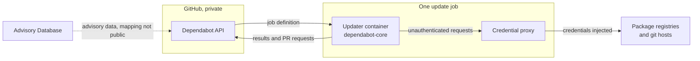
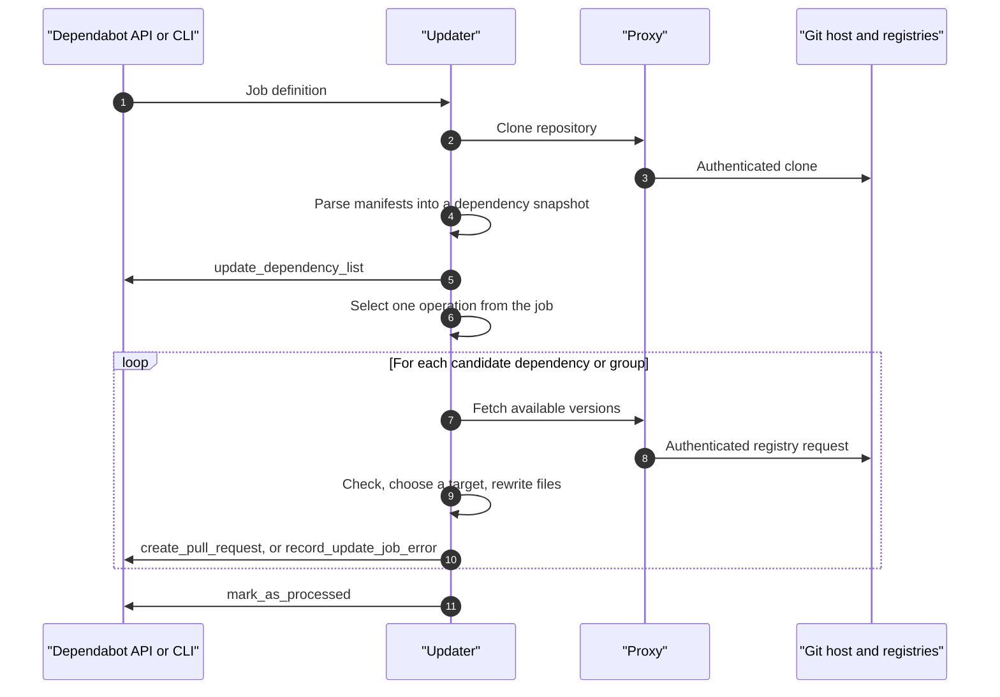
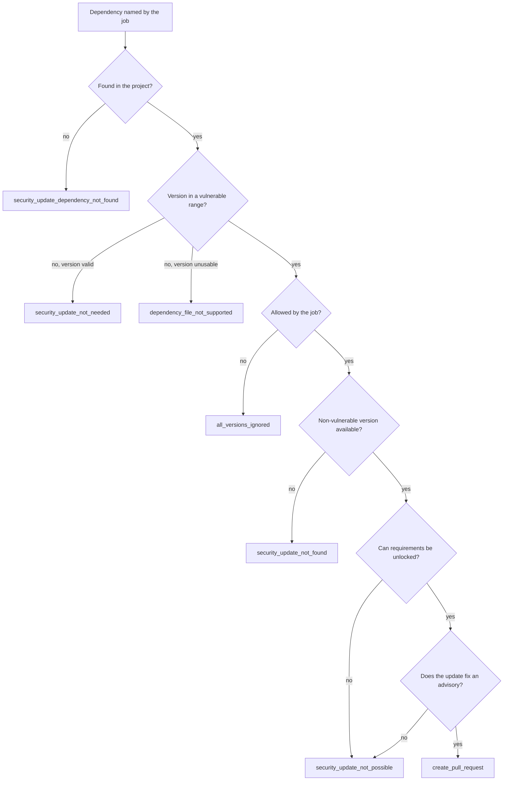
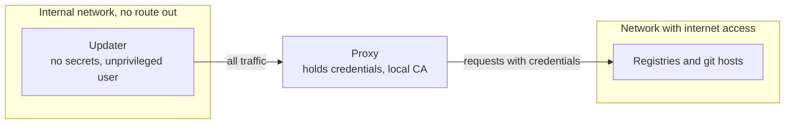

[Dependabot](https://docs.github.com/en/code-security/dependabot) is GitHub's service for keeping project dependencies up to date and for fixing known vulnerabilities in them. Most developers meet it as a stream of pull requests, which makes it look like one product. It is three features, and the part that writes the pull requests is an open-source job runner that talks to a private API.

This article follows one update job through the public code: how the updater fetches and parses a repository, how it picks a target version, how a security advisory reaches it, and how it gets a pull request opened without holding registry credentials or pushing anything itself. It also answers a narrower question: whether Dependabot checks that vulnerable code is called. The update path does not. It compares version numbers, and it does not use [govulncheck](https://pkg.go.dev/golang.org/x/vuln/cmd/govulncheck).

Everything about the update path was read in `dependabot/dependabot-core` and `dependabot/cli` at the commits pinned in the references. Statements about GitHub's hosted service come from its documentation, because that code is not public.

> This article has been made with the help of [Claude Code](https://claude.com/product/claude-code) and several custom skills

[TOC]

## What you need to know first

The article relies on a few concepts from package management and network isolation.

- **Manifest and lockfile.** A manifest (`package.json`, `go.mod`, `Gemfile`) declares the dependencies a project wants, usually as ranges. A lockfile records the exact versions resolved. Dependabot needs an exact version to decide whether a dependency is vulnerable.
- **Direct and transitive dependencies.** A direct dependency is declared by the project, and a transitive one is pulled in by another dependency. A transitive dependency can often be moved only if its parent allows the new version.
- **Requirement.** A constraint on versions, such as `>= 1.2, < 2.0`. Each ecosystem has its own syntax and its own ordering rules, for example for pre-releases.
- **Version matching and reachability.** Version matching asks whether an installed version falls inside a vulnerable range. Reachability analysis asks whether the program can call the vulnerable function. The first needs only metadata, and the second needs the code.
- **OSV format.** The [Open Source Vulnerability schema](https://ossf.github.io/osv-schema/) is a JSON format for advisories. It describes affected versions with `introduced`, `fixed` and `last_affected` events.
- **Intercepting proxy.** A forward proxy can read and change HTTPS traffic if the client trusts a certificate authority controlled by the proxy. Dependabot uses this to add credentials to outbound requests.
- **Containers.** Dependabot runs in Docker containers, and [Docker en bref]({{site.url_complet}}/2021/05/11/docker-en-bref/) gives an introduction in French. This article relies on one feature in particular: an `internal` Docker network has no route to the outside.

## Three features under one name

GitHub's documentation describes three features that share the name. They have different triggers and outputs.

| Feature | Trigger | Data used | Output | Configuration |
|---------|---------|-----------|--------|---------------|
| **Dependabot alerts** | A new advisory, or a change to the repository's dependencies | Dependency graph and GitHub-reviewed advisories | An alert | Repository setting |
| **Security updates** | An alert on a dependency declared in a manifest or lockfile | The alert and its advisory | A pull request to the minimum patched version | Repository setting; `dependabot.yml` optional |
| **Version updates** | A schedule set in `dependabot.yml` | Registry metadata | A pull request to a newer version | `dependabot.yml` required |

Alerts are detection, and the other two are remediation. Only the remediation path is public: `dependabot-core` states in its README that issues about security alerts and the dependency graph do not belong in its tracker, and offers a rule of thumb: questions about the diff in a pull request belong there.

## What is public and what is not

Four public components and one private one take part in an update.

- **`dependabot/dependabot-core`** is a set of Ruby gems with the update logic. It also holds the `updater`, the program that runs inside the container.
- **`dependabot/cli`** is a Go program that starts the containers and runs a job locally. The core README says GitHub uses it in production.
- **`dependabot/proxy`** is the credential proxy, published as the image `ghcr.io/dependabot/proxy`. [A separate article]({{site.url_complet}}/2026/11/05/dependabot-credential-proxy-isolation/) reads its source.
- **`github/advisory-database`** is the public copy of the advisory data, in OSV format.
- **The Dependabot API** is private. The updater's README says it is reachable only inside GitHub's network. It issues jobs and receives their results.



The CLI takes the place of the private API when you run a job yourself. It serves a local HTTP endpoint with the same routes and records what the updater sends.

## One interface per ecosystem

At the analysed commit, `dependabot-omnibus` depends on `dependabot-common` and 34 ecosystem gems, from `bundler` and `npm_and_yarn` to `terraform` and `github_actions`. The README states the contract: each gem implements the same classes.

| Class | Responsibility |
|-------|----------------|
| `FileFetcher` | Finds the dependency files of a project |
| `FileParser` | Turns those files into a list of `Dependency` objects |
| `UpdateChecker` | Decides whether a dependency can move, and to which version |
| `FileUpdater` | Rewrites the files for the new version |
| `MetadataFinder` | Looks up changelogs, release notes and commits |
| `Version` | Orders versions in this ecosystem |
| `Requirement` | Parses and evaluates constraints |

This split keeps the orchestration independent of any language, because `updater/` only ever calls `Dependabot::UpdateCheckers.for_package_manager(...)` and its siblings.

The file update step usually delegates to the real package manager rather than reimplementing it. For Go, `go_mod_updater.rb` bumps modules with `go get lib@version`, then runs `go get` again with no argument so that its validation checks run against each module in `go.mod`. This keeps lockfiles consistent, and it is the reason the update has to be isolated: real package managers can run code from the project.

## Anatomy of an update job

A job is a declarative description of one piece of work. The CLI's `model.Job` struct lists the fields, and the ones that shape behaviour are these:

- `package-manager` selects the ecosystem gem.
- `source` gives the provider, repository, directory and commit.
- `allowed-updates` and `ignore-conditions` restrict what may change.
- `dependency-groups` describes which updates share a pull request.
- `security-updates-only`, `security-advisories` and `dependencies` turn the job into a targeted fix.
- `updating-a-pull-request` and `existing-pull-requests` tell the job what is already open.
- `cooldown` delays recent releases.

The entry point is `updater/bin/update_files.rb`. The CLI still issues `bin/run fetch_files && bin/run update_files`, but `bin/run` treats `fetch_files` as a no-op kept for backward compatibility. Both steps run in one process.



The steps map to two commands:

1. **`FileFetcherCommand`** validates the target branch, clones the repository and collects the dependency files. If that fails it reports the error and marks the job as processed.
2. **`UpdateFilesCommand`** builds a `DependencySnapshot`, which runs the ecosystem's `FileParser`, sends the dependency list to the API, and hands over to `Dependabot::Updater`.

Every update job reports the project's dependencies, so a version update run also refreshes what the service knows about the repository.

An update that cannot happen is not a job failure. It is recorded with `record_update_job_error` and a type such as `security_update_not_found`, and the job still ends with `mark_as_processed`.

### Choosing an operation

`Updater#run` asks `Operations.class_for(job:)` for a class, and takes the first in an ordered list whose `applies_to?` returns true.

| Operation | Applies to |
|-----------|-----------|
| `GroupUpdateAllVersions` | Multi-ecosystem jobs, new version updates, and security jobs with several dependencies or a group for security updates |
| `RefreshGroupUpdatePullRequest` | An existing group pull request to rebuild |
| `CreateSecurityUpdatePullRequest` | A new security update for named dependencies |
| `RefreshSecurityUpdatePullRequest` | An existing security pull request |
| `RefreshVersionUpdatePullRequest` | An existing version pull request |

`UpdateAllVersions` is not in that list, and its `applies_to?` returns false. It is called by `GroupUpdateAllVersions`, which first runs each configured group and then handles the remaining dependencies one by one. So every new version update goes through the group path, even in a repository with no groups.

The refresh operations are separate jobs. Refreshing an open pull request recomputes the change and sends it with `update_pull_request`.

## Version updates: finding a target

For each dependency, `UpdateAllVersions` builds an `UpdateChecker` and asks whether the dependency is up to date. Dependencies are shuffled first unless deterministic updates are switched on, so ordering is not a stable property of a run.

The shared finder `PackageLatestVersionFinder` narrows the published releases in a fixed order:

```ruby
releases = filter_yanked_versions(releases)
releases = @cooldown_tracker.filter(language_version:, requirements: false) do
  filtered = filter_by_cooldown(releases)
  filtered = filter_prerelease_versions(filter_unsupported_versions(filtered, language_version))
  filtered = filter_ignored_versions(filtered)
  apply_post_fetch_latest_versions_filter(filtered)
end
releases.max_by(&:version)
```

The target is the highest version that survives. The cooldown excludes releases that are too recent, 3 days by default (`DEFAULT_COOLDOWN_DAYS`). The delay also gives a compromised release time to be noticed and removed before it reaches a pull request.

A latest version is not necessarily installable, so the operation then asks how much must move:

| Unlock level | Meaning |
|--------------|---------|
| `:none` | The update fits the current requirements |
| `:own` | The dependency's own requirement must change |
| `:all` | Other dependencies must change too |

The levels are tried in that order, and `:update_not_possible` is the result if none works. For version updates, an impossible update is only logged.

## Security updates: finding the minimum fix

A security update reuses the same classes with a different goal. `CreateSecurityUpdatePullRequest` receives named dependencies, and the checker receives the advisories for each one.

`UpdateCheckers::Base#vulnerable?` returns false in three cases: no advisories, no resolved version, or a git dependency pinned to a SHA. The last two are limits of the method, since they cover dependencies Dependabot cannot place in a range:

```ruby
def vulnerable?
  return false if security_advisories.none?

  # Can't (currently) detect whether dependencies without a version
  # (i.e., for repos without a lockfile) are vulnerable
  return false unless dependency.version

  # Can't (currently) detect whether git dependencies are vulnerable
  return false if existing_version_is_sha?

  active_advisories.any?
end
```

Finding the target then differs from a version update in four ways:

- **It picks the lowest version, not the highest.** The patched release is the smallest change that closes the advisory.
- **It removes vulnerable versions** by testing each candidate against every advisory with `filter_vulnerable_versions`.
- **It skips the cooldown.** The operation builds its checker without one, because delaying a fix is the wrong trade-off.
- **It does not apply the shared pre-release filter.** That line is commented out in `fetch_lowest_security_fix_version`, although an ecosystem can still filter on its own, as Go does.

```ruby
releases = filter_yanked_versions(releases)
releases = filter_unsupported_versions(releases, language_version)
releases = Dependabot::UpdateCheckers::VersionFilters
           .filter_vulnerable_versions(releases, security_advisories)
releases = filter_ignored_versions(releases)
releases = filter_lower_versions(releases)
releases = apply_post_fetch_lowest_security_fix_versions_filter(releases)

releases.min_by(&:version)&.version
```

Go adds one detail. The Go proxy lists tagged releases, but an advisory can be fixed by a commit that has only a pseudo-version, such as `2.3.1-0.20260320110106-0b84568fffcc`. `fetch_lowest_security_fix_version` in the Go finder extracts those versions from the advisory's own boundaries and adds them as candidates.

### Why a security update can fail

A vulnerable dependency does not guarantee a pull request. The operation walks through a chain of checks, and each exit reports a specific error.



The last check is a guard. `job.security_fix?` confirms that at least one updated dependency moves from an affected version to a non-affected one. The code comment explains why it exists: for npm and Yarn sub-dependencies, Dependabot does not control the final version, so an update could otherwise land on another vulnerable release.

GitHub's documentation describes the same limit from the outside: in most ecosystems, Dependabot cannot update a transitive dependency if that would also require updating its parent.

## Where advisories come from

The updater does not look advisories up. They arrive in the job as plain data, and the CLI's `Advisory` struct holds four fields: `dependency-name`, `affected-versions`, `patched-versions` and `unaffected-versions`. There is no field for functions or call paths.

`Job#security_advisories_for` selects advisories by case-insensitive name and builds `SecurityAdvisory` objects, with patched and unaffected versions merged into `safe_versions`. A safe range wins over a vulnerable range:

```ruby
def vulnerable?(version)
  in_safe_range = safe_versions.any? { |r| r.satisfied_by?(version) }
  return false if in_safe_range

  in_vulnerable_range = vulnerable_versions.any? { |r| r.satisfied_by?(version) }
  return true if in_vulnerable_range
  return false if vulnerable_versions.any?

  safe_versions.any?
end
```

The source of that data on GitHub is the [GitHub Advisory Database](https://github.com/advisories), published as `github/advisory-database`. The documentation is explicit that only advisories reviewed by GitHub trigger alerts. The snapshot analysed here shows why the distinction matters:

| Measure, commit `b6d0ec57e55` of 2026-11-04 | Count |
|---------------------------------------------|-------|
| GitHub-reviewed advisories | 37,522 |
| of which withdrawn | 1,256 |
| Unreviewed advisories | 362,041 |
| Unreviewed advisories with an `ecosystem` field | 3 |

Reviewed advisories are about 9.4% of the files, and they are nearly the only ones Dependabot could match to a package. The unreviewed ones generally lack the package and version data that matching needs. These counts describe what the database holds on that date. They are not a measure of how many vulnerabilities exist.

The conversion from an OSV record to the job's fields happens in the private service. The fields correspond in an obvious way, but the code that does it is not public.

## Version matching, not reachability

A search for `govulncheck`, `x/vuln` and `vulncheck` across `dependabot-core` and `dependabot/cli` returns nothing, and neither `go.mod` depends on `golang.org/x/vuln`. In the update path, a dependency is vulnerable if its version is in a range. Whether the project calls the vulnerable code plays no part.

The data could not support more on its own: none of the 5,065 reviewed Go advisory files has a `symbols`, `imports` or `affected_functions` field. govulncheck uses a different source, the [Go vulnerability database](https://vuln.go.dev/), which the Advisory Database README lists among its own inputs.

| | Dependabot update path | govulncheck | Reachability for Dependabot alerts |
|---|---|---|---|
| **Question** | Is this version in an affected range? | Does this Go code use a vulnerable function? | Can this application call the vulnerable function? |
| **Method** | Range comparison | Static analysis of source, or a binary's symbol table | CodeQL static analysis |
| **Data** | Advisories passed in the job | vuln.go.dev | Open alerts and curated data on affected functions |
| **Coverage** | All supported ecosystems | Go | JavaScript and TypeScript, public preview |
| **Result** | Update pull request | Report | A verdict on the alert |

The third column is a separate GitHub feature. [Reachability analysis for Dependabot alerts](https://docs.github.com/en/code-security/concepts/supply-chain-security/about-reachability-analysis-for-dependabot-alerts) is in public preview for repositories using npm, pnpm or Yarn. It only helps with prioritisation: it does not find new vulnerabilities or close alerts, and the documentation advises against dismissing an alert on the verdict alone. Nothing in the two public repositories refers to it, and the page does not say whether it affects which pull requests are raised.

For a Go project, the two tools answer different questions and work well together. Dependabot proposes the fix, and running govulncheck in CI tells you which findings can be reached.

Version matching reports vulnerable code that is never called, which generates noise. It also needs no build and no call graph, works the same way across every ecosystem, and does not miss a vulnerability because of reflection or dynamic dispatch.

## Trust boundaries: running untrusted code

Updating a dependency means executing the project's tooling. The core README names the risk: `setup.py` and `.gemspec` can run arbitrary code, so a compromised package could force a package manager to expose credentials. The design assumes the updater may be compromised, and removes what an attacker would want from it.

Three mechanisms do that work, all visible in the CLI:

- **Network isolation.** `NewNetworks` creates two Docker networks, one with `Internal: true`. The updater attaches only to the internal one. The proxy attaches to both, so it is the updater's only way out.
- **Credential separation.** The updater reads `credentials_metadata` from the job, which describes registries but holds no secrets. Real credentials are given to the proxy, and it adds them to outbound requests. In the core README's words, Dependabot-Core never sees private registry credentials.
- **Interception by a local CA.** `NewProxy` generates a certificate authority for the run, and the updater container trusts it. That is what lets the proxy add headers to HTTPS traffic.

The updater also runs as an unprivileged `dependabot` user, created in `Dockerfile.updater-core`. Before starting anything, the CLI requires valid GitHub build attestations for the updater and proxy images, which ties them to the `main` branch of their repositories. A flag can skip this check for trusted development images.

The job also carries a `reject-external-code` flag, which is passed to the file parser so that ecosystems can refuse to run external code.



This limits the damage of a compromise, but it does not remove it. The proxy adds credentials to read requests and refuses to authenticate git pushes, so code in the updater can still read what the job can read. It can also change the file contents sent back. Egress filtering exists in the proxy, but it is off unless a job experiment enables it.

None of this reviews the new code itself. A Dependabot pull request is an automated proposal to run new third-party code, and it needs the same checks as any other contribution.

## From a change to a pull request

Once a target is known, `DependencyChangeBuilder` asks the ecosystem's `FileUpdater` to rewrite the files, and raises `DependencyFileContentNotChanged` if nothing changed. The result is a `DependencyChange`.

The title and body come from `PullRequestCreator::MessageBuilder`, which uses the `MetadataFinder` to add release notes, the changelog and commits. Its base class also has hooks for maintainer changes, install script changes and attestation changes, which ecosystems can implement, and the message builder includes a `link_and_mention_sanitizer`.

Then the updater stops. It does not push a branch. `ApiClient#create_pull_request` sends a POST to `/update_jobs/<id>/create_pull_request` with the new file contents and the message:

```text
dependencies, updated-dependency-files, base-commit-sha,
commit-message, pr-title, pr-body
```

Creating the branch and the pull request is left to whoever receives that call. `common` does contain pull request creators for GitHub, GitLab, Azure DevOps, Bitbucket and CodeCommit, for standalone use, but in `updater/lib` the `PullRequestCreator` class is used only for the message builder and its length limits.

As far as the public code shows, the component that runs untrusted code asks for a commit, and a separate component makes it.

## Running a job yourself

The CLI makes all of this observable. It needs Docker, and `dependabot update go_modules dependabot/cli` runs a version update on a public repository. It records the calls the updater makes and writes them as YAML with `--output`, but it does not create a pull request. The core README points to `dependabot/example-cli-usage` for turning the diffs into pull requests.

A security job needs you to supply the advisory, since nothing else will. This is the input of the repository's own smoke test, `testdata/go/security-go.yaml`:

```yaml
input:
  job:
    package-manager: go_modules
    allowed-updates:
      - update-type: all
    security-advisories:
      - dependency-name: github.com/fatih/color
        affected-versions:
          - <1.10.0
        patched-versions: []
        unaffected-versions: []
    security-updates-only: true
    source:
      provider: github
      repo: dependabot/smoke-tests
      directory: /
      commit: 832e37c1a7a4ef89feb9dc7cfa06f62205191994
```

The test expects an `update_dependency_list` call, then a `create_pull_request` that moves `github.com/fatih/color` from `1.7.0` to `1.10.0`: the lowest version outside the range, not the latest one. The job was not run for this article; this is the expected output recorded in the test.

The same mechanism means a scanner of your own can feed Dependabot. If govulncheck reports a reachable vulnerability, you can write it into `security-advisories`. Dependabot will still only compare versions, but the job will exist only for the findings you selected.

## Conclusion

Dependabot is a job system. A private service decides what to do, and an open-source updater does it in a container that holds no secrets.

- **Three features** share the name: alerts detect, while security updates and version updates remediate. Only the remediation path is public.
- **One interface per ecosystem** keeps the orchestration generic, with 34 ecosystem gems behind the same classes, and real package managers doing the file updates.
- **Version updates** take the highest version that passes the filters, after a default cooldown of 3 days. **Security updates** take the lowest non-vulnerable version and skip the cooldown.
- **Advisories arrive in the job.** On GitHub they come from the reviewed part of the Advisory Database, and only 3 of the 362,041 unreviewed advisories name an ecosystem.
- **The update path matches versions.** It does not use govulncheck, and it does not check that vulnerable code is called. GitHub's reachability analysis is a separate preview that adds a verdict to alerts, for JavaScript and TypeScript.
- **The trust boundary sits around the updater.** It has no direct internet route and no registry credentials, and it asks for a pull request rather than creating one.


## Annex

### Key Terms

| Term | Definition |
|------|------------|
| **Manifest** | A file that declares a project's dependencies, usually as version ranges. |
| **Lockfile** | A file that records the exact resolved version of each dependency. |
| **Transitive dependency** | A dependency pulled in by another dependency rather than declared by the project. |
| **Requirement** | A version constraint, parsed and evaluated by an ecosystem's `Requirement` class. |
| **Ecosystem gem** | A Ruby package in `dependabot-core` that implements the update classes for one package manager. |
| **Update job** | A declarative description of one piece of work, passed to the updater. |
| **Updater** | The program in `dependabot-core` that runs inside the container and performs a job. |
| **Dependabot API** | GitHub's private service, which issues jobs and receives their results. |
| **Dependabot CLI** | The Go tool that runs a job locally and stands in for the private API. |
| **Credential proxy** | The container that adds credentials to the updater's outbound requests. |
| **Dependency snapshot** | The parsed state of a project at the start of a job. |
| **Operation** | The class selected from the job that decides what the updater does. |
| **Unlock level** | How much must change for an update to install: nothing, the dependency's own requirement, or others too. |
| **Cooldown** | A delay before a new release can be proposed by a version update. |
| **Security advisory** | A record of a vulnerability, with the package and affected versions. |
| **GitHub-reviewed advisory** | An advisory mapped by GitHub to a package in a supported ecosystem, which can trigger alerts. |
| **Pseudo-version** | A Go version string that points to a commit rather than a tag. |
| **Reachability analysis** | Checking whether a program can call a vulnerable function. |

### Invariants

| Invariant | Enforced by | Breaks if |
|-----------|-------------|-----------|
| The updater has no direct route to the internet. | `Internal: true` on the network it joins, in `NewNetworks` | The updater is attached to a network with outbound access. |
| The updater never holds registry credentials. | `credentials_metadata` in the job, with secrets held by the proxy | Secrets are placed in the job, or a credential is passed in the environment. |
| A security pull request fixes at least one advisory. | The `job.security_fix?` check before the change is built | The check is removed, or an advisory's ranges are wrong. |
| A security update targets a non-vulnerable version. | `filter_vulnerable_versions` | An advisory's range is incomplete. |
| Cooldown never delays a security update. | `update_cooldown: job.security_updates_only? ? nil : job.cooldown` and its absence from the security checker | An operation passes `job.cooldown` to the checker in a security job. |
| A refresh rebuilds the change rather than editing the branch. | The separate refresh operations | An operation reuses old file contents. |

### Integration Notes

| Behaviour | What an integrator should do |
|-----------|------------------------------|
| Without a lockfile, `dependency.version` can be empty and `vulnerable?` returns false. | Commit a lockfile if you rely on security updates. |
| A git dependency pinned to a SHA is not considered vulnerable. | Track such dependencies separately, since Dependabot can't place them in a range. |
| Dependencies are shuffled in each run. | Don't rely on update order, and set a group if updates must travel together. |
| A job that cannot update records an error and still ends as processed. | Read the error type, because "no pull request" can have several causes. |
| The default cooldown does not apply to security updates. | Don't expect a security pull request to have aged, and review it as a fresh release. |
| The CLI produces diffs, not pull requests. | Use `dependabot/example-cli-usage` as a base for self-hosting. |
| Security jobs in the CLI do nothing without advisories in the job. | Supply `security-advisories` from your own source. |

## Frequently Asked Questions

**Q: What is the difference between a Dependabot alert and a security update?**

An alert is a detection: it says that a dependency in the repository matches a reviewed advisory. A security update is a remediation: it tries to raise a pull request to the minimum patched version.

They can diverge. Alerts cover the full dependency graph, whereas security updates apply only to dependencies specified in a manifest or lockfile, and an update can fail with an error such as `security_update_not_possible`.

**Q: Does Dependabot use govulncheck?**

No. Neither `dependabot-core` nor `dependabot/cli` contains it, and the update path compares versions with advisory ranges. govulncheck uses static analysis and the Go vulnerability database to report vulnerable code that could affect the application, and you can run it next to Dependabot in CI. GitHub's separate reachability preview for alerts uses CodeQL and covers JavaScript and TypeScript.

**Q: Why does a security update choose the lowest fixed version and a version update the highest?**

The two have different goals. A security update wants the smallest change that closes the advisory, which limits the risk of breaking the project while it responds to a vulnerability. A version update wants to keep the project current. The code reflects this directly: `min_by` in `fetch_lowest_security_fix_version` and `max_by` in `fetch_latest_release`.

**Q: A vulnerable dependency has a fixed release, but no pull request appears. What can explain it?**

Several exits in `CreateSecurityUpdatePullRequest` lead there:

- The dependency's version cannot be matched, for example with no lockfile or a pinned SHA.
- An ignore rule blocks it (`all_versions_ignored`).
- The fixed version is not usable in this environment (`security_update_not_found`).
- A parent dependency blocks the change (`security_update_not_possible`).
- A pull request already exists.

The job's error type says which one applies.

**Q: How does Dependabot protect registry credentials from a malicious package?**

The updater never receives them. It runs on an internal Docker network, with the proxy as its only way out, and its job holds only credential metadata. The proxy injects the secret into the outbound request and strips it from the response, using a local certificate authority to do so for HTTPS. A package that runs code during an update therefore finds no credential in the updater's environment.

**Q: Combining the sections above, could an unreviewed advisory lead to a Dependabot pull request?**

Not through the path GitHub documents, since only reviewed advisories trigger alerts, and an unreviewed advisory almost never carries the package data needed for matching. With the CLI, however, the updater does not know where an advisory comes from. If you copy the data into `security-advisories` in a job file, it is treated like any other.

## Gaps

The points below were not settled by the code and documentation read for this article.

| Gap | Why it matters | What to read or verify |
|-----|----------------|------------------------|
| The private Dependabot API is not public. | Scheduling, job creation, the OSV-to-job mapping and the creation of commits are described from the outside. | GitHub's documentation; no public code exists. |
| The network topology was read in the CLI, not in GitHub's production setup. | The core README says GitHub uses the CLI, but the hosted service may differ in detail. | `internal/infra/run.go` against any GitHub statement on hosted runners. |
| Whether hosted jobs enable the proxy's egress enforcement is not public. | It sets the limit of the isolation described. | GitHub's documentation or a statement from the project. |
| Whether reachability verdicts change which security updates are raised is not stated. | It affects how much of the update path is version-only on GitHub. | The reachability documentation, which is in preview and may change. |
| How `reject-external-code` is honoured by each ecosystem was not checked. | The article says only that the flag is passed to the parser. | `reject_external_code` in each ecosystem's `FileParser`. |
| The CLI job and its expected output were read, not run. | The `1.10.0` result is the test's recorded expectation. | Run `dependabot test -f testdata/go/security-go.yaml`. |
| GitHub's documentation pages carry no date, and the schedule and repository settings in the feature table come from general knowledge. | The feature table may change, particularly the preview. | The pages listed in the references, and the `dependabot.yml` options reference. |

## References

### Analyzed source

- [dependabot/dependabot-core](https://github.com/dependabot/dependabot-core) — analyzed at commit [`6a43f5c18a7120386064c4afabb6a3e803d63d90`](https://github.com/dependabot/dependabot-core/tree/6a43f5c18a7120386064c4afabb6a3e803d63d90), 2026-11-05
- [dependabot/proxy](https://github.com/dependabot/proxy) — analyzed at commit [`8232624e0a642edf5b77ac4927db0bb774e43777`](https://github.com/dependabot/proxy/tree/8232624e0a642edf5b77ac4927db0bb774e43777) (tag [v2.0.20261103195546](https://github.com/dependabot/proxy/releases/tag/v2.0.20261103195546)), 2026-11-05
- [dependabot/cli](https://github.com/dependabot/cli) — analyzed at commit [`41663d5a4acf0917b1e46d8117ea6a9f503eabb9`](https://github.com/dependabot/cli/tree/41663d5a4acf0917b1e46d8117ea6a9f503eabb9) (release [v1.97.0](https://github.com/dependabot/cli/releases/tag/v1.97.0)), 2026-11-05
- [github/advisory-database](https://github.com/github/advisory-database) — analyzed at commit [`b6d0ec57e5561f66c3121af72e24871d1d7f2902`](https://github.com/github/advisory-database/tree/b6d0ec57e5561f66c3121af72e24871d1d7f2902), 2026-11-05

### GitHub documentation

- [About Dependabot alerts](https://docs.github.com/en/code-security/dependabot/dependabot-alerts/about-dependabot-alerts), read 2026-11-05
- [About Dependabot security updates](https://docs.github.com/en/code-security/dependabot/dependabot-security-updates/about-dependabot-security-updates), read 2026-11-05
- [About Dependabot version updates](https://docs.github.com/en/code-security/dependabot/dependabot-version-updates/about-dependabot-version-updates), read 2026-11-05
- [About reachability analysis for Dependabot alerts](https://docs.github.com/en/code-security/concepts/supply-chain-security/about-reachability-analysis-for-dependabot-alerts), public preview, read 2026-11-05
- [About the GitHub Advisory Database](https://docs.github.com/en/code-security/security-advisories/working-with-global-security-advisories-from-the-github-advisory-database/about-the-github-advisory-database), read 2026-11-05
- [GitHub Advisory Database](https://github.com/advisories)

### Vulnerability tools and formats

- [govulncheck command documentation](https://pkg.go.dev/golang.org/x/vuln/cmd/govulncheck)
- [Go vulnerability database](https://vuln.go.dev/)
- [Open Source Vulnerability schema](https://ossf.github.io/osv-schema/)
- [dependabot/example-cli-usage](https://github.com/dependabot/example-cli-usage)

### Related articles

- [Firmware Supply Chain - Reproducible Builds and Code Signing]({{site.url_complet}}/2026/07/31/firmware-reproducible-builds-code-signing/)
- [Crypto Hacks of 2026 So Far - January to September, from Truebit to Bitget]({{site.url_complet}}/2026/10/07/crypto-hacks-2026-year-to-date/)
- [Docker en bref]({{site.url_complet}}/2021/05/11/docker-en-bref/)
