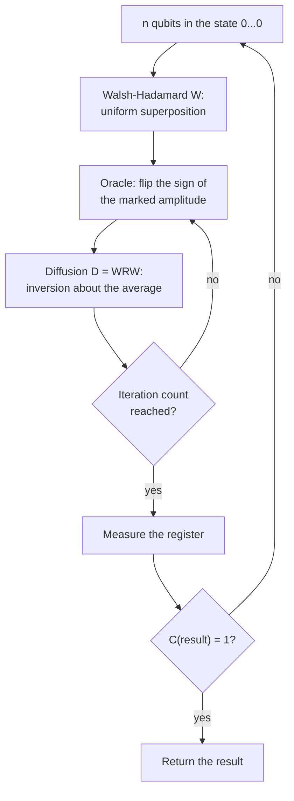

In 1996 Lov Grover published [*A fast quantum mechanical algorithm for database search*](https://arxiv.org/abs/quant-ph/9605043), which finds one marked item among $$N$$ unstructured candidates in $$O(\sqrt N)$$ steps, where a classical computer needs $$O(N)$$. The speedup is only quadratic, far from the exponential gain of Shor's factoring algorithm, but it applies to almost any problem that can be phrased as "test a candidate". That includes brute-force search for a symmetric key and for a hash preimage.

This article follows the paper: the algorithm, the two proofs behind it, and the limits it states. It then adds what later work established, namely the exact iteration count, optimality, the failure of parallel speedup, and the cost of running the algorithm against AES and SHA-256. Three of those results matter more to a cryptographer than the headline: too many iterations destroy the answer, $$S$$ machines give a speedup of only $$\sqrt S$$, and each query is a full reversible evaluation of the cipher or hash.

> This article has been made with the help of [Claude Code](https://claude.com/product/claude-code) and several custom skills

[TOC]

## What you need to know first

The article assumes basic linear algebra, and it uses the following quantum computing concepts without deriving them.

- **Amplitude.** The state of $$n$$ qubits is a vector of $$N = 2^n$$ complex numbers, one per bit string. Measuring returns string $$x$$ with probability $$\lvert\alpha_x\rvert^2$$, so the squared magnitudes sum to 1. Amplitudes can be negative, which probabilities cannot, and that difference is what the algorithm exploits.
- **Unitary evolution.** Before measurement, a quantum computer can only multiply the state by a unitary matrix. Such a matrix preserves the total probability and can always be undone.
- **Interference.** Amplitudes add with their signs. Paths leading to the same outcome can reinforce or cancel each other, provided nothing records which path was taken. The paper stresses this requirement: the implementation must leave "no trace" of the state in the system.
- **Hadamard gate.** The one-qubit matrix $$M$$ of the paper sends a basis state to an equal superposition of 0 and 1. Applied to each of $$n$$ qubits it gives the Walsh-Hadamard transform $$W$$, also written $$H^{\otimes n}$$.
- **Oracle and query complexity.** An oracle is a black box that answers "is this candidate a solution?". Query complexity counts the calls to it and ignores all other work, which matters later because a query can be very expensive.
- **Security level and block cipher key search.** A $$k$$-bit key has a classical brute-force cost of about $$2^k$$ cipher evaluations. [NIST's post-quantum categories](https://csrc.nist.gov/projects/post-quantum-cryptography/post-quantum-cryptography-standardization/evaluation-criteria/security-(evaluation-criteria)) use AES key search and SHA collision search as reference attacks.

## The search problem

The paper abstracts the task as follows. A system has $$N = 2^n$$ states $$S_1, \dots, S_N$$, represented as $$n$$-bit strings. A condition $$C$$ can be evaluated on a state in unit time, with $$C(S_\nu) = 1$$ for one unknown state and $$C(S) = 0$$ for all others. The goal is to identify $$S_\nu$$.

Nothing about $$C$$ may be used except its answers. A classical algorithm can only try candidates, and it needs $$N/2$$ evaluations to reach a success probability of $$1/2$$. Grover's phone-directory image, a directory in random order searched by number, has made "database search" the common name, and that name misleads. The practical use is searching the inputs of a *function*, such as "does this key decrypt this block?". Section 7 of the paper makes this point itself: computing the function at each point avoids storing the data in quantum memory.

## The algorithm

The algorithm has three steps, and the loop in the second is the whole idea.

1. **Initialise.** Apply $$W$$ to $$\lvert 0\rangle^{\otimes n}$$ to get the uniform superposition, with amplitude $$1/\sqrt N$$ on every state. This takes $$O(\log N)$$ gates.
2. **Repeat $$O(\sqrt N)$$ times:**
   - (a) rotate the phase of the marked state by $$\pi$$, which multiplies its amplitude by $$-1$$;
   - (b) apply the diffusion transform $$D$$.
3. **Measure.** The result is $$S_\nu$$ with probability at least $$1/2$$. The caller checks it with $$C$$ and restarts on failure.

### The phase flip

Step (a) reads the condition without measuring anything: the amplitude changes sign, and the probability of that state does not change, since $$\lvert -\alpha\rvert^2 = \lvert\alpha\rvert^2$$. A single step therefore reveals nothing. The information is stored in a sign, and a measurement at this point would still return a uniformly random state.

The paper specifies the behaviour of the step and leaves its circuit aside. The textbook construction takes a reversible circuit $$U_f \lvert x\rangle\lvert b\rangle = \lvert x\rangle\lvert b \oplus f(x)\rangle$$ and sets the extra qubit to $$(\lvert 0\rangle - \lvert 1\rangle)/\sqrt 2$$, so that $$f(x) = 1$$ turns into a sign on $$\lvert x\rangle$$. This is phase kickback.

### The diffusion transform

The diffusion transform is the matrix

$$
\begin{aligned}
D_{ij} = \frac{2}{N} \;\text{ if } i \neq j, \qquad D_{ii} = -1 + \frac{2}{N}.
\end{aligned}
$$

Read directly, it connects every state to every other, so it is not a local operation. Theorem 1 of the paper shows that it factors into local ones:

$$
\begin{aligned}
D = W R W, \qquad R = \mathrm{diag}(1, -1, -1, \dots, -1),
\end{aligned}
$$

where $$W_{ij} = 2^{-n/2}(-1)^{i \cdot j}$$ and $$R$$ flips the sign of every basis state except $$\lvert 0\dots 0\rangle$$. The proof writes $$R = -I + R_2$$, where $$R_2$$ has a single non-zero entry, a 2 at position $$(0,0)$$. Since $$WW = I$$, the term $$-I$$ stays $$-I$$. The term $$W R_2 W$$ gives $$2 W_{a0} W_{0d} = 2/N$$ in every position.

The only quantum operations the algorithm needs are therefore Walsh-Hadamard transforms and conditional phase shifts. Section 7 of the paper offers this as a reason the algorithm should be easier to implement than ones built on a large Fourier transform.

## Why it works

### Inversion about the average

The paper's key insight is the form $$D = -I + 2P$$, where $$P_{ij} = 1/N$$ for all $$i, j$$. $$P$$ replaces every component of a vector with the average $$A$$ of all components, and $$P^2 = P$$ then gives $$D^2 = I$$, so $$D$$ is unitary. Applied to a vector $$v$$:

$$
\begin{aligned}
w_i = -v_i + 2A = A + (A - v_i) \quad\text{where } w = Dv.
\end{aligned}
$$

Each amplitude is reflected through the mean: a value $$\delta$$ above it ends up $$\delta$$ below it, and the reverse.

This explains the pairing of the two steps. Near the start, all amplitudes are about $$1/\sqrt N$$. The phase flip makes one of them negative, and the average barely moves. The inversion then leaves the $$N-1$$ positive amplitudes almost unchanged, while the negative one, far below the average, lands far above it. Its magnitude grows by about $$2/\sqrt N$$ per iteration.

### The worked case $$N = 8$$

With three qubits and one marked state, a run looks like this. Values come from a [state-vector simulation](#verification-of-the-numbers).

| Stage | Marked amplitude | Each other amplitude | Average | $$P$$(marked) |
|---|---:|---:|---:|---:|
| Initial | 0.35355 | 0.35355 | 0.35355 | 0.1250 |
| After phase flip 1 | −0.35355 | 0.35355 | 0.26517 | 0.1250 |
| After diffusion 1 | 0.88388 | 0.17678 | | 0.7813 |
| After phase flip 2 | −0.88388 | 0.17678 | 0.04419 | 0.7813 |
| After diffusion 2 | 0.97227 | −0.08839 | | 0.9453 |

Row 3 follows from the formula: $$2 \times 0.26517 + 0.35355 = 0.88388$$. Note the last line, where the unmarked amplitudes have become negative. A third iteration would start reducing the marked amplitude, as the next section shows.

### The proof of convergence

Theorem 2 gives the effect of $$D$$ on a state described by two numbers, $$k$$ on the marked state and $$l$$ on each of the others. This closes the system: the whole $$N$$-dimensional evolution reduces to a recurrence on $$(k, l)$$. Theorem 3 then shows that while $$0 \lt k \lt 1/\sqrt 2$$ and $$l \gt 0$$, one iteration satisfies

$$
\begin{aligned}
\Delta k = -\frac{2k}{N} + 2\left(1 - \frac{1}{N}\right) l \;\gt\; \frac{1}{2\sqrt N}.
\end{aligned}
$$

The bound on $$l$$ comes from normalisation: $$k^2 + (N-1) l^2 = 1$$ with $$k \lt 1/\sqrt 2$$ forces $$l \gt 1/\sqrt{2N}$$. Since $$k$$ gains at least $$1/(2\sqrt N)$$ per iteration, it passes $$1/\sqrt 2$$ in fewer than $$\sqrt{2N}$$ iterations, and the success probability $$k^2$$ passes $$1/2$$.

That is all the paper proves about the count: such a number $$M \lt \sqrt{2N}$$ *exists*. It does not say to stop at $$\sqrt{2N}$$, and doing so would be a mistake.

### The rotation view

[Boyer, Brassard, Høyer and Tapp](https://arxiv.org/abs/quant-ph/9605034) (BBHT) solved the recurrence in closed form. Allow $$M$$ marked states out of $$N$$, and define the angle $$\theta$$ by $$\sin^2\theta = M/N$$. After $$j$$ iterations the probability of measuring a solution is exactly

$$
\begin{aligned}
P_j = \sin^2\big((2j + 1)\theta\big).
\end{aligned}
$$

The usual geometric reading of this formula is a rotation. The state stays in the plane spanned by the uniform superposition of solutions and that of non-solutions, and starts at angle $$\theta$$ from the non-solution axis. Each of the two steps is a reflection, and two reflections compose to a rotation, here by $$2\theta$$. The algorithm turns the state towards the solutions at a constant angular speed, and nothing stops it at the target.

## How many iterations

Setting $$(2j+1)\theta \approx \pi/2$$ gives the count BBHT recommend, $$\lfloor \pi/(4\theta) \rfloor$$. For $$M \ll N$$, $$\theta \approx \sqrt{M/N}$$ and the count is about

$$
\begin{aligned}
\frac{\pi}{4}\sqrt{\frac{N}{M}},
\end{aligned}
$$

with a failure probability of at most $$M/N$$. The figure shows the consequence of that sine.

Two behaviours appear in the figure that have no classical counterpart.

- **Overshooting.** The solid curve peaks at 25 iterations and returns to zero near 50. A classical search only improves with more work. For $$N = 2^{20}$$, BBHT's numbers, which the script reproduces, are 804 iterations for a failure probability of $$2.4 \times 10^{-7}$$ and under 9.5% success at Grover's upper bound of $$\sqrt{2N} = 1448$$ iterations. The 50% mark is reached at 402 iterations, about $$(\pi/8)\sqrt N$$, so the paper's bound is loose by a factor of 3.6.
- **Dependence on $$M$$.** The count must match the number of solutions. The dashed curve has four solutions: 25 iterations give $$P = 0.0023$$, close to the worst possible choice. With $$N = 2^{20}$$, running the 804 iterations meant for one solution on a table with four gives less than one chance in a million.

### When the number of solutions is unknown

BBHT handle an unknown $$M$$ with a randomised schedule built on a simple average. If $$j$$ is drawn uniformly from $$\{0, \dots, m-1\}$$, the mean success probability is

$$
\begin{aligned}
P_m = \frac{1}{2} - \frac{\sin(4m\theta)}{4m\sin(2\theta)},
\end{aligned}
$$

which is at least $$1/4$$ once $$m \geq 1/\sin(2\theta)$$. The algorithm starts with a small $$m$$, picks $$j$$ at random, runs and measures, then multiplies $$m$$ by a factor $$\lambda = 6/5$$ on failure. The expected total stays in $$O(\sqrt{N/M})$$ without knowing $$M$$, with BBHT's bound of about $$\tfrac{9}{4}\sqrt{N/M}$$ iterations for $$M \ll N$$ in the main case of their proof.

The paper's own section 8 sketches two routes for several solutions: checking ranges of degeneracy, or a random perturbation in the style of Mulmuley, Vazirani and Vazirani that removes the degeneracy with high probability.

If only the expected cost matters, it pays to stop early and restart. BBHT find the optimum near $$0.583\sqrt{N/M}$$ iterations, with a success probability of 0.8446 and an expected cost of about $$0.690\sqrt{N/M}$$, 88% of the single-run count. For $$N = 2^{20}$$ this is 596 iterations and an expected 706, against 804.

## Optimality

The paper quotes a matching lower bound from Bennett, Bernstein, Brassard and Vazirani (BBBV): a quantum algorithm running for $$T$$ steps is only sensitive to $$O(T^2)$$ queries, so at least one answer can be flipped without changing the output unless $$T = \Omega(\sqrt N)$$. Grover's algorithm is thus optimal up to a constant.

The constant was settled afterwards. BBHT refined the bound, and [Zalka](https://arxiv.org/abs/quant-ph/9711070) proved that for any number of oracle queries up to about $$(\pi/4)\sqrt N$$, Grover's algorithm gives the highest success probability any quantum algorithm can reach. This has two consequences:

- **Unstructured search has no faster quantum algorithm.** A cipher key search can only do better than Grover by exploiting structure in the cipher, which is then a cryptanalytic attack rather than a generic one.
- **NP-complete problems do not fall to this technique.** Applied to SAT over $$n$$ variables, Grover's algorithm takes about $$2^{n/2}$$ steps, which is still exponential. The paper notes that reaching a polynomial in $$\log N$$ would yield a polynomial-time algorithm for NP-complete problems; the lower bound rules that out for any method that treats the problem as a black box.

## Amplitude amplification

Grover's loop is a special case of a more general procedure. [Brassard, Høyer, Mosca and Tapp](https://arxiv.org/abs/quant-ph/0005055) show that for any quantum algorithm $$\mathcal A$$ that produces a good result with probability $$a$$, a good result can be found after about $$1/\sqrt a$$ applications of $$\mathcal A$$, where classical repetition takes about $$1/a$$. Grover search is the case where $$\mathcal A = W$$ and $$a = M/N$$.

This is the form in which the idea reappears as a component: it improves any search that has a good heuristic, and combined with Fourier techniques it gives amplitude estimation and approximate counting of $$M$$. Section 8 of Grover's paper anticipates this kind of combination, citing the Dürr-Høyer minimum-finding work and his own median estimation.

## From queries to circuits

The $$O(\sqrt N)$$ bound counts oracle calls, and the distance between that count and a physical run is where most of the popular claims go wrong. The hash-based signature survey by [Kudinov and Nick](https://eprint.iacr.org/2025/2203) works through the case of SHA-256.

The oracle must be a reversible circuit, and it has to be undone inside each iteration so that no trace remains. One iteration therefore evaluates the function twice; BBHT count two table look-ups for the same reason. The survey quotes this cost:

$$
\begin{aligned}
\text{cost(iteration)} = 2 \cdot \text{cost(SHA-256)} + \text{cost}(C^{256}\text{NOT}) + \text{cost}(C^{266}\text{NOT}).
\end{aligned}
$$

With 10112 Toffoli depth for the best SHA-256 circuit it cites and 509 for each multi-controlled NOT, one iteration has Toffoli depth $$2 \cdot 10112 + 509 + 509 = 21242 \approx 2^{14.4}$$. A preimage search on a 128-bit truncation then takes about $$2^{14} \cdot 2^{64} = 2^{78}$$ Toffoli depth, on a circuit using about 938 qubits, before any error correction.

Fault tolerance sits on top of that count. [Babbush et al.](https://arxiv.org/abs/2603.28846) argue that the quadratic speedup is all but consumed by the overheads of quantum error correction, and cite a separate analysis on why quadratic speedups are a weak target for error-corrected machines.

### Parallelism

The second limit is structural. Classical key search divides among $$k$$ machines with a speedup close to $$k$$, which is how real brute-force attacks work. Grover's algorithm does not share that property. Zalka shows that quantum search cannot be parallelised better than by giving each of $$S$$ independent machines a share $$N/S$$ of the search space, and each machine then needs

$$
\begin{aligned}
T_S \approx \frac{\pi}{4}\sqrt{\frac{N}{S}}
\end{aligned}
$$

iterations. The speedup is $$\sqrt S$$. Halving the time takes four times the machines.

From this it follows that $$S \cdot T^2 \approx (\pi/4)^2 N$$, so the total work under a time limit $$T$$ is $$S \cdot T \approx (\pi/4)^2 N / T$$ (*derived here*). The quadratic advantage therefore shrinks as the deadline tightens, and total work grows linearly in $$N$$ for a fixed $$T$$, like a classical search. This is the shape of the NIST estimate in the next section, whose cost is divided by the permitted depth.

Kudinov and Nick illustrate the effect by applying NIST's $$2^{64}$$ depth limit to their $$2^{78}$$ figure: the job needs $$(2^{78-64})^2 = 2^{28}$$, about 268 million, large fast quantum computers running in parallel for ten years.

## What it means for cryptography

The site's [post-quantum overview]({{site.url_complet}}/2026/10/29/post-quantum-cryptography-algorithms-overview/) places Grover among the attacks each algorithm family faces; this section looks at what that attack costs. The popular summary is that Grover "halves the key size". It is correct for the query count and only for that. The table separates what the algorithm changes from what it does not.

| Target | Classical generic cost | Grover-based cost | What it means |
|---|---|---|---|
| $$k$$-bit symmetric key | $$2^k$$ | about $$2^{k/2}$$ iterations, each a reversible cipher circuit | The relevant case; see the NIST figures below |
| $$n$$-bit hash preimage | $$2^n$$ | about $$2^{n/2}$$ iterations | Same bound, and the basis for hash-based signature parameters |
| $$n$$-bit hash collision | $$2^{n/2}$$ | $$2^{n/3}$$ queries with BHT, using $$2^{n/3}$$ memory | Query gain only; [Bernstein](https://cr.yp.to/hash/collisioncost-20090823.pdf) argues the total cost is worse than classical circuits |
| Proof-of-work mining | Massive parallel hardware | Grover per machine | Babbush et al. call it not practically relevant |
| RSA, ECDSA, ECDH | Sub-exponential or $$2^{128}$$ for a 256-bit curve | Not the relevant attack | [Shor's algorithm](https://arxiv.org/abs/quant-ph/9508027) breaks them in polynomial time |

### The NIST figures

NIST defines its five categories by reference attacks and gives gate estimates based on the [Grassl et al.](https://arxiv.org/abs/1512.04965) circuits. For key search, the quantum cost is divided by MAXDEPTH, the assumed limit on serial circuit depth.

| Reference attack | Category | Quantum gates | Classical gates |
|---|---:|---|---:|
| AES-128 key search | 1 | $$2^{170}$$ / MAXDEPTH | $$2^{143}$$ |
| SHA3-256 collision | 2 | not given | $$2^{146}$$ |
| AES-192 key search | 3 | $$2^{233}$$ / MAXDEPTH | $$2^{207}$$ |
| SHA3-384 collision | 4 | not given | $$2^{210}$$ |
| AES-256 key search | 5 | $$2^{298}$$ / MAXDEPTH | $$2^{272}$$ |

NIST gives three plausible MAXDEPTH values, each with its rationale:

| MAXDEPTH | Rationale | AES-128 quantum gates |
|---:|---|---:|
| $$2^{40}$$ | what envisioned quantum architectures can perform serially in a year | $$2^{130}$$ |
| $$2^{64}$$ | what current classical architectures can perform serially in a decade | $$2^{106}$$ |
| $$2^{96}$$ | what atomic-scale qubits at the speed of light could perform in a millennium | $$2^{74}$$ |

These gate counts do not compare directly with the classical column. NIST states that a quantum gate could cost billions or trillions of times a classical gate under envisioned architectures, while advising that for the top categories this gap may narrow or disappear. Hence the practical reading: at a depth limit of $$2^{64}$$ the gate count of AES-128 falls by 37 bits, from $$2^{143}$$ to $$2^{106}$$, and not by 64, and those quantum gates are the expensive kind. 256-bit keys remain the conservative choice when a margin against future hardware is wanted.

### Consequences in deployed designs

Grover is the attack that sets hash lengths in hash-based signatures. [FIPS 205](https://csrc.nist.gov/pubs/fips/205/final), [SLH-DSA]({{site.url_complet}}/2026/06/29/slh-dsa-fips-205-hash-based-signatures/), claims category 1 for its parameter sets with $$n = 16$$ bytes, which is to say 128-bit hash outputs, category 3 for 24 bytes and category 5 for 32. Kudinov and Nick argue that level 1 is sufficient for Bitcoin, on the cost figures above.

Blockchains are affected in the same way. Babbush et al. describe a hashed public key as protected against Shor's algorithm at rest, because recovering the key from the hash would need Grover, which they do not consider a credible threat. On mining they give an upper estimate: even if a quantum computer could compute SHA-256 in a single 1 µs error-correction cycle, it would reach 0.25 TH/s, against 110 TH/s for an S19 Pro ASIC. These are the authors' own figures and assumptions.

## Corrections to the paper

Reading the arXiv version (v3, 1996) against later sources turned up a few details worth knowing before quoting it.

- **Step reference.** Section 4 says the inversion about average is the diffusion transform "as used in step (ii)(a)". The diffusion is step (ii)(b).
- **[DH96] arXiv number.** The reference gives quant-ph/9602016, which is the number of the Beckman et al. factoring paper [BCDP96]. The [Dürr-Høyer paper](https://arxiv.org/abs/quant-ph/9607014) is quant-ph/9607014.
- **[DJ92] citation.** The reference gives Proc. R. Soc. London A400, pp. 73-90, which is close to the Deutsch 1985 entry. The [Deutsch-Jozsa paper](https://doi.org/10.1098/rspa.1992.0167) is A439, pp. 553-558.
- **"Within a few percent".** Section 6 reports that BBHT show the algorithm within a few percent of optimal. The abstract of the BBHT preprint says "nearly within a factor 2" in table probes, while Zalka summarises BBHT as "a few percent" for 50% success. The two statements appear to count different things, and Zalka's exact optimality replaces both.

None of these affects the algorithm or its proofs, and the script below confirms Theorems 1 and 3 numerically.

### Verification of the numbers

Every derived value in this article comes from [`verify_grover.py`](https://github.com/rya-sge/access-denied/tree/main/verification/grover-algorithm-quantum-search). It builds $$W$$, $$R$$ and $$D$$ explicitly and checks $$D = WRW$$, runs the Theorem 2 recurrence up to $$N = 2^{20}$$, and compares a full state-vector simulation with the closed form for $$N$$ up to 1024 and several values of $$M$$. It also reproduces the BBHT figures for $$N = 2^{20}$$ and Lemma 2.

## Conclusion

Grover's algorithm finds a marked item among $$N$$ with about $$(\pi/4)\sqrt{N/M}$$ oracle calls, using a sign flip and a reflection about the average.

- **Mechanism.** The phase flip stores the answer in a sign, and $$D = WRW$$ turns the sign into amplitude. Together they rotate the state by $$2\theta$$, where $$\sin^2\theta = M/N$$.
- **Iteration count.** The count must be chosen, because the success probability is periodic. Grover proved that a count below $$\sqrt{2N}$$ exists, and BBHT gave the exact formula and a randomised schedule for an unknown $$M$$.
- **Optimality.** The BBBV bound gives $$\Omega(\sqrt N)$$ and Zalka shows the algorithm is exactly optimal. NP-complete problems stay exponential under this technique.
- **Cost.** A query is a reversible circuit, evaluated twice per iteration, and the $$\sqrt S$$ limit on parallelism keeps real attacks far from the query count: NIST estimates $$2^{170}$$/MAXDEPTH quantum gates for AES-128.
- **Cryptographic effect.** Symmetric keys and hash outputs keep a usable margin, with 256-bit keys as the conservative choice. Public-key schemes fall to Shor's algorithm, which is a separate problem.

## Annex

### Key Terms

| Term | Definition |
|------|------------|
| **Qubit** | The basic unit of quantum information; $$n$$ qubits are described by $$2^n$$ complex amplitudes. |
| **Amplitude** | The complex number attached to a basis state; its squared magnitude is the probability of measuring that state. |
| **Superposition** | A state with non-zero amplitude on several basis states at once. |
| **Measurement** | The irreversible read-out that returns one basis state according to the amplitudes. |
| **Unitary matrix** | A matrix preserving total probability; the only kind of operation allowed before measurement. |
| **Interference** | The addition of amplitudes with their signs, which reinforces some outcomes and cancels others. |
| **Hadamard / Walsh-Hadamard transform** | The one-qubit coin-flip matrix, and its application to every qubit, written $$W$$; it creates the uniform superposition. |
| **Oracle** | A black box that tests a candidate; the algorithm is only allowed to use its answers. |
| **Query complexity** | The number of oracle calls, ignoring every other cost. |
| **Unstructured search** | Search in which only oracle queries distinguish a solution from a non-solution. |
| **Phase kickback** | The construction that turns a reversible bit-flip oracle into a sign on the input state. |
| **Diffusion transform** | The operator $$D = -I + 2P = WRW$$, which reflects each amplitude through the mean. |
| **Inversion about the average** | Grover's name for the action of $$D$$: each amplitude $$v_i$$ becomes $$2A - v_i$$. |
| **Grover iteration** | One phase flip followed by one diffusion; it rotates the state by $$2\theta$$. |
| **Overshooting** | The fall in success probability when iterating past the optimal count. |
| **Amplitude amplification** | The generalisation that turns a success probability $$a$$ into near-certainty in about $$1/\sqrt a$$ runs. |
| **Toffoli gate** | The doubly controlled NOT, the usual cost unit for reversible oracle circuits. |
| **MAXDEPTH** | NIST's assumed limit on serial quantum circuit depth, which divides the key-search gate estimates. |
| **Security category** | One of NIST's five post-quantum strength levels, defined by AES key search and SHA collision search. |

## Frequently Asked Questions

**Q: What does one Grover iteration do to the amplitudes?**

It negates the amplitude of each marked state, then replaces every amplitude $$v_i$$ with $$2A - v_i$$, where $$A$$ is the mean of all amplitudes. The negative amplitude sits far below the mean, so it lands far above it, and the others barely move. Near the start the marked amplitude grows by about $$2/\sqrt N$$.

**Q: Why does running more iterations reduce the chance of success?**

The success probability is $$\sin^2((2j+1)\theta)$$, a periodic function of $$j$$. The state rotates at a constant angle per iteration and passes the solution direction. With $$N = 2^{20}$$ and one solution, 804 iterations almost always succeed, while 1448 succeed less than 9.5% of the time.

**Q: Does Grover's algorithm cut AES-128 to 64-bit security?**

Not in any practical sense. The figure of about $$2^{64}$$ counts iterations, and three things separate it from a 64-bit classical attack:

- Each iteration holds two reversible AES evaluations, plus multi-controlled gates.
- The run cannot be divided efficiently: $$S$$ machines give a speedup of only $$\sqrt S$$.
- Each logical gate needs error correction, and quantum gates cost far more than classical ones.

NIST's estimate is $$2^{170}$$/MAXDEPTH quantum gates, which is $$2^{106}$$ for a depth limit of $$2^{64}$$.

**Q: Why does the unknown number of solutions cause a problem, and how is it solved?**

The optimal count depends on $$M$$, and a count tuned for the wrong $$M$$ can land near a zero of the sine: for $$N = 1024$$, 25 iterations give 0.9995 for one solution and 0.0023 for four. BBHT pick the iteration count uniformly at random from a growing range. On average over that choice, the success probability is at least $$1/4$$ once the range is large enough, whatever the phase, so the expected cost stays in $$O(\sqrt{N/M})$$.

**Q: Why is the oracle evaluated twice per iteration?**

Evaluating $$f$$ reversibly leaves intermediate values in work qubits, and those would record which input was processed. That record destroys interference, the condition the paper states as leaving no trace. The circuit therefore computes $$f$$, applies the phase, and uncomputes $$f$$.

**Q: Could Grover's algorithm break SHA-256 mining or a 256-bit hash preimage if machines were cheap?**

The two cases differ. A 256-bit preimage takes about $$2^{128}$$ iterations, and even the largest MAXDEPTH that NIST considers, $$2^{96}$$, covers only a tiny part of that run.

Mining involves a far smaller search per block, but it competes against specialised hardware with massive parallelism, and the $$\sqrt S$$ limit removes the main advantage of adding machines. Babbush et al. estimate 0.25 TH/s under a deliberately optimistic assumption, against 110 TH/s for one ASIC.

**Q: Combining the sections: why does NIST divide the quantum cost by MAXDEPTH?**

A key search must finish within a depth limit $$T$$, so if the full run is longer, the search space is split among $$S$$ machines. Since each machine runs $$\frac{\pi}{4}\sqrt{N/S}$$ iterations, the number of machines needed for a fixed $$T$$ grows like $$N/T^2$$, and the total gate count $$S \cdot T$$ grows like $$N/T$$. A smaller depth limit therefore means a larger total.

## Gaps

These points were not settled by the sources read, or rest on inference, and should be checked before relying on them.

| Gap | Why it matters | What to read or verify |
|-----|----------------|------------------------|
| The revised AES estimates of Jaques et al. (Eurocrypt 2020, ePrint 2019/1146) were not read; only the page note was seen. | They give lower costs than Grassl et al., so the NIST column may overstate the attack. | The tables in https://eprint.iacr.org/2019/1146, using the revised version. |
| The NIST page was read through a fetched summary, and it does not cite Jaques et al. | Later NIST documents may update the figures quoted here. | The NIST page directly, and NIST IR 8547. |
| Only the abstract of Bernstein's collision paper was read. | The table row on collisions relies on its conclusion and not on its cost model. | https://cr.yp.to/hash/collisioncost-20090823.pdf |
| The BBBV paper was read only as quoted by Grover. | The lower-bound summary is second-hand. | Bennett et al., *Strengths and weaknesses of quantum computing*, SIAM J. Comput., 1997. |
| The explanation of "few percent" versus "factor 2" is an inference. | The article says only that the two statements appear to count different things. | The lower-bound section of BBHT and the introduction of Zalka. |
| The phase-kickback and reflection-pair descriptions come from general knowledge, not from the paper. | They are standard, but the sources read do not state them in this form. | Nielsen and Chuang, *Quantum Computation and Quantum Information*, chapter 6. |
| The relation $$S \cdot T \approx (\pi/4)^2 N/T$$ and its link to the NIST formula are derived here. | NIST does not present its estimate that way in the text read. | Grassl et al., and Zalka section 4. |
| The Babbush et al. hardware figures were not recomputed. | They depend on assumptions those authors chose. | Section III D of the paper. |
| Kudinov and Nick give one iteration a Toffoli depth of 21242, then say the circuits reach "around $$10^5$$". | The $$2^{78}$$ figure uses the first value, and the second would raise it by about 2 bits. | Section 12.2 of the survey and its reference [27], section 6.3. |
| The Shor reference is cited for a known result and was not read for this article. | The table row depends on it. | https://arxiv.org/abs/quant-ph/9508027 |
| Grover applied inside lattice sieving, or to the symmetric parts of ML-KEM and ML-DSA, is not covered. | These affect post-quantum parameter estimates. | The FIPS 203 and FIPS 204 security sections and the lattice cryptanalysis literature. |

## References

### Analyzed source

- [Verification script](https://github.com/rya-sge/access-denied/tree/main/verification/grover-algorithm-quantum-search) for the numbers in this article, 2026-11-06

### Primary paper

- L. K. Grover, [*A fast quantum mechanical algorithm for database search*](https://arxiv.org/abs/quant-ph/9605043), arXiv:quant-ph/9605043v3, 19 November 1996; updated version of the paper in Proceedings of STOC 1996, pp. 212-219.

### Analysis of the algorithm

- M. Boyer, G. Brassard, P. Høyer, A. Tapp, [*Tight bounds on quantum searching*](https://arxiv.org/abs/quant-ph/9605034), Fortschritte der Physik 46, 1998, pp. 493-506.
- C. Zalka, [*Grover's quantum searching algorithm is optimal*](https://arxiv.org/abs/quant-ph/9711070), Physical Review A 60, 1999, pp. 2746-2751.
- C. H. Bennett, E. Bernstein, G. Brassard, U. Vazirani, *Strengths and weaknesses of quantum computing*, cited as [BBBV96] in the paper.
- G. Brassard, P. Høyer, M. Mosca, A. Tapp, [*Quantum Amplitude Amplification and Estimation*](https://arxiv.org/abs/quant-ph/0005055), AMS Contemporary Mathematics 305, 2002, pp. 53-74.
- C. Dürr, P. Høyer, [*A Quantum Algorithm for Finding the Minimum*](https://arxiv.org/abs/quant-ph/9607014), 1996.
- D. Deutsch, R. Jozsa, [*Rapid solution of problems by quantum computation*](https://doi.org/10.1098/rspa.1992.0167), Proc. R. Soc. Lond. A 439, 1992, pp. 553-558.
- D. Beckman, A. N. Chari, S. Devabhaktuni, J. Preskill, [*Efficient Networks for Quantum Factoring*](https://arxiv.org/abs/quant-ph/9602016), 1996.
- P. W. Shor, [*Polynomial-Time Algorithms for Prime Factorization and Discrete Logarithms on a Quantum Computer*](https://arxiv.org/abs/quant-ph/9508027), arXiv version.

### Cryptographic cost

- NIST, [*Security (Evaluation Criteria)*](https://csrc.nist.gov/projects/post-quantum-cryptography/post-quantum-cryptography-standardization/evaluation-criteria/security-(evaluation-criteria)), Post-Quantum Cryptography Standardization.
- NIST, [FIPS 205, *Stateless Hash-Based Digital Signature Standard*](https://csrc.nist.gov/pubs/fips/205/final), August 2024.
- M. Grassl, B. Langenberg, M. Roetteler, R. Steinwandt, [*Applying Grover's algorithm to AES: quantum resource estimates*](https://arxiv.org/abs/1512.04965), PQCrypto 2016.
- S. Jaques, M. Naehrig, M. Roetteler, F. Virdia, [*Implementing Grover oracles for quantum key search on AES and LowMC*](https://eprint.iacr.org/2019/1146), Eurocrypt 2020, revised 2023.
- G. Brassard, P. Høyer, A. Tapp, [*Quantum Algorithm for the Collision Problem*](https://arxiv.org/abs/quant-ph/9705002), LATIN 1998.
- D. J. Bernstein, [*Cost analysis of hash collisions: will quantum computers make SHARCS obsolete?*](https://cr.yp.to/hash/collisioncost-20090823.pdf), 2009.
- M. Kudinov, J. Nick, [*Hash-based Signature Schemes for Bitcoin*](https://eprint.iacr.org/2025/2203), revision 2025-12-05, section 12.
- R. Babbush et al., [*Securing Elliptic Curve Cryptocurrencies against Quantum Vulnerabilities: Resource Estimates and Mitigations*](https://arxiv.org/abs/2603.28846), arXiv:2603.28846v2, 15 April 2026.

### Related articles

- [Post-Quantum Cryptography in 2026 — The Algorithms, What They Do and Who Deploys Them]({{site.url_complet}}/2026/10/29/post-quantum-cryptography-algorithms-overview/)
- [Post-Quantum Cryptography on Blockchains — Where Bitcoin, Ethereum, Solana and Others Stand in 2026]({{site.url_complet}}/2026/10/29/post-quantum-cryptography-blockchains/)
- [SLH-DSA — The Stateless Hash-Based Signature Standard (FIPS 205)]({{site.url_complet}}/2026/06/29/slh-dsa-fips-205-hash-based-signatures/)
- [The SHA-3 Standard (FIPS 202) — A Second Family of Hash Functions]({{site.url_complet}}/2026/08/24/sha3-standard-fips-202/)

### Tooling

- [Claude Code](https://claude.com/product/claude-code)
