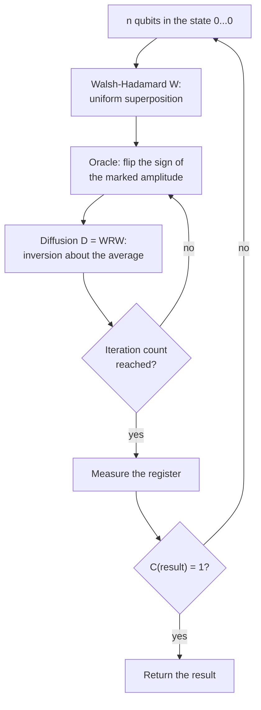

In 1996 Lov Grover published [*A fast quantum mechanical algorithm for database search*](https://arxiv.org/abs/quant-ph/9605043), which finds one marked item among $$N$$ unstructured candidates in $$O(\sqrt N)$$ steps, where a classical computer needs $$O(N)$$. The speedup is only quadratic, far from the exponential gain of Shor's factoring algorithm, but it applies to almost any problem that can be phrased as "test a candidate". That includes brute-force search for a symmetric key and for a hash preimage.

This article follows the paper: the algorithm, the two proofs behind it, and the limits it states. It then adds what later work established, namely the exact iteration count, optimality, the failure of parallel speedup, and the cost of running the algorithm against AES and SHA-256. Three of those results matter more to a cryptographer than the headline: too many iterations destroy the answer, $$S$$ machines give a speedup of only $$\sqrt S$$, and each query is a full reversible evaluation of the cipher or hash.

> This article has been made with the help of [Claude Code](https://claude.com/product/claude-code) and several custom skills

[TOC]

## What you need to know first

The article assumes basic linear algebra, and it uses the following quantum computing concepts without deriving them.

- **Amplitude.** The state of $$n$$ qubits is a vector of $$N = 2^n$$ complex numbers, one per bit string. Measuring returns string $$x$$ with probability $$\lvert\alpha_x\rvert^2$$, so the squared magnitudes sum to 1. Amplitudes can be negative, which probabilities cannot, and that difference is what the algorithm exploits.
- **Unitary evolution.** Before measurement, a quantum computer can only multiply the state by a unitary matrix. Such a matrix preserves the total probability and can always be undone.
- **Interference.** Amplitudes add with their signs. Paths leading to the same outcome can reinforce or cancel each other, provided nothing records which path was taken. The paper stresses this requirement: the implementation must leave "no trace" of the state in the system.
- **Hadamard gate.** The one-qubit matrix $$H$$, which the paper calls $$M$$, sends a basis state to an equal superposition of 0 and 1. Applied to each of $$n$$ qubits it gives the Walsh-Hadamard transform $$W$$, also written $$H^{\otimes n}$$. This article keeps the letter $$M$$ for the number of solutions.
- **Oracle and query complexity.** An oracle is a black box that answers "is this candidate a solution?". Query complexity counts the calls to it and ignores all other work, which matters later because a query can be very expensive.
- **Security level and block cipher key search.** A $$k$$-bit key has a classical brute-force cost of about $$2^k$$ cipher evaluations. [NIST's post-quantum categories](https://csrc.nist.gov/projects/post-quantum-cryptography/post-quantum-cryptography-standardization/evaluation-criteria/security-(evaluation-criteria)) use AES key search and SHA collision search as reference attacks.

## The search problem

The paper abstracts the task as follows. A system has $$N = 2^n$$ states $$S_1, \dots, S_N$$, represented as $$n$$-bit strings. A condition $$C$$ can be evaluated on a state in unit time, with $$C(S_\nu) = 1$$ for one unknown state and $$C(S) = 0$$ for all others. The goal is to identify $$S_\nu$$.

Nothing about $$C$$ may be used except its answers. A classical algorithm can only try candidates, and it needs $$N/2$$ evaluations to reach a success probability of $$1/2$$. Grover's phone-directory image, a directory in random order searched by number, has made "database search" the common name, and that name misleads. The practical use is searching the inputs of a *function*, such as "does this key decrypt this block?". Section 7 of the paper makes this point itself: computing the function at each point avoids storing the data in quantum memory.

A few slips in the paper's step labels and references, none affecting the proofs, are listed in the [Annex](#corrections-to-the-paper), and the [timeline](#timeline) in the same annex dates the later bounds, the first experiments and the NIST guidance.

## The algorithm

The algorithm has three steps, and the loop in the second is the whole idea.

1. **Initialise.** Apply $$W$$ to $$\lvert 0\rangle^{\otimes n}$$ to get the uniform superposition, with amplitude $$1/\sqrt N$$ on every state. This takes $$O(\log N)$$ gates.
2. **Repeat $$O(\sqrt N)$$ times:**
   - (a) rotate the phase of the marked state by $$\pi$$, which multiplies its amplitude by $$-1$$;
   - (b) apply the diffusion transform $$D$$.
3. **Measure.** The result is $$S_\nu$$ with probability at least $$1/2$$. The caller checks it with $$C$$ and restarts on failure.

The exact iteration count, and a success probability close to 1, come in [How many iterations](#how-many-iterations).

### The phase flip

Step (a) reads the condition without measuring anything: the amplitude changes sign, and the probability of that state does not change, since $$\lvert -\alpha\rvert^2 = \lvert\alpha\rvert^2$$. A single step therefore reveals nothing. The information is stored in a sign, and a measurement at this point would still return a uniformly random state.

The paper specifies the behaviour of the step and leaves its circuit aside. The textbook construction takes a reversible circuit $$U_f \lvert x\rangle\lvert b\rangle = \lvert x\rangle\lvert b \oplus f(x)\rangle$$ and sets the extra qubit to $$(\lvert 0\rangle - \lvert 1\rangle)/\sqrt 2$$, so that $$f(x) = 1$$ turns into a sign on $$\lvert x\rangle$$. This is phase kickback.

### The diffusion transform

The diffusion transform is the matrix

$$
\begin{aligned}
D_{ij} = \frac{2}{N} \;\text{ if } i \neq j, \qquad D_{ii} = -1 + \frac{2}{N}.
\end{aligned}
$$

Read directly, it connects every state to every other, so it is not a local operation, that is, not a product of gates acting on one or two qubits. Theorem 1 of the paper shows that it factors into local ones:

$$
\begin{aligned}
D = W R W, \qquad R = \mathrm{diag}(1, -1, -1, \dots, -1),
\end{aligned}
$$

where $$W_{ij} = 2^{-n/2}(-1)^{i \cdot j}$$, with $$i \cdot j$$ the bitwise inner product of the binary forms of $$i$$ and $$j$$, that is, the number of positions where both have a 1, and $$R$$ flips the sign of every basis state except $$\lvert 0\dots 0\rangle$$. The proof writes $$R = -I + R_2$$, where $$R_2$$ has a single non-zero entry, a 2 at position $$(0,0)$$. Since $$WW = I$$, the term $$-I$$ stays $$-I$$. The term $$W R_2 W$$ gives $$(W R_2 W)_{ij} = 2 W_{i0} W_{0j} = 2/N$$ in every position.

The only quantum operations the algorithm needs are therefore Walsh-Hadamard transforms and conditional phase shifts. Section 7 of the paper offers this as a reason the algorithm should be easier to implement than ones built on a large Fourier transform.

## Why it works

### Inversion about the average

The paper's key insight is the form $$D = -I + 2P$$, where $$P_{ij} = 1/N$$ for all $$i, j$$. $$P$$ replaces every component of a vector with the average $$A$$ of all components, and $$P^2 = P$$ then gives $$D^2 = I$$. Since $$D$$ is also real and symmetric, $$D^{\mathsf T} D = D^2 = I$$, so $$D$$ is unitary. Applied to a vector $$v$$:

$$
\begin{aligned}
w_i = -v_i + 2A = A + (A - v_i) \quad\text{where } w = Dv.
\end{aligned}
$$

Each amplitude is reflected through the mean: a value $$\delta$$ above it ends up $$\delta$$ below it, and the reverse.

This explains the pairing of the two steps. Near the start, all amplitudes are about $$1/\sqrt N$$. The phase flip makes one of them negative, and the average barely moves. The inversion then leaves the $$N-1$$ positive amplitudes almost unchanged, while the negative one, far below the average, lands far above it. Its magnitude grows by about $$2/\sqrt N$$ per iteration.

### The worked case $$N = 8$$

With three qubits and one marked state, a run looks like this. Values come from a [state-vector simulation](#verification-of-the-numbers).

| Stage | Marked amplitude | Each other amplitude | Average | $$P$$(marked) |
|---|---:|---:|---:|---:|
| Initial | 0.35355 | 0.35355 | 0.35355 | 0.1250 |
| After phase flip 1 | −0.35355 | 0.35355 | 0.26517 | 0.1250 |
| After diffusion 1 | 0.88388 | 0.17678 | 0.26517 | 0.7813 |
| After phase flip 2 | −0.88388 | 0.17678 | 0.04419 | 0.7813 |
| After diffusion 2 | 0.97227 | −0.08839 | 0.04419 | 0.9453 |

Row 3 follows from the formula: $$2 \times 0.26517 + 0.35355 = 0.88388$$. The diffusion never changes the average, because $$PD = -P + 2P^2 = P$$; only the phase flip moves it. Note the last line, where the unmarked amplitudes have become negative. A third iteration would start reducing the marked amplitude, as [Overshooting](#how-many-iterations) shows.

### The proof of convergence

Theorem 2 gives the effect of $$D$$ on a state described by two numbers, $$k$$ on the marked state and $$l$$ on each of the others. This closes the system: the whole $$N$$-dimensional evolution reduces to a recurrence on $$(k, l)$$. The phase flip replaces $$k$$ by $$-k$$, and Theorem 2 applied to $$(-k, l)$$ gives one full iteration:

$$
\begin{aligned}
k' &= \left(1 - \frac{2}{N}\right) k + 2\left(1 - \frac{1}{N}\right) l, \\
l' &= -\frac{2}{N} k + \left(1 - \frac{2}{N}\right) l.
\end{aligned}
$$

With $$N = 8$$ and $$k = l = 0.35355$$, this gives the 0.88388 and 0.17678 of the table.

Theorem 3 then bounds the growth of $$k$$. First, normalisation bounds $$l$$: $$k^2 + (N-1) l^2 = 1$$ with $$k \lt 1/\sqrt 2$$ forces $$l \gt 1/\sqrt{2N}$$. Putting this into $$\Delta k = k' - k$$ shows that while $$0 \lt k \lt 1/\sqrt 2$$ and $$l \gt 0$$,

$$
\begin{aligned}
\Delta k = -\frac{2k}{N} + 2\left(1 - \frac{1}{N}\right) l \;\gt\; \frac{1}{2\sqrt N}.
\end{aligned}
$$

This is weaker than the $$2/\sqrt N$$ gain seen near the start, but it holds over the whole range up to $$k = 1/\sqrt 2$$. Since $$k$$ gains at least $$1/(2\sqrt N)$$ per iteration, it passes $$1/\sqrt 2$$ in fewer than $$\sqrt{2N}$$ iterations, and the success probability $$k^2$$ passes $$1/2$$.

That is all the paper proves about the count: such a number of iterations $$j \lt \sqrt{2N}$$ *exists*. It does not say to stop at $$\sqrt{2N}$$, and doing so would be a mistake.

### The rotation view

[Boyer, Brassard, Høyer and Tapp](https://arxiv.org/abs/quant-ph/9605034) (BBHT) solved the recurrence in closed form. Allow $$M$$ marked states out of $$N$$, and define the angle $$\theta$$ by $$\sin^2\theta = M/N$$. After $$j$$ iterations the probability of measuring a solution is exactly

$$
\begin{aligned}
P_j = \sin^2\big((2j + 1)\theta\big).
\end{aligned}
$$

The usual geometric reading of this formula is a rotation. The state stays in the plane spanned by the uniform superposition of solutions and that of non-solutions, and starts at angle $$\theta$$ from the non-solution axis. Each of the two steps is a reflection, and two reflections compose to a rotation, here by $$2\theta$$. The algorithm turns the state towards the solutions at a constant angular speed, and nothing stops it at the target.

## How many iterations

Setting $$(2j+1)\theta \approx \pi/2$$ gives the count BBHT recommend, $$\lfloor \pi/(4\theta) \rfloor$$. For $$M \ll N$$, $$\theta \approx \sqrt{M/N}$$ and the count is about

$$
\begin{aligned}
\frac{\pi}{4}\sqrt{\frac{N}{M}},
\end{aligned}
$$

with a failure probability of at most $$M/N$$. The figure shows the consequence of that sine.

Two behaviours appear in the figure that have no classical counterpart.

- **Overshooting.** The solid curve peaks at 25 iterations and returns to zero near 50. A classical search only improves with more work. The table below gives the same effect for $$N = 2^{20}$$.
- **Dependence on $$M$$.** The count must match the number of solutions. The dashed curve has four solutions: 25 iterations give $$P = 0.0023$$, close to the worst possible choice. With $$N = 2^{20}$$, running the 804 iterations meant for one solution on a table with four gives less than one chance in a million.

For $$N = 2^{20}$$ and one solution, three iteration counts stand out:

| Iterations | Where the count comes from | Success probability |
|---:|---|---|
| 402 | about $$(\pi/8)\sqrt N$$, the first count reaching 50% | about 1/2 |
| 804 | BBHT's $$\lfloor \pi/(4\theta) \rfloor$$ | failure at most $$1/N$$ (the script computes $$2.4 \times 10^{-7}$$) |
| 1448 | Grover's upper bound $$\sqrt{2N}$$ | under 9.5% |

The 50% mark that Grover's proof guarantees is reached at 402 iterations, and $$1448 / 402 \approx 3.6$$, so the paper's bound is loose by a factor of 3.6. Running to the bound itself would land past the peak.

### When the number of solutions is unknown

BBHT handle an unknown $$M$$ with a randomised schedule built on a simple average. If $$j$$ is drawn uniformly from $$\{0, \dots, m-1\}$$, the mean success probability is

$$
\begin{aligned}
P_m = \frac{1}{2} - \frac{\sin(4m\theta)}{4m\sin(2\theta)},
\end{aligned}
$$

which is at least $$1/4$$ once $$m \geq 1/\sin(2\theta)$$. The algorithm starts with a small $$m$$, picks $$j$$ at random, runs and measures, then multiplies $$m$$ by a factor $$\lambda = 6/5$$ on failure. The expected total stays in $$O(\sqrt{N/M})$$ without knowing $$M$$, with BBHT's bound of about $$\tfrac{9}{4}\sqrt{N/M}$$ iterations for $$M \ll N$$ in the main case of their proof.

If only the expected cost matters, it pays to stop early and restart. BBHT find the optimum near $$0.583\sqrt{N/M}$$ iterations, with a success probability of 0.8446 and an expected cost of about $$0.690\sqrt{N/M}$$, 88% of the single-run count. For $$N = 2^{20}$$ this is 596 iterations and an expected 706, against 804.

Grover's paper itself, in section 8, sketches two other routes for several solutions: checking ranges of degeneracy, or a random perturbation in the style of Mulmuley, Vazirani and Vazirani that removes the degeneracy with high probability.

## Optimality

The paper quotes a matching lower bound from Bennett, Bernstein, Brassard and Vazirani (BBBV): a quantum algorithm running for $$T$$ steps is only sensitive to $$O(T^2)$$ queries. In the paper's words, if there are more possible queries, the answer to at least one of them can be flipped without affecting the behaviour of the algorithm. The paper turns this into a bound with one case:

- Take an instance with no solution, $$C(S) = 0$$ everywhere, on which the algorithm correctly answers "none".
- If $$T^2$$ is much smaller than $$N$$, some state $$S$$ exists whose answer can be flipped to $$C(S) = 1$$ without changing the output.
- The algorithm then still answers "none" on an instance that has a solution, so it is wrong there.

A correct algorithm therefore needs $$T = \Omega(\sqrt N)$$. Grover's algorithm is thus optimal up to a constant.

The constant was settled afterwards. BBHT refined the bound, and [Zalka](https://arxiv.org/abs/quant-ph/9711070) proved that for any number of oracle queries up to about $$(\pi/4)\sqrt N$$, Grover's algorithm gives the highest success probability any quantum algorithm can reach. This has two consequences:

- **Unstructured search has no faster quantum algorithm.** A cipher key search can only do better than Grover by exploiting structure in the cipher, which is then a cryptanalytic attack rather than a generic one.
- **NP-complete problems do not fall to this technique.** Applied to SAT over $$n$$ variables, Grover's algorithm takes about $$2^{n/2}$$ steps, which is still exponential. The paper notes that reaching a polynomial in $$\log N$$ would yield a polynomial-time algorithm for NP-complete problems; the lower bound rules that out for any method that treats the problem as a black box.

## Amplitude amplification

Grover's loop is a special case of a more general procedure. [Brassard, Høyer, Mosca and Tapp](https://arxiv.org/abs/quant-ph/0005055) show that for any quantum algorithm $$\mathcal A$$ that produces a good result with probability $$a$$, a good result can be found after about $$1/\sqrt a$$ applications of $$\mathcal A$$ and its inverse, provided $$\mathcal A$$ makes no measurements, where classical repetition takes about $$1/a$$. Grover search is the case where $$\mathcal A = W$$ and $$a = M/N$$.

This is the form in which the idea reappears as a component: it improves any search that has a good heuristic, and combined with Fourier techniques it gives amplitude estimation and approximate counting of $$M$$. Section 8 of Grover's paper anticipates this kind of combination, citing the Dürr-Høyer minimum-finding work and his own median estimation.

## From queries to circuits

The $$O(\sqrt N)$$ bound counts oracle calls, and the distance between that count and a physical run is where most of the popular claims go wrong. The hash-based signature survey by [Kudinov and Nick](https://eprint.iacr.org/2025/2203) works through the case of SHA-256.

The oracle must be a reversible circuit, and it has to be undone inside each iteration so that no trace remains. One iteration therefore evaluates the function twice; BBHT count two table look-ups for the same reason. The survey quotes this cost:

$$
\begin{aligned}
\text{cost(iteration)} = 2 \cdot \text{cost(SHA-256)} + \text{cost}(C^{256}\text{NOT}) + \text{cost}(C^{266}\text{NOT}).
\end{aligned}
$$

Here $$C^n\text{NOT}$$ is a NOT gate with $$n$$ control qubits. The survey takes the cost of the 256-control gate from its source and reuses it for the 266-control one; it does not say which register each gate acts on, nor where the 266 comes from (see [Gaps](#gaps)).

The cost unit is the Toffoli depth: the length of the critical path of Toffoli gates, in other words the number of Toffoli layers that must run one after the other. With 10112 Toffoli depth for the best SHA-256 circuit it cites and 509 for each multi-controlled NOT, one iteration has Toffoli depth $$2 \cdot 10112 + 509 + 509 = 21242 \approx 2^{14.4}$$. A 128-bit hash, the output size of the SLH-DSA category 1 parameter sets ([see below](#consequences-in-deployed-designs)), can be made by truncating SHA-256, and each iteration then costs the same. A preimage search on it takes about $$2^{14} \cdot 2^{64} = 2^{78}$$ Toffoli depth, before any error correction.

The $$2^{78}$$ figure uses the 10112 depth per SHA-256 call. Later in the same section, the survey describes the presented SHA-256 circuits as having Toffoli depth "around $$10^5$$" with a width of about 938 qubits, and still concludes $$2^{78}$$. It does not reconcile the two depths, and the [Gaps](#gaps) table records the difference.

Fault tolerance sits on top of that count. [Babbush et al.](https://arxiv.org/abs/2603.28846) argue that the quadratic speedup is all but consumed by the overheads of quantum error correction, and cite a separate analysis on why quadratic speedups are a weak target for error-corrected machines.

### Parallelism

The second limit is structural. Classical key search divides among $$S$$ machines with a speedup close to $$S$$, which is how real brute-force attacks work. Grover's algorithm does not share that property. Zalka shows that quantum search cannot be parallelised better than by giving each of the $$S$$ independent machines a share $$N/S$$ of the search space, and each machine then needs

$$
\begin{aligned}
T_S \approx \frac{\pi}{4}\sqrt{\frac{N}{S}}
\end{aligned}
$$

iterations. The speedup is $$\sqrt S$$. Halving the time takes four times the machines.

From this it follows that $$S \cdot T^2 \approx (\pi/4)^2 N$$, so the total work under a time limit $$T$$ is $$S \cdot T \approx (\pi/4)^2 N / T$$ (*derived here*). The quadratic advantage therefore shrinks as the deadline tightens, and total work grows linearly in $$N$$ for a fixed $$T$$, like a classical search. This is the shape of the NIST estimate in the next section, whose cost is divided by the permitted depth.

Kudinov and Nick illustrate the effect by applying NIST's $$2^{64}$$ depth limit to their $$2^{78}$$ figure: the job needs $$(2^{78-64})^2 = 2^{28}$$, about 268 million, large fast quantum computers running in parallel for ten years. The ten years comes from NIST, which ties the $$2^{64}$$ depth to what classical architectures can perform serially in a decade; the [MAXDEPTH table](#the-nist-figures) gives the rationale.

## What it means for cryptography

The site's [post-quantum overview]({{site.url_complet}}/2026/10/29/post-quantum-cryptography-algorithms-overview/) places Grover among the attacks each algorithm family faces; this section looks at what that attack costs. The popular summary is that Grover "halves the key size". It is correct for the query count and only for that. The table separates what the algorithm changes from what it does not.

| Target | Classical generic cost | Grover-based cost | What it means |
|---|---|---|---|
| $$k$$-bit symmetric key | $$2^k$$ | about $$2^{k/2}$$ iterations, each a reversible cipher circuit | The relevant case; see the NIST figures below |
| $$n$$-bit hash preimage | $$2^n$$ | about $$2^{n/2}$$ iterations | Same bound; hash-based signature parameters are matched to AES key search |
| $$n$$-bit hash collision | $$2^{n/2}$$ | $$2^{n/3}$$ queries with the [Brassard-Høyer-Tapp](https://arxiv.org/abs/quant-ph/9705002) (BHT) algorithm, using $$2^{n/3}$$ memory | Query gain only; [Bernstein](https://cr.yp.to/hash/collisioncost-20090823.pdf) argues its price-performance is worse than the classical van Oorschot-Wiener circuits |
| RSA, ECDSA, ECDH | Sub-exponential or $$2^{128}$$ for a 256-bit curve | Not the relevant attack | [Shor's algorithm](https://arxiv.org/abs/quant-ph/9508027) breaks them in polynomial time |

### The NIST figures

NIST defines its five categories by reference attacks and gives gate estimates based on the [Grassl et al.](https://arxiv.org/abs/1512.04965) circuits. For key search, the quantum cost is divided by MAXDEPTH, the assumed limit on serial circuit depth.

| Reference attack | Category | Quantum gates | Classical gates |
|---|---:|---|---:|
| AES-128 key search | 1 | $$2^{170}$$ / MAXDEPTH | $$2^{143}$$ |
| SHA3-256 collision | 2 | not given | $$2^{146}$$ |
| AES-192 key search | 3 | $$2^{233}$$ / MAXDEPTH | $$2^{207}$$ |
| SHA3-384 collision | 4 | not given | $$2^{210}$$ |
| AES-256 key search | 5 | $$2^{298}$$ / MAXDEPTH | $$2^{272}$$ |

NIST gives a plausible range for MAXDEPTH, with three reference points and their rationale:

| MAXDEPTH | Rationale | AES-128 quantum gates |
|---:|---|---:|
| $$2^{40}$$ | what envisioned quantum architectures can perform serially in a year | $$2^{130}$$ |
| $$2^{64}$$ | what current classical architectures can perform serially in a decade | $$2^{106}$$ |
| $$2^{96}$$ | what atomic-scale qubits at the speed of light could perform in a millennium | $$2^{74}$$ |

These gate counts do not compare directly with the classical column. NIST states that a quantum gate could cost billions or trillions of times a classical gate under envisioned architectures, while advising that for the top categories this gap may narrow or disappear. Hence the practical reading: at a depth limit of $$2^{64}$$, AES-128 needs $$2^{106}$$ quantum gates against $$2^{143}$$ classical gates, a nominal gap of 37 bits. The "halving" summary would predict a gap of 64 bits, from $$2^{128}$$ to $$2^{64}$$, and the quantum gates are the expensive kind. 256-bit keys remain the conservative choice when a margin against future hardware is wanted.

### Consequences in deployed designs

Hash lengths in hash-based signatures are set so that generic preimage search, classical or Grover, costs as much as AES key search of the same category. [FIPS 205](https://csrc.nist.gov/pubs/fips/205/final), [SLH-DSA]({{site.url_complet}}/2026/06/29/slh-dsa-fips-205-hash-based-signatures/), claims category 1 for its parameter sets with $$n = 16$$ bytes, which is to say 128-bit hash outputs, category 3 for 24 bytes and category 5 for 32. Kudinov and Nick argue that level 1 is sufficient for Bitcoin, on the cost figures above.

Blockchains are affected in the same way. Babbush et al. describe a hashed public key as protected against Shor's algorithm at rest, because recovering the key from the hash would need Grover, which they do not consider a credible threat.

Proof-of-work mining is left out of the table because it is not a single search of fixed cost: miners compete with massively parallel hardware, and Babbush et al. call Grover-based attacks on it "not practically relevant", citing the error-correction overhead and the poor parallelism. They give an upper estimate: even if a quantum computer could compute SHA-256 in a single 1 µs error-correction cycle, it would reach 0.25 TH/s, against 110 TH/s for an S19 Pro ASIC. These are the authors' own figures and assumptions.

## Conclusion

Grover's algorithm finds a marked item among $$N$$ with about $$(\pi/4)\sqrt{N/M}$$ oracle calls, using a sign flip and a reflection about the average.

- **Mechanism.** The phase flip stores the answer in a sign, and $$D = WRW$$ turns the sign into amplitude. Together they rotate the state by $$2\theta$$, where $$\sin^2\theta = M/N$$.
- **Iteration count.** The count must be chosen, because the success probability is periodic. Grover proved that a count below $$\sqrt{2N}$$ exists, and BBHT gave the exact formula and a randomised schedule for an unknown $$M$$.
- **Optimality.** The BBBV bound gives $$\Omega(\sqrt N)$$ and Zalka shows the algorithm is exactly optimal. NP-complete problems stay exponential under this technique.
- **Cost.** A query is a reversible circuit, evaluated twice per iteration, and the $$\sqrt S$$ limit on parallelism keeps real attacks far from the query count: NIST estimates $$2^{170}$$/MAXDEPTH quantum gates for AES-128.
- **Cryptographic effect.** Symmetric keys and hash outputs keep a usable margin, with 256-bit keys as the conservative choice. Public-key schemes fall to Shor's algorithm, which is a separate problem.

## Annex

### Key Terms

| Term | Definition |
|------|------------|
| **Qubit** | The basic unit of quantum information; $$n$$ qubits are described by $$2^n$$ complex amplitudes. |
| **Amplitude** | The complex number attached to a basis state; its squared magnitude is the probability of measuring that state. |
| **Superposition** | A state with non-zero amplitude on several basis states at once. |
| **Measurement** | The irreversible read-out that returns one basis state according to the amplitudes. |
| **Unitary matrix** | A matrix preserving total probability; the only kind of operation allowed before measurement. |
| **Interference** | The addition of amplitudes with their signs, which reinforces some outcomes and cancels others. |
| **Hadamard / Walsh-Hadamard transform** | The one-qubit coin-flip matrix, and its application to every qubit, written $$W$$; it creates the uniform superposition. |
| **Oracle** | A black box that tests a candidate; the algorithm is only allowed to use its answers. |
| **Query complexity** | The number of oracle calls, ignoring every other cost. |
| **Unstructured search** | Search in which only oracle queries distinguish a solution from a non-solution. |
| **Phase kickback** | The construction that turns a reversible bit-flip oracle into a sign on the input state. |
| **Diffusion transform** | The operator $$D = -I + 2P = WRW$$, which reflects each amplitude through the mean. |
| **Inversion about the average** | Grover's name for the action of $$D$$: each amplitude $$v_i$$ becomes $$2A - v_i$$. |
| **Grover iteration** | One phase flip followed by one diffusion; it rotates the state by $$2\theta$$. |
| **Overshooting** | The fall in success probability when iterating past the optimal count. |
| **Amplitude amplification** | The generalisation that turns a success probability $$a$$ into near-certainty in about $$1/\sqrt a$$ runs. |
| **Toffoli gate** | The doubly controlled NOT, the usual cost unit for reversible oracle circuits. |
| **MAXDEPTH** | NIST's assumed limit on serial quantum circuit depth, which divides the key-search gate estimates. |
| **Security category** | One of NIST's five post-quantum strength levels, defined by AES key search and SHA collision search. |

### Corrections to the paper

Reading the arXiv version (v3, 1996) against later sources turned up a few details worth knowing before quoting it.

- **Step reference.** Section 4 says the inversion about average is the diffusion transform "as used in step (ii)(a)". The diffusion is step (ii)(b).
- **[DH96] arXiv number.** The reference gives quant-ph/9602016, which is the number of the Beckman et al. factoring paper [BCDP96]. The [Dürr-Høyer paper](https://arxiv.org/abs/quant-ph/9607014) is quant-ph/9607014.
- **[DJ92] citation.** The reference gives Proc. R. Soc. London A400, pp. 73-90, which reuses the volume number (A400) of the Deutsch 1985 entry. The [Deutsch-Jozsa paper](https://doi.org/10.1098/rspa.1992.0167) is A439, pp. 553-558.

None of these affects the algorithm or its proofs, and the script below confirms Theorems 1 and 3 numerically.

One statement in section 6 looks like an error and is not. It says BBHT show the algorithm within a few percent of optimal, while the BBHT abstract says "nearly within a factor 2". Section 7 of BBHT explains the difference: their lower bound on table lookups is a few percent below Grover's iteration count, and each iteration needs two lookups (one to fetch the entry, one to erase it), so in lookups the algorithm is within a factor of about 2. Zalka's exact optimality later settled the constant.

### Verification of the numbers

Most derived values in this article come from [`verify_grover.py`](https://github.com/rya-sge/access-denied/tree/main/verification/grover-algorithm-quantum-search). It builds $$W$$, $$R$$ and $$D$$ explicitly and checks $$D = WRW$$, runs the Theorem 2 recurrence up to $$N = 2^{20}$$, and compares a full state-vector simulation with the closed form for $$N$$ up to 1024 and several values of $$M$$. It also reproduces the BBHT figures for $$N = 2^{20}$$ and their Lemma 2, the averaged success probability $$P_m$$ of a uniformly random iteration count. The values for $$N = 1024$$ in the figure (25 and 12 iterations, $$P = 0.0023$$) come from the figure's own script, `grover-success-probability.py`.

### Timeline

Events up to 25 November 2026.

| Date | Event | Why it matters here | Source |
|---|---|---|---|
| 23 May 1996 | Boyer, Brassard, Høyer and Tapp post *Tight bounds on quantum searching*, with the closed form of the success probability and a search for an unknown number of solutions. | It gives the exact iteration count and the randomised schedule used in [How many iterations](#how-many-iterations). | [arXiv:quant-ph/9605034](https://arxiv.org/abs/quant-ph/9605034) |
| May 1996 | Grover presents *A fast quantum mechanical algorithm for database search* at STOC 1996 and posts it on arXiv on 29 May, with the revised v3 on 19 November. | This is the paper the article follows. | [arXiv:quant-ph/9605043](https://arxiv.org/abs/quant-ph/9605043) |
| 1 January 1997 | Bennett, Bernstein, Brassard and Vazirani post *Strengths and weaknesses of quantum computing*, published in SIAM Journal on Computing the same year. | It is the BBBV lower bound that Grover's paper quotes for optimality up to a constant. | [arXiv:quant-ph/9701001](https://arxiv.org/abs/quant-ph/9701001) |
| 26 November 1997 | Zalka posts *Grover's quantum searching algorithm is optimal*, which also shows that search parallelises no better than splitting the space. | It settles the constant and is the source of the $$\sqrt S$$ limit on parallel machines. | [arXiv:quant-ph/9711070](https://arxiv.org/abs/quant-ph/9711070) |
| 13 April 1998 | Chuang, Gershenfeld and Kubinec publish an NMR implementation of Grover search over four states in Physical Review Letters. | The authors present it as the first complete experiment that runs a search in fewer steps than a classical one, here on two qubits. | [Physical Review Letters 80, 3408](https://journals.aps.org/prl/abstract/10.1103/PhysRevLett.80.3408) |
| 15 December 2015 | Grassl, Langenberg, Roetteler and Steinwandt post quantum circuits and resource estimates for Grover key search on AES-128, AES-192 and AES-256. | Their gate counts are the basis of the NIST figures in this article. | [arXiv:1512.04965](https://arxiv.org/abs/1512.04965) |
| 20 December 2016 | NIST opens its post-quantum call for proposals, defining security categories by AES key search and SHA collision search, with Grover limited by MAXDEPTH. | It is where the $$2^{170}$$/MAXDEPTH estimate for AES-128 and the parallelism argument first appear as NIST guidance. | [NIST CSRC announcement](https://csrc.nist.gov/news/2016/public-key-post-quantum-cryptographic-algorithms) and [call for proposals](https://csrc.nist.gov/CSRC/media/Projects/Post-Quantum-Cryptography/documents/call-for-proposals-final-dec-2016.pdf) |
| 30 March 2017 | Figgatt et al. post a complete three-qubit Grover search on a programmable trapped-ion computer, later published in Nature Communications. | It tests every single-solution and two-solution oracle on eight states, the case of the worked $$N = 8$$ example. | [arXiv:1703.10535](https://arxiv.org/abs/1703.10535) |
| 13 August 2024 | NIST publishes FIPS 205, whose SLH-DSA parameter sets with 16, 24 and 32-byte hashes are claimed in categories 1, 3 and 5. | It shows hash lengths sized against generic search at the AES reference levels. | [FIPS 205](https://csrc.nist.gov/pubs/fips/205/final) |
| 27 October 2026 | NIST publishes the final IR 8547, which states that approved symmetric primitives with at least 128 bits of classical security meet at least category 1 and that NIST does not expect to transition away from them. | It places AES-128 in category 1, the reading the cost analysis above supports. | [NIST IR 8547](https://csrc.nist.gov/pubs/ir/8547/final) |

## Frequently Asked Questions

**Q: What does one Grover iteration do to the amplitudes?**

It negates the amplitude of each marked state, then replaces every amplitude $$v_i$$ with $$2A - v_i$$, where $$A$$ is the mean of all amplitudes. The negative amplitude sits far below the mean, so it lands far above it, and the others barely move. Near the start the marked amplitude grows by about $$2/\sqrt N$$.

**Q: Why does running more iterations reduce the chance of success?**

The success probability is $$\sin^2((2j+1)\theta)$$, a periodic function of $$j$$. The state rotates at a constant angle per iteration and passes the solution direction. With $$N = 2^{20}$$ and one solution, 804 iterations almost always succeed, while 1448 succeed less than 9.5% of the time.

**Q: Does Grover's algorithm cut AES-128 to 64-bit security?**

Not in any practical sense. The figure of about $$2^{64}$$ counts iterations, and three things separate it from a 64-bit classical attack:

- Each iteration evaluates AES reversibly on several plaintext-ciphertext pairs (three for AES-128 in Grassl et al.) and then uncomputes them, plus multi-controlled gates.
- The run cannot be divided efficiently: $$S$$ machines give a speedup of only $$\sqrt S$$.
- Each logical gate needs error correction, and quantum gates cost far more than classical ones.

NIST's estimate is $$2^{170}$$/MAXDEPTH quantum gates, which is $$2^{106}$$ for a depth limit of $$2^{64}$$.

**Q: Why does the unknown number of solutions cause a problem, and how is it solved?**

The optimal count depends on $$M$$, and a count tuned for the wrong $$M$$ can land near a zero of the sine: for $$N = 1024$$, 25 iterations give 0.9995 for one solution and 0.0023 for four. BBHT pick the iteration count uniformly at random from a growing range. On average over that choice, the success probability is at least $$1/4$$ once the range is large enough, whatever the phase, so the expected cost stays in $$O(\sqrt{N/M})$$.

**Q: Why is the oracle evaluated twice per iteration?**

Evaluating $$f$$ reversibly leaves intermediate values in work qubits, and those would record which input was processed. That record destroys interference, the condition the paper states as leaving no trace. The circuit therefore computes $$f$$, applies the phase, and uncomputes $$f$$.

**Q: Could Grover's algorithm break SHA-256 mining or a 256-bit hash preimage if machines were cheap?**

The two cases differ. A 256-bit preimage takes about $$2^{128}$$ iterations, and even the largest MAXDEPTH that NIST considers, $$2^{96}$$, covers only a tiny part of that run.

Mining involves a far smaller search per block, but it competes against specialised hardware with massive parallelism, and the $$\sqrt S$$ limit removes the main advantage of adding machines. Babbush et al. estimate 0.25 TH/s under a deliberately optimistic assumption, against 110 TH/s for one ASIC.

**Q: Combining the sections: why does NIST divide the quantum cost by MAXDEPTH?**

A key search must finish within a depth limit $$T$$, so if the full run is longer, the search space is split among $$S$$ machines. Since each machine runs $$\frac{\pi}{4}\sqrt{N/S}$$ iterations, the number of machines needed for a fixed $$T$$ grows like $$N/T^2$$, and the total gate count $$S \cdot T$$ grows like $$N/T$$. A smaller depth limit therefore means a larger total.

## Gaps

These points were not settled by the sources read, or rest on inference, and should be checked before relying on them.

| Gap | Why it matters | What to read or verify |
|-----|----------------|------------------------|
| The revised AES estimates of [Jaques et al.](https://eprint.iacr.org/2019/1146) (Eurocrypt 2020, ePrint 2019/1146) were not read; only the page note was seen. | They give lower costs than [Grassl et al.](https://arxiv.org/abs/1512.04965), so the NIST column may overstate the attack. | The tables in the revised version of [ePrint 2019/1146](https://eprint.iacr.org/2019/1146). |
| The figures were checked against the full text of the [NIST page](https://csrc.nist.gov/projects/post-quantum-cryptography/post-quantum-cryptography-standardization/evaluation-criteria/security-(evaluation-criteria)), which does not cite Jaques et al. The final [NIST IR 8547](https://csrc.nist.gov/pubs/ir/8547/final) of 27 October 2026 was read only for its symmetric-cryptography section. | Later NIST documents may update the figures quoted here. | [NIST IR 8547](https://csrc.nist.gov/pubs/ir/8547/final). |
| Only the abstract of Bernstein's collision paper was read. | The table row on collisions relies on its conclusion and not on its cost model. | The full text of [Bernstein, *Cost analysis of hash collisions*](https://cr.yp.to/hash/collisioncost-20090823.pdf). |
| The BBBV paper was read only as quoted by Grover; only its arXiv abstract page was opened for the timeline. | The lower-bound summary is second-hand. | [Bennett et al., *Strengths and weaknesses of quantum computing*, arXiv:quant-ph/9701001](https://arxiv.org/abs/quant-ph/9701001), SIAM J. Comput., 1997. |
| The phase-kickback and reflection-pair descriptions come from general knowledge, not from the paper. | They are standard, but the sources read do not state them in this form. | Nielsen and Chuang, *Quantum Computation and Quantum Information*, chapter 6. |
| The relation $$S \cdot T \approx (\pi/4)^2 N/T$$ and its link to the NIST formula are derived here. | NIST does not present its estimate that way; it only notes that parallel runs make the speedup less dramatic and cites Zalka (footnote 6). | [Grassl et al.](https://arxiv.org/abs/1512.04965), and section 4 of [Zalka](https://arxiv.org/abs/quant-ph/9711070). |
| The Babbush et al. hardware figures were not recomputed. | They depend on assumptions those authors chose. | Section III D of [Babbush et al.](https://arxiv.org/abs/2603.28846) |
| Kudinov and Nick give one iteration a Toffoli depth of 21242, then say the circuits reach "around $$10^5$$". | The $$2^{78}$$ figure uses the first value, and the second would raise it by about 2 bits. | Section 12.2 of [Kudinov and Nick](https://eprint.iacr.org/2025/2203) and its reference [27], section 6.3. |
| Kudinov and Nick list a 256-control and a 266-control NOT in each iteration, without saying which register each acts on or why the second has 266 controls, and reuse the first gate's cost for the second. | The iteration cost depends on these gates, and the article cannot explain their widths. | Section 6.3 of the survey's reference [27], as cited in section 12.2 of [Kudinov and Nick](https://eprint.iacr.org/2025/2203). |
| The number of plaintext-ciphertext pairs a key search needs (three for AES-128 in Grassl et al.) is quoted without the reason or the counts for AES-192 and AES-256. | The likely reason, not checked here, is to make the key unique so that $$M = 1$$, and each pair adds a reversible AES evaluation to the oracle. | The key-search section of [Grassl et al.](https://arxiv.org/abs/1512.04965). |
| The Shor reference is cited for a known result and was not read for this article. | The table row depends on it. | [Shor, arXiv:quant-ph/9508027](https://arxiv.org/abs/quant-ph/9508027) |
| Grover applied inside lattice sieving, or to the symmetric parts of ML-KEM and ML-DSA, is not covered. | These affect post-quantum parameter estimates. | The security sections of [FIPS 203](https://csrc.nist.gov/pubs/fips/203/final) and [FIPS 204](https://csrc.nist.gov/pubs/fips/204/final), and the lattice cryptanalysis literature. |
| The timeline stops at the three-qubit trapped-ion run of 2017 for experiments. | Later demonstrations on more qubits or on superconducting hardware may change the picture of what has been run. | A survey of Grover implementations since [Figgatt et al., arXiv:1703.10535](https://arxiv.org/abs/1703.10535), not done for this article. |

## References

### Analyzed source

- [Verification script](https://github.com/rya-sge/access-denied/tree/main/verification/grover-algorithm-quantum-search) for the numbers in this article, 2026-11-06

### Primary paper

- L. K. Grover, [*A fast quantum mechanical algorithm for database search*](https://arxiv.org/abs/quant-ph/9605043), arXiv:quant-ph/9605043v3, 19 November 1996; updated version of the paper in Proceedings of STOC 1996, pp. 212-219.

### Analysis of the algorithm

- M. Boyer, G. Brassard, P. Høyer, A. Tapp, [*Tight bounds on quantum searching*](https://arxiv.org/abs/quant-ph/9605034), Fortschritte der Physik 46, 1998, pp. 493-506.
- C. Zalka, [*Grover's quantum searching algorithm is optimal*](https://arxiv.org/abs/quant-ph/9711070), Physical Review A 60, 1999, pp. 2746-2751.
- C. H. Bennett, E. Bernstein, G. Brassard, U. Vazirani, [*Strengths and weaknesses of quantum computing*](https://arxiv.org/abs/quant-ph/9701001), arXiv:quant-ph/9701001, 1 January 1997; SIAM J. Comput. 26(5), 1997, pp. 1510-1523; cited as [BBBV96] in the paper.
- G. Brassard, P. Høyer, M. Mosca, A. Tapp, [*Quantum Amplitude Amplification and Estimation*](https://arxiv.org/abs/quant-ph/0005055), AMS Contemporary Mathematics 305, 2002, pp. 53-74.
- C. Dürr, P. Høyer, [*A Quantum Algorithm for Finding the Minimum*](https://arxiv.org/abs/quant-ph/9607014), 1996.
- D. Deutsch, R. Jozsa, [*Rapid solution of problems by quantum computation*](https://doi.org/10.1098/rspa.1992.0167), Proc. R. Soc. Lond. A 439, 1992, pp. 553-558.
- D. Beckman, A. N. Chari, S. Devabhaktuni, J. Preskill, [*Efficient Networks for Quantum Factoring*](https://arxiv.org/abs/quant-ph/9602016), 1996.
- P. W. Shor, [*Polynomial-Time Algorithms for Prime Factorization and Discrete Logarithms on a Quantum Computer*](https://arxiv.org/abs/quant-ph/9508027), arXiv version.

### Cryptographic cost

- NIST, [*Security (Evaluation Criteria)*](https://csrc.nist.gov/projects/post-quantum-cryptography/post-quantum-cryptography-standardization/evaluation-criteria/security-(evaluation-criteria)), Post-Quantum Cryptography Standardization.
- NIST, [FIPS 205, *Stateless Hash-Based Digital Signature Standard*](https://csrc.nist.gov/pubs/fips/205/final), August 2024.
- M. Grassl, B. Langenberg, M. Roetteler, R. Steinwandt, [*Applying Grover's algorithm to AES: quantum resource estimates*](https://arxiv.org/abs/1512.04965), PQCrypto 2016.
- S. Jaques, M. Naehrig, M. Roetteler, F. Virdia, [*Implementing Grover oracles for quantum key search on AES and LowMC*](https://eprint.iacr.org/2019/1146), Eurocrypt 2020, revised 2023.
- G. Brassard, P. Høyer, A. Tapp, [*Quantum Algorithm for the Collision Problem*](https://arxiv.org/abs/quant-ph/9705002), LATIN 1998.
- D. J. Bernstein, [*Cost analysis of hash collisions: will quantum computers make SHARCS obsolete?*](https://cr.yp.to/hash/collisioncost-20090823.pdf), 2009.
- M. Kudinov, J. Nick, [*Hash-based Signature Schemes for Bitcoin*](https://eprint.iacr.org/2025/2203), revision 2025-12-05, section 12.
- R. Babbush et al., [*Securing Elliptic Curve Cryptocurrencies against Quantum Vulnerabilities: Resource Estimates and Mitigations*](https://arxiv.org/abs/2603.28846), arXiv:2603.28846v2, 15 April 2026.

### Timeline sources

- I. L. Chuang, N. Gershenfeld, M. Kubinec, [*Experimental Implementation of Fast Quantum Searching*](https://journals.aps.org/prl/abstract/10.1103/PhysRevLett.80.3408), Physical Review Letters 80, 3408, 13 April 1998.
- C. Figgatt, D. Maslov, K. A. Landsman, N. M. Linke, S. Debnath, C. Monroe, [*Complete 3-Qubit Grover Search on a Programmable Quantum Computer*](https://arxiv.org/abs/1703.10535), arXiv:1703.10535, 30 March 2017; Nature Communications 8, 1918, 2017.
- NIST, [*Announcing Request for Nominations for Public-Key Post-Quantum Cryptographic Algorithms*](https://csrc.nist.gov/news/2016/public-key-post-quantum-cryptographic-algorithms), 20 December 2016.
- NIST, [*Submission Requirements and Evaluation Criteria for the Post-Quantum Cryptography Standardization Process*](https://csrc.nist.gov/CSRC/media/Projects/Post-Quantum-Cryptography/documents/call-for-proposals-final-dec-2016.pdf), December 2016, section 4.A.5.
- NIST, D. Moody et al., [NIST IR 8547, *Transition to Post-Quantum Cryptography Standards*](https://csrc.nist.gov/pubs/ir/8547/final), final, 27 October 2026, section 4.1.3.

### Related articles

- [Post-Quantum Cryptography in 2026 — The Algorithms, What They Do and Who Deploys Them]({{site.url_complet}}/2026/10/29/post-quantum-cryptography-algorithms-overview/)
- [Post-Quantum Cryptography on Blockchains — Where Bitcoin, Ethereum, Solana and Others Stand in 2026]({{site.url_complet}}/2026/10/29/post-quantum-cryptography-blockchains/)
- [SLH-DSA — The Stateless Hash-Based Signature Standard (FIPS 205)]({{site.url_complet}}/2026/06/29/slh-dsa-fips-205-hash-based-signatures/)
- [The SHA-3 Standard (FIPS 202) — A Second Family of Hash Functions]({{site.url_complet}}/2026/08/24/sha3-standard-fips-202/)

### Tooling

- [Claude Code](https://claude.com/product/claude-code)
