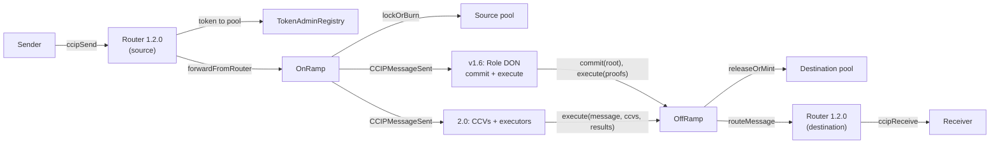
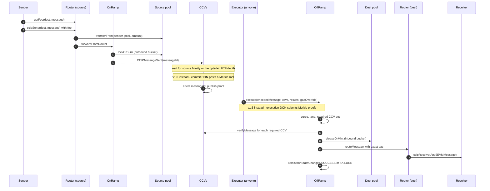

[Chainlink CCIP](https://docs.chain.link/ccip) (Cross-Chain Interoperability Protocol) is Chainlink's protocol for sending arbitrary messages, tokens, or both in one message, from a contract on one chain to a contract on another. A sender calls a fixed Router contract, Chainlink-operated nodes attest that the message was emitted on the source chain, and the message is delivered on the destination chain to the receiver's `ccipReceive` function, with tokens moved by issuer-owned token pools. What stands behind "Chainlink nodes attest" is the part that changed: the contracts of release 2.0 replace the single oracle network of v1.5 and v1.6 with pluggable Cross-Chain Verifiers and let anyone execute a verified message.

This article describes both generations and labels each statement with the version it applies to: the onchain components, the commit and execution DON of v1.6, the CCVs and permissionless executors of 2.0, the message lifecycle, `extraArgs`, finality, token pools and the TokenAdminRegistry, the rate limiter, fees, and what a receiver and a token issuer have to get right. The contract facts come from `smartcontractkit/chainlink-ccip` at contracts 2.0.0 and the v1.5-v1.6 facts from the Chainlink documentation, both pinned under References.

> This article has been made with the help of [Claude Code](https://claude.com/product/claude-code) and several custom skills

[TOC]

## What you need to know first

The article assumes the reader knows what a bridge, an ERC-20 and an oracle are. A few mechanisms one level below are used without being derived:

- **Finality and reorgs.** A block is final once the chain's consensus guarantees it will not be reverted; before that, a reorganisation can replace it and erase the transactions it held. A cross-chain protocol that acts on a source event before finality can deliver a message whose source transaction later disappears.
- **Decentralized Oracle Network (DON) and OCR.** A DON is a set of independent node operators that run the same job; Off-Chain Reporting (OCR) is Chainlink's protocol by which those nodes agree on a report offchain and submit it once, signed by a quorum. CCIP v1.6 runs its commit and execution logic as OCR plugins.
- **Merkle roots and proofs.** A Merkle root commits to a list of items in 32 bytes; a proof of a few hashes shows that one item is in the list. CCIP v1.6 commits a root per batch of messages and executes each message with a proof against it.
- **Lock-and-mint and burn-and-mint bridges.** A bridge either locks the original tokens in an escrow on one chain and mints a representation elsewhere, or burns on one side and mints on the other; in both cases a forged message mints or releases tokens that were never deposited. The [Cross-Chain Bridge Threat Model - Assets, Trust Boundaries, STRIDE and Threat Register]({{site.url_complet}}/2026/07/31/cross-chain-bridge-threat-model/) works through the assets and trust boundaries this creates.
- **ERC-165 interface detection.** A contract answers `supportsInterface(bytes4)` to say which interfaces it implements, as defined by [ERC-165](https://eips.ethereum.org/EIPS/eip-165). The CCIP OffRamp uses it to decide whether to call the receiver at all.
- **Token-bucket rate limiting.** A bucket holds up to a capacity of tokens and refills at a fixed rate per second; each transfer consumes from it and fails when it is short. CCIP pools use one bucket per remote chain and per direction.

## Which CCIP: two generations side by side

The two sources describe different protocol generations, and an integration has to know which one it is talking to. Every CCIP contract reports its version through `typeAndVersion()`.

| | v1.5 - v1.6 (Chainlink documentation, API reference v1.5.0 to v1.6.3) | 2.0 (`chainlink-ccip` repository, `@chainlink/contracts-ccip` 2.0.0) |
|---|---|---|
| Entry point | `Router 1.2.0` | the same `Router 1.2.0`, kept across versions |
| Verification | One Role DON: the commit OCR plugin posts Merkle roots to `OffRamp.commit()` | Cross-Chain Verifiers (CCVs); the former DON becomes the default `CommitteeVerifier`; no Merkle roots onchain |
| Execution | The executing plugin of the same DON submits proofs; manual execution in the CCIP Explorer after a failure or after the 8-hour Smart Execution window | Permissionless executors: anyone can call `OffRamp.execute(encodedMessage, ccvs, verifierResults, gasLimitOverride)` once the message is verified |
| Ordering | `NonceManager`; in-order execution per sender is optional or required per lane, and the docs announce its deprecation "in early 2026" | No `NonceManager`; legacy `extraArgs` are resolved with `allowOutOfOrderExecution = true` |
| Message ID | Computed by the OnRamp's hasher | `keccak256` of the chain-agnostic `MessageV1` encoding |
| Finality | Always wait for source finality (finality tag or block depth) | Same by default; opt-in Faster-Than-Finality (FTF) |
| Pools | `IPoolV1` (`lockOrBurn`, `releaseOrMint`); lock/release pools hold the liquidity | `IPoolV2` adds finality, token arguments, `getRequiredCCVs` and pool fees; liquidity sits in an `ERC20LockBox` (introduced in 1.6.4) |
| RMN | Offchain Risk Management Network blessed roots (v1.6); the docs now say that role "is no longer active", the onchain curse remains | `RMN 2.1.0` is curse-only; `isBlessed()` is a `pure` function kept for compatibility |
| Rate-limit reconfiguration | The bucket refills at the normal rate after a change | The bucket is set full on any configuration change |

On Ethereum mainnet, read on 2026-11-16 at block 26,428,742, the two generations coexist. The Router at `0x80226fc0Ee2b096224EeAc085Bb9a8cba1146f7D` reports `Router 1.2.0`, its OnRamp towards Arbitrum (chain selector `4949039107694359620`) reports `OnRamp 2.0.0`, and the Router lists four OffRamps for messages coming from Arbitrum: `EVM2EVMOffRamp 1.2.0`, `EVM2EVMOffRamp 1.5.0`, `OffRamp 1.6.0` and `OffRamp 2.0.0`. Older OffRamps stay registered so that messages sent under an older version can still be executed. Which lanes run which version beyond this one pair was not checked.

## The onchain components

The Router is the only address an application should hardcode. Everything else is derived from it, because the ramps change with every release:

- **Router** (one per chain, immutable). On the source chain it takes the fee and the tokens and forwards to the OnRamp for the destination; on the destination chain its `routeMessage` is the only caller of `ccipReceive`. `getOnRamp(destSelector)`, `getOffRamps()` and `isOffRamp()` give the current ramps.
- **OnRamp.** Validates the message, checks the curse, calls the token pool, assigns a message number and ID, and emits `CCIPMessageSent`. Before v1.6 there was one OnRamp per lane (`EVM2EVMOnRamp`); since v1.6 there is one per chain.
- **OffRamp.** One per chain since v1.6. In v1.6 it receives commit reports and executes messages against Merkle proofs; in 2.0 it executes messages against CCV results. It tracks each message as `UNTOUCHED`, `IN_PROGRESS`, `SUCCESS` or `FAILURE`.
- **FeeQuoter.** Holds gas and token prices in USD, per-destination fee configuration and the limits `extraArgs` are checked against (`maxDataBytes`, `maxPerMsgGasLimit`, `defaultTxGasLimit`). In 2.0 its prices have no staleness check: a price is valid until overwritten.
- **NonceManager** (v1.6 only). Enforces in-order execution for messages that ask for it.
- **RMN.** A curse switch read by the Router, the OnRamp, the OffRamp and every token pool.
- **TokenAdminRegistry.** Maps each token to its pool and records each token's administrator.
- **Token pools.** Contracts owned by the token issuer, which burn or lock on the source chain and mint or release on the destination.



### RMN and cursing

`RMN 2.1.0` lets its authorized callers `curse` and `uncurse` a list of 16-byte subjects. A subject is either a remote chain, encoded as `bytes16(uint128(chainSelector))`, or the global subject `0x01000000000000000000000000000001`, which halts everything. `isCursed(subject)` is true when the subject or the global subject is cursed.

A curse makes `Router.ccipSend`, `Router.routeMessage`, `OnRamp.forwardFromRouter`, `OffRamp.execute` and the validation step of every pool revert. In-flight messages are not lost, though: they stay `UNTOUCHED` or `FAILURE` and become executable again after the uncurse. The documentation describes the curse as a manual action of the CCIP owner. On Ethereum, the Router's `getArmProxy()` points to an `ARMProxy 1.0.0` whose target reports `RMN 2.1.0`, not cursed at the block read above.

In v1.6 the RMN also had an automated offchain role: its nodes checked commit reports and the commit plugin included their signatures ("pre-blessed roots", in the repository's protocol notes). The documentation copy states that this role "is no longer active in current CCIP deployments, but is expected to be offered as an optional validation layer in future releases". `RMN 2.1.0` matches that: `isBlessed()` returns `true` unconditionally.

## The v1.5 - v1.6 design: one Role DON, two plugins

In v1.6, one DON of Chainlink node operators runs two OCR plugins. The documentation calls the nodes running them the Committing DON and the Executing DON, and notes that they are "not separate oracle networks" but subsets of one Role DON. Subcommittees of the DON read from each source chain and write to each destination chain.

- **Commit.** For each source chain, the subcommittee reading it agrees on a range of messages and builds a Merkle root over them. A leader assembles a commit report, which can hold roots from several source chains and price updates for fee tokens and gas, and the subcommittee writing to the destination submits it to `OffRamp.commit()`. The OffRamp emits `CommitReportAccepted`.
- **Execute.** The subcommittee on the destination chain looks for committed messages not yet executed, checks the corresponding source events, batches messages within the gas limits and submits them to the OffRamp with Merkle proofs against the committed root.

Execution order depends on the message. With `allowOutOfOrderExecution = false`, the `NonceManager` makes a message wait for the previous one from the same sender. The best-practices page states that this in-order mode "is being deprecated in early 2026"; whether it is already disabled on a given lane is not stated in the sources read.

### Manual execution

When automatic execution fails, a message can be executed manually from the CCIP Explorer by anyone, who pays the destination gas without reimbursement. The documentation lists three causes: the receiver reverts on a logic error, the receiver runs out of gas, or the pool's `balanceOf` plus `releaseOrMint` plus `balanceOf` sequence exceeds the 90,000-gas token-pool limit. Manual execution can raise the gas limit for that one execution beyond the lane's cap. Two consequences follow:

- A receiver that reverts because of a bug in non-upgradeable code never succeeds, so the message, and the tokens it carries, stay stuck.
- A message that goes to manual execution because the Smart Execution window expired (8 hours in the documentation) blocks later in-order messages from the same sender until it is processed. A failure caused by the receiver does not block later messages, unless they hit the same error.

## The 2.0 design: Cross-Chain Verifiers and permissionless executors

The 2.0 changelog summarises the change in one line: "The v1 CCIP DON is now called the CommitteeVerifier and is still the safe, default option." Verification becomes a list of verifier contracts that each message must satisfy, and execution becomes an open function.

### Cross-Chain Verifiers

A CCV is a contract implementing `ICrossChainVerifierV1.verifyMessage`, reached through a `VersionedVerifierResolver` so that the verifier's address stays stable while its implementation is upgraded. CCVs are permissionless and need no registration. The repository ships several:

- **`CommitteeVerifier`**: a signature quorum of Chainlink node operators, the former DON.
- **`CCTPVerifier`** and **`LombardVerifier`**: token developer attestations, which in v1.6 were special cases of the USDC and Lombard pools.
- **`SuccinctZKVerifier`**: a zero-knowledge verifier, at version `0.0.1-dev`.

A CCV attests to the message ID only. Since the message ID is `keccak256` of the chain-agnostic `MessageV1` encoding, one signature or proof covers the whole message. Each verifier publishes its own proofs, through an API, an offchain location or the destination chain. A private verifier that never publishes means no executor can execute the message; the changelog presents this as the way to guarantee that a message is not executed.

The OffRamp builds the set of CCVs a message must pass from three sources and removes duplicates (`_getCCVsForMessage`):

- **The receiver**, through `IAny2EVMMessageReceiverV2.getCCVsAndFinalityConfig(sourceChainSelector, sender)`, which returns required CCVs, optional CCVs and a threshold on the optional ones, plus the finality the receiver accepts.
- **The token pool**, through `getRequiredCCVs`, which can depend on the amount through the `AdvancedPoolHooks` thresholds.
- **The lane**, through `laneMandatedCCVs` in the OffRamp's source-chain configuration.

`address(0)` in any of these lists means "the default CCVs". Two rules matter for security. A pool that returns no CCVs, or a v1 pool, falls back to the default CCVs; the code explains why: otherwise "any arbitrary CCV [could] mint infinite tokens by fabricating messages. Since CCVs are permissionless, this would mean anyone would be able to mint." And a token-only transfer skips the receiver's CCVs, because only the token issuer bears the risk; USDC token-only transfers can therefore rely on `CCTPVerifier` alone.

`CommitteeVerifier` has no built-in domain separation: two instances must use distinct signer sets, and signatures must be sorted by signer address (`SignatureQuorumValidator.sol`).

### Executors

An executor has an onchain part on the source chain, which bills and configures, and an offchain part that calls `OffRamp.execute` on the destination. Because `execute` is permissionless, anyone holding the published proofs can execute a verified message without waiting. A sender who wants no paid execution sets `Client.NO_EXECUTION_TAG` (`0xeba517d2`) as executor; this removes the payment, not the possibility that someone else executes.

Open execution has a side effect the code documents. A caller can submit wrong proofs and drive a valid message to `FAILURE`. The NatSpec of `execute` states that the default Chainlink executor still makes its own honest attempt in that case, so "dishonest attempts cannot block honest attempts". `getExecutionState` warns that `FAILURE` "cannot be relied upon to mean that the message execution failed due to an error in the message processing".

### What 2.0 removed

- **Merkle roots.** There is no commit step and no root on the OffRamp; each message is verified on its own.
- **`NonceManager` and ordering.** Messages carry a `messageNumber` per lane, but nothing enforces order, and legacy `extraArgs` are read with `allowOutOfOrderExecution = true` (`FeeQuoter.sol`, around line 521).
- **RMN blessing.** Only the curse remains.

### CCVs compared with LayerZero DVNs

The closest design to CCVs is LayerZero V2's Decentralized Verifier Networks, described in [How LayerZero V2 Works - Endpoint, DVNs, Executors, OFT and the Kelp DAO Lesson]({{site.url_complet}}/2026/11/16/layerzero-v2-architecture/). The comparison below is drawn from the two protocols' references and is this article's own reading:

| | CCIP 2.0 CCVs | LayerZero V2 DVNs |
|---|---|---|
| What is attested | The message ID, hash of the whole `MessageV1` | The packet's payload hash, per DVN |
| Who chooses the verifiers | Receiver, token pool and lane, merged | The application (OApp) per pathway, or the endpoint's defaults |
| Threshold form | Required set plus optional set with a threshold (receiver); required sets (pool, lane) | Required DVNs plus optional DVNs with a threshold |
| Default when unset | The lane's default CCVs, Chainlink's `CommitteeVerifier` | The defaults set by the endpoint owner |
| Execution | Permissionless `OffRamp.execute` | Permissionless `lzReceive` after commit |
| Token issuer's say | The pool adds required CCVs, which apply even when the receiver sets none | The OFT is the application, so the issuer sets the whole stack |

The main structural difference is the third party. In LayerZero the application alone sets its stack; in CCIP 2.0 the token issuer, through its pool, imposes verifiers on every message carrying its token, and the lane can impose more.

## Message lifecycle

The diagram follows a programmable token transfer under 2.0, from an EVM chain to an EVM chain, with the v1.6 steps in notes:



The rules attached to each step, with the code that enforces them:

- **Fee.** With `feeToken == address(0)`, `Router.ccipSend` wraps `msg.value` and keeps all of it; the code comment reads "we take the whole msg.value regardless if its larger". Overpayment is not refunded. With an ERC-20 fee token, any `msg.value` reverts with `InvalidMsgValue`.
- **Tokens move before the OnRamp runs.** The Router transfers them from the sender to the pool named in the TokenAdminRegistry, and the OnRamp then calls `lockOrBurn`. Mainnet allows one token per message; the 2.0 OnRamp enforces it with `CanOnlySendOneTokenPerMessage`.
- **Atomic delivery.** Token release and `ccipReceive` run together inside a self-call wrapped in `try/catch`. If the receiver reverts, the token transfer reverts with it and the message is `FAILURE`.
- **When the receiver is called.** It is not called if the data is empty and the gas limit is 0, if the receiver has no code, or if it does not report `IAny2EVMMessageReceiver` through ERC-165. In those cases the tokens are only transferred.
- **Amount delivered (2.0).** The OffRamp reads the receiver's `balanceOf` before and after the release and passes the difference in `destTokenAmounts`.
- **Return data.** The Router caps what it copies from `ccipReceive` at `MAX_RET_BYTES = 4 + 4 * 32`, 132 bytes.
- **Retry.** Only `UNTOUCHED` or `FAILURE` messages can be executed; `IN_PROGRESS` and `SUCCESS` revert with `SkippedAlreadyExecutedMessage`. In 2.0 the gas override must be 0 or at least the message's `ccipReceiveGasLimit`.

## The message format and `extraArgs`

The message structures in `Client.sol` have not changed across versions:

```solidity
struct EVM2AnyMessage {
  bytes receiver;                // abi.encode(address) for an EVM destination
  bytes data;                    // payload
  EVMTokenAmount[] tokenAmounts;
  address feeToken;              // address(0): pay in native through msg.value
  bytes extraArgs;               // tagged encoding, see below
}

struct Any2EVMMessage {
  bytes32 messageId;
  uint64 sourceChainSelector;
  bytes sender;                  // abi.encode(address) for an EVM source
  bytes data;
  EVMTokenAmount[] destTokenAmounts; // destination token addresses and amounts
}
```

`extraArgs` carries the per-message options. It starts with a 4-byte tag that selects the layout:

| Version | Tag | Fields | Applies to |
|---|---|---|---|
| `EVMExtraArgsV1` | `0x97a657c9` | `gasLimit` | Legacy |
| `GenericExtraArgsV2` | `0x181dcf10` | `gasLimit`, `allowOutOfOrderExecution` | v1.6 default; not for Solana or Sui destinations |
| `SVMExtraArgsV1` | `0x1f3b3aba` | `computeUnits`, `accountIsWritableBitmap`, `allowOutOfOrderExecution`, `tokenReceiver`, `accounts` | Solana destination |
| `SuiExtraArgsV1` | `0x21ea4ca9` | `gasLimit`, `allowOutOfOrderExecution`, `tokenReceiver`, `receiverObjectIds` | Sui destination |
| `GenericExtraArgsV3` | `0xa69dd4aa` | packed: `gasLimit`, `requestedFinalityConfig`, CCVs and their arguments, `executor`, `executorArgs`, `tokenReceiver`, `tokenArgs` | 2.0; an empty CCV list means the defaults, a zero executor the default executor |

Four points come up in every integration:

- **The gas limit is paid, not refunded.** Empty `extraArgs` give the destination's default gas limit, `FeeQuoter.defaultTxGasLimit`, which the `Client.sol` comment and the documentation put at 200,000. The sender pays for the limit whether or not the receiver uses it.
- **Use 0 for an EOA.** A token-only transfer to an externally owned account needs no gas for `ccipReceive`.
- **Keep `extraArgs` mutable.** The best-practices page asks for `extraArgs` built offchain or settable by an admin, because each release adds a tag. A contract that hardcodes V2 bytes cannot request V3 options.
- **Mainnet limits (v1.6 documentation).** Data up to 30 kB, an execution gas limit of 3,000,000, or 500,000 on lanes from Corn, one token per message, 90,000 gas for the pool steps.

## Finality and Faster-Than-Finality

By default, every version waits for source-chain finality before verifying a message. The documentation's latency page (last modified 2025-06-04) gives the method and an estimated time per chain, for example:

| Chain | Method | Estimated time |
|---|---|---|
| Ethereum | finality tag | 15 min |
| Arbitrum / Base / OP | finality tag | 17 / 18 / 20 min |
| BNB / Avalanche / Solana | finality tag | 5 s / under 1 s / under 1 s |
| Polygon PoS | block depth 500 | 17 min |
| Linea | block depth 600 | 20 min |
| ZKsync | block depth 1200 | 20 min |
| Scroll | finality tag | 1 h |

Where the method is a block depth, a reorganisation deeper than that depth remains possible, and the documentation warns that it "carries inherent risks". Its service-responsibility page puts the correctness of a chain's finality on that chain's team and the assessment of chain risk on the integrator.

2.0 adds an opt-in Faster-Than-Finality mode. `requestedFinalityConfig` is a `bytes4` defined in `FinalityCodec.sol`: `0x00000000` waits for finality and is the default, `0x00010000` waits for the `safe` head, and a value from `0x00000001` to `0x0000FFFF` waits for that many blocks. Every party must allow the requested mode: the sender, the pool (`setAllowedFinalityConfig`, with separate FTF rate-limit buckets), the CCVs, the executor and the receiver, through `allowedFinalityConfig` in `getCCVsAndFinalityConfig`.

The OnRamp does not check the receiver's policy at send time. The changelog's warning is direct: if every source-side party allows FTF and the receiver does not, "the message will be stuck until the receiver is configured to allow FTF", which for a non-upgradeable v1 receiver may mean forever. A token-only transfer skips the receiver check, so finality is then enforced by the pool alone. In 2.0 a message's `messageNumber` is unique per lane only once the message is final: a reorganisation under FTF can renumber it.

## Token transfers

### Handling mechanisms

A token's pools on each chain determine how it moves:

| Mechanism | Source pool | Destination pool | Typical use (documentation) |
|---|---|---|---|
| Burn and Mint | `BurnMintTokenPool` and variants (`BurnFromMint`, `BurnWithFromMint`, `BurnToAddressMint`) | burn/mint | Tokens issued natively on several chains; total supply constant |
| Lock and Mint | `LockReleaseTokenPool` on the issuing chain | burn/mint | An existing single-chain token; tokens backed by a Proof of Reserve feed |
| Burn and Unlock | burn/mint | lock/release | The return trip of Lock and Mint |
| Lock and Unlock | lock/release | lock/release | Tokens such as WETH; liquidity needed on every chain |

Specialised pools exist for specific tokens: `SiloedLockReleaseTokenPool` keeps one LockBox per remote chain, `USDCTokenPoolProxy` routes USDC to CCTP V1, CCTP V2 or lock/release depending on the destination, and Lombard has its own pool. Since 1.6.4, lock/release pools keep their tokens in an `ERC20LockBox`, so a pool can be upgraded by allowlisting the new pool on the LockBox instead of moving the liquidity.

A burn/mint token must expose `mint(address,uint256)`, `burn(uint256)` or `burnFrom`, `decimals()` and `balanceOf()`, and let its owner grant the mint and burn roles to the pool. A lock/release token only needs `decimals()` and `balanceOf()`.

### What a pool checks

The base `TokenPool.sol` runs the same checks in every pool that does not override them:

- **Outbound (`_validateLockOrBurn`).** The token is supported, the remote chain is not cursed, the caller is the OnRamp the Router names for that chain, the requested finality is allowed (2.0), the outbound bucket has room for the amount, and the `_preflightCheck` hook passes.
- **Inbound (`_validateReleaseOrMint`).** The token is supported, the source chain is not cursed, the caller is a Router-registered OffRamp, the source pool is one of the configured remote pools for that chain (`isRemotePool`), the inbound bucket has room for the local amount, and the `_postflightCheck` hook passes.

The remote-pool check is what ties a mint to a burn on a pool the issuer configured. `Pool.sol` marks `offchainTokenData` as untrusted and `destTokenAddress` as "UNTRUSTED as any pool owner can return whatever value they want".

### Decimals across chains

A token can have different decimals on different chains. The source pool sends its local decimals in `destPoolData`, and the destination pool converts. Going from more decimals to fewer divides and rounds down, so it never mints more than was sent; going from fewer to more multiplies with an overflow check. The remainder is lost: burned on a burn/mint pool, left in a lock/release pool.

Worked example: 1.0000005 tokens sent from an 18-decimal chain to a 6-decimal chain is 1,000,000,500,000,000,000 units at the source. Dividing by 10^12 and rounding down gives 1,000,000 units, 1.000000 tokens, at the destination; the 500,000,000,000 source units (0.0000005 tokens) are dust.

Pool versions matter here. According to the token-pools page, v1.5.0 pools do not support different decimals, v1.5.1 pools support them but compute inbound rate limits wrongly when decimals differ, and v1.6.0 pools are correct.

### TokenAdminRegistry and the CCT self-serve flow

A Cross-Chain Token (CCT) is a token whose issuer has registered it with CCIP without Chainlink's involvement. The registry maps each token to one pool and one administrator. On EVM, the self-serve flow is:

1. Deploy the token and the pool on each chain; the `TokenPoolFactory` can deploy both with CREATE2.
2. Grant a burn/mint pool the mint and burn roles, or fund the LockBox of a lock/release pool.
3. From the admin address itself, call a registry module: `registerAdminViaGetCCIPAdmin`, `registerAdminViaOwner` or `registerAccessControlDefaultAdmin` (since 1.6). The module calls `TokenAdminRegistry.proposeAdministrator`.
4. Call `acceptAdminRole(token)` from the proposed administrator.
5. Call `setPool(token, pool)`; the pool must report `isSupportedToken(token)`. `setPool(token, address(0))` delists the token.
6. On each pool, call `applyChainUpdates` with the remote chain selector, the remote pools, the remote token and the outbound and inbound rate limits.

A token without `owner()`, `getCCIPAdmin()` or OpenZeppelin's `DEFAULT_ADMIN_ROLE` registers through a Chainlink request form instead. Administrator transfers are two-step (`transferAdminRole`, then `acceptAdminRole`). The documentation recommends `getCCIPAdmin()`, which separates the CCIP administrator from the token's `owner`.

From v1.5.1, a pool accepts several remote pools per chain, so that messages in flight from an old pool still execute during an upgrade. `removeRemotePool` rejects every in-flight message from the removed pool. v1.5.0 pools accept a single remote pool, so an upgrade must switch every connected chain together.

### The rate limiter

Each pool has one token bucket per remote chain and per direction, in the token's smallest unit: `{isEnabled, capacity, rate, tokens, lastUpdated}`. On each transfer, `RateLimiter._consume` refills the bucket by the elapsed seconds times the rate, capped at the capacity, then:

- reverts with `TokenMaxCapacityExceeded` when the amount exceeds the capacity, which no amount of waiting fixes;
- reverts with `TokenRateLimitReached(minWait, available)` when the bucket is short, where `minWait` is the shortfall divided by the rate, rounded up;
- otherwise subtracts the amount.

Worked example, in whole tokens for readability: a bucket of capacity 1,000,000 refills at 100 tokens per second and currently holds 200,000. A transfer of 500,000 reverts with a minimum wait of 3,000 seconds (300,000 / 100), 50 minutes, and the code notes that the wait is a lower bound if other traffic competes. A transfer of 1,200,000 reverts on capacity. An empty bucket takes 10,000 seconds, about 2.8 hours, to refill completely.

Four behaviours an issuer should plan for:

- **Inbound should be larger than outbound.** A finalised source epoch can release several outbound transfers at once to the destination. The `TokenPool.sol` comment recommends a buffer of 5 to 10 percent, so an outbound capacity of 1,000,000 pairs with an inbound capacity between 1,050,000 and 1,100,000.
- **Inbound exhaustion delays, it does not lose.** The message fails on the destination and can be executed again once the bucket refills. Outbound exhaustion reverts the send.
- **Reconfiguration refills in 2.0.** Every call to `_setTokenBucketConfig` sets `tokens = capacity`. An administrator who changes the configuration therefore grants a full bucket at once. In earlier versions the bucket refilled at the normal rate after a change.
- **Who can change it.** The pool `owner` or its `rateLimitAdmin`. Delegating `rateLimitAdmin` avoids sharing ownership with the team that tunes limits.

v1.6 also had an aggregate USD rate limiter per lane; 2.0 caps the fee of a single message with `maxUSDCentsPerMessage`.

## Fees

The v1.6 billing page defines `fee = blockchain fee + network fee`:

- **Blockchain fee** = execution cost + data availability cost, where execution cost = destination gas price × gas usage × gas multiplier, and gas usage = gas limit + destination overhead + gas per payload byte + gas for token transfers. Data availability cost applies to L2 destinations.
- **Network fee.** A percentage of the transferred value for Lock and Unlock; a static USD amount for the other token mechanisms and for data-only messages. A Solana destination adds 0.10 USD for associated-token-account creation. The fee values themselves are in a table component not present in the local documentation copy.
- **Payment.** In LINK, native or wrapped native. The fee is fixed at send time, so a later gas spike on the destination is CCIP's cost, not the sender's.

In 2.0 the OnRamp records one receipt per party that charges: each CCV in order, the token pool if a token moves, the executor, and the network fee kept by the OnRamp. An `IPoolV2` pool can charge basis points on the amount. Because third-party `getFee` results can change between the quote and the send, the OnRamp re-checks the total against what the Router collected and reverts with `InsufficientFeeTokenAmount` if it falls short.

## Receiver best practices

The best-practices page, the `CCIPReceiver` and `DefensiveExample` contracts and the defensive sample in the documentation give the following rules for a receiver:

1. **Only the Router calls `ccipReceive`.** `CCIPReceiver` stores the Router at construction and checks it with `onlyRouter`.
2. **Check the source chain and the sender as a pair.** Decode the sender with `abi.decode(message.sender, (address))` for an EVM source. The documentation's defensive sample keeps two separate allowlists, chains and sender addresses, so an allowed address deployed on another allowed chain also passes; a mapping keyed by `(chainSelector, sender)` closes that gap.
3. **Do not revert on a business failure.** Catch it, store the message, emit an event and offer a retry or escape function. A revert also reverts the token delivery, and a bug in non-upgradeable code then strands the tokens.
4. **Size the gas limit for the worst path**, measured with `eth_estimateGas` or a Foundry gas test.
5. **Implement ERC-165 correctly.** If `supportsInterface` does not report the receiver interface, tokens arrive and `ccipReceive` is silently skipped.
6. **Use `destTokenAmounts`**, the destination addresses and, in 2.0, the measured balance change, never the source token list.
7. **Be idempotent on `messageId`** if the application's own retry path can deliver a message twice.
8. **In 2.0, implement `getCCVsAndFinalityConfig` deliberately**: require extra CCVs for high-value flows and return `WAIT_FOR_FINALITY_FLAG` unless FTF was chosen on purpose.
9. **Monitor** `ExecutionStateChanged` with `FAILURE`, the rate-limit headroom, the LockBox balance and the administrative events of the pool and registry.

A sketch of rules 1 to 3, written for this article on top of `CCIPReceiver` (not taken from the repository):

```solidity
contract Receiver is CCIPReceiver {
  mapping(uint64 => mapping(address => bool)) public allowed; // (chain, sender)
  mapping(bytes32 => Client.Any2EVMMessage) public failed;

  constructor(address router) CCIPReceiver(router) {}

  function _ccipReceive(Client.Any2EVMMessage memory m) internal override {
    address sender = abi.decode(m.sender, (address));
    if (!allowed[m.sourceChainSelector][sender]) revert("sender not allowed");
    try this.process(m) {
    } catch {
      failed[m.messageId] = m; // tokens are already here: keep them, retry later
    }
  }

  function process(Client.Any2EVMMessage memory m) external {
    require(msg.sender == address(this));
    // application logic
  }
}
```

The revert on an unknown sender follows the documentation's defensive sample, which also reverts on a source it does not allow: no application state changes, the message stays in `FAILURE`, and its tokens are not delivered to a contract that would not know what to do with them.

## Conclusion

CCIP keeps one stable interface, the `Router 1.2.0` and the `Client.sol` message structures, while what decides that a message is genuine has changed under it.

- **v1.5 - v1.6** rely on one Role DON: its commit plugin posts Merkle roots to the OffRamp, its execution plugin submits proofs, a `NonceManager` can enforce order, and a failed message goes to manual execution in the CCIP Explorer.
- **2.0** turns that DON into the default `CommitteeVerifier` among other Cross-Chain Verifiers, merges the CCVs required by the receiver, the token pool and the lane, and lets anyone execute a verified message. Merkle roots, the `NonceManager` and RMN blessing are gone; the RMN is a curse switch.
- **Both generations run on Ethereum today**: the Router read on 2026-11-16 forwards to an `OnRamp 2.0.0` towards Arbitrum and still lists OffRamps from 1.2.0 to 2.0.0 for the reverse direction.
- **Tokens** move through issuer-owned pools, registered in the TokenAdminRegistry, with per-lane token buckets; decimals conversion rounds down, and 2.0 refills a bucket in full on every reconfiguration.
- **For integrators**, the defects that cost money are on their side of the interface: a receiver that reverts, an allowlist that checks the sender without the chain, a gas limit sized for the common path, hardcoded `extraArgs`, or an FTF setting the receiver does not accept.
- **The main risks** are the trust placed in the verifier set a message ends up with (by default, Chainlink's committee), the issuer's control of pools, mint roles and rate limits, and the CCIP owner's ability to curse lanes and replace ramps.


## Annex

### Key Terms

| Term | Definition |
|------|------------|
| **Finality** | The point after which a block cannot be reverted; CCIP waits for it on the source chain before verifying a message, unless FTF is enabled. |
| **Chain selector** | A `uint64` identifier CCIP uses for each chain, distinct from the EVM chain ID, used in messages, curses and pool configuration. |
| **Lane** | A source-destination pair of chains, the unit at which CCIP configures ramps, mandated CCVs and pool rate limits. |
| **DON** | Decentralized Oracle Network, a set of independent node operators running the same job; v1.6 CCIP uses one Role DON. |
| **OCR** | Off-Chain Reporting, the protocol by which DON nodes agree on a report offchain and submit it with a quorum of signatures. |
| **Router** | The immutable entry contract on each chain (`Router 1.2.0`), which takes fees and tokens on the source and calls `ccipReceive` on the destination. |
| **OnRamp / OffRamp** | The contracts that accept messages on the source chain and execute them on the destination; replaced with each release and found through the Router. |
| **Commit report** | In v1.6, the report the commit plugin posts to the OffRamp, holding Merkle roots of message batches and price updates. |
| **RMN** | Risk Management Network; in current deployments an onchain curse switch that halts a lane or the whole chain. |
| **Curse** | An RMN flag on a chain subject or on the global subject that makes sends, executions and pool operations revert. |
| **CCV** | Cross-Chain Verifier, in 2.0 a permissionless contract that attests to a message ID; the receiver, pool and lane choose which ones a message must pass. |
| **CommitteeVerifier** | The 2.0 CCV that is the former CCIP DON, a signature quorum of Chainlink node operators, used as the default. |
| **Executor** | In 2.0, a paid service that calls `OffRamp.execute` for verified messages; execution itself is open to anyone. |
| **extraArgs** | The tagged byte string in a message that carries options such as the gas limit, ordering, finality, CCVs and executor. |
| **FTF** | Faster-Than-Finality, a 2.0 opt-in that lets a message be verified after a block depth or the `safe` head rather than finality. |
| **Token pool** | An issuer-owned contract that burns or locks tokens on the source chain and mints or releases them on the destination. |
| **LockBox** | `ERC20LockBox`, the contract that holds a lock/release pool's tokens since 1.6.4, so the pool can be upgraded without moving liquidity. |
| **TokenAdminRegistry** | The CCIP contract mapping each token to its pool and its administrator. |
| **CCT** | Cross-Chain Token, a token registered through the self-serve flow with its own pools. |
| **Manual execution** | In v1.6, executing a failed or timed-out message through the CCIP Explorer, at the caller's gas cost. |

### Invariants

| Invariant | Enforced by | Breaks if |
|---|---|---|
| Only the Router delivers a message to a receiver. | `CCIPReceiver.onlyRouter`; `Router.routeMessage` callable only by registered OffRamps | A receiver omits the check or stores a wrong Router address. |
| A message is executed successfully at most once. | OffRamp execution state per message ID; only `UNTOUCHED` and `FAILURE` are executable | An application adds its own delivery path without `messageId` idempotency. |
| A mint or release on the destination matches a burn or lock by a configured remote pool. | `isRemotePool(remote, sourcePoolAddress)` in `_validateReleaseOrMint`, plus the verification of the message | A custom pool skips `_validateReleaseOrMint`, or a wrong remote pool is configured. |
| A 2.0 message carrying a token passes at least the default CCVs. | `OffRamp._getCCVsFromPool` falls back to the defaults when a pool returns none | A lane or the default CCV list is misconfigured, or a pool requires only a weak CCV. |
| A pool never releases more than its bucket allows per window. | `RateLimiter._consume` on both directions | Limits are disabled, or an admin reconfigures repeatedly (2.0 refills on each change). |
| Decimal conversion never increases the amount. | Division with rounding down in the destination pool's local-amount conversion | A custom pool overrides the conversion. |
| Nothing moves on a cursed lane. | `isCursed` checks in Router, OnRamp, OffRamp and pools | A pool overrides the validation functions. |

### Integration Notes

| Behaviour | What an integrator should do |
|---|---|
| The Router keeps the whole `msg.value` when paying in native. | Pass exactly the `getFee` result, computed with the same message, in the same transaction. |
| The gas limit is charged in full and not refunded. | Measure the worst path of `ccipReceive`, and use 0 for transfers to an EOA. |
| Without ERC-165 support, tokens arrive and `ccipReceive` is skipped. | Report `IAny2EVMMessageReceiver` (and V2 in 2.0) in `supportsInterface`; inherit `CCIPReceiver`. |
| `FAILURE` is retryable and, in 2.0, can be caused by a wrong external call. | Do not treat it as final; monitor and re-execute. |
| 2.0 has no ordering, and v1.6 in-order mode is being deprecated. | Design the application to accept messages in any order. |
| `destTokenAmounts` can be smaller than the amount sent. | Read the delivered amount from `destTokenAmounts`; account for rounding dust and pool fees. |
| A receiver that does not allow the requested FTF strands the message. | Keep the default finality unless every party, receiver included, is configured for FTF. |
| Ramps and `extraArgs` tags change with each release. | Derive ramps from the Router, keep `extraArgs` settable, check `typeAndVersion()` of the contracts on the target lane. |

### Risks

CCIP's own documentation sets out the split of responsibilities on its service-responsibility page: chain finality is the chain team's concern, and the risk assessment of chains and integrations is the integrator's. The categories below add what the contracts and the deployment read for this article show.

#### Smart contracts and transparency

- **Two generations at once.** Ethereum's Router listed OffRamps of four versions for one source chain on 2026-11-16. Ordering, manual execution and verification semantics differ between them, so behaviour depends on which ramp handles a given message.
- **Replaceable components behind a fixed Router.** The Router is immutable, but its owner can change the OnRamp and OffRamps it points to. The Router owner on Ethereum is a contract whose `getMinDelay()` returns 10,800 seconds (3 hours), which indicates a timelock; its exact type and its proposers were not identified. *(derived)*
- **CCV upgrades.** Verifiers are reached through `VersionedVerifierResolver`, whose implementation can be swapped without changing the address a receiver configured; whoever controls a resolver controls what that CCV accepts.
- **Audits.** No audit report of 2.0.0 was read for this article (see Gaps).

#### External dependencies

- **Default verifier.** Unless a receiver, pool or lane asks for more, a 2.0 message is verified by Chainlink's `CommitteeVerifier`, a signature quorum; the trust in CCIP is then the trust in that committee's signer set.
- **Finality of the source chain.** Lanes from chains whose finality is a block depth (Polygon PoS, Linea, ZKsync in the latency table) accept the residual risk of a deeper reorganisation; FTF adds that risk deliberately.
- **Token developer attestations.** USDC token-only transfers can rely on `CCTPVerifier` alone, so their security is Circle's CCTP attestation rather than Chainlink's committee.

#### Depeg

- **Bridged representations.** A token minted by a burn/mint or lock/mint pool on a destination chain is worth its source counterpart only while the pool's supply invariant holds: minted supply on non-issuing chains at most the locked amount. A forged message, a compromised minter or a drained LockBox breaks it, and the representation can fall towards zero on the chain where it was minted. *(derived)*

#### Liquidity

- **Lock/release pools need liquidity on the destination.** A release fails when the LockBox does not hold enough; liquidity fragmented across chains can make one lane unusable while another has excess.
- **Rate limits delay exits.** In the worked example, a 500,000 transfer against a bucket holding 200,000 waits at least 50 minutes; a transfer larger than the capacity never passes until an administrator raises it.
- **Curses halt everything on a lane.** Messages survive a curse, but nothing executes until the uncurse.

#### Centralisation and governance

- **CCIP owner.** Can curse a lane or every lane, replace ramps on the Router, set FeeQuoter prices (with no staleness check in 2.0), and propose administrators for tokens not yet registered.
- **Token issuer.** The pool owner, the `rateLimitAdmin`, the fee admin, the LockBox owner and its allowed callers can each move or block funds; a LockBox allowed caller can withdraw up to the whole balance. Any minter other than the pool can inflate a chain's supply outside CCIP.
- **Registration race.** `proposeAdministrator` refuses only once an administrator is set, so a pending, not yet accepted, administrator can be replaced through another registration path; and holders of `CCIP_TOKEN_REGISTRY_ADMIN_ROLE` in `RegistryModuleExternalAccessControl` can register ahead of the `DEFAULT_ADMIN_ROLE` holder.

#### Loss sharing

- **None found at protocol level.** The sources describe no insurance fund or loss socialisation for a forged mint or a lost LockBox balance; the loss falls on the holders of the affected token's representation.

#### Regulatory

- **None raised by the design** beyond those of the tokens moved; a permissioned or blocklisting token makes `releaseOrMint` fail on a blocked destination address, which is the issuer's policy rather than CCIP's.

#### Summary

| Risk | Where it comes from | What the design does about it | What remains |
|---|---|---|---|
| Forged message | Verifier set compromised | Default CCVs as floor; pools and receivers can require more | Trust in the committee and in each resolver's owner |
| Unbacked mint | Pool, minter or LockBox misused | Remote-pool check, rate limits | Issuer key management; other minters |
| Reorganisation | Source chain finality | Finality by default; FTF must be allowed by every party | Block-depth chains; deliberate FTF |
| Stuck message | Receiver revert, FTF mismatch, gas too low | Retry by anyone; manual execution in v1.6 | Non-upgradeable receivers with bugs |
| Lane halt | RMN curse | Messages kept, executable after uncurse | Duration decided by the CCIP owner |
| Delayed exit | Rate limits, LockBox liquidity | Inbound failures retryable | Waits of hours at full use |
| Admin change | Router owner, pool owner | 3-hour delay observed on the Router owner | Pool-level controls depend on each issuer |

## Frequently Asked Questions

**Q: Which CCIP contract should an application hardcode, and why only that one?**

The Router. It is `Router 1.2.0` in every version, and it exposes the current ramps through `getOnRamp(destSelector)`, `getOffRamps()` and `isOffRamp()`. OnRamps and OffRamps are replaced at each release: on Ethereum the Router lists OffRamps from 1.2.0 to 2.0.0 for messages from Arbitrum, so an address hardcoded last year may already be a legacy ramp.

**Q: What did the commit DON do in v1.6, and what replaces it in 2.0?**

In v1.6, the commit plugin of the Role DON agreed on a batch of messages per source chain, built a Merkle root over it and posted the root, with price updates, to `OffRamp.commit()`. The execution plugin then submitted each message with a proof against that root.

In 2.0 there is no root. The same node operators form the `CommitteeVerifier`, which attests to each message ID. Other CCVs can be required alongside it, and any executor can submit the message with the CCV results to `OffRamp.execute`.

**Q: A token issuer's pool returns an empty list from `getRequiredCCVs`. Can a CCV deployed by an attacker then verify a message that mints the token?**

No. The OffRamp treats an empty pool list, and a v1 pool, as a request for the default CCVs. The code comment explains why: CCVs are permissionless, so without that fallback anyone could deploy a CCV that accepts fabricated messages and mint the token. The attacker's CCV can be added to a message, but the default CCVs must still pass.

**Q: Why can a receiver revert lose the tokens of a programmable token transfer?**

Token delivery and `ccipReceive` execute together, so a revert in the receiver reverts the token transfer and leaves the message in `FAILURE`. Re-execution succeeds only if the cause goes away:

- an out-of-gas failure can be retried with a higher gas limit;
- a temporary condition (a paused dependency, an empty inbound bucket) clears with time;
- a deterministic bug in a non-upgradeable receiver fails on every attempt, so the tokens stay locked or burned on the source with nothing minted.

This is why the best practices ask the receiver to catch its own failures, store the message and offer a retry path.

**Q: A bucket has capacity 1,000,000, rate 100 tokens per second and holds 200,000. What happens to a 500,000 outbound transfer, and to the same amount inbound?**

Outbound, the send reverts with `TokenRateLimitReached` and a minimum wait of 3,000 seconds, 50 minutes, so the sender has to retry later. Inbound, the release fails on the destination and the message stays retryable; it can be executed once the bucket has refilled enough. If the administrator changes the bucket configuration under 2.0, the bucket is set to its full capacity immediately.

**Q: What does Faster-Than-Finality change for a receiver that was written before 2.0?**

Such a receiver does not implement `getCCVsAndFinalityConfig`, so it cannot allow any finality other than the default. If a sender, pool, CCVs and executor all accept FTF for a message to it, the OnRamp does not check the receiver, and the message reaches the OffRamp with a finality the receiver does not allow. It then stays stuck, and for a non-upgradeable receiver possibly forever, which is the changelog's warning. Token-only transfers skip the receiver check.

**Q: How do CCVs differ from LayerZero's DVNs in who decides the security of a message?**

Both are verifier sets with a required part and an optional part with a threshold, and both separate verification from permissionless execution. In LayerZero V2 the application alone sets its verifiers per pathway. In CCIP 2.0 the receiver, the token pool and the lane each contribute required CCVs, and the OffRamp takes the union, so a token issuer can impose verifiers on every message that carries its token.

## Gaps

The points below were not settled by the sources read on 2026-11-16.

| Gap | Why it matters | What to read or verify |
|---|---|---|
| The offchain services of 2.0 (CommitteeVerifier nodes, proof publication, the Executor service) are not in the repository read, whose Go code is the v1.6 commit and execute plugins. | Liveness, proof availability and the "honest attempt" claim of the executor rest on code not read. | The upstream service repository, not identified locally; `chains/evm/contracts/docs/v1.7-overview.png` in [chainlink-ccip at f560834](https://github.com/smartcontractkit/chainlink-ccip/tree/f560834e0bb4ca24428d637b0f98e76f26443008). |
| Only the Ethereum-Arbitrum pair was read on chain; which other lanes run 2.0 contracts is unknown. | Ordering, manual execution and verification differ by version. | `typeAndVersion()` on each lane's ramps, and the [CCIP Directory](https://docs.chain.link/ccip/directory/mainnet). |
| The v1.6 OffRamp commit and proof code and the `NonceManager` were read only through the documentation, not in Solidity. | The v1.6 lifecycle in this article comes from prose. | Tag `contracts-ccip-v1.6.3` of [chainlink-ccip](https://github.com/smartcontractkit/chainlink-ccip), `OffRamp.sol` and `NonceManager.sol` (tag name not verified). |
| The 200,000 default gas limit comes from a code comment and the documentation; the real value is `FeeQuoter.defaultTxGasLimit` per destination. | A receiver sized to 200,000 may get another default. | `FeeQuoter.getDestChainConfig(dest)` on the target chain. |
| Finality times, service limits and the 8-hour Smart Execution window are dated 2025 in the documentation copy; network fee values are not in it at all. | They change per lane and over time. | The live [execution latency page](https://docs.chain.link/ccip/ccip-execution-latency) and [billing page](https://docs.chain.link/ccip/billing). |
| Manual execution and the Smart Execution window under 2.0 are not documented locally. | The retry path users are told to follow may differ for 2.0 messages. | Chainlink documentation published after the 2.0 release. |
| The Router owner on Ethereum (`0x44835bBBA9D40DEDa9b64858095EcFB2693c9449`) was identified only by `getMinDelay() = 10800`; its type, proposers and executors were not read. | The 3-hour delay is the only observed check on ramp replacement. | Its verified source on Etherscan and its role members. |
| The comparison with LayerZero DVNs is this article's own reading of the two references. | A difference in details (defaults, thresholds) would change the comparison. | The [LayerZero V2 article]({{site.url_complet}}/2026/11/16/layerzero-v2-architecture/) and the LayerZero `ReceiveUln302` source. |
| No audit report of contracts 2.0.0 was read. | Known issues may already be documented. | Chainlink's audit list on the [CCIP documentation](https://docs.chain.link/ccip). |
| The Solana, Aptos, Sui, TON and Canton flows are left out. | Their pools, `extraArgs` and manual execution differ. | The non-EVM pages under `concepts/architecture/onchain/` of the [Chainlink documentation](https://github.com/smartcontractkit/documentation/tree/4cd1d61a0a6a8cd195222900f23abaeeb1771f40/src/content/ccip). |

## References

### Analyzed source

- [smartcontractkit/chainlink-ccip](https://github.com/smartcontractkit/chainlink-ccip), analyzed at commit [`f560834e0bb4ca24428d637b0f98e76f26443008`](https://github.com/smartcontractkit/chainlink-ccip/tree/f560834e0bb4ca24428d637b0f98e76f26443008) (`@chainlink/contracts-ccip` 2.0.0, commit dated 2026-11-12), read 2026-11-16. Files used: `chains/evm/contracts/Router.sol`, `onRamp/OnRamp.sol`, `offRamp/OffRamp.sol`, `FeeQuoter.sol`, `rmn/RMN.sol`, `pools/TokenPool.sol`, `libraries/RateLimiter.sol`, `libraries/Client.sol`, `libraries/ExtraArgsCodec.sol`, `libraries/FinalityCodec.sol`, `libraries/Internal.sol`, `ccvs/`, `executor/Executor.sol`, `applications/CCIPReceiver.sol`, and `chains/evm/CHANGELOG.md`.
- [smartcontractkit/documentation](https://github.com/smartcontractkit/documentation), CCIP section, at commit [`4cd1d61a0a6a8cd195222900f23abaeeb1771f40`](https://github.com/smartcontractkit/documentation/tree/4cd1d61a0a6a8cd195222900f23abaeeb1771f40), copied 2026-08-17 (v1.5.0 to v1.6.3 API reference).
- Ethereum mainnet state read with `cast call` on 2026-11-16 at block 26,428,742: Router `0x80226fc0Ee2b096224EeAc085Bb9a8cba1146f7D`, its OnRamp towards Arbitrum and its OffRamps from Arbitrum, its owner and its RMN proxy.

### Chainlink documentation pages

- [CCIP overview](https://docs.chain.link/ccip)
- [Onchain architecture, EVM components](https://docs.chain.link/ccip/concepts/architecture/onchain/evm/components)
- [Offchain architecture overview](https://docs.chain.link/ccip/concepts/architecture/offchain/overview)
- [Best practices, EVM](https://docs.chain.link/ccip/concepts/best-practices/evm)
- [Manual execution](https://docs.chain.link/ccip/concepts/manual-execution)
- [Cross-chain token, token pools](https://docs.chain.link/ccip/concepts/cross-chain-token/evm/token-pools)
- [Billing](https://docs.chain.link/ccip/billing)
- [Execution latency](https://docs.chain.link/ccip/ccip-execution-latency)
- [Service limits, EVM](https://docs.chain.link/ccip/service-limits/evm)
- [Service responsibility](https://docs.chain.link/ccip/service-responsibility)

### Standards

- [ERC-165: Standard Interface Detection](https://eips.ethereum.org/EIPS/eip-165)

### Related articles

- [Cross-Chain Bridge Threat Model - Assets, Trust Boundaries, STRIDE and Threat Register]({{site.url_complet}}/2026/07/31/cross-chain-bridge-threat-model/)
- [Cross-Chain Bridge Hacks - Ten Incidents, Five Failure Classes]({{site.url_complet}}/2026/07/31/cross-chain-bridge-hacks/)
- [How LayerZero V2 Works - Endpoint, DVNs, Executors, OFT and the Kelp DAO Lesson]({{site.url_complet}}/2026/11/16/layerzero-v2-architecture/)
- [Centrifuge Cross-Chain Messaging — Per-Pool Adapter Quorums, Batching and Failure Recovery]({{site.url_complet}}/2026/08/18/centrifuge-cross-chain-messaging/)
- [Pricing Yield Collateral on Morpho - Huma's PST Exchange Rate and Ojo's Pendle PT Feed]({{site.url_complet}}/2026/10/11/huma-pst-ojo-pt-oracle-morpho-collateral-pricing/)
- [Cross-chain tokens Standard (ERC-7281, xERC20) - Overview]({{site.url_complet}}/2025/05/07/cross-chain-token-overview/)

### Tooling

- [Claude Code](https://claude.com/product/claude-code)
