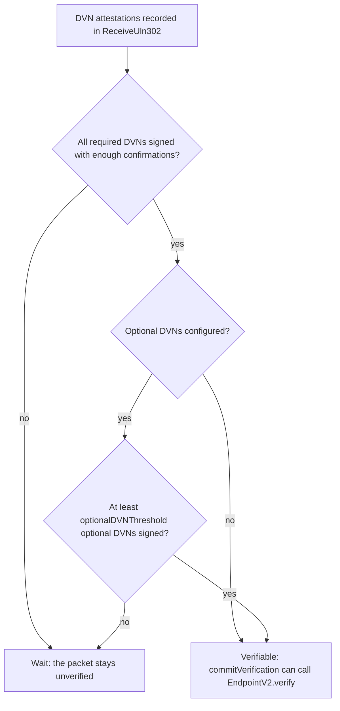

[LayerZero](https://layerzero.network/) is a cross-chain messaging protocol: an application on one chain sends bytes, and its counterpart on another chain receives them. Version 2 does not ship one verification scheme for everyone. Each application chooses who must attest that a message was sent, and the protocol's core contract only enforces that choice, so the security of a LayerZero token is a property of its configuration rather than of LayerZero as a whole.

This article follows LayerZero V2 through its EVM contracts: the endpoint, the message libraries and their verifiers, the executor, the full life of a message, nonces and the four recovery functions, composed calls, options and fees, the configuration and its defaults, the OApp and OFT standards, lzRead, and what the April 2026 Kelp DAO incident shows about a single-verifier setup. The code is `layerzero-v2` and `devtools`, pinned under References.

> This article has been made with the help of [Claude Code](https://claude.com/product/claude-code) and several custom skills

[TOC]

## What you need to know first

The article assumes the reader knows smart contracts, ERC-20 tokens and what a bridge does in general. A few mechanisms one level below are used without being derived:

- **Lock-and-mint and burn-and-mint bridging.** A bridged token either sits locked in an escrow on one chain while a representation is minted elsewhere, or is burned on the source and minted on the destination. The escrow version concentrates all backing in one contract, which the [bridge threat model]({{site.url_complet}}/2026/07/31/cross-chain-bridge-threat-model/) treats as the main asset to protect.
- **Attestation.** An off-chain party observes an event on chain A and signs or submits a claim about it on chain B. Chain B cannot check chain A's state itself, so the attestation is the trust boundary.
- **Block confirmations and reorganisations.** A transaction included in a block can still be reverted if the chain reorganises; waiting a number of blocks reduces that risk. LayerZero lets each application choose how many blocks its verifiers wait.
- **RPC node.** The server an off-chain service queries to read a blockchain's state. A verifier is only as honest as the data its RPC nodes return, which is the point of the Kelp DAO incident.
- **Nonce.** A per-channel counter that orders messages and makes each one unique, so a message cannot be delivered twice.
- **Delegate and owner roles.** Contracts commonly separate an `owner` (OpenZeppelin `Ownable`) from other privileged addresses. In LayerZero, the application's owner and its endpoint delegate are two distinct roles.

## The design in three ideas

LayerZero V2 rests on three choices, each visible in the code:

- **The endpoint is immutable and minimal.** `EndpointV2` is a plain, non-proxied contract holding nonces, payload hashes, the library registry and the compose queue. Its owner can register new libraries, which is append-only since there is no unregister function, set the *default* libraries per pathway, set the LZ token and recover stray tokens. The default DVN, confirmation and executor configurations are set by the owner of each message library, not by the endpoint. Neither owner can change a library or a configuration an application has pinned.

  *Implementation:* `EndpointV2.sol` and `MessageLibManager.sol` for the endpoint owner's setters. Library defaults: `UlnBase.sol`, `setDefaultUlnConfigs()` (lines 55-70). `SendLibBase.sol`, `setDefaultExecutorConfigs()` (lines 67-77).
- **Security is set per application and per pathway.** Which library verifies, which verifiers must sign, how many confirmations they wait and which executor delivers are all set per `(oapp, remote eid)`. A broken stack on one application leaves the others' configurations untouched.
- **Verification is separate from execution.** Verifiers attest to a packet's hash. Once enough of them have, anyone commits that to the endpoint, and then anyone (normally the executor) delivers the message. An executor can delay a message but not forge one; a quorum of verifiers can forge one but cannot run it twice or skip a nonce silently.

## The actors

Each chain runs one endpoint, identified by an **`eid`** (endpoint ID, a `uint32` distinct from the chain id). Around it sit the following contracts and roles:

| Actor | Role | Contract |
|---|---|---|
| **EndpointV2** | Entry point for `quote`, `send`, `verify`, `lzReceive`, `clear`, `skip`/`nilify`/`burn`, `sendCompose`/`lzCompose` and the configuration setters. `EndpointV2Alt` is the same with fees paid in an ERC-20, for chains whose native token has no value. | `protocol/contracts/EndpointV2.sol` |
| **Send / receive library** | Pluggable contracts registered on the endpoint. The production one is **ULN302** (Ultra Light Node): `SendUln302` quotes and pays the workers and encodes the packet, `ReceiveUln302` collects verifier attestations and commits them. `BlockedMessageLib` reverts everything and is how a pathway is shut. | `messagelib/contracts/uln/uln302/` |
| **DVN** (Decentralized Verifier Network) | An off-chain verifier plus its on-chain contract. It is assigned and paid on the source chain, waits the configured confirmations, then calls `ReceiveUln302.verify` on the destination. The reference DVN contract is a signer multisig. | `uln/dvn/DVN.sol`, `dvn/MultiSig.sol` |
| **Executor** | Paid on the source to deliver on the destination: it calls `lzReceive` with the gas and value the options requested, performs native drops and calls `lzCompose`. A failing call is reported with `lzReceiveAlert` and the message stays verified for a retry. | `messagelib/contracts/Executor.sol` |
| **Treasury** | Charges LayerZero's protocol fee, in native or in the LZ token. | `messagelib/contracts/Treasury.sol` |
| **OApp** | The application: `OAppCore` (endpoint, `peers`, delegate), `OAppSender`, `OAppReceiver`, `OAppOptionsType3` (enforced options). | `devtools/packages/oapp-evm/contracts/oapp/` |
| **Delegate** | The address an OApp registers with `setDelegate`. It, or the OApp itself, may call every per-OApp setter on the endpoint: libraries, `setConfig`, `skip`, `clear`, `nilify`, `burn`. | `EndpointV2.setDelegate` |

The delegate is not the OApp's `owner`. The owner sets peers and enforced options on the OApp contract; the delegate configures the OApp's security on the endpoint. The owner also appoints the delegate, so a compromised owner key can take over the delegate role. A review of an integration checks both addresses.

*Implementation:* `OAppCore.sol`, `setDelegate()`, restricted with `onlyOwner` (lines 80-82).

## The security stack

An OApp's security stack is the set of choices the receive library uses to decide that a packet is genuine. For ULN302 it is a `UlnConfig`, stored per OApp and per remote `eid`:

```solidity
struct UlnConfig {
    uint64 confirmations;
    uint8 requiredDVNCount;     // 0 = DEFAULT, NIL_DVN_COUNT (255) = NONE
    uint8 optionalDVNCount;     // 0 = DEFAULT, NIL_DVN_COUNT (255) = NONE
    uint8 optionalDVNThreshold; // (0, optionalDVNCount]
    address[] requiredDVNs;     // sorted ascending, no duplicates
    address[] optionalDVNs;     // sorted ascending, no duplicates
}
```

A packet verifies when **every** required DVN and `optionalDVNThreshold` of the optional DVNs have attested with at least `confirmations` blocks. This is often written "X of Y of N": X required verifiers, a threshold Y over a set of N optional ones. Each list holds at most 127 addresses, so that the two together fit in a `uint8`, and at least one DVN must result after merging with the defaults.

*Implementation:* `ReceiveUlnBase.sol`, `_checkVerifiable()` (lines 90-124). The 127-address limit is `MAX_COUNT` in `UlnBase.sol`, line 32.



Two features of this configuration matter in practice:

- **Both sides must agree.** The send-side config decides which DVNs are assigned and paid; the receive-side config decides whose attestations count. If they differ, the paid DVNs sign but their attestations are ignored, and the message never verifies. That is a liveness failure, not a forgery.
- **Zero means "inherit".** A count of `0` takes the library's default for that field, field by field. Only the reserved value `255` (`NIL_DVN_COUNT`, and `type(uint64).max` for confirmations) means "explicitly none". Setting the required DVNs while leaving `optionalDVNCount` at 0 therefore still merges in the default optional set.

The executor is configured the same way, as an `ExecutorConfig { maxMessageSize, executor }` (config type 1) on the send library only.

## The life of a message

The sequence below follows one message from a user on chain A to the receiving application on chain B. Every call and check in it is taken from the EVM contracts.


Step by step:

1. **Quote.** The OApp asks the endpoint for a price. The endpoint builds the same packet it would send, with the next nonce, and passes it to the send library. `SendUln302` adds the DVN fees, checks the message size against the `maxMessageSize` of the executor config, then adds the executor fee and the treasury fee. The quote can go stale before the send: underpaying reverts with `LZ_InsufficientFee`, overpaying is refunded.

   *Implementation:* `OAppSender.sol`, `_quote()` (lines 47-58). `EndpointV2.sol`, `quote()` (lines 55-78).
2. **Send.** The endpoint increments the outbound nonce of the `(sender, dstEid, receiver)` channel, derives the message's GUID by hashing the nonce, source eid, sender, destination eid and receiver, calls the send library and emits `PacketSent`, the event the workers listen to. The encoded packet is an 81-byte header (version, nonce, source eid, sender, destination eid, receiver) followed by the payload `guid ‖ message`.

   *Implementation:* `EndpointV2.sol`, `send()` and `_send()` (lines 83-144). `MessagingChannel.sol`, `_outbound()`, increments `outboundNonce[sender][dstEid][receiver]` at line 30. `libs/GUID.sol`, `generate()`, returns `keccak256(nonce, srcEid, sender, dstEid, receiver)` at line 17.
3. **Assign and pay.** The send library pays the executor, then calls `assignJob` on every required and optional DVN of the *send-side* config. Fees are credited inside the library (`fees[worker]`) and each worker withdraws them later.
4. **Attest.** Each DVN waits its confirmations on chain A, then calls `ReceiveUln302.verify(header, payloadHash, confirmations)` on chain B. The call is open to anyone, but only entries written by DVN addresses of the *receive-side* config are counted.
5. **Commit.** Committing the verification on the receive library is permissionless. The library checks the header (length, version, destination eid equal to the local eid), loads the receiver's config, runs the threshold check above, deletes the DVN entries and calls the endpoint's `verify`.

   *Implementation:* `ReceiveUln302.sol`, `commitVerification()` (lines 48-61).
6. **Endpoint verify.** The endpoint checks that the caller is the receiver's receive library (or the previous one within its grace period), that the path is **initializable** through the OApp's `allowInitializePath`, and that the nonce is still verifiable. It then stores `inboundPayloadHash[receiver][srcEid][sender][nonce]`. `OAppReceiver` implements `allowInitializePath` as "the sender is my peer for that eid".

   *Implementation:* `EndpointV2.sol`, `verify()` (lines 151-161). `OAppReceiver.sol`, `allowInitializePath()` (lines 63-65).
7. **Execute.** Delivery through the endpoint's `lzReceive` is permissionless too. The endpoint first requires that every nonce after the lazy inbound nonce, up to this one, holds a stored hash. It then advances the lazy nonce, checks the hash of `guid ‖ message` against the stored hash and deletes it **before** calling the OApp. The OApp's `lzReceive` must check that the caller is the endpoint and that the origin's sender is its peer, then runs `_lzReceive`.

   *Implementation:* `EndpointV2.sol`, `lzReceive()` (lines 172-183). `MessagingChannel.sol`, `_clearPayload()` (lines 126-151). `OAppReceiver.sol`, `lzReceive()` (lines 95-110).

The executor's role in steps 5 and 7 is a service, not a privilege. If it does not deliver, the user or anyone else can pay the gas and call the same functions.

## Nonces and recovery

### Ordering

Nonces run per `(sender, dstEid, receiver)` on the way out, and the endpoint tracks two inbound values:

- **`lazyInboundNonce`** moves only on execution, `skip` or `clear`.
- **`inboundNonce()`** is the end of the longest gapless run of stored hashes after the lazy nonce. With hashes at nonces 1, 2, 3, 4, 6 and 7, it returns 4.

Verification can arrive in any order, and once nonces 1 to n are all verified they can be executed in any order. What cannot happen is execution past a gap: an unverified nonce blocks everything after it. That is the censorship-resistance property of the design, since no message can be dropped silently. Strict ordering is opt-in at the application level. The OApp overrides `nextNonce` and checks the nonce in its own receive logic, since the `OAppReceiver` comment says ordering "is also enforced by the OApp"; the sender adds the executor option `ORDERED_EXECUTION`.

The executor is then expected to deliver in nonce order. That is off-chain behaviour, not in the repositories (see Gaps), and the endpoint itself does not enforce it.

### The four recovery functions

When a message is stuck or must not run, only the OApp or its delegate can intervene, through four endpoint functions:

| Function | Applies to | Effect |
|---|---|---|
| `skip(oapp, srcEid, sender, nonce)` | the next unverified nonce, `inboundNonce + 1` | Sets `lazyInboundNonce` to that nonce, so it is passed without ever being verified. The code comments cite a PreCrime alert as the use case. |
| `clear(oapp, origin, guid, message)` | a verified nonce | Consumes the payload exactly as `lzReceive` would, but without calling the OApp: the message is dropped by the application. |
| `nilify(oapp, srcEid, sender, nonce, payloadHash)` | a verified or a future nonce | Writes `NIL_PAYLOAD_HASH` (`bytes32` all ones). The slot counts as filled for the gapless check but cannot execute until it is verified again. |
| `burn(oapp, srcEid, sender, nonce, payloadHash)` | a verified nonce at or below `lazyInboundNonce` | Deletes the hash. The nonce can never be executed or verified again. |

*Implementation:* `MessagingChannel.sol`, `skip()`, `nilify()` and `burn()` (lines 82-121). `EndpointV2.sol`, `clear()` (lines 211-217).

`skip` takes the nonce as an argument rather than "the next one" so that a race, where the nonce is consumed first, does not skip an unintended message. The same functions are what a delegate would use to stop a forged packet that has been verified but not yet executed, which is why the delegate key is as sensitive as the DVN set.

## lzCompose

Composition splits one delivery into two transactions, so that a failure in the second does not undo the first. The OFT uses it to credit tokens and then call a contract with them, for example to swap.

Inside its receive logic, the OApp asks the endpoint to queue a compose message, and the endpoint stores the message's hash under the sending OApp, the composer, the GUID and an index. The executor, paid through the `LZCOMPOSE` option, later asks the endpoint to deliver it. The endpoint checks the hash, marks the slot as received and calls `lzCompose` on the composer with the sending OApp, the GUID, the message, the executor and extra data. The slot is marked rather than deleted, so the same compose cannot be queued again.

*Implementation:* `MessagingComposer.sol`, `sendCompose()` and `lzCompose()` (lines 23-28 and 39-59); `sendCompose()` stores `keccak256(message)` in `composeQueue[from][to][guid][index]`.

Anyone can call `sendCompose` with themselves as `from`. A composer must therefore check both that `msg.sender` is the endpoint and that `from` is the OApp it trusts; the first check alone accepts compose messages queued by any contract.

## Options and fees

### Options

Options are bytes passed with every send and parsed by the send library. Types 1 and 2 are the legacy V1 encodings; **TYPE_3** is the current one, a `uint16(3)` prefix followed by entries `workerId ‖ size ‖ optionType ‖ data`, built with `OptionsBuilder`:

| Worker | Option | Data | Meaning |
|---|---|---|---|
| Executor (id 1) | `LZRECEIVE` = 1 | `uint128 gas, uint128 value` | gas limit and `msg.value` for `lzReceive` |
| Executor | `NATIVE_DROP` = 2 | `uint128 amount, bytes32 receiver` | native gas sent to an address on the destination |
| Executor | `LZCOMPOSE` = 3 | `uint16 index, uint128 gas, uint128 value` | gas and value for one `lzCompose` |
| Executor | `ORDERED_EXECUTION` = 4 | none | deliver in nonce order |
| DVN (id 2) | `PRECRIME` = 1 | DVN index | ask that DVN to run PreCrime |

**Enforced options** let the OApp owner store options per `(eid, msgType)`; on every send they are concatenated with what the caller passes. This is how an application guarantees a minimum destination gas whatever the user supplies. A gas limit that is too low does not lose the message: it stays verified and fails on execution, and anyone can retry it with more gas.

*Implementation:* `OAppOptionsType3.sol`, `setEnforcedOptions()` and `combineOptions()` (lines 28-30 and 63-85).

### Fees

A send pays three parties: every assigned DVN, the executor and the treasury.

- **In native.** The OApp requires `msg.value` to equal the quoted native fee; the endpoint pays the library and refunds the excess to the refund address.

  *Implementation:* `OAppSender.sol`, `_payNative()` (lines 104-107).
- **In the LZ token.** With `payInLzToken`, the OApp transfers the token to the endpoint before `send`. It pays only the treasury part; workers are still paid in native. The option is unavailable while `lzToken` is unset.
- **Treasury bounds.** The treasury's native fee is capped by the code, and a treasury call that reverts or returns malformed data charges nothing. The send library's owner, who sets the treasury, therefore cannot block sends through it. The cap is the larger of the other fees and `treasuryNativeFeeCap`, a value the owner can only lower.

  *Implementation:* `SendLibBase.sol`, `_parseTreasuryResult()` (lines 200-225). `SendLibBaseE2.sol`, `setTreasury()` (lines 60-62).

The executor's fee scales with the gas and value requested, which is why options and fees are quoted together.

*Implementation:* `ExecutorFeeLib.sol`.

## Configuration, and why defaults are dangerous

Every setting of the security stack is set through the endpoint, by the OApp or its delegate, and falls back to a default when left unset:

| Setting | Setter | Default when unset |
|---|---|---|
| Send library per destination | `setSendLibrary(oapp, eid, lib)` | `defaultSendLibrary[eid]` |
| Receive library per source | `setReceiveLibrary(oapp, eid, lib, gracePeriod)` | `defaultReceiveLibrary[eid]` |
| Old receive library still accepted | `setReceiveLibraryTimeout` | `defaultReceiveLibraryTimeout[eid]` |
| `UlnConfig` (type 2), send and receive libraries | `setConfig(oapp, lib, params)` | the library's default config for that eid, field by field |
| `ExecutorConfig` (type 1), send library | `setConfig(...)` | default executor and message size |

When an OApp moves between two pinned receive libraries with a non-zero `gracePeriod`, the old one keeps verifying until `block.number + gracePeriod`, so packets already in flight under the old library still land. The grace period is counted in blocks. The endpoint rejects a grace period with `LZ_OnlyNonDefaultLib` when the old or the new library is the default. An OApp leaving the default library passes 0 and then sets the old library's expiry with `setReceiveLibraryTimeout`, or packets in flight under it stop verifying.

*Implementation:* `MessageLibManager.sol`, `setReceiveLibrary()` and `setReceiveLibraryTimeout()` (lines 245-273 and 279-302). The grace-period check is at line 263.

The endpoint owner sets the default libraries, and each message library's owner sets the default DVN, confirmation and executor configs. LayerZero's May 2026 update names the LayerZero Labs multisig as the party that "sets defaults for all pathways" and "sets the default DVNs". An OApp that leaves any field at 0, or any library unpinned, follows whatever these owners set for that pathway, now and in the future. LayerZero's own [May 2026 update](https://layerzero.network/blog/an-overdue-apology) states that an application pointing at the defaults is "fully reliant on the LayerZero Labs multisig" and that the defaults are "intended to be for testing only". Its recommendations, in the same post:

- pin every configuration, so nothing depends on defaults controlled by LayerZero Labs;
- set block confirmations per chain at a depth where a reorganisation is nearly impossible;
- configure at least two DVNs, with three to five described as better;
- consider running one's own DVN and setting it as required.

The field-by-field merge is the trap in the first point. Pinning the required DVNs while leaving the optional count at 0 still imports the default optional set, which then changes when the library's owner changes it.

## OApp and OFT

### Peers

`peers[eid]` is a `bytes32` (so a non-EVM address fits) naming the only remote contract the OApp talks to on that chain. A send reverts with `NoPeer` when it is unset, a delivery reverts with `OnlyPeer` when the origin's sender differs, and a path can only start from the peer. Only the owner can set a peer, and setting a peer to zero closes the pathway on that side.

*Implementation:* `OAppCore.sol`, `setPeer()` and `_getPeerOrRevert()` (lines 43-45 and 67-71). `OAppReceiver.sol`, `allowInitializePath()` and `lzReceive()` (lines 63-65 and 95-110), with the `OnlyPeer` check at line 106.

### The Omnichain Fungible Token

The OFT is an OApp that moves a token. A send debits the sender, builds the message `to (32 bytes) ‖ amountSD (8 bytes)`, plus a compose part when one is attached, and passes it to the OApp's send path. The receiving side credits the recipient and optionally queues a compose. The `OFT` variant mints to the dead address when the recipient is zero; `OFTAdapter` transfers to the recipient as given.

*Implementation:* `oft-evm/contracts/OFTCore.sol`, `send()`, `_buildMsgAndOptions()` and `_lzReceive()` (lines 175-181, 231-253 and 266-297). `OFT.sol` and `OFTAdapter.sol`, `_credit()` (lines 78-88 and 96-105).

**Shared decimals.** Amounts cross chains as a `uint64` in shared decimals, 6 by default, so that chains with different local decimals agree. The conversion rate is `10^(localDecimals − 6)`, 10^12 for an 18-decimal token. Before debiting, the OFT rounds the amount down to a multiple of that rate, so the remainder never leaves the sender's wallet. For example, sending 1,234,567,891,234,567,891 base units of an 18-decimal token debits 1,234,567,000,000,000,000 and leaves 891,234,567,891 base units of dust with the sender. The `uint64` caps one transfer at about 1.8 × 10^13 tokens, above which the conversion reverts with `AmountSDOverflowed`, and `minAmountLD` is the slippage check.

*Implementation:* `OFTCore.sol`, `sharedDecimals()`, `_removeDust()` and `_toSD()` (lines 85-87, 343-345 and 364-368).

**Burn and mint, or lock and unlock.** The variants differ in where the backing lives:

- **`OFT`** is the token itself; it burns on debit and mints on credit.
- **`OFTAdapter`** wraps an existing ERC-20: it **locks** tokens on debit and **unlocks** them on credit. There must be one adapter per mesh, with an `OFT` on every other chain. It assumes lossless transfers (no fee-on-transfer) and needs an approval.
- **`MintBurnOFTAdapter`** uses an existing token's mint and burn roles; **`NativeOFTAdapter`** locks the native gas token.

The adapter's invariant is that the OFT supply on all other chains equals what it holds. That makes the adapter the single pot a forged inbound message empties, as the Kelp DAO incident showed. Rate limiting exists as an optional add-on and is not part of the default OFT. The [USD₮0 article]({{site.url_complet}}/2025/11/07/usdt0-Omnichain-fungible-token/) describes a production deployment of this pattern, with an adapter locking USDT on Ethereum.

*Implementation:* `oapp/utils/RateLimiter.sol` (rate limiter).

## lzRead

`OAppRead` lets an OApp ask DVNs to read state on other chains and deliver the answer back to itself. The request is sent to a **read channel**, an `eid` above the normal range (the devtools example uses `4294967295`), whose peer is the OApp itself. `ReadLib1002` stores the command hash at send time, the DVNs execute the command off chain and attest to the result, and the response arrives through the ordinary `lzReceive`. The trust model is the same as for messages: the answer is as reliable as the DVN set that attests to it.

## The Kelp DAO incident: a 1-of-1 stack

On 18 April 2026, Kelp DAO's rsETH bridge from Unichain to Ethereum released 116,500 rsETH, about $292M, for a burn that never happened. The full narrative, the attribution and the recovery are in [Cross-Chain Bridge Hacks]({{site.url_complet}}/2026/07/31/cross-chain-bridge-hacks/); this section reads the incident against the architecture above.

**The configuration.** The rsETH pathway ran a 1-of-1 DVN stack, with the LayerZero Labs DVN as the only verifier ([LayerZero, KelpDAO Incident Statement](https://layerzero.network/blog/kelpdao-incident-statement)). One attestation was enough to verify any packet.

**The attack.** According to [LayerZero's incident report](https://layerzero.network/blog/layerzero-labs-kelpdao-incident-report), the attackers compromised internal RPC nodes the DVN read from, patched them to return tampered responses to the DVN alone, and ran a denial-of-service attack against the external RPC provider so that the DVN failed over to the poisoned nodes. The DVN then attested to a packet describing a source-chain burn that did not exist.

**On chain.** The Ethereum endpoint accepted inbound nonce 308 while Unichain's outbound nonce was still 307, and the `RSETH_OFTAdapter` unlocked the 116,500 rsETH ([Aave post-mortem](https://x.com/aave/status/2060901386611499378)). The attacker supplied 89,567 rsETH to Aave V3 and borrowed 82,650 WETH and 821 wstETH against it.

Every contract behaved as written. The receive-side config asked for one attestation and received one; the endpoint checked the library, the peer and the nonce; the adapter released what a verified message told it to. Three lessons follow from the architecture:

- **A DVN's data sources are part of the trust base.** A DVN is an off-chain observer, so compromising what it reads is equivalent to compromising its key. Several RPC sources did not help, because degrading the honest ones made the DVN fail over to the poisoned ones.
- **A second, independent required DVN would have refused the packet** *(derived)*, provided it read the source chain through infrastructure the attacker did not control.
- **The adapter concentrates the loss.** With lock-and-unlock, one forged message can drain all backing for every other chain at once.

LayerZero changed its own policy afterwards. Its [May 2026 update](https://layerzero.network/blog/an-overdue-apology) says the LayerZero Labs DVN "no longer services 1/1 DVN configurations" and that default pathways are being migrated to 5/5 where possible and no less than 3/3. The [July 2026 update](https://layerzero.network/blog/ongoing-security-updates-july-10) reports the 3/3 minimum in place on Endpoint V2 pathways, with about 0.5 % still to be updated. These are operational policies: nothing in the contracts enforces a minimum number of DVNs.

## Conclusion

LayerZero V2 keeps its core small and immutable and moves every security decision into a per-application configuration. What an integrator gets is therefore whatever that configuration says, no more.

- **EndpointV2** holds nonces, payload hashes and the library registry; its owner can add libraries and set the default libraries but cannot change a pinned configuration.
- **The security stack** is a receive library, a `UlnConfig` (X required DVNs, Y of N optional, block confirmations) and an executor, set per OApp and per pathway by the delegate.
- **A message** is quoted and sent on the source, attested by DVNs, committed to the endpoint by anyone, and executed by anyone; the executor delivers but cannot forge.
- **Nonces** allow out-of-order execution but no gaps; `skip`, `clear`, `nilify` and `burn` are the delegate's tools for stuck or unwanted messages.
- **Defaults** come from two owners, the endpoint's for libraries and each message library's for DVN and executor configs, and are merged field by field; LayerZero's own guidance is to pin everything.
- **The OFT** moves amounts in 6 shared decimals; its adapter variant holds all backing in one contract.
- **The Kelp DAO incident** shows a 1-of-1 DVN stack failing through its data sources, not its code. The main risk of a LayerZero integration is its configuration: the DVN set, the delegate key and the defaults it still inherits.


## Annex

### Key Terms

| Term | Definition |
|------|------------|
| **Endpoint ID (eid)** | A `uint32` identifying one LayerZero endpoint, distinct from the chain id. |
| **EndpointV2** | The immutable per-chain contract that stores nonces and payload hashes and routes messages through libraries. |
| **OApp** | An application contract that sends and receives LayerZero messages through the endpoint. |
| **Peer** | The remote contract an OApp accepts messages from and sends messages to, stored per eid as `bytes32`. |
| **Delegate** | The address allowed to configure an OApp's libraries and DVNs on the endpoint and to call the recovery functions. |
| **Message library** | A contract registered on the endpoint that encodes, pays for and verifies packets; ULN302 is the production one. |
| **ULN302** | The Ultra Light Node message library, split into `SendUln302` and `ReceiveUln302`. |
| **DVN** | Decentralized Verifier Network: an off-chain verifier that attests to a packet's hash on the destination chain. |
| **UlnConfig** | The per-OApp, per-pathway verification config: confirmations, required DVNs, optional DVNs and their threshold. |
| **X of Y of N** | All X required DVNs plus Y of the N optional DVNs must attest before a packet verifies. |
| **Executor** | The paid off-chain worker that calls `lzReceive` and `lzCompose` on the destination. |
| **GUID** | The hash of nonce, source eid, sender, destination eid and receiver that identifies a message. |
| **Lazy inbound nonce** | The highest inbound nonce consumed by execution, `skip` or `clear`. |
| **lzCompose** | A second transaction, queued by the receiving OApp, that calls a composer contract after delivery. |
| **TYPE_3 options** | The current options encoding, a list of worker entries for gas, value, native drops, compose and ordering. |
| **Enforced options** | Options stored by the OApp owner and combined with the caller's options on every send. |
| **OFT** | Omnichain Fungible Token: an OApp that burns on debit and mints on credit. |
| **OFT adapter** | An OFT variant that locks an existing ERC-20 on debit and unlocks it on credit, holding all backing. |
| **Shared decimals** | The decimal precision (6 by default) in which OFT amounts cross chains, as a `uint64`. |
| **lzRead** | A LayerZero feature in which DVNs read state on other chains and return the result to the requesting OApp. |

### Invariants

| Invariant | Enforced by | Breaks if |
|-----------|-------------|-----------|
| A message executes at most once. | `_clearPayload` deletes the payload hash before calling the OApp. | The hash were deleted after the external call, opening reentrancy. |
| No nonce is passed silently. | `_clearPayload` requires a stored hash for every nonce up to the one executed; only the OApp or its delegate can `skip`. | The delegate key is compromised. |
| Only the receive library (or the grace library) can store a payload hash. | `isValidReceiveLibrary` in `EndpointV2.verify`. | The OApp pins a malicious library, or leaves it at a default the owner changes. |
| A packet verifies only with all required DVNs and the optional threshold. | `ReceiveUlnBase._checkVerifiable`. | The config has a single DVN, or inherits a weak default. |
| A path starts only from the configured peer. | `allowInitializePath` and the `OnlyPeer` check in `OAppReceiver`. | The owner sets a wrong peer. |
| OFT supply on all other chains equals the adapter's balance. | Lock on debit, unlock on credit, one adapter per mesh. | A forged message is verified, or a second adapter is deployed. |

### Integration Notes

| Behaviour | What an integrator should do |
|-----------|------------------------------|
| A `UlnConfig` field left at 0 inherits the default, field by field. | Set every field, including the optional count (255 for none), and read it back with `getConfig`. |
| The send-side and receive-side DVN sets are separate configs. | Configure both sides with the same DVNs, or messages are paid for but never verify. |
| A gas limit that is too low leaves the message verified but failing. | Set enforced options for each message type and destination. |
| `sendCompose` is callable by anyone for their own `from`. | In a composer, check `msg.sender == endpoint` and `from` equals the trusted OApp. |
| OFT amounts lose dust below the shared-decimal precision. | Quote with `quoteOFT` and set `minAmountLD`; do not assume the full amount crosses. |
| The owner and the delegate are different roles. | Review and secure both addresses, ideally behind a multisig and timelock. |
| Ordering is not enforced by the endpoint. | If the application needs strict order, override `nextNonce`, check the nonce in `_lzReceive` and request the `ORDERED_EXECUTION` option; executor ordering is off-chain behaviour (see Gaps). |

### Risks

LayerZero is infrastructure: the risks below fall on an application that integrates it and on holders of the tokens that application bridges. They come from the code and the incident sources cited above; points marked *(derived)* are this article's reasoning. LayerZero's documentation risk pages were not read for this article.

#### Smart contracts and transparency

- **Immutable core.** `EndpointV2` is not proxied, so its logic cannot be replaced, nor can it be patched; new behaviour arrives as new libraries, which are append-only and opt-in for an OApp that pins its library.
- **Upgradeable edges.** OApps and OFTs can be upgradeable at the integrator's choice; the USD₮0 contracts, for example, are named `OUpgradeable` and `OAdapterUpgradeable`. Whoever controls those upgrades controls the token, independently of LayerZero.
- **Audits.** LayerZero publishes an audit collection; only one report (Code4rena, Endpoint V2 on Sui) was read for this article, see Gaps.

#### External dependencies

- **DVNs and their data.** Every DVN in the stack is an off-chain service with its own keys and RPC sources; Kelp DAO lost funds through the latter.
- **Executor.** A liveness dependency only: if it stops, anyone can deliver at their own gas cost.
- **Source-chain finality.** Confirmations set too low let a reorganisation on the source chain produce a verified message for a transaction that no longer exists *(derived)*.

#### Depeg

- **Bridged token.** An OFT representation is worth its claim on the adapter's locked balance or on the burn-and-mint supply rules. A forged mint or unlock leaves more claims than backing, and the representation can trade below the original until backing is restored, as it was for rsETH *(derived)*.

#### Collateral and market risk

- **Lending markets downstream.** A forged token can be deposited as collateral elsewhere before anyone reacts; the Kelp attacker borrowed WETH and wstETH on Aave V3 against unbacked rsETH.

#### Liquidity

- **Stuck messages.** A gap in nonces blocks every later message on that pathway until it is verified or skipped; mismatched send and receive configs block all of them.

#### Centralisation and governance

- **Endpoint and library owners.** The endpoint owner registers libraries and sets the default libraries; each message library's owner sets the default DVN, confirmation and executor configs and the treasury. LayerZero names the LayerZero Labs multisig as the party that sets these defaults, and an OApp on defaults is fully reliant on it, by LayerZero's own statement.
- **OApp owner and delegate.** They set peers, DVNs and libraries, and can `skip`, `clear`, `nilify` or `burn` messages. The deployed owner and delegate of a given OApp were not read on chain for this article.

#### Loss sharing

- **No protocol backstop in the code.** A forged release drains the adapter, and the holders of the bridged token on every other chain share the shortfall *(derived)*. In the Kelp case the backing was restored by an industry recovery effort, not by a mechanism of the protocol.

#### Regulatory

- None found that is specific to the messaging layer.

#### Summary

| Risk | Where it comes from | What the design does about it | What remains |
|---|---|---|---|
| Forged message | DVN compromise, including its RPC sources | X-of-Y-of-N threshold chosen per OApp | Nothing enforces more than one DVN |
| Silent reliance on defaults | Unset config fields | Field-by-field defaults set by the endpoint owner (libraries) and the library owners (configs) | These owners can change them for any OApp on defaults |
| Delegate misuse | Delegate key | Only the OApp or its delegate can configure or recover | A compromised delegate can swap the DVN set |
| Adapter drain | Lock-and-unlock with all backing in one contract | Optional rate limiter | Not part of the default OFT |
| Liveness | Executor, mismatched configs, gaps | Permissionless delivery and retries | A misconfiguration blocks the pathway |

## Frequently Asked Questions

**Q: What can the owner of EndpointV2 change, and what can it not?**

It can register new message libraries (append-only), set the default send and receive libraries and the default receive-library timeout for each pathway, set the LZ token and recover tokens sent to the endpoint by mistake.

The default DVN, confirmation and executor configurations are not set on the endpoint: each message library's owner sets them on the library. Neither owner can modify or remove a registered library, or change a library or configuration that an OApp has pinned. An OApp that relies on defaults, however, follows every change these owners make to them.

*Implementation:* `UlnBase.sol`, `setDefaultUlnConfigs()` (lines 55-70). `SendLibBase.sol`, `setDefaultExecutorConfigs()` (lines 67-77).

**Q: What does "X of Y of N" mean in a DVN configuration?**

X is the number of required DVNs, all of which must attest. N is the set of optional DVNs and Y the threshold among them. A packet verifies when all X required DVNs and at least Y of the N optional DVNs have attested with enough block confirmations. Kelp DAO's rsETH pathway was a 1-of-1 stack: a single DVN, listed either as required or as a 1-of-1 optional set. The incident sources do not say which.

**Q: Why can the executor delay a message but not forge one?**

The executor only calls `lzReceive` with a message. The endpoint hashes `guid ‖ message` and compares it with the payload hash stored at verification, which only the receive library can write after the DVN threshold is met. A different message fails that comparison. The executor can refuse to deliver, but `lzReceive` is permissionless, so anyone else can deliver instead.

**Q: A forged packet has been verified on the destination but not executed. What can the application do?**

Its OApp or delegate can call `clear` to consume the payload without calling the OApp, `nilify` to replace the hash with a value that cannot execute until verified again, or `burn` once the nonce is at or below the lazy nonce. `skip` does not apply, since it only passes the next *unverified* nonce.

After `nilify`, the same DVNs can re-verify the forged hash, so the DVN config must be changed as well. All of these depend on noticing the packet before someone calls `lzReceive`, which is permissionless.

**Q: Why does an OFT transfer sometimes deliver slightly less than the amount entered?**

Amounts cross chains as a `uint64` in 6 shared decimals. For an 18-decimal token the conversion rate is 10^12, and `_removeDust` rounds the amount down to a multiple of it before debiting. The dust stays in the sender's wallet; it is not lost, but it does not cross. `minAmountLD` protects the sender against a larger difference.

**Q: Why did the Kelp DAO incident drain 116,500 rsETH at once, and what would have limited it?**

Two features combined:

- The pathway trusted a single DVN, so one false attestation verified the forged packet.
- The Ethereum side was an `OFTAdapter`, which holds the locked backing for every other chain, so one message could unlock a large amount.

An independent second required DVN would have had to be fooled as well, and an optional rate limiter on the adapter would have capped what one message could release. Neither is enforced by the protocol.

**Q: If an OApp pins its required DVNs but leaves `optionalDVNCount` at 0, which DVNs verify its messages?**

Its pinned required DVNs, plus the default optional DVNs and threshold for that pathway, because a count of 0 means "inherit the default" and the merge is done field by field. To say "no optional DVNs", the count must be set to 255 (`NIL_DVN_COUNT`).

## Gaps

The protocol description comes from the pinned EVM sources and the incident posts listed below; these points were not settled there.

| Gap | Why it matters | What to read or verify |
|-----|----------------|------------------------|
| Deployed addresses, eids, current default DVN sets and confirmations per pathway were not read on chain, nor the owners of the deployed endpoint, `SendUln302` and `ReceiveUln302`. | The defaults section describes the mechanism, not today's values or whether the endpoint and library owners are the same multisig. | `getConfig` on each endpoint for the pathways of interest, `owner()` on the endpoint and on each library, and LayerZero Scan (not opened for this article, so not linked). |
| The owner and delegate of specific OApps, such as Kelp's rsETH adapter, were not read with `cast call`. | The centralisation risk of a given token depends on who holds those roles. | `owner()` and the endpoint's `delegates(oapp)` on the deployed contracts. |
| The executor's ordered-execution behaviour and the DVN off-chain client are not in the repositories. | The claim that ordering is enforced by the executor rests on `nextNonce` and the option constant only. | The "Message Ordering" page of the LayerZero documentation (URL not checked). |
| The post-incident policy (no 1/1 for the LayerZero Labs DVN, 5/5 or 3/3 defaults) is off-chain and dated May to July 2026. | It can change without any code change. | [Ongoing Security Updates 7/10](https://layerzero.network/blog/ongoing-security-updates-july-10) and later posts on the LayerZero blog. |
| The full Kelp DAO post-mortem linked from LayerZero's report was not read. | The RPC-poisoning details here come from the summary posts. | The "Read the full report" link in [LayerZero Labs KelpDAO Incident Report](https://layerzero.network/blog/layerzero-labs-kelpdao-incident-report). |
| The read-channel eid is taken from the devtools example (`4294967295`), not a protocol constant. | An OApp using another channel id would not match the description. | The supported-eid checks in `ReadLib1002.sol`. |
| The audit reports in the [LayerZero-Labs/Audits](https://github.com/LayerZero-Labs/Audits) collection were not read, apart from the Code4rena Sui report. | Findings could refine the endpoint, ULN, OFT and lzRead descriptions. | The `EndpointV2`, `DVN`, OApp/OFT and lzRead reports in that repository. |
| `devtools` was read from a shallow clone; its OApp contracts differ slightly from the copy in `layerzero-v2/evm/oapp`. | An older deployed OApp may follow the other copy. | A diff of the two `OAppCore.sol` and `OFTCore.sol`. |
| Non-EVM implementations (Solana, Aptos, Sui, TON, Initia, IOTA) were not read. | Their nonce, fee and compose details may differ from the EVM ones. | `layerzero-v2/packages/layerzero-v2/<vm>/`. |

## References

### Analyzed source

- [LayerZero-Labs/layerzero-v2](https://github.com/LayerZero-Labs/layerzero-v2) — analyzed at commit [`9c741e7f9790639537b1710a203bcdfd73b0b9ac`](https://github.com/LayerZero-Labs/layerzero-v2/tree/9c741e7f9790639537b1710a203bcdfd73b0b9ac) (2026-02-27), read 2026-11-16; `packages/layerzero-v2/evm/protocol/contracts/` and `evm/messagelib/contracts/`
- [LayerZero-Labs/devtools](https://github.com/LayerZero-Labs/devtools) — analyzed at commit [`4973ba8bef7b0fdf7268469abea3ea50dbd4bbd8`](https://github.com/LayerZero-Labs/devtools/tree/4973ba8bef7b0fdf7268469abea3ea50dbd4bbd8) (2026-06-30), read 2026-11-16; `packages/oapp-evm/contracts/`, `packages/oft-evm/contracts/`, `examples/oapp-read/`

### Kelp DAO incident and LayerZero statements

- LayerZero, [KelpDAO Incident Statement](https://layerzero.network/blog/kelpdao-incident-statement), 2026-04-19
- Kelp DAO, [Incident Response · April 19, 2026](https://blogs.kerneldao.com/blog/kelp-dao-·-incident-response-·-april-19-2026), 2026-04-19
- LayerZero, [LayerZero Update](https://layerzero.network/blog/an-overdue-apology), 2026-05-08
- LayerZero, [LayerZero Labs KelpDAO Incident Report](https://layerzero.network/blog/layerzero-labs-kelpdao-incident-report), 2026-05-20
- LayerZero, [Ongoing Security Updates 7/10](https://layerzero.network/blog/ongoing-security-updates-july-10), 2026-07-10
- Aave, [April 18, 2026 rsETH Incident Post Mortem](https://x.com/aave/status/2060901386611499378) (post on X)

### Audits

- Code4rena, [LayerZero Endpoint V2 - Sui Findings & Analysis Report](https://code4rena.com/reports/2025-09-layerzero-endpoint-v2-sui), 2025-11-05
- [LayerZero-Labs/Audits](https://github.com/LayerZero-Labs/Audits), audit collection (not read)

### Related articles

- [Cross-Chain Bridge Hacks - Ten Incidents, Five Failure Classes]({{site.url_complet}}/2026/07/31/cross-chain-bridge-hacks/)
- [Cross-Chain Bridge Threat Model - Assets, Trust Boundaries, STRIDE and Threat Register]({{site.url_complet}}/2026/07/31/cross-chain-bridge-threat-model/)
- [USD₮0 - Omnichain Fungible Token]({{site.url_complet}}/2025/11/07/usdt0-Omnichain-fungible-token/)
- [Chainlink CCIP — from DONs to Cross-Chain Verifiers]({{site.url_complet}}/2026/11/16/chainlink-ccip-architecture/)
- [Centrifuge Cross-Chain Messaging — Per-Pool Adapter Quorums, Batching and Failure Recovery]({{site.url_complet}}/2026/08/18/centrifuge-cross-chain-messaging/)
- [Cross-chain tokens Standard (ERC-7281, xERC20) - Overview]({{site.url_complet}}/2025/05/07/cross-chain-token-overview/)
- [Across Protocol - How an Intent Bridge Settles Through UMA]({{site.url_complet}}/2026/11/23/across-protocol-intent-bridge/)
