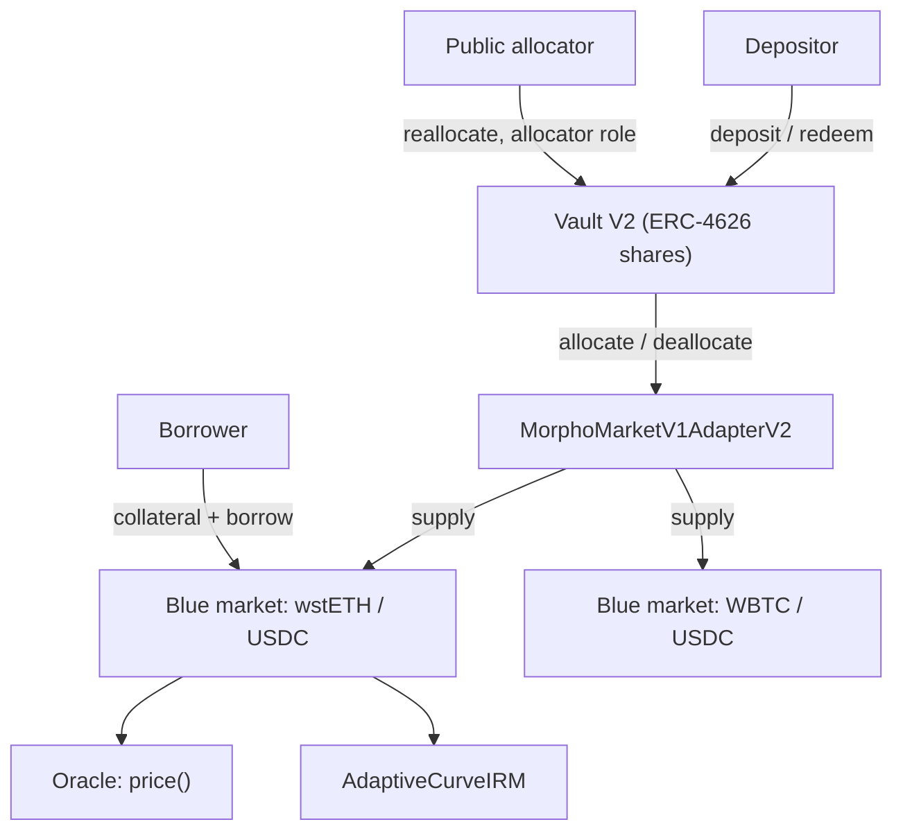
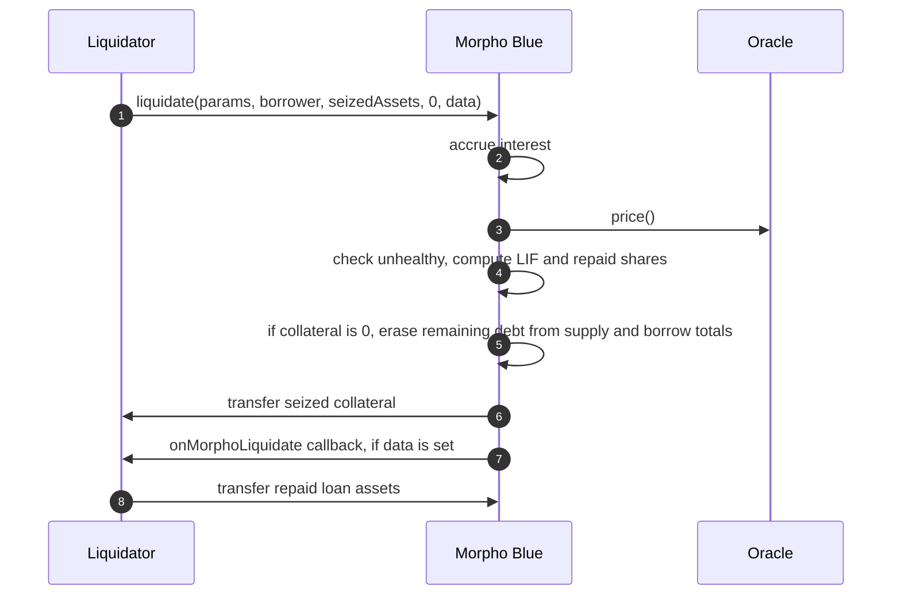
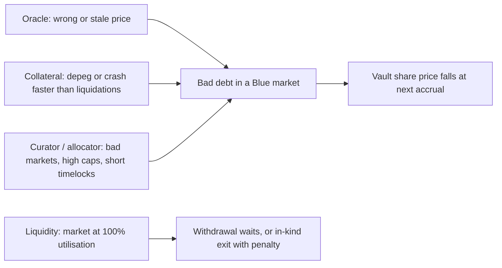

[Morpho](https://morpho.org) is a lending protocol on Ethereum and other EVM chains, built in two layers. At the bottom, Morpho Blue is a single immutable contract that holds many small lending markets, each with one loan asset, one collateral asset and one oracle, so a failure in one market does not touch the others. On top, vaults take deposits of one asset and spread them over several of those markets, under rules that a curator sets and that depositors can read on-chain.

This article walks through the whole stack once, from the code: how a Blue market is defined and accounted, how the AdaptiveCurveIRM sets the rate, how a liquidation and a bad-debt write-off work, what the standard Chainlink-based oracle computes, how Vault V1 (MetaMorpho) and Vault V2 differ, what the public allocator does, and which risks a vault depositor carries. The Morpho series on this site has one deep dive per layer; this article is the map that connects them, and the [timeline](#timeline) in the annex dates its deployments and audits and one oracle incident.

> This article has been made with the help of [Claude Code](https://claude.com/product/claude-code) and several custom skills

[TOC]

## What you need to know first

The article assumes the reader knows what a lending protocol and a stablecoin are. A few mechanisms one level below are used without being derived:

- **Overcollateralised lending.** A borrower locks collateral worth more than the loan; if the ratio of debt to collateral value (the loan-to-value, LTV) crosses a threshold, anyone may repay part of the debt and take collateral at a discount. Morpho calls that threshold the LLTV, the liquidation loan-to-value.
- **Share-based accounting.** Instead of storing each lender's balance, a pool issues shares and stores two totals, assets and shares; interest raises the asset total, so every share is worth more without any per-user write. The [ERC-4626](https://eips.ethereum.org/EIPS/eip-4626) tokenized-vault standard is the same idea with a token interface.
- **Utilisation.** Borrowed assets divided by supplied assets. Most lending protocols set the interest rate as a function of it, and a lender can only withdraw what is not borrowed.
- **Price feeds.** A Chainlink-style feed exposes `latestRoundData()`, an answer with a fixed number of decimals and the time it was last updated. Feeds can be chained (asset/ETH then ETH/USD) to price an asset that has no direct feed.
- **Fixed-point arithmetic.** Solidity has no decimals, so fractions are integers scaled by a constant: `WAD` is $$10^{18}$$, so an LLTV of 86 % is stored as $$0.86 \times 10^{18}$$, and Morpho scales oracle prices by $$10^{36}$$.
- **Flash loans.** A loan that must be repaid within the same transaction, used here by liquidators and by the in-kind exit of Vault V2. Morpho Blue lends any token it holds for free this way.

The figures and worked examples below were computed with the `qalc` calculator.

## The stack at a glance

A depositor usually touches Morpho through a vault, and the vault touches Blue through an adapter. A borrower goes to a Blue market directly.

Three properties hold across the stack, and the rest of the article comes back to them:

- **Immutability.** Morpho Blue and the vault contracts cannot be upgraded. The Vault V2 README states it directly: "All the contracts are immutable."
- **Isolation.** Risk is separated at the market level in Blue, and combined again, deliberately and within caps, at the vault level.
- **Curation is a role, not the protocol.** Morpho governance only whitelists LLTVs and interest-rate models and sets the protocol fee; which markets a vault uses is chosen by whoever holds the curator and allocator roles of that vault.

## Morpho Blue: isolated markets

### Five parameters define a market

Every market lives inside one contract, `Morpho.sol`, and is defined by a `MarketParams` struct of five fields: the loan token, the collateral token, the oracle, the interest-rate model (IRM) and the LLTV. The market id is the hash of those five values, `keccak256(abi.encode(marketParams))`, so two markets that differ in any one of them (the same pair with another oracle, say) are two separate markets with separate liquidity.

`createMarket` is permissionless, with two checks: the IRM and the LLTV must have been enabled by the Morpho owner, which is governance. The [market page of the Morpho documentation](https://docs.morpho.org/learn/concepts/market/) lists nine governance-approved LLTVs, 0 % and the eight values of the LIF table below, and the AdaptiveCurveIRM as the only approved IRM.

The on-chain record agrees, with one addition. On Ethereum, the `EnableLltv` and `EnableIrm` events of 28 December 2023 confirm the nine LLTVs and show a second enabled IRM, the zero address. A market created with it charges no interest, because interest accrual skips the rate call when the IRM is the zero address.

*Implementation:* `Morpho.sol`, `_accrueInterest`.

Once created, nothing about a market can change: its oracle, its LLTV and its IRM are fixed for life. The owner's remaining powers over a live market are limited to a protocol fee on interest, capped at 25 % by `MAX_FEE`, and the address that receives it.

The five operations are the familiar ones: `supply` and `withdraw` for lenders, `supplyCollateral`, `borrow`, `repay` and `withdrawCollateral` for borrowers, and `liquidate` for anyone. Collateral is never lent out, which is what keeps the market's accounting small: the loan token pool is the only pool. [How Morpho Blue Works - Isolated Lending Markets, Shares, Liquidations and Bad Debt]({{site.url_complet}}/2026/10/10/morpho-blue-lending-markets/) follows each of these functions through the source.

### Share accounting

A market stores four totals (`totalSupplyAssets`, `totalSupplyShares`, `totalBorrowAssets`, `totalBorrowShares`) and, per user, supply shares, borrow shares and collateral. Conversions between assets and shares use a virtual offset of $$10^6$$ shares and 1 asset, on either side (supply totals for supply shares, borrow totals for borrow shares):

$$
\begin{aligned}
\text{shares} &= \text{assets} \times \frac{\text{totalShares} + 10^6}{\text{totalAssets} + 1} \\
\text{assets} &= \text{shares} \times \frac{\text{totalAssets} + 1}{\text{totalShares} + 10^6}
\end{aligned}
$$

*Implementation:* `SharesMathLib.sol`, which cites OpenZeppelin's virtual-shares method against the [ERC-4626 inflation attack](https://docs.openzeppelin.com/contracts/4.x/erc4626#inflation-attack).

The offset protects the first depositors of an empty market. Without it, the formula is assets × totalShares / totalAssets: an attacker who holds the only share can donate a large amount, so that the next lender's deposit converts to zero shares after rounding down, and the attacker's single share then claims that deposit too (*derived*). The virtual offset is the mitigation the code adopts against this: it makes the first deposit expensive to manipulate, and a few wei donated to an empty market no longer inflate its share price. Each conversion rounds in the protocol's favour: a supplier's shares round down, a borrower's debt rounds up.

Interest accrues lazily. On the first interaction with a market in a block, Blue asks the IRM for a per-second borrow rate, compounds it over the elapsed time (with a third-order Taylor expansion of $$e^{rt} - 1$$), and adds the result to both `totalBorrowAssets` and `totalSupplyAssets`. If a fee is set, part of that interest is minted as supply shares to the fee recipient. A borrow or a withdrawal then reverts with `INSUFFICIENT_LIQUIDITY` if it would leave more borrowed than supplied.

### When a position is healthy

A position is healthy when its collateral, valued at the oracle price and multiplied by the LLTV, covers its debt:

$$
\begin{aligned}
\text{maxBorrow} &= \frac{\text{collateral} \times \text{price}}{10^{36}} \times \text{LLTV} \\
\text{healthy} &\iff \text{maxBorrow} \geq \text{borrowed}
\end{aligned}
$$

The borrowed amount is the borrower's shares converted to assets, rounded up. There is no separate "collateral factor" below the LLTV: a borrower may borrow up to the liquidation threshold itself, and a position one wei over it is liquidatable.

## AdaptiveCurveIRM: the rate model

The AdaptiveCurveIRM sets the borrow rate from the utilisation $$u$$ in two layers, read from `AdaptiveCurveIrm.sol` and its `ConstantsLib` in `morpho-blue-irm`.

**The curve.** The utilisation is turned into a normalised error $$\varepsilon$$ against a 90 % target, $$\varepsilon = (u - 0.9)/0.1$$ above the target and $$\varepsilon = (u - 0.9)/0.9$$ below it, so $$\varepsilon$$ runs from $$-1$$ at zero utilisation to $$+1$$ at full utilisation. With the rate at target $$r_T$$ and a steepness $$C = 4$$:

$$
\begin{aligned}
r(u) &= r_T \times \left(1 + k \cdot \varepsilon\right), \qquad k = \begin{cases} 1 - 1/C = 0.75 & \varepsilon \lt 0 \\ C - 1 = 3 & \varepsilon \geq 0 \end{cases}
\end{aligned}
$$

At full utilisation the borrow rate is four times $$r_T$$, and at zero utilisation it is a quarter of it.

**The adaptation.** $$r_T$$ itself moves over time, at a speed proportional to the error: $$r_T(t) = r_T(0) \cdot e^{s \varepsilon t}$$ with $$s = 50$$ per year, bounded between 0.1 % and 200 % a year. It starts at 4 % when a market is created. A market held at 100 % utilisation, where $$\varepsilon = 1$$, doubles its rate at target in $$\ln 2 / 50$$ years, about 5.1 days. At 95 % utilisation the doubling takes about 10.1 days, and at 45 % the rate halves in the same 10.1 days. Between two interactions, the rate returned to Blue is the average over the interval, approximated with the trapezoidal rule.

The design has a consequence for lenders. In a fixed-kink model, the rate above the kink is a fixed function of utilisation, so a fully used market pays the same high rate for as long as it stays full.

Here the curve gives only the first step, and the adaptation keeps raising it. A new market at $$r_T = 4$$ % that reaches 100 % utilisation charges 16 % at once; about 5.1 days later $$r_T$$ is 8 % and the borrow rate 32 %, and it keeps doubling until borrowers repay or new suppliers arrive. Liquidity for withdrawals therefore returns through prices over days, not through a kink whose level is fixed.

## Liquidations and bad debt

### The incentive factor

`liquidate` takes either the collateral to seize or the debt shares to repay, and exactly one of the two must be zero. It accrues interest, reads the oracle and reverts with `HEALTHY_POSITION` if the borrower is still healthy. The liquidator's reward is the liquidation incentive factor (LIF), fixed by the market's LLTV:

$$
\begin{aligned}
\text{LIF} &= \min\left(1.15,\ \frac{1}{1 - 0.3 \times (1 - \text{LLTV})}\right)
\end{aligned}
$$

The constants are `LIQUIDATION_CURSOR = 0.3` and `MAX_LIQUIDATION_INCENTIVE_FACTOR = 1.15`. A safer market (lower LLTV) pays a larger bonus, because the distance between the threshold and insolvency leaves room for it:

| LLTV | LIF | Bonus to the liquidator |
|---|---|---|
| 38.5 % | 1.15 (cap; uncapped 1.226) | 15 % |
| 62.5 % | 1.1268 | 12.7 % |
| 77 % | 1.0741 | 7.4 % |
| 86 % | 1.0438 | 4.4 % |
| 91.5 % | 1.0262 | 2.6 % |
| 94.5 % | 1.0168 | 1.7 % |
| 96.5 % | 1.0106 | 1.1 % |
| 98 % | 1.0060 | 0.6 % |

There is no close factor: one call may repay the whole debt. There is no protocol cut either, and no auction; the first transaction to land wins.

A worked example, at LLTV 86 %. A borrower has collateral worth 100,000 USDC at the oracle price and owes 87,000 USDC, an LTV of 87 %, so the position is liquidatable. A liquidator repays the full 87,000 and seizes collateral worth $$87{,}000 \times 1.0438 \approx 90{,}814$$ USDC. The borrower keeps about 9,186 USDC of collateral and no debt; the liquidator's gross margin is about 3,814 USDC, before swap costs and gas.

### When the collateral runs out

The same arithmetic shows where liquidation stops working. Seizing all the collateral repays at most collateral value divided by LIF; at LLTV 86 %, that is 95.8 % of the collateral value. A position whose debt exceeds that figure cannot be cleared by liquidation alone.

Blue handles that case in the same call. If a liquidation leaves the borrower with zero collateral and some debt, the remaining borrow shares are erased, and their asset value is subtracted from both `totalBorrowAssets` and `totalSupplyAssets`.

Take the example above with a debt of 97,000 USDC, a position that can exist only if nobody liquidated it in time or if the collateral price fell by more than about 10 % in one oracle update (see [The oracle](#the-oracle)): a liquidator who seizes the whole 100,000 of collateral repays about 95,800, and the remaining 1,200 USDC is removed from the market's supply. Every supplier's shares are now worth slightly less; the loss is shared pro rata at the moment it is realised, and the `Liquidate` event reports it in `badDebtAssets` and `badDebtShares`.

The callback before payment is what lets a liquidator sell the seized collateral within the same transaction and repay with the proceeds, with no capital of its own.

**Opt-in pre-liquidation.** A separate `PreLiquidation` contract also exists. A borrower who authorises it accepts partial liquidations from a lower threshold, the pre-liquidation LLTV (`preLLTV`), before the full liquidation applies. Each such contract sets its own incentive factor, its own close factor and its own oracle, which may differ from the market's. The close factor is the share of the debt one call may repay, which Blue itself does not limit.

*Implementation:* `PreLiquidation`, parameters `preLLTV`, `preLIF` and `preLCF`.

## The oracle

### What Blue expects

Blue's oracle interface has one function, `price()`, that returns the value of one unit of collateral in units of loan token, scaled by $$10^{36}$$ and expressed in raw token units, so the token decimals are folded into the number. Blue applies no staleness check, no bounds and no fallback of its own: whatever `price()` returns is the price. Because the oracle address is part of the market id, a market cannot switch to a better oracle later; the lenders would have to move to a new market.

### The MorphoChainlinkOracleV2 formula

Morpho's standard implementation, `MorphoChainlinkOracleV2` in `morpho-blue-oracles`, multiplies up to two ERC-4626 conversions and four Chainlink-interface feeds:

$$
\begin{aligned}
\text{price} &= \text{SCALE} \times \frac{\text{baseVault}(s_B) \times B_1 \times B_2}{\text{quoteVault}(s_Q) \times Q_1 \times Q_2} \\
\text{SCALE} &= 10^{\,36 + d_Q + f_{Q1} + f_{Q2} - d_B - f_{B1} - f_{B2}} \times \frac{s_Q}{s_B}
\end{aligned}
$$

Here the base asset is the collateral and the quote asset the loan token; $$B_1, B_2, Q_1, Q_2$$ are the feeds' latest answers, $$d_B, d_Q$$ the token decimals, $$f$$ the feed decimals, and $$s_B, s_Q$$ the sample share amounts converted with `convertToAssets`. A feed set to the zero address counts as 1 with 0 decimals, and a vault set to the zero address counts as 1 (with a sample of 1). `SCALE` is computed once in the constructor and is immutable.

The samples exist for precision. Converting a single raw unit of shares to assets can round to a coarse value, so the oracle converts a larger sample, chosen by the deployer so that the result "has enough precision", in the constructor's words. `SCALE` then divides by $$s_B$$ and multiplies by $$s_Q$$, which brings the result back to a per-unit price.

A worked example: WETH collateral with 18 decimals, a USDC loan with 6 decimals, and one base feed, ETH/USD, with 8 decimals answering 3,000. Then $$\text{SCALE} = 10^{36 + 6 - 18 - 8} = 10^{16}$$, the price is $$10^{16} \times 3000 \times 10^{8} = 3 \times 10^{27}$$, and one WETH ($$10^{18}$$ raw units) is valued at $$10^{18} \times 3 \times 10^{27} / 10^{36} = 3 \times 10^{9}$$ raw USDC, that is 3,000 USDC.

Two properties of this code matter for risk:

- **No freshness or sanity checks.** `getPrice` reads `latestRoundData()` and only requires a non-negative answer; it ignores `updatedAt`. A stalled feed keeps pricing the market at its last value.
- **A vault rate is trusted as a price.** When the collateral is a yield-bearing share priced through the oracle's vault parameter, the oracle reads the issuer's own exchange rate. That rate does not fall when the market price of the share does, so a depeg on secondary markets leaves the oracle price unchanged; only the issuer's accounting and the underlying asset's feed move it.

The constructor's NatSpec gives the condition a market should satisfy: the price should not be able to drop in one step below the old price multiplied by LLTV × LIF. The reason follows from the liquidation rule:

- a position just at the threshold has a debt equal to LLTV × collateral value;
- seizing all its collateral repays at most collateral value / LIF, so a liquidation clears the debt only while the collateral is worth at least debt × LIF;
- the price may therefore fall in one step to LLTV × LIF of its old value, and no further, before that position becomes insolvent.

At LLTV 86 % that product is about 0.898, so a single jump of more than about 10.2 % can take a position from healthy straight to insolvent, with no profitable liquidation in between. The same comment warns against using as quote asset a vault that can receive donations: a donation raises that vault's `convertToAssets` at once, which raises the denominator of the formula and drops the collateral price in one step (*derived*). [Pricing a Lending Position During an Incident - What the Oracle Reads, When, and Who Bears the Gap]({{site.url_complet}}/2026/10/11/oracle-kinds-pricing-lending-position-incident/) goes through each oracle kind under stress.

## Vault V1: MetaMorpho

The first vault generation, MetaMorpho (v1.0 and v1.1), is an immutable ERC-4626 vault that supplies one asset to Blue markets only. Its configuration is market-by-market:

- **Queues.** An allocator sets a supply queue, the ordered list of markets that receive deposits, and a withdraw queue, the list that withdrawals draw from. Each holds up to 30 markets (`MAX_QUEUE_LENGTH`).
- **Caps.** The curator submits one supply cap per market; raising a cap waits for the timelock.
- **Timelock.** One timelock for the whole vault covers cap increases, market removals, guardian changes and timelock decreases; a timelock increase is immediate. In v1.1 it is 0 or between 1 day and 2 weeks at deployment, and between 1 day and 2 weeks after any change (`POST_INITIALIZATION_MIN_TIMELOCK`, `MAX_TIMELOCK`).
- **Roles.** Owner, curator, allocators and a guardian who can revoke pending actions.
- **Fee.** One performance fee, at most 50 %.

The two versions differ on bad debt. In v1.0, `totalAssets` is the sum of what the vault can claim from each market, so a bad-debt write-off in Blue lowers the share price immediately, because `totalAssets` reads Blue live. In v1.1, a fall in that sum is added to `lostAssets`, and `totalAssets` is the real assets plus `lostAssets`: the share price does not fall, and the shortfall stays inside the vault.

The [liquidation page of the Morpho documentation](https://docs.morpho.org/learn/concepts/liquidation/) describes v1.1 as behaving like other lending pools, where bad debt stays on the books "until manual intervention to pay down the bad debt". The NatSpec of the loss counter names the intended intervention: supplying to the vault on behalf of address 1 to cover the loss. Neither source says more about why v1.1 made that choice. The cost is that, in a run on a v1.1 vault with lost assets that nobody covers, the depositors who exit last are the ones who cannot be paid in full (*derived*). Vault V2 returns to the v1.0 behaviour: a loss lowers the share price.

[How Morpho Vault V1 (MetaMorpho) Works, and What Vault V2 Changes]({{site.url_complet}}/2026/10/10/morpho-vault-v1-metamorpho/) reads both versions in detail.

## Vault V2

Vault V2 keeps the ERC-4626 face and changes most of what is behind it. A deposit no longer goes into a list of Blue markets; it goes into adapters, and the limits are set on risk factors rather than on markets.

### Adapters

An adapter is a separate contract that holds positions on the vault's behalf and reports their value through `realAssets()`. The vault sums the idle balance and every adapter's `realAssets()` to get its assets. Two adapters are in the code read here:

- **`MorphoMarketV1AdapterV2`** supplies to Blue markets;
- **`MorphoVaultV1Adapter`** deposits into a MetaMorpho vault.

The first name needs a note: contract names call Blue markets "Market V1", so `MorphoMarketV1AdapterV2` is the second version of the adapter to Blue markets. It has nothing to do with Vault V1, which is what the second adapter reaches.

An optional adapter registry restricts which adapters a vault may add. Adapters are fully trusted by the vault, so the choice of adapter is a curator's decision with the same weight as the choice of market. [Morpho Vault V2 Adapters - How a Vault Allocates, and Why It Wraps a Vault V1]({{site.url_complet}}/2026/10/10/morpho-vault-v2-adapters/) covers the adapter rules.

### Roles

Vault V2 splits the configuration across four roles, read from `VaultV2.sol`:

| Role | Who sets it | What it can do |
|---|---|---|
| **Owner** | itself (`setOwner`) | Set the curator and the sentinels, the name and the symbol. No direct control of funds. |
| **Curator** | owner, immediately | Submit timelocked changes: allocators, adapters, the adapter registry, caps up, gates, fees and recipients, timelocks, `forceDeallocate` penalties, abdications. Decrease caps immediately. |
| **Allocator(s)** | curator, timelocked | Allocate and deallocate within the caps, set the liquidity adapter and `maxRate`. |
| **Sentinel(s)** | owner, immediately | Revoke pending timelocked actions, decrease caps, deallocate to idle. |

Abdication is explained just below; the liquidity adapter, `maxRate` and `forceDeallocate` in [Liquidity, maxRate and fees](#liquidity-maxrate-and-fees).

The curator's actions go through `submit(data)`, which records the time at which that exact calldata becomes executable. When the timelock has passed, anyone can execute it. Each function has its own timelock, and decreasing a timelock is itself timelocked by the current timelock of that function. `abdicate(selector)` disables a function for good, for example to freeze the adapter set. Timelocks are zero at deployment, so a vault's guarantees depend on what its curator has set since.

### Caps by id

A cap applies to an id, a hash that names a common risk factor. For each Blue market it touches, `MorphoMarketV1AdapterV2` returns three ids:

- `keccak256(abi.encode("this", adapter))`, the whole adapter;
- `keccak256(abi.encode("collateralToken", collateralToken))`, every market with that collateral;
- `keccak256(abi.encode("this/marketParams", adapter, marketParams))`, the single market.

On every allocation, the vault updates the allocation of each returned id and requires three things:

- the absolute cap is not zero;
- the allocation does not exceed the absolute cap;
- unless the relative cap is 100 %, the allocation does not exceed the relative cap times `firstTotalAssets`, the vault's total assets at the start of the transaction.

So a curator can say "at most 50 million and at most 30 % of the vault across all wstETH-collateral markets" with two caps on the collateral-token id. Caps are checked only when assets go in: withdrawals from the vault can push an allocation above its relative cap, as the README notes, and accrued interest can push it above either cap.

### Liquidity, maxRate and fees

Withdrawals take idle assets first, then the liquidity adapter, a single adapter (typically a liquid Blue market) that the allocator sets with `setLiquidityAdapterAndData` and that also receives new deposits. 

If neither is enough, a depositor can use `forceDeallocate`: anyone may move assets from any adapter back to idle. The penalty, up to 2 % per adapter and set by the curator, is charged on the amount moved: the vault burns shares of the account named as `onBehalf` worth that fraction, and the matching assets stay in the vault, so they accrue to the remaining depositors.

The README gives the penalty's purpose: it discourages the manipulation of allocations, in particular of relative caps, which are not checked on withdrawals. The curator can change the penalty, but no role can remove the function: abdication only disables timelocked curator functions, `forceDeallocate` is not one, and the code notes that the allocator's choice of liquidity adapter can block deposits and withdrawals but cannot prevent in-kind redemptions with `forceDeallocate`.

*Implementation:* `VaultV2.sol`, `forceDeallocate()`.

Combined with a flash loan, `forceDeallocate` gives the in-kind exit described in the README. With a depositor holding vault shares worth 1,020 USDC, a 2 % penalty, and a market the vault supplies that is fully borrowed:

1. Flash-borrow 1,000 USDC.
2. Supply the 1,000 USDC directly to that Blue market, on the depositor's own account. The market now has 1,000 USDC of free liquidity.
3. Call `forceDeallocate` for 1,000 USDC on that adapter. The vault withdraws its own 1,000 USDC from the market into idle, and burns shares worth 20 USDC from the depositor as the penalty.
4. Withdraw 1,000 USDC from the vault, out of idle, which burns the depositor's remaining shares.
5. Repay the flash loan with that 1,000 USDC.

The depositor's own supply has replaced the vault's in the market: the depositor gave up vault shares worth 1,020 USDC and now holds a direct 1,000 USDC supply position in the illiquid market, and the 20 USDC stay with the vault's other depositors.

The vault's `totalAssets` grows at most at `maxRate` (up to 200 % a year), set by the allocator: on each accrual, the new total is the lower of the real assets and the previous total grown at `maxRate`. The README gives two uses: smoothing the rate paid to depositors, and building a buffer that can absorb later losses. The code adds a third: donations and `forceDeallocate` penalties raise the rate, which can attract depositors who arrive only to dilute that interest, and a lower `maxRate` limits that effect.

Fees are a performance fee on interest, capped at 50 %, and a management fee on assets, capped at 5 % a year. A loss passes into the share price at the next accrual because the minimum picks the lower real value: like MetaMorpho v1.0, and unlike v1.1, Vault V2 passes losses into the share price.

ERC-4626's `max*` functions (`maxDeposit`, `maxMint`, `maxWithdraw`, `maxRedeem`) always return zero on this vault. The code calls it a "gross underestimation" made because a call to a gate cannot be guaranteed not to revert, so an integrator that reads these functions to size a deposit or a withdrawal gets zero.

### Gates

Four optional gate contracts can restrict who receives shares, who sends shares, who receives assets and who sends assets. A vault with no gates is open. ChainSecurity's audit report (September 2025, in the `vault-v2` audits folder) gives the trust model: the two share gates and the receive-assets gate are fully trusted, because a gate that blocks can stop exits, while the send-assets gate can only block entries. [How Morpho Vault V2 Works - Adapters, Caps, Timelocks and In-Kind Redemption]({{site.url_complet}}/2026/10/10/morpho-vault-v2-architecture/) covers gates, fees and the timelock mechanics in depth.

## The public allocator

A borrower who wants more than a market currently has must wait for an allocator to move vault liquidity there. The public allocator removes that wait, within limits the vault sets. `BluePublicAllocator`, in the `vault-v2` periphery, is a contract that a vault appoints as one of its allocators. The vault's real allocators then configure it per vault:

- which adapters are active for it, which markets it may pull from (`canPullFromMarket`) and whether it may pull from idle;
- an absolute cap per market, separate from the vault's own caps;
- a fee per call, which the code calls a penalty: a fraction of the moved amount, which `setPenalty` accepts up to 100 % (`WAD`).

Anyone may then call `reallocate` (deallocate from one market, allocate to another) or `allocateFromIdle`, paying the penalty in the vault's asset. The penalty goes to the vault as a donation, where it accrues to depositors like a `forceDeallocate` penalty; the code gives no other purpose for it, and the 100 % bound is only the upper limit that `setPenalty` checks. The vault's own caps still apply on top of the allocator's caps. The developer docs describe the intended use: a front end bundles the reallocation with the borrow or the withdrawal, so the user gets the liquidity atomically.

The liquidity a borrower or a withdrawing lender can reach in a Blue market is therefore larger than what the market holds. The [shared liquidity page](https://docs.morpho.org/developers/borrow/concepts/shared-liquidity) counts both the assets already in the market and those the public allocator can move into it from every participating Vault V2 that supplies it, subject to each vault's settings and caps. This is why a depositor of one vault can benefit from other vaults' allocators: their liquidity can refill the market the depositor's vault is stuck in.

The contract's own comments list three things this opens:

- **Relative caps can be manipulated with capital.** A relative cap is measured against the vault's total assets at the start of the transaction. Someone who makes a large deposit in one transaction raises that total, can then call the public allocator to move more into a market than the relative cap would normally allow, and can withdraw afterwards (*derived*).
- **Direct liquidity can be drained.** Reallocations can pull assets from idle and from the liquidity market, which are what plain withdrawals draw on.
- **Deposits can be blocked.** Filling the liquidity market's caps makes deposits, which go through the liquidity adapter, revert.

## What a depositor is exposed to

A vault depositor's money is, in the end, a supply position in some Blue markets, chosen by people other than the depositor. The losses come from four places; the annex's [Risks](#risks) section goes through each category in full.

- **Oracle.** A fixed, unchecked oracle turns a stale or wrong price into bad debt.
- **Collateral.** Collateral that falls faster than liquidators can sell it leaves a shortfall written off against supply.
- **Curator.** The curator's markets, caps, adapters, timelocks and gates decide what the vault is exposed to.
- **Liquidity.** At full utilisation, the depositor waits for rates to bring liquidity back or exits in kind.

[Monitoring a Morpho Vault V2 - What a Depositor Needs to Watch]({{site.url_complet}}/2026/10/10/morpho-vault-v2-risk-monitoring/) lists the events and views that reveal each of these on-chain. Curators in practice are specialised firms; [Vault Curator - Steak House Finance]({{site.url_complet}}/2025/11/06/steakhouse-finance-overview/) presents one of them and its Morpho vaults. When the collateral of a market is a Pendle principal token, the oracle and collateral questions are those of [How Pendle V2 Works - SY, PT and YT, the Rate AMM, Oracles and PT as Collateral]({{site.url_complet}}/2026/11/16/pendle-v2-pt-yt-amm/).

## Conclusion

Morpho separates a lending protocol into an immutable market engine and a curation layer above it. The engine fixes the rules of each market at creation; the vaults decide which of those rules a depositor's money is exposed to.

- **A Blue market** is five immutable parameters hashed into an id, with share accounting that rounds against the user and a virtual offset against inflation attacks.
- **The AdaptiveCurveIRM** targets 90 % utilisation, multiplies the rate by up to 4 along its curve, and moves the curve itself at 50 per year, so a fully used market doubles its rate in about five days.
- **Liquidations** pay a bonus fixed by the LLTV, $$\min(1.15,\ 1/(1 - 0.3 \times (1 - \text{LLTV})))$$, with no close factor; when the collateral runs out, the remaining debt is subtracted from the suppliers' assets in the same transaction.
- **The standard oracle** multiplies vault conversions and feed answers into one $$10^{36}$$-scaled number, with no staleness check, and is fixed for the life of the market.
- **Vault V1** configures market by market with queues and one timelock; **Vault V2** routes through adapters, caps risk factors by id, timelocks each curator action separately, and offers an in-kind exit through `forceDeallocate` that no role can switch off, though a gate can still block a withdrawal.
- **The public allocator** lets anyone move vault liquidity between markets against a penalty, within limits the allocators set.
- **A depositor's main risks** are the oracle and collateral of each market the vault reaches, the curator's choices and timelocks, and the liquidity of those markets.

## Annex

### Key Terms

| Term | Definition |
|------|------------|
| **Morpho Blue** | The immutable singleton contract that holds every isolated lending market, also called Morpho V1 in the documentation (and Market V1 in contract names). |
| **Market id** | `keccak256` of the five market parameters; any change to one parameter is a different market. |
| **LLTV** | Liquidation loan-to-value: the debt-to-collateral ratio above which a position can be liquidated, chosen from a governance whitelist. |
| **LIF** | Liquidation incentive factor: the multiplier on repaid debt that sets the collateral a liquidator receives, from 1.15 down to about 1.006. |
| **Bad debt** | Debt left on a position whose collateral is exhausted; Blue erases it and subtracts it from the market's supply assets. |
| **Virtual shares** | The offset of $$10^6$$ shares and 1 asset in every conversion, which makes share-price inflation on an empty market costly. |
| **AdaptiveCurveIRM** | The only enabled interest-rate contract (the zero address is also enabled, for markets that charge no interest): a curve around 90 % utilisation whose level adapts over time. |
| **Rate at target** | The borrow rate the IRM charges at exactly 90 % utilisation; it drifts up or down with the utilisation error. |
| **`price()`** | The oracle function Blue calls: loan-token units per collateral unit, in raw units, scaled by $$10^{36}$$. |
| **MorphoChainlinkOracleV2** | Morpho's standard oracle: up to two ERC-4626 conversions and four feeds, multiplied and scaled by an immutable factor. |
| **MetaMorpho** | Morpho Vault V1: an ERC-4626 vault over Blue markets with supply and withdraw queues, one cap per market and one timelock. |
| **`lostAssets`** | In MetaMorpho v1.1, the cumulative loss kept inside `totalAssets` so that the share price does not fall. |
| **Adapter** | A Vault V2 contract that holds positions on the vault's behalf and reports their value with `realAssets()`. |
| **Curator** | The Vault V2 role that sets adapters, caps, gates, fees and timelocks; its actions go through `submit` and the timelock. |
| **Allocator** | The Vault V2 role that moves assets between adapters within the caps and sets the liquidity adapter and `maxRate`. |
| **Sentinel** | The Vault V2 role that can only reduce risk: revoke pending actions, decrease caps, deallocate. |
| **Id (cap id)** | A hash naming a risk factor (an adapter, a collateral token, a market) on which absolute and relative caps apply. |
| **`forceDeallocate`** | The permissionless function that moves assets from an adapter to idle against a penalty of up to 2 %, the basis of the in-kind exit. |
| **Gate** | An optional contract that controls who may send or receive shares or assets of a Vault V2. |
| **Public allocator** | `BluePublicAllocator`, an allocator contract that lets anyone reallocate vault liquidity into a market against a penalty. |

### Invariants

| Invariant | Enforced by | Breaks if |
|-----------|-------------|-----------|
| A market's oracle, IRM and LLTV never change. | They are hashed into the market id and Blue has no setter. | Never in Blue; a vault can only move to another market. |
| Total borrowed never exceeds total supplied in a market. | `require(totalBorrowAssets <= totalSupplyAssets)` in `borrow` and `withdraw`. | Not reachable through Blue's functions. |
| A healthy position cannot be liquidated. | `liquidate` reverts with `HEALTHY_POSITION`. | The oracle returns a wrong price, which Blue cannot detect. |
| Bad debt is socialised in the transaction that exhausts the collateral. | The `collateral == 0` branch of `liquidate`. | Nobody liquidates the last collateral, so the debt stays on the books. |
| A Vault V2 allocation never exceeds an absolute cap at the time it is made. | The cap loop in `allocateInternal`. | Interest accrues on it, or a curator or sentinel decreases the cap below the current allocation; caps do not prevent either. |
| A curator change waits for its timelock. | `timelocked()` checks `executableAt[msg.data]`. | The timelock was left at zero or decreased earlier. |
| A Vault V2 share price grows at most at `maxRate`. | `newTotalAssets = min(realAssets, maxTotalAssets)`. | Not breakable upward; downward, a loss passes through at once. |

### Risks

The risks below are those of a depositor in a Morpho vault, and of a lender supplying to a Blue market directly. Morpho's documentation and the audit reports are the starting point; points marked (*derived*) come from this article's reading of the code.

#### Smart contracts and transparency

- **Immutable core.** Morpho Blue, MetaMorpho and Vault V2 are immutable and published with their audits and Certora specifications. No party can replace the logic or change the rules under a depositor, and no party can patch a bug either.
- **Audited Vault V2.** The [`vault-v2` audits folder](https://github.com/morpho-org/vault-v2/tree/d992cb8438b8630b3fee4649311d78d649264a5e/audits) holds reports by Spearbit, Zellic, Cantina (a competition), Blackthorn, ChainSecurity and Certora on Vault V2 and its adapters, including acknowledged issues such as the ability of a user to exit before a pending loss is realised.

#### External dependencies

- **Oracles.** Each market trusts one oracle contract with no check in Blue. The standard oracle ignores feed timestamps and uses issuer exchange rates for vault-share collateral (see [The oracle](#the-oracle)).
- **Adapters and IRMs.** A Vault V2 trusts its adapters' `realAssets()`; a reverting IRM view can block a vault's accrual, as ChainSecurity's trust model notes.
- **Collateral issuers.** A market's collateral is often itself a protocol (a staking token, a synthetic dollar, a Pendle PT), whose failure reaches Morpho through the oracle or through liquidation proceeds.

#### Depeg

- **Loan asset.** A vault denominated in a stablecoin is exposed to that stablecoin's peg; Morpho has no mechanism of its own here.
- **Collateral priced by exchange rate.** When the oracle reads the issuer's rate, a market depeg of the collateral does not trigger liquidations, while the collateral that liquidators would sell is worth less than the oracle says (*derived*).

#### Collateral and market risk

- **Jumps larger than the buffer.** A price fall of more than $$1 - \text{LLTV} \times \text{LIF}$$ in one oracle update can move a position from healthy to insolvent with no profitable liquidation in between. That threshold is about 10.2 % at LLTV 86 % and about 3.9 % at LLTV 94.5 %.
- **Thin exit markets.** Liquidations are profitable only if the collateral can be sold near the oracle price at the liquidation size; a high LLTV leaves a small bonus to absorb slippage.

#### Liquidity

- **Utilisation.** Suppliers can withdraw only unborrowed assets. At 100 % utilisation the rate at target doubles in about five days, which is the mechanism that brings liquidity back.
- **Vault exits.** A Vault V2 withdrawal draws on idle and the liquidity adapter; beyond that, the depositor needs an allocator, the public allocator or an in-kind exit with a penalty of up to 2 %.
- **Public allocator.** Its comments state that reallocations can reduce the vault's direct liquidity by pulling from idle and from the liquidity market.

#### Centralisation and governance

- **Morpho governance.** The Morpho owner, a multisig according to the [governance page of the Morpho documentation](https://docs.morpho.org/learn/governance/organization/), can enable LLTVs and IRMs and set a fee of up to 25 % of interest on a market. It cannot change a market's parameters or move funds.
- **Vault roles.** The owner can replace the curator immediately; the curator controls everything else through timelocks that start at zero. A depositor should read each vault's timelocks, abdications, sentinels and gates. These were not read on-chain for this article, as it describes the design and no particular deployment.
- **Gates.** A gate that blocks share transfers or asset withdrawals can stop exits; three of the four gates are fully trusted.

#### Loss sharing

- **Blue.** Bad debt is shared pro rata by the suppliers of the market in the transaction that realises it.
- **Vault V2.** The loss passes into the share price at the next accrual, and every deposit or withdrawal accrues first. A depositor who exits while the loss is still pending in Blue, on an under-collateralised position not yet liquidated, avoids it and leaves it to the others (ChainSecurity finding, accepted by design).
- **MetaMorpho v1.1.** The loss is kept in `lostAssets` and not in the share price, so it falls on whoever cannot withdraw last (*derived*).

#### Regulatory

- **None found** in the design itself. Gates can be used to restrict access to whitelisted addresses, which is a choice of each vault.

#### Summary

| Risk | Where it comes from | What the design does about it | What remains |
|---|---|---|---|
| Wrong or stale oracle price | Each market's immutable oracle | Isolation: one oracle affects one market | Bad debt in that market; no staleness check in the standard oracle |
| Collateral crash or depeg | The collateral asset and its exit liquidity | LIF scaled by LLTV; isolated markets | Jumps beyond $$1 - \text{LLTV} \times \text{LIF}$$ become bad debt |
| Curator decisions | Vault V2 curator and allocators | Timelocks, caps by id, sentinels, abdication | Zero timelocks at deployment; owner can replace the curator at once |
| Liquidity | Utilisation of the underlying markets | Adaptive rate, liquidity adapter, `forceDeallocate`, public allocator | Waits of days, or an in-kind exit with up to 2 % penalty |
| Loss timing | Accrual-based loss recognition | Losses realised in Blue at liquidation; V2 share price follows at accrual | Early exits shift a pending loss to the remaining depositors |
| Gates | Optional gate contracts | Unset gates restrict nothing | A malicious or broken gate can block exits |

### Timeline

Events up to 25 November 2026.

| Date | Event | Why it matters here | Source |
|---|---|---|---|
| 11 October 2023 | Morpho Labs published the Morpho Blue whitepaper and released its code. | It is the first public description of the isolated-market design this article reads from the code. | [Morpho blog, Morpho Blue and how it enables our vision for DeFi lending](https://morpho.org/blog/morpho-blue-and-how-it-enables-our-vision-for-defi-lending/) |
| 24 October 2023 | Morpho announced MetaMorpho, a protocol for permissionless ERC-4626 lending vaults on top of Morpho Blue. | MetaMorpho is the Vault V1 layer that Vault V2 later replaces and can still reach through `MorphoVaultV1Adapter`. | [Morpho blog, Introducing MetaMorpho](https://morpho.org/blog/introducing-metamorpho-permissionless-lending-vaults-on-morpho-blue/) |
| 28 December 2023 | Morpho Blue was deployed on Ethereum at block [18,883,124](https://etherscan.io/block/18883124), and the AdaptiveCurveIRM, the zero address (interest-free markets) and the nine LLTVs from 0 % to 98 % were enabled within the next ten blocks. | These `EnableIrm` and `EnableLltv` events are the on-chain source of the enabled IRMs and of the LLTVs behind the LIF table. | [Etherscan, Morpho Blue creation transaction](https://etherscan.io/tx/0xba6a2e752ff5caee49cd4f69825ca00e47abc827ae51e7bda5c3ad56eae053b3) |
| 6 January 2024 | Ownership of Morpho Blue on Ethereum passed to the Safe `0xcBa2…9AFa` at block [18,949,595](https://etherscan.io/block/18949595); on 25 November 2026 at 09:05 UTC (block [26,491,186](https://etherscan.io/block/26491186)) it was still the owner, with a threshold of 6 of 10. | This Safe holds the governance powers listed in the risks, and the contract had emitted no `SetFee` event by that date, so no market on Ethereum paid a protocol fee. | [Etherscan, `setOwner` transaction](https://etherscan.io/tx/0xc86a635fe546d78029608bee34eb45174b020a3e5be7211d022d50096495b0b3) |
| 13 October 2024 | A PAXG/USDC market (LLTV 91.5 %) whose `MorphoChainlinkOracleV2` was deployed with a wrong scale let one borrower take about 230,000 USDC against a small PAXG deposit at block [20,956,052](https://etherscan.io/block/20956052). | It shows the oracle section's point in practice: Blue accepts whatever `price()` returns, and the damage was limited to that market and the vaults that supplied it. | [Etherscan, borrow transaction](https://etherscan.io/tx/0x256979ae169abb7fbbbbc14188742f4b9debf48b48ad5b5207cadcc99ccb493b); [LeadBlock, Retrospective: PAXG/USDC market oracle configuration](https://forum.morpho.org/t/retrospective-paxg-usdc-market-oracle-configuration/891) |
| 19 December 2024 | The MetaMorpho Factory V1.1 was deployed on Ethereum at block [21,439,510](https://etherscan.io/block/21439510). | Vault V1 vaults created from this factory keep bad debt in `lostAssets` instead of lowering the share price. | [Etherscan, factory creation transaction](https://etherscan.io/tx/0x4c19401df000d3bbc3fe364049c93913e0aa350e0cbb7d01dd9f27aaa2c512e9) |
| 16 September 2025 | The `VaultV2Factory` was deployed on Ethereum at block [23,375,073](https://etherscan.io/block/23375073), the date of ChainSecurity's Vault V2 audit report. | The roles, caps and gates described above apply to vaults created by this factory, under the trust model of that report. | [Etherscan, factory creation transaction](https://etherscan.io/tx/0xf3c7a7c3bda8c818c2e1e8d93a67bd0eda88309fcae551c9af68e36ac9685fcc); [ChainSecurity, Vault V2 audit](https://github.com/morpho-org/vault-v2/blob/d992cb8438b8630b3fee4649311d78d649264a5e/audits/2025-09-15-chainsecurity.pdf) |
| 29 September 2025 | Morpho announced that Vaults V2 were live on Ethereum, allocating at first only to Morpho V1 markets and vaults. | It marks the move from market-by-market queues to adapters and caps by id. | [Morpho blog, Morpho Vaults V2: A new standard for asset curation](https://morpho.org/blog/morpho-vaults-v2-a-new-standard-for-asset-curation) |
| 10 December 2025 | The `MorphoMarketV1AdapterV2` factory was deployed on Ethereum at block [23,981,459](https://etherscan.io/block/23981459), after reviews by Blackthorn, Certora and Spearbit filed on 4 December 2025. | This is the adapter whose three ids (adapter, collateral token, market) carry the caps explained in this article. | [Etherscan, factory creation transaction](https://etherscan.io/tx/0x1b302e0cff54f952fc724ecc30d6b96a3cb5a4919db62cc728fbb61f16d39538); [Blackthorn, MarketV1AdapterV2 audit](https://github.com/morpho-org/vault-v2/blob/d992cb8438b8630b3fee4649311d78d649264a5e/audits/2025-12-04-market-v1-adapter-v2-blackthorn.pdf) |
| 16 August 2026 | `BluePublicAllocator` was deployed on Ethereum at block [25,770,408](https://etherscan.io/block/25770408), after Blackthorn's review of 30 July to 2 August 2026. | It is the public allocator whose penalties and caps this article describes for Vault V2. | [Etherscan, creation transaction](https://etherscan.io/tx/0x053543c7e4a19e46b90c434537659a1500867536658aae58c4fc1a2d299c150a); [Blackthorn, Blue Public Allocator audit](https://github.com/morpho-org/vault-v2/blob/d992cb8438b8630b3fee4649311d78d649264a5e/audits/2026-08-13-blue-public-allocator-blackthorn.pdf) |

## Frequently Asked Questions

**Q: What are the five parameters of a Morpho Blue market, and which of them can change after creation?**

The loan token, the collateral token, the oracle, the interest-rate model and the LLTV. None of them can change: they are hashed into the market id, and Blue has no function to modify them. A different oracle or LLTV means a different market with separate liquidity.

**Q: How large is the liquidation bonus on a market with an LLTV of 91.5 %, and why is it smaller than on a 77 % market?**

The LIF is $$1/(1 - 0.3 \times 0.085) \approx 1.0262$$, a bonus of about 2.6 %, against about 7.4 % at LLTV 77 %. The formula ties the bonus to the gap between the LLTV and 100 %: a higher LLTV leaves less collateral above the debt, so a large bonus would push positions into bad debt as soon as they are liquidated.

**Q: A Blue market sits at 100 % utilisation for a week. What happens to its borrow rate?**

Two things act at once:

- On the curve, the rate is four times the rate at target, because the normalised error is $$+1$$.
- The rate at target grows as $$e^{50 \cdot t}$$ with $$t$$ in years, doubling about every 5.1 days, up to a ceiling of 200 % a year.

After a week the borrow rate is therefore about 2.6 times ($$e^{50 \times 7/365}$$) what it was at the start of the week, still on the 4× curve. Borrowers are pushed to repay and suppliers attracted, which is how withdrawal liquidity returns.

**Q: Why does `MorphoChainlinkOracleV2` not protect a market against a depeg of a staked-token collateral?**

When the oracle is configured with the ERC-4626 share as `BASE_VAULT`, it reads the share's `convertToAssets`, the issuer's own exchange rate, and multiplies it by a feed for the underlying asset. A fall of the share's market price does not change that rate, so the oracle price does not move and no liquidation is triggered. The code also does not check feed timestamps, so a stalled feed is not detected either.

**Q: What is the difference between an absolute cap and a relative cap in Vault V2, and when is each checked?**

An absolute cap is an amount of assets; a relative cap is a fraction of the vault's total assets at the start of the transaction. Both apply to an id, such as a collateral token, and both are checked when the vault allocates to an adapter. Neither is checked on withdrawal or interest accrual, so an allocation can end above its relative cap after other depositors leave.

**Q: A Vault V2 has all its assets in one Blue market that is fully borrowed. How can a depositor get out?**

There are three routes:

- Wait for an allocator to move assets, or for borrowers to repay as the rate rises.
- Wait for other vaults that appointed a public allocator to have liquidity moved into that market. Anyone can trigger such a move by paying the configured penalty. Then withdraw through the liquidity adapter or `forceDeallocate`. This vault's own public allocator cannot help, since the vault has no other market to pull from.
- Exit in kind: flash-borrow the asset, supply it directly to the market, call `forceDeallocate` so that the vault pulls that liquidity to idle (penalty up to 2 %), withdraw it from the vault, and repay the flash loan. The depositor ends up holding a supply position in the illiquid market instead of vault shares.

**Q: How does a bad-debt event in a Blue market reach a Vault V2 depositor, and who bears it?**

When a liquidation exhausts a borrower's collateral, Blue subtracts the remaining debt from the market's supply assets, so the adapter's supply shares are worth less. At the vault's next accrual, `realAssets()` reports the lower value, `totalAssets` takes the minimum, and the share price falls for every depositor still in the vault.

A redeem accrues first, so a depositor cannot exit between the write-off and the accrual. The escape happens earlier: a depositor who redeemed while the loss was still pending in Blue, before the liquidation, is not affected. This is the "users can escape losses" finding accepted by Morpho.

## Gaps

These points were not settled by the repositories at the commits listed in References and the Morpho documentation, and should be checked before relying on the article.

| Gap | Why it matters | What to read or verify |
|-----|----------------|------------------------|
| The enabled LLTVs and IRMs were read on chain for Ethereum only (`EnableLltv` and `EnableIrm` events up to 25 November 2026), not on the other chains where Morpho Blue is deployed. | The LIF table and the list of IRMs may not hold on another chain. | Call `isLltvEnabled` and `isIrmEnabled`, or read the same events, on each [Morpho Blue deployment](https://docs.morpho.org/developers/contracts/addresses). |
| The learn docs (Vault V2 and Curator concept pages) say the curator can set `maxRate`, while `VaultV2.sol` at the commit listed in References restricts `setMaxRate` to allocators. | The article follows the code; a later revision may differ. | `setMaxRate` in [`VaultV2.sol`](https://github.com/morpho-org/vault-v2/blob/d992cb8438b8630b3fee4649311d78d649264a5e/src/VaultV2.sol). |
| The MetaMorpho-era public allocator (a separate contract for Vault V1) is not in the repositories read for this article; only `BluePublicAllocator` for Vault V2 was read. | V1 vaults may expose liquidity through a different contract with other rules. | The [public allocator page of the Morpho learn docs](https://docs.morpho.org/learn/concepts/public-allocator/), not read here. |
| The `PreLiquidation` contract is described from secondary notes, not from its source. | Its parameters and its oracle choice affect when a borrower is partially liquidated. | The [morpho-org/pre-liquidation](https://github.com/morpho-org/pre-liquidation) repository, not read for this article. |
| No particular vault's roles, timelocks, gates or caps were read on-chain. | The risk section describes what the design allows, not what a given vault does. | `curator()`, `owner()`, `timelock(selector)`, `abdicated(selector)` and the gate getters on the vault in question. |
| Of the audit reports, only ChainSecurity's (the trust model and the "Users Can Escape Losses" finding) was read for this article; the other findings are not summarised here. | Other reports may record issues relevant to depositors. | The other reports in the [`vault-v2` audits folder](https://github.com/morpho-org/vault-v2/tree/d992cb8438b8630b3fee4649311d78d649264a5e/audits). |
| The [governance page of the Morpho documentation](https://docs.morpho.org/learn/governance/organization/) describes a 5-of-9 multisig, while the owner Safe had a threshold of 6 of 10 owners on 25 November 2026 at 09:05 UTC (block [26,491,186](https://etherscan.io/block/26491186)). | A reader who relies on the documentation gets the wrong signer set for the powers to enable LLTVs and set fees. | Check whether the governance page has been updated, and read `getThreshold()` and `getOwners()` again before relying on the signer set. |
| Neither the MetaMorpho v1.1 sources nor the documentation state why v1.1 stopped realising bad debt in the share price. | The trade-off between a stable share price and last-out losses is presented without its stated rationale. | The [metamorpho-v1.1](https://github.com/morpho-org/metamorpho-v1.1) audits and release notes. |
| The timeline dates Morpho Blue and Vault V2 from Ethereum deployments and blog posts; no Morpho page giving the public mainnet opening of Blue, nor the dates of Vault V2 deployments on other chains, was found. | The launch row and the Vault V2 rows may not match the dates Morpho itself gives, and the timeline covers Ethereum only. | The [Morpho blog](https://morpho.org/blog) archive for early 2024 and the per-chain factories on the [addresses page of the Morpho documentation](https://docs.morpho.org/developers/contracts/addresses). |

## References

### Analyzed source

- [morpho-org/morpho-blue](https://github.com/morpho-org/morpho-blue) — analyzed at commit [`8e26ca6a8dbc5089edcd67fb576248810fd2870a`](https://github.com/morpho-org/morpho-blue/tree/8e26ca6a8dbc5089edcd67fb576248810fd2870a), 2026-11-16 (`src/Morpho.sol`, `src/libraries/ConstantsLib.sol`, `src/libraries/SharesMathLib.sol`)
- [morpho-org/morpho-blue-irm](https://github.com/morpho-org/morpho-blue-irm) — analyzed at commit [`b9a580635f5890ca07e9deb6198b22c9078aedb8`](https://github.com/morpho-org/morpho-blue-irm/tree/b9a580635f5890ca07e9deb6198b22c9078aedb8), 2026-11-16 (`src/adaptive-curve-irm/`)
- [morpho-org/morpho-blue-oracles](https://github.com/morpho-org/morpho-blue-oracles) — analyzed at commit [`a6fff8bab1255baed052694935aa04998aafb50b`](https://github.com/morpho-org/morpho-blue-oracles/tree/a6fff8bab1255baed052694935aa04998aafb50b), 2026-11-16 (`src/morpho-chainlink/MorphoChainlinkOracleV2.sol`)
- [morpho-org/metamorpho](https://github.com/morpho-org/metamorpho) — analyzed at commit [`ded84e59668155b34d3c24906c4f7461c12828af`](https://github.com/morpho-org/metamorpho/tree/ded84e59668155b34d3c24906c4f7461c12828af), 2026-11-16
- [morpho-org/metamorpho-v1.1](https://github.com/morpho-org/metamorpho-v1.1) — analyzed at commit [`3b17547ee464d00370d1e5e7cd997c3cdb8b0fb7`](https://github.com/morpho-org/metamorpho-v1.1/tree/3b17547ee464d00370d1e5e7cd997c3cdb8b0fb7), 2026-11-16
- [morpho-org/vault-v2](https://github.com/morpho-org/vault-v2) — analyzed at commit [`d992cb8438b8630b3fee4649311d78d649264a5e`](https://github.com/morpho-org/vault-v2/tree/d992cb8438b8630b3fee4649311d78d649264a5e), 2026-11-16 (`README.md`, `src/VaultV2.sol`, `src/adapters/MorphoMarketV1AdapterV2.sol`, `src/periphery/blue-public-allocator/BluePublicAllocator.sol`)

### Documentation and standards

- [Morpho documentation, Learn](https://docs.morpho.org/learn) (curator and Vault V2 concept pages)
- [Morpho developer documentation, shared liquidity](https://docs.morpho.org/developers/borrow/concepts/shared-liquidity)
- [Morpho developer documentation, Vault V2 public allocator tutorial](https://docs.morpho.org/developers/borrow/tutorials/public-allocator)
- [ERC-4626: Tokenized Vaults](https://eips.ethereum.org/EIPS/eip-4626)
- [OpenZeppelin, ERC-4626 inflation attack](https://docs.openzeppelin.com/contracts/4.x/erc4626#inflation-attack) (cited by `SharesMathLib`)
- [ChainSecurity, Morpho Vault V2 audit, September 2025](https://github.com/morpho-org/vault-v2/tree/d992cb8438b8630b3fee4649311d78d649264a5e/audits) (`2025-09-15-chainsecurity.pdf`)
- [Claude Code](https://claude.com/product/claude-code)

### Timeline sources

- [Morpho Blue and how it enables our vision for DeFi lending](https://morpho.org/blog/morpho-blue-and-how-it-enables-our-vision-for-defi-lending/), Paul Frambot, Morpho blog, 11 October 2023
- [Introducing MetaMorpho: Permissionless lending vaults on Morpho Blue](https://morpho.org/blog/introducing-metamorpho-permissionless-lending-vaults-on-morpho-blue/), Paul Frambot, Morpho blog, 24 October 2023
- [Retrospective: PAXG/USDC market oracle configuration](https://forum.morpho.org/t/retrospective-paxg-usdc-market-oracle-configuration/891), LeadBlock, Morpho governance forum, 15 October 2024
- [Morpho Vaults V2: A new standard for asset curation](https://morpho.org/blog/morpho-vaults-v2-a-new-standard-for-asset-curation), Morpho blog, 29 September 2025
- [Code Assessment of the Morpho Vault V2 Smart Contracts](https://github.com/morpho-org/vault-v2/blob/d992cb8438b8630b3fee4649311d78d649264a5e/audits/2025-09-15-chainsecurity.pdf), ChainSecurity, 16 September 2025
- [MorphoMarketV1AdapterV2 audit](https://github.com/morpho-org/vault-v2/blob/d992cb8438b8630b3fee4649311d78d649264a5e/audits/2025-12-04-market-v1-adapter-v2-blackthorn.pdf), Blackthorn, filed 4 December 2025
- [BluePublicAllocator audit](https://github.com/morpho-org/vault-v2/blob/d992cb8438b8630b3fee4649311d78d649264a5e/audits/2026-08-13-blue-public-allocator-blackthorn.pdf), Blackthorn, audited 30 July to 2 August 2026

### On-chain reads

- Ethereum, Etherscan API V2 (contract creations, `logs getLogs`, transaction receipts), read on 25 November 2026: creation of [Morpho Blue](https://etherscan.io/address/0xBBBBBbbBBb9cC5e90e3b3Af64bdAF62C37EEFFCb), the [AdaptiveCurveIRM](https://etherscan.io/address/0x870aC11D48B15DB9a138Cf899d20F13F79Ba00BC), the [MetaMorpho Factory V1.1](https://etherscan.io/address/0x1897A8997241C1cD4bD0698647e4EB7213535c24), the [VaultV2Factory](https://etherscan.io/address/0xA1D94F746dEfa1928926b84fB2596c06926C0405), the [MorphoMarketV1AdapterV2 factory](https://etherscan.io/address/0x32BB1c0D48D8b1B3363e86eeB9A0300BAd61ccc1) and [BluePublicAllocator](https://etherscan.io/address/0x00b8e1509398ED692C3F326CbAf1694F9A881e27); Morpho Blue's `EnableIrm`, `EnableLltv`, `SetOwner`, `SetFee` and `SetFeeRecipient` events; the receipt of the PAXG/USDC borrow transaction. Powered by [Etherscan.io](https://etherscan.io) APIs.
- Ethereum, PublicNode RPC, block [26,491,186](https://etherscan.io/block/26491186) (25 November 2026, 09:05 UTC): `owner()` on Morpho Blue, `getThreshold()` and `getOwners()` on the [owner Safe](https://etherscan.io/address/0xcBa28b38103307Ec8dA98377ffF9816C164f9AFa).

### Related articles

- [Pricing Yield Collateral on Morpho - Huma's PST Exchange Rate and Ojo's Pendle PT Feed]({{site.url_complet}}/2026/10/11/huma-pst-ojo-pt-oracle-morpho-collateral-pricing/)
- [The PT-reUSD Liquidations on Morpho - How a 320,000 SY Trade Liquidated 36M, Replayed from On-Chain State]({{site.url_complet}}/2026/10/11/pt-reusd-morpho-liquidations-pendle-twap-replay/)
- [Risk of a Zama Confidential Morpho Vault - Losses, Exits, Contagion and What Can Be Watched]({{site.url_complet}}/2026/10/11/zama-confidential-morpho-vault-risk/)
- [Vault Curator - Steak House Finance]({{site.url_complet}}/2025/11/06/steakhouse-finance-overview/)
- [How Pendle V2 Works - SY, PT and YT, the Rate AMM, Oracles and PT as Collateral]({{site.url_complet}}/2026/11/16/pendle-v2-pt-yt-amm/)
- [Pricing a Lending Position During an Incident - What the Oracle Reads, When, and Who Bears the Gap]({{site.url_complet}}/2026/10/11/oracle-kinds-pricing-lending-position-incident/)
- [Compound V2 Overview]({{site.url_complet}}/2024/08/27/compound-protocol-v2/)
- [Monte Carlo Simulation for DeFi Risk Analysis - From Random Sampling to a Stay-or-Exit Decision]({{site.url_complet}}/2026/10/10/monte-carlo-defi-risk-analysis/)
