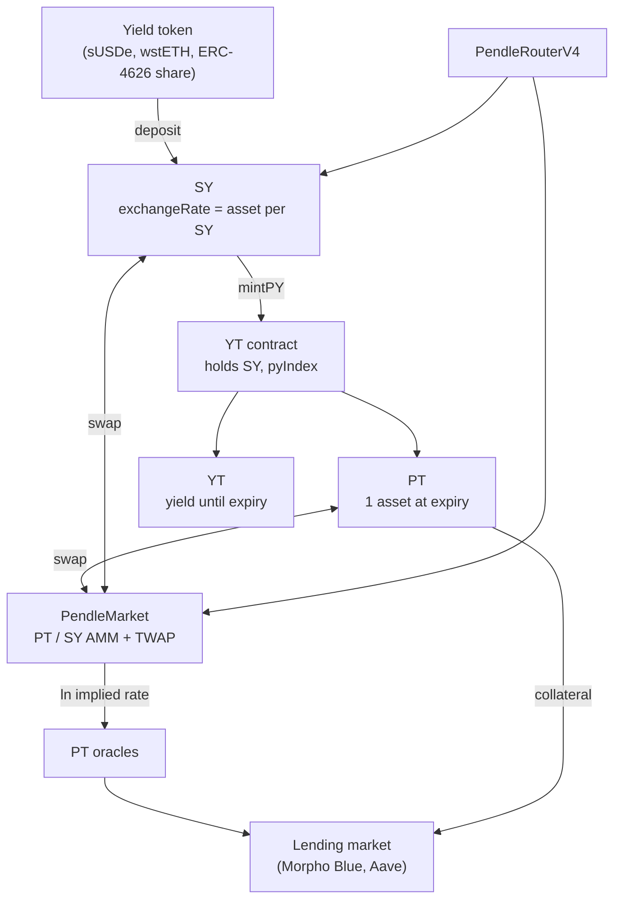
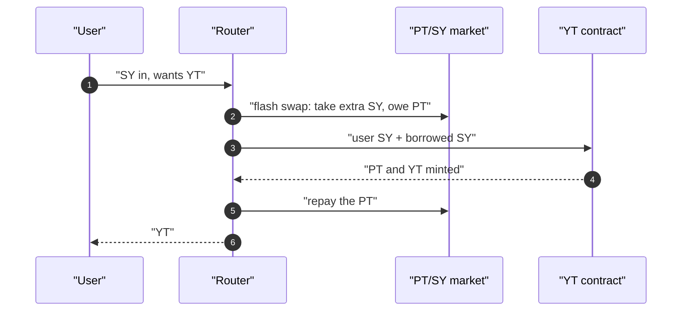
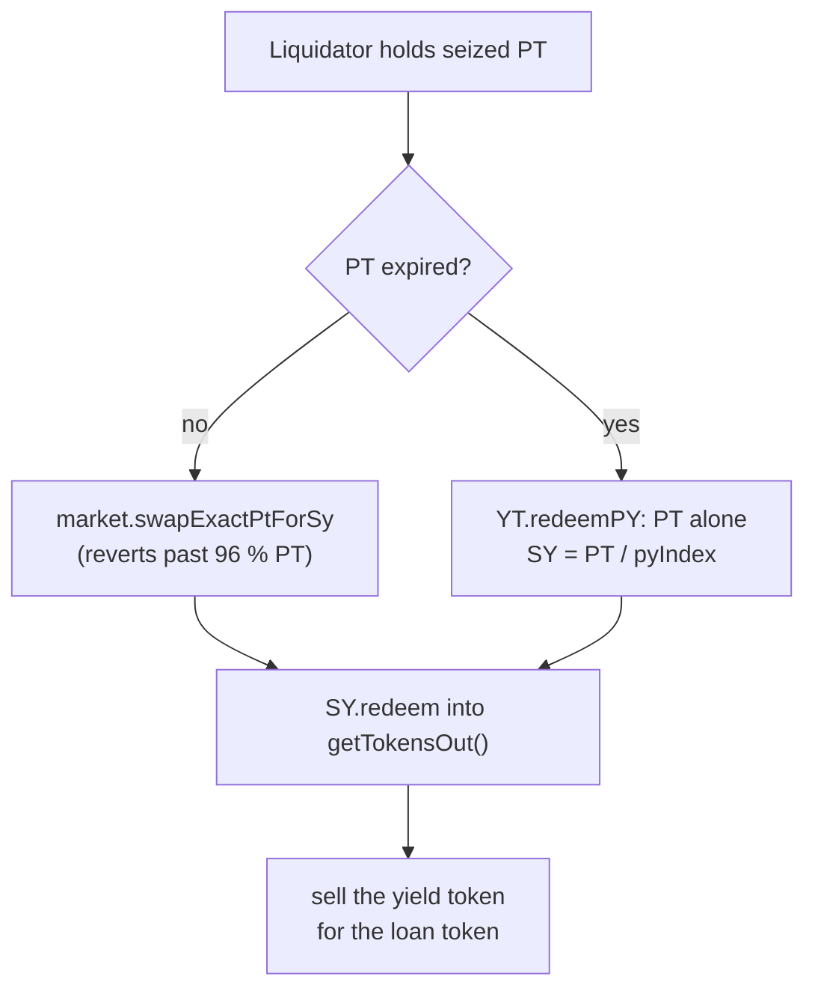

[Pendle](https://docs.pendle.finance/) is a yield-trading protocol on Ethereum and other EVM chains. It takes a yield-bearing token, such as Ethena's sUSDe or Lido's wstETH, and splits it into two tokens with a fixed maturity: a principal token (PT) that redeems for one unit of the underlying asset at expiry, and a yield token (YT) that collects all the yield until then. A PT bought below 1 is therefore a fixed-rate position, close to a zero-coupon bond, and that property is what made PTs common collateral on lending markets such as Morpho and Aave.

This article follows Pendle V2 through its contracts: the SY wrapper, the PT and YT split and its index, the PT/SY market and its logit curve with a worked numeric trade, the PT price before and after expiry, the two oracle designs, the router, and what a lender takes on when it accepts PT as collateral. The code is `pendle-core-v2-public` at v6.11.0, pinned under References.

> This article has been made with the help of [Claude Code](https://claude.com/product/claude-code) and several custom skills

[TOC]

## What you need to know first

The article assumes the reader knows tokens, DEXes and lending in general. A few mechanisms one level below are used without being derived:

- **Exchange-rate tokens.** A yield-bearing token such as an [ERC-4626](https://eips.ethereum.org/EIPS/eip-4626) vault share does not rebase; its value grows through an exchange rate, assets per share. Pendle's whole accounting is built on that rate.
- **Zero-coupon pricing and continuous compounding.** A claim to 1 unit at time $$\tau$$ years from now, discounted at a continuously compounded rate $$r$$, is worth $$e^{-r\tau}$$ today. Pendle stores rates as $$r = \ln(1 + \text{APY})$$, the "ln implied rate".
- **Automated market makers.** A pool prices a trade from its reserves through a curve; [Automated Market Makers (AMMs) - Overview]({{site.url_complet}}/2025/07/29/automated-market-makers-amm/) covers constant-product and StableSwap designs. Pendle's curve is a different one, built for a token whose fair price drifts toward 1.
- **TWAP oracles.** A pool can keep a running sum of a quantity over time, so that the average over any window is a difference of two sums divided by the window. Pendle adapts the [Uniswap V3 oracle](https://docs.uniswap.org/concepts/protocol/oracle) design to the log of the implied rate.
- **Flash swaps.** A pool that sends the output first, calls back the caller, and only then checks that the input arrived. Pendle uses this for every swap, and to trade YT without a YT pool.
- **Liquidation in an isolated lending market.** A borrower is liquidated when the oracle value of the collateral times the liquidation threshold falls below the debt; the liquidator repays debt and takes collateral with a bonus, which it then has to sell. [How Morpho Blue Works - Isolated Lending Markets, Shares, Liquidations and Bad Debt]({{site.url_complet}}/2026/10/10/morpho-blue-lending-markets/) describes this for Morpho Blue.

## Architecture: three layers behind interfaces

Pendle V2 has three layers of contracts that only talk through interfaces, plus a router on top:

- **SY (Standardized Yield)** wraps a yield-bearing token into one interface. For most SYs, 1 SY is 1 yield token, and `exchangeRate()` returns the amount of *asset* one SY is worth.
- **The YT contract** (`PendleYieldToken`) holds SY and mints PT and YT against it. PT and YT of one SY and one expiry form a pair, written PY in the code.
- **The market** (`PendleMarketV7`) is an AMM between PT and SY with an LP token and a built-in oracle. There is no YT pool: YT is traded through flash swaps on the PT/SY market.
- **The router** (`PendleRouterV4`, an EIP-2535 diamond proxy) bundles these steps into one call from any token.

### Units: asset, SY and the index

The word *asset* has a precise meaning here: it is what the yield token appreciates against, given by `SY.assetInfo()`. For SY-wstETH the asset is stETH; for SY-sUSDe it is USDe. The documentation notes that the asset address is a best estimate and may not exist on the chain. PT and YT carry the asset's decimals, SY the yield token's, and LP tokens 18; assets with fewer than 18 decimals get a `scaled18` wrapper. Every rate in the contracts is 1e18-scaled on raw units.

A PT is worth 1 asset at expiry, not 1 SY: at maturity it redeems for the amount of SY that is worth 1 asset. Pendle's documentation illustrates this with wstETH at 1.2 stETH and gives 0.8928 wstETH per PT-wstETH. The two figures do not match: at 1.2 the amount is $$1/1.2 = 0.8333$$ wstETH, and 0.8928 corresponds to a rate of 1.12.

## SY: the wrapper everything else uses

`IStandardizedYield` is a small interface: `deposit(receiver, tokenIn, amount, minSharesOut)` and `redeem(receiver, shares, tokenOut, minOut, burnFromInternalBalance)` wrap and unwrap, `exchangeRate()` gives the asset value of one SY, and `claimRewards` pays out non-compounding rewards, such as AURA or BAL for a Balancer LP. For an ERC-4626 vault the rate is the vault's `totalAssets / totalSupply` (`PendleERC4626SY.sol`).

Three properties of SY matter later, when PT is used as collateral:

- **The output token set is narrow.** `getTokensOut()` lists what SY can redeem into. `PendleSUSDESY` redeems to sUSDe only, so whoever unwinds PT-sUSDe ends with sUSDe and still has to exit Ethena's cooldown or sell on a DEX. SY-wstETH accepts ETH in but never pays ETH out.
- **SY is pausable.** `SYBaseUpgV2.pause()`, callable by the owner, makes every SY transfer revert, which freezes swaps on the market, `redeemPY` and SY redemptions for every PT built on it. Pendle's troubleshooting page says it pauses contracts when an integrated protocol is compromised.
- **Newer SYs are upgradeable proxies** behind Pendle's proxy admin, while markets are immutable.

`previewDeposit` and `previewRedeem` exist but are documented as best-effort and not audited for on-chain use.

## PT and YT: split, accrual and redemption

### The PY index

The YT contract keeps one number, the PY index:

$$
\begin{aligned}
\text{pyIndex} = \max\left(\text{SY.exchangeRate()},\ \text{pyIndexStored}\right)
\end{aligned}
$$

It never decreases. Minting sends SY in and returns $$\text{SY} \times \text{pyIndex}$$ PT **and** the same amount of YT, so one unit of PT and one unit of YT together are always backed by one unit of asset at the current index. Before expiry, `redeemPY` needs equal amounts of PT and YT and returns $$\text{PY} / \text{pyIndex}$$ SY.

### YT accrual

A YT holder earns the SY that one unit of asset frees as the index rises. When the index moves from $$I_0$$ to $$I_1$$, a balance $$B$$ of YT accrues (`InterestManagerYT._distributeInterestPrivate`):

$$
\begin{aligned}
\Delta\text{SY} = B \cdot \frac{I_1 - I_0}{I_0 \, I_1}
\end{aligned}
$$

With 1,000 YT and an index going from 1.200 to 1.212 (a 1 % rise), the holder accrues 8.2508 SY, which is worth exactly $$8.2508 \times 1.212 = 10.000$$ asset: 1 % of 1,000 asset of principal. The accrual is settled on every YT transfer, paid in SY by `redeemDueInterestAndRewards`, and the factory's `interestFeeRate` and `rewardFeeRate` are taken for the treasury on payout.

### Expiry and the treasury's share

At expiry, YT stops earning and is worth zero. The first interaction after expiry freezes the index as `firstPYIndex`. From then on, PT redeems alone, without YT, for $$\text{PT} / \text{pyIndexCurrent}$$ SY. The difference between what `firstPYIndex` would have paid and what the current index pays goes to `totalSyInterestForTreasury` (`_calcSyRedeemableFromPY`). In other words, **a PT held after expiry does not earn yield**: it is a fixed amount of asset, and the yield on the SY behind it belongs to Pendle's treasury until the holder redeems.

### Negative yield

If the SY's exchange rate falls below the stored index, the index stays where it was. Redemptions then return fewer SY per PY than the asset value implies, and YT stops accruing until the rate recovers. The documentation's example: a PT minted at index 1.20 that redeems when 1 SY is worth 1.15 asset returns 115 asset per 120 PT. The promise "1 PT = 1 asset" holds only while the SY stays solvent.

## The PT/SY market

The market is an AMM between PT and SY whose curve is defined on the *proportion of PT* in the pool rather than on the product of reserves. The model comes from Notional Finance's AMM, and the formulas below are read from `MarketMathCore.sol`.

### State and parameters

`MarketState` holds `totalPt`, `totalSy`, `totalLp`, the immutable `scalarRoot`, `expiry` and `lnFeeRateRoot`, a `reserveFeePercent` from the factory, and `lastLnImpliedRate`. The SY side is converted to asset with the index: $$A = \text{totalSy} \times \text{pyIndex}$$. Time to expiry $$\tau$$ is counted in years of 365 days. Market creation is permissionless (`createNewMarket(PT, scalarRoot, initialAnchor, lnFeeRateRoot)`), and the documentation caps `lnFeeRateRoot` at $$\ln 1.05 \approx 0.0488$$.

### The curve

For a trade that takes $$\Delta$$ PT out of the pool, a negative $$\Delta$$ when PT is sold in, the code computes:

$$
\begin{aligned}
s &= \frac{\text{scalarRoot}}{\tau} \\
p &= \frac{N - \Delta}{N + A} \\
E &= \frac{1}{s}\,\ln\frac{p}{1 - p} + a \\
\text{PT price in asset} &= \frac{1}{E}
\end{aligned}
$$

where $$N$$ is `totalPt`, $$s$$ is the rate scalar, $$a$$ the rate anchor and $$E$$ the exchange rate in PT per asset. The pool's implied rate is read from the same curve with $$\Delta = 0$$:

$$
\begin{aligned}
r &= \frac{\ln E}{\tau} \\
\text{implied APY} &= e^{r} - 1
\end{aligned}
$$

Three things in these formulas carry the design:

- **The logit term $$\ln\frac{p}{1-p}$$.** It is zero at an even pool and grows without bound as PT fills the pool. Liquidity is concentrated around the anchor; `scalarRoot` sets how concentrated. The docs describe a large `scalarRoot` as a tighter, more capital-efficient market with a narrower range of tradeable rates.
- **The rate scalar grows as expiry nears.** $$s$$ is `scalarRoot × 365 days / timeToExpiry`, so the same trade moves $$E$$ less and less. Combined with the next point, this is what pulls the price to 1.
- **The anchor is re-solved before every trade.** `_getRateAnchor` picks $$a$$ so that the pool's current proportion $$p_0$$ reproduces the last implied rate at today's $$\tau$$:

$$
\begin{aligned}
a = e^{r_{last}\,\tau} - \frac{1}{s}\,\ln\frac{p_0}{1 - p_0}
\end{aligned}
$$

So without any trade the implied rate stays constant, and the PT price drifts up deterministically as $$e^{-r\tau}$$.

The curve has two hard bounds. A trade that leaves more than 96 % PT in the pool reverts with `MarketProportionTooHigh` (`MAX_MARKET_PROPORTION`), and an exchange rate below 1 reverts with `MarketExchangeRateBelowOne`, so PT can never be bought above 1 asset and the implied rate cannot go negative. Leaving the rate range that `scalarRoot` and the anchor allow is what Pendle's troubleshooting page calls a market going **out of range**: selling PT, buying YT and market-order zaps out are disabled, limit orders still work, and since markets are immutable Pendle redeploys a wider pool.

### Fees on the rate

The fee is applied to the exchange rate rather than to the amount. With $$\phi$$ = `lnFeeRateRoot`, the fee factor is $$f = e^{\phi\tau}$$, so it shrinks with time to expiry. In `calcTrade`:

- **Buying PT** divides the exchange rate by $$f$$ (fewer PT per asset); the code checks that the post-fee rate is still at least 1. The buyer pays the pre-fee asset amount times $$f$$.
- **Selling PT** returns the pre-fee asset amount divided by $$f$$.

`reserveFeePercent` of the fee goes to the treasury in SY; the rest stays in the pool for LPs. A swap whose LP fee rounds to zero reverts with `MarketZeroNetLPFee`. The factory can set a lower fee for a given router on a given market (`setOverriddenFee`), which is how trades through the Pendle router pay less than direct pool calls.

### Swaps and liquidity

The market exposes only two primitive swaps, `swapExactPtForSy` and `swapSyForExactPt`, and both are flash swaps: the output is sent, `swapCallback` runs if data was passed, and the balance check comes last. The router solves every other exact-input trade by binary search over the PT amount, bounded by `ApproxParams`. LP `mint` is proportional to reserves, with 1,000 units locked on the first mint; `burn` is pro-rata and still works after expiry, while swaps and mints revert with `MarketExpired`.

YT is traded on the same pool:

Buying YT therefore sells PT into the pool, and selling YT buys PT from it. A large YT purchase moves the PT price down exactly like a large PT sale, which matters for any oracle that reads this pool.

### A worked trade

The parameters below are illustrative, chosen to make the steps visible; they are not read from a deployed market. Every figure was computed at full precision and is rounded only in the table.

| Input | Value |
|---|---|
| Time to expiry $$\tau$$ | 0.5 year (182.5 days) |
| `scalarRoot`, so $$s = 10 / 0.5$$ | 10, rate scalar 20 |
| `totalPt` $$N$$ | 1,500,000 PT |
| `totalSy`, `pyIndex` | 800,000 SY at 1.25 asset per SY, so $$A$$ = 1,000,000 asset |
| `lastLnImpliedRate` | $$\ln 1.10$$ (10 % implied APY) |
| `lnFeeRateRoot`, `reserveFeePercent` | 0.003, 80 |
| Trade | buy $$\Delta$$ = 10,000 PT |

The steps, in the order `executeTradeCore` takes them:

1. **Spot before the trade.** $$E_0 = e^{0.5 \ln 1.1} = \sqrt{1.1} = 1.048809$$, so PT trades at $$1/E_0 = 0.953463$$ asset.
2. **Anchor.** $$p_0 = 1{,}500{,}000 / 2{,}500{,}000 = 0.6$$, and $$a = 1.048809 - \ln(1.5)/20 = 1.028536$$.
3. **Trade rate.** The code evaluates the curve at the post-trade PT count over the *pre-trade* total: $$p = 1{,}490{,}000 / 2{,}500{,}000 = 0.596$$, so $$E = \ln(1{,}490{,}000/1{,}010{,}000)/20 + a = 1.047977$$. Before fees, 10,000 PT cost $$10{,}000 / 1.047977 = 9{,}542.20$$ asset.
4. **Fee.** $$f = e^{0.003 \times 0.5} = 1.001501$$. The buyer pays $$9{,}542.20 \times f = 9{,}556.52$$ asset, so the fee is 14.32 asset. The post-fee rate $$E/f = 1.046406$$ is above 1, so the trade is allowed.
5. **Settlement in SY.** 9,556.52 asset is 7,645.22 SY at 1.25 (rounded up in the code, `assetToSyUp`). Of the 14.32 asset fee, 80 % (11.46 asset, 9.17 SY) leaves the pool for the treasury, and 2.86 asset stays with the LPs.
6. **New state.** `totalPt` = 1,490,000 and `totalSy` = 807,636.05. With the same anchor, the new spot rate is $$E_1 = 1.047999$$: the PT spot price rises to 0.954199 and the stored implied APY falls from 10.00 % to 9.83 %.

The buyer paid 0.955652 asset per PT on average, 0.23 % above the pre-trade spot of 0.953463; the fee accounts for about 0.15 points of that.

Buying PT lowers the implied rate. The [PT-reUSD liquidations on Morpho]({{site.url_complet}}/2026/10/11/pt-reusd-morpho-liquidations-pendle-twap-replay/) were the mirror image: a large YT purchase sold PT into the pool and pushed the rate up.

## The PT price to expiry and after

If nobody trades, the anchor keeps the implied rate fixed and the PT price follows $$e^{-r\tau}$$. At a 10 % implied APY this gives 0.909091 one year out, 0.953463 at six months, 0.976454 at three months and 0.992089 at one month. Rate risk shrinks with $$\tau$$: a jump of the implied rate from 10 % to 20 % six months before expiry moves the price from 0.953463 to 0.912871, a 4.26 % fall. The same jump with one month left moves it from 0.992089 to 0.984921, a 0.72 % fall.

The left panel shows the three prices at the 182.5-day mark: 0.9535 for the market at 10 %, 0.9500 for a linear oracle at 10 %, and 0.9129 for the market after the rate jump, which a 10 % linear oracle would not see. The right panel shows the cost of not redeeming: at 8 % a year of SY yield (illustrative), 180 days after expiry the redeemed position is worth about 1.040 asset while the unredeemed PT is still worth 1.

The phases, with what each one does to a PT holder:

| Phase | Market | PT value |
|---|---|---|
| Long before expiry | swaps live; the rate scalar is small, so rate moves cost more price | $$e^{-r\tau}$$ asset |
| Approaching expiry | the rate scalar grows, price impact per unit traded falls; liquidity and incentives often leave | converges to 1 asset if the SY is solvent |
| At expiry | swaps and mints revert; LP `burn` still works | `redeemPY` returns $$1/\text{pyIndex}$$ SY per PT |
| After expiry | no AMM exit; the exit is `redeemPY` then `SY.redeem` into `getTokensOut()` (router `exitPostExpToToken`) | a fixed amount of asset, no further yield |

## Oracles: TWAP of the rate, or a linear discount

Pendle documents two ways to price a PT. Its oracle overview recommends the **linear-discount** oracle for money markets and keeps the **TWAP** oracle for integrations that need a market-derived price.

### The TWAP oracle

Each market stores observations in a ring buffer (`OracleLib.sol`, adapted from Uniswap V3): a timestamp and a cumulative sum of the ln implied rate over time. At most one observation is written per timestamp, accumulating the *previous* `lastLnImpliedRate` over the elapsed time, so a rate set in a block enters the sum only from the next block. Over a window of $$D$$ seconds:

$$
\begin{aligned}
\bar r &= \frac{C(t) - C(t - D)}{D} \\
\text{PT price in asset} &= e^{-\bar r\,\tau}
\end{aligned}
$$

`getPtToAssetRateRaw` returns exactly 1 after expiry. The average is taken over the **rate**, and converted to a price at today's $$\tau$$, so the TWAP price still converges to 1 at expiry whatever the rate did. `PendlePYOracleLib` (or the deployed `PendlePYLpOracle` at `0x5542be50420E88dd7D5B4a3D488FA6ED82F6DAc2`) adds the SY solvency check: if `SY.exchangeRate()` is below the stored PY index, `getPtToAssetRate` scales the price down by their ratio, and `getPtToSyRate` divides by the larger of the two.

Practical points from the integration guide and the code:

- **Cardinality starts at 1.** A window older than the oldest observation reverts with `OracleTargetTooOld`. Anyone can call `increaseObservationsCardinalityNext(n)`, and the integrator then waits `D` seconds. `getOracleState(market, duration)` reports readiness; the required cardinality is $$\lceil D \times 1000 / \text{blockCycleNumerator} \rceil + 1$$, with 11000 given as the Ethereum value in the code comments (83 slots for 900 s).
- **Recommended windows** are 900 s or 1800 s. A window of 0 returns the spot `lastLnImpliedRate`, which is manipulable within a block and should not price collateral.
- **Price to SY, not to asset.** Pendle guarantees PT to SY; SY to asset (sUSDe to USDe, ezETH to ETH) happens outside Pendle and may trade at a discount. The docs advise `getPtToSyRate` times the yield token's price over `getPtToAssetRate` times the asset's price.
- **`PendleChainlinkOracle`**, the wrapper with Chainlink's interface, reports `updatedAt = block.timestamp` and `roundId = 0`, so a staleness check on it tests nothing, and the answer's real precision is $$18 + \text{out} - \text{in}$$ decimals even though `decimals()` returns 18.

### The linear-discount oracle

`PendleSparkLinearDiscountOracle`, deployed through a factory at `0x34C91651A070664279866E5f3d6B4d5F65cbbFFb`, ignores the market entirely:

$$
\begin{aligned}
\text{answer} = 1 - d \cdot \max(\text{maturity} - \text{now},\ 0) / 365\ \text{days}
\end{aligned}
$$

It reads only `block.timestamp`, so it has no liveness or manipulation surface, and it reaches 1 at maturity. It is a discount factor in the PT's asset, not a USD price, and it sees neither a market move nor an SY depeg. Because $$1 - d\tau \le e^{-d\tau}$$, a discount equal to the market rate already prices slightly below the market: 0.9500 against 0.9535 at 10 % and six months.

Pendle's parameter guide advises choosing $$d$$ so that the oracle stays under the **lowest** price of the market's yield range until maturity, with 18 % as the example for PT-USDe-25SEP2025. If the market rate rises above $$d$$, through a stress, a depeg or LPs leaving, the oracle **overprices** the PT: in the jump to 20 % above, a 10 % oracle reads 0.9500 while the market pays 0.9129, 4.07 % less. Positions are then not liquidated while the collateral's sale value falls, and the liquidation bonus is spent on the gap. That is the cost of the liveness the design buys.

[Pricing Yield Collateral on Morpho - Huma's PST Exchange Rate and Ojo's Pendle PT Feed]({{site.url_complet}}/2026/10/11/huma-pst-ojo-pt-oracle-morpho-collateral-pricing/) looks at a third design, Ojo's feed, which takes the minimum of the TWAP and a linear discount.

## The router

`PendleRouterV4` lives at `0x888888888889758F76e7103c6CbF23ABbF58F946` on Ethereum. It is an upgradeable diamond whose full ABI is in `IPAllActionV3.sol` (explorers show only the proxy), and it holds no special permission on markets. Its functions fall into a few groups:

| Need | Functions |
|---|---|
| Buy or sell PT | `swapExactTokenForPt`, `swapExactSyForPt`, `swapExactPtForToken`, `swapExactPtForSy` |
| YT | `swapExactTokenForYt`, `swapExactYtForToken` |
| Liquidity | `addLiquiditySingleToken`, `removeLiquiditySingleToken` and dual variants |
| Mint and redeem | `mintPyFromToken`, `redeemPyToToken`, `exitPreExpToToken`, `exitPostExpToToken`, `exitPostExpToSy` |

`TokenInput` and `TokenOutput` carry a KyberSwap route for tokens the SY does not take directly, and `LimitOrderData` for fills from Pendle's off-chain limit-order book. Pendle recommends generating calldata with its hosted SDK (`POST /v3/sdk/{chainId}/convert`), whose aggregator quotes expire.

## PT as lending collateral

Pendle's own collateral guide lists three uses: leveraging the spread between the PT's fixed rate and the borrow rate, leveraging a short-yield view, and a leveraged long on the asset with fixed carry on top. Its example of the first: PT-stETH yields 5 %, ETH borrows at 3 %, and a collateral factor of 0.80 allows up to 5x, for at most $$5 \times (5 - 3) = 10$$ %.

On Morpho Blue, a PT market's oracle is a `MorphoChainlinkOracleV2` whose base feed is either the linear-discount oracle or the TWAP behind a `PendleChainlinkOracle`; Morpho's documentation lists a community adapter and factory for both. How that price enters a Morpho market's health check is covered in [Morpho Blue and Vault V2]({{site.url_complet}}/2026/11/16/morpho-blue-vault-v2/). Aave's PT price adapter is not in the sources read for this article.

The liquidator's side is short in code and long in consequences. `BoringPtSeller` branches on expiry:

Every arrow in that path is a dependency: the PT/SY pool's depth before expiry, the SY's output set, and the yield token's own exit through a cooldown or a DEX.

Pendle's sizing rule makes the first one checkable. With a deposit cap $$dCap$$, collateral factor $$c$$, share $$k$$ of loans liquidatable at once, close factor $$f$$ and bonus $$p$$, selling $$dCap \cdot c \cdot k \cdot f \cdot (1 + p)$$ worth of PT must cost less than $$p$$ in price impact. In the guide's Compound V2 example, with $$c = 0.70$$, $$k = 0.30$$, $$f = 0.5$$ and $$p = 0.08$$, that is $$0.1134 \cdot dCap$$. The guide also warns that sales lower the price and liquidate more loans, so a strict analysis takes $$k = 1$$.

The risks of PT collateral are collected in the Risks annex below.

## Conclusion

Pendle V2 turns a yield-bearing token into a fixed-maturity bond and a yield strip, and prices the bond with a curve built on the implied rate rather than on reserves.

- **SY** standardises the yield token behind `exchangeRate()`, with a narrow redemption set, an owner pause and, for newer SYs, an upgradeable proxy.
- **PT and YT** are minted against SY at a PY index that never decreases. YT accrues $$B(I_1 - I_0)/(I_0 I_1)$$ SY; after expiry the yield on unredeemed PT goes to the treasury.
- **The market** prices PT on the logit of the PT proportion, with a rate scalar that grows toward expiry and an anchor re-solved before each trade so that the implied rate persists. Fees are on the rate, and the pool refuses trades past 96 % PT or below a zero rate.
- **The worked trade** of 10,000 PT moved the implied APY from 10.00 % to 9.83 % and cost 0.23 % above spot, of which about 0.15 points was fee.
- **The two oracles** trade accuracy for liveness: the TWAP follows the market and can be moved by it, while the linear discount ignores the market and overprices PT when rates rise above its discount.
- **As collateral**, a PT depends on the pool's depth before expiry, the SY's exit after it, the solvency of the yield token, and Pendle's and the SY's admin keys.

## Annex

### Key Terms

| Term | Definition |
|------|------------|
| **Yield-bearing token** | A token whose value grows against an underlying asset through an exchange rate, such as wstETH against stETH or an ERC-4626 share. |
| **Asset** | What the SY's yield token appreciates against, given by `assetInfo()`; PT redeems for 1 asset at expiry. |
| **SY (Standardized Yield)** | Pendle's wrapper around a yield-bearing token, with `deposit`, `redeem` and `exchangeRate()` in asset per SY. |
| **PT (principal token)** | A claim to 1 asset at expiry, minted together with YT; before expiry it trades at a discount on the market. |
| **YT (yield token)** | A claim to the interest and rewards of 1 asset of principal until expiry; worth zero after. |
| **PY index** | `max(SY.exchangeRate(), pyIndexStored)`, the never-decreasing index at which PT and YT are minted and redeemed. |
| **Expiry (maturity)** | The timestamp after which swaps and mints revert, YT stops earning and PT redeems alone. |
| **Implied rate** | The fixed rate at which the market prices PT; stored as `lnImpliedRate` = ln(1 + APY). |
| **Exchange rate (market)** | $$E$$, the number of PT per asset on the curve; its inverse is the PT price. |
| **Rate scalar** | `scalarRoot × 365 days / timeToExpiry`, the factor that flattens the logit curve and grows toward expiry. |
| **scalarRoot** | An immutable market parameter that sets how concentrated liquidity is around the anchor. |
| **Rate anchor** | The curve's offset, re-solved before each trade so that the current pool reproduces the last implied rate. |
| **lnFeeRateRoot** | The market's fee parameter in log form; the fee factor is $$e^{\phi\tau}$$ and applies to the exchange rate. |
| **Out of range** | A market whose rate has left what its curve can trade: selling PT and buying YT revert, limit orders still work. |
| **Flash swap** | A swap that sends the output first and checks the input after a callback; Pendle uses it for every swap and for YT trades. |
| **TWAP oracle** | The market's ring buffer of cumulative ln implied rates, averaged over a window and converted to a PT price at today's time to expiry. |
| **Cardinality** | The number of observation slots a market keeps; it starts at 1 and must be raised before a TWAP window can be read. |
| **Linear-discount oracle** | A feed returning $$1 - d\tau$$ from the timestamp alone, without reading the market. |
| **Liquidation threshold (LLTV)** | The ratio of debt to oracle-valued collateral at which a lending position becomes liquidatable. |

### Invariants

| Invariant | Enforced by | Breaks if |
|-----------|-------------|-----------|
| The PY index never decreases. | `_pyIndexCurrent` takes the max of the SY rate and the stored index. | Never by design; a falling SY rate is absorbed by redeeming fewer SY, not by lowering the index. |
| One PT plus one YT are backed by one asset at the current index before expiry. | `mintPY` mints SY × pyIndex of each; `redeemPY` needs equal amounts. | The SY's exchange rate falls below the index: the backing in asset shrinks. |
| PT can never be bought above 1 asset in the pool. | `MarketExchangeRateBelowOne` on the pre- and post-fee rate. | Never by design; the market reverts instead. |
| The pool never holds more than 96 % PT after a trade. | `MAX_MARKET_PROPORTION` in `_getExchangeRate`. | Never by design; sales of PT revert past it. |
| No swap or mint happens after expiry. | `MarketExpired` in `executeTradeCore` and `mint`. | Never by design; only `burn` and redemptions work. |
| Without trades, the implied rate stays constant over time. | The anchor is re-solved from `lastLnImpliedRate` before each trade. | A trade, which moves `lastLnImpliedRate`. |

### Integration Notes

| Behaviour | What an integrator should do |
|-----------|------------------------------|
| `PendleChainlinkOracle.updatedAt` is always `block.timestamp`. | Do not treat it as freshness; check readiness with `getOracleState`. |
| The answer of a Chainlink-shaped Pendle feed has $$18 + \text{out} - \text{in}$$ real decimals. | Read the PT, SY and asset decimals before scaling the price. |
| A TWAP window older than the oldest observation reverts. | Raise cardinality first and wait the window length before reading. |
| `getPtToAssetRate` assumes the yield token redeems at its exchange rate. | Price to SY and multiply by the yield token's own price where possible. |
| Market swaps revert after expiry; `redeemPY` does not need YT then. | Branch the liquidation path on `PT.isExpired()`, as `BoringPtSeller` does. |
| `pyIndexCurrent()` is state-changing. | Use `pyIndexStored()` and `max(syIndex, stored)` in views. |
| `previewDeposit` and `previewRedeem` are not audited for on-chain use. | Call them with `eth_call` only. |

### Risks

The risks below are those a PT holder or a lender against PT carries. They start from Pendle's own collateral risk analysis (`Oracles/PTAsCollateral.md`) and add what the code shows. Points from this article's own reasoning are marked *(derived)*.

#### Smart contracts and transparency

- **Pendle core.** The core repository lists audits by Ackee, CMichel, Dedaub, Dingbats, 0xleastwood, WatchPug, ChainSecurity and Spearbit, and separate reviews of markets V6 and V7 and of the oracles. Pendle's collateral guide, written in 2023, reports no incident in Pendle contracts since June 2021. The audit PDFs were not read for this article.
- **Each SY separately.** Every PT sits on its own SY implementation, audited separately in `Pendle-SY-Public`. The SY is the part that is upgradeable and pausable, so its code and its admin matter as much as the core's.
- **Upgradeability, both sides.** Markets are immutable, so a market's maths cannot change under an LP or a lender, and a bug in it cannot be patched either. Newer SYs and the router are upgradeable: they can be fixed, and the proxy admin can replace their logic.

#### External dependencies

- **The yield token's issuer.** A PT is as good as the protocol behind its SY: Ethena for sUSDe, Lido for wstETH. A loss there reaches the PT through the SY rate.
- **The oracle composition.** A money market prices PT through Pendle's TWAP or a linear discount, and usually multiplies it by an external price for the asset or yield token, which brings that feed's own risks.
- **Aggregators.** Router routes through KyberSwap and the limit-order book are off-chain components; they affect execution, not the market's maths.

#### Depeg

- **PT = 1 asset only if the SY is solvent.** The PY index does not fall, so a drop in the SY rate passes to PT holders in full. The documentation's example returns 115 asset for 120 PT.
- **Asset versus yield token.** PT's asset, such as USDe or stETH, can itself trade away from its target, and the yield token can trade below its exchange rate (an exit queue, a cooldown). A feed priced in asset hides both.

#### Collateral and market risk

- **Rate risk scales with time to expiry.** A rate jump from 10 % to 20 % six months out moves the price 4.26 % (*derived*, from the worked figures). A lender's margin must cover the rate range, not only the asset's volatility.
- **Pool-driven moves.** Buying YT sells PT into the pool. A TWAP lags such a move and then follows it, which is what liquidated PT-reUSD loans on Morpho in August 2026.
- **Linear oracle gap.** With the rate above $$d$$, the oracle overprices the PT, and liquidations come late or not at all while the sale value falls.

#### Liquidity

- **One pool, thinning toward expiry.** Liquidators sell PT on one PT/SY market; LPs and incentives often leave as maturity nears. Pendle's sizing rule ($$0.1134 \cdot dCap$$ in its Compound example) is the test to run at the current depth.
- **Out of range.** Past 96 % PT, sells revert and only limit orders fill.
- **After expiry.** No AMM exit; the exit is `redeemPY` then `SY.redeem` into a narrow output set, then the yield token's own exit.

#### Centralisation and governance

- **Admin keys.** On Ethereum, `deployments/1-core.json` names a `proxyAdmin` (`0xA28c08f165116587D4F3E708743B4dEe155c5E64`), a `timelockController` (`0x68d8D192dF476bC01895E16b0ED3945673d777AC`) and a `timelockedProxyAdmin`. Their owners, thresholds and delays were not read on-chain for this article.
- **SY owner.** The SY owner can pause all transfers of an SY, freezing the market, redemptions and any liquidation path through it.
- **Fees.** The factory owner sets `reserveFeePercent`, the treasury and per-router fee overrides.

#### Loss sharing

- **No insurance layer in Pendle.** A loss in the SY passes pro rata to PT and YT holders through the index; there is no Pendle-level buffer described in the sources (*derived*).
- **Lenders.** A lender against PT takes the loss when liquidations fail to cover the debt, through the money market's own bad-debt rule.

#### Regulatory

- None found in the sources specific to Pendle's design; the regulatory profile follows the underlying yield token.

#### Summary

| Risk | Where it comes from | What the design does about it | What remains |
|------|---------------------|-------------------------------|--------------|
| SY insolvency | The yield token's issuer | The oracle library scales the price down when the SY rate is below the index | PT holders take the full loss |
| Rate jump | Market trading, YT buying | TWAP smooths over its window | The price still falls; a long window delays liquidations |
| Linear oracle gap | Rate above the discount $$d$$ | None, by design | Late liquidations, bonus eaten by the gap |
| Pool depth | One PT/SY pool, LPs leaving near expiry | Concentrated liquidity curve | Cascades, out-of-range sells revert |
| Post-expiry exit | No AMM after expiry | `redeemPY` without YT | Narrow SY output set, yield token exit |
| Pause and upgrade | SY owner, proxy admin | Timelocked proxy admin listed in deployments | Owner thresholds not verified here |
| Contract bugs | Core and SY code | Multiple audits, immutable markets | Each SY needs its own review |

## Frequently Asked Questions

**Q: Why is a PT worth 1 asset at expiry and not 1 SY?**

Because PT and YT are minted at the PY index: one SY at an index of 1.25 mints 1.25 PT and 1.25 YT. The PT side is a claim to the asset principal, the YT side to everything the SY earns on top. At expiry one PT redeems for $$1/\text{pyIndex}$$ SY, which is 1 asset at that index.

**Q: What does the rate anchor do, and why is it recomputed before each trade?**

The anchor is the offset of the curve. Before each trade, `_getRateAnchor` chooses it so that the pool's current PT proportion gives back the last stored implied rate at the current time to expiry. As a result, the passage of time alone does not move the implied rate; only trades do. Combined with the rate scalar growing as $$1/\tau$$, this makes the PT price drift up as $$e^{-r\tau}$$ when nobody trades.

**Q: How does buying YT affect the PT price, given that there is no YT pool?**

The router flash-swaps SY out of the PT/SY market, mints PT and YT from the user's SY plus the borrowed SY, repays the market in PT and hands the YT to the user. The market receives PT and gives SY, which is a PT sale. A large YT purchase therefore pushes the PT price down and the implied rate up, and a TWAP oracle on that market follows after its window.

**Q: In the worked trade, why did the buyer pay 0.23 % above spot, and how much of it was the fee?**

Two parts add up:

- **Price impact.** Before fees the trade rate was 1.047977 PT per asset against a spot of 1.048809, so 10,000 PT cost 9,542.20 asset instead of 9,534.63 at spot.
- **Fee.** The fee factor $$e^{0.003 \times 0.5}$$ multiplies the cost by 1.001501, adding 14.32 asset, about 0.15 % of the trade.

The total is 9,556.52 asset, 0.955652 per PT against a spot price of 0.953463.

**Q: A lending market prices PT-sUSDe with a linear-discount oracle at 10 % six months before expiry. The implied rate jumps to 20 %. What happens to the market's borrowers and lenders?**

The oracle still reads 0.9500 asset, while the PT now sells for 0.9129, 4.07 % less.

Borrowers near their threshold are not liquidated, because the oracle does not see the fall. If one is liquidated, the liquidator receives PT valued at 0.95 but sells it for 0.913, so the bonus must cover the gap before the liquidation is profitable. If it does not, liquidations stop and the lenders carry the difference as possible bad debt. A TWAP oracle would have moved toward 0.9129 within its window.

**Q: Why should an integrator price PT to SY rather than to asset?**

Pendle guarantees the conversion from PT to SY, but SY to asset happens outside Pendle: sUSDe to USDe goes through Ethena's cooldown or a DEX. `getPtToAssetRate` times the asset price assumes that conversion happens at the exchange rate. `getPtToSyRate` times the price of the yield token itself does not, so a discount on the yield token shows up in the collateral value.

## Gaps

The points below were not settled by the sources read for this article.

| Gap | Why it matters | What to read or verify |
|-----|----------------|------------------------|
| The AMM whitepaper was not read; the curve is described from `MarketMathCore.sol` only. | The interpretation of `scalarRoot` and the yield range rests on code and doc prose. | The V2 AMM whitepaper linked from `Contracts/PendleMarket.md`. |
| The worked trade uses illustrative `scalarRoot`, fee and reserve values, not a deployed market's. | Real markets may have very different price impact for the same size. | `readState(router)` on a live market, or the API's market data. |
| The Ethereum `blockCycleNumerator` of `PendlePYLpOracle` was not read on-chain; 11000 comes from a code comment. | A different value changes the cardinality a TWAP window needs. | `blockCycleNumerator()` at `0x5542be50420E88dd7D5B4a3D488FA6ED82F6DAc2`. |
| Owners, thresholds and delays of the proxy admin, timelock and SY owners were not read on-chain. | They decide who can pause or upgrade what a PT depends on. | `owner()` and `getMinDelay()` on the addresses in `deployments/1-core.json`. |
| Aave's PT price adapter is not covered by the sources. | An Aave PT listing may price differently from both oracles described here. | Aave governance proposals for PT listings. |
| Only the sUSDe and ERC-4626 SY implementations were read. | Output sets, caps and pause hooks differ per SY. | The specific SY under `Pendle-SY-Public/.../implementations/`. |
| The audit reports were listed, not read. | Known findings on markets V6/V7 and the oracles are not summarised. | `pendle-core-v2-public/audits/`. |
| The documentation's wstETH example gives 0.8928 wstETH per PT at a rate of 1.2, which would give 0.8333. | One of the two figures in the doc is wrong; the article quotes neither as fact. | `HighLevelArchitecture.md`, PT section. |
| The title of the planned Morpho Blue and Vault V2 article was not known when this one was written. | The link text under Related articles must match its title. | `_posts/2026-11-16-morpho-blue-vault-v2.md`. |

## References

### Analyzed source

- [pendle-finance/pendle-core-v2-public](https://github.com/pendle-finance/pendle-core-v2-public) — analyzed at commit [`87685c89d05087535e9b9647eeda0e3d297d1f06`](https://github.com/pendle-finance/pendle-core-v2-public/tree/87685c89d05087535e9b9647eeda0e3d297d1f06) (v6.11.0 in its changelog), 2026-11-16
- [pendle-finance/Pendle-SY-Public](https://github.com/pendle-finance/Pendle-SY-Public) — analyzed at commit [`73676d931102a369a978a713abfd0b48e3e34361`](https://github.com/pendle-finance/Pendle-SY-Public/tree/73676d931102a369a978a713abfd0b48e3e34361), 2026-11-16

### Documentation

- [Pendle V2 developer documentation](https://docs.pendle.finance/pendle-v2-dev/), read 2026-11-16
- [Pendle Oracle Overview](https://docs.pendle.finance/pendle-v2-dev/Oracles/OracleOverview)
- [PT as Collateral in a Money Market](https://docs.pendle.finance/pendle-v2-dev/Oracles/PTAsCollateral)
- [Linear Discount Oracle](https://docs.pendle.finance/pendle-v2-dev/Oracles/DeterministicOracles/LinearDiscountOracle) and [Choosing Linear Discount Parameters](https://docs.pendle.finance/pendle-v2-dev/Oracles/DeterministicOracles/ChoosingLinearDiscountParams)
- [How to Integrate PT and LP Oracle](https://docs.pendle.finance/pendle-v2-dev/Oracles/HowToIntegratePtAndLpOracle)
- [Pendle V2 AMM Whitepaper](https://github.com/pendle-finance/pendle-v2-resources/blob/main/whitepapers/V2_AMM.pdf) (cited, not read)
- [Spark forum, June 26 2025 proposed changes to Spark](https://forum.sky.money/t/june-26-2025-proposed-changes-to-spark-for-upcoming-spell/26663) (linear discount rates for PT listings; cited by Pendle, not read)
- [Uniswap V3 oracle concepts](https://docs.uniswap.org/concepts/protocol/oracle)
- [ERC-4626: Tokenized Vaults](https://eips.ethereum.org/EIPS/eip-4626)
- [Claude Code](https://claude.com/product/claude-code)

### Related articles

- [Automated Market Makers (AMMs) - Overview]({{site.url_complet}}/2025/07/29/automated-market-makers-amm/)
- [Morpho Blue and Vault V2]({{site.url_complet}}/2026/11/16/morpho-blue-vault-v2/)
- [How Morpho Blue Works - Isolated Lending Markets, Shares, Liquidations and Bad Debt]({{site.url_complet}}/2026/10/10/morpho-blue-lending-markets/)
- [The PT-reUSD Liquidations on Morpho - How a 320,000 SY Trade Liquidated 36M, Replayed from On-Chain State]({{site.url_complet}}/2026/10/11/pt-reusd-morpho-liquidations-pendle-twap-replay/)
- [Pricing Yield Collateral on Morpho - Huma's PST Exchange Rate and Ojo's Pendle PT Feed]({{site.url_complet}}/2026/10/11/huma-pst-ojo-pt-oracle-morpho-collateral-pricing/)
- [Risk of Ethena's USDe and sUSDe - Backing Venues, Depeg Priors and a Leveraged PT Position]({{site.url_complet}}/2026/10/11/ethena-usde-risk-backing-venues-leveraged-positions/)
